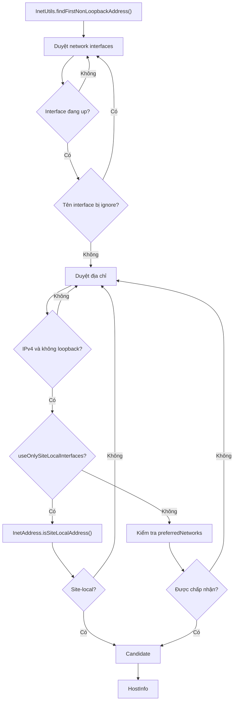

# Giới hạn địa chỉ nội bộ với useOnlySiteLocalInterfaces

Một máy chủ có thể đồng thời sở hữu nhiều địa chỉ IP: mạng ứng dụng, mạng quản trị, Docker bridge, VPN, mạng Wi-Fi và interface ảo. Khi Spring Cloud xác định địa chỉ host để công bố cho service discovery, ứng dụng có thể chọn nhầm một địa chỉ mà các service consumer không thể truy cập.

Spring Cloud Commons cung cấp thuộc tính **spring.cloud.inetutils.use-only-site-local-interfaces** để chỉ chấp nhận các địa chỉ mà Java phân loại là **site-local** trong bước tìm địa chỉ mạng. Với IPv4, phép phân loại này tương ứng các dải private được định nghĩa trong RFC 1918. Thuộc tính có thể giúp tránh quảng bá địa chỉ public khi ứng dụng cần giao tiếp trong mạng nội bộ.

Tuy nhiên, site-local là một quy tắc phân loại địa chỉ, không phải phép kiểm tra route hay khả năng kết nối. Nhiều interface cùng có địa chỉ RFC 1918 vẫn có thể được chấp nhận; địa chỉ Docker bridge cũng thuộc nhóm này. Ngoài ra, đường fallback của InetUtils có thể trả về địa chỉ local host khi không tìm thấy candidate phù hợp. Bài học sẽ làm rõ các giới hạn đó để cấu hình không tạo ra cảm giác an toàn giả.

Bài học thuộc chương **Định danh và mạng** của **SPRING_CLOUD_CORE**. Trọng tâm là cách Java xác định site-local address, cách Spring Cloud sử dụng phép kiểm tra này, cấu hình useOnlySiteLocalInterfaces, kết hợp với ignoredInterfaces, và xác minh địa chỉ thực tế được đưa vào Environment để service registration sử dụng.

## 1. Mục tiêu học tập

Sau bài này, người học có thể:

1. Giải thích khái niệm site-local và quan hệ với địa chỉ private IPv4.
2. Liệt kê ba dải IPv4 RFC 1918 được Java phân loại là site-local.
3. Phân biệt site-local với loopback, link-local, CGNAT shared address space và public address.
4. Cấu hình spring.cloud.inetutils.use-only-site-local-interfaces.
5. Mô tả cách InetUtils áp dụng InetAddress.isSiteLocalAddress().
6. Kết hợp site-local filter với ignored-interfaces.
7. Giải thích vì sao Docker bridge có thể vẫn được chọn.
8. Phân tích fallback khi không tìm thấy site-local candidate.
9. Phân biệt IP host được quảng bá với địa chỉ bind của web server và route mạng.
10. Kiểm thử predicate và xác minh host information trong môi trường triển khai.

## 2. Site-local address là gì?

Java định nghĩa site-local address là địa chỉ unicast dùng trong phạm vi một site, không cần global prefix. Phương thức InetAddress.isSiteLocalAddress() trả về true nếu địa chỉ được phân loại là site-local; nó không kiểm tra địa chỉ đó có thể được máy khác truy cập hay không.

Với IPv4, Java tham chiếu RFC 1918. RFC này dành riêng ba dải cho private internets:

| Dải | Prefix | Ví dụ | isSiteLocalAddress() |
| --- | --- | --- | --- |
| 10.0.0.0 – 10.255.255.255 | 10.0.0.0/8 | 10.24.8.15 | true |
| 172.16.0.0 – 172.31.255.255 | 172.16.0.0/12 | 172.20.4.10 | true |
| 192.168.0.0 – 192.168.255.255 | 192.168.0.0/16 | 192.168.1.20 | true |

Đây là ba dải IPv4 private được RFC 1918 quy định. Địa chỉ trong các dải này không có ý nghĩa duy nhất trên Internet toàn cầu; các tổ chức có thể dùng lại cùng dải trong những mạng riêng khác nhau. Vì vậy, một địa chỉ site-local chỉ hữu ích nếu consumer có route và quyền truy cập tới mạng chứa địa chỉ đó.

## 3. Phân biệt site-local với các loại địa chỉ khác

Tên “site-local” dễ bị hiểu thành “mọi địa chỉ nội bộ”. Trên thực tế, Java phân loại nhiều phạm vi địa chỉ bằng các phương thức riêng.

| Loại địa chỉ | Ví dụ/dải | Site-local IPv4? | Ý nghĩa |
| --- | --- | --- | --- |
| Private IPv4 RFC 1918 | 10/8, 172.16/12, 192.168/16 | Có | Dùng trong private internets |
| Loopback | 127.0.0.1 | Không | Quay về chính host |
| IPv4 link-local | 169.254.0.0/16 | Không | Dùng trên một link khi không có cấu hình địa chỉ phù hợp |
| CGNAT shared space | 100.64.0.0/10 | Không | Không gian địa chỉ dùng chung cho mạng nhà cung cấp dịch vụ |
| Public IPv4 | 8.8.8.8 | Không | Địa chỉ có thể được định tuyến toàn cầu theo chính sách mạng |
| IPv6 unique-local | fc00::/7 | Không nên coi là RFC 1918/site-local Java | Không gian địa chỉ cục bộ duy nhất của IPv6 |

### 3.1. Link-local không phải site-local

Địa chỉ IPv4 169.254.0.0/16 là link-local. Nó phục vụ giao tiếp trên cùng một link và không được định tuyến qua router theo cách thông thường. Java có phương thức riêng isLinkLocalAddress() để kiểm tra loại địa chỉ này.

useOnlySiteLocalInterfaces=true không có nghĩa “chấp nhận mọi IP không public”. Địa chỉ link-local không nằm trong ba dải RFC 1918 nên không qua site-local filter.

### 3.2. CGNAT shared address space không phải RFC 1918

Dải 100.64.0.0/10 được RFC 6598 dành cho shared address space trong mạng nhà cung cấp dịch vụ. Nó có thể xuất hiện trên interface của hạ tầng cloud, ISP hoặc mạng overlay, nhưng không phải một trong ba dải RFC 1918.

Vì vậy, địa chỉ 100.64.10.20 không được Java phân loại là site-local IPv4. Nếu hạ tầng của bạn sử dụng dải này cho mạng ứng dụng, bật useOnlySiteLocalInterfaces có thể loại địa chỉ đó khỏi bước chọn candidate.

### 3.3. Site-local IPv6 là khái niệm lịch sử

Java API có isSiteLocalAddress() cho Inet6Address. Phạm vi IPv6 site-local lịch sử là FEC0::/10, nhưng RFC 3879 đã chính thức deprecated prefix này. IPv6 Unique Local Address fc00::/7 là một loại địa chỉ riêng; không nên đánh đồng ULA với site-local IPv4 RFC 1918.

Trong implementation InetUtils hiện hành, vòng lặp chọn địa chỉ interface kiểm tra address instanceof Inet4Address. Vì vậy, dù Java có API phân loại site-local IPv6, không nên giả định cấu hình useOnlySiteLocalInterfaces sẽ khiến đường chọn interface của InetUtils tự chọn IPv6 ULA hoặc IPv6 site-local. Hãy kiểm tra đúng release train và discovery provider nếu hệ thống triển khai IPv6.

## 4. Thuộc tính useOnlySiteLocalInterfaces

Spring Cloud Commons cung cấp thuộc tính:

```yaml
spring:
  cloud:
    inetutils:
      use-only-site-local-interfaces: true
```

Tên property canonical dùng kebab-case. Một số ví dụ cũ viết camelCase useOnlySiteLocalInterfaces; Spring Boot relaxed binding có thể ánh xạ dạng tên này, nhưng nên thống nhất canonical property trong cấu hình mới.

Thuộc tính có mặc định là false. Khi bật, InetUtils kiểm tra mỗi địa chỉ IPv4 candidate bằng InetAddress.isSiteLocalAddress(). Địa chỉ chỉ được chấp nhận nếu phép kiểm tra trả về true.

Cấu hình này hữu ích khi:

- Ứng dụng chạy trên máy có cả địa chỉ public và private.
- Service registration phải công bố địa chỉ private có thể truy cập trong cụm.
- Máy ảo có interface public dành cho quản trị nhưng service-to-service traffic đi qua private subnet.
- Môi trường triển khai đã thống nhất dùng RFC 1918 cho mạng ứng dụng.

Nó không thay đổi địa chỉ trên network interface và không cấu hình firewall, route hoặc security group.

## 5. InetUtils áp dụng site-local filter như thế nào?

### 5.1. Luồng chọn địa chỉ

Trong implementation Spring Cloud Commons hiện hành, InetUtils.findFirstNonLoopbackAddress() duyệt các network interface mà JVM nhìn thấy. Đường xử lý chính có thể tóm tắt như sau:

1. Lấy danh sách network interface từ NetworkInterface.getNetworkInterfaces().
2. Bỏ interface không ở trạng thái up.
3. Bỏ interface có display name khớp ignored-interfaces.
4. Duyệt các địa chỉ trên interface.
5. Chỉ xét Inet4Address trong đường chọn candidate hiện hành.
6. Bỏ địa chỉ loopback.
7. Gọi isPreferredAddress(address).
8. Nếu useOnlySiteLocalInterfaces=true, isPreferredAddress trả trực tiếp kết quả address.isSiteLocalAddress().
9. Nếu tìm được candidate, tạo HostInfo từ địa chỉ đó.

Sơ đồ:



Cách chọn candidate còn phụ thuộc trạng thái interface và thứ tự/index interface trong implementation. Không nên giả định thuộc tính site-local chọn một interface cụ thể chỉ dựa trên tên mạng hoặc thứ tự trong file cấu hình.

### 5.2. useOnlySiteLocalInterfaces thay thế kiểm tra preferredNetworks

Đây là chi tiết quan trọng khi kết hợp hai thuộc tính. Trong InetUtils.isPreferredAddress(), nếu useOnlySiteLocalInterfaces bật, implementation trả kết quả của address.isSiteLocalAddress() ngay. Danh sách preferredNetworks không được áp dụng tiếp như một bộ lọc thứ hai.

Ví dụ:

```yaml
spring:
  cloud:
    inetutils:
      use-only-site-local-interfaces: true
      preferred-networks:
        - "10.24."
```

Cấu hình trên không có nghĩa “chỉ chấp nhận site-local thuộc prefix 10.24.”. Khi cờ site-local bật, mọi địa chỉ site-local phù hợp đều có thể được chấp nhận, chẳng hạn 10.24.8.15, 172.17.0.1 hoặc 192.168.1.20.

Nếu cần giới hạn vào một subnet hoặc prefix cụ thể, hãy tắt use-only-site-local-interfaces và cấu hình preferred-networks theo mục tiêu. Xem thêm tài liệu về preferredNetworks để hiểu cách viết Java regular expression và prefix.

## 6. Vì sao Docker bridge vẫn có thể được chọn?

Docker bridge thường dùng địa chỉ trong dải 172.16.0.0/12, ví dụ 172.17.0.1. Địa chỉ này thuộc RFC 1918, nên Java phân loại nó là site-local.

Giả sử máy/container có các interface:

| Interface | Địa chỉ | Site-local? |
| --- | --- | --- |
| lo | 127.0.0.1 | Không |
| docker0 | 172.17.0.1 | Có |
| eth0 | 10.24.8.15 | Có |
| wlan0 | 192.168.1.25 | Có |

Nếu chỉ bật use-only-site-local-interfaces, cả ba địa chỉ private đều là candidate. Thuộc tính này không biết eth0 là mạng ứng dụng và docker0 là bridge không muốn quảng bá.

Có thể loại interface ảo theo tên:

```yaml
spring:
  cloud:
    inetutils:
      use-only-site-local-interfaces: true
      ignored-interfaces:
        - "docker0"
        - "veth.*"
```

ignored-interfaces kiểm tra display name của interface theo Java regular expression. Cấu hình này loại docker0 và các interface có tên khớp pattern veth.*, sau đó site-local filter tiếp tục xét địa chỉ trên các interface còn lại.

Nếu máy có nhiều interface RFC 1918 hợp lệ mà tên interface thay đổi giữa các node, chỉ bật site-local không đủ để chọn đúng mạng. Hãy kiểm tra cấu trúc interface thực tế hoặc dùng cấu hình preferred network cụ thể phù hợp với địa chỉ triển khai.

## 7. Giới hạn quan trọng: fallback không bị site-local filter kiểm tra lại

Tên thuộc tính dễ khiến người vận hành nghĩ rằng địa chỉ cuối cùng InetUtils trả về luôn là site-local. Nhưng trong source hiện hành, useOnlySiteLocalInterfaces được áp dụng khi kiểm tra địa chỉ trong vòng lặp interface.

Nếu không tìm thấy candidate, findFirstNonLoopbackAddress() tiếp tục gọi InetAddress.getLocalHost(). Địa chỉ fallback này được trả về trực tiếp; nó không được đưa qua isPreferredAddress() lần nữa.

Nếu InetAddress.getLocalHost() cũng thất bại, findFirstNonLoopbackHostInfo() dùng giá trị mặc định:

| Property | Mặc định |
| --- | --- |
| spring.cloud.inetutils.default-hostname | localhost |
| spring.cloud.inetutils.default-ip-address | 127.0.0.1 |

Do đó, có thể xảy ra các tình huống:

- Không có interface IPv4 site-local phù hợp nhưng local host resolution trả về một địa chỉ khác.
- Hostname local được resolve về loopback.
- Không thể resolve local host nên InetUtils dùng 127.0.0.1.
- Registry nhận được địa chỉ fallback mà các service khác không thể truy cập.

Nếu yêu cầu vận hành là “không bao giờ đăng ký địa chỉ ngoài subnet ứng dụng”, hãy kiểm tra kết quả cuối cùng trước khi registration hoàn tất hoặc dùng cấu hình host/IP riêng của discovery provider. Không dựa duy nhất vào useOnlySiteLocalInterfaces để bảo đảm invariant đó.

## 8. Cấu hình theo từng môi trường

### 8.1. Máy ảo hoặc máy chủ có private subnet

Nếu service-to-service traffic chỉ dùng private IPv4 RFC 1918, có thể cấu hình:

```yaml
spring:
  cloud:
    inetutils:
      use-only-site-local-interfaces: true
      ignored-interfaces:
        - "lo"
        - "docker0"
        - "veth.*"
```

Loopback vốn được loại trong vòng chọn candidate của InetUtils; khai báo lo trong ignore list có thể giúp ý định cấu hình rõ ràng hơn nhưng không phải điều kiện bắt buộc.

### 8.2. Kubernetes dùng Pod CIDR RFC 1918

Nếu Pod IP thuộc 10.0.0.0/8 hoặc 172.16.0.0/12, site-local filter có thể phù hợp:

```yaml
spring:
  cloud:
    inetutils:
      use-only-site-local-interfaces: true
```

Hãy xác minh địa chỉ thực tế bên trong pod và bản ghi ServiceInstance trong registry. Mạng CNI có thể có interface phụ hoặc địa chỉ overlay khác; không giả định tất cả node đều có cùng topology.

### 8.3. Hạ tầng dùng CGNAT hoặc dải không thuộc RFC 1918

Nếu CNI hoặc mạng ứng dụng sử dụng 100.64.0.0/10, site-local filter sẽ loại địa chỉ đó. Bật thuộc tính mà không kiểm tra CIDR có thể khiến InetUtils chuyển sang fallback.

Trong trường hợp này, cần chọn chính sách địa chỉ phù hợp với hạ tầng: cấu hình preferred network cụ thể, dùng thuộc tính host/IP riêng của provider hoặc tùy biến cách đăng ký. Hãy xác nhận release train và discovery implementation trước khi áp dụng.

## 9. Site-local không có nghĩa là có thể kết nối

Một địa chỉ 10.24.8.15 có thể là site-local, nhưng điều đó không chứng minh:

- Consumer có route đến subnet 10.24.8.0/24.
- Network policy cho phép kết nối đến port của service.
- Security group hoặc firewall cho phép traffic.
- Địa chỉ thuộc network namespace mà consumer có thể nhìn thấy.
- Service đang bind trên đúng interface.
- Registry đang công bố port và scheme đúng.

Cần phân biệt:

| Thành phần | Vai trò |
| --- | --- |
| use-only-site-local-interfaces | Lọc địa chỉ host candidate theo phân loại Java |
| ignored-interfaces | Loại interface theo display name |
| preferred-networks | Chọn địa chỉ theo Java regex/prefix |
| server.address | Chọn địa chỉ bind của embedded web server |
| Routing table / CNI | Quyết định đường đi của packet |
| Firewall / NetworkPolicy | Kiểm soát traffic được phép |
| Service Registry | Lưu địa chỉ instance mà consumer tra cứu |

useOnlySiteLocalInterfaces không phải tính năng bảo mật và không thay thế network policy.

## 10. Host information được đưa vào Environment ra sao?

Spring Cloud Commons có HostInfoEnvironmentPostProcessor. Trong quá trình khởi động, processor bind spring.cloud.inetutils.* từ Environment, tạo InetUtils, tìm HostInfo rồi đưa hai key sau vào Environment:

- spring.cloud.client.hostname
- spring.cloud.client.ip-address

Discovery client hoặc service registration implementation có thể sử dụng các key chung này làm thông tin host mặc định. Provider cụ thể vẫn có thể có thuộc tính riêng để ghi đè hostname hoặc IP.

Trong source hiện hành, HostInfoEnvironmentPostProcessor chạy sau ConfigDataEnvironmentPostProcessor. Điều đó cho phép các property đã được nạp trong Config Data tham gia quá trình xác định host information. Với bootstrap mode hoặc release train khác, hãy kiểm tra thứ tự processor theo phiên bản ứng dụng.

Nếu registry hiển thị địa chỉ khác với spring.cloud.client.ip-address, hãy kiểm tra registration object và thuộc tính riêng của provider trước khi kết luận site-local filter không hoạt động.

## 11. Chẩn đoán địa chỉ được chọn

### 11.1. Liệt kê interface trong môi trường chạy thật

Trên Linux host/container có công cụ mạng:

```bash
ip -brief address
ip route
```

Lệnh cần chạy bên trong đúng container hoặc pod. Network namespace của container có thể nhìn thấy interface và IP khác với host machine.

### 11.2. Kiểm tra site-local bằng Java

Có thể kiểm tra một địa chỉ cụ thể:

```java
InetAddress address = InetAddress.getByName("10.24.8.15");

System.out.println(address.isSiteLocalAddress());
System.out.println(address.isLoopbackAddress());
System.out.println(address.isLinkLocalAddress());
```

Các phương thức trả lời những câu hỏi khác nhau. Không thay thế isSiteLocalAddress() bằng !isLoopbackAddress() vì link-local, public và CGNAT cũng có thể không phải loopback.

### 11.3. Log host information từ Environment

Ví dụ một runner đơn giản:

```java
@Component
class HostInfoLogger implements ApplicationRunner {

    private final Environment environment;

    HostInfoLogger(Environment environment) {
        this.environment = environment;
    }

    @Override
    public void run(ApplicationArguments args) {
        String ip = environment.getProperty(
            "spring.cloud.client.ip-address", "unknown"
        );
        String hostname = environment.getProperty(
            "spring.cloud.client.hostname", "unknown"
        );

        log.info("Spring Cloud host info: ip={}, hostname={}",
            ip, hostname);
    }
}
```

Cần khai báo logger và import phù hợp. Chỉ log hostname/IP cần thiết; không in toàn bộ Environment vì có thể chứa secret.

### 11.4. Kiểm tra registration record

Sau khi biết giá trị Environment, hãy kiểm tra địa chỉ mà provider thực sự đăng ký:

1. Xem spring.cloud.client.ip-address.
2. Xem thuộc tính hostname/IP riêng của Eureka, Consul hoặc provider đang dùng.
3. Kiểm tra Registration object trước khi gửi.
4. Kiểm tra bản ghi instance trong registry.
5. Thử kết nối từ một consumer thuộc mạng thực tế đến địa chỉ và port được quảng bá.

Nếu Environment đúng nhưng registry sai, nguyên nhân có thể nằm ở provider-specific override hoặc registration customization.

## 12. Kiểm thử site-local filter

Có thể kiểm tra predicate bằng unit test trong cùng package với InetUtils, vì isPreferredAddress là phương thức package-private trong implementation hiện hành.

### 12.1. Kiểm thử các dải IPv4

```java
class SiteLocalAddressTests {

    @Test
    void acceptsRfc1918Addresses() throws Exception {
        InetUtilsProperties properties = new InetUtilsProperties();
        properties.setUseOnlySiteLocalInterfaces(true);

        try (InetUtils inetUtils = new InetUtils(properties)) {
            assertThat(inetUtils.isPreferredAddress(
                InetAddress.getByName("10.24.8.15")
            )).isTrue();

            assertThat(inetUtils.isPreferredAddress(
                InetAddress.getByName("172.16.4.10")
            )).isTrue();

            assertThat(inetUtils.isPreferredAddress(
                InetAddress.getByName("192.168.1.20")
            )).isTrue();
        }
    }
}
```

### 12.2. Kiểm thử địa chỉ ngoài RFC 1918

```java
@Test
void rejectsLoopbackLinkLocalCgnatAndPublicAddresses() throws Exception {
    InetUtilsProperties properties = new InetUtilsProperties();
    properties.setUseOnlySiteLocalInterfaces(true);

    try (InetUtils inetUtils = new InetUtils(properties)) {
        assertThat(inetUtils.isPreferredAddress(
            InetAddress.getByName("127.0.0.1")
        )).isFalse();

        assertThat(inetUtils.isPreferredAddress(
            InetAddress.getByName("169.254.10.20")
        )).isFalse();

        assertThat(inetUtils.isPreferredAddress(
            InetAddress.getByName("100.64.10.20")
        )).isFalse();

        assertThat(inetUtils.isPreferredAddress(
            InetAddress.getByName("8.8.8.8")
        )).isFalse();
    }
}
```

Test này kiểm tra predicate. Trong đường chọn interface, loopback còn bị loại trước khi gọi predicate; giữ assertion ở đây giúp xác nhận rõ hành vi phân loại của Java.

### 12.3. Kiểm thử ranh giới dải 172.16/12

Dải RFC 1918 thứ hai chỉ bao gồm 172.16.0.0 đến 172.31.255.255. Không phải toàn bộ 172.0.0.0/8 đều site-local.

```java
@Test
void checks172RangeBoundaries() throws Exception {
    InetUtilsProperties properties = new InetUtilsProperties();
    properties.setUseOnlySiteLocalInterfaces(true);

    try (InetUtils inetUtils = new InetUtils(properties)) {
        assertThat(inetUtils.isPreferredAddress(
            InetAddress.getByName("172.16.0.1")
        )).isTrue();

        assertThat(inetUtils.isPreferredAddress(
            InetAddress.getByName("172.31.255.254")
        )).isTrue();

        assertThat(inetUtils.isPreferredAddress(
            InetAddress.getByName("172.32.0.1")
        )).isFalse();
    }
}
```

### 12.4. Unit test chưa kiểm chứng fallback

Các test trên chỉ kiểm tra isPreferredAddress(). Chúng không chứng minh địa chỉ cuối cùng của findFirstNonLoopbackAddress() luôn site-local.

Để kiểm tra end-to-end, cần môi trường mạng được kiểm soát:

- Tạo interface có địa chỉ site-local.
- Tạo interface phụ có địa chỉ không site-local.
- Kiểm tra ignored-interfaces và trạng thái interface.
- Thử tình huống không có site-local candidate.
- Quan sát địa chỉ mà InetAddress.getLocalHost() trả về.
- Xác nhận HostInfo cuối cùng và registration record.

Có thể dùng container hoặc network namespace trong integration test. Tránh phụ thuộc vào interface của máy CI vì chúng thay đổi theo runner.

## 13. Các lỗi thường gặp

| Triệu chứng | Nguyên nhân có thể | Hướng xử lý |
| --- | --- | --- |
| Registry quảng bá 172.17.0.1 | Docker bridge thuộc RFC 1918 nên site-local filter chấp nhận | Thêm docker0 vào ignored-interfaces |
| Không chọn được Pod IP 100.64.x.x | Dải CGNAT không thuộc RFC 1918 | Dùng preferred pattern hoặc cấu hình provider phù hợp |
| Vẫn thấy IP không site-local | Không có candidate và InetUtils fallback sang InetAddress.getLocalHost() | Kiểm tra fallback và xác minh HostInfo cuối cùng |
| Registry hiển thị 127.0.0.1 | Fallback/default IP được dùng | Kiểm tra interface, DNS/local host và cấu hình mạng |
| Muốn site-local trong một subnet cụ thể nhưng vẫn nhận subnet khác | useOnlySiteLocalInterfaces không kết hợp preferredNetworks thành AND | Tắt site-local filter và cấu hình preferred pattern cụ thể |
| IP trong Environment khác IP registry | Provider-specific host/IP override | Kiểm tra Registration object và config của provider |
| Service không truy cập được IP được quảng bá | Địa chỉ site-local không có route từ consumer hoặc port bị chặn | Kiểm tra CNI, routing, firewall, NetworkPolicy và port |
| Chỉ có IPv6 nhưng không chọn được địa chỉ mong muốn | Đường chọn candidate hiện hành của InetUtils kiểm tra Inet4Address | Kiểm tra hỗ trợ IPv6 của release train/provider và cấu hình host riêng |

## 14. Quy trình lựa chọn cấu hình

Trước khi bật use-only-site-local-interfaces, hãy trả lời:

1. Các service consumer có truy cập được mạng RFC 1918 của instance không?
2. Môi trường có dùng CGNAT shared space hoặc một CIDR ngoài RFC 1918 không?
3. Có nhiều interface private cùng tồn tại không?
4. Docker bridge hoặc virtual interface có thể được chọn không?
5. ignored-interfaces có thể loại các interface không mong muốn không?
6. Có cần giới hạn vào một subnet cụ thể thay vì mọi RFC 1918 không?
7. Có thể xảy ra fallback sang InetAddress.getLocalHost() không?
8. Discovery provider có cấu hình hostname/IP riêng không?
9. Có integration test xác minh IP cuối cùng trong registry không?
10. Consumer có route và quyền kết nối đến địa chỉ được quảng bá không?

Chỉ bật thuộc tính khi dải địa chỉ của hạ tầng phù hợp với cách Java phân loại site-local và đã kiểm tra các interface phụ.

## 15. Bài tập áp dụng

### Bài tập 1. Phân loại địa chỉ

Cho các địa chỉ:

- 10.24.8.15
- 172.17.0.1
- 172.32.0.1
- 192.168.1.20
- 169.254.10.20
- 100.64.10.20
- 8.8.8.8

Hãy xác định địa chỉ nào được InetAddress.isSiteLocalAddress() chấp nhận và giải thích theo RFC 1918/RFC 6598.

### Bài tập 2. Docker bridge được chọn

Một host có docker0=172.17.0.1 và eth0=10.24.8.15. Sau khi bật useOnlySiteLocalInterfaces, registry vẫn hiển thị 172.17.0.1.

Hãy giải thích nguyên nhân và viết cấu hình loại Docker bridge. Nêu vì sao site-local filter không thể tự biết interface nào là mạng ứng dụng.

### Bài tập 3. Mạng ứng dụng dùng 100.64/10

Một nền tảng sử dụng 100.64.12.10 làm địa chỉ nội bộ của service. Sau khi bật site-local filter, InetUtils không chọn địa chỉ này.

Hãy giải thích mối quan hệ giữa RFC 6598 và RFC 1918, rồi đề xuất chính sách lựa chọn địa chỉ phù hợp.

### Bài tập 4. Không có candidate site-local

Một container chỉ có địa chỉ public IPv4. useOnlySiteLocalInterfaces=true được bật, nhưng registry vẫn hiển thị một địa chỉ.

Hãy mô tả đường fallback trong InetUtils và giải thích vì sao cần kiểm tra InetAddress.getLocalHost() cùng HostInfo cuối cùng.

### Bài tập 5. Kiểm thử integration

Thiết kế một integration test trong container có hai interface: một RFC 1918 và một public/non-site-local. Xác nhận interface được chọn, trường hợp interface bị ignore và trường hợp không có candidate phù hợp.

## 16. Câu hỏi tự kiểm tra

1. useOnlySiteLocalInterfaces sử dụng phương thức Java nào?
2. Ba dải IPv4 RFC 1918 là gì?
3. Vì sao 169.254.0.0/16 không được xem là site-local?
4. Vì sao 100.64.0.0/10 không qua site-local filter?
5. Vì sao Docker bridge 172.17.0.1 vẫn có thể được chấp nhận?
6. ignored-interfaces bổ sung điều gì cho site-local filter?
7. useOnlySiteLocalInterfaces tương tác với preferredNetworks ra sao?
8. Vì sao fallback InetAddress.getLocalHost() có thể trả về địa chỉ không site-local?
9. spring.cloud.client.ip-address được đưa vào Environment bởi thành phần nào?
10. Vì sao một địa chỉ site-local vẫn có thể không truy cập được từ consumer?
11. Site-local IPv6 FEC0::/10 có vai trò gì trong thiết kế IPv6 hiện đại?
12. Làm sao xác minh địa chỉ cuối cùng được ghi trong service registry?

## 17. Nguồn tham chiếu

- [Spring Cloud Commons Reference — Ignore Network Interfaces](https://docs.spring.io/spring-cloud-commons/reference/spring-cloud-commons/common-abstractions.html#ignore-network-interfaces): cách cấu hình ignoredInterfaces, preferredNetworks và useOnlySiteLocalInterfaces.
- [Spring Cloud Commons — Configuration Properties](https://docs.spring.io/spring-cloud-commons/reference/configprops.html): kiểu dữ liệu, giá trị mặc định và mô tả spring.cloud.inetutils.use-only-site-local-interfaces.
- [InetUtils.java — Spring Cloud Commons source](https://github.com/spring-cloud/spring-cloud-commons/blob/main/spring-cloud-commons/src/main/java/org/springframework/cloud/commons/util/InetUtils.java): cách duyệt interface, áp dụng site-local predicate và fallback InetAddress.getLocalHost().
- [HostInfoEnvironmentPostProcessor.java — Spring Cloud Commons source](https://github.com/spring-cloud/spring-cloud-commons/blob/main/spring-cloud-commons/src/main/java/org/springframework/cloud/client/HostInfoEnvironmentPostProcessor.java): cách đưa hostname/IP được chọn vào Environment.
- [Java SE — InetAddress](https://docs.oracle.com/en/java/javase/21/docs/api/java.base/java/net/InetAddress.html): định nghĩa API isSiteLocalAddress(), isLinkLocalAddress() và isLoopbackAddress().
- [RFC 1918 — Address Allocation for Private Internets](https://www.rfc-editor.org/rfc/rfc1918.html): ba dải IPv4 private.
- [RFC 6598 — IANA-Reserved IPv4 Prefix for Shared Address Space](https://www.rfc-editor.org/rfc/rfc6598.html): dải shared address space 100.64.0.0/10.
- [RFC 3879 — Deprecating Site Local Addresses](https://www.rfc-editor.org/rfc/rfc3879.html): lý do deprecated IPv6 site-local FEC0::/10.

## Ghi nhớ

useOnlySiteLocalInterfaces yêu cầu InetUtils chỉ chấp nhận các IPv4 candidate mà Java phân loại là site-local trong bước duyệt interface. Với IPv4, đó là ba dải RFC 1918. Địa chỉ Docker bridge như 172.17.0.1 vẫn hợp lệ theo quy tắc này, còn link-local 169.254/16 và CGNAT 100.64/10 thì không. Hãy kết hợp ignored-interfaces khi cần loại NIC cụ thể, nhớ rằng cờ này thay thế kiểm tra preferredNetworks, và đặc biệt kiểm tra đường fallback InetAddress.getLocalHost() vì nó không bị site-local filter đánh giá lại. Cuối cùng, xác minh địa chỉ được quảng bá trong registry và khả năng truy cập thực tế từ consumer.
