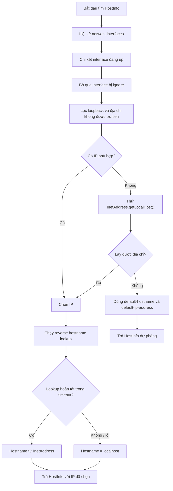

# Timeout phân giải hostname và địa chỉ dự phòng

## 1. Vì sao Spring Cloud cần biết hostname và IP của instance?

Một service chạy trong mạng phân tán thường phải công bố địa chỉ để các thành phần khác có thể tìm thấy nó. Khi khởi động, Spring Cloud Commons có thể xác định thông tin host của máy đang chạy ứng dụng và đưa các giá trị đó vào Spring `Environment`. Discovery client hoặc service registry có thể sử dụng chúng khi đăng ký instance.

Thông tin host gồm hai phần:

- **Hostname**: tên máy mà hệ thống phân giải tên có thể trả về cho một địa chỉ IP.
- **IP address**: địa chỉ mạng được chọn từ các network interface của máy.

Hai giá trị có liên quan nhưng không phải một. Một máy có thể có IP hợp lệ nhưng reverse DNS không trả lời; khi đó Spring Cloud vẫn có thể giữ IP đã chọn và dùng hostname dự phòng. Ngược lại, máy có hostname nhưng không có địa chỉ phù hợp để quảng bá ra mạng thì service registry vẫn có thể nhận địa chỉ không hữu ích.

Spring Cloud Commons cung cấp `InetUtils` và `InetUtilsProperties` để thực hiện việc này. Các thuộc tính quan trọng nằm dưới prefix `spring.cloud.inetutils`, trong đó `timeout-seconds` giới hạn thời gian chờ tính hostname, còn `default-hostname` và `default-ip-address` cung cấp giá trị dự phòng khi không lấy được thông tin host.

Bài học thuộc chương **Định danh và mạng** của **SPRING_CLOUD_CORE**. Trọng tâm là hiểu đúng phạm vi của timeout, cách Spring Cloud chọn địa chỉ mạng, sự khác nhau giữa hai nhánh fallback và ảnh hưởng của kết quả đến service registration.

## 2. Phân biệt ba công việc thường bị gọi chung là “DNS timeout”

Khi debug startup hoặc service registration, cần xác định thao tác nào đang chậm:

| Công việc | Mục đích | `spring.cloud.inetutils.timeout-seconds` có giới hạn không? |
| --- | --- | --- |
| Duyệt network interface | Tìm interface đang hoạt động và địa chỉ IP phù hợp | Không |
| Reverse hostname lookup | Tìm hostname tương ứng với IP đã chọn bằng `InetAddress.getHostName()` | Có, giới hạn thời gian chờ kết quả trong `InetUtils` |
| Resolve hostname của một dịch vụ đích | Đổi tên như `payment.internal` thành IP để gọi HTTP, JDBC hoặc broker | Không. Cần cấu hình timeout của client/resolver tương ứng |

`timeout-seconds` không phải timeout tổng cho mọi thao tác DNS trong JVM, cũng không phải connect timeout hoặc read timeout của HTTP client. Nó phục vụ riêng bước tính hostname của `InetUtils`.

Ví dụ, nếu ứng dụng mất 8 giây khi gọi một API bằng hostname `catalog.internal`, thay đổi `spring.cloud.inetutils.timeout-seconds` không tự làm request đó nhanh hơn. Hãy cấu hình DNS resolver, HTTP client connect timeout và retry policy tại đúng thành phần thực hiện request.

## 3. `InetUtils` tìm địa chỉ như thế nào?

Quy trình khái quát của `InetUtils.findFirstNonLoopbackHostInfo()` gồm các bước:

1. Liệt kê các network interface của máy.
2. Chỉ xét interface đang ở trạng thái up.
3. Bỏ qua interface có tên khớp `ignored-interfaces`.
4. Duyệt địa chỉ trên interface và lọc địa chỉ loopback.
5. Áp dụng `preferred-networks` hoặc `use-only-site-local-interfaces` để chọn địa chỉ phù hợp.
6. Nếu tìm được IP, gọi `convertAddress()` để tính hostname cho IP đó.
7. Nếu không có địa chỉ được chọn, thử lấy địa chỉ local host của JVM; nếu bước này cũng không cung cấp được địa chỉ, `InetUtils` dùng cặp giá trị mặc định.

Trong implementation hiện tại, bước quét interface trực tiếp chọn địa chỉ `Inet4Address`. Vì vậy, nếu môi trường chỉ có IPv6 hoặc có nhiều interface phức tạp, cần kiểm tra kết quả trên đúng phiên bản và cấu hình runtime đang sử dụng.

Sơ đồ:



Các bộ lọc interface và IP có vai trò khác nhau. `ignored-interfaces` loại bỏ cả interface theo tên; `preferred-networks` lọc theo chuỗi địa chỉ IP; `use-only-site-local-interfaces` chỉ chấp nhận địa chỉ mà `InetAddress.isSiteLocalAddress()` đánh dấu là site-local.

## 4. Timeout phân giải hostname hoạt động ra sao?

Sau khi chọn được một `InetAddress`, `InetUtils.convertAddress()` gọi `address.getHostName()` trong một tác vụ chạy trên executor riêng. Kết quả được chờ bằng `Future.get(timeoutSeconds, TimeUnit.SECONDS)`.

Giá trị mặc định của `spring.cloud.inetutils.timeout-seconds` là **1 giây**. Nếu tác vụ trả kết quả trong khoảng thời gian này, `HostInfo.hostname` nhận hostname trả về. Nếu chờ quá hạn hoặc tác vụ phát sinh exception, `InetUtils` ghi log và đặt hostname thành chuỗi `localhost`.

Ví dụ cấu hình tăng thời gian chờ lên 2 giây:

```yaml
spring:
  cloud:
    inetutils:
      timeout-seconds: 2
```

### 4.1. `getHostName()` có thể thực hiện reverse lookup

Theo API Java, nếu `InetAddress` được tạo từ địa chỉ IP mà chưa có hostname gắn sẵn, `getHostName()` có thể gọi system name service để thực hiện reverse name lookup. Resolver của hệ điều hành có thể sử dụng DNS hoặc nguồn phân giải tên được cấu hình trên máy.

Vì vậy, hostname có thể phụ thuộc vào reverse DNS/PTR record, file hosts và cấu hình name service của môi trường chạy. `getHostName()` cũng không cam kết luôn trả về fully qualified domain name. Nếu reverse lookup không có bản ghi phù hợp, kết quả có thể là biểu diễn IP dạng chuỗi theo hành vi của JDK.

### 4.2. Timeout giới hạn thời gian chờ, không bảo đảm dừng resolver bên dưới

Trong implementation hiện tại, `InetUtils` đặt lời gọi `getHostName()` vào executor rồi chờ Future với timeout. Khi timeout, code chuyển hostname sang `localhost`; nó không gọi `Future.cancel(true)` trong nhánh xử lý lỗi. Vì thế thao tác phân giải ở worker có thể vẫn tiếp tục cho đến khi resolver của hệ điều hành trả về.

Ngoài ra, `NetworkInterface.getNetworkInterfaces()` và nhánh dự phòng `InetAddress.getLocalHost()` nằm ngoài Future chờ hostname này. Chúng không bị giới hạn bởi `timeout-seconds`.

Do đó, hiểu đúng thuộc tính này là **giới hạn thời gian mà `InetUtils` chờ hostname**, không phải một hard deadline bảo đảm toàn bộ quá trình phát hiện host kết thúc sau đúng N giây.

Không nên tăng timeout lên hàng chục giây chỉ để tránh hostname `localhost`. Hãy kiểm tra reverse DNS/PTR, cấu hình DNS và danh sách interface trước; chỉ tăng nhẹ timeout khi môi trường thực sự cần thêm thời gian và startup delay đó được chấp nhận.

## 5. Hai nhánh fallback có kết quả khác nhau

Đây là điểm dễ gây nhầm lẫn nhất khi đọc log hoặc xem thông tin instance.

### 5.1. Reverse lookup timeout: hostname dự phòng, IP thật vẫn giữ nguyên

Giả sử máy có IP phù hợp `10.24.8.15`, nhưng reverse DNS không trả lời trong thời gian chờ. `InetUtils.convertAddress()` tạo `HostInfo` với:

| Trường | Kết quả |
| --- | --- |
| `hostname` | `localhost` |
| `ipAddress` | `10.24.8.15` |

Ở nhánh này, hostname timeout được xử lý bằng chuỗi `localhost` trong `convertAddress()`. IP vẫn là địa chỉ đã được chọn. Cặp `default-hostname` và `default-ip-address` không được dùng để thay thế IP đã chọn chỉ vì reverse lookup timeout.

Điều này có nghĩa cấu hình `default-hostname: node-backup` không nhất thiết làm hostname thành `node-backup` khi reverse lookup của một IP đã chọn bị timeout. Trong code hiện tại, nhánh timeout dùng trực tiếp `localhost`.

### 5.2. Không lấy được HostInfo: dùng cặp giá trị mặc định

Nếu quá trình tìm địa chỉ không trả về được một `InetAddress` — ví dụ không tìm được địa chỉ phù hợp và `InetAddress.getLocalHost()` cũng ném `UnknownHostException` — `findFirstNonLoopbackHostInfo()` tạo HostInfo bằng hai thuộc tính:

| Thuộc tính | Giá trị mặc định |
| --- | --- |
| `spring.cloud.inetutils.default-hostname` | `localhost` |
| `spring.cloud.inetutils.default-ip-address` | `127.0.0.1` |

Có thể tùy chỉnh hai giá trị này:

```yaml
spring:
  cloud:
    inetutils:
      default-hostname: fallback-node
      default-ip-address: 127.0.0.1
```

Cặp mặc định là phương án cuối khi không thu thập được host information. Nó **không phải danh sách địa chỉ dự phòng**, không thử lần lượt nhiều IP và cũng không thực hiện failover sang một network interface khác.

Cũng cần lưu ý: nếu không tìm được interface phù hợp nhưng `InetAddress.getLocalHost()` vẫn trả về một địa chỉ (kể cả loopback), `InetUtils` có thể chuyển địa chỉ đó thành HostInfo thay vì dùng cặp default. Hãy kiểm tra kết quả thực tế thay vì suy luận chỉ từ việc máy có interface nào đang up.

### 5.3. Vì sao `127.0.0.1` có thể gây lỗi đăng ký dịch vụ?

`127.0.0.1` là loopback của chính máy. Nếu service registry công bố địa chỉ này cho một service chạy trên node khác, client từ node khác sẽ kết nối tới loopback của chính client thay vì máy chứa service.

Vì vậy, default IP phù hợp để biểu thị fallback hoặc hỗ trợ một số môi trường local, nhưng thường không phải địa chỉ quảng bá hợp lệ trong production nhiều máy. Khi service cần được gọi từ các node khác, hãy sửa lựa chọn interface/network hoặc cấu hình địa chỉ đăng ký phù hợp với nền tảng.

## 6. Các thuộc tính `spring.cloud.inetutils`

| Thuộc tính | Mặc định | Ý nghĩa |
| --- | --- | --- |
| `spring.cloud.inetutils.timeout-seconds` | `1` | Số giây tối đa `InetUtils` chờ kết quả tính hostname |
| `spring.cloud.inetutils.default-hostname` | `localhost` | Hostname dự phòng khi không lấy được HostInfo |
| `spring.cloud.inetutils.default-ip-address` | `127.0.0.1` | IP dự phòng khi không lấy được HostInfo |
| `spring.cloud.inetutils.ignored-interfaces` | Danh sách rỗng | Regex tên interface cần bỏ qua |
| `spring.cloud.inetutils.preferred-networks` | Danh sách rỗng | Regex hoặc prefix địa chỉ IP được chấp nhận/ưu tiên |
| `spring.cloud.inetutils.use-only-site-local-interfaces` | `false` | Chỉ chấp nhận địa chỉ site-local |

Các tên property trong `application.yml` dùng kebab-case. Java class `InetUtilsProperties` có field tương ứng như `timeoutSeconds`, `defaultHostname`, `defaultIpAddress`, `ignoredInterfaces` và `preferredNetworks`.

## 7. Chọn network interface đúng

Một máy có thể có nhiều interface: Ethernet, Wi-Fi, VPN, Docker bridge, Kubernetes veth, Hyper-V virtual switch hoặc interface dành cho management. Nếu Spring Cloud chọn nhầm địa chỉ, service có thể đăng ký thành công nhưng các service khác không gọi được.

### 7.1. Bỏ qua interface không dùng để phục vụ service

Ví dụ bỏ qua Docker bridge và các interface có tên bắt đầu bằng `veth`:

```yaml
spring:
  cloud:
    inetutils:
      ignored-interfaces:
        - docker0
        - veth.*
```

Mỗi phần tử là Java regular expression áp dụng cho tên interface. `veth.*` có thể khớp `veth1234`; `docker0` khớp đúng tên đó. Hãy xem tên interface thực tế trên hệ điều hành/container trước khi đặt pattern.

### 7.2. Chọn các subnet mong muốn

Nếu máy có nhiều địa chỉ, có thể chỉ chấp nhận các network phù hợp:

```yaml
spring:
  cloud:
    inetutils:
      preferred-networks:
        - '10\.24\..*'
        - '192\.168\.10\..*'
```

Các biểu thức trên minh họa cách khớp địa chỉ IPv4 thuộc hai dải mong muốn. `InetUtils` kiểm tra địa chỉ bằng regex và hỗ trợ cả trường hợp địa chỉ bắt đầu bằng chuỗi cấu hình, nên các prefix ngắn như `192.168` cũng thường được dùng trong tài liệu.

`preferred-networks` là bộ lọc địa chỉ IP của interface cục bộ. Nó không phải danh sách hostname của service đích và cũng không cấu hình DNS server.

### 7.3. Chỉ dùng địa chỉ site-local

Có thể bật:

```yaml
spring:
  cloud:
    inetutils:
      use-only-site-local-interfaces: true
```

Thuộc tính này sử dụng định nghĩa `InetAddress.isSiteLocalAddress()` của JDK. Nó có thể hữu ích trong mạng nội bộ, nhưng không thay thế firewall, network policy hay kiểm soát bảo mật. Hãy xác nhận địa chỉ cần quảng bá có thực sự được JDK phân loại là site-local.

### 7.4. Ví dụ kết hợp

Một cấu hình cho máy chạy service trong mạng nội bộ có thể là:

```yaml
spring:
  cloud:
    inetutils:
      timeout-seconds: 2
      default-hostname: localhost
      default-ip-address: 127.0.0.1
      ignored-interfaces:
        - docker0
        - veth.*
      preferred-networks:
        - '10\.24\..*'
        - '192\.168\.10\..*'
      use-only-site-local-interfaces: false
```

Đây chỉ là cấu hình minh họa. Cần thay subnet và interface bằng thông tin thực tế của môi trường triển khai. Không bật đồng thời các bộ lọc quá chặt nếu chúng loại bỏ toàn bộ địa chỉ hợp lệ; khi đó ứng dụng có thể rơi về nhánh lấy local host hoặc cặp giá trị mặc định.

## 8. HostInfo được đưa vào Spring Environment như thế nào?

Spring Cloud Commons có `HostInfoEnvironmentPostProcessor`. Trong quá trình chuẩn bị Environment, post-processor gọi `InetUtils` để lấy HostInfo rồi thêm hai property:

- `spring.cloud.client.hostname`
- `spring.cloud.client.ip-address`

Các giá trị này có thể được các thành phần Spring Cloud dùng khi tạo thông tin instance hoặc đăng ký service. Theo mặc định, các implementation DiscoveryClient có thể tự đăng ký ứng dụng đang chạy với discovery server; hành vi và chi tiết địa chỉ đăng ký còn phụ thuộc implementation như Eureka, Consul hoặc Zookeeper.

Có thể kiểm tra hai property sau khi Environment được chuẩn bị:

```java
import org.springframework.boot.ApplicationArguments;
import org.springframework.boot.ApplicationRunner;
import org.springframework.core.env.Environment;
import org.springframework.stereotype.Component;

import org.slf4j.Logger;
import org.slf4j.LoggerFactory;

@Component
public class HostIdentityReporter implements ApplicationRunner {

    private static final Logger log =
            LoggerFactory.getLogger(HostIdentityReporter.class);

    private final Environment environment;

    public HostIdentityReporter(Environment environment) {
        this.environment = environment;
    }

    @Override
    public void run(ApplicationArguments args) {
        String hostname =
                environment.getProperty("spring.cloud.client.hostname");
        String ipAddress =
                environment.getProperty("spring.cloud.client.ip-address");

        log.info("Resolved service host: hostname={}, ip={}",
                hostname, ipAddress);
    }
}
```

Ví dụ chỉ ghi hostname và IP, không ghi thông tin nhạy cảm. Trong môi trường production, hãy giới hạn quyền đọc log và đối chiếu hai giá trị này với địa chỉ mà discovery server thực sự lưu.

Nếu cần quảng bá một hostname/IP cố định do nền tảng cấp, có thể cung cấp giá trị `spring.cloud.client.hostname` hoặc `spring.cloud.client.ip-address` từ nguồn cấu hình có độ ưu tiên cao hơn, hoặc dùng thuộc tính override riêng của discovery implementation. Cách override cụ thể phụ thuộc phiên bản và registry; cần xác nhận giá trị cuối trong Environment và bản ghi instance trên registry.

## 9. Chẩn đoán theo biểu hiện

| Biểu hiện | Nguyên nhân có thể | Hướng kiểm tra |
| --- | --- | --- |
| Hostname là `localhost`, IP là IP thật | Reverse lookup chậm, timeout hoặc lỗi | Kiểm tra PTR/reverse DNS; xem log `Cannot determine local hostname`; cân nhắc timeout cao hơn một chút |
| Hostname và IP đều là `localhost` / `127.0.0.1` | Không lấy được địa chỉ host cuối cùng hoặc fallback được sử dụng | Kiểm tra interface, trạng thái up, `ignored-interfaces`, `preferred-networks` và kết quả `InetAddress.getLocalHost()` |
| IP đăng ký sai subnet | Interface VPN, Docker, Hyper-V hoặc management được chọn | Kiểm tra network interface; thêm `ignored-interfaces` hoặc `preferred-networks` |
| Startup vẫn chậm dù timeout nhỏ | Chậm ở bước khác ngoài Future hostname lookup | Kiểm tra interface enumeration, `InetAddress.getLocalHost()`, DNS của dependency và các post-processor khác |
| Registry có IP loopback | Giá trị fallback hoặc địa chỉ local host được chọn | Kiểm tra cặp default, interface được phát hiện và cấu hình override của registry |
| Hostname trả về không phải FQDN mong muốn | `getHostName()` không bảo đảm canonical FQDN | Cấu hình DNS/PTR hoặc hostname quảng bá rõ ràng theo nền tảng |

### 9.1. Lệnh kiểm tra trên Linux

```bash
ip address
ip route
hostname
hostname -f
getent hosts "$(hostname)"
getent hosts 10.24.8.15
```

Các lệnh giúp xem interface, route, hostname local và kết quả name service. `getent hosts <IP>` có thể giúp kiểm tra reverse lookup nếu hệ thống dùng NSS phù hợp.

### 9.2. Lệnh kiểm tra trên Windows

```powershell
ipconfig /all
Get-NetIPConfiguration
hostname
Resolve-DnsName app-node.internal
Resolve-DnsName 10.24.8.15
```

`Resolve-DnsName` có thể dùng để kiểm tra truy vấn tên hoặc PTR tùy dữ liệu DNS và môi trường. Nếu máy chạy trong container hoặc VM, hãy kiểm tra cả interface ở host lẫn interface nhìn thấy từ network namespace của ứng dụng.

## 10. Kiểm thử và xác nhận cấu hình

Không nên chỉ kiểm tra ứng dụng có khởi động thành công. Cần xác minh host identity được chọn phù hợp với đường mạng mà các service khác có thể truy cập.

Một bộ kiểm tra tích hợp nên bao gồm:

1. Chạy ứng dụng trên máy có một interface IPv4 phù hợp và xác nhận `spring.cloud.client.ip-address` khớp địa chỉ mong muốn.
2. Chạy trên máy có nhiều interface và xác nhận `ignored-interfaces`/`preferred-networks` loại đúng interface.
3. Dùng môi trường test có reverse DNS chậm hoặc không có PTR để quan sát hostname fallback; không thay đổi DNS production chỉ để thử.
4. Xác nhận khi reverse lookup timeout, IP đã chọn vẫn được giữ nguyên.
5. Kiểm tra nhánh không lấy được HostInfo để xác nhận `default-hostname` và `default-ip-address` được dùng đúng.
6. Đọc bản ghi instance trên Eureka/Consul/Zookeeper hoặc registry đang dùng để so sánh với hai property trong Environment.
7. Kiểm tra client từ một máy khác có thể kết nối đến địa chỉ được quảng bá.

Có thể viết unit test cho logic chọn interface/địa chỉ bằng cách kiểm tra các method của `InetUtils` trong module test phù hợp, hoặc kiểm thử `InetUtilsProperties` và cấu hình binding. Kiểm thử timeout thực tế nên tách khỏi unit test thông thường vì phụ thuộc resolver, hệ điều hành và DNS cache.

## 11. Những nhầm lẫn thường gặp

| Nhầm lẫn | Cách hiểu đúng |
| --- | --- |
| `timeout-seconds` là timeout cho mọi truy vấn DNS | Nó giới hạn thời gian chờ hostname trong `InetUtils.convertAddress()` |
| Timeout hostname sẽ thay cả hostname và IP bằng default | Trong nhánh timeout, hostname thành `localhost`, IP đã chọn vẫn giữ nguyên |
| `default-ip-address` là IP thứ hai để failover | Đây là một giá trị dự phòng đơn lẻ khi không lấy được HostInfo |
| `default-hostname` luôn được dùng khi reverse DNS timeout | Nhánh timeout trong `convertAddress()` dùng `localhost`; default hostname thuộc nhánh không lấy được địa chỉ |
| `preferred-networks` chọn DNS server | Nó lọc địa chỉ IP trên interface cục bộ |
| `ignored-interfaces` lọc địa chỉ IP | Nó bỏ qua interface theo tên |
| IP `127.0.0.1` có thể được service khác truy cập từ xa | Loopback chỉ trỏ về chính máy đang gọi |
| Tăng timeout sẽ sửa được mọi startup delay | Interface scan, local-host resolution và DNS của dependency có thể nằm ngoài timeout này |

## 12. Nguyên tắc vận hành

- Bảo đảm DNS forward và reverse được cấu hình nhất quán cho các node cần đăng ký service bằng hostname.
- Chọn subnet quảng bá dựa trên đường mạng mà consumer thực sự truy cập được, không dựa vào việc interface chỉ đang up.
- Giữ `timeout-seconds` đủ ngắn để tránh kéo dài startup; chỉ tăng khi có bằng chứng reverse lookup cần thêm thời gian.
- Không dùng `default-ip-address` như giải pháp che giấu lỗi network interface trong production.
- Theo dõi giá trị hostname/IP được tạo ra và so sánh với dữ liệu thực tế trong service registry.
- Khi chạy Docker/Kubernetes/VM có nhiều interface, kiểm tra network namespace và cấu hình interface tại đúng nơi JVM chạy.
- Xác nhận hành vi với phiên bản Spring Cloud Commons trong dependency tree; chi tiết `InetUtils` và thời điểm nạp cấu hình có thể thay đổi theo release.

## 13. Câu hỏi tự kiểm tra

1. `InetUtils` tìm HostInfo từ các network interface theo những bước nào?
2. `timeout-seconds` giới hạn thao tác nào và mặc định là bao nhiêu?
3. Vì sao `InetAddress.getHostName()` có thể thực hiện reverse DNS lookup?
4. Nếu reverse lookup timeout, hostname và IP trong HostInfo có giá trị gì?
5. Khi nào `default-hostname` và `default-ip-address` được sử dụng?
6. Vì sao cặp giá trị default không phải một cơ chế failover IP?
7. `ignored-interfaces` khác `preferred-networks` ở điểm nào?
8. Khi nào nên bật `use-only-site-local-interfaces`?
9. Vì sao một service đăng ký với IP `127.0.0.1` có thể không được các node khác truy cập?
10. Cần kiểm tra những gì nếu startup vẫn chậm dù đã giảm `timeout-seconds`?

## 14. Tài liệu tham khảo chính thức

- [Spring Cloud Commons — Configuration Properties](https://docs.spring.io/spring-cloud-commons/reference/configprops.html) — giá trị mặc định và mô tả `spring.cloud.inetutils.*`.
- [Spring Cloud Commons — Common Abstractions](https://docs.spring.io/spring-cloud-commons/reference/spring-cloud-commons/common-abstractions.html) — discovery client, service registration và các bộ lọc network interface.
- [InetUtils.java — Spring Cloud Commons](https://github.com/spring-cloud/spring-cloud-commons/blob/main/spring-cloud-commons/src/main/java/org/springframework/cloud/commons/util/InetUtils.java) — cách tìm địa chỉ, tính hostname, timeout và nhánh fallback.
- [InetUtilsProperties.java — Spring Cloud Commons](https://github.com/spring-cloud/spring-cloud-commons/blob/main/spring-cloud-commons/src/main/java/org/springframework/cloud/commons/util/InetUtilsProperties.java) — prefix và các thuộc tính cấu hình.
- [HostInfoEnvironmentPostProcessor.java — Spring Cloud Commons](https://github.com/spring-cloud/spring-cloud-commons/blob/main/spring-cloud-commons/src/main/java/org/springframework/cloud/client/HostInfoEnvironmentPostProcessor.java) — cách đưa hostname/IP vào Environment.
- [Java `InetAddress` API](https://docs.oracle.com/en/java/javase/27/docs/api/java.base/java/net/InetAddress.html) — hành vi `getHostName()`, reverse lookup và `getLocalHost()`.

*Tài liệu phân biệt timeout chờ hostname với fallback HostInfo và lựa chọn network interface. Hãy kiểm tra cả kết quả Environment lẫn bản ghi service registry trên đúng phiên bản Spring Cloud Commons và hệ điều hành triển khai.*
