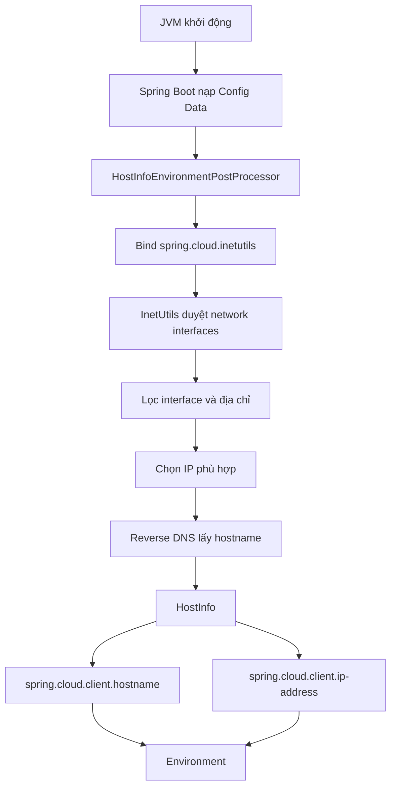

# Kiểm tra IP và hostname được chọn bằng thực nghiệm

Trong hệ thống nhiều mạng, một JVM có thể nhìn thấy nhiều địa chỉ: loopback, Ethernet, Wi-Fi, VPN, bridge Docker, interface của Kubernetes, interface ảo của hypervisor và cả IPv6. Spring Cloud cần chọn một địa chỉ đại diện cho ứng dụng khi cung cấp thông tin host cho các thành phần dùng chung và cơ chế đăng ký service discovery.

Không nên suy luận địa chỉ được chọn chỉ từ IP của máy phát triển hoặc từ kết quả `hostname`. Spring Cloud Commons có `InetUtils` để tìm địa chỉ phù hợp, sau đó công bố thông tin host vào `Environment`. Cách chắc chắn là **đối chiếu ba kết quả độc lập**: interface mà hệ điều hành nhìn thấy, giá trị Spring Cloud công bố, và địa chỉ mà registry/consumer thực sự sử dụng.

Bài học thuộc chương **Định danh và mạng** của module **SPRING_CLOUD_CORE**. Nội dung hướng dẫn quan sát từng interface, hiểu bộ lọc của `InetUtils`, cấu hình lựa chọn IP/hostname, kiểm tra trong JVM/container và xác nhận địa chỉ đăng ký có thể được instance khác truy cập.

## 1. Mục tiêu học tập

Sau bài học, người học có thể:

- Liệt kê các network interface và địa chỉ IP mà tiến trình Java nhìn thấy.
- Giải thích vai trò của `InetUtils` và `HostInfoEnvironmentPostProcessor`.
- Đọc các thuộc tính `spring.cloud.client.hostname` và `spring.cloud.client.ip-address`.
- Cấu hình `ignored-interfaces`, `preferred-networks`, `use-only-site-local-interfaces` và giá trị fallback.
- Phân biệt địa chỉ host được phát hiện với địa chỉ được service registry lưu.
- Kiểm tra sự khác nhau giữa host, container, pod, service DNS và địa chỉ mà client thực sự kết nối.
- Xác định trường hợp hostname reverse DNS trả về `localhost` hoặc IP được chọn không thể truy cập từ mạng khác.
- Viết phép thử có thể lặp lại để xác nhận lựa chọn IP sau khi thay đổi cấu hình hoặc môi trường mạng.

## 2. Vì sao một máy có thể có nhiều IP?

Một máy chủ hoặc container không nhất thiết chỉ có một địa chỉ. Ví dụ một máy phát triển có thể có:

| Interface | Ví dụ địa chỉ | Vai trò |
| --- | --- | --- |
| `lo` | `127.0.0.1` | Giao tiếp nội bộ trong network namespace |
| `eth0` | `192.168.1.25` | Mạng LAN |
| `wlan0` | `192.168.1.80` | Wi-Fi |
| `tun0` | `10.8.0.12` | VPN |
| `docker0` | `172.17.0.1` | Bridge Docker trên host |
| `veth...` | `172.18.0.1` | Cặp interface ảo nối container |
| `vEthernet...` | `172.22.64.1` | Hyper-V/WSL virtual switch |

Địa chỉ được chọn phụ thuộc interface và network namespace mà JVM đang chạy. Java trong container thường chỉ nhìn thấy network stack của container; địa chỉ của host Windows/Linux có thể hoàn toàn khác.

Cần phân biệt bốn khái niệm:

1. **Host identity:** IP và hostname mà Spring Cloud phát hiện cho ứng dụng.
2. **Bind address:** địa chỉ mà HTTP server lắng nghe, thường liên quan đến `server.address`.
3. **Registered address:** host/port mà Eureka, Consul, Zookeeper hoặc registry khác lưu.
4. **Reachable address:** địa chỉ mà một consumer cụ thể có thể kết nối qua route, firewall, NAT, DNS hoặc service mesh.

Bốn giá trị này có thể trùng nhau, nhưng không bắt buộc. `server.address=0.0.0.0` chỉ yêu cầu server lắng nghe trên các interface phù hợp; nó không có nghĩa ứng dụng nên đăng ký địa chỉ `0.0.0.0`.

## 3. Spring Cloud tìm hostname và IP như thế nào?

Spring Cloud Commons cung cấp `InetUtils` trong package `org.springframework.cloud.commons.util`. Trong quá trình chuẩn bị `Environment`, `HostInfoEnvironmentPostProcessor` gọi `InetUtils` để tìm `HostInfo`, rồi thêm hai property vào `Environment`:

- `spring.cloud.client.hostname`
- `spring.cloud.client.ip-address`

Trong implementation hiện hành, post processor chạy sau `ConfigDataEnvironmentPostProcessor`, đọc cấu hình `spring.cloud.inetutils`, sau đó thêm property source tên `springCloudClientHostInfo` vào cuối danh sách nguồn cấu hình.

Luồng khái quát:



`spring.cloud.client.hostname` là hostname thu được từ địa chỉ đã chọn thông qua `InetAddress.getHostName()`. Đây có thể là kết quả reverse DNS, không nhất thiết là tên máy bạn thấy trong lệnh `hostname`.

### 3.1. Các bước lọc trong InetUtils

Ở mức khái niệm, quy trình chính có thể hiểu như sau:

1. Lấy danh sách `NetworkInterface` từ JVM.
2. Chỉ xét interface đang hoạt động (`isUp()`).
3. Bỏ interface có display name khớp một biểu thức trong `ignored-interfaces`.
4. Duyệt địa chỉ trên interface và bỏ địa chỉ loopback.
5. Kiểm tra địa chỉ có khớp `preferred-networks` hoặc chính sách site-local hay không.
6. Chuyển địa chỉ đã chọn thành `HostInfo`.
7. Thực hiện hostname lookup trong giới hạn timeout; nếu lookup thất bại, hostname có thể thành `localhost`.

Implementation hiện hành của `InetUtils.findFirstNonLoopbackAddress()` kiểm tra `Inet4Address` khi tìm địa chỉ. Vì vậy, không nên giả định mọi bản Spring Cloud đều tự chọn IPv6 qua đường này. Nếu hệ thống cần đăng ký IPv6, hãy kiểm tra source/API của đúng release train và kiểm thử riêng bằng địa chỉ IPv6 thực tế.

`InetUtils` cũng có thể thử `InetAddress.getLocalHost()` khi không tìm được địa chỉ phù hợp. Nếu vẫn không lấy được host, `findFirstNonLoopbackHostInfo()` dùng giá trị mặc định `localhost` và `127.0.0.1`. Đây là fallback để ứng dụng có thông tin host; nó không chứng minh địa chỉ đó có thể được consumer khác truy cập.

### 3.2. Interface nào được chọn khi có nhiều interface?

Không nên coi danh sách `preferred-networks` là danh sách ưu tiên theo thứ tự. Nó được dùng để kiểm tra một địa chỉ có được chấp nhận hay không. Việc duyệt interface và index do hệ điều hành/JVM cung cấp cũng ảnh hưởng kết quả.

Trong source hiện hành, `InetUtils` theo dõi index của interface trong lúc duyệt để giới hạn interface được xét sau khi đã tìm thấy ứng viên. Nếu có nhiều interface cùng chứa địa chỉ phù hợp, kết quả còn phụ thuộc thứ tự/index và thứ tự địa chỉ mà JVM trả về.

Ví dụ cấu hình:

```yaml
spring:
  cloud:
    inetutils:
      preferred-networks:
        - "10."
        - "192.168."
```

không có nghĩa `10.*` luôn thắng `192.168.*`. Cả hai đều là mạng được chấp nhận; hãy quan sát interface và địa chỉ thực tế để xác nhận IP cuối cùng.

## 4. Các thuộc tính spring.cloud.inetutils

Các thuộc tính thường dùng trong Spring Cloud Commons:

| Thuộc tính | Mặc định trong metadata hiện hành | Tác dụng |
| --- | --- | --- |
| `spring.cloud.inetutils.ignored-interfaces` | Danh sách rỗng | Bỏ qua interface có display name khớp Java regular expression |
| `spring.cloud.inetutils.preferred-networks` | Danh sách rỗng | Chỉ chấp nhận địa chỉ phù hợp các mẫu mạng |
| `spring.cloud.inetutils.use-only-site-local-interfaces` | `false` | Chỉ chấp nhận địa chỉ mà JDK phân loại là site-local |
| `spring.cloud.inetutils.default-hostname` | `localhost` | Hostname dự phòng khi không tìm được host |
| `spring.cloud.inetutils.default-ip-address` | `127.0.0.1` | IP dự phòng khi không tìm được host |
| `spring.cloud.inetutils.timeout-seconds` | `1` | Giới hạn thời gian tính hostname |

Hãy kiểm tra configuration metadata của release train đang dùng nếu dự án chạy phiên bản cũ. Không sao chép nguyên xi một cấu hình từ tài liệu của release train khác.

### 4.1. ignored-interfaces

Thuộc tính này nhận danh sách Java regular expression so khớp với tên hiển thị của interface. Ví dụ bỏ qua bridge Docker và interface veth:

```yaml
spring:
  cloud:
    inetutils:
      ignored-interfaces:
        - "docker0"
        - "veth.*"
        - "br-.*"
        - "tun.*"
```

Không thêm `eth.*` hoặc `ens.*` nếu đó là interface duy nhất mà service khác có thể truy cập. Nếu pattern khớp mọi interface hợp lệ, `InetUtils` sẽ không còn ứng viên và có thể rơi về địa chỉ fallback.

Không giả định mọi interface ảo đều tự động bị loại. Implementation hiện hành kiểm tra interface đang hoạt động và áp dụng danh sách ignore; nếu `veth`, bridge hoặc interface ảo không nên được chọn, hãy quan sát display name rồi thêm pattern tương ứng.

### 4.2. preferred-networks

Thuộc tính này nhận danh sách Java regular expression cho địa chỉ mạng. Ví dụ chỉ chấp nhận các địa chỉ thuộc hai dải private thường dùng:

```yaml
spring:
  cloud:
    inetutils:
      preferred-networks:
        - '10\..*'
        - '192\.168\..*'
```

Trong implementation hiện hành, địa chỉ được chấp nhận nếu khớp regex hoặc bắt đầu bằng chuỗi pattern. Vì vậy, ví dụ ngắn `10.` cũng có thể hoạt động như prefix. Viết regex đầy đủ giúp ý định rõ hơn khi cấu hình được review.

Đây không phải cú pháp CIDR. Không viết `10.0.0.0/8` với kỳ vọng InetUtils tự hiểu subnet mask. Nếu cần lọc theo CIDR, hãy tự triển khai logic phù hợp hoặc dùng cơ chế network/provider riêng.

### 4.3. use-only-site-local-interfaces

```yaml
spring:
  cloud:
    inetutils:
      use-only-site-local-interfaces: true
```

Khi bật, InetUtils dùng `InetAddress.isSiteLocalAddress()` để lọc địa chỉ. Khái niệm site-local là quy tắc của JDK; không nên hiểu nó là một phép kiểm tra khả năng kết nối từ mọi mạng.

Trong implementation hiện hành, nhánh site-local trả kết quả lọc trực tiếp; nếu bật tùy chọn này, không nên kỳ vọng `preferred-networks` tiếp tục thu hẹp tập địa chỉ theo cách độc lập. Hãy kiểm tra source của release train đang dùng nếu kết hợp hai thuộc tính.

Không bật tùy chọn này nếu service cần quảng bá địa chỉ public hoặc địa chỉ không được JDK phân loại là site-local.

### 4.4. default-hostname và default-ip-address

```yaml
spring:
  cloud:
    inetutils:
      default-hostname: "catalog-node"
      default-ip-address: "127.0.0.1"
```

Hai thuộc tính này là giá trị dự phòng khi không tìm được địa chỉ phù hợp. Chúng không phải lựa chọn ưu tiên để ép InetUtils lấy một interface cụ thể. Nếu đặt IP mặc định là loopback trong một dịch vụ cần được gọi từ pod khác, registry có thể lưu địa chỉ không thể truy cập.

### 4.5. timeout-seconds

Hostname được tính bằng cách tra cứu tên từ địa chỉ đã chọn. DNS reverse lookup có thể chậm hoặc không có bản ghi PTR. Timeout giới hạn thời gian chờ cho bước xác định hostname; nó không làm cho IP trở nên có thể truy cập và cũng không thay đổi route của hệ điều hành.

Nếu IP được chọn đúng nhưng hostname là `localhost`, hãy kiểm tra DNS/PTR và timeout trước khi thay bộ lọc IP.

## 5. Thực nghiệm 1: liệt kê interface trên hệ điều hành

Trước khi sửa cấu hình Spring Cloud, hãy ghi lại interface mà môi trường chạy nhìn thấy.

### 5.1. Windows PowerShell

```powershell
Get-NetAdapter |
  Format-Table Name, Status, InterfaceDescription

Get-NetIPAddress -AddressFamily IPv4 |
  Sort-Object InterfaceIndex |
  Format-Table InterfaceAlias, InterfaceIndex, IPAddress, PrefixLength, AddressState

Get-NetRoute -AddressFamily IPv4 |
  Sort-Object RouteMetric |
  Format-Table InterfaceAlias, DestinationPrefix, NextHop, RouteMetric
```

Kết quả cho biết tên interface, trạng thái, index, địa chỉ và route. Nếu JVM chạy trong Docker Desktop, WSL2 hoặc Kubernetes, kết quả trên Windows host không thay thế được kết quả bên trong container/pod.

### 5.2. Linux

```bash
ip -br link
ip -br addr
ip route
ip route get 10.20.0.15
```

Thay `10.20.0.15` bằng địa chỉ của consumer hoặc endpoint mà service cần gọi. `ip route get` cho biết route/địa chỉ nguồn mà kernel dự kiến dùng cho đích đó. Kết quả này có thể khác IP mà InetUtils chọn để đăng ký service.

### 5.3. Docker

Chạy lệnh trong đúng container chứa JVM:

```bash
docker exec <container-name> ip -br addr
docker exec <container-name> ip route
```

Không suy luận IP của container từ địa chỉ `docker0` trên host. Container có network namespace riêng; IP mà JVM nhìn thấy thường thuộc bridge hoặc network mà container tham gia.

### 5.4. Kubernetes

```bash
kubectl get pod -n <namespace> -o wide
kubectl exec -n <namespace> <pod-name> -- ip -br addr
kubectl exec -n <namespace> <pod-name> -- ip route
```

`kubectl get pod -o wide` cho biết Pod IP do Kubernetes báo cáo. Lệnh `ip` trong pod cho biết các interface mà tiến trình trong pod network namespace nhìn thấy. Nếu pod dùng `hostNetwork: true`, kết quả sẽ gần với network namespace của node hơn.

## 6. Thực nghiệm 2: đọc giá trị Spring Cloud đã công bố

Sau khi ứng dụng khởi động, đọc hai property sau từ chính `Environment`:

```text
spring.cloud.client.hostname
spring.cloud.client.ip-address
```

Có thể quan sát qua Actuator `env` trong môi trường kiểm thử. Ví dụ bật endpoint cần thiết:

```yaml
management:
  endpoints:
    web:
      exposure:
        include: health,env
```

Sau đó truy vấn:

```bash
curl -sS http://localhost:8080/actuator/env/spring.cloud.client.ip-address
curl -sS http://localhost:8080/actuator/env/spring.cloud.client.hostname
```

Endpoint `env` có thể chứa thông tin cấu hình nội bộ. Chỉ bật tạm trong môi trường được bảo vệ, giới hạn quyền truy cập và tắt sau khi kiểm tra. Không expose toàn bộ Environment công khai.

### 6.1. In kết quả từ code

Một `ApplicationRunner` nhỏ có thể in giá trị hiệu lực sau khi context đã được tạo:

```java
import org.slf4j.Logger;
import org.slf4j.LoggerFactory;
import org.springframework.boot.ApplicationArguments;
import org.springframework.boot.ApplicationRunner;
import org.springframework.core.env.Environment;
import org.springframework.stereotype.Component;

@Component
public class NetworkIdentityProbe implements ApplicationRunner {

    private static final Logger log =
        LoggerFactory.getLogger(NetworkIdentityProbe.class);

    private final Environment environment;

    public NetworkIdentityProbe(Environment environment) {
        this.environment = environment;
    }

    @Override
    public void run(ApplicationArguments args) {
        log.info("Spring Cloud hostname: {}",
            environment.getProperty("spring.cloud.client.hostname"));

        log.info("Spring Cloud IP address: {}",
            environment.getProperty("spring.cloud.client.ip-address"));
    }
}
```

Đây là giá trị mà code ứng dụng tra cứu được. Nó có thể bị ghi đè bởi một property source có độ ưu tiên cao hơn nguồn `springCloudClientHostInfo`, vì vậy hãy xem cả origin/property source khi kết quả khác với dự kiến.

### 6.2. Liệt kê interface từ bên trong JVM

Để so sánh với lệnh hệ điều hành, có thể dùng Java NetworkInterface API:

```java
import java.net.InetAddress;
import java.net.NetworkInterface;
import java.util.Collections;

public class NetworkInterfaceProbe {

    public static void printInterfaces() throws Exception {
        for (NetworkInterface networkInterface :
                Collections.list(NetworkInterface.getNetworkInterfaces())) {

            System.out.printf(
                "name=%s display=%s index=%d up=%s loopback=%s virtual=%s%n",
                networkInterface.getName(),
                networkInterface.getDisplayName(),
                networkInterface.getIndex(),
                networkInterface.isUp(),
                networkInterface.isLoopback(),
                networkInterface.isVirtual()
            );

            for (InetAddress address :
                    Collections.list(networkInterface.getInetAddresses())) {
                System.out.printf(
                    "  address=%s loopback=%s siteLocal=%s%n",
                    address.getHostAddress(),
                    address.isLoopbackAddress(),
                    address.isSiteLocalAddress()
                );
            }
        }
    }
}
```

Đặt probe này trong một runner hoặc test riêng. Đối chiếu `displayName`, index và địa chỉ với cấu hình `ignored-interfaces`/`preferred-networks`. Không chỉ nhìn tên `eth0`: InetUtils so khớp display name của interface theo implementation hiện hành.

## 7. Thực nghiệm 3: quan sát HostInfo do InetUtils trả về

Nếu dự án có bean `InetUtils` do Spring Cloud Commons auto-configuration cung cấp, có thể gọi trực tiếp:

```java
import org.springframework.cloud.commons.util.InetUtils;
import org.springframework.cloud.commons.util.InetUtils.HostInfo;
import org.springframework.stereotype.Component;

@Component
public class InetUtilsProbe {

    private final InetUtils inetUtils;

    public InetUtilsProbe(InetUtils inetUtils) {
        this.inetUtils = inetUtils;
    }

    public void printHostInfo() {
        HostInfo hostInfo = inetUtils.findFirstNonLoopbackHostInfo();

        System.out.println("InetUtils IP: " + hostInfo.getIpAddress());
        System.out.println("InetUtils hostname: " + hostInfo.getHostname());
    }
}
```

Kết quả này cho biết lựa chọn của `InetUtils` với cấu hình được bind cho bean. Đối chiếu nó với `spring.cloud.client.ip-address` trong `Environment`.

Nếu hai kết quả khác nhau, hãy kiểm tra:

- Có property source nào ghi đè `spring.cloud.client.ip-address` hoặc `spring.cloud.client.hostname` không?
- `InetUtils` bean có nhận cùng `InetUtilsProperties` mà post processor đã dùng không?
- Ứng dụng có custom `InetUtils`, `InetUtilsProperties` hoặc `EnvironmentPostProcessor` không?
- Phiên bản Spring Cloud có thay đổi thời điểm chạy post processor hay thuật toán chọn địa chỉ không?

Không kết luận rằng registry sẽ luôn dùng đúng kết quả của lần gọi probe thứ hai. Provider discovery có thể dùng cấu hình instance riêng hoặc một `Registration` đã được tạo trước đó.

## 8. Ví dụ cấu hình khi máy có VPN và Docker

Giả sử JVM chạy trên Linux host có các interface:

| Interface | IP | Ý định |
| --- | --- | --- |
| `eth0` | `192.168.10.25` | Mạng LAN cần dùng |
| `tun0` | `10.8.0.12` | VPN không muốn quảng bá |
| `docker0` | `172.17.0.1` | Bridge không muốn quảng bá |
| `lo` | `127.0.0.1` | Loopback |

Muốn bỏ VPN và Docker bridge, đồng thời chỉ nhận địa chỉ LAN:

```yaml
spring:
  cloud:
    inetutils:
      ignored-interfaces:
        - "tun.*"
        - "docker0"
      preferred-networks:
        - "192\\.168\\..*"
```

Sau khi khởi động lại ứng dụng, kiểm tra:

1. Interface `tun0` và `docker0` không được dùng làm ứng viên.
2. Địa chỉ `192.168.10.25` có được JVM nhìn thấy.
3. `spring.cloud.client.ip-address` có đúng `192.168.10.25`.
4. Hostname trả về có phân giải được từ consumer.
5. Consumer ở mạng khác có route tới địa chỉ đó hay không.

Nếu không còn interface nào khớp, đừng ngạc nhiên khi ứng dụng rơi về kết quả từ `InetAddress.getLocalHost()` hoặc giá trị fallback. Sửa pattern và kiểm thử lại trong cùng network namespace.

## 9. Thực nghiệm 4: xác nhận địa chỉ service registry lưu

Giá trị trong `Environment` là thông tin host chung của Spring Cloud. Địa chỉ đăng ký thực tế còn phụ thuộc implementation discovery như Eureka, Consul hoặc Zookeeper và cấu hình instance của provider.

Spring Cloud Commons có cơ chế auto-registration khi discovery implementation hiện diện trên classpath. `@EnableDiscoveryClient` không còn bắt buộc trong các cấu hình hiện hành. Auto-registration có thể được tắt bằng:

```yaml
spring:
  cloud:
    service-registry:
      auto-registration:
        enabled: false
```

Dùng tùy chọn này trong bài thực hành nếu muốn khởi động ứng dụng và quan sát `Environment` trước khi cho phép đăng ký.

Khi bật registration, kiểm tra record trong giao diện/API của registry:

- Host/IP được lưu là gì?
- Port đăng ký có đúng với cổng server thực tế không?
- Registry lưu hostname hay IP?
- Instance ID có phân biệt các replica không?
- Metadata có chứa thông tin zone, version hoặc thông tin riêng của provider không?

Một số provider có thuộc tính riêng để chọn hostname, IP hoặc ưu tiên IP. Những thuộc tính đó có thể ghi đè lựa chọn chung của InetUtils. Hãy xem tài liệu của đúng provider và so sánh record thật trong registry.

### 9.1. Kiểm tra từ DiscoveryClient

Từ một service consumer có thể đọc các instance mà registry trả về:

```java
import org.springframework.cloud.client.ServiceInstance;
import org.springframework.cloud.client.discovery.DiscoveryClient;
import org.springframework.stereotype.Component;

@Component
public class RegisteredInstanceProbe {

    private final DiscoveryClient discoveryClient;

    public RegisteredInstanceProbe(DiscoveryClient discoveryClient) {
        this.discoveryClient = discoveryClient;
    }

    public void printInstances(String serviceId) {
        for (ServiceInstance instance :
                discoveryClient.getInstances(serviceId)) {

            System.out.printf(
                "service=%s host=%s port=%d secure=%s uri=%s metadata=%s%n",
                serviceId,
                instance.getHost(),
                instance.getPort(),
                instance.isSecure(),
                instance.getUri(),
                instance.getMetadata()
            );
        }
    }
}
```

`DiscoveryClient.getInstances()` cho biết dữ liệu mà discovery client đang trả về. Nó không kiểm tra endpoint có thực sự truy cập được từ vị trí consumer hay không.

### 9.2. Kiểm tra khả năng truy cập từ consumer

Chạy thử từ đúng network namespace của service gọi:

```bash
curl -v --connect-timeout 3 http://192.168.10.25:8080/actuator/health
```

Thay host/port bằng record thật từ registry. Nếu DNS hostname được đăng ký, hãy thử chính hostname đó thay vì tự đổi sang IP.

Nếu thất bại, kiểm tra route, firewall, security group, NetworkPolicy, port mapping, service mesh và server bind address. Không sửa `preferred-networks` chỉ vì consumer không truy cập được: nguyên nhân có thể nằm ở routing hoặc NAT.

## 10. Phân biệt địa chỉ host với địa chỉ route

`InetUtils` chọn một địa chỉ đại diện dựa trên các interface mà JVM thấy. Nó không hỏi “khi kết nối tới consumer A thì kernel sẽ dùng source IP nào?” và cũng không kiểm tra firewall từ xa.

Ví dụ:

- JVM chọn `172.18.0.4` trong Docker bridge.
- Consumer ở cùng Docker network có thể truy cập `172.18.0.4`.
- Consumer ở một mạng khác không có route tới subnet bridge có thể không truy cập được.
- Host publish port `8080:8080` có thể cho phép consumer truy cập qua host IP, dù container đăng ký `172.18.0.4`.

Trong Kubernetes:

- Pod IP thường dùng được giữa các pod trong cluster nếu CNI/network policy cho phép.
- Pod IP có vòng đời theo pod và có thể thay đổi khi reschedule.
- Kubernetes Service DNS thường ổn định hơn cho client truy cập service.
- Nếu dùng service mesh, địa chỉ mà application nhìn thấy và đường đi thực tế qua sidecar có thể khác nhau.

Trong môi trường cloud:

- Private IP, public IP, NAT gateway và load balancer là các lớp khác nhau.
- `InetUtils` không tự phát hiện public IP sau NAT.
- Nếu service cần quảng bá endpoint qua load balancer, hãy cấu hình provider/registry hoặc gateway với địa chỉ public/virtual phù hợp.

## 11. Kiểm tra hostname và DNS

Hostname có thể được lấy từ reverse DNS của IP đã chọn. Vì thế, cần kiểm tra hai chiều:

```bash
getent hosts 192.168.10.25
getent ahosts catalog-node.internal
```

Trên Windows:

```powershell
Resolve-DnsName 192.168.10.25
Resolve-DnsName catalog-node.internal
```

Kiểm tra:

- IP có PTR record không?
- PTR có trả về hostname dự kiến không?
- Hostname có A/AAAA record phù hợp không?
- DNS search domain trong container/pod có làm kết quả khác host không?
- Hostname có trỏ về IP cũ sau khi container/pod được tạo lại không?

Hostname `localhost` không nhất thiết chứng minh IP đã chọn là loopback. Trong `InetUtils`, hostname lookup có thể timeout hoặc thất bại và chuyển hostname thành `localhost`, trong khi IP address vẫn giữ giá trị được chọn. Hãy kiểm tra riêng hai property.

## 12. Chẩn đoán khi kết quả không đúng

| Triệu chứng | Nguyên nhân có thể | Cách kiểm tra |
| --- | --- | --- |
| IP là `127.0.0.1` | Không tìm được interface phù hợp hoặc fallback đang được dùng | Liệt kê interface trong cùng container; xem `preferred-networks` và `ignored-interfaces` |
| IP là Docker bridge | Interface bridge chưa bị bỏ qua hoặc được chấp nhận | Kiểm tra display name, regex và network namespace |
| IP là VPN | VPN interface đang hoạt động và khớp bộ lọc | Thêm pattern loại VPN hoặc giới hạn preferred network |
| IP đúng trong host nhưng sai trong pod | JVM chạy trong network namespace khác | Chạy `ip addr` bên trong pod/container |
| Hostname là `localhost`, IP vẫn đúng | Reverse DNS timeout hoặc PTR không có | Kiểm tra DNS/PTR và timeout |
| IP trong Environment đúng nhưng registry sai | Provider dùng cấu hình instance riêng hoặc record cũ | Kiểm tra provider config và record registration mới |
| Registry có IP đúng nhưng consumer không gọi được | Route/firewall/NAT/NetworkPolicy/port mapping | Thử kết nối từ đúng consumer namespace |
| Cấu hình `preferred-networks` không có tác dụng | Pattern sai, property chưa được nạp ở thời điểm post processor chạy hoặc khác phiên bản | Kiểm tra `/actuator/env`, configuration metadata và release train |
| Chỉ sai khi chạy trên Windows/WSL | Hyper-V, WSL, VPN hoặc Docker tạo thêm interface | So sánh interface trên host với interface trong JVM runtime |
| IPv6 không được đăng ký | Đường chọn địa chỉ của implementation hiện hành chỉ xét IPv4 | Kiểm tra version/source và cấu hình IPv6 của provider |

### 12.1. Quy trình điều tra theo thứ tự

1. Xác định JVM chạy trực tiếp trên host, trong Docker hay trong Kubernetes.
2. Liệt kê interface và IP ngay trong môi trường đó.
3. Ghi lại `spring.cloud.client.ip-address` và `spring.cloud.client.hostname`.
4. Kiểm tra `springCloudClientHostInfo` và các property source có thể ghi đè hai giá trị.
5. Xem cấu hình `spring.cloud.inetutils` đã được bind đúng chưa.
6. Gọi `InetUtils.findFirstNonLoopbackHostInfo()` và so sánh kết quả.
7. Kiểm tra record thực tế trong service registry.
8. Từ consumer, thử DNS resolution, route và HTTP/TCP tới host/port đăng ký.
9. Chỉ thay một bộ lọc mỗi lần, restart và lặp lại phép đo.
10. Ghi nhận phiên bản Spring Cloud, JDK, container image và network topology cùng kết quả.

## 13. Lưu ý về thời điểm nạp cấu hình và phiên bản

`HostInfoEnvironmentPostProcessor` là một `EnvironmentPostProcessor`. Trong implementation hiện hành, nó được sắp xếp chạy sau `ConfigDataEnvironmentPostProcessor`, để có thể bind các thuộc tính `spring.cloud.inetutils` đã được nạp từ Config Data.

Các release cũ từng có khác biệt về thứ tự post processor và thời điểm cấu hình được nhìn thấy. Nếu `ignored-interfaces` hoặc `preferred-networks` có trong file nhưng không tác động, hãy kiểm tra:

- Spring Cloud BOM và Spring Boot version thực tế.
- `spring.cloud.inetutils.*` có xuất hiện trong `/actuator/env` không.
- Property source có sẵn tại thời điểm host info được tạo không.
- Có custom `EnvironmentPostProcessor` hoặc bootstrap configuration làm thay đổi thứ tự không.
- Implementation `InetUtils` trong đúng dependency JAR có giống source/docs mà bạn đang tham khảo không.

Không dùng tài liệu `current` để khẳng định mọi release train cũ có cùng thuật toán. Hãy xem source JAR hoặc tag đúng phiên bản nếu kết quả thực nghiệm khác mô tả.

## 14. Kiểm thử tự động cho lựa chọn IP

Không nên viết unit test phụ thuộc vào interface thật của máy CI, vì danh sách NIC có thể khác giữa developer, runner và container. Tách logic lọc địa chỉ ra khỏi môi trường thực hoặc kiểm thử `InetUtils` với network namespace/container được kiểm soát.

Các ca kiểm thử nên có:

| Ca | Dữ liệu mạng | Kết quả cần xác nhận |
| --- | --- | --- |
| Chỉ có loopback | `lo` với `127.0.0.1` | Fallback theo implementation |
| Một interface hợp lệ | `eth0` với IP không loopback | IP được chọn |
| Interface bị bỏ qua | `docker0` có IP, `eth0` có IP | Không chọn địa chỉ từ `docker0` |
| Preferred network khớp | Một IP `10.*`, một IP `192.168.*` nhưng chỉ pattern `10.*` | Chỉ địa chỉ `10.*` được chấp nhận |
| Không pattern khớp | Các IP đều ngoài preferred networks | Không có ứng viên phù hợp; xác nhận fallback |
| Site-local only | Có site-local và non-site-local | Chỉ chấp nhận site-local |
| Reverse DNS lỗi | IP có thể dùng nhưng PTR không có | Hostname fallback; IP vẫn được kiểm tra riêng |
| Multi-interface | Nhiều NIC đều có IP hợp lệ | Kết quả theo implementation/version và interface index |
| Registry override | Environment IP khác provider registration IP | Xác nhận record theo cấu hình provider |
| Consumer reachability | Registry trả host/port nhưng network policy chặn | Phép thử kết nối phải thất bại dù discovery thành công |

Đối với integration test, hãy ghi lại interface list, selected IP, property source và registry record. Không hardcode một IP cụ thể của máy CI vào unit test.

## 15. Bài tập vận dụng

Một `catalog-service` chạy trong Docker trên máy có các interface sau:

| Interface | IP |
| --- | --- |
| `eth0` | `172.20.0.5` |
| `tun0` | `10.8.0.6` |
| `docker0` trên host | `172.17.0.1` |
| `lo` | `127.0.0.1` |

Service được đăng ký vào Eureka với hostname `localhost`. Consumer khác trong Docker network gọi service thất bại.

Hãy thực hiện:

1. Liệt kê interface bên trong container và trên host để xác định JVM nhìn thấy địa chỉ nào.
2. Đọc `spring.cloud.client.ip-address` và `spring.cloud.client.hostname` từ Environment.
3. Gọi `InetUtils.findFirstNonLoopbackHostInfo()` và so sánh kết quả.
4. Kiểm tra reverse DNS cho IP được chọn để tìm lý do hostname là `localhost`.
5. Cấu hình `ignored-interfaces` và `preferred-networks` để chọn đúng mạng Docker có thể truy cập.
6. Kiểm tra provider-specific Eureka instance settings và record thực tế trong registry.
7. Từ consumer container, thử kết nối tới host/port trong record.
8. Giải thích vì sao địa chỉ `docker0` trên host không nhất thiết là địa chỉ của `eth0` bên trong container.
9. Đề xuất cách đăng ký địa chỉ ổn định hơn nếu service chạy trong Kubernetes hoặc sau load balancer.

**Tiêu chí hoàn thành:** có bằng chứng từ hệ điều hành, JVM, Environment, registry và consumer; giải thích được khác biệt giữa IP được phát hiện và IP có thể truy cập; cấu hình lọc được kiểm chứng sau khi restart.

## 16. Ghi nhớ

- Spring Cloud Commons dùng `InetUtils` để tìm `HostInfo` và công bố `spring.cloud.client.hostname` cùng `spring.cloud.client.ip-address`.
- `ignored-interfaces` lọc interface theo Java regular expression; `preferred-networks` lọc địa chỉ theo pattern.
- `preferred-networks` không phải danh sách ưu tiên CIDR và thứ tự list không bảo đảm interface đầu tiên được chọn.
- `use-only-site-local-interfaces` dựa trên định nghĩa site-local của JDK.
- `default-hostname` và `default-ip-address` là fallback, không phải cách chọn interface.
- Hostname có thể phụ thuộc reverse DNS; IP đúng không bảo đảm hostname đúng.
- `spring.cloud.client.ip-address`, địa chỉ đăng ký trong registry và địa chỉ consumer truy cập được có thể khác nhau.
- Docker, WSL, VPN, Kubernetes và service mesh làm thay đổi network namespace/route mà JVM nhìn thấy.
- Phải kiểm tra đúng Spring Cloud release train; implementation hiện hành có thể khác phiên bản cũ, đặc biệt với IPv6 và thứ tự khởi tạo.
- Chỉ kết luận sau khi đối chiếu interface của hệ điều hành, giá trị Environment, registry record và phép thử kết nối từ consumer.

## 17. Tài liệu tham khảo

- [Spring Cloud Commons — Common Abstractions, Ignore Network Interfaces](https://docs.spring.io/spring-cloud-commons/reference/spring-cloud-commons/common-abstractions.html): cấu hình ignoredInterfaces, preferredNetworks và useOnlySiteLocalInterfaces.
- [Spring Cloud Commons — Configuration Properties](https://docs.spring.io/spring-cloud-commons/reference/configprops.html): tên thuộc tính spring.cloud.inetutils.* và giá trị mặc định.
- [HostInfoEnvironmentPostProcessor.java](https://github.com/spring-cloud/spring-cloud-commons/blob/main/spring-cloud-commons/src/main/java/org/springframework/cloud/client/HostInfoEnvironmentPostProcessor.java): thời điểm tạo property spring.cloud.client.hostname và spring.cloud.client.ip-address.
- [InetUtils.java](https://github.com/spring-cloud/spring-cloud-commons/blob/main/spring-cloud-commons/src/main/java/org/springframework/cloud/commons/util/InetUtils.java): thuật toán duyệt interface, lọc địa chỉ, chọn IP và xác định hostname.
- [InetUtilsProperties.java](https://github.com/spring-cloud/spring-cloud-commons/blob/main/spring-cloud-commons/src/main/java/org/springframework/cloud/commons/util/InetUtilsProperties.java): các thuộc tính cấu hình của InetUtils.
- [Spring Cloud Commons — ServiceRegistry and DiscoveryClient](https://docs.spring.io/spring-cloud-commons/reference/spring-cloud-commons/common-abstractions.html): auto-registration, ServiceRegistry và DiscoveryClient.

