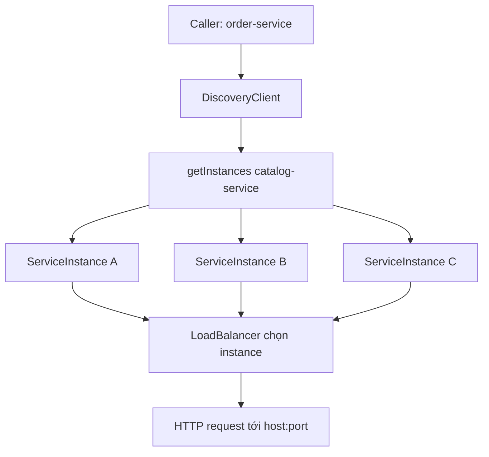

# Vai trò ServiceInstance và DefaultServiceInstance

Trong Spring Cloud, service discovery giúp một ứng dụng tìm các bản chạy của dịch vụ khác mà không phải cố định IP và port của từng máy. Discovery provider trả về danh sách endpoint có thể gọi; Spring Cloud Commons biểu diễn mỗi endpoint bằng abstraction **ServiceInstance**. Lớp **DefaultServiceInstance** là implementation phổ biến của abstraction này, hữu ích khi cần tạo một mô tả instance đơn giản, cấu hình discovery tĩnh hoặc viết test.

Hai kiểu này thường xuất hiện cùng nhau nhưng có vai trò khác nhau. ServiceInstance là hợp đồng mà DiscoveryClient và LoadBalancer có thể sử dụng độc lập với Eureka, Consul hay provider khác. DefaultServiceInstance là một object cụ thể chứa service ID, instance ID, host, port, trạng thái secure và metadata. Bản thân object đó không kết nối tới registry, không tự kiểm tra health và không tự đăng ký ứng dụng.

Bài học thuộc chương **DiscoveryClient** của module SPRING_CLOUD_CORE. Mục tiêu là hiểu các trường của ServiceInstance, cách đọc và sử dụng URI/metadata, cách tạo DefaultServiceInstance, giới hạn của dữ liệu discovery và cách kiểm thử luồng chọn endpoint trong hệ thống phân tán.

## 1. ServiceInstance giải quyết bài toán gì?

Giả sử order-service cần gọi catalog-service. Trong môi trường phát triển, catalog có thể chạy tại localhost:8081; ở staging, nó có thể chạy trên nhiều container; ở production, các instance có thể thay đổi IP sau mỗi lần scale hoặc rollout.

Nếu code gọi trực tiếp một host cố định:

```java
URI catalogUri = URI.create("http://10.0.1.21:8080");
```

thì địa chỉ đó trở thành một phụ thuộc cứng. Khi instance bị thay thế, caller phải được cập nhật và triển khai lại.

Với discovery, caller yêu cầu các instance theo service ID logic:

```java
List<ServiceInstance> instances =
        discoveryClient.getInstances("catalog-service");
```

Mỗi phần tử mô tả một địa chỉ có thể gọi. Ví dụ:

| Service ID | Instance ID | Host | Port | Secure |
| --- | --- | --- | ---: | --- |
| catalog-service | catalog-a1 | catalog-1.internal | 8080 | false |
| catalog-service | catalog-b2 | catalog-2.internal | 8080 | false |
| catalog-service | catalog-c3 | catalog-3.internal | 8443 | true |

Service ID xác định nhóm dịch vụ logic. Instance ID phân biệt một bản đăng ký cụ thể nếu provider cung cấp. Host, port và secure mô tả địa chỉ mạng. DiscoveryClient trả danh sách các mô tả này để lớp gọi dịch vụ hoặc load balancer lựa chọn.



ServiceInstance là dữ liệu mô tả một instance tại thời điểm discovery trả kết quả. Nó không bảo đảm endpoint sẽ luôn sống tới lúc request được gửi. Instance có thể dừng ngay sau khi được trả về; caller vẫn cần timeout, retry, circuit breaker và xử lý lỗi mạng phù hợp.

## 2. Hợp đồng ServiceInstance

Interface `org.springframework.cloud.client.ServiceInstance` thuộc Spring Cloud Commons. Nó tạo một abstraction chung để các thư viện discovery và load balancing trao đổi thông tin instance mà không buộc ứng dụng phụ thuộc trực tiếp vào kiểu dữ liệu của một registry cụ thể.

Các accessor quan trọng:

| Method | Ý nghĩa | Lưu ý |
| --- | --- | --- |
| `getServiceId()` | Service ID mà instance đăng ký | Là tên logic để tra cứu nhóm instance |
| `getInstanceId()` | ID duy nhất của instance nếu implementation cung cấp | Có implementation trả về `null` |
| `getHost()` | Hostname hoặc địa chỉ host của instance | Phải có thể truy cập từ caller |
| `getPort()` | Port của dịch vụ | Phải khớp cổng thực tế có thể gọi |
| `isSecure()` | Cho biết endpoint sử dụng HTTPS | Không thay thế cấu hình TLS trust |
| `getUri()` | URI địa chỉ dịch vụ | Nên dùng thay vì tự ghép chuỗi host/port |
| `getMetadata()` | Metadata key/value gắn với instance | Có thể rỗng hoặc `null`, tùy implementation |
| `getScheme()` | Scheme của instance nếu implementation cung cấp | Method mặc định có thể trả `null` |

### 2.1. Service ID

`getServiceId()` trả về tên dịch vụ logic được registry hoặc discovery client công bố. Nhiều instance có thể có cùng service ID:

```text
catalog-service
  ├── catalog-a1
  ├── catalog-b2
  └── catalog-c3
```

Khi gọi `getInstances("catalog-service")`, DiscoveryClient trả về các instance thuộc service ID đó. Service ID không phải host, port hoặc instance ID.

### 2.2. Instance ID

`getInstanceId()` cung cấp identity của bản đăng ký nếu implementation có dữ liệu đó. Trong hợp đồng hiện tại, đây là method mặc định có thể trả `null`; vì vậy code dùng ServiceInstance tổng quát không nên giả định mọi provider luôn cung cấp instance ID.

Ví dụ xử lý an toàn:

```java
String instanceId = instance.getInstanceId();

if (instanceId == null || instanceId.isBlank()) {
    // Ghi nhận rằng provider không cung cấp instance identity.
}
```

Không dùng `getHost() + ":" + getPort()` như một instance ID phổ quát nếu không có quy ước rõ ràng. Hai registration có thể dùng chung địa chỉ qua proxy, hoặc một instance có thể có nhiều địa chỉ mạng.

### 2.3. Host và port

`getHost()` trả hostname hoặc địa chỉ host mà caller sẽ kết nối. `getPort()` trả cổng dịch vụ. Hai giá trị phải đúng với góc nhìn network của caller.

Ví dụ, nếu catalog chạy trong container và caller ở cùng Kubernetes cluster, hostname nội bộ có thể là DNS service hoặc Pod address được provider công bố. `localhost` bên trong một container chỉ trỏ về chính container đó; không dùng `localhost` để mô tả một service ở container khác.

### 2.4. Secure và URI

`isSecure()` biểu thị kết nối tới instance dùng HTTPS. `getUri()` trả URI địa chỉ dịch vụ theo implementation. Với `DefaultServiceInstance`, URI được tạo từ host, port và cờ secure; scheme thường là `https` khi secure là `true`, còn lại là `http`.

Nên dùng:

```java
URI serviceUri = instance.getUri();
```

thay vì tự ghép:

```java
String url = "http://" + instance.getHost() + ":" + instance.getPort();
```

Tự ghép chuỗi có thể bỏ qua HTTPS, port mặc định, hoặc các khác biệt URI mà implementation quản lý. Nếu endpoint cần base path, query hoặc thông tin bổ sung, hãy xây dựng URI theo contract riêng của ứng dụng từ URI nền đã được xác định.

`isSecure()` chỉ mô tả scheme bảo mật của endpoint. Nó không tự cấu hình truststore, hostname verification, certificate rotation hay mTLS. Những phần đó thuộc HTTP client và hạ tầng TLS.

### 2.5. Metadata

`getMetadata()` trả map key/value do discovery provider gắn với instance. Ví dụ:

```text
zone = ap-southeast-1a
version = v2
canary = true
team = catalog
```

Metadata có thể hỗ trợ lọc instance theo zone, version, tenant hoặc năng lực. Tuy nhiên, Spring Cloud Commons không áp đặt một bộ key nghiệp vụ chung cho mọi provider. Ý nghĩa của metadata phải được thống nhất giữa nơi đăng ký và nơi tiêu thụ.

Hãy xử lý metadata như dữ liệu đầu vào từ hệ thống discovery:

- Kiểm tra key có tồn tại trước khi dùng.
- Chuyển đổi kiểu từ chuỗi một cách rõ ràng.
- Có giá trị fallback khi key không có.
- Không đặt password, token hoặc secret vào metadata.
- Không giả định metadata luôn bất biến hoặc luôn có mặt.

Ví dụ:

```java
Map<String, String> metadata = instance.getMetadata();

String zone = metadata == null ? null : metadata.get("zone");
String version = metadata == null ? null : metadata.get("version");
```

## 3. DefaultServiceInstance là gì?

`org.springframework.cloud.client.DefaultServiceInstance` là implementation mặc định của `ServiceInstance`. Nó lưu các trường cơ bản để mô tả một instance:

- `instanceId`
- `serviceId`
- `host`
- `port`
- `secure`
- `metadata`

Các constructor thường dùng:

```java
new DefaultServiceInstance(
        instanceId,
        serviceId,
        host,
        port,
        secure
);
```

Hoặc truyền thêm metadata:

```java
new DefaultServiceInstance(
        instanceId,
        serviceId,
        host,
        port,
        secure,
        metadata
);
```

Ví dụ tạo instance:

```java
import java.util.LinkedHashMap;
import java.util.Map;

import org.springframework.cloud.client.DefaultServiceInstance;
import org.springframework.cloud.client.ServiceInstance;

Map<String, String> metadata = new LinkedHashMap<>();
metadata.put("zone", "ap-southeast-1a");
metadata.put("version", "v2");

ServiceInstance instance = new DefaultServiceInstance(
        "catalog-pod-7f9a",
        "catalog-service",
        "catalog-1.internal",
        8080,
        false,
        metadata
);
```

Sử dụng interface ở phía caller:

```java
URI uri = instance.getUri();
String serviceId = instance.getServiceId();
String instanceId = instance.getInstanceId();
```

Biến có kiểu `ServiceInstance` giúp code phụ thuộc abstraction thay vì implementation cụ thể. Chỉ dùng `DefaultServiceInstance` trực tiếp khi cần tạo object hoặc khi test yêu cầu implementation mặc định.

### 3.1. Constructor không thực hiện discovery

Khi gọi `new DefaultServiceInstance(...)`, ứng dụng chỉ tạo một object Java chứa thông tin endpoint. Constructor không:

- Gọi Eureka, Consul hoặc Kubernetes API.
- Kiểm tra host có DNS hay không.
- Kiểm tra port có mở hay không.
- Đăng ký instance vào service registry.
- Gửi heartbeat hoặc health status.
- Chọn instance cho một request.

Những trách nhiệm đó thuộc discovery provider, ServiceRegistry, health check và load balancer. Không nên nhầm việc tạo DefaultServiceInstance với việc đăng ký service.

### 3.2. DefaultServiceInstance không phải Registration

`Registration` là abstraction riêng dùng với `ServiceRegistry`; trong Spring Cloud Commons, nó mở rộng hợp đồng `ServiceInstance` và đóng vai trò marker cho dữ liệu đăng ký. `DefaultServiceInstance` chỉ implement `ServiceInstance`, không tự trở thành `Registration`.

Do đó, không thể mặc định truyền một DefaultServiceInstance vào mọi `ServiceRegistry.register(...)`. Mỗi provider có registration implementation riêng, ví dụ EurekaRegistration hoặc ConsulRegistration. Khi cần đăng ký thủ công, hãy tạo đúng kiểu Registration mà ServiceRegistry đang sử dụng.

### 3.3. Object có thể thay đổi

DefaultServiceInstance cung cấp setter cho một số trường như instance ID, service ID, host, port và secure. Metadata cũng là map được lưu trên object. Điều đó khiến implementation này thuận tiện cho việc tạo dữ liệu, nhưng code không nên sửa instance sau khi đã chia sẻ cho nhiều thread hoặc đưa vào danh sách được cache.

Một quy tắc thực tế là tạo instance hoàn chỉnh trước khi publish, sau đó xem nó như dữ liệu chỉ đọc. Nếu cần thay đổi endpoint, tạo bản mô tả mới và cập nhật danh sách theo cơ chế đồng bộ của ứng dụng.

## 4. Tạo và đọc URI đúng cách

URI là địa chỉ mà HTTP client hoặc thành phần mạng có thể dùng để gọi instance.

Ví dụ endpoint HTTP:

```java
ServiceInstance httpInstance = new DefaultServiceInstance(
        "catalog-http-1",
        "catalog-service",
        "catalog-1.internal",
        8080,
        false
);

URI httpUri = httpInstance.getUri();
// http://catalog-1.internal:8080
```

Ví dụ endpoint HTTPS:

```java
ServiceInstance httpsInstance = new DefaultServiceInstance(
        "catalog-https-1",
        "catalog-service",
        "catalog-1.internal",
        8443,
        true
);

URI httpsUri = httpsInstance.getUri();
// https://catalog-1.internal:8443
```

Cờ secure phải khớp với cách server thực sự phục vụ traffic. Nếu đặt `secure=true` nhưng server chỉ nhận HTTP, client sẽ lỗi handshake hoặc kết nối. Nếu đặt `secure=false` cho endpoint chỉ hỗ trợ HTTPS, client sẽ gửi request sai scheme.

### 4.1. Port và giá trị mặc định

`DefaultServiceInstance` tạo URI từ host và port. Helper URI của ServiceInstance có thể sử dụng port mặc định 80 hoặc 443 khi port không dương, tùy secure flag. Tuy nhiên, registration thực tế nên công bố port rõ ràng; đừng dựa vào fallback để che lỗi cấu hình port bằng 0 hoặc giá trị chưa khởi tạo.

### 4.2. Host phải có thể truy cập từ caller

Một địa chỉ hợp lệ về cú pháp chưa chắc hợp lệ về network. Ví dụ:

- `localhost:8080` chỉ phù hợp khi server nằm trong cùng network namespace với caller.
- IP private chỉ dùng được nếu caller có route tới mạng đó.
- Pod IP có thể thay đổi khi Pod được tạo lại.
- DNS service có thể ổn định hơn Pod IP trong một số kiến trúc.
- Host/port công bố qua registry phải khớp cổng được expose sau NAT, proxy hoặc ingress.

Khi discovery trả về URI không gọi được, hãy kiểm tra địa chỉ từ chính network namespace của caller, không chỉ ping hoặc curl từ máy phát triển.

## 5. ServiceInstance được sử dụng qua DiscoveryClient

Spring Cloud Commons định nghĩa `DiscoveryClient` để lấy instance theo service ID và liệt kê các service ID đã biết.

```java
import java.util.List;

import org.springframework.cloud.client.ServiceInstance;
import org.springframework.cloud.client.discovery.DiscoveryClient;
import org.springframework.stereotype.Component;

@Component
public class CatalogInstanceFinder {
    private final DiscoveryClient discoveryClient;

    public CatalogInstanceFinder(DiscoveryClient discoveryClient) {
        this.discoveryClient = discoveryClient;
    }

    public List<ServiceInstance> findCatalogInstances() {
        return discoveryClient.getInstances("catalog-service");
    }

    public List<String> knownServices() {
        return discoveryClient.getServices();
    }
}
```

`getInstances(serviceId)` trả danh sách ServiceInstance. Danh sách rỗng có thể có nghĩa service chưa đăng ký, registry chưa đồng bộ, service ID sai hoặc không có instance phù hợp. Nó không nhất thiết là lỗi kết nối HTTP; caller cần phân biệt lỗi discovery với lỗi gọi endpoint.

Ví dụ xử lý danh sách:

```java
List<ServiceInstance> instances =
        discoveryClient.getInstances("catalog-service");

if (instances == null || instances.isEmpty()) {
    throw new IllegalStateException(
            "No instances found for catalog-service"
    );
}

for (ServiceInstance instance : instances) {
    System.out.println(instance.getServiceId());
    System.out.println(instance.getInstanceId());
    System.out.println(instance.getUri());
}
```

Một số implementation trả danh sách rỗng khi không có service; code vẫn nên tránh giả định danh sách luôn có ít nhất một phần tử. Nếu muốn ứng dụng tiếp tục khi discovery tạm lỗi, hãy định nghĩa rõ fallback và timeout.

## 6. DefaultServiceInstance trong SimpleDiscoveryClient

Spring Cloud Commons có `SimpleDiscoveryClient`, một discovery implementation dùng cấu hình properties để cung cấp danh sách instance. Nó hữu ích cho môi trường nhỏ, local development, test hoặc trường hợp không cần một service registry chuyên dụng.

Khi không có discovery client dựa trên registry trong classpath, SimpleDiscoveryClient có thể được sử dụng làm nguồn instance tĩnh.

Ví dụ YAML:

```yaml
spring:
  cloud:
    discovery:
      client:
        simple:
          instances:
            catalog-service:
              - uri: http://catalog-1.internal:8080
              - uri: http://catalog-2.internal:8080
```

Hoặc dạng property:

```properties
spring.cloud.discovery.client.simple.instances.catalog-service[0].uri=http://catalog-1.internal:8080
spring.cloud.discovery.client.simple.instances.catalog-service[1].uri=http://catalog-2.internal:8080
```

Service ID là `catalog-service`; chỉ số `[0]`, `[1]` phân biệt các phần tử trong danh sách. SimpleDiscoveryClient chuyển các cấu hình instance thành ServiceInstance để caller sử dụng qua cùng abstraction DiscoveryClient.

### 6.1. SimpleDiscoveryClient không phải registry động

Danh sách instance được khai báo trong cấu hình. Nó không tự phát hiện Pod mới, gửi heartbeat, đăng ký instance khi ứng dụng khởi động hoặc xóa instance khi process dừng. Khi topology thay đổi, cấu hình phải được cập nhật và ứng dụng phải nhận cấu hình theo cơ chế triển khai tương ứng.

Nếu hệ thống cần tự động scale, health registration, lease, deregistration hoặc đồng bộ nhiều node, hãy dùng discovery provider/registry phù hợp.

### 6.2. Không gắn cứng endpoint production trong source code

SimpleDiscoveryClient vẫn có thể nhận URI từ profile hoặc nguồn cấu hình ngoài. Tránh commit IP/port của môi trường production vào source code hoặc profile dùng chung. Cấu hình endpoint cần được quản lý theo môi trường và có thể kiểm tra khi triển khai.

## 7. Metadata và cách sử dụng

Metadata cho phép discovery provider hoặc load balancer mang thêm thuộc tính về từng instance. Ví dụ catalog có các instance ở hai zone:

| Instance | URI | Metadata |
| --- | --- | --- |
| catalog-a | http://catalog-a:8080 | zone=zone-a, version=v1 |
| catalog-b | http://catalog-b:8080 | zone=zone-b, version=v2 |

Caller hoặc custom ServiceInstanceListSupplier có thể dùng metadata để lọc theo zone hoặc version nếu ứng dụng đã cấu hình chính sách tương ứng.

Ví dụ đọc metadata:

```java
String version = null;
Map<String, String> metadata = instance.getMetadata();

if (metadata != null) {
    version = metadata.get("version");
}

if ("v2".equals(version)) {
    // Instance được gắn nhãn version v2.
}
```

Chỉ đọc metadata không làm load balancer tự động lọc instance. Cần cấu hình supplier, hint hoặc policy tương ứng để metadata ảnh hưởng tới lựa chọn. Không dùng metadata như một cơ chế authorization; caller vẫn phải xác thực và kiểm tra quyền ở server.

### 7.1. Metadata không phải hợp đồng chung cho mọi provider

Các provider có thể chuẩn hóa metadata, giới hạn key hoặc bổ sung trường riêng. Một key như `zone` có thể tồn tại ở provider này nhưng không tồn tại ở provider khác. Nếu ứng dụng phụ thuộc vào metadata để định tuyến, hãy định nghĩa schema nội bộ và kiểm thử trên provider thực tế.

### 7.2. Không lưu secret trong metadata

Metadata có thể xuất hiện trong registry dashboard, log, endpoint quản trị hoặc response discovery. Không đặt token, password, private key hoặc dữ liệu cá nhân nhạy cảm vào đây. Dùng secret manager và cơ chế xác thực riêng.

## 8. ServiceInstance và LoadBalancer

DiscoveryClient cung cấp các instance; Spring Cloud LoadBalancer lựa chọn một instance để xử lý request. Hai abstraction có trách nhiệm khác nhau:

| Thành phần | Trách nhiệm |
| --- | --- |
| DiscoveryClient | Tra cứu các ServiceInstance theo service ID |
| ServiceInstance | Mô tả một endpoint cụ thể |
| ServiceInstanceListSupplier | Cung cấp danh sách instance cho LoadBalancer |
| ReactorLoadBalancer / BlockingLoadBalancerClient | Chọn instance theo policy |
| HTTP client được tích hợp LoadBalancer | Gửi request tới instance được chọn |

Ví dụ một HTTP client dùng service ID logic:

```java
@LoadBalanced
@Bean
RestClient.Builder loadBalancedRestClientBuilder() {
    return RestClient.builder();
}
```

Caller sử dụng hostname ảo là service ID:

```java
String response = restClientBuilder.build()
        .get()
        .uri("http://catalog-service/catalog/42")
        .retrieve()
        .body(String.class);
```

LoadBalancer tìm danh sách instance của `catalog-service`, chọn một ServiceInstance và chuyển request tới URI vật lý tương ứng. Ứng dụng không cần tự lấy DefaultServiceInstance rồi chọn ngẫu nhiên trong code nghiệp vụ nếu đã dùng LoadBalancer.

Cấu hình bean và starter cụ thể phụ thuộc HTTP client stack và Spring Cloud release train. Đảm bảo Spring Cloud LoadBalancer có trong classpath nếu muốn dùng client-side load balancing.

## 9. Phân biệt ServiceInstance, Registration và DefaultServiceInstance

Các kiểu này liên quan nhưng không thể thay thế tùy tiện:

| Kiểu | Vai trò | Dùng khi |
| --- | --- | --- |
| `ServiceInstance` | Hợp đồng mô tả instance | Đọc dữ liệu từ DiscoveryClient hoặc LoadBalancer |
| `DefaultServiceInstance` | Implementation mặc định của ServiceInstance | Tạo mô tả instance, dữ liệu test hoặc nguồn tĩnh |
| `Registration` | Marker abstraction mở rộng ServiceInstance cho thao tác đăng ký | Truyền registration cho ServiceRegistry |
| `ServiceRegistry` | Đăng ký, deregister, cập nhật trạng thái registration | Tích hợp với registry provider |

Ví dụ logic với ServiceRegistry cần một Registration đúng kiểu provider:

```java
Registration registration = createProviderSpecificRegistration();
serviceRegistry.register(registration);
```

`createProviderSpecificRegistration()` là placeholder vì mỗi provider có registration implementation riêng. Không thể thay bằng `new DefaultServiceInstance(...)` nếu phương thức `register` yêu cầu `Registration`.

Việc auto-registration thường được tích hợp trong lifecycle của discovery provider. Không tự đăng ký cùng một instance lần thứ hai nếu auto-registration đã bật; điều đó có thể tạo registration trùng hoặc trạng thái không nhất quán.

## 10. Kiểm thử với DefaultServiceInstance

DefaultServiceInstance thuận tiện cho unit test vì có thể tạo endpoint giả mà không cần khởi chạy Eureka/Consul.

Ví dụ:

```java
import static org.assertj.core.api.Assertions.assertThat;

import java.util.Map;

import org.junit.jupiter.api.Test;
import org.springframework.cloud.client.DefaultServiceInstance;
import org.springframework.cloud.client.ServiceInstance;

class ServiceInstanceTest {

    @Test
    void exposesInstanceAddressAndMetadata() {
        ServiceInstance instance = new DefaultServiceInstance(
                "catalog-test-1",
                "catalog-service",
                "localhost",
                8081,
                false,
                Map.of("zone", "test-zone", "version", "v2")
        );

        assertThat(instance.getServiceId()).isEqualTo("catalog-service");
        assertThat(instance.getInstanceId()).isEqualTo("catalog-test-1");
        assertThat(instance.getHost()).isEqualTo("localhost");
        assertThat(instance.getPort()).isEqualTo(8081);
        assertThat(instance.isSecure()).isFalse();
        assertThat(instance.getUri().toString())
                .isEqualTo("http://localhost:8081");
        assertThat(instance.getMetadata()).containsEntry("version", "v2");
    }
}
```

Test này xác minh cách DefaultServiceInstance lưu và cung cấp thông tin. Nó không chứng minh registry thật đã đăng ký instance hoặc endpoint HTTP có thể truy cập.

### 10.1. Kiểm thử HTTPS

Tạo instance với `secure=true` và port HTTPS test; xác nhận URI sử dụng scheme `https`. Không cần tạo TLS server nếu chỉ kiểm tra cách object biểu diễn địa chỉ. Muốn xác minh TLS handshake, cần integration test với server và certificate test phù hợp.

### 10.2. Kiểm thử DiscoveryClient

Có thể mock DiscoveryClient để trả danh sách DefaultServiceInstance:

```java
when(discoveryClient.getInstances("catalog-service"))
        .thenReturn(List.of(
                new DefaultServiceInstance(
                        "catalog-a",
                        "catalog-service",
                        "localhost",
                        8081,
                        false
                ),
                new DefaultServiceInstance(
                        "catalog-b",
                        "catalog-service",
                        "localhost",
                        8082,
                        false
                )
        ));
```

Sau đó kiểm thử service gọi discovery xử lý trường hợp có instance, danh sách rỗng và lỗi từ provider. Đây là unit test cho logic caller, không thay thế integration test của discovery provider.

### 10.3. Kiểm thử SimpleDiscoveryClient

Khi dùng SimpleDiscoveryClient, có thể khởi động context với properties tĩnh và gọi `getInstances("catalog-service")`. Xác nhận số lượng, URI và metadata khớp cấu hình. Test này giúp kiểm tra binding properties nhưng không kiểm tra behavior của registry phân tán.

## 11. Các lỗi thường gặp

| Triệu chứng | Nguyên nhân có thể | Hướng kiểm tra |
| --- | --- | --- |
| `getInstances` trả danh sách rỗng | Sai service ID, chưa đăng ký hoặc provider chưa đồng bộ | Kiểm tra service ID và registry |
| URI có host nhưng không kết nối được | Host không reachable từ caller | Kiểm tra DNS, routing, network policy và container namespace |
| Request dùng HTTP trong khi server yêu cầu HTTPS | `secure` hoặc URI scheme được công bố sai | Kiểm tra `isSecure()` và `getUri()` |
| Instance ID trả `null` | Provider không cung cấp ID qua ServiceInstance | Không giả định mọi implementation đều có instance ID |
| Metadata rỗng hoặc thiếu key | Provider không publish metadata hoặc key khác schema | Kiểm tra registration metadata và cách chuẩn hóa |
| Nhiều request tới một instance | LoadBalancer policy, cache hoặc supplier không như kỳ vọng | Kiểm tra danh sách đầu vào và policy lựa chọn |
| `DefaultServiceInstance` tạo được nhưng registry không nhận | Đang truyền ServiceInstance thay vì Registration | Dùng registration implementation của provider |
| SimpleDiscoveryClient không thấy instance mới | Cấu hình tĩnh chưa cập nhật hoặc app chưa nạp lại | Kiểm tra property binding và lifecycle triển khai |
| Host trả về là localhost | Provider hoặc local config quảng bá địa chỉ loopback | Công bố host/DNS có thể truy cập từ caller |
| Port không khớp | Registry ghi cổng container/management thay vì cổng service | Kiểm tra port mapping và registration |

Trình tự chẩn đoán:

1. Kiểm tra service ID caller đang tra cứu.
2. Gọi DiscoveryClient và xem số lượng ServiceInstance trả về.
3. Ghi nhận host, port, secure, URI và instance ID nếu có.
4. Kiểm tra metadata có đúng schema và giá trị mong đợi.
5. Thử kết nối từ chính instance caller tới URI được discovery trả về.
6. Kiểm tra provider health, registration, lease và cache.
7. Kiểm tra LoadBalancer nhận đúng danh sách và chọn instance theo policy.
8. Phân biệt lỗi discovery, lỗi DNS/network, lỗi TLS và lỗi ứng dụng đích.

## 12. Thực hành: tạo danh sách instance giả cho catalog-service

Giả sử cần kiểm thử một policy chọn endpoint catalog mà không khởi động registry.

### Bước 1 — Tạo các ServiceInstance

```java
List<ServiceInstance> instances = List.of(
        new DefaultServiceInstance(
                "catalog-a",
                "catalog-service",
                "catalog-a.internal",
                8080,
                false,
                Map.of("zone", "zone-a", "version", "v1")
        ),
        new DefaultServiceInstance(
                "catalog-b",
                "catalog-service",
                "catalog-b.internal",
                8443,
                true,
                Map.of("zone", "zone-b", "version", "v2")
        )
);
```

### Bước 2 — Kiểm tra URI và metadata

```java
for (ServiceInstance instance : instances) {
    System.out.println("service=" + instance.getServiceId());
    System.out.println("instance=" + instance.getInstanceId());
    System.out.println("uri=" + instance.getUri());
    System.out.println("metadata=" + instance.getMetadata());
}
```

Không ghi metadata nhạy cảm ra log. Ví dụ này chỉ dùng dữ liệu giả.

### Bước 3 — Kiểm tra điều kiện HTTPS

Xác nhận instance `catalog-b` có `isSecure() == true` và URI scheme là HTTPS. Kiểm tra policy client có cho phép kết nối TLS tới host đó.

### Bước 4 — Kiểm tra trường hợp thiếu dữ liệu

Tạo một implementation test của ServiceInstance có `getInstanceId()` hoặc `getMetadata()` trả `null`. Xác nhận code caller không ném NullPointerException khi đọc metadata hoặc log instance ID.

### Bước 5 — Chuyển sang discovery thật

Khi logic đã đúng, thay danh sách test bằng `DiscoveryClient.getInstances("catalog-service")` hoặc `ServiceInstanceListSupplier` được LoadBalancer sử dụng. Không cần thay đổi code nghiệp vụ nếu nó đã phụ thuộc vào interface ServiceInstance.

## 13. Câu hỏi tự kiểm tra

1. `ServiceInstance` mô tả điều gì trong Spring Cloud?
2. `getServiceId()` khác `getInstanceId()` như thế nào?
3. Vì sao code tổng quát phải xử lý trường hợp `getInstanceId()` trả `null`?
4. `getHost()`, `getPort()` và `isSecure()` tham gia tạo địa chỉ gọi như thế nào?
5. Vì sao nên dùng `getUri()` thay vì tự ghép host và port?
6. `getMetadata()` có phải schema chuẩn giống nhau cho mọi discovery provider không?
7. `DefaultServiceInstance` có tự đăng ký với Eureka hoặc Consul không?
8. Vì sao `DefaultServiceInstance` không thể mặc định truyền vào `ServiceRegistry.register()`?
9. SimpleDiscoveryClient lấy danh sách instance từ đâu?
10. ServiceInstance và LoadBalancer có trách nhiệm khác nhau thế nào?
11. Nếu `getInstances()` trả danh sách rỗng, cần kiểm tra những gì?
12. Vì sao một URI hợp lệ về cú pháp vẫn có thể không truy cập được?

**Gợi ý đáp án:** (1) Một bản mô tả endpoint của instance trong hệ thống discovery; (2) Service ID định danh nhóm dịch vụ, instance ID định danh bản đăng ký cụ thể; (3) Vì interface cho phép implementation không cung cấp ID; (4) Host và port tạo địa chỉ, secure quyết định HTTP/HTTPS; (5) Để tôn trọng cách implementation tạo URI và scheme; (6) Không, metadata phụ thuộc provider và hợp đồng ứng dụng; (7) Không, nó chỉ là object Java; (8) Nó implement ServiceInstance, còn registry yêu cầu Registration; (9) Từ properties tĩnh; (10) ServiceInstance mô tả endpoint, LoadBalancer chọn một endpoint cho request; (11) Service ID, registration, provider health, cache và network; (12) Host/port có thể không reachable từ network của caller.

## 14. Những nguyên tắc cần nhớ

- `ServiceInstance` là abstraction mô tả một endpoint dịch vụ, độc lập với discovery provider.
- Service ID nhận diện nhóm dịch vụ; instance ID nhận diện bản đăng ký cụ thể nếu implementation cung cấp.
- `getInstanceId()` có thể trả `null`; metadata cũng cần được kiểm tra trước khi sử dụng.
- `getHost()`, `getPort()`, `isSecure()` và `getUri()` phải phản ánh địa chỉ có thể truy cập từ caller.
- `DefaultServiceInstance` là implementation mặc định hữu ích cho object mô tả, test và dữ liệu discovery tĩnh.
- Tạo DefaultServiceInstance không gọi registry, không health check và không thực hiện network discovery.
- `DefaultServiceInstance` implement `ServiceInstance`; `Registration` là abstraction riêng dành cho thao tác `ServiceRegistry`.
- SimpleDiscoveryClient lấy instance từ properties và phù hợp với topology tĩnh; nó không thay thế registry động.
- Metadata cần schema rõ ràng, không chứa secret và chỉ có tác dụng định tuyến khi policy/supplier sử dụng nó.
- Kiểm thử riêng object instance, DiscoveryClient, LoadBalancer và kết nối mạng để xác định đúng tầng có lỗi.

Hiểu rõ ServiceInstance và DefaultServiceInstance giúp ứng dụng Spring Cloud làm việc với địa chỉ dịch vụ theo một hợp đồng thống nhất. Khi phân biệt object mô tả instance với registration và cơ chế lựa chọn endpoint, code có thể kiểm thử độc lập, thay đổi discovery provider dễ hơn và xử lý chính xác các vấn đề về host, port, TLS và metadata.

## Tài liệu tham khảo

- [Spring Cloud Commons — Common Abstractions](https://docs.spring.io/spring-cloud-commons/reference/spring-cloud-commons/common-abstractions.html)
- [Spring Cloud Commons — ServiceInstance API](https://github.com/spring-cloud/spring-cloud-commons/blob/main/spring-cloud-commons/src/main/java/org/springframework/cloud/client/ServiceInstance.java)
- [Spring Cloud Commons — DefaultServiceInstance API](https://github.com/spring-cloud/spring-cloud-commons/blob/main/spring-cloud-commons/src/main/java/org/springframework/cloud/client/DefaultServiceInstance.java)
- [Spring Cloud LoadBalancer](https://docs.spring.io/spring-cloud-commons/reference/spring-cloud-commons/loadbalancer.html)
