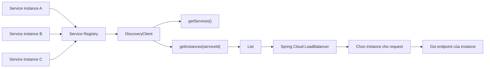
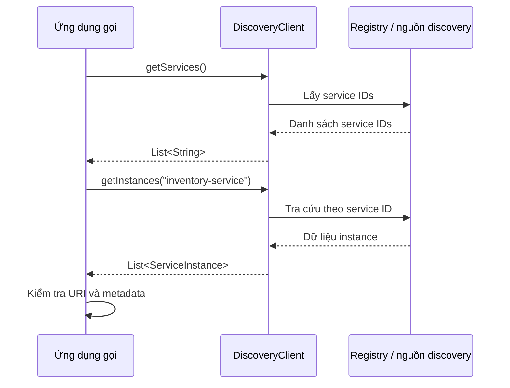

# Liệt kê dịch vụ và lấy danh sách instance

## 1. Từ tên dịch vụ đến địa chỉ của instance

Trong hệ thống phân tán, một dịch vụ có thể chạy trên nhiều instance. Mỗi instance có địa chỉ mạng, cổng, trạng thái bảo mật và metadata riêng. Khi một ứng dụng cần tìm dịch vụ khác, nó không nên phải biết trước hostname hoặc IP của từng instance.

Spring Cloud Commons cung cấp abstraction `DiscoveryClient` để ứng dụng truy vấn thông tin discovery theo cách ít phụ thuộc vào registry cụ thể. Phía sau abstraction này có thể là Eureka, Consul, Zookeeper hoặc một implementation khác. Hai thao tác đọc quan trọng nhất là:

- `getServices()`: lấy các service ID mà discovery client hiện biết.
- `getInstances(serviceId)`: lấy danh sách instance gắn với một service ID.

Bài học thuộc chương **DiscoveryClient** của module **SPRING_CLOUD_CORE**. Module tập trung vào Spring Cloud Commons, Spring Cloud Context, cấu hình ngoài, tương thích Spring Boot, refresh scope, discovery, service registry, giao tiếp dịch vụ và cách kiểm thử/vận hành các abstraction chung.

Sau bài này, người học có thể:

- Phân biệt service ID và service instance.
- Liệt kê service ID bằng `DiscoveryClient.getServices()`.
- Truy vấn các instance bằng `DiscoveryClient.getInstances(serviceId)`.
- Đọc URI, host, port, secure flag, instance ID và metadata từ `ServiceInstance`.
- Cấu hình `SimpleDiscoveryClient` khi không cần registry bên ngoài.
- Phân biệt blocking discovery với reactive discovery.
- Hiểu ranh giới giữa discovery, service registration và client-side load balancing.
- Xử lý danh sách rỗng, dữ liệu stale, nhiều discovery client và chi phí truy vấn.

## 2. DiscoveryClient nằm ở đâu trong kiến trúc?

Discovery thường có ba vai trò riêng:

1. **Service registry:** lưu thông tin đăng ký của các service instance và cập nhật khi instance đăng ký, deregister hoặc trạng thái thay đổi.
2. **Discovery client:** đọc thông tin từ registry hoặc nguồn discovery, trả về service ID và danh sách instance.
3. **Load balancer:** chọn một instance phù hợp cho một request cụ thể từ danh sách instance có sẵn.



Ví dụ, registry có thể biết dịch vụ `inventory-service` đang chạy trên hai instance:

| Service ID | Instance ID | Địa chỉ |
| --- | --- | --- |
| `inventory-service` | `inventory-1` | `http://10.0.0.11:8080` |
| `inventory-service` | `inventory-2` | `https://10.0.0.12:8443` |
| `payment-service` | `payment-1` | `http://10.0.1.21:8080` |

Trong trường hợp này:

- `getServices()` có thể trả về `inventory-service` và `payment-service`.
- `getInstances("inventory-service")` trả về hai instance của dịch vụ inventory.
- `getInstances("payment-service")` trả về instance của payment.

`DiscoveryClient` là abstraction đọc dữ liệu discovery. Nó không phải API đăng ký instance và cũng không phải thuật toán chọn instance cho từng request. Spring Cloud Commons có `ServiceRegistry` cho thao tác đăng ký/hủy đăng ký; Spring Cloud LoadBalancer dùng danh sách instance để chọn đích gọi.

## 3. Hai phương thức đọc cốt lõi

### 3.1. getServices(): liệt kê service ID

Chữ ký phương thức:

```java
List<String> getServices();
```

Phương thức trả về các service ID mà implementation hiện tại biết. Service ID là khóa dùng để truy vấn instance tiếp theo. Nó thường được lấy từ tên ứng dụng hoặc tên dịch vụ đã đăng ký, nhưng quy tắc đặt tên và chuẩn hóa có thể khác nhau giữa các registry.

Ví dụ:

```java
List<String> serviceIds = discoveryClient.getServices();

serviceIds.forEach(System.out::println);
```

Kết quả minh họa:

```text
inventory-service
payment-service
notification-service
```

Danh sách này phục vụ mục đích tra cứu và quan sát. Không nên coi nó là danh sách endpoint có thể gọi ngay lập tức: service ID có thể không còn instance khả dụng khi truy vấn tiếp theo diễn ra. Interface cũng không cam kết thứ tự ổn định cho danh sách; không nên dùng phần tử đầu tiên như một lựa chọn mặc định.

### 3.2. getInstances(serviceId): lấy các instance của một dịch vụ

Chữ ký phương thức:

```java
List<ServiceInstance> getInstances(String serviceId);
```

Tham số `serviceId` phải khớp với service ID mà registry hoặc discovery provider sử dụng. Kết quả là danh sách `ServiceInstance`, mỗi phần tử mô tả một địa chỉ có thể được dùng để liên hệ với instance.

Ví dụ:

```java
List<ServiceInstance> instances =
        discoveryClient.getInstances("inventory-service");

for (ServiceInstance instance : instances) {
    System.out.println(instance.getUri());
}
```

Kết quả minh họa:

```text
http://10.0.0.11:8080
https://10.0.0.12:8443
```

Nếu service ID không tồn tại hoặc không có instance phù hợp tại thời điểm truy vấn, implementation thường trả danh sách rỗng. Cần phân biệt trường hợp đó với lỗi kết nối registry: một số provider có thể ném exception khi không truy cập được backend discovery. Không nên bắt mọi exception rồi chuyển thành danh sách rỗng, vì điều đó che giấu sự cố registry.

### 3.3. Quy trình truy vấn



Hai truy vấn có thể được gọi độc lập. Nếu đã biết service ID từ cấu hình hoặc một yêu cầu nghiệp vụ, ứng dụng có thể gọi thẳng `getInstances(serviceId)` mà không cần liệt kê toàn bộ service trước.

## 4. Đọc thông tin từ ServiceInstance

Spring Cloud Commons định nghĩa `ServiceInstance` để biểu diễn một instance trong hệ thống discovery. Các trường thường dùng:

| Phương thức | Ý nghĩa |
| --- | --- |
| `getInstanceId()` | ID duy nhất của instance theo registry; có thể không được cung cấp |
| `getServiceId()` | Service ID mà instance thuộc về |
| `getHost()` | Hostname hoặc địa chỉ IP |
| `getPort()` | Cổng dịch vụ |
| `isSecure()` | Cho biết instance sử dụng HTTPS |
| `getUri()` | URI của instance, gồm scheme, host và port |
| `getMetadata()` | Map metadata dạng key/value do provider hoặc ứng dụng gắn vào |
| `getScheme()` | Scheme nếu implementation cung cấp riêng |

Không nên giả định mọi implementation đều có instance ID hoặc metadata. Hai giá trị này có thể là `null`. Metadata cũng phụ thuộc provider; các khóa như `zone`, `version`, `weight` chỉ có ý nghĩa khi hệ thống đăng ký và tiêu thụ chúng theo cùng một quy ước.

Ví dụ đọc một instance:

```java
ServiceInstance instance = instances.get(0);

String serviceId = instance.getServiceId();
String instanceId = instance.getInstanceId();
String host = instance.getHost();
int port = instance.getPort();
boolean secure = instance.isSecure();
URI uri = instance.getUri();
Map<String, String> metadata = instance.getMetadata();
```

Để gọi địa chỉ instance, ưu tiên dùng `getUri()` thay vì tự ghép chuỗi host và port. URI đã phản ánh scheme bảo mật và cách provider biểu diễn địa chỉ. Nếu cần log hoặc hiển thị, hãy xử lý trường nullable và không giả định metadata luôn tồn tại.

### 4.1. Metadata có thể dùng vào việc gì?

Metadata bổ sung thông tin ngoài địa chỉ mạng:

```yaml
metadata:
  zone: ap-southeast-1a
  version: v2
  weight: "3"
```

Các ứng dụng có thể dùng metadata cho:

- Ưu tiên instance trong cùng availability zone.
- Chọn phiên bản API phù hợp.
- Gắn nhãn nhóm triển khai hoặc tenant.
- Cung cấp trọng số cho thuật toán load balancing.
- Phục vụ dashboard và chẩn đoán.

Metadata không tự tạo ra hành vi. Ví dụ, thêm `zone: ap-southeast-1a` không tự khiến request được định tuyến theo zone. LoadBalancer hoặc logic tùy biến phải đọc metadata và áp dụng chính sách tương ứng.

### 4.2. Ví dụ ánh xạ thành DTO

Nếu cần hiển thị danh sách instance trong API nội bộ hoặc trang quản trị, nên chọn lọc trường cần thiết thay vì trả trực tiếp toàn bộ object provider:

```java
import java.net.URI;
import java.util.Collections;
import java.util.LinkedHashMap;
import java.util.Map;

public record InstanceView(
        String instanceId,
        String serviceId,
        String host,
        int port,
        boolean secure,
        URI uri,
        Map<String, String> metadata) {
}
```

Phương thức ánh xạ:

```java
private InstanceView toView(ServiceInstance instance) {
    Map<String, String> metadata = instance.getMetadata();

    return new InstanceView(
            instance.getInstanceId(),
            instance.getServiceId(),
            instance.getHost(),
            instance.getPort(),
            instance.isSecure(),
            instance.getUri(),
            metadata == null ? Map.of() : Collections.unmodifiableMap(new LinkedHashMap<>(metadata))
    );
}
```

Không nên mở endpoint liệt kê toàn bộ registry cho người dùng công khai. Danh sách host, port, metadata, tên nội bộ và topology có thể tiết lộ thông tin hạ tầng. Nếu cần API quản trị, hãy áp dụng authentication, authorization và lọc trường dữ liệu.

## 5. Dùng DiscoveryClient trong ứng dụng Spring

Một service có thể inject `DiscoveryClient` để cung cấp thao tác tra cứu tập trung:

```java
import java.util.List;

import org.springframework.cloud.client.ServiceInstance;
import org.springframework.cloud.client.discovery.DiscoveryClient;
import org.springframework.stereotype.Service;
import org.springframework.util.StringUtils;

@Service
public class ServiceCatalog {

    private final DiscoveryClient discoveryClient;

    public ServiceCatalog(DiscoveryClient discoveryClient) {
        this.discoveryClient = discoveryClient;
    }

    public List<String> listServiceIds() {
        return List.copyOf(discoveryClient.getServices());
    }

    public List<ServiceInstance> listInstances(String serviceId) {
        if (!StringUtils.hasText(serviceId)) {
            throw new IllegalArgumentException("serviceId must not be blank");
        }

        return List.copyOf(discoveryClient.getInstances(serviceId));
    }
}
```

Ở đây, `ServiceCatalog` chỉ là lớp ứng dụng bọc hai thao tác đọc. Nó không tự đăng ký service và không tự chọn instance. Việc tách lớp giúp controller, job hoặc thành phần quản trị dùng chung quy tắc kiểm tra đầu vào và xử lý lỗi.

Với các phiên bản Spring Cloud hiện hành, `@EnableDiscoveryClient` không còn là annotation bắt buộc nếu implementation discovery phù hợp đã có trên classpath. Spring Cloud auto-configuration có thể phát hiện implementation. Tuy vậy, cần kiểm tra starter và cấu hình của provider cụ thể; việc có interface trên classpath không tự đảm bảo registry đã kết nối và có dữ liệu.

## 6. SimpleDiscoveryClient: cấu hình instance tĩnh

Không phải môi trường nào cũng cần một service registry riêng. Nếu không có implementation discovery dựa trên registry trong classpath, Spring Cloud Commons có thể sử dụng `SimpleDiscoveryClient`. Implementation này đọc danh sách service và instance từ cấu hình ứng dụng.

Ví dụ:

```yaml
spring:
  cloud:
    discovery:
      client:
        simple:
          instances:
            inventory-service:
              - uri: http://inventory-1.internal:8080
                metadata:
                  zone: az-a
              - uri: https://inventory-2.internal:8443
                metadata:
                  zone: az-b
            payment-service:
              - uri: http://payment-1.internal:8080
```

Sau khi cấu hình được bind:

```java
List<String> services = discoveryClient.getServices();

List<ServiceInstance> inventory =
        discoveryClient.getInstances("inventory-service");
```

Kết quả có hai service ID và hai instance cho `inventory-service`. Trong dạng properties, cấu hình tương đương có thể viết:

```properties
spring.cloud.discovery.client.simple.instances.inventory-service[0].uri=http://inventory-1.internal:8080
spring.cloud.discovery.client.simple.instances.inventory-service[1].uri=https://inventory-2.internal:8443
spring.cloud.discovery.client.simple.instances.payment-service[0].uri=http://payment-1.internal:8080
```

Chỉ số `[0]`, `[1]` xác định vị trí từng instance trong danh sách và bắt đầu từ 0.

`SimpleDiscoveryClient` phù hợp cho môi trường local, integration test, demo hoặc danh sách endpoint ít thay đổi. Nó không thay thế registry động khi hệ thống cần tự cập nhật instance theo vòng đời container, autoscaling hoặc health registration.

## 7. Blocking và reactive discovery

Spring Cloud Commons có hai abstraction để phù hợp với kiểu xử lý của ứng dụng:

| Interface | Kết quả | Phù hợp |
| --- | --- | --- |
| `DiscoveryClient` | `List<String>`, `List<ServiceInstance>` | Ứng dụng blocking hoặc imperative |
| `ReactiveDiscoveryClient` | `Flux<String>`, `Flux<ServiceInstance>` | Ứng dụng reactive/WebFlux |

Trong ứng dụng reactive, dùng `ReactiveDiscoveryClient` để tránh gọi một API blocking trên event-loop:

```java
import org.springframework.cloud.client.ServiceInstance;
import org.springframework.cloud.client.discovery.ReactiveDiscoveryClient;
import org.springframework.stereotype.Service;
import reactor.core.publisher.Flux;
import reactor.core.publisher.Mono;

@Service
public class ReactiveServiceCatalog {

    private final ReactiveDiscoveryClient discoveryClient;

    public ReactiveServiceCatalog(ReactiveDiscoveryClient discoveryClient) {
        this.discoveryClient = discoveryClient;
    }

    public Flux<String> listServiceIds() {
        return discoveryClient.getServices();
    }

    public Flux<ServiceInstance> listInstances(String serviceId) {
        return discoveryClient.getInstances(serviceId);
    }

    public Mono<Void> probe() {
        return discoveryClient.reactiveProbe();
    }
}
```

Các publisher chỉ thực hiện công việc khi được subscribe theo quy tắc Reactor. Hãy compose `Flux`/`Mono` vào pipeline WebFlux thay vì gọi `block()` trên event-loop.

Với reactive discovery, dùng `reactiveProbe()` để kiểm tra khả năng gọi discovery. Phương thức `probe()` cũ đã deprecated; implementation hiện hành cảnh báo không nên dùng vì nó gọi `getServices()` nhưng không subscribe vào publisher được trả về.

Có thể tắt từng kiểu discovery qua cấu hình:

```yaml
spring:
  cloud:
    discovery:
      blocking:
        enabled: true
      reactive:
        enabled: true
```

Đặt một trong hai thuộc tính thành `false` nếu ứng dụng không sử dụng kiểu tương ứng. Có thể tắt toàn bộ discovery bằng `spring.cloud.discovery.enabled=false`; hãy lưu ý tác động đến cả những thành phần khác đang phụ thuộc discovery.

## 8. Nhiều DiscoveryClient và thứ tự lựa chọn

`DiscoveryClient` mở rộng Spring `Ordered`. Implementation có thể cung cấp `getOrder()`; mặc định của interface là `0`. Khi có nhiều discovery client, thứ tự là một phần của cách Spring Cloud tổ chức và sử dụng các implementation.

Với custom client, có thể ghi đè:

```java
@Override
public int getOrder() {
    return 10;
}
```

Các implementation Spring Cloud cung cấp cũng có thể nhận cấu hình thứ tự qua property tương ứng, ví dụ `spring.cloud.{clientIdentifier}.discovery.order` hoặc `eureka.client.order` với Eureka.

Khi nhiều provider cùng có mặt, không nên mặc định rằng `getInstances(serviceId)` sẽ hợp nhất mọi instance từ mọi registry. Hãy kiểm tra composite discovery client và chính sách delegation của phiên bản đang sử dụng. Thứ tự client có thể ảnh hưởng đến kết quả tra cứu, vì vậy cần kiểm thử trường hợp một service ID xuất hiện ở nhiều nguồn.

## 9. DiscoveryClient, ServiceRegistry và LoadBalancer khác nhau

| Thành phần | Trách nhiệm | API/khái niệm |
| --- | --- | --- |
| `DiscoveryClient` | Đọc service ID và danh sách instance | `getServices()`, `getInstances(serviceId)` |
| `ServiceRegistry` | Đăng ký, deregister hoặc thay đổi trạng thái registration | `register(Registration)`, `deregister(Registration)` |
| `LoadBalancer` | Chọn một instance để gửi request | `ServiceInstanceListSupplier`, `ReactorLoadBalancer` |

Ví dụ, nếu chỉ muốn hiển thị danh sách instance trong trang quản trị, gọi `DiscoveryClient` là phù hợp. Nếu muốn gọi `inventory-service` trong một request nghiệp vụ, không nên lấy phần tử đầu tiên từ danh sách rồi tự gọi URI. Danh sách có thể thay đổi, phần tử đầu tiên không phải lúc nào cũng khỏe hoặc phù hợp.

Thay vào đó, dùng Spring Cloud LoadBalancer với client được đánh dấu `@LoadBalanced`. Khi gọi URL ảo như `http://inventory-service/api/items`, LoadBalancer sẽ chọn một địa chỉ vật lý từ các instance mà discovery cung cấp.

Điều này tách hai quyết định:

- Discovery trả lời: “Dịch vụ này hiện có những instance nào?”
- LoadBalancer trả lời: “Request này nên được gửi đến instance nào?”

## 10. Health, dữ liệu stale và hiệu năng truy vấn

### 10.1. Danh sách instance không phải phép kiểm tra kết nối tức thời

`getInstances(serviceId)` trả dữ liệu theo góc nhìn của discovery provider tại thời điểm truy vấn. Nó không chứng minh mọi instance sẽ nhận được request ngay sau đó.

Có thể xảy ra các tình huống:

- Instance vừa dừng nhưng registry chưa kịp cập nhật.
- Instance vừa khởi động nhưng chưa đăng ký hoặc chưa ready.
- Registry đang đồng bộ dữ liệu giữa các node.
- Client hoặc LoadBalancer đang giữ cache cũ.
- Provider lọc instance theo health, namespace, zone hoặc metadata riêng.

Không tự suy ra instance khỏe chỉ vì nó xuất hiện trong danh sách. Với các registry thực, provider thường trả các instance đủ điều kiện theo quy tắc của registry; chi tiết phụ thuộc integration. Với `SimpleDiscoveryClient`, danh sách cấu hình không tự phản ánh trạng thái sống của endpoint.

### 10.2. Health indicator có thể gọi getServices

Spring Cloud Commons cung cấp `DiscoveryClientHealthIndicator`. Mặc định, health indicator gọi `getServices()` để xác minh discovery client có thể truy vấn và đưa danh sách service vào health details.

Ở hệ thống có rất nhiều service, truy vấn toàn bộ danh sách trong mỗi lần health check có thể tốn tài nguyên. Có thể đặt:

```yaml
spring:
  cloud:
    discovery:
      client:
        health-indicator:
          use-services-query: false
```

Khi đó health indicator gọi `probe()`. Interface `DiscoveryClient` có implementation mặc định của `probe()` chỉ gọi `getServices()`; provider có thể override bằng một phép kiểm tra nhẹ hơn. Vì vậy, muốn giảm chi phí thực sự, cần xác minh implementation đang dùng có override `probe()` hay không.

Có thể tắt health indicator bằng `spring.cloud.discovery.client.health-indicator.enabled=false`, hoặc tắt composite indicator bằng `spring.cloud.discovery.client.composite-indicator.enabled=false`. Chỉ tắt khi đã có cách giám sát khả năng truy cập registry khác.

### 10.3. Cache của DiscoveryClient và LoadBalancer

Cache có thể nằm ở nhiều tầng:

- Registry client có thể tự cache dữ liệu từ backend.
- Spring Cloud LoadBalancer có thể cache danh sách `ServiceInstance` thông qua `ServiceInstanceListSupplier`.
- Ứng dụng có thể tự cache kết quả `getServices()` hoặc `getInstances()`.

Trong Spring Cloud LoadBalancer 5.0.4, cache mặc định có TTL 35 giây và capacity 256 khi cơ chế cache được sử dụng. Nếu discovery implementation đã cache dữ liệu (ví dụ một số registry client), bật thêm cache LoadBalancer có thể tạo double caching và kéo dài thời gian dữ liệu cũ tồn tại. Tài liệu khuyến nghị tắt cache LoadBalancer trong trường hợp registry client đã tự cache.

Khi cần cache ở tầng ứng dụng, hãy xác định rõ TTL, cách invalidation và mức chấp nhận dữ liệu stale. Không cache danh sách instance vô thời hạn.

## 11. Kiểm thử liệt kê service và instance

Một bài test discovery nên xác minh cả hai cấp truy vấn:

| Trường hợp | Điều cần xác minh |
| --- | --- |
| Có nhiều service | `getServices()` trả đúng service ID theo fixture |
| Một service có nhiều instance | `getInstances(serviceId)` trả đủ instance |
| Service không tồn tại | Kết quả rỗng theo behavior của provider được kiểm thử |
| Instance dùng HTTPS | `isSecure()` là true và `getUri()` có scheme phù hợp |
| Instance có metadata | Metadata chứa đúng key/value đã đăng ký |
| Instance thiếu metadata hoặc ID | Mã xử lý chấp nhận giá trị nullable |
| Registry không truy cập được | Lỗi được ghi nhận rõ, không bị ngụy trang thành service không tồn tại |
| Nhiều DiscoveryClient | Thứ tự và composite behavior đúng với cấu hình thực tế |
| Reactive discovery | Publisher được subscribe và lỗi được xử lý trong pipeline |
| Cache hết TTL hoặc registry thay đổi | Danh sách cập nhật trong thời gian chấp nhận được |

### 11.1. Unit test cho lớp ứng dụng

Có thể mock `DiscoveryClient` để kiểm tra service layer:

- Stub `getServices()` với hai service ID.
- Stub `getInstances("inventory-service")` với hai `ServiceInstance`.
- Kiểm tra service layer trả đúng danh sách hoặc DTO.
- Kiểm tra service ID rỗng bị từ chối trước khi gọi discovery.
- Kiểm tra exception từ provider được truyền hoặc chuyển đổi theo error policy.

### 11.2. Integration test với SimpleDiscoveryClient

Cấu hình một vài instance bằng `spring.cloud.discovery.client.simple.instances`, khởi tạo application context và inject `DiscoveryClient`. Đảm bảo test không nạp thêm registry-backed discovery provider khác nếu mục tiêu là kiểm thử riêng `SimpleDiscoveryClient`. Sau đó xác nhận:

1. `getServices()` chứa các key service đã khai báo.
2. `getInstances("inventory-service")` có đúng số phần tử.
3. URI, host, port, secure flag và metadata được bind chính xác.
4. Service ID không tồn tại trả danh sách rỗng với SimpleDiscoveryClient.

### 11.3. Kiểm thử với registry thật

Với Eureka, Consul hoặc Zookeeper, nên có integration test riêng cho:

- Đăng ký instance.
- Chờ registry nhận registration.
- Truy vấn service ID và instance.
- Deregister instance và kiểm tra propagation.
- Mất kết nối registry, phục hồi và dữ liệu stale.
- Readiness/health ảnh hưởng đến instance list theo cấu hình provider.

Không nên dùng unit test mock để kết luận rằng cơ chế đồng bộ, health filtering hoặc consistency của registry thật đã hoạt động.

## 12. Các lỗi thường gặp và cách xử lý

| Triệu chứng | Nguyên nhân có thể | Hướng xử lý |
| --- | --- | --- |
| `getServices()` trả danh sách rỗng | Chưa có registration, sai provider, registry chưa đồng bộ hoặc SimpleDiscoveryClient chưa khai báo instance | Kiểm tra service registration, provider và cấu hình instance |
| `getInstances(serviceId)` rỗng | Sai service ID, không có instance đủ điều kiện hoặc instance chưa xuất hiện trong registry | So sánh với service ID thực tế từ `getServices()` và kiểm tra registry |
| Có instance nhưng gọi không được | Dữ liệu discovery stale, network policy, DNS hoặc instance không còn ready | Kiểm tra health, network và cache; không coi discovery là health probe trực tiếp |
| Chỉ thấy instance từ một registry | Có nhiều DiscoveryClient và composite/order đang chọn theo một chính sách | Kiểm tra các implementation, `getOrder()` và composite behavior |
| Service list làm health check chậm | `getServices()` trả danh sách lớn ở mỗi lần check | Cân nhắc `use-services-query=false` và probe nhẹ hơn |
| Instance list thay đổi chậm | Registry propagation hoặc cache ở provider/LoadBalancer/app | Xác định tầng cache và TTL |
| Gọi phần tử đầu tiên luôn thất bại | Đang tự chọn instance thay LoadBalancer | Dùng client-side LoadBalancer |
| Metadata không có key mong muốn | Provider không đăng ký key hoặc key khác quy ước | Kiểm tra registration metadata và tên key |
| Reactive request bị block | Dùng blocking `DiscoveryClient` hoặc gọi `block()` trong event-loop | Dùng `ReactiveDiscoveryClient` và compose publisher |

## 13. Checklist vận hành

Trước khi dùng kết quả discovery trong nghiệp vụ, hãy xác nhận:

1. Service ID lấy từ đâu và có đúng quy ước của registry không?
2. Implementation discovery nào đang được nạp?
3. Ứng dụng đang dùng blocking hay reactive API?
4. `getServices()` có cần thiết cho luồng hiện tại hay đã biết service ID?
5. Danh sách instance có thể rỗng hoặc stale không?
6. Instance ID và metadata có thể null không?
7. Registry provider có lọc instance theo health/namespace/zone không?
8. Có nhiều DiscoveryClient và composite order không?
9. Có cache ở registry client, LoadBalancer hoặc ứng dụng không?
10. Có cần dùng LoadBalancer thay vì tự chọn instance?
11. Health indicator có đang truy vấn toàn bộ service list quá thường xuyên không?
12. Có metric/log cho lỗi truy vấn, số lượng instance và thời gian cập nhật registry không?
13. API quản trị có đang lộ host, port hoặc metadata nội bộ không?

## 14. Tài liệu tham khảo chính thức

- [Spring Cloud Commons — Common Abstractions](https://docs.spring.io/spring-cloud-commons/reference/spring-cloud-commons/common-abstractions.html): DiscoveryClient, ReactiveDiscoveryClient, SimpleDiscoveryClient, health indicator và ordering.
- [DiscoveryClient.java — Spring Cloud Commons](https://github.com/spring-cloud/spring-cloud-commons/blob/main/spring-cloud-commons/src/main/java/org/springframework/cloud/client/discovery/DiscoveryClient.java): chữ ký và semantics của `getServices()`, `getInstances()`, `probe()` và `getOrder()`.
- [ServiceInstance.java — Spring Cloud Commons](https://github.com/spring-cloud/spring-cloud-commons/blob/main/spring-cloud-commons/src/main/java/org/springframework/cloud/client/ServiceInstance.java): instance ID, service ID, host, port, URI, secure flag và metadata.
- [ReactiveDiscoveryClient.java — Spring Cloud Commons](https://github.com/spring-cloud/spring-cloud-commons/blob/main/spring-cloud-commons/src/main/java/org/springframework/cloud/client/discovery/ReactiveDiscoveryClient.java): API Flux và `reactiveProbe()`.
- [Spring Cloud LoadBalancer](https://docs.spring.io/spring-cloud-commons/reference/spring-cloud-commons/loadbalancer.html): lấy instance từ discovery, caching, health check và lựa chọn instance.

**Ghi nhớ:** `getServices()` cho biết những service ID mà discovery client hiện biết; `getInstances(serviceId)` trả các địa chỉ instance tương ứng. Hãy đọc URI và metadata một cách phòng thủ, xem danh sách là dữ liệu có thể thay đổi, và dùng Spring Cloud LoadBalancer khi cần chọn đích cho request thực tế.
