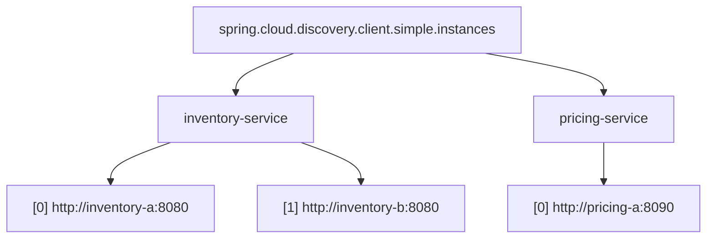

# Khai báo spring.cloud.discovery.client.simple.instances

## 1. Khi nào dùng SimpleDiscoveryClient?

Spring Cloud Commons định nghĩa abstraction DiscoveryClient để ứng dụng tra cứu các instance của một service bằng tên service. Thông thường, dữ liệu này đến từ một service registry như Eureka, Consul hoặc ZooKeeper. Với ứng dụng nhỏ, môi trường phát triển, demo hoặc bài kiểm thử tích hợp, việc dựng thêm registry có thể không cần thiết.

SimpleDiscoveryClient là implementation đọc danh sách service instance từ cấu hình của ứng dụng. Ta khai báo các địa chỉ trong application.yml, application.properties hoặc nguồn cấu hình tương ứng. Spring Cloud chuyển các khai báo đó thành ServiceInstance để phần còn lại của ứng dụng sử dụng qua abstraction DiscoveryClient.

Thuộc tính trung tâm của bài học là:

```text
spring.cloud.discovery.client.simple.instances
```

Đây là một map: mỗi key là serviceId, mỗi value là danh sách instance của service đó. Mỗi instance cần ít nhất một địa chỉ uri có thể truy cập từ mạng của ứng dụng gọi.

Giá trị truyền vào `getInstances(serviceId)` phải khớp chính xác key đã khai báo. Ví dụ, `inventory-service` và `Inventory-Service` là hai chuỗi khác nhau khi tra cứu map.

Theo tài liệu Spring Cloud Commons, SimpleDiscoveryClient được dùng khi classpath không có implementation DiscoveryClient được hỗ trợ bởi service registry. Nếu dự án đã đưa Eureka, Consul hoặc một registry client khác vào classpath, đừng mặc định rằng danh sách simple instances sẽ thay thế registry client đó.

Với các phiên bản Spring Cloud hiện hành, không cần thêm `@EnableDiscoveryClient` chỉ để kích hoạt discovery. Khi implementation phù hợp có trên classpath, Spring Boot auto-configuration sẽ cung cấp DiscoveryClient.

## 2. Cấu trúc dữ liệu của simple.instances

Có thể đọc cấu trúc thuộc tính theo ba tầng:

| Tầng | Ý nghĩa | Ví dụ |
| --- | --- | --- |
| instances | Map chứa danh sách instance | spring.cloud.discovery.client.simple.instances |
| serviceId | Tên logic của service cần tìm | inventory-service |
| Index | Vị trí của một instance trong danh sách, bắt đầu từ 0 | [0], [1] |
| Thuộc tính instance | Thông tin của một địa chỉ cụ thể | uri, instance-id, metadata |

Ví dụ dạng property path:

```properties
spring.cloud.discovery.client.simple.instances.inventory-service[0].uri=http://inventory-a.internal:8080
spring.cloud.discovery.client.simple.instances.inventory-service[1].uri=http://inventory-b.internal:8080
```

Hai dòng trên tạo hai instance cùng thuộc service có ID inventory-service. Số 0 và 1 là index trong danh sách, không phải port hoặc ID của service.

### 2.1. Mối quan hệ giữa serviceId và instance

Một service có thể có một hoặc nhiều instance. Các instance dùng chung serviceId, nhưng mỗi instance có URI và metadata riêng.



Khi gọi getInstances("inventory-service"), DiscoveryClient trả hai địa chỉ thuộc inventory-service. Khi gọi getServices(), nó trả các service ID đã khai báo trong map.

## 3. Khai báo bằng application.yml

YAML thường dễ đọc hơn khi một service có nhiều instance và mỗi instance có metadata riêng.

```yaml
spring:
  application:
    name: order-service
  cloud:
    discovery:
      client:
        simple:
          instances:
            inventory-service:
              - uri: http://inventory-a.internal:8080
                instance-id: inventory-a
                metadata:
                  zone: zone-a
                  version: v1
              - uri: https://inventory-b.internal:8443
                instance-id: inventory-b
                metadata:
                  zone: zone-b
                  version: v1
            pricing-service:
              - uri: http://pricing-a.internal:8090
                instance-id: pricing-a
```

Trong ví dụ:

- inventory-service có hai instance.
- Instance thứ nhất sử dụng HTTP ở cổng 8080.
- Instance thứ hai sử dụng HTTPS ở cổng 8443.
- pricing-service có một instance.
- instance-id là mã định danh của từng instance; nó khác serviceId.
- metadata chứa các cặp key/value dạng chuỗi để ứng dụng hoặc thành phần load balancing có thể đọc.

spring.application.name ở đây đặt tên cho chính ứng dụng hiện tại. Nó không phải key của service từ xa trong instances. Muốn khai báo địa chỉ service khác, hãy dùng tên service đó làm key dưới instances.

## 4. Ý nghĩa các thuộc tính của một instance

### 4.1. uri

uri là địa chỉ của instance. Spring Cloud phân tích URI để lấy scheme, host và port của ServiceInstance.

```yaml
instances:
  inventory-service:
    - uri: http://inventory-a.internal:8080
    - uri: https://inventory-b.internal:8443
```

| URI | Host | Port | isSecure() |
| --- | --- | ---: | --- |
| http://inventory-a.internal:8080 | inventory-a.internal | 8080 | false |
| https://inventory-b.internal:8443 | inventory-b.internal | 8443 | true |
| https://inventory-c.internal | inventory-c.internal | Theo mặc định của scheme HTTPS | true |

Nên khai báo URI tuyệt đối với scheme và host có thể phân giải từ môi trường chạy của client. Với SimpleDiscoveryClient, hãy dùng URI gốc dạng scheme://host:port; đường dẫn API như /api/items nên được thêm khi tạo request HTTP. ServiceInstance biểu diễn địa chỉ instance, không phải một endpoint nghiệp vụ cụ thể.

### 4.2. instance-id

instance-id là định danh tùy chọn cho một instance. Nó hữu ích khi log, tracing hoặc thuật toán load balancing cần phân biệt các bản sao của cùng service.

```yaml
instances:
  inventory-service:
    - uri: http://inventory-a.internal:8080
      instance-id: inventory-a
    - uri: http://inventory-b.internal:8080
      instance-id: inventory-b
```

Nếu bỏ qua instance-id, instance vẫn có thể được trả về qua DiscoveryClient; chỉ là ứng dụng không có giá trị ID riêng do cấu hình cung cấp.

### 4.3. metadata

metadata là map key/value dạng chuỗi đi kèm instance. Nó không thay đổi URI và cũng không tự động gửi header trong request.

```yaml
instances:
  inventory-service:
    - uri: http://inventory-a.internal:8080
      metadata:
        zone: zone-a
        version: v1
        weight: "80"
```

Ứng dụng có thể đọc metadata để ghi log, kiểm tra phiên bản hoặc áp dụng chính sách định tuyến riêng. Ví dụ, Spring Cloud LoadBalancer có thể sử dụng metadata zone khi được cấu hình với supplier phù hợp cho lựa chọn theo vùng. Chỉ khai báo metadata.zone chưa đủ để bật mọi chính sách lọc zone.

## 5. Khai báo bằng application.properties

Nếu dự án sử dụng .properties, dùng index trong dấu ngoặc vuông để biểu diễn từng phần tử của danh sách:

```properties
spring.cloud.discovery.client.simple.instances.inventory-service[0].uri=http://inventory-a.internal:8080
spring.cloud.discovery.client.simple.instances.inventory-service[0].instance-id=inventory-a
spring.cloud.discovery.client.simple.instances.inventory-service[0].metadata.zone=zone-a
spring.cloud.discovery.client.simple.instances.inventory-service[0].metadata.version=v1

spring.cloud.discovery.client.simple.instances.inventory-service[1].uri=https://inventory-b.internal:8443
spring.cloud.discovery.client.simple.instances.inventory-service[1].instance-id=inventory-b
spring.cloud.discovery.client.simple.instances.inventory-service[1].metadata.zone=zone-b
spring.cloud.discovery.client.simple.instances.inventory-service[1].metadata.version=v1

spring.cloud.discovery.client.simple.instances.pricing-service[0].uri=http://pricing-a.internal:8090
```

Các index bắt đầu từ 0. Khi dùng .properties, nên đánh số liên tục để cấu trúc danh sách dễ đọc và dễ kiểm tra. Không nhầm [1] với tên instance hoặc port.

Hai cách YAML và .properties biểu diễn cùng một cấu trúc. Chọn một cách nhất quán trong từng file cấu hình để tránh khó xác định giá trị nào đang ghi đè giá trị nào.

## 6. Cách DiscoveryClient đọc danh sách đã khai báo

SimpleDiscoveryClient triển khai interface DiscoveryClient. Phần ứng dụng nên phụ thuộc interface này để không gắn chặt vào implementation cụ thể:

```java
import java.util.List;

import org.springframework.cloud.client.ServiceInstance;
import org.springframework.cloud.client.discovery.DiscoveryClient;
import org.springframework.stereotype.Service;

@Service
public class ServiceDirectory {

    private final DiscoveryClient discoveryClient;

    public ServiceDirectory(DiscoveryClient discoveryClient) {
        this.discoveryClient = discoveryClient;
    }

    public List<ServiceInstance> inventoryInstances() {
        return discoveryClient.getInstances("inventory-service");
    }

    public List<String> knownServices() {
        return discoveryClient.getServices();
    }
}
```

Hai phương thức quan trọng:

- getInstances(serviceId) trả danh sách ServiceInstance của service được yêu cầu.
- getServices() trả danh sách các serviceId có trong cấu hình.

Nếu serviceId không tồn tại, SimpleDiscoveryClient trả danh sách rỗng. Vì vậy, mã gọi cần xử lý trường hợp không có instance thay vì giả định luôn có ít nhất một địa chỉ.

### 6.1. Đọc thông tin của từng instance

ServiceInstance cung cấp các thông tin thường dùng:

Trong ServiceDirectory ở trên, sau khi lấy danh sách bằng inventoryInstances(), có thể duyệt từng instance như sau:

```java
List<ServiceInstance> instances = inventoryInstances();

for (ServiceInstance instance : instances) {
    System.out.println("serviceId = " + instance.getServiceId());
    System.out.println("instanceId = " + instance.getInstanceId());
    System.out.println("uri = " + instance.getUri());
    System.out.println("secure = " + instance.isSecure());
    System.out.println("metadata = " + instance.getMetadata());
}
```

getServiceId() là tên service, getInstanceId() là ID riêng của bản sao, getUri() là địa chỉ, isSecure() cho biết instance sử dụng HTTPS, còn getMetadata() trả map metadata.

Không nên giả định thứ tự instance trong danh sách là thứ tự ưu tiên hoặc instance đầu tiên luôn khỏe mạnh. SimpleDiscoveryClient cung cấp các địa chỉ đã khai báo; nó không tự kiểm tra sức khỏe endpoint để sắp xếp danh sách.

## 7. Tích hợp với Spring Cloud LoadBalancer

DiscoveryClient chỉ cung cấp danh sách instance. Nếu muốn gọi service bằng tên logic và để Spring Cloud chọn một địa chỉ vật lý, cần có Spring Cloud LoadBalancer trên classpath.

Thêm starter LoadBalancer, để Spring Cloud BOM quản lý version:

```xml
<dependency>
    <groupId>org.springframework.cloud</groupId>
    <artifactId>spring-cloud-starter-loadbalancer</artifactId>
</dependency>
```

Ví dụ dùng RestTemplate có @LoadBalanced:

```java
import org.springframework.cloud.client.loadbalancer.LoadBalanced;
import org.springframework.context.annotation.Bean;
import org.springframework.context.annotation.Configuration;
import org.springframework.web.client.RestTemplate;

@Configuration
public class HttpClientConfiguration {

    @Bean
    @LoadBalanced
    RestTemplate loadBalancedRestTemplate() {
        return new RestTemplate();
    }
}
```

Sau đó gọi bằng service ID:

```java
import org.springframework.cloud.client.loadbalancer.LoadBalanced;
import org.springframework.stereotype.Service;
import org.springframework.web.client.RestTemplate;

@Service
public class InventoryGateway {

    private final RestTemplate restTemplate;

    public InventoryGateway(@LoadBalanced RestTemplate restTemplate) {
        this.restTemplate = restTemplate;
    }

    public String health() {
        return restTemplate.getForObject(
                "http://inventory-service/actuator/health",
                String.class
        );
    }
}
```

inventory-service trong URL là service ID đã khai báo dưới instances. LoadBalancer lấy danh sách từ DiscoveryClient, chọn một instance rồi chuyển request tới URI vật lý tương ứng. Nếu chỉ inject DiscoveryClient mà không dùng LoadBalancer, ứng dụng phải tự chọn một phần tử và tự gửi request tới URI đó.

## 8. Kết hợp profile và cấu hình theo môi trường

Danh sách instance thường khác nhau giữa local, test, staging và production. Có thể đặt cấu hình riêng trong các file profile:

```yaml
# application-local.yml
spring:
  cloud:
    discovery:
      client:
        simple:
          instances:
            inventory-service:
              - uri: http://localhost:8081
            pricing-service:
              - uri: http://localhost:8091
```

```yaml
# application-staging.yml
spring:
  cloud:
    discovery:
      client:
        simple:
          instances:
            inventory-service:
              - uri: http://inventory-a.staging.internal:8080
              - uri: http://inventory-b.staging.internal:8080
            pricing-service:
              - uri: http://pricing-a.staging.internal:8090
```

Kích hoạt profile bằng spring.profiles.active hoặc cơ chế triển khai tương ứng. Đối với danh sách instance, hãy kiểm tra cấu hình đã bind sau khi profile được kích hoạt, đặc biệt khi một profile ghi đè danh sách của profile khác.

Không dùng localhost làm địa chỉ service từ xa trong môi trường container nếu client và server chạy ở các container khác nhau. localhost luôn trỏ về chính container hoặc máy đang chạy client. Hãy dùng DNS/service name hoặc hostname mà client thực sự phân giải và truy cập được.

## 9. Kiểm thử việc bind simple.instances

Có thể kiểm thử mà không cần dựng Eureka hoặc Consul. Spring Boot cho phép đưa các property trực tiếp vào @SpringBootTest:

```java
import static org.assertj.core.api.Assertions.assertThat;

import java.net.URI;
import java.util.List;

import org.junit.jupiter.api.Test;
import org.springframework.beans.factory.annotation.Autowired;
import org.springframework.boot.test.context.SpringBootTest;
import org.springframework.cloud.client.ServiceInstance;
import org.springframework.cloud.client.discovery.DiscoveryClient;

@SpringBootTest(properties = {
        "spring.cloud.discovery.client.simple.instances.catalog[0].uri=http://catalog-a:8080",
        "spring.cloud.discovery.client.simple.instances.catalog[1].uri=https://catalog-b:8443",
        "spring.cloud.discovery.client.simple.instances.catalog[1].metadata.zone=zone-b"
})
class SimpleDiscoveryClientPropertiesTests {

    @Autowired
    private DiscoveryClient discoveryClient;

    @Test
    void bindsConfiguredInstances() {
        List<ServiceInstance> instances =
                discoveryClient.getInstances("catalog");

        assertThat(instances).hasSize(2);
        assertThat(instances.get(0).getUri())
                .isEqualTo(URI.create("http://catalog-a:8080"));
        assertThat(instances.get(1).isSecure()).isTrue();
        assertThat(instances.get(1).getMetadata())
                .containsEntry("zone", "zone-b");
    }

    @Test
    void exposesConfiguredServiceIds() {
        assertThat(discoveryClient.getServices()).contains("catalog");
    }

    @Test
    void returnsEmptyListForUnknownService() {
        assertThat(discoveryClient.getInstances("unknown-service")).isEmpty();
    }
}
```

Kiểm thử này xác nhận ba điều: danh sách được bind đúng, scheme HTTPS được phản ánh qua isSecure(), và metadata đi cùng đúng instance. Nó kiểm tra discovery metadata trong bộ nhớ; nó không xác nhận các host có thể truy cập qua mạng.

### 9.1. Các ca kiểm thử nên có

| Ca | Cấu hình/thao tác | Kết quả mong đợi |
| --- | --- | --- |
| Một instance | Khai báo index [0] | getInstances(serviceId) có một phần tử |
| Nhiều instance | Khai báo [0], [1] | Trả đủ các instance của cùng service |
| Nhiều service | Khai báo nhiều key dưới instances | getServices() chứa các service ID |
| Service không tồn tại | Gọi getInstances với key chưa khai báo | Danh sách rỗng |
| URI HTTPS | Khai báo URI bắt đầu bằng https | isSecure() trả true |
| Metadata | Khai báo metadata.zone | getMetadata() chứa cặp key/value |
| Profile | Chạy với profile khác nhau | Danh sách khớp cấu hình môi trường đã chọn |

## 10. Phân biệt instances với local instance

spring.cloud.discovery.client.simple.instances mô tả các service instance mà ứng dụng cần tra cứu. Nó không phải cấu hình để đăng ký chính ứng dụng hiện tại vào một registry từ xa.

Spring Cloud Commons còn có nhóm thuộc tính spring.cloud.discovery.client.simple.local.* để mô tả local service instance, chẳng hạn service-id, host, port, secure, instance-id và metadata. Đây là cấu hình khác với map instances.

Ví dụ:

```yaml
spring:
  application:
    name: order-service
  cloud:
    discovery:
      client:
        simple:
          local:
            service-id: order-service
            host: order-a.internal
            port: 8080
```

Đoạn local nói về instance hiện tại. Đoạn instances nói về các service instance được client tra cứu. Không thêm địa chỉ của chính ứng dụng vào instances chỉ để mô tả local service.

## 11. Giới hạn và lỗi thường gặp

SimpleDiscoveryClient phù hợp khi danh sách endpoint nhỏ và tương đối ổn định. Danh sách được khai báo trong cấu hình, nên không tự thay đổi theo autoscaling, đăng ký/hủy đăng ký động hoặc heartbeat như một registry thực thụ.

| Triệu chứng | Nguyên nhân có thể | Cách xử lý |
| --- | --- | --- |
| getInstances() trả danh sách rỗng | Sai serviceId, sai key hoặc danh sách chưa được bind | So khớp key dưới instances với chuỗi truyền vào getInstances() |
| Không thấy SimpleDiscoveryClient được chọn | Có registry-backed DiscoveryClient khác trên classpath | Kiểm tra dependency và implementation DiscoveryClient đang được cấu hình |
| URI không truy cập được | Hostname không phân giải hoặc port không mở từ mạng client | Kiểm tra DNS, route, firewall và địa chỉ trong container |
| Gọi nhầm instance | Service ID hoặc index bị khai báo sai | Đọc lại map service ID và danh sách URI |
| HTTPS không hoạt động | URI dùng http hoặc TLS của endpoint chưa được cấu hình đúng | Kiểm tra scheme, chứng thư và truststore của HTTP client |
| Metadata không có tác dụng định tuyến | Chỉ khai báo metadata nhưng chưa cấu hình supplier/policy sử dụng nó | Kiểm tra cấu hình Spring Cloud LoadBalancer |
| Thay cấu hình nhưng instance cũ vẫn được dùng | Danh sách tĩnh không tự đồng bộ với trạng thái triển khai | Cập nhật nguồn cấu hình và khởi động/reload theo quy trình của ứng dụng |
| Dùng localhost giữa các container | localhost trỏ về container của caller | Dùng DNS/service name có thể truy cập từ caller |

Khi cần membership động, health-aware discovery, heartbeat, tự đăng ký và deregistration, hãy cân nhắc registry như Eureka hoặc Consul. Không nên biến file cấu hình tĩnh thành một registry tự chế bằng cách liên tục cập nhật địa chỉ thủ công.

## 12. Nguyên tắc khai báo và vận hành

1. Dùng tên service nhất quán giữa key trong instances, lời gọi getInstances() và URL ảo của LoadBalancer.
2. Đánh số danh sách từ [0] và giữ các index liên tục.
3. Khai báo URI tuyệt đối, có scheme, host và port phù hợp với mạng của client.
4. Dùng instance-id để nhận diện từng bản sao khi cần quan sát hoặc định tuyến.
5. Chỉ dùng metadata cho dữ liệu bổ sung; cấu hình rõ thành phần nào sẽ đọc metadata đó.
6. Tách endpoint theo profile và môi trường; tránh dùng localhost cho kết nối giữa các container.
7. Kiểm thử cả kết quả DiscoveryClient lẫn khả năng kết nối mạng tới các URI.
8. Thêm Spring Cloud LoadBalancer nếu muốn gọi bằng service ID và tự chọn instance.
9. Chọn service registry khi danh sách instance cần cập nhật động hoặc cần health-aware registration.

## 13. Tài liệu tham khảo

- [Spring Cloud Commons — Common Abstractions](https://docs.spring.io/spring-cloud-commons/reference/spring-cloud-commons/common-abstractions.html): phần SimpleDiscoveryClient, DiscoveryClient và tích hợp LoadBalancer.
- [Spring Cloud Commons — Configuration Properties](https://docs.spring.io/spring-cloud-commons/reference/configprops.html): danh sách thuộc tính cấu hình discovery client.
- [Spring Cloud LoadBalancer](https://docs.spring.io/spring-cloud-commons/reference/spring-cloud-commons/loadbalancer.html): cách chọn ServiceInstance và sử dụng metadata trong load balancing.
- [SimpleDiscoveryClient source](https://github.com/spring-cloud/spring-cloud-commons/blob/main/spring-cloud-commons/src/main/java/org/springframework/cloud/client/discovery/simple/SimpleDiscoveryClient.java): cách triển khai getInstances() và getServices().
- [SimpleDiscoveryClient property mapping tests](https://github.com/spring-cloud/spring-cloud-commons/blob/main/spring-cloud-commons/src/test/java/org/springframework/cloud/client/discovery/simple/SimpleDiscoveryClientPropertiesMappingTests.java): ví dụ kiểm thử URI, HTTPS, danh sách instance và service ID.

spring.cloud.discovery.client.simple.instances là cách khai báo tĩnh một map từ service ID tới danh sách địa chỉ. Khi hiểu rõ ba tầng instances → serviceId → instance, ta có thể cấu hình nhiều bản sao, bổ sung metadata, tra cứu qua DiscoveryClient và kết hợp LoadBalancer mà không cần dựng một service registry riêng cho các môi trường đơn giản.
