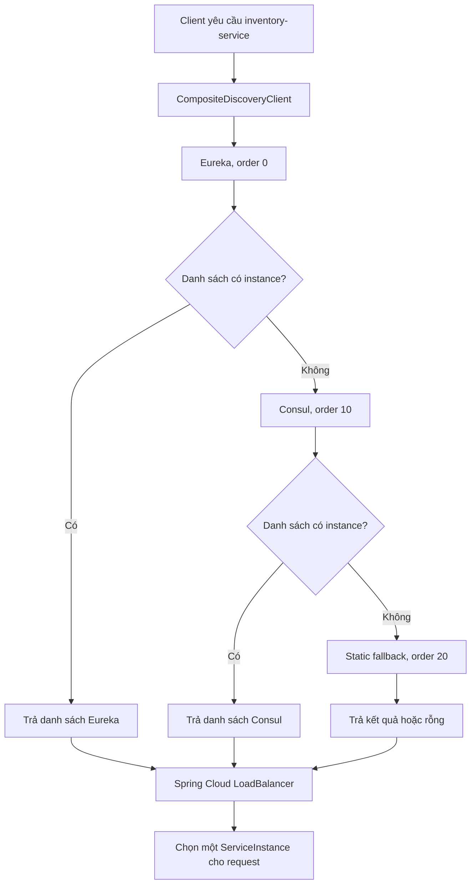

# Thứ tự nhiều DiscoveryClient và cơ chế tổng hợp

Trong một hệ thống phân tán, một ứng dụng có thể nhìn thấy nhiều nguồn service discovery cùng lúc. Ví dụ, một nhóm dịch vụ được đăng ký trong Eureka, một nhóm khác được tìm qua Consul, còn một số endpoint cố định được khai báo bằng cấu hình tĩnh. Khi nhiều implementation của `DiscoveryClient` cùng tồn tại trong Spring context, ứng dụng cần một quy tắc xác định nguồn nào được hỏi trước và cách hợp nhất kết quả.

Spring Cloud Commons cung cấp abstraction `DiscoveryClient` và cơ chế tổng hợp qua `CompositeDiscoveryClient`. Điểm quan trọng là hai thao tác chính có cách tổng hợp khác nhau: `getInstances(serviceId)` trả về danh sách instance đầu tiên không rỗng theo thứ tự discovery client; `getServices()` tổng hợp tên service từ các client và loại bỏ tên trùng. Vì vậy, composite không đơn giản ghép mọi instance từ mọi registry thành một danh sách.

Với **SPRING_CLOUD_CORE**, hiểu thứ tự và semantics tổng hợp giúp tránh chọn nhầm registry, tránh trùng instance và dự đoán được fallback khi một nguồn không có dữ liệu. Bài học thuộc chương **DiscoveryClient**, tập trung vào `Ordered`, `CompositeDiscoveryClient`, sự khác nhau giữa `@Primary` và thứ tự delegate, cùng cách kiểm thử hành vi tổng hợp.

## 1. Mục tiêu học tập

Sau bài này, bạn có thể:

- Giải thích vì sao một ứng dụng có thể có nhiều `DiscoveryClient`.
- Mô tả hợp đồng `DiscoveryClient` và vai trò của `getOrder()`.
- Thiết lập thứ tự ưu tiên bằng `Ordered`, `getOrder()` hoặc `@Order`.
- Giải thích cách `CompositeDiscoveryClient` xử lý `getInstances()` và `getServices()`.
- Phân biệt first-non-empty selection với việc hợp nhất toàn bộ instance.
- Hiểu `@Primary` không thay thế thứ tự của danh sách delegate trong composite.
- Phân biệt chọn discovery provider với chọn instance của Spring Cloud LoadBalancer.
- Thiết kế fallback khi registry không có dữ liệu hoặc không truy cập được.
- Kiểm thử thứ tự, kết quả tổng hợp và các trường hợp service trùng tên.
- Chẩn đoán vì sao một service xuất hiện trong danh sách nhưng instance được trả về từ registry khác.

## 2. Vì sao có nhiều DiscoveryClient?

`DiscoveryClient` là abstraction để ứng dụng truy vấn instance theo service ID mà không phụ thuộc trực tiếp vào một registry cụ thể. Một ứng dụng có thể tích hợp nhiều nguồn vì các lý do:

- **Di chuyển nền tảng:** một nhóm service còn ở Eureka trong khi nhóm mới đã chuyển sang Consul.
- **Mạng phân vùng:** dịch vụ trong một vùng được quản lý bởi registry nội bộ, dịch vụ vùng khác dùng nguồn khác.
- **Dịch vụ tĩnh:** một số endpoint ít thay đổi được khai báo bằng `SimpleDiscoveryClient`.
- **Tích hợp nhiều hệ thống:** ứng dụng cần truy vấn registry nội bộ và registry của một nền tảng đối tác.
- **Fallback:** một nguồn discovery phụ cung cấp danh sách instance khi nguồn ưu tiên không có kết quả.

Ví dụ, classpath có thể chứa các starter tạo bean discovery cho nhiều provider. Khi đó, ứng dụng cần biết Spring Cloud chọn và kết hợp các bean này như thế nào.

### 2.1. Ví dụ kiến trúc

```text
Checkout Service
      |
      v
CompositeDiscoveryClient
      |
      +---- DiscoveryClient (Eureka, order 0)
      |
      +---- DiscoveryClient (Consul, order 10)
      |
      +---- DiscoveryClient (Static, order 20)
```

Thứ tự nhỏ hơn được ưu tiên trước. Nếu Eureka trả về instance cho service đang hỏi, composite dùng kết quả đó. Nếu Eureka trả về danh sách rỗng, composite tiếp tục hỏi Consul; nếu Consul cũng không có kết quả, nó mới xét nguồn tĩnh.

## 3. Hợp đồng DiscoveryClient

`org.springframework.cloud.client.discovery.DiscoveryClient` định nghĩa các thao tác discovery đồng bộ thường dùng:

```java
public interface DiscoveryClient extends Ordered {

    String description();

    List<ServiceInstance> getInstances(String serviceId);

    List<String> getServices();

    @Override
    default int getOrder() {
        return DEFAULT_ORDER;
    }
}
```

Các phương thức có ý nghĩa:

| Phương thức | Trách nhiệm |
| --- | --- |
| `description()` | Trả mô tả implementation discovery |
| `getInstances(serviceId)` | Tìm các instance của một service ID |
| `getServices()` | Liệt kê service ID mà discovery source biết |
| `getOrder()` | Cung cấp thứ tự ưu tiên khi có nhiều DiscoveryClient |

`DiscoveryClient` kế thừa `Ordered`. Giá trị mặc định của order là `DEFAULT_ORDER` (0) nếu implementation không ghi đè. Khi có nhiều implementation, nên đặt thứ tự rõ ràng thay vì phụ thuộc vào thứ tự bean được phát hiện trên classpath.

### 3.1. ServiceInstance là kết quả discovery

Mỗi `ServiceInstance` biểu diễn một endpoint cụ thể, thường có:

- Service ID.
- Instance ID.
- Host và port.
- Cờ secure để biểu diễn endpoint dùng kết nối bảo mật.
- Metadata do provider cung cấp.
- URI mà client có thể dùng để xây dựng request.

Ví dụ:

```java
List<ServiceInstance> instances =
        discoveryClient.getInstances("inventory-service");

for (ServiceInstance instance : instances) {
    URI uri = instance.getUri();
    Map<String, String> metadata = instance.getMetadata();
    // Use the selected instance metadata when appropriate.
}
```

Discovery trả về danh sách instance theo semantics của provider. Nó không bảo đảm tất cả instance đều đang phục vụ tốt ở thời điểm request tiếp theo; health, lease, cache và trạng thái provider ảnh hưởng đến kết quả.

## 4. Thứ tự của nhiều DiscoveryClient

`DiscoveryClient` hỗ trợ `Ordered`, vì vậy mỗi implementation có thể công bố mức ưu tiên của mình qua `getOrder()`. Spring cũng có `@Order` cho nhiều loại bean collection khác, nhưng với `DiscoveryClient` vốn đã triển khai `Ordered`, hãy dùng `getOrder()` làm nguồn xác định thứ tự delegate; không dựa vào annotation để ghi đè giá trị mặc định của interface.

Quy tắc cơ bản:

| Giá trị order | Mức ưu tiên |
| --- | --- |
| `Ordered.HIGHEST_PRECEDENCE` | Cao nhất, được xét trước |
| `-10` | Cao hơn `0` |
| `0` | Giá trị mặc định của `DiscoveryClient` |
| `10` | Thấp hơn `0` |
| `Ordered.LOWEST_PRECEDENCE` | Thấp nhất, được xét sau |

**Số order càng nhỏ thì càng được ưu tiên trước.**

### 4.1. Đặt order bằng getOrder()

Một implementation tùy chỉnh có thể khai báo:

```java
@Component
public class CorporateDiscoveryClient implements DiscoveryClient {

    @Override
    public int getOrder() {
        return 0;
    }

    @Override
    public String description() {
        return "Corporate registry";
    }

    @Override
    public List<ServiceInstance> getInstances(String serviceId) {
        // Query the corporate registry.
        return List.of();
    }

    @Override
    public List<String> getServices() {
        // Return service IDs known by this registry.
        return List.of();
    }
}
```

Khi cần đảm bảo implementation này được ưu tiên hơn các nguồn còn lại, đặt order nhỏ hơn order của các implementation kia.

### 4.2. Vai trò và giới hạn của @Order

Spring hỗ trợ `@Order` để sắp xếp nhiều bean trong collection. Tuy nhiên, `DiscoveryClient` đã triển khai `Ordered` và cung cấp `getOrder()` mặc định. Khi comparator gặp một object triển khai `Ordered`, giá trị `getOrder()` là thông tin order được ưu tiên; annotation không nên được xem là cách ghi đè an toàn cho giá trị này.

Vì vậy, với implementation `DiscoveryClient`, hãy override `getOrder()`:

```java
@Component
public class StaticFallbackDiscoveryClient implements DiscoveryClient {

    @Override
    public int getOrder() {
        return 20;
    }

    // Other DiscoveryClient methods...
}
```

`@Order` vẫn hữu ích cho bean khác không tự triển khai `Ordered`, hoặc cho các extension point mà contract của chúng dựa vào annotation. Với `DiscoveryClient`, `getOrder()` là cách tường minh và dễ kiểm tra nhất.

### 4.3. Không dựa vào thứ tự khai báo dependency

Không nên giả định starter khai báo trước trong Maven/Gradle sẽ luôn có discovery client đứng trước. Thứ tự dependency, thứ tự classpath hoặc thứ tự component scan không phải chính sách ưu tiên ổn định.

Hãy dùng `DiscoveryClient#getOrder()` và quan sát danh sách bean đã được Spring sắp xếp.

## 5. CompositeDiscoveryClient tổng hợp như thế nào?

`CompositeDiscoveryClient` là implementation dùng nhiều `DiscoveryClient` delegate. Nó cung cấp một facade để caller chỉ cần tương tác với một discovery client.

Điểm quan trọng là hai phương thức có semantics khác nhau.

### 5.1. getInstances(): chọn danh sách đầu tiên không rỗng

Khi gọi:

```java
List<ServiceInstance> instances =
        compositeDiscoveryClient.getInstances("inventory-service");
```

Composite duyệt các delegate theo thứ tự ưu tiên. Nó hỏi từng client cho tới khi tìm được danh sách instance không rỗng; danh sách đó được trả về.

Ví dụ:

| Thứ tự | DiscoveryClient | Kết quả `getInstances("inventory-service")` |
| ---: | --- | --- |
| 1 | Eureka, order 0 | Danh sách rỗng |
| 2 | Consul, order 10 | 2 instance |
| 3 | Static, order 20 | 1 instance |

Composite trả về 2 instance từ Consul. Nó không tiếp tục lấy instance từ Static để nối thêm vào danh sách.

Nếu Eureka trả về 2 instance, Consul và Static không được hỏi tiếp cho lần truy vấn đó.

### 5.2. getServices(): hợp nhất tên service

`getServices()` có mục tiêu khác: liệt kê các service ID mà những delegate biết tới. Composite tổng hợp danh sách từ các discovery client và loại bỏ các tên trùng.

Ví dụ:

| DiscoveryClient | `getServices()` |
| --- | --- |
| Eureka | `checkout-service`, `inventory-service` |
| Consul | `inventory-service`, `payment-service` |
| Static | `legacy-catalog` |

Danh sách service tổng hợp:

```text
checkout-service
inventory-service
payment-service
legacy-catalog
```

`inventory-service` chỉ xuất hiện một lần dù có ở cả Eureka và Consul.

### 5.3. Bảng phân biệt hai phương thức

| Phương thức | Cách tổng hợp | Có ghép tất cả kết quả? |
| --- | --- | --- |
| `getInstances(serviceId)` | Trả danh sách đầu tiên không rỗng theo thứ tự delegate | Không |
| `getServices()` | Gom service ID từ các delegate và loại bỏ trùng | Có, ở cấp tên service |

Đây là điểm cốt lõi của `CompositeDiscoveryClient`: danh sách service là phép hợp nhất, còn danh sách instance của một service là phép chọn theo thứ tự.

## 6. Ví dụ nhiều registry cùng có một service

Giả sử `inventory-service` được đăng ký ở hai registry:

```text
Eureka (order 0)
  inventory-service
    - 10.10.1.11:8080
    - 10.10.1.12:8080

Consul (order 10)
  inventory-service
    - 10.20.1.21:8080
```

Khi gọi `getInstances("inventory-service")`, composite trả về danh sách từ Eureka vì đây là delegate ưu tiên cao nhất có kết quả không rỗng.

Các instance từ Consul không được nối thêm. Vì vậy, composite không phải là cơ chế active-active merge instance giữa các registry.

### 6.1. Khi registry ưu tiên không có service

Nếu Eureka trả về danh sách rỗng:

```text
Eureka -> []
Consul -> [10.20.1.21:8080]
```

Composite trả instance từ Consul. Đây là fallback dựa trên kết quả rỗng.

### 6.2. Khi registry ưu tiên trả instance cũ hoặc không khỏe

Nếu Eureka trả về một danh sách không rỗng nhưng chứa instance không thể kết nối, composite vẫn coi nguồn đó đã có kết quả và trả danh sách này. Nó không tự hỏi Consul để lấy danh sách thay thế chỉ vì instance Eureka không reachable.

Điều này có nghĩa thứ tự discovery client không phải health-based failover. Health filtering phải được thực hiện bởi provider, registry, health check, hoặc một lớp chọn instance có chính sách riêng.

## 7. Lỗi từ một delegate và fallback

Một trường hợp khác với kết quả rỗng là delegate ném exception.

Ví dụ:

```text
Eureka.getInstances() -> throws IllegalStateException
Consul.getInstances() -> [instance]
```

Không nên mặc định rằng mọi exception từ delegate sẽ được composite coi như danh sách rỗng và tự động chuyển sang delegate tiếp theo. Hành vi xử lý exception phụ thuộc implementation và phiên bản. Composite tiêu chuẩn chủ yếu mô tả lựa chọn theo danh sách kết quả; lỗi truy vấn có thể được truyền lên caller.

Nếu yêu cầu vận hành là “registry ưu tiên lỗi thì vẫn dùng registry dự phòng”, cần xác định chính sách lỗi rõ ràng:

- Lỗi kết nối có được phép fallback không?
- Lỗi xác thực có phải dừng ngay không?
- Timeout có được xem là nguồn tạm thời không khả dụng không?
- Có cần metric/alert khi fallback xảy ra không?
- Khi nguồn chính phục hồi, có tự quay lại nguồn chính không?

Không nên catch mọi `RuntimeException` rồi trả kết quả từ nguồn phụ. Làm vậy có thể che lỗi cấu hình, lỗi lập trình hoặc lỗi bảo mật. Nếu cần resilience, hãy triển khai wrapper có phân loại exception và test rõ các trường hợp.

## 8. @Primary không thay thế DiscoveryClient order

`@Primary` và `Ordered` giải quyết hai vấn đề khác nhau:

| Cơ chế | Mục tiêu |
| --- | --- |
| `@Primary` | Chọn một bean khi có nhiều candidate cùng kiểu cho một điểm inject đơn |
| `Ordered` / `@Order` | Sắp xếp nhiều bean trong một collection hoặc extension chain; riêng `DiscoveryClient`, dùng `getOrder()` của implementation |
| `CompositeDiscoveryClient` | Gọi nhiều delegate theo thứ tự và tổng hợp kết quả theo semantics của composite |

Ví dụ:

```java
@Bean
@Primary
DiscoveryClient preferredDiscoveryClient() {
    return new CorporateDiscoveryClient();
}
```

Khai báo `@Primary` có thể quyết định bean nào được inject khi constructor yêu cầu đúng một `DiscoveryClient`. Nó không có nghĩa những bean `DiscoveryClient` khác bị loại khỏi `List<DiscoveryClient>`, cũng không tự xác định chính sách ưu tiên của composite.

Nếu muốn điều khiển thứ tự delegate, hãy override `DiscoveryClient#getOrder()`. Nếu muốn một bean duy nhất được inject ở một điểm cụ thể, khi đó mới xem xét `@Primary` hoặc qualifier.

## 9. Phân biệt composite discovery với LoadBalancer

Trong Spring Cloud, có hai tầng lựa chọn khác nhau:

1. **DiscoveryClient composite chọn nguồn discovery:** registry/delegate nào cung cấp danh sách instance cho service ID.
2. **LoadBalancer chọn instance:** từ danh sách instance nhận được, load balancer chọn một instance cho request cụ thể.



Composite quyết định **danh sách đến từ đâu**. LoadBalancer quyết định **instance nào trong danh sách sẽ nhận request**.

Nếu Eureka trả 5 instance, LoadBalancer có thể chọn một trong 5 theo algorithm và trạng thái. Nó không quay lại Consul để ghép thêm instance, trừ khi kiến trúc có một discovery source khác được cấu hình rõ.

### 9.1. Không nhầm load balancing với registry failover

LoadBalancer có thể áp dụng retry, health-check filtering hoặc chọn instance theo thuật toán. Nhưng các cơ chế này hoạt động trên danh sách instance mà discovery layer cung cấp. Chúng không tự thay đổi thứ tự các `DiscoveryClient` trong composite.

## 10. SimpleDiscoveryClient trong mô hình nhiều nguồn

`SimpleDiscoveryClient` là implementation dựa trên cấu hình tĩnh, hữu ích khi không có registry động hoặc khi cần khai báo một số instance cố định.

Ví dụ cấu hình minh họa:

```yaml
spring:
  cloud:
    discovery:
      client:
        simple:
          instances:
            inventory-service:
              - uri: http://inventory-a.internal:8080
                metadata:
                  zone: zone-a
              - uri: http://inventory-b.internal:8080
                metadata:
                  zone: zone-b
```

Nếu `SimpleDiscoveryClient` cùng tồn tại với một discovery client khác, nó có thể tham gia vào thứ tự delegate tùy cấu hình và auto-configuration của release train. Đặt order rõ ràng nếu muốn nó là nguồn dự phòng.

Không nên giả định Simple luôn đứng cuối trong mọi cấu hình. Hãy quan sát `getOrder()` và danh sách delegate thực tế.

## 11. Viết DiscoveryClient tùy chỉnh có thứ tự

Một implementation discovery tùy chỉnh nên công bố order rõ ràng, trả về `ServiceInstance` có metadata chính xác và không tự thực hiện việc đăng ký nếu trách nhiệm registration đã thuộc một component khác.

Ví dụ skeleton:

```java
@Component
public class PartnerRegistryDiscoveryClient implements DiscoveryClient {

    @Override
    public int getOrder() {
        return 20;
    }

    @Override
    public String description() {
        return "Partner registry";
    }

    @Override
    public List<ServiceInstance> getInstances(String serviceId) {
        // Query partner registry and map its results to ServiceInstance.
        return List.of();
    }

    @Override
    public List<String> getServices() {
        // Return service IDs visible to this registry.
        return List.of();
    }
}
```

Nếu implementation này là fallback, order `20` chỉ có ý nghĩa khi các nguồn chính được đặt order nhỏ hơn. Không dựa vào tên class hoặc thứ tự package để bảo đảm fallback.

### 11.1. Trả về danh sách rỗng khi không có service

Nếu registry không có service ID, implementation nên trả về danh sách rỗng theo hợp đồng discovery. Không trả `null`, vì caller/composite thường kỳ vọng một collection hợp lệ.

### 11.2. Không trả dữ liệu giả để ép composite chọn nguồn

Không trả một `ServiceInstance` placeholder chỉ để tránh danh sách rỗng. Composite sẽ coi đó là kết quả hợp lệ và không hỏi delegate tiếp theo. Một endpoint giả có thể làm consumer gọi nhầm host/port.

### 11.3. Giữ metadata nhất quán

Khi map kết quả từ registry ngoài:

- Service ID phải đúng tên mà client dùng để tìm.
- Host/port phải là địa chỉ mà consumer có thể truy cập.
- Metadata không nên chứa secret.
- `secure` phải phản ánh scheme thực tế.
- Instance ID nên ổn định trong phạm vi vòng đời instance.

## 12. Kiểm tra danh sách DiscoveryClient trong Spring context

Khi ứng dụng có nhiều starter discovery, nên quan sát bean thực tế thay vì suy luận từ dependency.

Có thể inject danh sách:

```java
@Component
public class DiscoveryClientInventory {

    private final List<DiscoveryClient> discoveryClients;

    public DiscoveryClientInventory(List<DiscoveryClient> discoveryClients) {
        this.discoveryClients = discoveryClients;
    }

    public void reportOrder() {
        for (DiscoveryClient client : discoveryClients) {
            // Report implementation class, description and getOrder().
        }
    }
}
```

Danh sách được Spring inject có thể được sắp xếp theo order metadata. Khi cần xác minh chính sách runtime, log:

- Tên class implementation.
- `description()`.
- `getOrder()`.
- Tên bean nếu lấy qua BeanFactory.

Không log endpoint hoặc metadata nhạy cảm nếu registry chứa thông tin nội bộ.

### 12.1. Kiểm tra composite đang được dùng

Nếu ứng dụng mong đợi `CompositeDiscoveryClient`, hãy kiểm tra bean type thực tế và các delegate mà nó nhận. Cấu hình tùy chỉnh, auto-configuration exclusion, qualifier hoặc bean thay thế có thể làm ứng dụng dùng một implementation khác.

Đặc biệt, nếu inject trực tiếp một `DiscoveryClient` với `@Primary`, caller có thể nhận một provider riêng thay vì composite. Hãy xác minh bean được inject tại đúng call site.

## 13. Kiểm thử thứ tự và cơ chế tổng hợp

Nên có unit test cho semantics first-non-empty và union service names, cùng integration test xác minh thứ tự bean trong Spring context.

### 13.1. Kiểm thử getInstances chọn nguồn đầu tiên có kết quả

Có thể tạo hai stub `DiscoveryClient`:

```java
class StubDiscoveryClient implements DiscoveryClient {

    private final int order;
    private final List<ServiceInstance> instances;
    private final List<String> services;

    StubDiscoveryClient(
            int order,
            List<ServiceInstance> instances,
            List<String> services) {
        this.order = order;
        this.instances = instances;
        this.services = services;
    }

    @Override
    public int getOrder() {
        return order;
    }

    @Override
    public String description() {
        return "Stub order " + order;
    }

    @Override
    public List<ServiceInstance> getInstances(String serviceId) {
        return instances;
    }

    @Override
    public List<String> getServices() {
        return services;
    }
}
```

Test cần sắp xếp delegate theo order trước khi đưa vào composite nếu đang tạo composite trực tiếp trong unit test:

```java
List<DiscoveryClient> delegates = new ArrayList<>(
        List.of(consulClient, eurekaClient));

AnnotationAwareOrderComparator.sort(delegates);

CompositeDiscoveryClient composite =
        new CompositeDiscoveryClient(delegates);
```

Sau đó xác minh:

- Eureka trả rỗng thì kết quả đến từ Consul.
- Eureka trả non-empty thì kết quả đến từ Eureka.
- Kết quả không chứa instance từ Consul nếu Eureka đã có dữ liệu.

Chữ ký constructor và chi tiết tạo stub cần điều chỉnh theo release Spring Cloud Commons mà dự án đang dùng.

### 13.2. Kiểm thử getServices loại tên trùng

Giả sử:

```text
Eureka: [checkout-service, inventory-service]
Consul: [inventory-service, payment-service]
Static: [legacy-catalog]
```

Xác minh kết quả chứa đủ bốn service ID và `inventory-service` chỉ xuất hiện một lần. Nếu test phụ thuộc thứ tự hiển thị, hãy xác minh rõ thứ tự được bảo đảm bởi implementation đang dùng; nếu không, so sánh như một tập hợp.

### 13.3. Kiểm thử order qua Spring context

Tạo hai bean discovery với order khác nhau và inject `List<DiscoveryClient>`. Xác minh client có order nhỏ xuất hiện trước. Test này xác minh cơ chế sắp xếp bean của Spring; nó khác test kiểm tra `CompositeDiscoveryClient` thực sự chọn delegate nào.

### 13.4. Kiểm thử trường hợp exception

Tạo một delegate ném exception và một delegate dự phòng trả instance. Xác minh hành vi của composite đúng với phiên bản đang dùng. Nếu ứng dụng cần tiếp tục khi nguồn chính lỗi, test wrapper/resilience policy riêng để chứng minh exception được phân loại và fallback có chủ đích.

### 13.5. Kiểm thử provider thật

Unit test không chứng minh registry trả đúng dữ liệu ngoài đời. Với integration test, nên kiểm tra:

1. Đăng ký service vào từng registry test.
2. Xác minh từng `DiscoveryClient` nhìn thấy đúng service/instance.
3. Xác minh composite trả danh sách từ nguồn ưu tiên.
4. Gỡ instance khỏi nguồn ưu tiên và kiểm tra fallback.
5. Đăng ký service trùng tên ở nhiều nguồn và kiểm tra `getServices()`.
6. Kiểm tra health/status filtering của provider.

## 14. Các lỗi thường gặp

| Triệu chứng | Nguyên nhân thường gặp | Cách xử lý |
| --- | --- | --- |
| Luôn nhận instance từ registry không mong muốn | Order của client đó cao hơn (số nhỏ hơn) | Kiểm tra `getOrder()` và đặt thứ tự rõ ràng |
| Không fallback sang registry thứ hai | Registry đầu tiên trả danh sách không rỗng | Kiểm tra health/status và chính sách chọn nguồn |
| Instance từ hai registry không được ghép | `getInstances()` dùng first-non-empty | Dùng kiến trúc merge riêng nếu thật sự cần hợp nhất |
| Service ID xuất hiện một lần dù có ở nhiều registry | `getServices()` loại tên trùng | Đây là hành vi tổng hợp tên service |
| `@Primary` không đổi thứ tự composite | `@Primary` chọn bean đơn, không điều khiển delegate order | Dùng `Ordered`/`@Order` |
| Lỗi registry chính làm request thất bại | Delegate ném exception, không phải trả danh sách rỗng | Phân loại exception và thiết kế fallback rõ |
| Static client luôn được chọn | Order của nó đang cao hơn các client khác | Đặt order fallback lớn hơn |
| LoadBalancer không thấy instance từ registry phụ | Composite đã trả danh sách non-empty từ registry chính | Xem lại discovery source selection trước LoadBalancer |
| Kết quả service list có đủ tên nhưng instance không có | `getServices()` là union, còn `getInstances()` chọn một nguồn | Kiểm tra từng delegate theo service ID |
| Thứ tự thay đổi giữa môi trường | Có bean khác, order mặc định trùng hoặc cấu hình auto-config khác | Quan sát danh sách bean và đặt order tường minh |

## 15. Nguyên tắc thiết kế

- Chỉ tích hợp nhiều `DiscoveryClient` khi có lý do kiến trúc rõ ràng.
- Đặt `getOrder()` tường minh cho các implementation có vai trò primary/fallback.
- Nhớ rằng số order nhỏ hơn được xét trước.
- Hiểu `getInstances()` chọn danh sách đầu tiên không rỗng, không merge instance từ mọi nguồn.
- Hiểu `getServices()` tổng hợp tên service từ nhiều nguồn và loại bỏ trùng.
- Không nhầm kết quả rỗng với exception; thiết kế fallback cho từng loại lỗi.
- Không dùng `@Primary` thay cho thứ tự delegate.
- Phân biệt lựa chọn discovery source với lựa chọn instance của LoadBalancer.
- Không trả instance placeholder để ép composite bỏ qua fallback.
- Kiểm tra order và bean type trong Spring context thật.
- Viết integration test với registry provider để xác minh health, status và propagation.
- Theo dõi nguồn discovery được chọn và tần suất fallback bằng metric/log an toàn.

## 16. Tổng kết

Khi nhiều `DiscoveryClient` cùng tồn tại, Spring Cloud sử dụng thứ tự ưu tiên để quyết định nguồn nào được hỏi trước. `DiscoveryClient` hỗ trợ `Ordered`; giá trị order nhỏ hơn được ưu tiên trước và giá trị mặc định là `0` nếu implementation không ghi đè.

`CompositeDiscoveryClient` cung cấp một facade cho nhiều delegate nhưng không áp dụng cùng một phép tổng hợp cho mọi API. `getInstances(serviceId)` trả về danh sách đầu tiên không rỗng theo thứ tự client; nó không ghép instance từ tất cả registry. `getServices()` tổng hợp tên service từ nhiều client và loại bỏ tên trùng.

`@Primary` chỉ giải quyết lựa chọn bean trong điểm inject đơn, còn `Ordered`/`@Order` điều khiển thứ tự delegate. Sau khi composite chọn được danh sách instance, Spring Cloud LoadBalancer mới chọn instance cho request. Phân biệt các tầng này, kiểm thử kết quả rỗng/exception và quan sát registry thực tế giúp hệ thống discovery có hành vi dự đoán được.

## 17. Tài liệu tham khảo

- [Spring Cloud Commons — DiscoveryClient and Service Discovery](https://docs.spring.io/spring-cloud-commons/reference/spring-cloud-commons/common-abstractions.html)
- [Spring Cloud Commons — Multiple DiscoveryClient Implementations](https://docs.spring.io/spring-cloud-commons/reference/spring-cloud-commons/common-abstractions.html#multiple-discoveryclient)
- [Spring Cloud Commons API — DiscoveryClient](https://docs.spring.io/spring-cloud-commons/docs/current/javadoc-api/org/springframework/cloud/client/discovery/DiscoveryClient.html)
- [Spring Cloud Commons API — CompositeDiscoveryClient](https://docs.spring.io/spring-cloud-commons/docs/current/javadoc-api/org/springframework/cloud/client/discovery/composite/CompositeDiscoveryClient.html)
- [Spring Cloud Commons source — CompositeDiscoveryClient](https://github.com/spring-cloud/spring-cloud-commons/blob/main/spring-cloud-commons/src/main/java/org/springframework/cloud/client/discovery/composite/CompositeDiscoveryClient.java)
- [Spring Cloud LoadBalancer — Reference Documentation](https://docs.spring.io/spring-cloud-commons/reference/spring-cloud-commons/loadbalancer.html)
