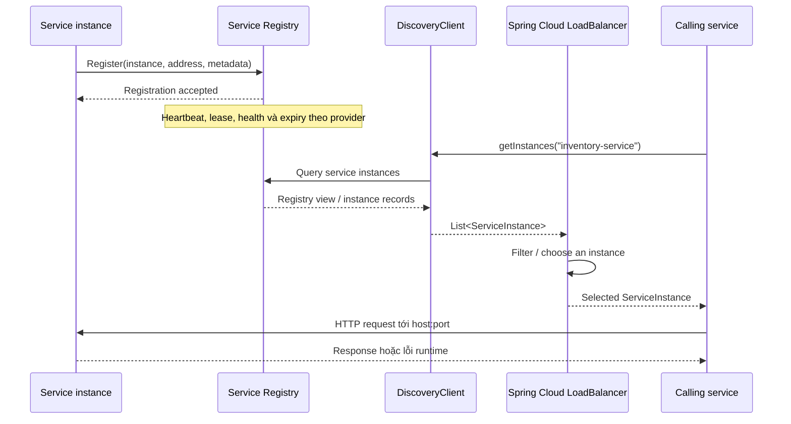
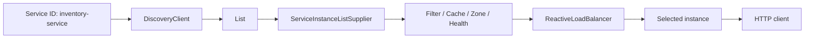

# Giới hạn dữ liệu discovery và quan hệ với hệ đăng ký thực

> **Chương:** DiscoveryClient
> **Module:** `SPRING_CLOUD_CORE` — các nền tảng cốt lõi của Spring Cloud trong hệ thống phân tán, đặc biệt Spring Cloud Commons, Context, cấu hình bên ngoài và tương thích phiên bản với Spring Boot. Người học tìm hiểu refresh scope, discovery, service registry, giao tiếp dịch vụ và cách kiểm thử, vận hành các abstraction chung.
> **Trọng tâm:** `DiscoveryClient` cung cấp hợp đồng tra cứu service và instance thống nhất cho ứng dụng Spring. Hợp đồng này giảm phụ thuộc vào Eureka, Consul, ZooKeeper hoặc nền tảng khác, nhưng dữ liệu trả về chỉ là góc nhìn discovery do provider cung cấp. Cần hiểu giới hạn của `ServiceInstance`, vòng đời đăng ký và quan hệ giữa dữ liệu discovery với trạng thái thực của service.

## 1. DiscoveryClient giải quyết bài toán nào?

Trong hệ thống phân tán, một service thường chạy nhiều instance. Địa chỉ của mỗi instance có thể thay đổi khi container được tạo lại, máy chủ được thay thế, autoscaling tăng giảm replica hoặc workload chuyển sang node khác. Nếu client gọi service bằng IP và port cố định, mỗi lần triển khai hoặc mở rộng có thể buộc phải sửa cấu hình của các service phụ thuộc.

Service discovery giải quyết việc tìm địa chỉ instance theo một tên logic. Ví dụ, ứng dụng đặt yêu cầu tới `inventory-service`; hệ thống discovery trả về danh sách instance đang được provider công bố cho service đó. Client-side load balancer sau đó chọn một instance để gửi request.

Spring Cloud Commons định nghĩa `DiscoveryClient` để các thành phần Spring Cloud sử dụng chung một API, độc lập với implementation cụ thể như Eureka, Consul hoặc ZooKeeper. `DiscoveryClient` không phải toàn bộ hệ thống registry. Nó là lớp truy vấn dữ liệu discovery mà provider đưa ra.

Sự phân biệt này rất quan trọng. Một danh sách instance được trả về không phải cam kết rằng mọi instance đều đang xử lý request thành công tại thời điểm hiện tại. Dữ liệu có thể đã cũ, health state có thể cập nhật trễ, metadata có thể do từng provider định nghĩa và địa chỉ có thể không truy cập được từ network của caller.

### Kết quả học tập

Sau bài này, người học có thể:

1. giải thích vai trò của `DiscoveryClient` trong Spring Cloud Commons;
2. phân biệt hợp đồng đọc discovery với API đăng ký service;
3. mô tả những trường dữ liệu chuẩn của `ServiceInstance`;
4. nhận diện thông tin không được bảo đảm bởi abstraction;
5. phân biệt `SimpleDiscoveryClient` với discovery client dựa trên registry thực;
6. giải thích vai trò của `ServiceRegistry`, auto-registration và registration lifecycle;
7. hiểu tác động của nhiều `DiscoveryClient`, thứ tự ưu tiên và cache;
8. phân biệt discovery health với sức khỏe thực tế của từng instance;
9. thiết kế kiểm thử và vận hành phù hợp với giới hạn của dữ liệu discovery.

## 2. Luồng từ service đang chạy đến request của client

Một service registry và `DiscoveryClient` tham gia vào các giai đoạn khác nhau:

1. Service instance khởi động và tạo thông tin đăng ký gồm service ID, instance ID, địa chỉ, port và metadata.
2. Discovery integration đăng ký instance với registry, thường thông qua auto-registration của Spring Cloud.
3. Registry lưu thông tin và áp dụng quy tắc riêng về heartbeat, lease, health check, TTL hoặc deregistration.
4. `DiscoveryClient` truy vấn provider và chuyển kết quả thành `ServiceInstance`.
5. Spring Cloud LoadBalancer nhận danh sách instance, áp dụng chiến lược chọn instance và trả kết quả cho HTTP client.
6. HTTP client kết nối tới địa chỉ đã chọn. Request vẫn có thể thất bại do network, timeout, TLS, authorization hoặc lỗi ứng dụng.



Sơ đồ cho thấy discovery kết thúc ở việc cung cấp địa chỉ instance. Request thực tế vẫn cần đi qua network và ứng dụng đích.

## 3. Hợp đồng của DiscoveryClient

### 3.1. Những thao tác chính

`org.springframework.cloud.client.discovery.DiscoveryClient` là một abstraction thiên về đọc. Các phương thức quan trọng gồm:

| Phương thức | Ý nghĩa |
| --- | --- |
| `description()` | Mô tả implementation, có thể được dùng trong health indicator |
| `getInstances(serviceId)` | Lấy danh sách `ServiceInstance` được biết cho service ID |
| `getServices()` | Lấy các service ID mà client biết |
| `probe()` | Kiểm tra discovery client có thể thực hiện thao tác discovery hay không |
| `getOrder()` | Trả thứ tự khi có nhiều discovery client |

`DiscoveryClient` mở rộng `Ordered`, vì vậy implementation có thể tham gia sắp xếp khi ứng dụng có nhiều nguồn discovery.

`getInstances(serviceId)` trả về danh sách instance của một service. Nếu service không tồn tại hoặc provider không tìm thấy instance phù hợp, danh sách thường rỗng. Không nên coi danh sách rỗng là bằng chứng duy nhất rằng service chưa được triển khai; có thể do namespace, credential, filter, cache hoặc trạng thái đồng bộ của provider.

`getServices()` trả về các service ID mà implementation hiện tại biết. Đây không phải API bảo đảm liệt kê toàn bộ service trong mọi cluster hoặc mọi namespace. Kết quả phụ thuộc quyền truy cập, phạm vi cấu hình và quy tắc của provider.

### 3.2. DiscoveryClient không phải API quản trị registry

Các thao tác đăng ký và hủy đăng ký thuộc một abstraction khác là `ServiceRegistry`. Spring Cloud Commons cung cấp `register(Registration)`, `deregister(Registration)` và các thao tác status tương ứng ở implementation. `DiscoveryClient` tập trung vào việc đọc service catalog và instance.

Không nên dùng `DiscoveryClient` như thể nó có thể tạo, sửa hoặc xóa registration. Cũng không nên giả định mọi provider có cùng semantics cho registration, health status, heartbeat hoặc metadata.

### 3.3. Blocking và reactive discovery

Spring Cloud Commons hỗ trợ cả `DiscoveryClient` dạng blocking và `ReactiveDiscoveryClient` dạng reactive. Hai API phục vụ hai kiểu lập trình khác nhau:

- Blocking client trả kết quả đồng bộ, phù hợp với call stack imperative.
- Reactive client trả dữ liệu qua reactive type, phù hợp với ứng dụng WebFlux hoặc luồng reactive.

Việc có hai API không có nghĩa hệ thống có hai registry độc lập. Chúng có thể là hai adapter cho cùng provider. Hãy chọn kiểu client phù hợp với stack của ứng dụng và kiểm tra implementation tương ứng có được đưa vào classpath.

Có thể tắt discovery client theo nhu cầu:

```yaml
spring:
  cloud:
    discovery:
      enabled: true
      blocking:
        enabled: true
      reactive:
        enabled: true
```

Các giá trị `false` có thể được dùng để vô hiệu hóa toàn bộ discovery hoặc riêng blocking/reactive client. Chỉ tắt một nhánh khi chắc chắn các thành phần trong ứng dụng không cần API tương ứng.

### 3.4. @EnableDiscoveryClient có còn bắt buộc?

Trong các phiên bản Spring Cloud hiện hành, `@EnableDiscoveryClient` không còn bắt buộc trong nhiều cấu hình thông thường. Khi implementation discovery phù hợp có mặt trên classpath và auto-configuration được kích hoạt, Spring Boot có thể tự cấu hình client và registration.

Annotation vẫn hữu ích khi muốn khai báo rõ ý định hoặc tùy chỉnh `autoRegister`. Không nên thêm annotation theo thói quen mà không kiểm tra starter, auto-configuration và phiên bản đang sử dụng.

## 4. Dữ liệu chuẩn của ServiceInstance

`DiscoveryClient` trả về `List<ServiceInstance>`. Interface `ServiceInstance` chuẩn hóa một số thông tin cơ bản về instance.

| Trường | Ý nghĩa | Giới hạn cần nhớ |
| --- | --- | --- |
| `getInstanceId()` | ID duy nhất của instance theo registration | Có thể `null`; cách tạo ID tùy provider |
| `getServiceId()` | Service ID đã đăng ký | Quy tắc tên, chữ hoa/thường và namespace tùy provider |
| `getHost()` | Hostname của instance | Có thể là IP, DNS name hoặc địa chỉ đại diện |
| `getPort()` | Port của instance | Không chứng minh port đang mở hoặc có thể truy cập từ caller |
| `isSecure()` | Cho biết instance sử dụng HTTPS | Không thay thế việc kiểm tra certificate hoặc TLS policy |
| `getUri()` | URI của service instance | URI có thể đúng về cú pháp nhưng endpoint vẫn không reachable |
| `getMetadata()` | Map key/value metadata của instance | Có thể null hoặc rỗng; schema và ý nghĩa do provider/ứng dụng định nghĩa |
| `getScheme()` | Scheme nếu implementation cung cấp | Có thể `null`; cần hiểu quy tắc fallback của provider |

### 4.1. Instance ID không phải lúc nào cũng có

`ServiceInstance.getInstanceId()` là nullable và implementation mặc định có thể trả `null`. Vì vậy, không viết code giả định instance ID luôn tồn tại:

```java
String instanceId = instance.getInstanceId();

if (instanceId == null || instanceId.isBlank()) {
    // Dùng thông tin khác để log hoặc xử lý chẩn đoán.
}
```

Nếu cần một ID ổn định để log, trace hoặc sticky routing, hãy xác định quy tắc của provider. Không tự tạo ID ngẫu nhiên ở mỗi lần đọc discovery rồi coi đó là danh tính instance.

### 4.2. Host và port không phải health check

Một `ServiceInstance` có thể chứa host và port hợp lệ nhưng:

- pod đã dừng nhưng registry chưa loại bỏ record;
- firewall hoặc network policy chặn kết nối;
- port chưa mở vì ứng dụng chưa bind server;
- endpoint chỉ reachable từ một subnet khác;
- certificate TLS không hợp lệ;
- ứng dụng đã nhận request nhưng downstream dependency đang lỗi.

Do đó, việc có instance trong danh sách chỉ chứng minh discovery provider đã cung cấp một record. Nó không chứng minh request nghiệp vụ sẽ thành công.

### 4.3. Metadata là dữ liệu mở, không phải schema dùng chung

Metadata thường là `Map<String, String>`. Các key như `zone`, `weight`, `version`, `region`, `canary` hoặc `hint` có thể được provider hoặc ứng dụng tự định nghĩa.

Không có quy tắc chung buộc mọi provider phải trả các key này hoặc sử dụng cùng ý nghĩa. Ví dụ:

- `zone` có thể mô tả availability zone, rack hoặc region tùy integration;
- `weight` có thể được LoadBalancer dùng nếu cấu hình supplier hỗ trợ;
- `version` có thể là phiên bản ứng dụng, API contract hoặc release channel;
- `hint` có thể phục vụ lọc instance theo request.

Nếu metadata là một phần contract của hệ thống, hãy định nghĩa key, kiểu, giá trị hợp lệ, owner và versioning. Xử lý trường hợp key thiếu hoặc sai định dạng. Không đặt secret, token hoặc thông tin nhạy cảm vào metadata vì registry có thể hiển thị dữ liệu này cho nhiều client.

## 5. DiscoveryClient và service registry thực

### 5.1. Registry lưu registration; DiscoveryClient cung cấp góc nhìn tra cứu

Một service registry như Eureka, Consul hoặc ZooKeeper có thể lưu thông tin registration và cung cấp cơ chế cập nhật trạng thái instance. Mỗi hệ thống có mô hình riêng về:

- đăng ký và hủy đăng ký;
- heartbeat hoặc lease;
- TTL và thời gian loại bỏ record hết hạn;
- health check và trạng thái instance;
- replication, cache và consistency giữa node;
- namespace, datacenter, tag hoặc metadata;
- authentication và quyền đọc/ghi.

Spring Cloud Commons chuẩn hóa phần API mà ứng dụng Spring sử dụng. Nó không loại bỏ sự khác biệt bên trong các provider.

Một ứng dụng có thể gọi `DiscoveryClient.getInstances("inventory-service")` mà không cần biết provider cụ thể. Tuy nhiên, khi thiết kế vận hành, cần đọc tài liệu provider để hiểu record được tạo khi nào, bị xóa khi nào và health status được cập nhật theo cơ chế nào.

### 5.2. ServiceRegistry và Registration

`ServiceRegistry` là abstraction cho các thao tác đăng ký. `Registration` mô tả instance cần đăng ký và mở rộng thông tin của `ServiceInstance`. Các implementation cụ thể sử dụng kiểu registration tương ứng với provider, ví dụ Eureka, Consul hoặc ZooKeeper.

Trong nhiều cấu hình, service được tự động đăng ký khi web server khởi tạo. Có thể tắt auto-registration bằng cấu hình:

```yaml
spring:
  cloud:
    service-registry:
      auto-registration:
        enabled: false
```

Hoặc dùng `@EnableDiscoveryClient(autoRegister = false)` nếu ứng dụng chọn điều khiển registration qua annotation. Không tắt auto-registration chỉ để sửa một lỗi tra cứu; hãy xác định rõ service có cần tự đăng ký hay được một controller bên ngoài quản lý.

### 5.3. Registration lifecycle events

Spring Cloud Commons cung cấp các event liên quan tới auto-registration:

- `InstancePreRegisteredEvent` được phát trước khi instance được đăng ký;
- `InstanceRegisteredEvent` được phát sau khi registration hoàn tất.

Ứng dụng có thể lắng nghe event để ghi audit, cập nhật trạng thái nội bộ hoặc thực hiện hành động sau đăng ký. Nếu `spring.cloud.service-registry.auto-registration.enabled=false`, các event auto-registration này không được phát theo luồng mặc định.

Event registration thành công không đồng nghĩa toàn bộ dependency của service đã sẵn sàng. Nếu readiness phụ thuộc database, message broker hoặc downstream, hãy dùng readiness check phù hợp trước khi đưa instance vào traffic.

### 5.4. Endpoint Service Registry của Actuator

Spring Cloud Commons cung cấp endpoint `/actuator/serviceregistry` khi có Actuator và registration bean phù hợp. GET trả trạng thái registration; POST có thể yêu cầu thay đổi status thông qua payload có trường `status`.

Các giá trị status được chấp nhận phụ thuộc provider. Ví dụ, Eureka có các trạng thái `UP`, `DOWN`, `OUT_OF_SERVICE` và `UNKNOWN`. Không áp dụng danh sách này như contract chung cho Consul hoặc ZooKeeper.

Endpoint thay đổi status là endpoint quản trị. Chỉ expose khi cần, bảo vệ bằng authentication/authorization và audit thao tác. Không để client nghiệp vụ thông thường có quyền thay đổi trạng thái registration.

## 6. Những gì DiscoveryClient không bảo đảm

Đây là phần quan trọng nhất khi thiết kế hệ thống sử dụng discovery.

### 6.1. Không bảo đảm danh sách luôn mới nhất

Một danh sách instance có thể chậm hơn trạng thái thật vì:

- registry chỉ nhận heartbeat theo chu kỳ;
- TTL chưa hết nên record cũ vẫn còn;
- node registry đang đồng bộ hoặc replication chậm;
- client cache kết quả;
- LoadBalancer cache thêm một lớp;
- provider chỉ cập nhật health sau một khoảng thời gian;
- network partition khiến client không đọc được trạng thái mới.

Không có một độ trễ đồng bộ chung áp dụng cho mọi provider. Hãy xác định heartbeat interval, lease duration, eviction timeout và cache TTL theo tài liệu implementation đang dùng.

### 6.2. Không bảo đảm consistency giống nhau giữa các provider

Một provider có thể trả danh sách từ local cache, provider khác có thể query server hoặc dùng cơ chế watch/stream. Một số registry ưu tiên availability khi phân vùng mạng; một số có thể từ chối query hoặc trả dữ liệu cũ.

Vì vậy, không nên thiết kế thuật toán nghiệp vụ dựa trên giả định rằng mọi instance nhìn thấy chính xác cùng một danh sách tại cùng một thời điểm.

### 6.3. Không bảo đảm thứ tự instance

Danh sách `getInstances()` không nên được coi là một thứ tự ưu tiên hoặc thứ tự round-robin có ý nghĩa. Provider có thể thay đổi thứ tự theo cache, response hoặc cách lưu trữ.

Nếu cần chọn instance, dùng Spring Cloud LoadBalancer hoặc chính sách được thiết kế rõ ràng. Không lấy phần tử `[0]` rồi xem đó là primary instance nếu provider không định nghĩa contract như vậy.

### 6.4. Không bảo đảm instance đã sẵn sàng xử lý request

Một record có thể xuất hiện trong discovery trước khi mọi dependency của ứng dụng đã sẵn sàng. Một instance `UP` trong registry cũng có thể gặp lỗi sau thời điểm health check gần nhất.

Discovery health, process liveness, application readiness và request success là những tín hiệu khác nhau. Cần kết hợp health check, readiness probe, retry có giới hạn, timeout và circuit breaker theo kiến trúc của service.

### 6.5. Không bảo đảm metadata có cùng ngữ nghĩa

Metadata là một map mở. Nếu client phụ thuộc vào `zone=zone-a`, provider và service đăng ký phải thống nhất key này. Nếu một implementation dùng `availability-zone`, client sẽ không tự hiểu đó là cùng một thông tin.

Hãy tạo contract metadata riêng cho nền tảng, kiểm thử ở cả phía đăng ký và phía tiêu thụ, đồng thời hỗ trợ dữ liệu thiếu hoặc phiên bản cũ trong giai đoạn migration.

### 6.6. Không bảo đảm endpoint có thể truy cập từ mọi network

Registry có thể chứa địa chỉ chỉ hợp lệ trong một network segment hoặc namespace. Một client ở cluster khác có thể nhìn thấy record nhưng không có route tới địa chỉ đó.

Trong môi trường đa cluster hoặc đa vùng, cần xác định discovery scope, network topology, DNS, service mesh hoặc gateway. Không công bố địa chỉ nội bộ cho client ngoài phạm vi được phép.

### 6.7. Không bảo đảm service ID có cùng quy tắc giữa mọi hệ thống

Một provider có thể chuẩn hóa tên service thành chữ thường, provider khác phân biệt chữ hoa/thường hoặc kết hợp namespace. Hãy thống nhất service ID trong cấu hình, metadata, URL load-balanced và registry.

Ví dụ `Inventory-Service`, `inventory-service` và `inventory` có thể là ba ID khác nhau tùy provider. Không dùng tên hiển thị thay cho service ID logic.

## 7. SimpleDiscoveryClient: discovery từ cấu hình tĩnh

### 7.1. Khi nào được sử dụng?

Nếu classpath không có `DiscoveryClient` được kết nối với service registry thực, Spring Cloud có thể sử dụng `SimpleDiscoveryClient`. Implementation này lấy thông tin instance từ properties thay vì truy vấn registry động.

Ví dụ:

```yaml
spring:
  cloud:
    discovery:
      client:
        simple:
          instances:
            inventory-service:
              - uri: http://inventory-1.internal:8080
              - uri: http://inventory-2.internal:8080
            pricing-service:
              - uri: https://pricing.internal:8443
```

Dạng property tương đương có thể được viết như sau:

```properties
spring.cloud.discovery.client.simple.instances.inventory-service[0].uri=http://inventory-1.internal:8080
spring.cloud.discovery.client.simple.instances.inventory-service[1].uri=http://inventory-2.internal:8080
spring.cloud.discovery.client.simple.instances.pricing-service[0].uri=https://pricing.internal:8443
```

Các giá trị này được cấu hình cùng ứng dụng hoặc nguồn property mà Spring Boot nạp. Nếu địa chỉ instance thay đổi, cấu hình cũng phải được cập nhật và ứng dụng cần nạp lại theo cơ chế phù hợp.

### 7.2. Giới hạn của SimpleDiscoveryClient

`SimpleDiscoveryClient` hữu ích cho local development, integration test hoặc môi trường có topology cố định. Nó không tự cung cấp:

- đăng ký instance động;
- heartbeat;
- lease hoặc TTL;
- tự loại bỏ instance chết;
- đồng bộ catalog giữa nhiều node;
- health state tự cập nhật từ registry;
- auto-scaling discovery.

Vì danh sách đến từ properties, một URI vẫn có thể tồn tại trong cấu hình sau khi server đích đã dừng. Nếu dùng trong môi trường cần tính sẵn sàng cao, cần có cơ chế cập nhật cấu hình và health checking phù hợp.

### 7.3. Không nhầm SimpleDiscoveryClient với registry thật

Tên interface giống nhau nhưng nguồn dữ liệu khác nhau. `SimpleDiscoveryClient` là implementation đọc danh sách instance từ property. Một discovery client dựa trên Eureka/Consul/ZooKeeper truy vấn provider có lifecycle registration và health riêng.

Không nên dùng `SimpleDiscoveryClient` để kiểm chứng các tính năng như lease expiration, auto-registration hoặc deregistration của registry thật.

## 8. Nhiều DiscoveryClient và thứ tự ưu tiên

Một ứng dụng có thể có nhiều discovery implementation trên classpath, ví dụ Eureka và Consul cùng lúc. `DiscoveryClient` mở rộng `Ordered`, cho phép đặt thứ tự implementation.

Mặc định order là `0`. Custom implementation có thể override `getOrder()`. Các implementation do Spring Cloud cung cấp có thể có property riêng để điều chỉnh thứ tự, ví dụ `spring.cloud.{clientIdentifier}.discovery.order` hoặc property tương ứng của Eureka.

Khi nhiều discovery client cùng tồn tại:

- kiểm tra implementation nào thực sự được auto-configure;
- xác định thứ tự và semantics của composite discovery client trong release đang dùng;
- không giả định danh sách instance luôn được hợp nhất từ mọi registry;
- kiểm tra trường hợp cùng service ID xuất hiện ở hai provider;
- kiểm thử khi provider ưu tiên không có service hoặc bị lỗi;
- tránh để hai nguồn registration cùng đăng ký một service theo hai quy tắc khác nhau.

Nếu kiến trúc cần hợp nhất nhiều registry, hãy thiết kế một adapter/federation rõ ràng và quy định cách xử lý duplicate instance, conflict metadata, service ID và lỗi từng nguồn. Không dựa vào việc thêm hai starter là tự có một service catalog hợp nhất đúng ý nghiệp vụ.

## 9. Quan hệ giữa DiscoveryClient và Spring Cloud LoadBalancer

### 9.1. DiscoveryClient cung cấp danh sách; LoadBalancer chọn instance

Spring Cloud LoadBalancer dùng discovery client để lấy danh sách `ServiceInstance`, sau đó áp dụng thuật toán chọn instance. Các implementation mặc định gồm round-robin và random; có thể tùy chỉnh supplier hoặc load-balancer theo từng service.

Luồng khái niệm:



DiscoveryClient không tự thực hiện request tới instance. Nó cũng không thay thế retry, timeout, circuit breaker hoặc HTTP client.

### 9.2. Cache có thể làm dữ liệu cũ hơn

Spring Cloud LoadBalancer có cache cho danh sách instance. Tài liệu hiện hành mô tả TTL mặc định là `35s` và cache capacity ban đầu là `256`. Có thể thay đổi hoặc tắt cache bằng các property tương ứng.

Ví dụ:

```yaml
spring:
  cloud:
    loadbalancer:
      cache:
        enabled: true
        ttl: 20s
        capacity: 256
```

Nếu discovery provider đã có cache riêng, thêm cache LoadBalancer có thể tạo double caching. Khi đó, một instance đã bị xóa khỏi registry có thể tiếp tục xuất hiện trong cache của provider và cache của LoadBalancer lâu hơn dự kiến.

Tài liệu Spring Cloud khuyến nghị tắt cache LoadBalancer khi DiscoveryClient implementation đã cache dữ liệu, ví dụ Eureka DiscoveryClient, để tránh double caching. Hãy đo độ trễ cập nhật thực tế trước khi chọn TTL.

### 9.3. HealthCheckServiceInstanceListSupplier

Spring Cloud LoadBalancer cung cấp `HealthCheckServiceInstanceListSupplier` để kiểm tra định kỳ các instance do supplier delegate trả về. Cơ chế này đặc biệt hữu ích khi dùng `SimpleDiscoveryClient`, vì danh sách tĩnh không tự biết instance nào đã chết.

Với registry thực, provider thường đã có health state của instance, vì vậy không phải lúc nào cũng cần health check thứ hai từ LoadBalancer. Nếu bật thêm, cần cân nhắc chi phí probe và semantics của endpoint.

Một chi tiết cần chú ý: khi không có instance nào vượt qua health check, supplier có thể trả lại toàn bộ danh sách đã nhận. Vì vậy, không xem health-check supplier là một cơ chế cô lập lỗi tuyệt đối. Vẫn cần timeout, retry có giới hạn và circuit breaker ở tầng gọi dịch vụ.

### 9.4. Zone, weight và hint dựa trên metadata

LoadBalancer có thể sử dụng metadata để lọc hoặc ưu tiên instance:

- zone preference dựa trên key `zone`;
- weighted supplier có thể đọc key `weight`;
- hint-based supplier có thể đọc key `hint`.

Các cơ chế này chỉ có tác dụng khi metadata được đăng ký đúng và supplier tương ứng được cấu hình. Nếu không có key, LoadBalancer có thể dùng giá trị mặc định hoặc trả lại danh sách ban đầu theo semantics của supplier.

Không dùng metadata để triển khai security boundary. Một header hint từ request hoặc giá trị metadata do service tự khai báo không thay thế authorization và policy mạng.

## 10. Health indicator của discovery nói lên điều gì?

### 10.1. DiscoveryClientHealthIndicator

Spring Cloud Commons cung cấp `DiscoveryClientHealthIndicator`. Theo mặc định, indicator có thể gọi `getServices()` để kiểm tra discovery client và đưa danh sách service vào health details.

Trong deployment có nhiều service, truy vấn toàn bộ service list cho mỗi health check có thể tốn kém. Có thể cấu hình `spring.cloud.discovery.client.health-indicator.use-services-query=false` để indicator gọi `probe()` thay thế. Implementation có thể override `probe()` bằng một thao tác nhẹ hơn `getServices()`.

Các property liên quan:

```yaml
spring:
  cloud:
    discovery:
      client:
        health-indicator:
          enabled: true
          include-description: false
          use-services-query: false
```

### 10.2. Discovery health không phải downstream health

Nếu health indicator báo `UP`, điều đó thường cho thấy discovery client đã thực hiện được thao tác truy vấn/probe theo contract của implementation. Nó không chứng minh:

- mọi service ID đều có instance;
- mọi instance đều healthy;
- mọi host/port đều reachable;
- TLS handshake thành công;
- request nghiệp vụ thành công;
- registry đang có dữ liệu mới nhất.

Để kiểm tra một downstream cụ thể, hãy có health check hoặc smoke test riêng với timeout và phạm vi rõ ràng. Không biến liveness probe của service thành một chuỗi gọi đồng bộ tới tất cả downstream vì điều đó có thể làm một dependency chậm khiến nhiều service cùng bị đánh dấu lỗi.

### 10.3. Phân biệt các tín hiệu sức khỏe

| Tín hiệu | Câu hỏi được trả lời |
| --- | --- |
| Process liveness | Process có còn chạy và có thể tiếp tục không? |
| Application readiness | Instance có sẵn sàng nhận traffic theo policy của ứng dụng không? |
| Discovery health | Discovery client có thể truy vấn/probe provider không? |
| Registry instance status | Provider đang xem registration ở trạng thái nào? |
| LoadBalancer health check | Instance có phản hồi endpoint probe được cấu hình không? |
| Business smoke test | Request nghiệp vụ cụ thể có thành công không? |

Các tín hiệu bổ sung cho nhau. Không dùng một trạng thái `UP` để thay cho tất cả.

## 11. Ví dụ sử dụng DiscoveryClient để quan sát dữ liệu

Có thể inject `DiscoveryClient` để đọc danh sách service và instance:

```java
import java.util.List;

import org.springframework.cloud.client.ServiceInstance;
import org.springframework.cloud.client.discovery.DiscoveryClient;
import org.springframework.stereotype.Component;

@Component
public class DiscoveryInspector {

    private final DiscoveryClient discoveryClient;

    public DiscoveryInspector(DiscoveryClient discoveryClient) {
        this.discoveryClient = discoveryClient;
    }

    public void inspectInventoryInstances() {
        List<ServiceInstance> instances =
                discoveryClient.getInstances("inventory-service");

        for (ServiceInstance instance : instances) {
            String instanceId = instance.getInstanceId();

            // Ghi log metadata không nhạy cảm, tránh log toàn bộ map.
            System.out.printf(
                    "service=%s instance=%s uri=%s secure=%s%n",
                    instance.getServiceId(),
                    instanceId,
                    instance.getUri(),
                    instance.isSecure()
            );
        }
    }
}
```

Đây là ví dụ quan sát dữ liệu discovery. Trong code nghiệp vụ, không nên tự lấy `instances.get(0)` rồi gửi request trực tiếp. Hãy dùng client được tích hợp Spring Cloud LoadBalancer để chọn instance theo policy và giữ đúng luồng retry/metrics.

Nếu chỉ cần liệt kê service ID phục vụ chẩn đoán:

```java
List<String> serviceIds = discoveryClient.getServices();
```

Không hiển thị catalog này công khai nếu tên service tiết lộ cấu trúc nội bộ. Cũng không ghi toàn bộ metadata nếu trong đó có thông tin nội bộ không cần thiết.

## 12. Các tình huống lỗi thường gặp

| Triệu chứng | Nguyên nhân có thể | Cách kiểm tra |
| --- | --- | --- |
| `getInstances()` trả danh sách rỗng | Sai service ID, namespace, credential hoặc chưa có registration | So sánh service ID, provider catalog và quyền truy cập |
| Có instance nhưng gọi timeout | Record cũ, network policy, route hoặc port sai | Kiểm tra host/port từ network của caller và TTL |
| Service mới chạy nhưng chưa được tìm thấy | Auto-registration tắt, registration lỗi hoặc provider chưa cập nhật | Registration events, log provider và service ID |
| Instance đã dừng vẫn xuất hiện | Heartbeat/lease chưa hết, deregistration không chạy hoặc cache chưa hết hạn | TTL, health state, deregistration log và cache |
| Hai registry trả hai danh sách khác nhau | Nhiều DiscoveryClient, order hoặc scope khác nhau | Kiểm tra classpath, order và provider cụ thể |
| LoadBalancer tiếp tục chọn instance cũ | Double cache hoặc cache TTL quá dài | Cache provider và `spring.cloud.loadbalancer.cache.*` |
| Discovery health `UP` nhưng downstream lỗi | Health indicator chỉ kiểm tra discovery client | Kiểm tra instance health và business smoke test |
| Metadata `zone` bị thiếu | Registration không gắn metadata hoặc provider mapping khác | Kiểm tra registration payload và metadata map |
| Instance ID là `null` | Provider không cung cấp ID hoặc mapping không có ID | Dùng quy tắc ID phù hợp, không giả định non-null |
| `SimpleDiscoveryClient` vẫn trả instance chết | URI được khai báo tĩnh trong properties | Cập nhật cấu hình hoặc dùng registry động/health check |
| `/serviceregistry` không hoạt động | Thiếu Actuator, không có Registration bean hoặc endpoint chưa expose | Dependency, auto-registration và endpoint exposure |
| Service ID không khớp | Khác chữ hoa/thường, prefix hoặc namespace | Chuẩn hóa service naming và kiểm thử contract |

## 13. Chiến lược kiểm thử dữ liệu discovery

### 13.1. Unit test cho code tiêu thụ DiscoveryClient

Khi viết code dùng `DiscoveryClient`, kiểm tra ít nhất:

- service ID hợp lệ và service không tồn tại;
- danh sách instance rỗng;
- nhiều instance cùng service;
- `instanceId` là `null`;
- metadata thiếu key hoặc chứa giá trị không hợp lệ;
- host/port/scheme không đúng kỳ vọng;
- exception khi truy vấn provider;
- dữ liệu có duplicate instance.

Không viết logic giả định danh sách luôn có phần tử hoặc metadata luôn có một key cụ thể.

### 13.2. Integration test với registry thật hoặc test container

Unit test mock `DiscoveryClient` không kiểm chứng registration lifecycle. Cần integration test cho các hành vi quan trọng:

1. service khởi động và được đăng ký;
2. registry trả đúng service ID và instance;
3. instance có metadata mong đợi;
4. service shutdown và deregistration hoạt động;
5. heartbeat/TTL loại record cũ theo thời gian provider quy định;
6. trạng thái health thay đổi được phản ánh trong kết quả discovery;
7. caller có quyền truy vấn đúng namespace/service;
8. lỗi kết nối registry được phát hiện.

Nếu test dùng test container hoặc môi trường provider riêng, cần kiểm soát port, network và thời gian lease để tránh test flaky.

### 13.3. Kiểm thử cache và consistency

Thiết kế test để quan sát độ trễ từ registration thay đổi tới kết quả `getInstances()`:

- đăng ký instance A;
- truy vấn từ caller;
- thêm instance B;
- đo thời gian B xuất hiện;
- deregister A;
- đo thời gian A biến mất;
- thử khi cache provider và cache LoadBalancer được bật/tắt.

Kết quả cần được đánh giá theo SLA/giới hạn của provider đang dùng, không kỳ vọng một con số cố định cho mọi registry.

### 13.4. Kiểm thử metadata contract

Nếu LoadBalancer dùng `zone`, `weight` hoặc `hint`, hãy kiểm thử:

- registration thực sự gửi key;
- discovery adapter trả key trong `ServiceInstance.getMetadata()`;
- kiểu dữ liệu có parse được;
- giá trị thiếu có fallback hợp lý;
- metadata phiên bản cũ vẫn tương thích trong thời gian rollout;
- metadata không chứa credential hoặc secret.

## 14. Khuyến nghị thiết kế và vận hành

- Dùng `DiscoveryClient` để tra cứu service/instance và dùng `ServiceRegistry` cho registration lifecycle.
- Xem `ServiceInstance` là một bản ghi địa chỉ và metadata, không phải bằng chứng endpoint đang phục vụ khỏe.
- Chuẩn hóa service ID giữa `spring.application.name`, registry, client và LoadBalancer.
- Xác định owner và schema cho metadata tùy chỉnh.
- Không dựa vào thứ tự phần tử trong `getInstances()`.
- Đặt timeout cho truy vấn discovery và request tới downstream.
- Kiểm tra cache của registry và LoadBalancer để tránh double caching.
- Dùng health indicator để quan sát khả năng truy vấn discovery, đồng thời có readiness/smoke test cho service quan trọng.
- Chọn `SimpleDiscoveryClient` cho topology tĩnh, test hoặc development; dùng registry-backed implementation khi cần registration và lifecycle động.
- Nếu có nhiều `DiscoveryClient`, cấu hình order và kiểm thử rõ semantics của composite.
- Bảo vệ endpoint `/serviceregistry` và các API quản trị registry.
- Theo dõi registration success, deregistration, heartbeat expiry, empty instance list, stale instance và lỗi kết nối.
- Đọc tài liệu provider khi cần hiểu consistency, lease, namespace, status và metadata mapping.

## 15. Bài tập vận dụng

### Bài tập 1 — Instance có trong danh sách nhưng request timeout

`DiscoveryClient.getInstances("inventory-service")` trả về ba instance. Một trong ba instance không thể kết nối từ service caller.

Hãy giải thích vì sao discovery vẫn có thể trả instance đó. Đề xuất các kiểm tra network, registry health, cache TTL và LoadBalancer health phù hợp.

### Bài tập 2 — Phân biệt DiscoveryClient và ServiceRegistry

Một nhóm phát triển inject `DiscoveryClient` rồi tìm cách gọi `register()` để đăng ký instance mới.

Hãy giải thích vì sao đây là nhầm lẫn abstraction. Nêu vai trò của `ServiceRegistry`, `Registration` và auto-registration trong Spring Cloud Commons.

### Bài tập 3 — Metadata không thống nhất

Service A đăng ký `zone=zone-a`, service B đăng ký `availability-zone=zone-a`. LoadBalancer chỉ đọc key `zone`.

Hãy dự đoán kết quả khi chọn instance và đề xuất một metadata contract có versioning.

### Bài tập 4 — Double caching

Eureka đã cache registry data, trong khi LoadBalancer cũng dùng cache TTL 35 giây. Sau khi một instance bị deregister, client vẫn chọn instance cũ.

Hãy giải thích hai lớp cache và đề xuất cách cấu hình/đo độ trễ để tránh giữ record cũ quá lâu.

### Bài tập 5 — SimpleDiscoveryClient trong production

Một nhóm dùng `SimpleDiscoveryClient` với ba URI trong YAML. Một server đích bị dừng nhưng vẫn xuất hiện trong danh sách.

Hãy giải thích nguồn dữ liệu tĩnh của SimpleDiscoveryClient và đề xuất registry động hoặc health check phù hợp.

### Bài tập 6 — Health indicator báo UP nhưng service không xử lý request

`DiscoveryClientHealthIndicator` báo `UP`, nhưng request tới `payments-service` trả HTTP 503.

Hãy phân tích những gì health indicator đã kiểm tra và những gì nó chưa kiểm tra. Đề xuất business smoke test hoặc health policy bổ sung.

### Bài tập 7 — Hai discovery provider cùng tồn tại

Ứng dụng có cả Eureka và Consul trên classpath. Một service ID có trong cả hai registry nhưng địa chỉ khác nhau.

Hãy giải thích vai trò `Ordered`, xác định cách kiểm tra implementation được ưu tiên và thiết kế test để phát hiện duplicate hoặc dữ liệu xung đột.

### Tự kiểm tra nhanh

1. `DiscoveryClient` chủ yếu cung cấp loại thao tác nào? **Đọc service ID và danh sách ServiceInstance.**
2. API đăng ký service thuộc abstraction nào? **`ServiceRegistry` với `Registration`.**
3. `getInstances()` có chứng minh endpoint reachable không? **Không.**
4. `instanceId` có luôn khác null không? **Không, interface cho phép null.**
5. Metadata có schema chung cho mọi provider không? **Không, key và ý nghĩa thường do provider/ứng dụng quy định.**
6. `SimpleDiscoveryClient` lấy dữ liệu từ đâu? **Từ properties cấu hình.**
7. `DiscoveryClientHealthIndicator` mặc định có thể gọi phương thức nào? **`getServices()`; có thể chuyển sang `probe()`.**
8. LoadBalancer có vai trò gì sau discovery? **Chọn instance từ danh sách được cung cấp.**
9. Vì sao double caching nguy hiểm? **Có thể kéo dài thời gian giữ instance đã bị deregister.**
10. Registry status `UP` có bảo đảm request nghiệp vụ thành công không? **Không.**

**Thông điệp cốt lõi:** `DiscoveryClient` là hợp đồng tra cứu dữ liệu service và instance, còn `ServiceRegistry` quản lý các thao tác đăng ký. `ServiceInstance` chỉ chuẩn hóa một tập trường cơ bản; độ mới, health, metadata, consistency và khả năng truy cập vẫn phụ thuộc provider, cache và network. Hãy kết hợp discovery với LoadBalancer, health/readiness, timeout, retry có giới hạn và kiểm thử integration để xử lý đúng trạng thái thực của service.

**Tài liệu tham khảo:** [Spring Cloud Commons — Common Abstractions](https://docs.spring.io/spring-cloud-commons/reference/spring-cloud-commons/common-abstractions.html), [Spring Cloud LoadBalancer](https://docs.spring.io/spring-cloud-commons/reference/spring-cloud-commons/loadbalancer.html), [DiscoveryClient interface](https://github.com/spring-cloud/spring-cloud-commons/blob/main/spring-cloud-commons/src/main/java/org/springframework/cloud/client/discovery/DiscoveryClient.java), [ServiceInstance interface](https://github.com/spring-cloud/spring-cloud-commons/blob/main/spring-cloud-commons/src/main/java/org/springframework/cloud/client/ServiceInstance.java) và [SimpleDiscoveryClient implementation](https://github.com/spring-cloud/spring-cloud-commons/blob/main/spring-cloud-commons/src/main/java/org/springframework/cloud/client/discovery/simple/SimpleDiscoveryClient.java). Các chi tiết registry, health, metadata và cache có thể khác theo provider/release train; đối chiếu tài liệu đúng phiên bản Spring Boot/Spring Cloud của ứng dụng.
