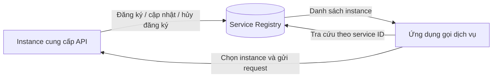

# Phân biệt tra cứu dịch vụ với đăng ký dịch vụ

Trong một hệ thống Spring Cloud, một dịch vụ thường chạy thành nhiều instance. Mỗi instance có địa chỉ mạng riêng, có thể được tạo mới, khởi động lại hoặc thay thế trong quá trình vận hành. Các dịch vụ gọi nhau cần biết instance nào đang sẵn sàng và cách kết nối đến chúng. Service discovery giải quyết bài toán đó thông qua hai thao tác có liên quan nhưng khác mục đích: **đăng ký dịch vụ** và **tra cứu dịch vụ**.

Đăng ký dịch vụ công bố thông tin của một instance lên hệ thống registry để các thành phần khác có thể tìm thấy. Tra cứu dịch vụ đọc thông tin đã được công bố để lấy danh sách instance có thể gọi. Spring Cloud Commons cung cấp các abstraction riêng cho hai hướng này, giúp ứng dụng làm việc với nhiều cơ chế registry mà không phải phụ thuộc trực tiếp vào API của từng nhà cung cấp.

## 1. Hai thao tác giải quyết hai chiều khác nhau

Giả sử hệ thống có dịch vụ `inventory-service` với ba instance. Khi một instance khởi động, nó cần công bố service ID, host, port và metadata cần thiết. Khi `order-service` muốn kiểm tra tồn kho, nó tra cứu `inventory-service` để nhận về một hoặc nhiều địa chỉ instance.

| Khía cạnh | Đăng ký dịch vụ (registration) | Tra cứu dịch vụ (discovery/lookup) |
|---|---|---|
| Mục đích | Công bố một instance để hệ thống biết instance đó tồn tại | Tìm các instance đã được công bố của một service ID |
| Chiều dữ liệu | Ứng dụng dịch vụ ghi thông tin lên registry | Ứng dụng gọi dịch vụ đọc thông tin từ registry hoặc nguồn discovery |
| Thành phần thường thực hiện | Dịch vụ cung cấp API | Dịch vụ tiêu thụ API |
| Thông tin đầu vào | Định danh dịch vụ, địa chỉ instance, port, metadata và trạng thái theo cơ chế của provider | Service ID cần tìm, ví dụ `inventory-service` |
| Kết quả | Registry lưu hoặc cập nhật bản ghi instance | Danh sách `ServiceInstance` phù hợp với service ID |
| Thời điểm | Khi instance tham gia hệ thống, cập nhật trạng thái hoặc rời hệ thống | Khi cần chọn đích gọi; có thể diễn ra nhiều lần trong suốt vòng đời ứng dụng |

Một ứng dụng có thể đảm nhiệm cả hai vai trò. `inventory-service` đăng ký chính nó để những dịch vụ khác tìm thấy, đồng thời nó có thể tra cứu `pricing-service` để tính giá. Việc ứng dụng có khả năng tra cứu không tự động có nghĩa là nó đã đăng ký; tương tự, đăng ký thành công không đảm bảo ứng dụng đã cấu hình được client để tra cứu dịch vụ khác.



Registry là nơi lưu hoặc phân phối thông tin về các instance. Tùy nền tảng, nó có thể là một cụm server riêng, một dịch vụ điều phối, hoặc một nguồn cấu hình tĩnh. Các chi tiết như heartbeat, lease, health check và cách đồng bộ dữ liệu phụ thuộc vào implementation.

## 2. Tra cứu dịch vụ trong Spring Cloud: `DiscoveryClient`

Trong Spring Cloud Commons, `DiscoveryClient` là abstraction dành cho phía đọc thông tin discovery. API cốt lõi gồm:

- `getInstances(String serviceId)`: trả về các `ServiceInstance` được biết đến cho service ID đã cho.
- `getServices()`: trả về các service ID mà discovery client biết.
- `description()`: mô tả implementation của discovery client.

`ServiceInstance` biểu diễn một địa chỉ có thể được dùng để kết nối đến một instance. Nó cung cấp các thông tin như service ID, host, port, URI, giao thức bảo mật và metadata. Metadata có thể chứa dữ liệu bổ sung do provider hoặc ứng dụng công bố, chẳng hạn vùng triển khai hay phiên bản dịch vụ; ý nghĩa cụ thể của từng khóa phải được thống nhất giữa bên ghi và bên đọc.

Ví dụ, một thành phần trong `order-service` có thể tra cứu các instance của `inventory-service`:

```java
import java.net.URI;
import java.util.List;

import org.springframework.cloud.client.ServiceInstance;
import org.springframework.cloud.client.discovery.DiscoveryClient;
import org.springframework.stereotype.Component;

@Component
public class InventoryEndpointResolver {

    private final DiscoveryClient discoveryClient;

    public InventoryEndpointResolver(DiscoveryClient discoveryClient) {
        this.discoveryClient = discoveryClient;
    }

    public List<ServiceInstance> findInstances() {
        return discoveryClient.getInstances("inventory-service");
    }

    public URI findOneEndpoint() {
        return findInstances().stream()
                .findFirst()
                .map(ServiceInstance::getUri)
                .orElseThrow(() -> new IllegalStateException(
                        "Không tìm thấy instance của inventory-service"));
    }
}
```

Đoạn mã minh họa việc đọc danh sách instance và lấy URI của một phần tử. Nó dùng phần tử đầu tiên để làm ví dụ, không phải chiến lược cân bằng tải phù hợp cho production. Khi có nhiều instance, ứng dụng cần một chính sách chọn đích thích hợp, đồng thời xử lý trường hợp danh sách rỗng, instance lỗi hoặc dữ liệu discovery đã cũ.

Trong ứng dụng Spring Cloud, có thể kết hợp Spring Cloud LoadBalancer để chọn instance theo chính sách cấu hình. Ví dụ, một HTTP client được cấu hình với tên dịch vụ logic `inventory-service` có thể để LoadBalancer phân giải tên đó thành instance thực tế. Cách này giúp mã nghiệp vụ không phải tự chọn phần tử đầu tiên hoặc tự xây dựng thuật toán phân phối request.

Điểm quan trọng: `DiscoveryClient` trả lời câu hỏi **“Có những instance nào của dịch vụ này?”**. Nó không phải API dùng để công bố instance hiện tại của ứng dụng.

### Nguồn discovery không nhất thiết phải hỗ trợ đăng ký động

Spring Cloud có thể cung cấp discovery client dựa trên các hệ thống như Eureka, Consul hoặc ZooKeeper thông qua các integration tương ứng. Ngoài ra, `SimpleDiscoveryClient` có thể lấy danh sách instance từ cấu hình tĩnh. Với nguồn tĩnh, ứng dụng có thể tra cứu các địa chỉ đã khai báo mà không cần đăng ký động vào một registry server.

Điều này cho thấy khả năng tra cứu và khả năng đăng ký là hai năng lực độc lập. Có một `DiscoveryClient` hoạt động không đủ để kết luận ứng dụng đang tự đăng ký vào registry.

## 3. Đăng ký dịch vụ trong Spring Cloud: `ServiceRegistry`

Ở chiều ghi, Spring Cloud Commons định nghĩa abstraction `ServiceRegistry`. Interface này làm việc với một kiểu `Registration` cụ thể do integration cung cấp. `Registration` biểu diễn thông tin instance cần đăng ký và mở rộng mô hình `ServiceInstance`.

Các thao tác chính của `ServiceRegistry` gồm:

- `register(registration)`: đăng ký instance với registry.
- `deregister(registration)`: hủy đăng ký instance.
- `getStatus(registration)`: đọc trạng thái theo cách provider biểu diễn.
- `setStatus(registration, status)`: cập nhật trạng thái theo khả năng của provider.
- `close()`: giải phóng hoặc đóng tài nguyên liên quan theo implementation.

Đây là abstraction ở phía ghi. Kiểu registration cụ thể, cách tạo đối tượng registration, ý nghĩa của status và cơ chế gửi heartbeat được quyết định bởi thư viện tích hợp với registry. Vì vậy, không nên giả định một đối tượng `Registration` có thể dùng thay thế giữa mọi provider.

Về mặt khái niệm, luồng đăng ký có thể mô tả như sau:

```java
// Mã minh họa vòng đời, không phải đoạn mã khởi tạo dùng chung cho mọi provider.
Registration registration = createProviderSpecificRegistration();
ServiceRegistry<Registration> registry = obtainProviderSpecificRegistry();

registry.register(registration);

// Khi instance rời hệ thống một cách có kiểm soát:
registry.deregister(registration);
```

`createProviderSpecificRegistration()` và `obtainProviderSpecificRegistry()` là phần phụ thuộc integration. Trong một ứng dụng thực tế, Spring Boot starter của provider thường cấu hình các bean và cơ chế vòng đời cần thiết. Ứng dụng thường không tự tạo `Registration` bằng cách đoán cấu trúc của một provider khác.

### Đăng ký tự động và đăng ký chủ động

Nhiều integration Spring Cloud hỗ trợ tự động đăng ký instance trong quá trình ứng dụng khởi động và hủy đăng ký khi ứng dụng dừng. Khi đó, integration phối hợp với lifecycle của Spring để lấy thông tin instance và gửi thao tác tương ứng đến registry.

Một số hệ thống hoặc tình huống đặc biệt cho phép ứng dụng gọi API đăng ký chủ động. Cách nào được dùng phụ thuộc provider, cấu hình và phiên bản thư viện. Cần kiểm tra tài liệu của integration đang triển khai trước khi tự gọi `register`, vì việc vừa bật auto-registration vừa đăng ký thủ công có thể tạo thao tác trùng hoặc trạng thái khó kiểm soát.

Đăng ký thành công cũng không đồng nghĩa instance chắc chắn đang phục vụ request. Registry có thể lưu bản ghi, trong khi health check, readiness hoặc cơ chế heartbeat vẫn đánh dấu instance không sẵn sàng. Ngược lại, khi instance bị dừng đột ngột, nó có thể không kịp gửi lệnh hủy đăng ký; registry thường cần heartbeat, TTL hoặc health check để loại bỏ bản ghi hết hạn.

## 4. So sánh các abstraction và vai trò

| Spring Cloud abstraction | Hướng thao tác | Câu hỏi được trả lời | Đối tượng chính |
|---|---|---|---|
| `DiscoveryClient` | Đọc/tra cứu | “Dịch vụ X có những instance nào?” | `ServiceInstance` |
| `ServiceRegistry` | Ghi/đăng ký và cập nhật trạng thái | “Làm thế nào công bố hoặc gỡ instance này?” | `Registration` |
| `ServiceInstance` | Mô tả instance | “Instance này có địa chỉ và metadata gì?” | Host, port, URI, service ID, metadata |
| `Registration` | Mô tả instance để đăng ký | “Đây là instance cần đưa vào registry” | Thông tin instance theo integration |

Không nên nhầm `ServiceRegistry` của Spring Cloud Commons với chính registry server. `ServiceRegistry` là giao diện Java mà ứng dụng dùng để thao tác đăng ký. Registry server hoặc backend là hệ thống lưu trữ, quản lý và phân phối các bản ghi. Một integration kết nối hai phía này với nhau.

## 5. Vòng đời kết hợp đăng ký và tra cứu

Một luồng điển hình trong hệ thống gồm các bước sau:

1. Instance của dịch vụ cung cấp khởi động và xác định service ID cùng địa chỉ có thể truy cập từ các instance khác.
2. Cơ chế registration của provider công bố instance lên registry. Nếu dùng auto-registration, integration thực hiện bước này theo lifecycle của ứng dụng.
3. Registry kiểm tra hoặc lưu bản ghi theo chính sách của nó. Cơ chế health check hay heartbeat có thể tiếp tục cập nhật khả năng phục vụ.
4. Dịch vụ tiêu thụ gọi `DiscoveryClient` với service ID cần tìm hoặc sử dụng một HTTP client tích hợp Spring Cloud LoadBalancer.
5. Discovery trả về danh sách instance. Thành phần chọn đích áp dụng chính sách cân bằng tải, vùng triển khai hoặc các ràng buộc khác.
6. Client gửi request đến instance đã chọn và áp dụng timeout, retry, circuit breaker cùng các biện pháp phục hồi phù hợp.
7. Khi instance dừng có kiểm soát, registration được hủy. Nếu instance dừng đột ngột, cơ chế hết hạn hoặc health check của provider cần phát hiện và loại bỏ bản ghi không còn hợp lệ.

Đăng ký thường diễn ra ít lần hơn tra cứu, nhưng tần suất thực tế phụ thuộc cache, refresh, heartbeat và cách client lấy dữ liệu. Tra cứu không nhất thiết gửi request đến registry server mỗi lần: một số implementation có cache cục bộ hoặc cơ chế cập nhật nền.

## 6. Các tình huống dễ nhầm và lỗi thường gặp

### Tra cứu được nhưng không đăng ký

Một ứng dụng có thể đọc danh sách instance từ cấu hình tĩnh hoặc từ registry dùng chung, trong khi bản thân nó không có registration. Đây là cấu hình hợp lệ nếu địa chỉ được quản lý bên ngoài. Nếu kỳ vọng instance tự xuất hiện khi khởi động, cần xác minh integration đăng ký đã được thêm và auto-registration được bật đúng cách.

### Đăng ký được nhưng tra cứu không thấy

Có thể registration đã được gửi đến một registry hoặc namespace, trong khi discovery client đọc từ registry, datacenter, namespace hay cấu hình khác. Cũng cần kiểm tra service ID, quyền truy cập, network, health status, thời gian đồng bộ và cache. Hai abstraction chỉ phối hợp đúng khi cùng nhìn vào một nguồn dữ liệu tương thích.

### Registry có bản ghi nhưng request không kết nối được

Thông tin đăng ký có thể chứa host hoặc port chỉ có ý nghĩa bên trong container hay mạng nội bộ. Một instance được registry nhìn thấy chưa chắc client ở mạng khác truy cập được. Cần xác minh địa chỉ quảng bá, cổng ánh xạ, DNS, giao thức HTTP/HTTPS và metadata bảo mật.

### Instance cũ vẫn xuất hiện sau khi ứng dụng dừng

Nếu ứng dụng tắt đột ngột, lệnh deregister có thể không được thực hiện. Cần hiểu cơ chế TTL, lease, heartbeat và health check của provider; đồng thời đặt thời gian phát hiện lỗi phù hợp với yêu cầu vận hành. Không nên giả định mọi registry đều xóa instance ngay lập tức.

### Chọn instance bằng phần tử đầu tiên

`DiscoveryClient.getInstances()` trả về danh sách, không cam kết phần tử đầu tiên là instance tốt nhất hoặc được phân phối đều. Dùng Spring Cloud LoadBalancer hoặc chính sách chọn đích phù hợp, và luôn xử lý trường hợp không có instance.

## 7. Kiểm tra và vận hành

Khi xác minh service discovery trong môi trường phát triển hoặc production, nên kiểm tra riêng hai chiều:

- **Đối với đăng ký:** xác nhận service ID, host, port và metadata được công bố; kiểm tra trạng thái sau khi ứng dụng khởi động; quan sát heartbeat hoặc health check; dừng ứng dụng có kiểm soát và xác nhận bản ghi được gỡ bỏ.
- **Đối với tra cứu:** gọi `getInstances()` cho đúng service ID; xác nhận danh sách có các địa chỉ mong đợi; kiểm tra hành vi khi danh sách rỗng; kiểm tra client có chọn instance và gọi được endpoint hay không.
- **Đối với tính nhất quán:** so sánh nguồn registry mà bên đăng ký ghi với nguồn mà bên tra cứu đọc; kiểm tra namespace, datacenter, profile, cache và quyền truy cập.
- **Đối với độ tin cậy:** kiểm tra timeout, retry, circuit breaker và hành vi khi registry tạm thời không truy cập được. Discovery chỉ cung cấp thông tin định vị; nó không thay thế cơ chế chịu lỗi của lời gọi mạng.

Trong kiểm thử tự động, có thể dùng discovery client giả hoặc cấu hình discovery tĩnh để xác nhận mã tiêu thụ xử lý đúng service ID, danh sách nhiều instance và danh sách rỗng. Với kiểm thử tích hợp, cần kiểm tra cả registration lifecycle và lookup qua cùng một provider thực tế hoặc môi trường test tương đương. Việc kiểm thử riêng `getInstances()` không chứng minh rằng đăng ký tự động đã hoạt động.

## 8. Ghi nhớ

Đăng ký dịch vụ là thao tác **đưa thông tin instance vào hệ thống registry**. Tra cứu dịch vụ là thao tác **đọc các instance theo service ID**. Trong Spring Cloud Commons, `ServiceRegistry` phục vụ chiều đăng ký, còn `DiscoveryClient` phục vụ chiều tra cứu. `Registration` và `ServiceInstance` mô tả dữ liệu instance ở hai ngữ cảnh liên quan.

Khi thiết kế hoặc xử lý sự cố, hãy xác định rõ ứng dụng đang đóng vai trò cung cấp hay tiêu thụ dịch vụ, kiểm tra độc lập đường ghi và đường đọc, rồi xác minh hai phía dùng chung nguồn registry và cùng hiểu service ID, địa chỉ cùng trạng thái instance. Cách phân biệt này giúp khoanh vùng lỗi chính xác hơn và tránh nhầm lẫn giữa “dịch vụ đã công bố” với “dịch vụ đã được tìm thấy và gọi thành công”.
