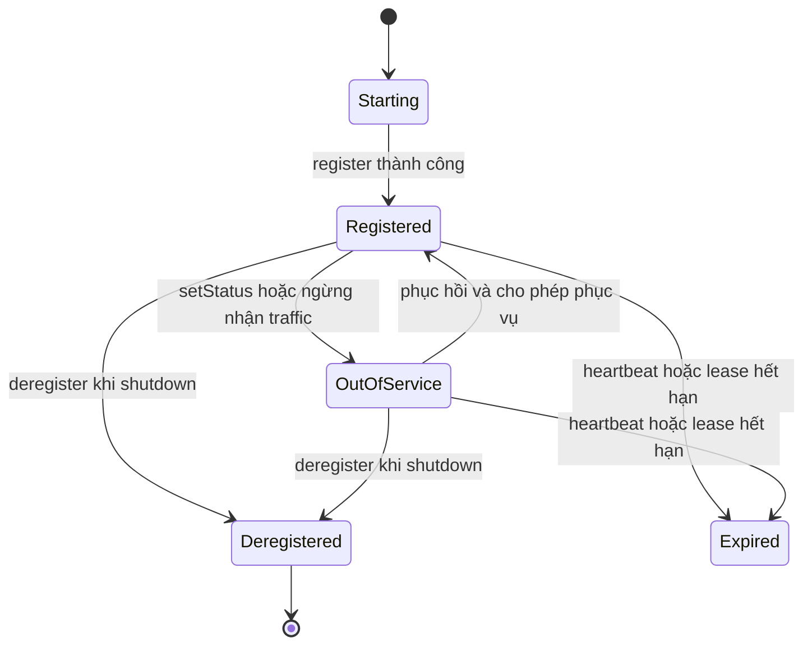

# Hợp đồng ServiceRegistry và Registration

Trong một hệ thống gồm nhiều dịch vụ, mỗi bản chạy của ứng dụng cần công bố địa chỉ để các thành phần khác có thể tìm thấy và gọi đến. Khi một bản chạy khởi động, nó đăng ký thông tin của mình với hệ thống đăng ký dịch vụ. Khi dừng, nó cần rút đăng ký hoặc chuyển trạng thái để các client không tiếp tục gửi yêu cầu đến một địa chỉ đã ngừng phục vụ.

Spring Cloud Commons định nghĩa các abstraction chung cho quy trình này. `Registration` mô tả một bản chạy có thể được đăng ký; `ServiceRegistry` định nghĩa các thao tác ghi đăng ký, gỡ đăng ký và cập nhật trạng thái. Một thư viện tích hợp như Eureka hoặc Consul cung cấp implementation cụ thể. Nhờ vậy, phần ứng dụng có thể làm việc với hợp đồng chung của Spring Cloud, trong khi chi tiết lưu trữ và giao tiếp với registry được giao cho provider.

## Mục tiêu

Sau bài học, bạn có thể:

- Giải thích vai trò của `Registration` và `ServiceRegistry` trong Spring Cloud Commons.
- Nhận biết dữ liệu định danh, địa chỉ và metadata của một service instance.
- Mô tả vòng đời đăng ký, cập nhật trạng thái và gỡ đăng ký.
- Phân biệt trách nhiệm ghi của `ServiceRegistry` với trách nhiệm khám phá của `DiscoveryClient`.
- Thiết kế cấu hình và kiểm thử đăng ký dịch vụ mà không phụ thuộc không cần thiết vào một registry cụ thể.

## Vị trí của hai abstraction trong kiến trúc

Một service có thể có nhiều instance chạy đồng thời. Mỗi instance có địa chỉ mạng riêng, nhưng tất cả thường cùng công bố một tên dịch vụ logic, chẳng hạn `order-service`. Registry duy trì các bản ghi instance để client tra cứu.


`Registration` biểu diễn dữ liệu của một instance ở phía đăng ký. `ServiceRegistry` cung cấp các thao tác tác động lên registry. Ở chiều đọc, `DiscoveryClient` truy vấn các instance đã được công bố. Bộ cân bằng tải phía client, chẳng hạn Spring Cloud LoadBalancer, có thể dùng danh sách instance đó để chọn đích gọi.

Hai abstraction có liên quan nhưng không thay thế nhau:

| Thành phần | Trách nhiệm chính | Câu hỏi mà nó trả lời |
|---|---|---|
| `Registration` | Mang dữ liệu của một instance cần đăng ký | Instance này có tên, địa chỉ và metadata gì? |
| `ServiceRegistry` | Ghi, gỡ và cập nhật trạng thái đăng ký | Làm thế nào để công bố hoặc thay đổi instance? |
| `DiscoveryClient` | Đọc danh sách instance từ nguồn khám phá | Hiện có những instance nào của dịch vụ này? |
| Spring Cloud LoadBalancer | Chọn instance để gửi yêu cầu | Trong các instance tìm thấy, nên gọi instance nào? |

Spring Cloud Commons chỉ chuẩn hóa hợp đồng. Nó không buộc mọi registry phải lưu dữ liệu theo cùng một cấu trúc nội bộ hoặc có cùng chính sách hết hạn bản ghi.

## Hợp đồng Registration

Trong Spring Cloud Commons, `Registration` mở rộng `ServiceInstance`. Vì vậy, một registration có thể được xem như một service instance với các thông tin cần thiết để client kết nối.

Các thông tin cốt lõi của `ServiceInstance` gồm:

| Thông tin | Ý nghĩa | Ví dụ |
|---|---|---|
| `serviceId` | Tên logic của dịch vụ | `order-service` |
| `host` | Host hoặc địa chỉ mạng của instance | `10.20.1.15` |
| `port` | Cổng nhận lưu lượng | `8080` |
| `secure` | Instance có sử dụng kết nối bảo mật hay không | `true` |
| `uri` | URI được tạo từ thông tin kết nối | `https://10.20.1.15:8080` |
| `metadata` | Các thuộc tính bổ sung do instance công bố | `zone=ap-southeast-1a`, `version=v2` |

Tên phương thức trong API là `getServiceId()`, `getHost()`, `getPort()`, `isSecure()`, `getUri()` và `getMetadata()`. Một provider có thể bổ sung trường riêng, chẳng hạn instance ID, tên datacenter, health-check path hoặc cấu hình lease. Những trường mở rộng đó không thuộc hợp đồng tối thiểu mà mọi implementation đều phải cung cấp.

### Service ID và instance identity

`serviceId` định danh dịch vụ logic. Nhiều instance có thể cùng mang `serviceId=order-service`; đây là cách hệ thống mở rộng theo chiều ngang. Registry cần phân biệt từng bản ghi instance bằng cơ chế nhận diện mà provider hỗ trợ. Cơ chế đó có thể dựa trên instance ID, địa chỉ, lease hoặc tổ hợp các trường.

Không nên xem `serviceId` là định danh duy nhất của một tiến trình. Khi có ba instance của `order-service`, client cần nhận được ba địa chỉ riêng biệt để lựa chọn. Nếu hai instance vô tình công bố cùng một định danh mà provider yêu cầu phải duy nhất, một bản ghi có thể ghi đè hoặc xung đột với bản ghi còn lại.

### Metadata

Metadata là bản đồ key-value đi kèm instance. Nó thường được dùng để công bố thông tin định tuyến hoặc phân loại. Ví dụ dưới đây minh họa dữ liệu metadata ở dạng Java:

```java
Map<String, String> metadata = Map.of(
        "zone", "ap-southeast-1a",
        "version", "v2",
        "capability", "order-read");
```

Đây là dữ liệu minh họa, chưa phải cách khởi tạo một registration hoàn chỉnh. Tên property hoặc API dùng để gắn metadata vào registration phụ thuộc starter/provider đang dùng. Hãy đối chiếu tài liệu của implementation đã chọn trước khi đưa cấu hình vào ứng dụng.

Metadata nên nhỏ, ổn định và có ý nghĩa với client hoặc quy trình vận hành. Không đưa mật khẩu, token, private key hay dữ liệu cá nhân vào metadata: registry có thể phân phối các trường này cho nhiều client và lưu chúng lâu hơn vòng đời của tiến trình. Metadata cũng không phải cơ chế thay thế xác thực hoặc phân quyền.

### Địa chỉ được công bố phải có thể truy cập

Địa chỉ trong registration là địa chỉ mà client sẽ sử dụng. Trong môi trường container, máy ảo hoặc nhiều mạng con, địa chỉ bind của server có thể khác địa chỉ mà client nhìn thấy. Nếu instance đăng ký `localhost`, một IP của mạng nội bộ không định tuyến được, hoặc cổng chưa được expose, registry vẫn có thể nhận đăng ký thành công nhưng client không kết nối được.

Khi triển khai, cần kiểm tra đồng thời:

1. Ứng dụng thực sự lắng nghe trên host và port dự kiến.
2. Địa chỉ công bố có thể định tuyến từ các client cần gọi dịch vụ.
3. `secure` và scheme phù hợp với giao thức đang bật.
4. Firewall, network policy, ingress hoặc service mesh cho phép luồng kết nối cần thiết.
5. Metadata không làm client chọn nhầm instance hoặc nhầm phiên bản giao thức.

## Hợp đồng ServiceRegistry

`ServiceRegistry<R extends Registration>` là abstraction thao tác với registry cho một kiểu registration cụ thể. Hợp đồng cốt lõi gồm các phương thức sau:

```java
public interface ServiceRegistry<R extends Registration> {

    void register(R registration);

    void deregister(R registration);

    void close();

    void setStatus(R registration, Object status);

    Object getStatus(R registration);
}
```

Đây là hình dạng hợp đồng để đọc và trao đổi về API; implementation cụ thể được cung cấp bởi discovery provider trên classpath.

### register

`register(registration)` công bố instance lên registry. Sau khi thao tác thành công và dữ liệu được provider làm cho khả dụng, các client có thể khám phá instance thông qua cơ chế discovery tương ứng.

Không nên suy ra rằng lời gọi `register` đồng nghĩa mọi client lập tức nhìn thấy instance. Registry có thể cần thời gian đồng bộ, client có thể cache danh sách, hoặc provider có thể áp dụng chu kỳ cập nhật riêng. Mức nhất quán và độ trễ phụ thuộc implementation.

### deregister

`deregister(registration)` yêu cầu registry gỡ instance khỏi danh sách có thể được khám phá. Đây là bước quan trọng khi ứng dụng tắt có kiểm soát hoặc khi instance ngừng nhận lưu lượng.

Nếu tiến trình bị kill đột ngột hoặc máy chủ mất mạng, ứng dụng có thể không kịp gọi `deregister`. Vì vậy nhiều registry có lease, heartbeat, TTL hoặc health check để phát hiện bản ghi không còn hợp lệ. Cơ chế phát hiện và thời gian dọn bản ghi là đặc điểm của provider, không được bảo đảm giống nhau bởi interface chung.

### setStatus và getStatus

`setStatus(registration, status)` cập nhật trạng thái mà provider gắn với registration. `getStatus(registration)` đọc lại trạng thái đó. Tham số và giá trị trả về có kiểu `Object` vì các registry có thể sử dụng mô hình trạng thái khác nhau.

Ví dụ, một provider có thể biểu diễn trạng thái bằng enum riêng; provider khác có thể ánh xạ sang trạng thái health hoặc trạng thái phục vụ. Không được mặc định rằng chuỗi `UP`, `DOWN` hay `OUT_OF_SERVICE` có cùng ý nghĩa và được hỗ trợ trên mọi provider. Hãy dùng kiểu trạng thái và quy tắc chuyển trạng thái mà implementation tài liệu hóa.

Trạng thái trong registry cũng không thay thế health endpoint của ứng dụng. Health check phản ánh khả năng hoạt động theo tiêu chí của ứng dụng hoặc nền tảng; registry status là thông tin mà provider dùng để quyết định instance có được công bố hoặc lựa chọn hay không. Hai cơ chế cần được cấu hình nhất quán.

### close

`close()` cho phép implementation đóng hoặc giải phóng tài nguyên liên quan đến service registry. Đây là thao tác vòng đời của thành phần registry. Ứng dụng thường để Spring quản lý vòng đời bean và các thành phần auto-configuration; không nên gọi `close()` tùy tiện từ mỗi request hoặc từ nhiều nơi, vì có thể đóng tài nguyên mà các thành phần khác vẫn đang sử dụng.

`close()` cũng không nên được hiểu là một cam kết thay thế cho `deregister()`. Quy tắc dọn đăng ký khi đóng ứng dụng phụ thuộc implementation và cơ chế auto-registration của provider. Nếu cần bảo đảm hành vi cụ thể khi shutdown, hãy kiểm tra tài liệu provider và kiểm thử kịch bản dừng ứng dụng.

## Vòng đời của một registration

Một vòng đời điển hình có thể được mô tả như sau:



Các trạng thái trong sơ đồ mô tả khái niệm vòng đời. `Starting`, `Registered`, `OutOfService` và `Expired` không phải một enum chuẩn áp dụng cho tất cả provider.

Một quy trình vận hành nên cân nhắc các thời điểm sau:

1. **Khởi động:** ứng dụng nạp cấu hình, xác định địa chỉ công bố và hoàn tất các điều kiện sẵn sàng cần thiết.
2. **Đăng ký:** cơ chế auto-registration hoặc mã tích hợp gọi `register` để công bố instance.
3. **Phục vụ:** instance tiếp nhận lưu lượng; registry và health check tiếp tục cập nhật tính khả dụng.
4. **Tạm ngừng:** trước khi bảo trì hoặc drain traffic, instance có thể được chuyển sang trạng thái không nhận yêu cầu mới theo khả năng của provider.
5. **Dừng:** ứng dụng ngừng nhận lưu lượng, gọi `deregister` nếu có thể, rồi giải phóng tài nguyên.

Thứ tự cụ thể phụ thuộc framework và provider. Đặc biệt, không nên tự viết một bộ đăng ký thủ công song song với auto-registration nếu chưa xác định rõ thành phần nào sở hữu vòng đời. Đăng ký hai lần có thể tạo bản ghi trùng, ghi đè metadata hoặc khiến shutdown gỡ nhầm instance.

## Tích hợp trong ứng dụng Spring Boot

Trong một ứng dụng Spring Cloud thông thường, discovery starter cung cấp implementation của các abstraction và có thể cấu hình auto-registration. Khi auto-registration được bật, Spring quản lý thời điểm đăng ký theo vòng đời ứng dụng; mã nghiệp vụ không cần gọi `register` ở mỗi lần xử lý request.

Nếu cần điều khiển registration bằng tay, kiểu generic của `ServiceRegistry` gắn với kiểu `Registration` cụ thể do provider cung cấp. Ví dụ dưới đây mô tả cách sử dụng ở mức hợp đồng; `ProviderRegistration` và `ProviderStatus` là tên minh họa, cần thay bằng kiểu thật của starter đang dùng:

```java
public final class ManualRegistrationLifecycle {

    private final ServiceRegistry<ProviderRegistration> serviceRegistry;
    private final ProviderRegistration registration;

    public ManualRegistrationLifecycle(
            ServiceRegistry<ProviderRegistration> serviceRegistry,
            ProviderRegistration registration) {
        this.serviceRegistry = serviceRegistry;
        this.registration = registration;
    }

    public void start() {
        serviceRegistry.register(registration);
    }

    public void stopAcceptingTraffic() {
        serviceRegistry.setStatus(registration, ProviderStatus.OUT_OF_SERVICE);
    }

    public void shutdown() {
        serviceRegistry.deregister(registration);
    }
}
```

Đoạn mã minh họa thứ tự gọi API, không phải một cấu hình có thể biên dịch nguyên trạng khi chưa có provider. Trong ứng dụng thực tế, cần bảo đảm `registration` đại diện đúng instance hiện tại, thao tác shutdown an toàn khi được gọi lặp, và lỗi giao tiếp với registry được xử lý theo chính sách vận hành.

Nếu muốn tắt auto-registration trong các cấu hình Spring Cloud Commons hỗ trợ property này, có thể đặt:

```yaml
spring:
  cloud:
    service-registry:
      auto-registration:
        enabled: false
```

Hãy xác nhận property và hành vi trên phiên bản Spring Cloud đang dùng. Khi tắt auto-registration, ứng dụng phải có quy trình đăng ký khác nếu vẫn cần xuất hiện trong registry. Không tắt cơ chế này chỉ để tránh lỗi khởi động mà chưa đánh giá tác động đến discovery và routing.

## Xử lý lỗi và các tình huống vận hành

Đăng ký dịch vụ là một tương tác mạng. Registry có thể không truy cập được, thông tin xác thực hết hạn, địa chỉ công bố sai hoặc instance bị từ chối do xung đột định danh. Ứng dụng cần có chính sách rõ ràng cho từng loại lỗi.

| Tình huống | Hệ quả có thể xảy ra | Hướng xử lý |
|---|---|---|
| Registry tạm thời không truy cập được | Instance chưa xuất hiện trong discovery | Xác định có cho phép ứng dụng khởi động hay phải fail-fast; dùng retry có giới hạn và log rõ nguyên nhân |
| Đăng ký thành công nhưng địa chỉ sai | Client tìm thấy instance nhưng không kết nối được | Kiểm tra advertised host, port, scheme và network policy |
| Instance dừng đột ngột | Bản ghi cũ có thể còn tồn tại | Dùng heartbeat, lease, TTL hoặc health check theo provider |
| Metadata sai hoặc lỗi thời | Client định tuyến theo tiêu chí không còn đúng | Quản lý metadata cùng phiên bản cấu hình và kiểm thử hợp đồng với client |
| Cập nhật status không được hỗ trợ | Instance vẫn có thể được coi là khả dụng | Kiểm tra khả năng của provider; dùng cơ chế drain hoặc health check được hỗ trợ |
| Đăng ký trùng | Có thể tạo bản ghi thừa hoặc xung đột | Chỉ định một chủ thể quản lý vòng đời registration |

Một retry vô hạn khi registry ngừng hoạt động có thể làm tăng tải và che khuất lỗi cấu hình. Ngược lại, cho ứng dụng khởi động mà không đăng ký có thể khiến dịch vụ chạy nhưng không thể được gọi qua discovery. Chính sách phù hợp phụ thuộc vai trò của dịch vụ, khả năng chịu lỗi và kiến trúc triển khai.

Với shutdown, nên dành đủ thời gian cho quá trình drain và deregister trước khi nền tảng cưỡng chế dừng container hoặc tiến trình. Nếu thời gian grace period quá ngắn, lời gọi gỡ đăng ký có thể không hoàn tất. Nếu quy trình shutdown không chạy được, TTL hoặc health check là lớp dự phòng quan trọng.

## Kiểm thử hợp đồng đăng ký

Có thể kiểm thử theo nhiều lớp, từ đơn vị đến tích hợp:

**Kiểm thử đơn vị cho logic điều phối.** Dùng mock `ServiceRegistry` để xác nhận ứng dụng gọi `register` khi khởi động, cập nhật status khi bắt đầu drain và gọi `deregister` khi shutdown. Kiểm tra cả nhánh lỗi để bảo đảm ứng dụng ghi log hoặc phản ứng theo chính sách đã chọn.

```java
@Test
void registersInstanceOnStartup() {
    ServiceRegistry<ProviderRegistration> registry = mock(ServiceRegistry.class);
    ProviderRegistration registration = testRegistration();
    ManualRegistrationLifecycle lifecycle =
            new ManualRegistrationLifecycle(registry, registration);

    lifecycle.start();

    verify(registry).register(registration);
}
```

Ví dụ dùng Mockito để minh họa kiểm thử lời gọi. `ProviderRegistration` và `testRegistration()` cần được thay bằng kiểu và factory của provider trong dự án.

**Kiểm thử tích hợp với registry thật hoặc container kiểm thử.** Xác minh instance được đăng ký với đúng service ID, host, port và metadata; truy vấn bằng discovery client để thấy instance; sau đó deregister và xác nhận instance biến mất theo thời gian hội tụ mà provider quy định.

**Kiểm thử vòng đời và lỗi mạng.** Kiểm tra ứng dụng khởi động khi registry không sẵn sàng, registry phục hồi sau một khoảng gián đoạn, shutdown có thời gian drain, và instance chết đột ngột. Các bài kiểm thử này giúp xác định rõ retry, fail-fast, cache và TTL trong cấu hình thực tế.

Không nên chỉ kiểm tra rằng `register()` đã được gọi. Điều cần xác nhận cuối cùng là client có thể khám phá và kết nối đến đúng instance trong điều kiện vận hành dự kiến.

## Những nguyên tắc cần ghi nhớ

- `Registration` mô tả một service instance; `serviceId` là tên logic có thể được chia sẻ bởi nhiều instance.
- `ServiceRegistry` là hợp đồng ghi: đăng ký, gỡ đăng ký và cập nhật trạng thái.
- `DiscoveryClient` là abstraction đọc danh sách instance; LoadBalancer có thể dùng danh sách đó để chọn đích.
- Địa chỉ công bố, cổng, scheme và metadata phải phản ánh cách client thực sự truy cập dịch vụ.
- Giá trị status, định danh instance, heartbeat, TTL và hành vi đồng bộ phụ thuộc provider.
- Auto-registration giúp Spring quản lý vòng đời; nếu chuyển sang đăng ký thủ công, cần chỉ định một chủ thể duy nhất sở hữu quy trình đó.
- Kiểm thử phải đi từ lời gọi API đến khả năng khám phá và kết nối thực tế.

Khi chọn hoặc thay đổi discovery provider, hãy bắt đầu từ hợp đồng chung của `Registration` và `ServiceRegistry`, sau đó đánh giá các phần mở rộng riêng như metadata, status, health check, lease và chính sách shutdown. Cách tiếp cận này giúp phần ứng dụng giữ được cấu trúc ổn định trong khi cấu hình triển khai vẫn có thể thích nghi với registry cụ thể.
