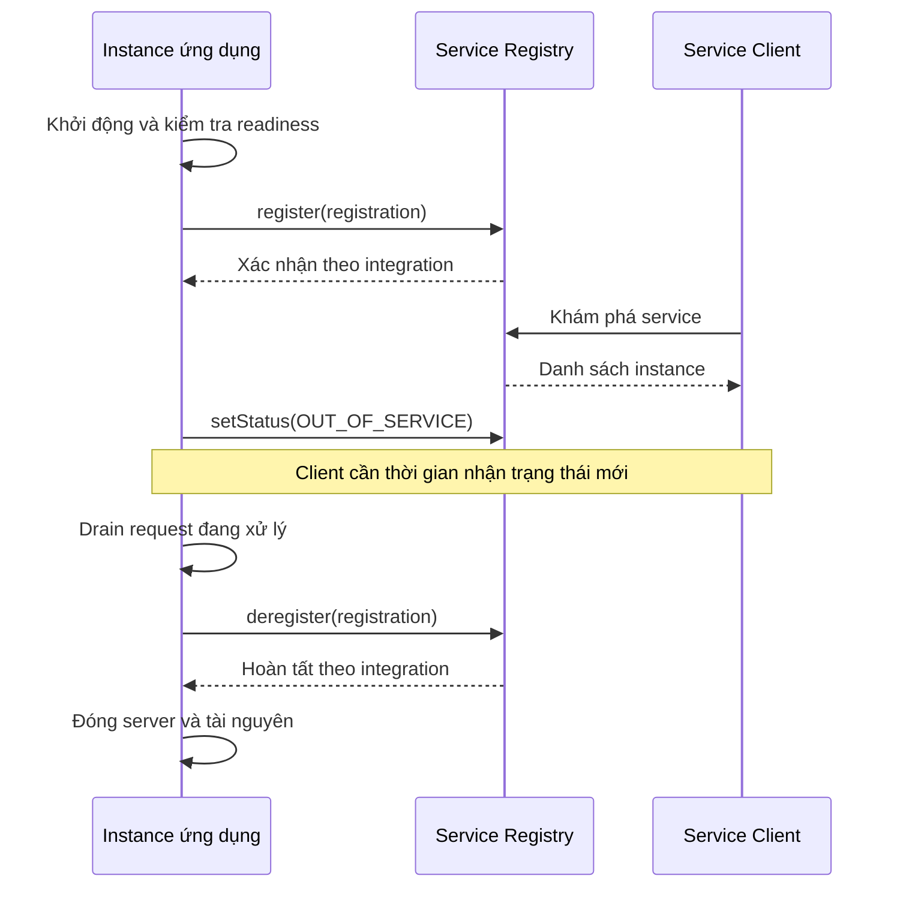

# Đăng ký, hủy đăng ký và thay đổi trạng thái instance

Trong hệ thống phân tán, một dịch vụ thường chạy trên nhiều instance. Mỗi instance có địa chỉ mạng, cổng, mã định danh và metadata riêng. Service registry lưu những thông tin này để các thành phần khác tìm được instance phù hợp khi cần gọi dịch vụ. Vòng đời của một bản ghi trong registry phải đi cùng vòng đời phục vụ request của instance: đăng ký khi instance đã sẵn sàng, cập nhật trạng thái khi khả năng nhận tải thay đổi và hủy đăng ký khi instance rời hệ thống.

Trong Spring Cloud, `ServiceRegistry` và `Registration` thuộc Spring Cloud Commons cung cấp một lớp trừu tượng cho các thao tác đó. Ứng dụng có thể làm việc qua API chung, còn cách lưu bản ghi, biểu diễn trạng thái, đồng bộ và phát hiện instance lỗi phụ thuộc vào implementation của nhà cung cấp registry.

## 1. Hai đối tượng cốt lõi

`Registration` mô tả một instance có thể được đăng ký. Nó mở rộng `ServiceInstance`, vì vậy thông tin thường gắn với bản ghi gồm service ID, host, port, giao thức bảo mật, URI và metadata. Một số registry còn cần instance ID để phân biệt các bản sao cùng cung cấp một service ID.

`ServiceRegistry<R extends Registration>` là hợp đồng thao tác với registry. Các phương thức chính gồm:

| Phương thức | Ý nghĩa |
| --- | --- |
| `register(R registration)` | Đưa instance vào registry để các thành phần khác có thể khám phá nó. |
| `deregister(R registration)` | Xóa bản ghi của instance khỏi registry. |
| `setStatus(R registration, Object status)` | Yêu cầu registry thay đổi trạng thái của instance. |
| `getStatus(R registration)` | Đọc trạng thái mà implementation registry trả về cho instance. |
| `close()` | Đóng hoặc giải phóng tài nguyên do implementation quản lý. |

Tham số kiểu `R` cho phép mỗi integration sử dụng kiểu `Registration` cụ thể của nó. Giá trị `status` có kiểu `Object` vì Spring Cloud Commons không áp đặt một tập trạng thái chung cho mọi nhà cung cấp. Do đó, ứng dụng phải tuân theo kiểu dữ liệu và tập giá trị mà implementation đang sử dụng.

Các lớp thuộc Spring Cloud Commons chỉ định nghĩa hợp đồng. Chúng không tự tạo một registry dùng chung và cũng không quyết định mọi quy tắc đăng ký. Một integration như Eureka, Consul hoặc ZooKeeper cung cấp implementation tương ứng và có thể bổ sung cơ chế đăng ký tự động, heartbeat, lease, kiểm tra sức khỏe hay đồng bộ trạng thái.

## 2. Đăng ký instance khi sẵn sàng

Đăng ký là bước công bố một instance với hệ thống khám phá dịch vụ. Bản ghi cần mô tả đúng địa chỉ mà các instance khác có thể truy cập. Nếu host hoặc port sai, registry vẫn có thể chứa bản ghi hợp lệ về mặt cấu trúc nhưng lời gọi đến instance sẽ thất bại.

Một quy trình khởi động hợp lý thường có các bước:

1. Nạp cấu hình và khởi tạo ứng dụng.
2. Khởi động server, chuẩn bị các dependency bắt buộc và xác định địa chỉ phục vụ thực tế.
3. Kiểm tra điều kiện sẵn sàng nhận request.
4. Đăng ký instance với service registry.
5. Duy trì trạng thái và cơ chế gia hạn bản ghi theo yêu cầu của nhà cung cấp.

Không phải ứng dụng nào cũng tự gọi `register`. Nhiều Spring Cloud integration quản lý đăng ký thông qua lifecycle của Spring và cấu hình auto-registration. Khi sử dụng cơ chế này, cần hiểu thời điểm integration thực hiện đăng ký và tránh thêm một luồng đăng ký thủ công khiến cùng một instance bị tạo bản ghi trùng hoặc ghi đè ngoài ý muốn.

Khi cần điều khiển thủ công, mã ứng dụng làm việc với `ServiceRegistry` và đối tượng `Registration` do integration cung cấp. Ví dụ sau minh họa các thao tác trên hợp đồng chung; `registry`, `registration` và giá trị trạng thái phải được cung cấp theo integration đang dùng:

```java
import org.springframework.cloud.client.serviceregistry.Registration;
import org.springframework.cloud.client.serviceregistry.ServiceRegistry;

public class InstanceRegistrationController<R extends Registration> {

    private final ServiceRegistry<R> registry;
    private final R registration;

    public InstanceRegistrationController(
            ServiceRegistry<R> registry,
            R registration) {
        this.registry = registry;
        this.registration = registration;
    }

    public void register() {
        registry.register(registration);
    }

    public Object currentStatus() {
        return registry.getStatus(registration);
    }

    public void changeStatus(Object status) {
        registry.setStatus(registration, status);
    }

    public void deregister() {
        registry.deregister(registration);
    }
}
```

Đoạn mã tập trung vào cách gọi API. Nó không phải cấu hình tự động hoàn chỉnh: kiểu `R`, bean registry, cách tạo `Registration` và giá trị trạng thái phải khớp với thư viện registry được tích hợp. Trong ứng dụng thực tế, không nên tự tạo một đối tượng registration thiếu host, port hoặc instance ID rồi kỳ vọng integration có thể suy ra các thông tin đó.

### Chọn định danh và metadata

Service ID thường đại diện cho tên logic mà client sử dụng, chẳng hạn `order-service`. Instance ID phân biệt từng bản sao, ví dụ `order-service-10.0.2.15-8081`. Mỗi replica cần có định danh riêng theo quy tắc của registry. Nếu nhiều instance dùng chung một ID trong hệ thống yêu cầu ID duy nhất, lần đăng ký sau có thể ghi đè hoặc xung đột với bản ghi trước.

Metadata có thể mang thông tin như vùng triển khai, phiên bản API, nhóm xử lý hoặc nhãn định tuyến. Chỉ đưa vào metadata những giá trị có ý nghĩa đối với cơ chế khám phá hoặc định tuyến; không đưa bí mật, token hay thông tin nhạy cảm vào bản ghi thường được nhiều thành phần đọc.

## 3. Thay đổi trạng thái instance

Một instance đã đăng ký không phải lúc nào cũng nên nhận tải. Ví dụ, ứng dụng có thể cần bảo trì, làm nóng cache, xử lý sự cố một dependency hoặc chuẩn bị dừng. `setStatus` cho phép yêu cầu registry cập nhật trạng thái của bản ghi; `getStatus` cho phép đọc trạng thái mà implementation cung cấp.

Ví dụ, trước khi bảo trì, ứng dụng có thể chuyển instance sang trạng thái tương đương `OUT_OF_SERVICE`:

```java
// Giá trị minh họa; hãy thay bằng hằng số hoặc kiểu trạng thái
// được integration của registry hiện tại định nghĩa.
registry.setStatus(registration, "OUT_OF_SERVICE");

Object status = registry.getStatus(registration);
```

Không nên mặc định chuỗi `OUT_OF_SERVICE` hoặc `UP` có cùng ý nghĩa ở mọi registry. Có integration dùng enum, có integration dùng chuỗi hoặc kiểu riêng. Một số registry cũng giới hạn các chuyển đổi trạng thái hợp lệ. Hãy tra hợp đồng của implementation đang sử dụng và xử lý đúng kiểu mà `getStatus` trả về.

Thay đổi trạng thái có thể hỗ trợ các mục tiêu khác nhau:

- **Sẵn sàng nhận tải:** instance đã khởi động và có thể phục vụ request.
- **Tạm ngừng nhận tải:** instance vẫn chạy để hoàn tất request đang xử lý nhưng client không nên chọn nó cho request mới.
- **Không khả dụng:** instance gặp lỗi hoặc không còn đáp ứng điều kiện phục vụ.
- **Khôi phục:** sau khi bảo trì hoặc dependency ổn định, instance được chuyển về trạng thái cho phép nhận tải.

Tên và cách biểu diễn các trạng thái trên chỉ là cách mô tả vận hành. Registry cụ thể quyết định trạng thái nào tồn tại và client có loại bỏ instance khỏi danh sách chọn hay không.

### Trạng thái registry và health/readiness của ứng dụng

Trạng thái trong registry không thay thế health check của ứng dụng. Health indicator phản ánh tình trạng một ứng dụng hoặc dependency theo quy tắc kiểm tra; readiness thể hiện ứng dụng có sẵn sàng nhận traffic hay chưa; trạng thái registry là dữ liệu mà hệ thống khám phá hoặc client sử dụng. Các cơ chế này có thể được kết nối với nhau, nhưng không tự động đồng nghĩa.

Ví dụ, một instance có thể vẫn chạy và health endpoint còn truy cập được trong lúc đang drain để bảo trì. Trong giai đoạn đó, ứng dụng cần ngừng nhận request mới, hoàn tất request đang xử lý rồi mới dừng. Nếu chỉ đổi trạng thái registry mà không kiểm soát server, request vẫn có thể đến qua địa chỉ trực tiếp hoặc qua client chưa cập nhật cache.

Registry và client thường có độ trễ đồng bộ hoặc cache. Vì vậy, `setStatus` thành công không đảm bảo mọi client lập tức ngừng chọn instance. Quy trình drain cần tính đến thời gian lan truyền trạng thái, thời gian cache và thời gian hoàn tất request đang chạy.

## 4. Hủy đăng ký khi instance rời hệ thống

Hủy đăng ký xóa bản ghi instance khỏi registry để các client không tiếp tục khám phá nó. Đây là bước quan trọng khi ứng dụng dừng có kiểm soát, được thay thế phiên bản hoặc rời khỏi một nhóm triển khai.

Một quy trình shutdown graceful thường được tổ chức như sau:

1. Ngừng nhận request mới hoặc chuyển trạng thái sang trạng thái không nhận tải nếu registry hỗ trợ.
2. Chờ request đang xử lý hoàn tất trong giới hạn thời gian shutdown.
3. Gọi `deregister` để xóa bản ghi instance.
4. Đóng server và giải phóng tài nguyên của ứng dụng.

Thứ tự chi tiết phụ thuộc vào integration và nền tảng triển khai. Chẳng hạn, một môi trường có thể cần cập nhật readiness trước, chờ bộ cân bằng tải ngừng gửi request, sau đó mới deregister. Hãy phối hợp lifecycle của Spring, server và nền tảng triển khai để không đóng server quá sớm.

Sơ đồ sau thể hiện một luồng khái quát:



Nếu tiến trình bị kill đột ngột, ứng dụng có thể không kịp gọi `deregister`. Nhiều registry giải quyết bản ghi cũ bằng heartbeat, lease, TTL hoặc health check. Đây là cơ chế dự phòng của integration và registry; không nên xem nó là lý do để bỏ qua deregistration khi shutdown có kiểm soát.

`close()` là phương thức vòng đời của `ServiceRegistry`, có thể được implementation dùng để giải phóng tài nguyên. Không gọi `close()` tùy tiện sau mỗi lần deregister: registry có thể là bean dùng chung hoặc được Spring quản lý. Chỉ tự đóng khi ứng dụng thực sự sở hữu vòng đời của implementation và tài liệu integration yêu cầu điều đó.

## 5. Xử lý lỗi và các tình huống vận hành

Các thao tác registry là lời gọi tới một hệ thống bên ngoài hoặc một thành phần hạ tầng. Chúng có thể thất bại do mất kết nối, timeout, xác thực sai, bản ghi không tồn tại hoặc xung đột định danh. Ứng dụng cần xác định rõ hành vi khi từng thao tác thất bại.

| Tình huống | Hướng xử lý |
| --- | --- |
| Đăng ký thất bại khi khởi động | Ghi log có ngữ cảnh, áp dụng retry/backoff theo chính sách và quyết định instance có được phép nhận tải khi chưa đăng ký hay không. |
| Đổi trạng thái thất bại | Không giả định instance đã được drain; kiểm tra trạng thái thực tế và phối hợp readiness hoặc cơ chế điều phối traffic khác. |
| Hủy đăng ký thất bại | Ghi nhận lỗi, thử lại trong giới hạn shutdown và dựa vào TTL/lease/health check của registry như lớp bảo vệ bổ sung. |
| Bản ghi cũ còn tồn tại | Kiểm tra heartbeat, TTL, instance ID và quy tắc dọn dẹp của nhà cung cấp. |
| Nhiều instance trùng định danh | Tạo instance ID duy nhất theo replica và xác minh quy tắc cập nhật bản ghi của registry. |
| Client vẫn gọi instance đã ngừng nhận tải | Kiểm tra cache, chu kỳ refresh, độ trễ lan truyền và cấu hình retry/load balancing của client. |

Retry cần có giới hạn và backoff để tránh làm registry quá tải khi đang gặp sự cố. Các thao tác có thể được thực hiện lại chỉ khi implementation bảo đảm hành vi phù hợp; không tự giả định `register` hoặc `deregister` có tính idempotent giống nhau ở mọi nhà cung cấp. Khi ứng dụng cần tiếp tục khởi động trong lúc registry không sẵn sàng, quyết định đó phải phù hợp yêu cầu sẵn sàng của hệ thống và có quan sát rõ ràng về trạng thái đăng ký.

Log nên ghi service ID, instance ID, thao tác, kết quả và nguyên nhân lỗi. Metrics có thể theo dõi số lần đăng ký thất bại, thời gian đăng ký, lỗi cập nhật trạng thái và lỗi deregister khi shutdown. Tránh ghi toàn bộ metadata hoặc thông tin xác thực vào log.

## 6. Kiểm thử vòng đời đăng ký

Kiểm thử nên xác minh cả thứ tự gọi API lẫn hành vi mà client quan sát được. Có thể dùng implementation giả của `ServiceRegistry` hoặc mock để kiểm tra logic điều phối:

- Khi instance đạt điều kiện sẵn sàng, `register` được gọi với đúng registration.
- Khi bắt đầu drain, ứng dụng gửi đúng trạng thái theo integration.
- Khi kết thúc bảo trì, trạng thái được khôi phục theo quy tắc của registry.
- Khi shutdown graceful, ứng dụng gọi `deregister` trước khi hoàn tất đóng server theo thứ tự đã thiết kế.
- Khi registry timeout hoặc trả lỗi, ứng dụng áp dụng chính sách retry và ghi nhận lỗi đúng cách.

Mock chỉ chứng minh ứng dụng gọi đúng hợp đồng. Một bài kiểm thử tích hợp với registry thật hoặc môi trường tương đương còn cần xác minh bản ghi xuất hiện, thay đổi trạng thái, biến mất sau deregister và được client khám phá theo thời gian dự kiến. Nên kiểm thử cả trường hợp instance chết đột ngột để đánh giá TTL, lease hoặc heartbeat.

## 7. Checklist khi triển khai

- [ ] Registration chứa service ID, instance ID, host, port và metadata chính xác.
- [ ] Thời điểm đăng ký phù hợp với readiness và lifecycle của Spring.
- [ ] Chỉ có một cơ chế chịu trách nhiệm đăng ký instance, tránh đăng ký trùng.
- [ ] Mã trạng thái và kiểu dữ liệu khớp với integration đang dùng.
- [ ] Quy trình drain cho client đủ thời gian nhận thay đổi và hoàn tất request đang chạy.
- [ ] Shutdown graceful gọi deregister và có giới hạn thời gian xử lý lỗi.
- [ ] Heartbeat, lease hoặc TTL được cấu hình như lớp dọn dẹp bản ghi bất thường.
- [ ] Log, metrics và kiểm thử bao phủ cả đăng ký, đổi trạng thái lẫn hủy đăng ký.

Quản lý vòng đời instance tốt giúp service registry phản ánh sát hơn khả năng phục vụ thực tế của hệ thống. Trong Spring Cloud, `ServiceRegistry` cung cấp điểm thao tác thống nhất, còn độ tin cậy cuối cùng phụ thuộc vào integration, cấu hình trạng thái, readiness, cơ chế đồng bộ và quy trình shutdown của ứng dụng.
