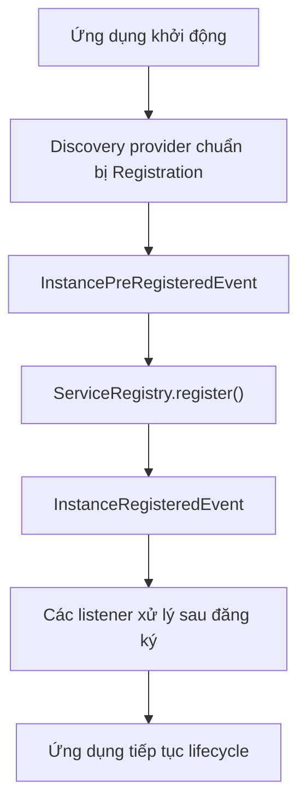
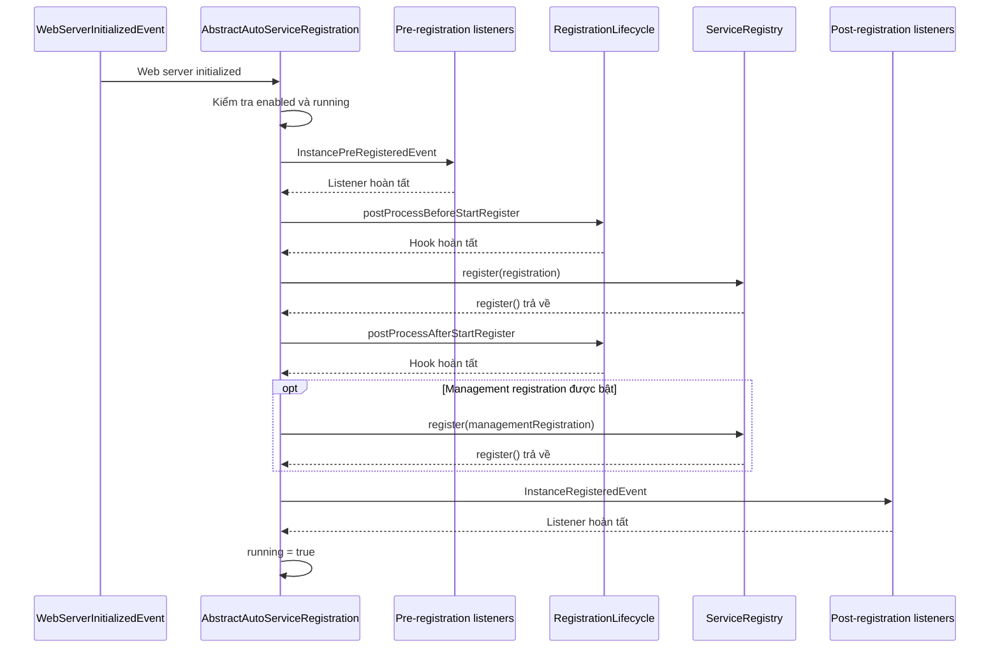

# InstancePreRegisteredEvent và InstanceRegisteredEvent

Khi một ứng dụng Spring Cloud tự đăng ký với service registry, các thành phần khác đôi khi cần biết lúc nào quá trình đăng ký sắp bắt đầu và lúc nào lời gọi đăng ký đã hoàn tất. Ví dụ, ứng dụng có thể cần kiểm tra metadata trước khi công bố instance, ghi nhận thời điểm đăng ký, cập nhật metric hoặc thông báo cho một thành phần nội bộ rằng discovery đã được khởi tạo.

Spring Cloud Commons cung cấp hai application event cho vòng đời auto-registration:

- `InstancePreRegisteredEvent`: được phát trước khi instance được gửi tới `ServiceRegistry`.
- `InstanceRegisteredEvent<T>`: được phát sau khi thao tác đăng ký instance đã được thực hiện.

Hai event đánh dấu hai mốc khác nhau. Event trước đăng ký mang đối tượng `Registration`; event sau đăng ký mang một payload cấu hình generic do implementation cung cấp. Không nên coi payload của hai event là cùng một kiểu dữ liệu, cũng không nên xem event sau đăng ký là bằng chứng rằng mọi consumer đã nhìn thấy instance hoặc ứng dụng đã sẵn sàng nhận traffic.

Bài học thuộc chương **ServiceRegistry** của **SPRING_CLOUD_CORE**. Nội dung tập trung vào cấu trúc event, thứ tự phát trong `AbstractAutoServiceRegistration`, cách đăng ký listener, cách phối hợp với `RegistrationLifecycle`, kiểm thử và xử lý các tình huống đăng ký thất bại.

## 1. Mục tiêu học tập

Sau bài này, bạn có thể:

- Giải thích vai trò của `InstancePreRegisteredEvent` và `InstanceRegisteredEvent`.
- Phân biệt payload `Registration` với payload generic `config`.
- Mô tả thứ tự auto-registration trong `AbstractAutoServiceRegistration`.
- Xác định thời điểm event được phát so với `ServiceRegistry.register()`.
- Đăng ký listener bằng `ApplicationListener` hoặc `@EventListener`.
- Chọn đúng event cho kiểm tra trước đăng ký và xử lý sau đăng ký.
- Phân biệt event auto-registration với lời gọi `ServiceRegistry.register()` thủ công.
- Hiểu tác động của `spring.cloud.service-registry.auto-registration.enabled`.
- Phân biệt đăng ký thành công với trạng thái Ready, health và khả năng discovery.
- Dùng `RegistrationLifecycle` khi cần can thiệp vào registration trước khi gửi lên registry.
- Kiểm thử thứ tự event, lỗi provider và hành vi khi auto-registration bị tắt.

## 2. Bối cảnh: service auto-registration

Trong hệ thống phân tán, mỗi instance thường cần công bố thông tin của mình lên registry để các service khác có thể tìm thấy. Thông tin này được biểu diễn qua abstraction `Registration`, còn thao tác với registry được chuẩn hóa qua `ServiceRegistry`.

Một implementation discovery có thể tự động đăng ký local service khi ứng dụng khởi động. Spring Cloud Commons cung cấp abstraction `AutoServiceRegistration` và lớp cơ sở `AbstractAutoServiceRegistration` để hỗ trợ lifecycle phổ biến này.



Event giúp các thành phần khác phản ứng với lifecycle mà không cần gọi trực tiếp API riêng của Eureka, Consul, Zookeeper hoặc provider khác.

### 2.1. Registration là gì?

`Registration` là **marker interface** dùng để đánh dấu object có thể được truyền cho `ServiceRegistry`; interface này mở rộng `ServiceInstance`. Vì vậy, listener có thể dùng các thuộc tính chung được kế thừa như `getServiceId()`, `getHost()`, `getPort()`, `isSecure()`, `getUri()` và `getMetadata()`. `getInstanceId()` có implementation mặc định trên `ServiceInstance`, nên provider có thể trả `null` nếu không cung cấp instance ID.

Kiểu implementation cụ thể vẫn phụ thuộc provider, ví dụ `EurekaRegistration` hoặc `ConsulRegistration`. Khi cần thông tin riêng ngoài hợp đồng `ServiceInstance`, hãy kiểm tra kiểu implementation và dùng API provider tương ứng.

### 2.2. ServiceRegistry là gì?

`ServiceRegistry<R extends Registration>` là abstraction thực hiện các thao tác đăng ký, hủy đăng ký và cập nhật trạng thái:

```java
public interface ServiceRegistry<R extends Registration> {

    void register(R registration);

    void deregister(R registration);

    void close();

    void setStatus(R registration, String status);

    <T> T getStatus(R registration);
}
```

Hai event trong bài học bao quanh quá trình auto-registration sử dụng abstraction này. Chúng không thay thế `ServiceRegistry` và cũng không phải API để đăng ký service.

## 3. InstancePreRegisteredEvent

`InstancePreRegisteredEvent` thuộc package:

```java
org.springframework.cloud.client.discovery.event
```

Đây là application event được phát **trước khi local service instance được đăng ký với discovery service**.

API chính:

```java
public class InstancePreRegisteredEvent extends ApplicationEvent {

    public InstancePreRegisteredEvent(
            Object source,
            Registration registration) {
        // constructor
    }

    public Registration getRegistration() {
        // returns registration
    }
}
```

Event cung cấp object registration dự kiến được gửi tới registry. Vì `Registration` mở rộng `ServiceInstance`, listener có thể đọc các trường instance chung như service ID, host, port, URI và metadata mà không cần ép kiểu provider.

### 3.1. Payload của event

| Thành phần | Ý nghĩa |
| --- | --- |
| `source` | Thành phần thực hiện auto-registration và phát event |
| `registration` | Đối tượng `Registration` mô tả instance sắp đăng ký |
| `getRegistration()` | Trả về registration được gắn với event |

Trong implementation dựa trên `AbstractAutoServiceRegistration`, source thường là instance auto-registration của provider, còn registration được lấy từ `getRegistration()`.

### 3.2. Listener có thể làm gì?

Các use case phù hợp:

- Ghi log có cấu trúc về service ID, host, port hoặc instance ID thông qua hợp đồng `ServiceInstance`.
- Kiểm tra metadata cần có trước khi công bố.
- Ghi metric về thời điểm bắt đầu đăng ký.
- Tạo correlation ID cho log lifecycle.
- Phát tín hiệu nội bộ để một thành phần quan sát quá trình registration.

Ví dụ listener:

```java
@Component
public class RegistrationPrecheckListener {

    private static final Logger log =
            LoggerFactory.getLogger(RegistrationPrecheckListener.class);

    @EventListener
    public void onPreRegistered(InstancePreRegisteredEvent event) {
        Registration registration = event.getRegistration();

        log.info(
                "Preparing service registration: serviceId={}, host={}, port={}",
                registration.getServiceId(),
                registration.getHost(),
                registration.getPort());
    }
}
```

Ví dụ chỉ ghi metadata nhận diện cần thiết. Không log credential, token hoặc toàn bộ metadata nếu metadata có thể chứa dữ liệu nhạy cảm.

### 3.3. Event này không phải điểm sửa registration portable

`Registration` là abstraction chung, nhưng khả năng thay đổi object phụ thuộc implementation. Một số provider dùng object mutable; provider khác có thể trả object được tạo lại hoặc có semantics riêng.

Nếu cần thêm metadata hoặc chỉnh registration trước khi gửi lên registry, không nên dựa vào việc listener thay đổi object lấy từ event. Trong lifecycle của `AbstractAutoServiceRegistration`, các hook `RegistrationLifecycle` được gọi sau event pre-registration và trước lời gọi register. Đây là extension point phù hợp hơn cho việc tiền xử lý registration.

## 4. InstanceRegisteredEvent<T>

`InstanceRegisteredEvent<T>` cũng nằm trong package:

```java
org.springframework.cloud.client.discovery.event
```

Event này được phát **sau khi local service instance đã được đăng ký thông qua discovery service**.

API chính:

```java
public class InstanceRegisteredEvent<T> extends ApplicationEvent {

    public InstanceRegisteredEvent(Object source, T config) {
        // constructor
    }

    public T getConfig() {
        // returns provider configuration
    }
}
```

Điểm quan trọng là kiểu dữ liệu `T` có tính generic. Payload không được cam kết luôn là `Registration`. Trong `AbstractAutoServiceRegistration`, event được tạo với cấu hình provider lấy từ `getConfiguration()`. API `getConfiguration()` ở lớp cơ sở hiện được đánh dấu deprecated; implementation provider quyết định payload thực tế.

### 4.1. Đọc payload đúng cách

Listener tổng quát nên dùng wildcard:

```java
@Component
public class RegistrationCompletedListener {

    @EventListener
    public void onRegistered(InstanceRegisteredEvent<?> event) {
        Object providerConfig = event.getConfig();

        // Record a registration-completed metric or audit event.
    }
}
```

Không viết:

```java
Registration registration = event.getConfig();
```

trừ khi ứng dụng đã xác nhận provider cụ thể truyền đúng kiểu đó. `getConfig()` trả về `T`, và `T` có thể là một cấu hình provider riêng.

### 4.2. Use case sau đăng ký

- Ghi nhận registration call đã hoàn tất.
- Tăng metric số lần đăng ký.
- Ghi audit với service ID và instance ID.
- Thông báo cho thành phần nội bộ rằng discovery lifecycle đã qua bước đăng ký.
- Khởi động một tác vụ phụ thuộc vào registration, nếu tác vụ đó không nằm trên đường critical startup.

Ví dụ:

```java
@Component
public class DiscoveryRegistrationMetrics {

    private final MeterRegistry meterRegistry;

    public DiscoveryRegistrationMetrics(MeterRegistry meterRegistry) {
        this.meterRegistry = meterRegistry;
    }

    @EventListener
    public void onRegistered(InstanceRegisteredEvent<?> event) {
        meterRegistry.counter("service.registry.registration.completed")
                .increment();
    }
}
```

Metric trên chỉ minh họa việc ghi nhận event. Trong hệ thống thật, nên thêm tag có cardinality được kiểm soát, chẳng hạn service name hoặc provider; tránh tag bằng instance ID không giới hạn nếu số instance rất lớn.

## 5. So sánh hai event

| Tiêu chí | `InstancePreRegisteredEvent` | `InstanceRegisteredEvent<T>` |
| --- | --- | --- |
| Thời điểm | Trước lời gọi đăng ký | Sau lời gọi đăng ký |
| Payload | `Registration` | Cấu hình generic `T` do provider cung cấp |
| Accessor | `getRegistration()` | `getConfig()` |
| Mục đích | Quan sát/kiểm tra thông tin sắp đăng ký | Ghi nhận kết quả của bước đăng ký |
| Có thể dùng để | Audit trước, kiểm tra metadata, metric bắt đầu | Audit sau, metric hoàn tất, thông báo nội bộ |
| Có chứng minh registry đã hội tụ? | Không | Không nhất thiết |
| Có chứng minh ứng dụng đã Ready? | Không | Không |

Hai event là hai mốc trong một lifecycle. Không nên thay thế event trước bằng event sau hoặc ngược lại vì listener cần phản ứng ở thời điểm khác nhau.

## 6. Thứ tự phát trong AbstractAutoServiceRegistration

`AbstractAutoServiceRegistration` là lớp cơ sở phổ biến trong Spring Cloud Commons. Nó lắng nghe `WebServerInitializedEvent`, lấy port thực tế của web server rồi bắt đầu auto-registration khi provider được bật.

Trong implementation hiện hành, phần cốt lõi của `start()` có thứ tự khái quát:

1. Kiểm tra auto-registration có được bật hay không.
2. Kiểm tra instance chưa được đánh dấu đang chạy/đã đăng ký.
3. Phát `InstancePreRegisteredEvent`.
4. Chạy các `RegistrationLifecycle.postProcessBeforeStartRegister(...)`.
5. Gọi `ServiceRegistry.register(...)`.
6. Chạy `RegistrationLifecycle.postProcessAfterStartRegister(...)`.
7. Nếu cấu hình yêu cầu, đăng ký management service và chạy các hook tương ứng.
8. Phát `InstanceRegisteredEvent`.
9. Cập nhật cờ `running`.



Sơ đồ mô tả luồng phổ biến của lớp cơ sở. Provider có thể ghi đè hook hoặc triển khai lifecycle riêng, vì vậy cần kiểm tra adapter đang dùng nếu yêu cầu vận hành phụ thuộc thứ tự chi tiết.

### 6.1. Event trước được phát trước RegistrationLifecycle hook

Một chi tiết quan trọng: trong `AbstractAutoServiceRegistration`, `InstancePreRegisteredEvent` được phát trước `postProcessBeforeStartRegister(...)`.

Do đó, listener nhận event pre có thể nhìn thấy registration trước khi hook lifecycle thực hiện việc bổ sung hoặc điều chỉnh metadata. Nếu cần quan sát dữ liệu cuối cùng ngay trước khi gửi lên registry, hãy dùng `RegistrationLifecycle` hoặc điểm mở rộng phù hợp của provider.

### 6.2. Event sau được phát sau bước đăng ký chính

`InstanceRegisteredEvent` được phát sau khi:

- Lời gọi đăng ký service chính hoàn tất.
- Các hook `postProcessAfterStartRegister(...)` hoàn tất.
- Management service được đăng ký nếu được bật và provider hỗ trợ.

Payload event sau được lấy từ `getConfiguration()` của implementation. Vì vậy, nó không nhất thiết là cùng object với `Registration` đã được truyền vào `ServiceRegistry.register()`.

### 6.3. Cờ running được cập nhật sau event

Trong implementation lớp cơ sở, `running` được đặt thành `true` sau khi `InstanceRegisteredEvent` được phát. Vì vậy, một listener xử lý event không nên dựa vào `AutoServiceRegistration.isRunning()` để kết luận rằng cờ này đã được cập nhật.

Event thể hiện mốc đăng ký trong lifecycle; trạng thái nội bộ `running` được cập nhật ở bước tiếp theo.

## 7. RegistrationLifecycle và vai trò khác với event

`RegistrationLifecycle<R>` là extension point cho các bước trước/sau khi đăng ký và hủy đăng ký. Nó khác với application event:

- Event phát tín hiệu cho các listener quan sát.
- Lifecycle hook tham gia trực tiếp vào quy trình đăng ký.

Các hook chính gồm `postProcessBeforeStartRegister(R)`, `postProcessAfterStartRegister(R)`, `postProcessBeforeStopRegister(R)` và `postProcessAfterStopRegister(R)`. `RegistrationLifecycle` cũng cung cấp thứ tự qua `Ordered`; kiểm tra Javadoc của release train đang dùng nếu cần điều khiển thứ tự nhiều lifecycle bean.

### 7.1. Khi cần bổ sung metadata

Nếu provider registration cho phép cập nhật metadata:

```java
public class VersionMetadataLifecycle
        implements RegistrationLifecycle<MyRegistration> {

    @Override
    public void postProcessBeforeStartRegister(MyRegistration registration) {
        registration.getMetadata().put("release", "2026.11");
        registration.getMetadata().put("region", "ap-southeast-1");
    }
}
```

Ví dụ dùng kiểu registration provider-specific để minh họa. Trong dự án thật, cần triển khai đúng generic type và đăng ký lifecycle bean theo cơ chế của provider.

### 7.2. Khi nào dùng event?

| Nhu cầu | Cơ chế phù hợp |
| --- | --- |
| Ghi nhận registration sắp diễn ra | `InstancePreRegisteredEvent` |
| Kiểm tra hoặc thay metadata trong lifecycle trước register | `RegistrationLifecycle.postProcessBeforeStartRegister` |
| Ghi nhận registration call đã hoàn tất | `InstanceRegisteredEvent` |
| Ghi metric/audit từ nhiều thành phần độc lập | Application event listener |

Không dùng listener event như một cách thay thế hook lifecycle khi logic cần bảo đảm chạy trong đúng trình tự nội bộ của provider.

## 8. Đăng ký listener bằng ApplicationListener

Có thể triển khai listener bằng `ApplicationListener`:

```java
@Component
public class PreRegistrationApplicationListener
        implements ApplicationListener<InstancePreRegisteredEvent> {

    @Override
    public void onApplicationEvent(InstancePreRegisteredEvent event) {
        Registration registration = event.getRegistration();

        // Validate or record safe registration metadata.
    }
}
```

Với event sau đăng ký:

```java
@Component
public class PostRegistrationApplicationListener
        implements ApplicationListener<InstanceRegisteredEvent<?>> {

    @Override
    public void onApplicationEvent(InstanceRegisteredEvent<?> event) {
        Object config = event.getConfig();

        // Record registration completion.
    }
}
```

`ApplicationListener` phù hợp khi muốn thể hiện rõ event type trong chữ ký class hoặc cần một listener chuyên trách.

## 9. Đăng ký listener bằng @EventListener

Với ứng dụng thông thường, `@EventListener` thường ngắn gọn hơn:

```java
@Component
public class ServiceRegistrationEvents {

    private static final Logger log =
            LoggerFactory.getLogger(ServiceRegistrationEvents.class);

    @EventListener
    public void beforeRegistration(InstancePreRegisteredEvent event) {
        Registration registration = event.getRegistration();

        log.info(
                "Registration starting: serviceId={}, instanceId={}",
                registration.getServiceId(),
                registration.getInstanceId());
    }

    @EventListener
    public void afterRegistration(InstanceRegisteredEvent<?> event) {
        log.info(
                "Registration call completed: configType={}",
                event.getConfig() == null
                        ? "null"
                        : event.getConfig().getClass().getName());
    }
}
```

Listener bean được tạo trong ApplicationContext. Trong luồng auto-registration phổ biến của `AbstractAutoServiceRegistration`, event phát sau khi web server được khởi tạo, nên listener bean thông thường đã được đăng ký.

### 9.1. Tách listener theo trách nhiệm

Không nhất thiết đặt mọi xử lý trong một class. Có thể tách:

- Listener audit registration.
- Listener metrics.
- Listener kiểm tra policy.
- Listener thông báo nội bộ.

Tách riêng giúp kiểm thử và quản lý lỗi độc lập hơn. Tránh để một listener thực hiện đồng thời log, gọi HTTP, gửi message và thay đổi trạng thái nghiệp vụ.

### 9.2. Thứ tự nhiều listener

Nếu nhiều listener cùng nhận một event và có phụ thuộc thứ tự, có thể dùng `Ordered` hoặc `@Order` theo cơ chế event multicaster của Spring.

```java
@Component
public class FirstRegistrationListener {

    @EventListener
    @Order(10)
    public void onRegistered(InstanceRegisteredEvent<?> event) {
        // Runs before listeners with a larger order value.
    }
}
```

Giá trị order nhỏ hơn được ưu tiên trước. Không nên phụ thuộc thứ tự component scan hoặc thứ tự file classpath.

## 10. Tắt auto-registration và ảnh hưởng tới event

Spring Cloud Commons cho phép tắt tự động đăng ký service. Có thể dùng cấu hình:

```yaml
spring:
  cloud:
    service-registry:
      auto-registration:
        enabled: false
```

Tài liệu Spring Cloud Commons cũng mô tả lựa chọn `@EnableDiscoveryClient(autoRegister = false)` trong các cấu hình sử dụng annotation này.

Khi auto-registration bị tắt, hai event `InstancePreRegisteredEvent` và `InstanceRegisteredEvent` không được phát bởi luồng auto-registration chuẩn.

### 10.1. Khi nào cần tắt?

Một số trường hợp:

- Instance được đăng ký bởi một tiến trình bên ngoài.
- Ứng dụng cần chờ điều kiện riêng rồi mới đăng ký.
- Một control plane khác quản lý lifecycle registration.
- Test muốn khởi động application mà không kết nối registry thật.

Ví dụ:

```java
@Configuration(proxyBeanMethods = false)
@EnableDiscoveryClient(autoRegister = false)
public class ManualRegistrationConfiguration {
    // Registration is triggered by an explicit application workflow.
}
```

Khi tự gọi `ServiceRegistry.register(...)`, không nên giả định hai auto-registration event sẽ tự động được phát. Nếu nghiệp vụ cần event tương tự, hãy phát một domain event riêng sau khi thao tác thủ công hoàn tất, với tên và semantics rõ ràng.

### 10.2. Phân biệt disabled với registration failure

| Tình huống | Pre event | Post event |
| --- | --- | --- |
| Auto-registration bị tắt | Không | Không |
| Provider báo disabled qua `isEnabled()` | Không | Không |
| Luồng auto-registration chạy bình thường | Có | Có sau bước register |
| Lỗi trước khi phát pre event | Không | Không |
| Lỗi sau pre event nhưng trước khi register hoàn tất | Có | Thường không |
| Register trả về rồi listener post chạy | Có | Có |

Không có post event không tự động chứng minh registry chưa từng nhận instance; cần xem log provider và thời điểm lỗi.

## 11. Event sau đăng ký không đồng nghĩa registry đã hội tụ

`ServiceRegistry.register()` có chữ ký trả về `void`. Khi lời gọi này trả về, `AbstractAutoServiceRegistration` có thể phát `InstanceRegisteredEvent`.

Tuy nhiên, một số provider hoặc client SDK có thể xử lý bất đồng bộ, gửi request qua network hoặc dựa vào heartbeat/consistency window. Vì vậy:

- Event post cho biết bước register trong lifecycle đã được gọi và trả về.
- Nó không nhất thiết chứng minh mọi node registry đã nhìn thấy instance.
- Nó không chứng minh `DiscoveryClient` từ một client khác đã trả về instance.
- Nó không chứng minh load balancer đã bắt đầu chọn instance.
- Nó không chứng minh health check đã chuyển sang passing.

Nếu cần xác nhận khả năng discovery thực tế, hãy truy vấn registry hoặc kiểm tra từ consumer đại diện sau thời gian propagation phù hợp.

### 11.1. Phân biệt với ApplicationReadyEvent

`InstanceRegisteredEvent` có thể được phát trong quá trình context startup sau khi web server được khởi tạo. Các `ApplicationRunner` và `CommandLineRunner` có thể chưa chạy xong tại thời điểm đó.

Do đó, không nên coi event post là tín hiệu ứng dụng đã Ready. `ApplicationReadyEvent` thuộc lifecycle Spring Boot; hai event registration thuộc lifecycle của service registry.

### 11.2. Phân biệt với ReadinessState

`ReadinessState.ACCEPTING_TRAFFIC` thể hiện ứng dụng sẵn sàng nhận traffic theo đánh giá availability. Registration event không tự động thay đổi readiness state.

Nếu ứng dụng chỉ được phép nhận traffic sau khi registration thành công, cần thiết kế readiness policy hoặc health check tích hợp với trạng thái registration một cách rõ ràng.

## 12. Listener đồng bộ và xử lý lỗi

Spring application event mặc định thường được dispatch đồng bộ. Listener được gọi trong luồng phát event, trừ khi ứng dụng tùy chỉnh event multicaster hoặc dùng cơ chế async.

Điều này có một số hệ quả:

- Listener pre-registration chậm có thể kéo dài thời gian đăng ký.
- Listener pre-registration ném exception có thể ngăn luồng đăng ký tiếp tục trong cấu hình dispatch đồng bộ mặc định.
- Listener post-registration chậm có thể kéo dài lifecycle sau khi registry call đã hoàn tất.
- Listener post-registration ném exception có thể làm luồng startup/registration báo lỗi dù lời gọi register trước đó đã thành công.

### 12.1. Không đặt tác vụ dài trong pre listener

Tránh thực hiện các công việc sau trực tiếp trong listener pre:

- Gọi nhiều API bên ngoài.
- Chờ một workflow phê duyệt lâu.
- Chạy migration hoặc tải dữ liệu lớn.
- Chờ một service khác khởi động.

Nếu cần kiểm tra điều kiện trước registration, hãy dùng validation nhanh và có timeout. Với logic tham gia trực tiếp vào registration, ưu tiên lifecycle hook.

### 12.2. Không để lỗi listener làm mơ hồ kết quả

Nếu post listener gọi webhook hoặc gửi message và thao tác đó lỗi, không nên làm cho trạng thái đăng ký trở nên khó phân biệt. Hãy:

- Ghi metric riêng cho lỗi listener.
- Dùng retry/outbox cho thông báo cần độ tin cậy.
- Không ném exception tùy tiện từ listener sau đăng ký.
- Phân biệt log `registry.register()` thành công với log thông báo nội bộ thất bại.

Nếu cấu hình listener bất đồng bộ, thứ tự hoàn tất không còn là thứ tự phát event. Không dùng `@Async` cho pre listener nếu nghiệp vụ cần listener hoàn tất trước khi register.

## 13. Ví dụ: audit vòng đời đăng ký

Một ứng dụng muốn ghi lại thời điểm bắt đầu và kết thúc registration mà không phụ thuộc trực tiếp vào Eureka hoặc Consul.

```java
@Component
public class RegistrationAuditListener {

    private static final Logger log =
            LoggerFactory.getLogger(RegistrationAuditListener.class);

    @EventListener
    public void onPreRegistered(InstancePreRegisteredEvent event) {
        Registration registration = event.getRegistration();

        log.info(
                "Service registration started: registrationType={}",
                registration.getClass().getName());
    }

    @EventListener
    public void onRegistered(InstanceRegisteredEvent<?> event) {
        Object config = event.getConfig();

        log.info(
                "Service registration completed: providerConfigType={}",
                config == null ? "null" : config.getClass().getName());
    }
}
```

Ví dụ này không giả định `event.getConfig()` là `Registration`. Nếu cần correlation giữa hai event, có thể tạo context theo instance ID/service ID ở listener pre và đối chiếu với payload sau đăng ký nếu provider cung cấp cùng thông tin. Cần có cơ chế xóa state sau timeout hoặc sau khi hoàn tất để tránh memory leak.

### 13.1. Không lưu event hoặc registration lâu dài

`Registration` có thể là object mutable của provider. Không nên giữ reference của nó vô thời hạn trong singleton hoặc cache nếu không có hợp đồng lifecycle rõ ràng. Hãy trích xuất các giá trị cần thiết thành một DTO bất biến:

```java
public record RegistrationSnapshot(
        String serviceId,
        String host,
        int port,
        String instanceId) {
}
```

DTO snapshot giúp audit và metrics không phụ thuộc vào object nội bộ của provider. Có thể lấy các trường chung qua `ServiceInstance`; trường riêng của provider cần được trích xuất bằng mapper tương ứng.

## 14. Ví dụ: precheck registration

Một listener có thể kiểm tra thông tin bắt buộc trước khi registry được gọi:

```java
@Component
public class RegistrationPrecheck {

    @EventListener
    public void validate(InstancePreRegisteredEvent event) {
        Registration registration = event.getRegistration();

        if (registration == null
                || registration.getServiceId() == null
                || registration.getServiceId().isBlank()) {
            throw new IllegalStateException(
                    "Registration and service ID are required before registration");
        }

        if (registration.getHost() == null || registration.getHost().isBlank()) {
            throw new IllegalStateException(
                    "Advertised host is required before registration");
        }
    }
}
```

Đây là ví dụ minh họa listener đồng bộ có thể chặn luồng đăng ký nếu validation thất bại. Chỉ dùng cách này khi việc dừng registration là hành vi được mong muốn và đã kiểm soát exception propagation.

Nếu kiểm tra cần thay đổi registration, bổ sung metadata hoặc thực hiện policy phức tạp, hãy cân nhắc `RegistrationLifecycle` thay vì sửa object trong event listener.

## 15. Kiểm thử thứ tự event

Nên kiểm thử cả event và lời gọi `ServiceRegistry.register()` bằng một test lifecycle có kiểm soát.

### 15.1. Kiểm thử event payload

```java
@Test
void preRegisteredEventExposesRegistration() {
    Registration registration = mock(Registration.class);
    InstancePreRegisteredEvent event =
            new InstancePreRegisteredEvent(this, registration);

    assertThat(event.getRegistration()).isSameAs(registration);
}
```

Test này xác minh event pre giữ registration được truyền vào.

Với event post:

```java
@Test
void registeredEventExposesProviderConfiguration() {
    Object providerConfig = new Object();
    InstanceRegisteredEvent<Object> event =
            new InstanceRegisteredEvent<>(this, providerConfig);

    assertThat(event.getConfig()).isSameAs(providerConfig);
}
```

Test chứng minh `getConfig()` trả payload generic, không áp đặt kiểu `Registration`.

### 15.2. Kiểm thử thứ tự phát so với register

Dùng một fake `ServiceRegistry` và listener ghi sự kiện vào danh sách:

```java
class RecordingRegistrationEvents {

    private final List<String> timeline;

    RecordingRegistrationEvents(List<String> timeline) {
        this.timeline = timeline;
    }

    @EventListener
    public void before(InstancePreRegisteredEvent event) {
        timeline.add("pre-event");
    }

    @EventListener
    public void after(InstanceRegisteredEvent<?> event) {
        timeline.add("post-event");
    }
}
```

Fake registry:

```java
class RecordingServiceRegistry
        implements ServiceRegistry<MyRegistration> {

    private final List<String> timeline;

    RecordingServiceRegistry(List<String> timeline) {
        this.timeline = timeline;
    }

    @Override
    public void register(MyRegistration registration) {
        timeline.add("register");
    }

    // Implement remaining ServiceRegistry methods for the test.
}
```

Kết quả kỳ vọng trong luồng bình thường:

```text
pre-event
register
post-event
```

Nếu test sử dụng `RegistrationLifecycle`, bổ sung marker cho hook trước/sau để xác minh đúng thứ tự thực tế.

### 15.3. Kiểm thử auto-registration disabled

Khởi tạo context với:

```yaml
spring:
  cloud:
    service-registry:
      auto-registration:
        enabled: false
```

Xác minh:

- Provider không thực hiện auto-registration.
- Không có `InstancePreRegisteredEvent`.
- Không có `InstanceRegisteredEvent`.

Nếu ứng dụng có đường manual registration riêng, kiểm thử riêng đường đó. Không dùng kết quả test auto-registration để kết luận mọi lời gọi `ServiceRegistry.register()` đều bị vô hiệu.

### 15.4. Kiểm thử lỗi register

Cho fake registry ném exception:

```java
doThrow(new IllegalStateException("registry unavailable"))
        .when(serviceRegistry)
        .register(any());
```

Kỳ vọng:

- Pre event đã được phát.
- Register được gọi.
- Post event không được phát nếu luồng dừng tại exception.
- Cờ running không được xem là đã chuyển sang true.

Nếu provider có retry hoặc swallow exception riêng, test cần mô phỏng đúng implementation đó.

### 15.5. Integration test với registry thật

Unit test không chứng minh registry đã lưu registration hoặc consumer có thể discovery instance. Integration test nên:

1. Khởi động registry test.
2. Khởi động ứng dụng với auto-registration được bật.
3. Thu nhận pre và post event.
4. Truy vấn registry bằng API/provider phù hợp.
5. Xác minh service ID, host, port và metadata.
6. Kiểm tra `DiscoveryClient` có trả instance sau thời gian propagation.
7. Đóng context và xác minh deregistration theo provider.

## 16. Chẩn đoán lỗi

| Triệu chứng | Nguyên nhân có thể | Cách xử lý |
| --- | --- | --- |
| Không nhận pre event | Auto-registration bị tắt hoặc provider không đi qua lifecycle chuẩn | Kiểm tra property, provider và auto-registration bean |
| Có pre nhưng không có post | `ServiceRegistry.register()` hoặc hook sau register thất bại | Đọc exception và log provider |
| Post event có nhưng client chưa discovery được | Registry/provider xử lý bất đồng bộ hoặc có propagation delay | Truy vấn registry, kiểm tra heartbeat và health |
| Listener pre thấy metadata thiếu | Event phát trước `RegistrationLifecycle` pre-hook | Dùng lifecycle hook để bổ sung metadata |
| `getConfig()` không ép kiểu được sang Registration | Payload generic là provider configuration khác | Dùng `InstanceRegisteredEvent<?>` và đọc kiểu payload có kiểm soát |
| Listener post chạy nhưng `isRunning()` vẫn false | Cờ running được cập nhật sau khi phát post event | Không dùng cờ này làm điều kiện trong listener |
| Ứng dụng khởi động thất bại dù registry đã nhận instance | Post listener ném exception sau register | Tách lỗi listener khỏi kết quả register; tránh ném exception tùy tiện |
| Không có event khi đăng ký thủ công | Event thuộc auto-registration lifecycle | Phát domain event riêng sau thao tác manual nếu cần |
| Có registration trùng | Nhiều lifecycle/đường đăng ký cùng chạy hoặc retry | Kiểm tra auto-registration và manual registration |
| Instance registered nhưng chưa Ready | Registration diễn ra trước khi startup runners hoàn tất | Kết hợp readiness/health filtering |
| Management instance không xuất hiện | Management registration bị tắt hoặc management port không tách biệt | Kiểm tra provider properties và port |
| Event listener chạy hai lần | Có nhiều context/provider hoặc nhiều lần start/retry | Log source, context, instance ID và lifecycle invocation |

### 16.1. Kiểm tra theo thứ tự

Khi event không xuất hiện hoặc kết quả registry không như mong đợi, hãy kiểm tra:

1. Starter/provider discovery có trên classpath và auto-configuration có được bật không?
2. `spring.cloud.service-registry.auto-registration.enabled` có đang là `false` không?
3. Provider có triển khai auto-registration lifecycle không?
4. Web server hoặc trigger lifecycle tương ứng đã khởi tạo chưa?
5. Registration object có service ID, host và port hợp lệ không?
6. Pre event có được phát không?
7. `ServiceRegistry.register()` có trả về hay ném exception?
8. Post event có được phát không?
9. Registry có lưu instance và health/status có phù hợp không?
10. Discovery client và consumer có nhìn thấy instance sau propagation không?

Không kết luận lỗi từ một event đơn lẻ. Cần đối chiếu log lifecycle, trạng thái provider và kết quả discovery thực tế.

## 17. Quan sát và vận hành

Hai event là điểm thuận tiện để tạo telemetry cho vòng đời đăng ký.

Các metric có thể theo dõi:

- Số lần registration bắt đầu.
- Số lần registration call hoàn tất.
- Tỷ lệ register thất bại.
- Thời gian từ pre event đến post event.
- Số lần listener lỗi.
- Số lần đăng ký lại sau khi provider phục hồi.

Có thể tạo timer bằng cách ghi thời điểm ở pre listener và kết thúc ở post listener. Khóa đối chiếu nên là instance ID nếu provider cung cấp giá trị ổn định; vì `ServiceInstance#getInstanceId()` có thể trả `null`, hãy chuẩn bị correlation ID hoặc khóa thay thế phù hợp. Dùng TTL để tránh giữ state nếu post event không bao giờ tới.

### 17.1. Phân biệt metric lifecycle với metric registry

Metric post event đo thời gian tới khi lời gọi register hoàn tất theo lifecycle ứng dụng. Nó không nhất thiết đo thời gian registry cluster hội tụ hoặc thời gian consumer discovery được instance.

Nếu cần đo propagation, hãy tạo probe riêng:

1. Đợi post event.
2. Truy vấn registry hoặc DiscoveryClient.
3. Đo thời gian cho tới khi instance xuất hiện.
4. Ghi nhận timeout nếu instance không xuất hiện trong giới hạn.

Không gộp hai khoảng thời gian thành một metric rồi gọi chung là “registration latency”.

### 17.2. Actuator Service Registry endpoint

Spring Cloud Commons có thể cung cấp endpoint `/serviceregistry` khi Actuator và cấu hình tương ứng được bật. Endpoint này cho phép xem hoặc thay đổi status registration theo semantics của provider.

Endpoint status không phải hai event auto-registration:

- GET đọc status hiện tại.
- POST cập nhật status nếu provider hỗ trợ giá trị yêu cầu.
- `InstancePreRegisteredEvent` và `InstanceRegisteredEvent` phản ánh lifecycle đăng ký.

Giá trị status như `UP`, `DOWN`, `OUT_OF_SERVICE` hoặc `UNKNOWN` phụ thuộc provider. Bảo vệ endpoint bằng authentication/authorization và chỉ expose trên management network phù hợp.

## 18. Nguyên tắc thiết kế

- Dùng `InstancePreRegisteredEvent` để quan sát hoặc kiểm tra thông tin trước đăng ký.
- Dùng `InstanceRegisteredEvent<?>` để xử lý sau bước đăng ký.
- Không giả định payload `getConfig()` luôn là `Registration`.
- Dùng `RegistrationLifecycle` khi cần thay đổi registration trong đúng lifecycle hook.
- Không giả định event sau đăng ký chứng minh registry đã hội tụ hoặc consumer đã discovery được instance.
- Không coi registration event là `ApplicationReadyEvent` hoặc readiness state.
- Không dựa vào `isRunning()` trong listener post vì cờ được cập nhật sau event trong implementation lớp cơ sở.
- Không đặt tác vụ mạng dài trong listener đồng bộ.
- Không để lỗi audit/notification tùy tiện làm gián đoạn lifecycle đăng ký.
- Nhớ rằng tắt auto-registration sẽ tắt cả hai event của luồng tự động.
- Nếu đăng ký thủ công, phát domain event riêng nếu nghiệp vụ cần thông báo.
- Kiểm thử cả event order, lỗi register, auto-registration disabled và registry propagation.

## 19. Tổng kết

`InstancePreRegisteredEvent` và `InstanceRegisteredEvent` là hai application event của Spring Cloud Commons dành cho lifecycle auto-registration. Event trước đăng ký mang `Registration` qua `getRegistration()` và được phát trước lời gọi `ServiceRegistry.register()`. Event sau đăng ký mang payload generic `T` qua `getConfig()` và được phát sau khi bước đăng ký đã được thực hiện.

Trong `AbstractAutoServiceRegistration`, thứ tự phổ biến là pre event, registration lifecycle hook trước, register, hook sau, optional management registration, post event rồi mới cập nhật cờ `running`. Vì vậy, pre event không nhất thiết phản ánh registration sau khi lifecycle hook đã chỉnh sửa; post event cũng không chứng minh registry đã hội tụ hoặc ứng dụng đã Ready.

Hãy dùng event để quan sát và phối hợp các thành phần độc lập, dùng `RegistrationLifecycle` cho can thiệp trực tiếp vào registration, và kiểm thử provider thực tế khi cần bảo đảm discovery. Khi auto-registration bị tắt, hai event này không được phát bởi luồng chuẩn; manual registration cần một cơ chế thông báo riêng nếu nghiệp vụ yêu cầu.

## 20. Tài liệu tham khảo

- [Spring Cloud Commons — ServiceRegistry Auto-Registration Events](https://docs.spring.io/spring-cloud-commons/reference/spring-cloud-commons/common-abstractions.html#service-registry-auto-registration)
- [Spring Cloud Commons API — InstancePreRegisteredEvent](https://javadoc.io/static/org.springframework.cloud/spring-cloud-commons/5.0.2/org/springframework/cloud/client/discovery/event/InstancePreRegisteredEvent.html)
- [Spring Cloud Commons API — InstanceRegisteredEvent](https://javadoc.io/static/org.springframework.cloud/spring-cloud-commons/5.0.2/org/springframework/cloud/client/discovery/event/InstanceRegisteredEvent.html)
- [Spring Cloud Commons API — AbstractAutoServiceRegistration](https://javadoc.io/static/org.springframework.cloud/spring-cloud-commons/5.0.2/org/springframework/cloud/client/serviceregistry/AbstractAutoServiceRegistration.html)
- [Spring Cloud Commons API — RegistrationLifecycle](https://javadoc.io/static/org.springframework.cloud/spring-cloud-commons/5.0.2/org/springframework/cloud/client/serviceregistry/RegistrationLifecycle.html)
- [Spring Cloud Commons source — AbstractAutoServiceRegistration](https://github.com/spring-cloud/spring-cloud-commons/blob/main/spring-cloud-commons/src/main/java/org/springframework/cloud/client/serviceregistry/AbstractAutoServiceRegistration.java)
- [Spring Cloud Commons — Service Registry Actuator Endpoint](https://docs.spring.io/spring-cloud-commons/reference/spring-cloud-commons/common-abstractions.html#service-registry-actuator-endpoint)


