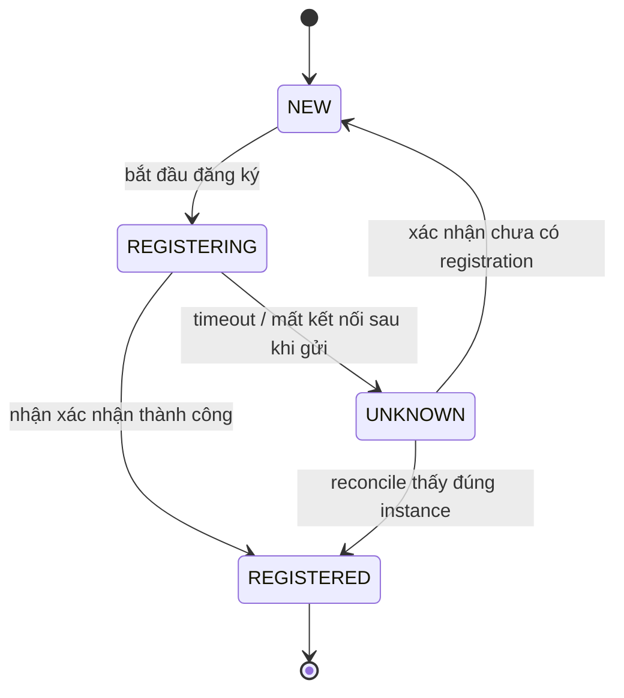

# Đăng ký đúng instance và xử lý việc gọi lặp

## 1. Bài toán

Một dịch vụ có thể chạy nhiều replica. Mỗi replica phải được đăng ký để consumer tìm thấy, nhưng registry cần phân biệt các replica với nhau. Khi một instance khởi động, Spring Cloud có thể tự đăng ký nó. Nếu code ứng dụng đồng thời gọi ServiceRegistry.register() thủ công, cùng một instance có thể bị gửi lệnh đăng ký nhiều lần.

Việc gọi lặp cũng xuất hiện khi kết nối tới registry chập chờn. Ứng dụng gửi yêu cầu đăng ký nhưng bị timeout trước khi nhận phản hồi. Lúc đó chưa thể kết luận registry chưa ghi nhận instance. Nếu retry ngay với một định danh mới, registry có thể xuất hiện hai registration cho cùng một process. Nếu retry với định danh của replica khác, một registration đang hoạt động có thể bị ghi đè hoặc bị nhầm với instance khác, tùy implementation.

Trong bài này, **đăng ký đúng instance** có nghĩa là:

- Mỗi replica có service ID và instance ID phù hợp.
- Host, port, scheme, metadata và health check mô tả đúng endpoint mà consumer có thể gọi.
- Một process giữ nguyên identity trong suốt vòng đời của nó, kể cả khi phải retry đăng ký.
- Một instance khác có identity riêng, không ghi đè registration của replica đang chạy.
- Việc đăng ký, cập nhật trạng thái và hủy đăng ký đi theo một lifecycle có chủ sở hữu rõ ràng.

Bài thuộc chương **ServiceRegistry** của mô-đun **SPRING_CLOUD_CORE**. Mô-đun giúp người học hiểu các abstraction cốt lõi của Spring Cloud trong hệ thống phân tán, gồm Spring Cloud Commons, cấu hình ngoài, discovery, service registry, giao tiếp dịch vụ và cách kiểm thử, vận hành.

Sau bài học, người học có thể:

- Giải thích vai trò của ServiceRegistry và Registration.
- Phân biệt service ID với instance ID khi có nhiều replica.
- Chọn đúng registration implementation cho registry đang sử dụng.
- Tránh đăng ký thủ công trùng với auto-registration.
- Xử lý timeout và retry khi kết quả đăng ký chưa rõ.
- Thiết kế thao tác đăng ký có thể gọi lặp an toàn ở cấp ứng dụng.
- Hủy đăng ký đúng instance khi shutdown và kiểm thử các tình huống gọi lặp.

## 2. Hợp đồng ServiceRegistry của Spring Cloud Commons

Spring Cloud Commons cung cấp abstraction ServiceRegistry để các discovery provider triển khai một giao diện chung. Hợp đồng có các thao tác:

```java
public interface ServiceRegistry<R extends Registration> {

    void register(R registration);

    void deregister(R registration);

    void close();

    void setStatus(R registration, String status);

    <T> T getStatus(R registration);
}
```

Registration là marker interface mở rộng ServiceInstance. Nó mang dữ liệu mô tả một instance như service ID, instance ID, host, port, URI, secure flag và metadata. Bản thân Registration không quy định cách registry lưu dữ liệu hoặc xử lý hai lệnh đăng ký có cùng identity.

| Thành phần | Trách nhiệm |
| --- | --- |
| Registration | Mô tả instance cần đăng ký. |
| ServiceRegistry.register() | Gửi registration tới registry implementation. |
| ServiceRegistry.deregister() | Hủy registration tương ứng. |
| ServiceRegistry.setStatus() | Cập nhật trạng thái theo quy ước của provider. |
| ServiceRegistry.getStatus() | Đọc trạng thái theo quy ước của provider. |
| ServiceRegistry.close() | Đóng tài nguyên của registry client theo lifecycle implementation. |

Các implementation sử dụng registration type riêng, ví dụ:

| Provider | Registration / ServiceRegistry |
| --- | --- |
| Eureka | EurekaRegistration / EurekaServiceRegistry |
| Consul | ConsulRegistration / ConsulServiceRegistry |
| Zookeeper | ZookeeperRegistration / ZookeeperServiceRegistry |

Khi dùng ServiceRegistry, phải truyền đúng loại Registration mà implementation tương ứng yêu cầu. Không tạo một object registration tùy ý rồi ép kiểu để gọi một registry khác.

**Giới hạn quan trọng:** hợp đồng chung không cam kết register() có tính idempotent, không định nghĩa idempotency key và cũng không bảo đảm exactly-once. Cách provider xử lý registration trùng phụ thuộc registry, phiên bản và identity của instance. Vì vậy, ứng dụng phải thiết kế identity và lifecycle rõ ràng, đồng thời kiểm tra semantics của provider đang dùng.

## 3. Phân biệt service ID và instance ID

Service ID là tên logic mà consumer dùng để tìm một dịch vụ. Instance ID phân biệt từng lần đăng ký cụ thể của dịch vụ đó.

Ví dụ ba replica:

| Service ID | Instance ID | Host | Port |
| --- | --- | --- | ---: |
| inventory-service | inventory-01 | inventory-01.internal | 8080 |
| inventory-service | inventory-02 | inventory-02.internal | 8080 |
| inventory-service | inventory-03 | inventory-03.internal | 8080 |

Các replica chia sẻ service ID để consumer gọi cùng một dịch vụ. Mỗi replica có instance ID riêng để registry theo dõi độc lập.

Nếu hai replica đang chạy đồng thời dùng cùng instance ID, một provider có thể xem lần đăng ký sau là cập nhật registration trước, provider khác có thể từ chối hoặc có hành vi riêng. Không nên dựa vào việc registry sẽ tự phân biệt hai process chỉ vì host hoặc metadata khác nhau.

### 3.1. Identity phải ổn định trong một vòng đời process

Một instance ID phù hợp có các đặc điểm:

- Duy nhất giữa các replica đang hoạt động của cùng service.
- Không thay đổi giữa các lần retry đăng ký của cùng process.
- Được dùng nhất quán khi cập nhật status và deregister.
- Có thể truy ngược về pod, container, VM hoặc process để chẩn đoán.

Không tạo UUID mới mỗi lần gọi register(). Nếu mỗi lần retry sinh một instance ID mới, một process có thể để lại nhiều registration. Nếu mọi replica dùng chung một ID, các replica có thể ghi đè nhau.

### 3.2. Eureka

Spring Cloud Netflix Eureka mặc định tạo instance ID theo dạng:

```text
${spring.cloud.client.hostname}:${spring.application.name}:${spring.application.instance_id:${server.port}}
```

Ví dụ:

```yaml
spring:
  application:
    name: inventory-service

eureka:
  instance:
    instance-id: ${spring.cloud.client.hostname}:${spring.application.name}:${spring.application.instance_id:${server.port}}
```

Nếu triển khai trên nền tảng có instance ID riêng, có thể đưa ID đó vào spring.application.instance_id. Khi chạy nhiều replica trên cùng host, port hoặc platform instance ID phải phân biệt được các replica.

### 3.3. Consul

Spring Cloud Consul mặc định lấy service name từ spring.application.name, instance ID từ Spring Application Context ID và port từ server.port. Context ID mặc định có dạng:

```text
${spring.application.name}:${profiles}:${server.port}
```

Có thể đặt instance ID riêng:

```yaml
spring:
  application:
    name: inventory-service
  cloud:
    consul:
      discovery:
        instance-id: ${spring.application.name}:${spring.application.instance_id:${server.port}}
```

Trong môi trường có platform identity, nên dùng ID của pod/container/VM để tránh phụ thuộc vào port nếu nhiều process có thể chia sẻ cùng port trong các network namespace khác nhau. Ví dụ, Kubernetes có thể inject Pod UID hoặc Pod name vào biến môi trường rồi dùng biến đó trong instance-id.

### 3.4. Không dùng địa chỉ mạng làm identity duy nhất nếu địa chỉ có thể thay đổi

IP có thể được cấp lại sau khi pod được tạo mới hoặc máy chủ thay đổi mạng. Nếu instance ID chỉ là IP, một instance mới có thể vô tình dùng lại ID của instance cũ. Ngược lại, một instance có IP mới có thể để lại registration cũ cho tới khi lease hoặc health check dọn dẹp.

Nên dùng định danh của runtime, kết hợp service ID và thông tin phân biệt replica. Host và port vẫn phải được cập nhật đúng, nhưng không nên mặc định chúng là identity bền vững.

## 4. Đăng ký đúng endpoint của instance

Một registration không chỉ có tên. Nó còn phải mô tả endpoint mà consumer có thể truy cập:

| Trường | Cần kiểm tra |
| --- | --- |
| Service ID | Tên logic đúng với dịch vụ consumer tìm kiếm. |
| Instance ID | Duy nhất giữa các replica và ổn định trong vòng đời process. |
| Host/IP | Có thể phân giải và định tuyến từ network consumer. |
| Port | Là port ứng dụng mà consumer cần gọi, không nhầm management port. |
| Scheme / secure | Phù hợp với HTTP hoặc HTTPS ở hop mà consumer kết nối. |
| Health check | Đúng path, port, scheme và trạng thái readiness. |
| Metadata | Theo contract mà consumer hoặc LoadBalancer thực sự hiểu. |

Ví dụ, nếu ứng dụng bind port ngẫu nhiên bằng server.port=0, registration phải dùng port thực tế sau khi web server khởi động, không được gửi số 0. Spring Cloud auto-registration gắn với lifecycle của web server và nhận WebServerInitializedEvent để lấy port thực tế trước khi bắt đầu đăng ký.

Nếu management server chạy port riêng, provider có thể đăng ký thêm management service. Ví dụ Spring Cloud Consul đăng ký một service riêng khi management.server.port khác application port. Đây là registration khác có mục đích riêng, không nên nhầm với việc ứng dụng nghiệp vụ bị đăng ký trùng.

## 5. Auto-registration và manual registration

Khi discovery provider có mặt trên classpath, Spring Cloud mặc định tự đăng ký Spring Boot application đang chạy. Với cấu hình thông thường, không cần tự gọi ServiceRegistry.register() trong @PostConstruct hoặc ApplicationRunner.

Có thể tắt auto-registration nếu ứng dụng muốn tự điều khiển:

```yaml
spring:
  cloud:
    service-registry:
      auto-registration:
        enabled: false
```

Hoặc dùng EnableDiscoveryClient(autoRegister = false) trong trường hợp cần cấu hình bằng annotation. EnableDiscoveryClient hiện không còn bắt buộc để kích hoạt discovery khi implementation đã có trên classpath.

Chỉ nên chọn một chủ sở hữu cho thao tác đăng ký:

| Mô hình | Cách làm |
| --- | --- |
| Dùng lifecycle mặc định | Để Spring Cloud auto-register và auto-deregister. Không gọi register() lần nữa trong code nghiệp vụ. |
| Tự quản lý lifecycle | Tắt auto-registration, tạo registration đúng provider và điều khiển register, status, deregister bằng một component riêng. |
| Chỉ cần quan sát registration | Lắng nghe event trước/sau đăng ký hoặc đọc trạng thái; không tạo thêm lệnh đăng ký. |

### 5.1. Event trước và sau đăng ký

Spring Cloud Commons phát hai event khi auto-registration hoạt động:

- InstancePreRegisteredEvent: trước khi instance được đăng ký.
- InstanceRegisteredEvent: sau khi instance được đăng ký.

Có thể dùng listener để ghi log, metric hoặc kích hoạt bước tích hợp phụ thuộc vào registration. Hai event này không được phát khi spring.cloud.service-registry.auto-registration.enabled=false.

Không nên xử lý event trước đăng ký bằng cách gọi thêm register() cho cùng instance. Điều đó tạo thêm một đường đăng ký ngoài lifecycle hiện có. Nếu cần thay đổi payload trước khi gửi, hãy dùng extension point/lifecycle callback của provider phù hợp.

### 5.2. Vì sao đăng ký quá sớm có thể sai port?

@PostConstruct có thể chạy trước khi embedded web server hoàn tất khởi động. Khi đó port thực tế, đặc biệt với server.port=0, có thể chưa được xác định.

Auto-registration của Spring Cloud sử dụng sự kiện web server khởi tạo để bắt đầu lifecycle đăng ký. Nếu tự quản lý, hãy đặt thao tác sau khi server đã có địa chỉ và port thực tế, đồng thời chỉ phát registration khi instance đủ điều kiện nhận traffic.

## 6. Gọi register lặp lại có nghĩa gì?

Có nhiều nguyên nhân khiến cùng một lệnh đăng ký được gửi hơn một lần:

1. Auto-registration và code thủ công cùng đăng ký một instance.
2. Hai listener cùng xử lý một sự kiện khởi động.
3. Một scheduled job hoặc health callback gọi register() định kỳ.
4. Một lần gọi bị timeout và client retry dù registry có thể đã nhận request.
5. Process khởi động lại trong khi registration cũ chưa được dọn dẹp.
6. Hai replica vô tình dùng cùng instance ID.

Phải phân biệt ba tình huống:

| Tình huống | Ý nghĩa | Hướng xử lý |
| --- | --- | --- |
| Gọi lặp trong cùng process | Nhiều code path gửi cùng registration | Chọn một lifecycle owner và chặn lời gọi trùng trong ứng dụng. |
| Retry sau lỗi chắc chắn chưa gửi được request | Registry chưa nhận yêu cầu | Retry có giới hạn và backoff. |
| Timeout sau khi gửi request | Chưa biết registry đã commit hay chưa | Reconcile theo identity trước khi gửi lại; không tạo ID mới. |

Một phản hồi timeout không chứng minh thao tác thất bại. Registry có thể đã ghi registration nhưng phản hồi bị mất trên đường về. Đây là trạng thái **kết quả chưa rõ**.

### 6.1. Cùng ID và khác ID

Hai lần đăng ký cùng service ID và instance ID có thể được provider xử lý như cập nhật, ghi đè, làm mới lease hoặc từ chối. Cùng ID nhưng payload khác nhau còn có thể thay host, port, metadata hoặc health check của registration đang tồn tại.

Hai lần đăng ký cùng service ID nhưng khác instance ID thường biểu diễn hai instance riêng. Điều này đúng khi đó thực sự là hai replica. Nếu chỉ là retry của một process, tạo instance ID mới sẽ làm registry có thể giữ nhiều bản ghi cho cùng process.

Không thể suy ra hành vi của mọi provider từ tên method register(). Hãy đọc tài liệu của registry cụ thể và kiểm thử với đúng phiên bản đang triển khai.

## 7. Thiết kế thao tác đăng ký có thể gọi lặp an toàn

Mục tiêu của xử lý idempotent ở cấp ứng dụng là: nếu cùng một yêu cầu đăng ký được kích hoạt nhiều lần trong cùng process, nó không tạo ra nhiều luồng đăng ký cạnh tranh và không sinh identity mới.

Một state machine đơn giản có thể dùng các trạng thái:

| Trạng thái | Ý nghĩa |
| --- | --- |
| NEW | Chưa gửi yêu cầu đăng ký. |
| REGISTERING | Đang thực hiện một lần đăng ký. |
| REGISTERED | Đã nhận xác nhận đăng ký thành công. |
| UNKNOWN | Request có thể đã được registry nhận nhưng client không biết kết quả. |

Luồng xử lý:



Ví dụ dưới đây minh họa khóa lời gọi đồng thời và giữ trạng thái UNKNOWN để buộc reconcile trước khi retry:

```java
import org.springframework.cloud.client.serviceregistry.Registration;
import org.springframework.cloud.client.serviceregistry.ServiceRegistry;

public final class RegistrationCoordinator<R extends Registration> {

    private enum State {
        NEW, REGISTERING, REGISTERED, UNKNOWN
    }

    private final ServiceRegistry<R> serviceRegistry;
    private final R registration;
    private State state = State.NEW;

    public RegistrationCoordinator(
            ServiceRegistry<R> serviceRegistry,
            R registration) {
        this.serviceRegistry = serviceRegistry;
        this.registration = registration;
    }

    public synchronized void register() {
        if (state == State.REGISTERED) {
            return;
        }
        if (state == State.UNKNOWN) {
            throw new IllegalStateException(
                    "Registration outcome is unknown; reconcile before retry");
        }
        if (state == State.REGISTERING) {
            return;
        }

        state = State.REGISTERING;
        try {
            serviceRegistry.register(registration);
            state = State.REGISTERED;
        }
        catch (RuntimeException ex) {
            // Giữ UNKNOWN vì exception không chứng minh registry chưa ghi nhận request.
            // Chỉ chuyển về NEW sau khi reconcile xác nhận chưa có registration.
            state = State.UNKNOWN;
            throw ex;
        }
    }

    public synchronized void markReconciled(boolean sameInstanceExists) {
        if (state != State.UNKNOWN) {
            throw new IllegalStateException("No unknown registration to reconcile");
        }
        state = sameInstanceExists ? State.REGISTERED : State.NEW;
    }
}
```

Đây là ví dụ về điều phối trong một process, không phải implementation hoàn chỉnh cho mọi registry. Hàm markReconciled chỉ nên được gọi sau khi query registry bằng identity của provider và có đủ độ tin cậy để kết luận registration tồn tại hay không. Với registry có cache hoặc eventual consistency, một lần query chưa thấy instance có thể là kết quả cũ.

State machine trong bộ nhớ cũng mất khi process restart. Nếu cần điều phối đăng ký do nhiều process cùng quản lý một tài nguyên logic, phải dùng khóa/idempotency mechanism ở nơi có phạm vi chia sẻ phù hợp hoặc giao việc sở hữu registration cho một controller duy nhất.

### 7.1. Reconcile theo identity, không theo service ID đơn lẻ

Khi kết quả đăng ký chưa rõ, cần tìm đúng instance:

- So sánh service ID.
- So sánh instance ID theo quy ước provider.
- Đối chiếu host, port và metadata quan trọng nếu provider không có instance ID đáng tin cậy.
- Xác minh trạng thái và health check.

Không chỉ kiểm tra service có tồn tại không, vì một service ID có thể có nhiều replica. Nếu đã có ba instance, điều đó không chứng minh instance thứ tư vừa đăng ký có tồn tại.

DiscoveryClient.getInstances(serviceId) có thể hỗ trợ quan sát instance, nhưng kết quả có thể bị cache hoặc trễ so với registry. Khi cần kết luận cho thao tác retry, dùng API/consistency guarantee của provider hoặc đợi khoảng hội tụ đã được xác định.

### 7.2. Không tạo identity mới cho lần retry

Một lần retry phải dùng lại registration identity của cùng process. Nếu registry hỗ trợ upsert theo instance ID, cùng identity có thể cho phép gửi lại payload mà không tạo instance logic mới. Tuy nhiên, chỉ dựa vào hành vi đó sau khi đã xác minh tài liệu provider và phiên bản.

Không tái sử dụng instance ID của process cũ cho process mới nếu process cũ vẫn có thể đang chạy. Một ID dùng chung có thể khiến hai process ghi đè registration của nhau.

## 8. Retry có giới hạn và backoff

Không retry vô hạn hoặc retry liên tục trong một vòng lặp. Khi registry gặp sự cố, nhiều instance cùng retry dồn dập có thể làm tăng tải và kéo dài outage.

Một chính sách retry nên có:

- Số lần thử tối đa.
- Backoff tăng dần giữa các lần thử.
- Jitter để các replica không retry cùng thời điểm.
- Timeout kết nối và timeout đọc hợp lý.
- Phân loại lỗi có thể retry và lỗi cấu hình không thể retry.
- Log/metric cho số lần thử, thời gian chờ và kết quả cuối.

Spring Cloud Consul có hỗ trợ retry cho quá trình đăng ký. Theo tài liệu hiện hành, cần thêm spring-retry và spring-boot-starter-aspectj vào classpath. Mặc định là sáu lần thử, khoảng chờ ban đầu 1.000 ms và hệ số nhân 1,1; có thể điều chỉnh qua spring.cloud.consul.retry.*. Cơ chế này áp dụng cho cả Consul Config và Discovery registration.

Ví dụ cấu hình:

```yaml
spring:
  cloud:
    consul:
      retry:
        enabled: true
        max-attempts: 6
        initial-interval: 1000
        max-interval: 2000
        multiplier: 1.1
```

Tên thuộc tính và giá trị mặc định cần đối chiếu theo phiên bản Spring Cloud Consul. Retry tích hợp của provider cũng không thay thế việc dùng instance ID ổn định hoặc reconcile khi kết quả của request trước chưa rõ.

### 8.1. Fail-fast hay tiếp tục chạy?

Với một số hệ thống, ứng dụng không thể nhận traffic nếu chưa đăng ký thành công. Khi đó startup nên fail-fast để orchestration có thể restart hoặc giữ instance ngoài traffic.

Với hệ thống cho phép chạy tạm thời mà chưa được discovery, có thể chọn tiếp tục startup nhưng phải giữ trạng thái chưa sẵn sàng và retry theo chính sách. Không để readiness báo UP chỉ vì web server đã mở port nếu consumer không thể tìm thấy instance.

Spring Cloud Consul có spring.cloud.consul.discovery.fail-fast để quyết định hành vi khi đăng ký thất bại. Giá trị mặc định hiện hành là true; hãy xem lại tài liệu phiên bản đang dùng trước khi thay đổi.

## 9. Lifecycle đăng ký và hủy đăng ký

Đăng ký instance là một phần của lifecycle ứng dụng:

1. Tạo registration từ service ID, instance ID và endpoint.
2. Chờ web server khởi tạo để có port thực tế.
3. Thực hiện các bước chuẩn bị trước đăng ký nếu có.
4. Gửi registration tới provider.
5. Xác nhận đăng ký và công bố trạng thái sau đăng ký.
6. Duy trì heartbeat hoặc health check theo provider.
7. Khi shutdown, đưa instance ra khỏi traffic nếu cần drain request.
8. Deregister đúng instance và đóng tài nguyên registry client.

Spring Cloud Commons có AbstractAutoServiceRegistration để quản lý lifecycle auto-registration. Lớp này lắng nghe WebServerInitializedEvent, bắt đầu registration sau khi server khởi tạo, phát InstancePreRegisteredEvent và InstanceRegisteredEvent, đồng thời gọi stop/deregister khi context đóng.

### 9.1. Deregister phải dùng đúng instance identity

Khi shutdown, phải hủy registration của instance hiện tại. Không dùng service ID chung để xóa toàn bộ dịch vụ nếu mục tiêu chỉ là dừng một replica.

Với Eureka, client gửi heartbeat định kỳ để gia hạn lease; tài liệu hiện hành mô tả chu kỳ mặc định 30 giây và lease expiration mặc định 90 giây. Nếu heartbeat ngừng, instance có thể bị loại khỏi registry theo chính sách lease. Graceful shutdown vẫn nên deregister để giảm thời gian instance cũ còn xuất hiện trong discovery.

Với Consul, Spring Cloud Consul tạo HTTP health check mặc định gọi /actuator/health mỗi 10 giây. Nếu health check thất bại, instance được đánh dấu critical. Consul cũng hỗ trợ TTL check khi ứng dụng chủ động gửi heartbeat. Không xem health check là thay thế cho deregistration khi shutdown bình thường.

### 9.2. Drain traffic trước khi hủy registration

Với dịch vụ đang xử lý request, có thể cần:

- Chuyển trạng thái instance sang OUT_OF_SERVICE hoặc trạng thái maintenance mà provider hỗ trợ.
- Chờ LoadBalancer/consumer ngừng chọn instance theo cơ chế health/status và cache.
- Chờ request đang chạy hoàn tất trong giới hạn thời gian graceful shutdown.
- Gọi deregister() đúng registration.
- Đóng registry client theo lifecycle.

Các giá trị status là provider-specific. Eureka có các trạng thái như UP, DOWN, OUT_OF_SERVICE và UNKNOWN; Consul có thể biểu diễn maintenance và health check theo cách khác. Không giả định cùng một chuỗi status có cùng hiệu lực ở mọi registry.

## 10. Tránh đăng ký nhầm management service

Nếu management server dùng port riêng, một số provider có thể đăng ký management endpoint thành service riêng. Với Consul, khi management.server.port khác application port, tài liệu mô tả hai registration: application service và management service có hậu tố riêng.

Điều này có thể khiến dashboard hiển thị hai service cùng nguồn ứng dụng. Hãy xác định mục đích của từng registration:

| Registration | Consumer dự kiến |
| --- | --- |
| Application service | Consumer nghiệp vụ gọi API ứng dụng. |
| Management service | Hệ thống quản trị, health check hoặc operations gọi endpoint quản lý. |

Không cấu hình consumer nghiệp vụ gọi management service. Nếu không muốn đăng ký management service, xem thuộc tính auto-registration management của Spring Cloud Commons/provider tương ứng.

## 11. Quan sát và chẩn đoán

Khi registry có registration trùng, thiếu hoặc stale, kiểm tra theo thứ tự:

1. spring.application.name có đúng service ID không?
2. Mỗi replica có instance ID duy nhất không?
3. Một process có sinh instance ID mới mỗi lần retry không?
4. Auto-registration có đang bật trong khi code thủ công cũng gọi register không?
5. Registration được gửi sau khi web server đã có host/port thực tế chưa?
6. Host, port, scheme và health check có đúng endpoint không?
7. Registry có nhận request nhưng client timeout trước khi nhận response không?
8. Consumer/discovery client có cache cũ không?
9. Shutdown có deregister đúng registration không?
10. Registry có lease/health check để dọn instance chết không?

Nên ghi log có cấu trúc với:

- Service ID và instance ID.
- Host và port đã đăng ký.
- Provider/registry đang sử dụng.
- Correlation ID hoặc registration attempt ID.
- Số lần thử và thời gian backoff.
- Kết quả: success, definite failure hoặc unknown outcome.
- Status và thời điểm deregister.

Không ghi token, password, private key hoặc toàn bộ metadata nhạy cảm vào log. Không chỉ log register failed; cần có đủ identity để đối chiếu registration ở registry.

Spring Cloud Commons cung cấp Actuator endpoint /serviceregistry khi có Registration bean. GET trả trạng thái hiện tại; POST có thể đổi status qua JSON field status. Giá trị hợp lệ phụ thuộc provider. Bảo vệ endpoint bằng authentication, authorization và giới hạn mạng truy cập.

## 12. Kiểm thử đăng ký và gọi lặp

Không chỉ kiểm tra rằng register() được gọi. Cần xác minh identity, số lần gọi, trạng thái sau lỗi và hành vi khi shutdown.

| Ca kiểm thử | Thiết lập | Kết quả cần xác minh |
| --- | --- | --- |
| Auto-registration | Khởi động ứng dụng với discovery provider | Instance được đăng ký sau khi web server có port thực tế. |
| Manual registration | Tắt auto-registration và gọi coordinator | Chỉ component được chỉ định thực hiện đăng ký. |
| Gọi lặp tuần tự | Gọi register() nhiều lần với cùng registration | Ứng dụng không phát thêm thao tác sau khi đã xác nhận REGISTERED. |
| Gọi đồng thời | Nhiều thread yêu cầu đăng ký cùng instance | Chỉ một thao tác local được đưa vào trạng thái REGISTERING. |
| Timeout sau khi gửi | Provider có thể đã ghi nhận nhưng client không nhận response | State chuyển UNKNOWN; không sinh instance ID mới và không retry mù. |
| Reconcile thấy instance | Registry có instance cùng identity | Coordinator chuyển sang REGISTERED. |
| Reconcile không thấy instance | Provider xác nhận chưa có registration sau khi xét consistency/cache | Cho phép thử lại với cùng identity. |
| Hai replica | Hai registration có cùng service ID nhưng instance ID khác nhau | Registry hiển thị hai instance riêng. |
| Trùng instance ID | Hai replica vô tình dùng cùng ID | Test phát hiện nguy cơ ghi đè hoặc conflict theo provider. |
| Shutdown | Dừng một replica trong nhóm nhiều replica | Chỉ registration của replica đó bị deregister. |
| Health check | Instance không còn healthy | Registry đánh dấu trạng thái theo provider; consumer không tiếp tục chọn instance theo chính sách. |
| Management port riêng | Management server được đăng ký riêng | Consumer nghiệp vụ không chọn nhầm management registration. |

### 12.1. Unit test với fake ServiceRegistry

Một fake registry có thể đếm số lần register() và deregister():

```java
import java.util.ArrayList;
import java.util.List;

import org.springframework.cloud.client.serviceregistry.Registration;
import org.springframework.cloud.client.serviceregistry.ServiceRegistry;

class RecordingServiceRegistry<R extends Registration>
        implements ServiceRegistry<R> {

    private final List<R> registrations = new ArrayList<>();
    private final List<R> deregistrations = new ArrayList<>();

    @Override
    public void register(R registration) {
        registrations.add(registration);
    }

    @Override
    public void deregister(R registration) {
        deregistrations.add(registration);
    }

    @Override
    public void close() {
    }

    @Override
    public void setStatus(R registration, String status) {
    }

    @Override
    public <T> T getStatus(R registration) {
        return null;
    }

    public List<R> registrations() {
        return List.copyOf(registrations);
    }
}
```

Test coordinator với cùng một registration:

```java
coordinator.register();
coordinator.register();
coordinator.register();

assertThat(recordingRegistry.registrations()).hasSize(1);
```

Đây là unit test cho lớp điều phối trong ứng dụng. Nó không chứng minh provider thật xử lý registration trùng theo cùng cách. Cần integration test riêng với Eureka, Consul hoặc provider đang triển khai.

### 12.2. Integration test với registry thật

Trong integration test:

- Khởi động registry bằng môi trường test phù hợp.
- Khởi động hai application context hoặc hai instance với cùng service ID nhưng instance ID khác nhau.
- Đọc danh sách instance từ registry hoặc discovery client.
- Xác minh mỗi registration có host, port, metadata và status đúng.
- Gửi lại cùng thao tác với cùng identity và quan sát semantics của provider.
- Dừng một instance rồi xác minh instance còn lại vẫn được đăng ký.
- Tắt instance đột ngột để kiểm tra lease/health check cleanup.

Nếu test dựa trên discovery client có cache, phải chờ hoặc đồng bộ theo cơ chế provider. Không dùng một assertion tức thời để kết luận registration đã thất bại chỉ vì instance chưa xuất hiện trong cache consumer.

## 13. Lỗi thường gặp

| Triệu chứng | Nguyên nhân có thể | Cách xử lý |
| --- | --- | --- |
| Một service xuất hiện nhiều instance cho cùng process | Retry sinh instance ID mới hoặc nhiều code path đăng ký | Giữ identity ổn định và chọn một lifecycle owner. |
| Replica mới làm replica cũ biến mất | Hai process dùng chung instance ID | Tạo ID duy nhất cho mỗi replica. |
| Instance có port bằng 0 | Đăng ký trước khi web server xác định port thực tế | Đăng ký sau WebServerInitializedEvent hoặc dùng lifecycle auto-registration. |
| Startup gọi register hai lần | Auto-registration và manual registration cùng bật | Tắt một cơ chế hoặc bỏ lệnh register thủ công. |
| Retry sau timeout tạo registration trùng | Client coi timeout là chắc chắn chưa commit | Chuyển sang trạng thái UNKNOWN và reconcile theo identity. |
| Registry giữ instance chết | Không graceful deregister và lease/health cleanup chưa hết hạn | Bật deregistration, cấu hình health check/lease phù hợp và theo dõi stale registration. |
| Shutdown xóa nhầm replica khác | Deregister dùng identity không đủ cụ thể | Deregister đúng instance ID của process hiện tại. |
| Consumer không thấy instance vừa đăng ký | Cache hoặc chu kỳ đồng bộ registry/discovery | Kiểm tra registry trực tiếp và thời gian hội tụ. |
| Health check luôn critical | Sai path, port, scheme hoặc management context path | Kiểm tra endpoint health từ góc nhìn của registry agent. |
| Management endpoint bị consumer nghiệp vụ gọi | Nhầm management registration với application registration | Tách service ID và chính sách consumer. |

## 14. Hướng dẫn thiết kế

1. **Dùng auto-registration mặc định khi không có yêu cầu lifecycle đặc biệt.** Tránh gọi register() thủ công lần nữa.
2. **Nếu tự quản lý, tắt auto-registration.** Để một component duy nhất sở hữu register, status và deregister.
3. **Duy trì service ID ổn định và instance ID riêng cho từng replica.** Cùng process phải dùng cùng identity trong mọi lần retry.
4. **Tạo registration sau khi endpoint đã sẵn sàng.** Đặc biệt lưu ý server.port=0, management port và địa chỉ quảng bá.
5. **Không giả định ServiceRegistry.register() exactly-once hoặc idempotent.** Kiểm tra semantics của provider.
6. **Phân loại kết quả lỗi.** Timeout sau khi gửi là trạng thái chưa rõ; reconcile trước khi retry.
7. **Retry có giới hạn, backoff và jitter.** Không để nhiều replica tạo retry storm.
8. **Deregister đúng instance khi shutdown.** Có thể drain traffic và cập nhật status trước khi xóa registration.
9. **Kiểm thử provider thật.** Fake registry chỉ xác minh logic điều phối của ứng dụng.
10. **Theo dõi identity và trạng thái.** Log service ID, instance ID, endpoint, attempt và kết quả để xử lý registration trùng hoặc stale.

## 15. Câu hỏi tự kiểm tra

1. ServiceRegistry và Registration có vai trò gì trong Spring Cloud Commons?
2. Vì sao service ID có thể giống nhau giữa các replica nhưng instance ID phải phân biệt được?
3. Tại sao không nên tạo instance ID mới mỗi lần retry đăng ký?
4. Vì sao auto-registration kết hợp với manual registration có thể tạo thao tác trùng?
5. InstancePreRegisteredEvent và InstanceRegisteredEvent được phát ở thời điểm nào?
6. Vì sao @PostConstruct có thể đăng ký sai port khi ứng dụng dùng server.port=0?
7. Timeout sau khi gửi yêu cầu đăng ký khác gì với lỗi chắc chắn xảy ra trước khi request được gửi?
8. Tại sao ServiceRegistry không thể bảo đảm exactly-once cho mọi provider?
9. Cần kiểm tra thông tin nào khi reconcile một registration có kết quả chưa rõ?
10. Hãy thiết kế test chứng minh hai replica cùng service ID nhưng có instance ID khác nhau, và retry của một replica không tạo thêm instance.

## 16. Tài liệu tham khảo chính thức

- [Spring Cloud Commons — ServiceRegistry, Auto-registration và Actuator endpoint](https://docs.spring.io/spring-cloud-commons/reference/spring-cloud-commons/common-abstractions.html)
- [Spring Cloud Netflix — Registering with Eureka và instance ID](https://docs.spring.io/spring-cloud-netflix/reference/spring-cloud-netflix.html)
- [Spring Cloud Consul — Service registration, instance ID và health check](https://docs.spring.io/spring-cloud-consul/reference/discovery.html)
- [Spring Cloud Consul — Retry khi registry không sẵn sàng](https://docs.spring.io/spring-cloud-consul/reference/retry.html)
- [Netflix Eureka — REST operations](https://github.com/Netflix/eureka/wiki/Eureka-REST-operations)

Hành vi xử lý registration trùng, retry, heartbeat và deregistration phụ thuộc provider cùng phiên bản. Trước khi triển khai retry tự động, hãy xác minh identity semantics, tính nhất quán khi đọc registry và quy tắc cleanup của registry đang sử dụng.
