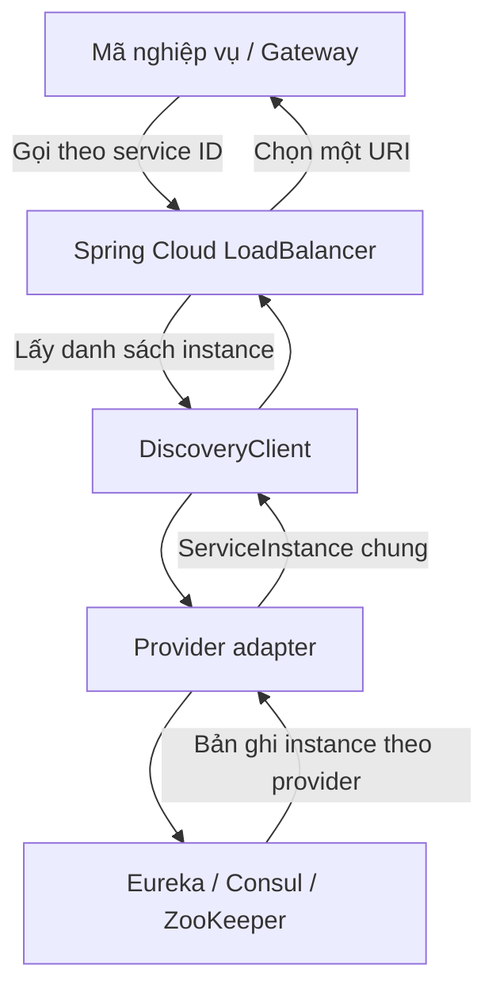
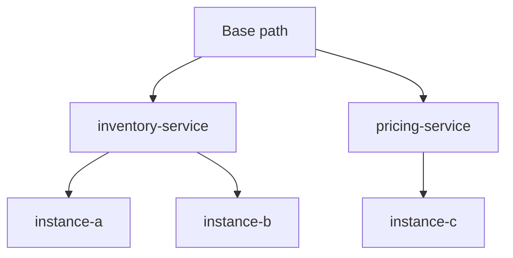

# Giới hạn hợp đồng chung so với Eureka, Consul và Zookeeper

## 1. Vì sao cần một hợp đồng chung?

Trong hệ thống microservice, một ứng dụng thường cần tìm địa chỉ của service khác mà không gắn cứng vào hostname hoặc IP của từng instance. Service registry lưu thông tin các instance đang được công bố; discovery client truy vấn registry để tìm các instance phù hợp.

Spring Cloud Commons cung cấp lớp abstraction để mã nghiệp vụ có thể dùng chung một cách truy vấn service, dù phần triển khai phía dưới là Eureka, Consul hay ZooKeeper. Mục tiêu là giảm sự phụ thuộc trực tiếp vào API riêng của từng sản phẩm. Ví dụ, một lớp gateway có thể gọi `DiscoveryClient.getInstances("inventory-service")` mà không cần biết registry đang lưu instance trong Eureka, Consul hay ZooKeeper.

Tuy nhiên, abstraction chỉ thống nhất **một phần hợp đồng lập trình**. Nó không biến ba hệ thống thành một sản phẩm có cùng mô hình dữ liệu, cơ chế phát hiện lỗi, độ trễ cập nhật, tính nhất quán, trạng thái instance hoặc cách vận hành cluster.

Đề bài này tập trung vào ranh giới giữa hợp đồng Spring Cloud Commons và năng lực riêng của từng registry. Sau bài học, người đọc có thể:

- Xác định việc gì có thể viết một lần bằng API Commons.
- Nhận diện thông tin và hành vi bị phụ thuộc vào provider.
- Giải thích khác biệt về đăng ký, heartbeat, health check, cache, watch và trạng thái.
- Thiết kế kiểm thử hợp đồng chung nhưng vẫn kiểm thử tích hợp riêng cho từng registry.
- Lập kế hoạch chuyển Eureka, Consul hoặc ZooKeeper mà không giả định chỉ cần đổi dependency.

## 2. Spring Cloud Commons chuẩn hóa những gì?

Hai abstraction quan trọng là `DiscoveryClient` và `ServiceRegistry`.

### 2.1. DiscoveryClient: tra cứu service instance

`DiscoveryClient` cung cấp API blocking để tìm các instance theo service ID. Những phương thức thường dùng là:

| Phương thức | Vai trò |
| --- | --- |
| `getInstances(serviceId)` | Trả danh sách instance mà implementation tìm được cho service ID |
| `getServices()` | Trả danh sách service ID mà implementation biết |
| `description()` | Cung cấp mô tả implementation discovery |

Spring Cloud Commons còn có `ReactiveDiscoveryClient` cho luồng reactive. Việc ứng dụng dùng API blocking hay reactive không làm thay đổi các khác biệt về semantics của registry bên dưới.

Đối tượng trả về là `ServiceInstance`. Đây là mô hình chung cho thông tin kết nối của một instance, thường bao gồm service ID, instance ID, URI, host, port, cờ secure và metadata. Ứng dụng có thể dùng URI để gọi endpoint và đọc metadata để áp dụng quy tắc riêng.

Hợp đồng này trả lời câu hỏi **“có những địa chỉ instance nào được discovery implementation cung cấp cho service này?”**. Nó không đảm bảo mọi instance trong danh sách đều đang phục vụ request thành công tại thời điểm gọi.

### 2.2. ServiceRegistry: đăng ký và hủy đăng ký

`ServiceRegistry` cung cấp các thao tác chung như:

- `register(Registration)`: đăng ký một service instance.
- `deregister(Registration)`: hủy đăng ký instance.

`Registration` là marker interface. Mỗi provider có kiểu registration riêng, chẳng hạn `EurekaRegistration`, `ConsulRegistration` và `ZookeeperRegistration`. Vì vậy, việc inject một `ServiceRegistry` không có nghĩa đối tượng registration được tạo theo cách giống nhau giữa các provider.

Commons cũng cung cấp cơ chế auto-registration và các sự kiện `InstancePreRegisteredEvent`, `InstanceRegisteredEvent`. Có thể tắt auto-registration bằng `spring.cloud.service-registry.auto-registration.enabled=false` hoặc cấu hình discovery client phù hợp. `@EnableDiscoveryClient` không còn bắt buộc chỉ để kích hoạt discovery khi implementation đã có trên classpath.

### 2.3. ServiceInstance là mô hình dữ liệu chung, không phải toàn bộ bản ghi registry

Một registry có thể lưu nhiều trường hơn những gì `ServiceInstance` biểu diễn. Khi chuyển dữ liệu từ registry sang mô hình Commons, adapter chỉ đưa ra phần thông tin phù hợp với abstraction và cách triển khai của nó.

| Dữ liệu | Commons có biểu diễn chung? | Điều cần kiểm tra theo provider |
| --- | --- | --- |
| Service ID | Có | Quy tắc đặt tên, phân biệt hoa thường, namespace và group |
| Instance ID | Có | Cách tạo ID và yêu cầu duy nhất |
| URI/host/port | Có | Cách suy ra địa chỉ khi chạy sau proxy, NAT, ingress hoặc nhiều network |
| Secure/HTTPS | Có | Cách provider công bố scheme và chứng thư TLS |
| Metadata | Có, dưới dạng map | Quy tắc key, tag, giới hạn kích thước và cách metadata được diễn giải |
| Trạng thái đăng ký | Không có một enum thống nhất cho mọi provider | Tập trạng thái hợp lệ và ý nghĩa lọc instance |
| Health check | Không chuẩn hóa thuật toán kiểm tra | HTTP check, TTL heartbeat, lease heartbeat hoặc logic riêng |
| Watch/change notification | Không có một mô hình đồng nhất trong DiscoveryClient | Polling, blocking query, watcher, cache và event |
| ACL, auth, TLS tới registry | Không được trừu tượng hóa đầy đủ | Cấu hình credential, certificate, token, ACL và quyền theo datacenter |
| Topology cluster | Không | Peer replication, gossip/Raft, ensemble và quorum |

### 2.4. LoadBalancer là một lớp khác

`DiscoveryClient` cung cấp danh sách instance; `Spring Cloud LoadBalancer` chọn một instance cho request. Không nên nhầm hai trách nhiệm này.



LoadBalancer có thể áp dụng chiến lược chọn instance, lọc theo metadata hoặc xử lý retry theo cấu hình. Nhưng nó không tự tạo ra health check giống nhau cho mọi registry và cũng không bảo đảm danh sách đầu vào luôn mới nhất.

## 3. Điều gì không nằm trong hợp đồng chung?

Khi chỉ nhìn vào chữ ký phương thức, ta dễ cho rằng các provider có hành vi tương đương. Trên thực tế, các chi tiết sau vẫn thuộc về implementation và cấu hình cụ thể.

### 3.1. Đăng ký và vòng đời instance

Hợp đồng chung có thao tác register/deregister, nhưng không quy định:

- Instance phải gửi heartbeat theo chu kỳ nào.
- Lease hết hạn sau bao lâu nếu mất heartbeat.
- Registry tự kiểm tra HTTP endpoint hay ứng dụng chủ động gửi TTL heartbeat.
- Khi tiến trình chết đột ngột, bản ghi biến mất ngay hay chỉ sau một khoảng timeout.
- Khi client mất kết nối registry nhưng service vẫn chạy, bản ghi được giữ, đánh dấu nghi vấn hay bị xóa.
- Khi khởi động lại, instance có giữ nguyên ID hay tạo ID mới.

Những quyết định này ảnh hưởng trực tiếp tới thời gian service xuất hiện hoặc biến mất khỏi kết quả discovery.

### 3.2. Health và trạng thái

Commons có thể cung cấp health indicator tổng hợp dựa trên discovery implementation. Điều đó không đồng nghĩa health indicator của Commons kiểm tra từng endpoint nghiệp vụ.

Provider có thể:

- Dựa trên heartbeat để suy luận instance còn sống.
- Gọi HTTP health endpoint từ agent hoặc server.
- Yêu cầu ứng dụng gửi TTL heartbeat.
- Lưu trạng thái riêng và lọc instance theo trạng thái.
- Dùng metadata để mô phỏng trạng thái không phục vụ.

Một trạng thái `UP` ở registry cũng không chứng minh database, message broker hoặc dependency nghiệp vụ của service đang khỏe. Health check phải được thiết kế phù hợp với mục tiêu: tiến trình còn sống, ứng dụng sẵn sàng nhận traffic hay toàn bộ nghiệp vụ có thể hoàn tất.

### 3.3. Độ mới và tính nhất quán của danh sách

`getInstances()` không có tham số chung để yêu cầu một mức freshness cụ thể. Nó trả dữ liệu theo cache, polling, watch hoặc API query của provider.

Do đó, các tình huống sau có thể khác nhau:

- Một instance mới đăng ký nhưng client chưa nhìn thấy.
- Một instance đã dừng nhưng vẫn còn trong cache của client.
- Registry bị phân vùng mạng và các node có góc nhìn khác nhau.
- Watcher bị ngắt kết nối rồi phải đồng bộ lại.
- Một lần truy vấn trả danh sách cũ trong khi cập nhật mới đang được lan truyền.

Mã gọi cần có timeout, retry có giới hạn, xử lý danh sách rỗng và kiểm soát lỗi kết nối. Không dùng discovery như bằng chứng tuyệt đối rằng địa chỉ trả về vẫn có thể phục vụ request.

### 3.4. Metadata và định tuyến

Commons đưa metadata về dạng map key/value. Nó không chuẩn hóa:

- Tên key như `zone`, `region`, `version`, `weight`, `group` hoặc `tag`.
- Giá trị có được provider tự sinh hay do ứng dụng khai báo.
- Metadata có được dùng để lọc instance mặc định hay chỉ là dữ liệu cho ứng dụng.
- Quy tắc ưu tiên cùng zone, cùng datacenter hoặc cùng region.

Nếu LoadBalancer cần metadata để định tuyến, phải cấu hình supplier hoặc policy tương ứng. Chỉ đưa key `zone` vào metadata không tự động bật zone-aware routing cho mọi provider.

## 4. So sánh Eureka, Consul và ZooKeeper

Ba hệ thống đều có thể phục vụ service discovery trong ứng dụng Spring Cloud, nhưng nền tảng và cách vận hành khác nhau.

| Khía cạnh | Eureka | Consul | ZooKeeper |
| --- | --- | --- | --- |
| Vai trò nền tảng | Service registry/client-server chuyên cho discovery | Nền tảng service discovery, health check, KV và DNS/HTTP API | Hệ thống coordination phân tán; discovery được xây trên Curator Service Discovery |
| Cách tích hợp Spring Cloud | Spring Cloud Netflix Eureka | Spring Cloud Consul | Spring Cloud Zookeeper, dùng Curator |
| Đăng ký | Client đăng ký metadata và gửi heartbeat/lease renewal | Client đăng ký qua Consul HTTP API; agent thực hiện health check hoặc TTL | Curator lưu ServiceInstance dưới cây znode theo service name và instance ID |
| Phát hiện lỗi | Heartbeat và lease; có thể bật truyền health status từ Actuator | HTTP health check hoặc TTL check | Vòng đời session/ephemeral node và cơ chế kiểm tra của Curator/provider |
| Cập nhật danh sách | Client cache registry và chu kỳ fetch; server peer replication | HTTP API/DNS; catalog watch dùng blocking query và phát event | Query trực tiếp hoặc cache được cập nhật bằng ZooKeeper watcher |
| Metadata | `eureka.instance.metadataMap` | Service metadata, tags và các thuộc tính discovery | Payload linh hoạt của Curator ServiceInstance |
| Trạng thái đặc biệt | Có các trạng thái như `UP`, `DOWN`, `OUT_OF_SERVICE`, `UNKNOWN` | Trạng thái check như passing/warning/critical; có TTL heartbeat | Spring Cloud Zookeeper có thể biểu diễn `OUT_OF_SERVICE` bằng metadata và LoadBalancer supplier |
| Khả năng khác biệt đáng chú ý | Peer replication, region/zone, client cache | DNS và HTTP API, agent, gossip/Raft, datacenter, health check | Coordination primitives, watches, ephemeral znodes, session và quorum |

Bảng trên mô tả cách các tích hợp hiện hành được tài liệu hóa. Cấu hình cụ thể có thể thay đổi theo release train, phiên bản server, starter và lựa chọn health check.

## 5. Eureka: heartbeat, cache và vùng triển khai

Eureka là service registry và client/server của Netflix. Spring Cloud Netflix đưa Eureka vào mô hình Spring Boot thông qua starter và auto-configuration.

### 5.1. Đăng ký và heartbeat

Khi client đăng ký, nó gửi metadata như host, port, health URL và các thông tin instance. Client tiếp tục gửi heartbeat tới Eureka Server. Tài liệu Spring Cloud Netflix hiện hành nêu chu kỳ heartbeat mặc định là 30 giây; nếu heartbeat không đến trong khoảng lease được cấu hình, server thường loại instance khỏi registry.

Điều này tạo ra một độ trễ có chủ đích giữa lúc tiến trình dừng và lúc client khác không còn thấy instance. Giảm chu kỳ heartbeat có thể làm discovery cập nhật nhanh hơn, nhưng cũng tăng lưu lượng và thay đổi giả định vận hành của server.

### 5.2. Client cache và peer replication

Eureka client giữ cache registry trong bộ nhớ để không phải truy vấn server cho từng request. Các Eureka Server có thể cấu hình làm peer và đồng bộ đăng ký với nhau. Nhờ đó, registry không chỉ là một API truy vấn trực tiếp; nó còn có cache ở client và trạng thái được sao chép giữa các peer.

Hệ quả là khi instance mới đăng ký, client có thể chưa nhìn thấy ngay do cần thời gian để metadata xuất hiện ở server và cache client. Khi đánh giá độ trễ discovery, cần xem cả heartbeat, server replication và chu kỳ fetch registry.

### 5.3. Health status không mặc định giống Actuator health

Mặc định, Eureka dùng heartbeat để xác định client còn hoạt động. Nếu chưa bật Eureka health check integration, trạng thái Actuator của ứng dụng không tự động được truyền sang registry; sau đăng ký, Eureka có thể tiếp tục công bố instance ở trạng thái `UP`.

Có thể bật:

```yaml
eureka:
  client:
    healthcheck:
      enabled: true
```

Thuộc tính này cần đặt trong `application.yml` theo tài liệu Spring Cloud Netflix; đặt trong `bootstrap.yml` có thể gây trạng thái `UNKNOWN` ngoài ý muốn. Với logic health phức tạp, Eureka cho phép triển khai `HealthCheckHandler` riêng.

### 5.4. Zone và region

Eureka hỗ trợ triển khai nhiều zone và region. Client có thể ưu tiên registry trong zone gần nó; metadata instance có thể công bố zone để Spring Cloud LoadBalancer lọc instance theo vùng.

Đây là semantics riêng của Eureka và cấu hình LoadBalancer liên quan. Khi chuyển sang Consul hoặc ZooKeeper, phải ánh xạ zone/region sang datacenter, metadata hoặc supplier tương ứng; không giả định tên property Eureka có tác dụng ở provider khác.

## 6. Consul: agent, health check, TTL và catalog watch

Consul cung cấp service discovery qua HTTP API và DNS. Spring Cloud Consul dùng HTTP API cho đăng ký và truy vấn; ứng dụng không dùng Spring Cloud vẫn có thể tra cứu qua DNS của Consul.

### 6.1. Agent và cluster

Consul triển khai các agent/server. Các server giao tiếp bằng gossip protocol và dùng Raft cho consensus. Vì vậy, vận hành Consul bao gồm agent, server cluster, ACL, datacenter, DNS và HTTP API chứ không chỉ cấu hình một URL registry.

### 6.2. HTTP health check mặc định

Spring Cloud Consul mặc định tạo HTTP health check tới `/actuator/health`, thường theo chu kỳ 10 giây. Nếu check thất bại, service instance được đánh dấu critical. Có thể thay đổi path, interval hoặc tắt HTTP health check bằng thuộc tính discovery tương ứng.

Nếu ứng dụng đổi management port, context path hoặc servlet path, cần cập nhật health check URL. Nếu không, Consul có thể đánh dấu instance critical dù endpoint sức khỏe thực tế vẫn hoạt động ở một đường dẫn khác.

### 6.3. TTL check

Consul cũng hỗ trợ TTL check. Với cách này, ứng dụng gửi heartbeat tới Consul agent thay vì agent chủ động gọi HTTP health endpoint. Tài liệu Spring Cloud Consul hiện hành nêu TTL heartbeat mặc định là 30 giây khi bật cơ chế này.

Hai cách kiểm tra có mô hình lỗi khác nhau:

| HTTP check | TTL check |
| --- | --- |
| Agent gọi endpoint của ứng dụng | Ứng dụng gửi heartbeat tới agent |
| Có thể kiểm tra health endpoint từ góc nhìn mạng của agent | Phụ thuộc ứng dụng còn chạy logic heartbeat |
| Cần cấu hình đúng URL, header và network route | Cần chu kỳ gửi TTL và xử lý khi heartbeat bị gián đoạn |
| Có thể đánh dấu critical khi HTTP check thất bại | Trạng thái phụ thuộc TTL hết hạn hoặc health provider của ứng dụng |

Không nên chọn chỉ dựa trên việc cấu hình nào ít dòng hơn. Cần quyết định trạng thái nào muốn đo và lỗi mạng nào muốn phát hiện.

### 6.4. Metadata, datacenter và catalog watch

Consul hỗ trợ metadata và tags. Spring Cloud Consul ánh xạ service metadata vào `ServiceInstance.getMetadata()`. Nếu dùng nhiều datacenter, chỉ service ID có thể chưa đủ để xác định nơi cần tra cứu; có thể cần cấu hình datacenter cho service.

Catalog Watch dùng blocking HTTP API call để phát hiện thay đổi service catalog. Khi dữ liệu mới xuất hiện, Spring Cloud phát một heartbeat event. Đây là cơ chế cập nhật riêng của Spring Cloud Consul, không phải một phương thức watch chung trong `DiscoveryClient`.

## 7. ZooKeeper: Curator, znode, watcher và session

ZooKeeper là hệ thống coordination phân tán. Spring Cloud Zookeeper sử dụng Curator Service Discovery extension để đăng ký và tra cứu service instance.

### 7.1. Cấu trúc dữ liệu service discovery

Curator biểu diễn một instance bằng `ServiceInstance`, gồm service name, ID, address, port hoặc SSL port và payload tùy chọn. Các instance được serialize và lưu trong ZooKeeper theo cây đường dẫn, nhóm theo service name rồi đến instance ID.



Spring Cloud Zookeeper cung cấp starter discovery để cấu hình tự động client, registration và DiscoveryClient. Địa chỉ ZooKeeper ensemble được khai báo qua `spring.cloud.zookeeper.connect-string`.

### 7.2. Session và ephemeral node

ZooKeeper duy trì session giữa client và ensemble. Với các bản ghi được tạo dưới dạng ephemeral znode, node tồn tại trong thời gian session tạo nó còn hiệu lực; khi session hết hạn, ZooKeeper xóa các ephemeral node thuộc session đó.

Điểm này khác cách mô tả heartbeat/lease của Eureka hoặc HTTP/TTL check của Consul. Khi mạng bị phân vùng, client có thể mất kết nối nhưng session chưa hết hạn ngay. Ứng dụng và Curator phải xử lý trạng thái connection `SUSPENDED`, `LOST`, `RECONNECTED` và khôi phục registration/cache phù hợp.

Không nên diễn giải một sự kiện mất TCP connection là bằng chứng tức thời rằng service đã bị xóa khỏi ZooKeeper. Session timeout và trạng thái Curator quyết định thời điểm session được xem là mất.

### 7.3. Watcher và ServiceCache

Curator cung cấp query trực tiếp và `ServiceCache`. ServiceCache giữ danh sách instance trong bộ nhớ, dùng ZooKeeper watcher để cập nhật khi instance được thêm, sửa hoặc xóa. Danh sách cache là trạng thái gần nhất đã quan sát; tài liệu Curator nói rõ không có bảo đảm tuyệt đối về freshness.

Do đó, code sử dụng cache cần chấp nhận một khoảng thời gian dữ liệu cũ trong lúc watcher đồng bộ hoặc kết nối được khôi phục. Với thao tác quan trọng, vẫn phải xử lý lỗi kết nối tới instance sau khi discovery trả URI.

### 7.4. Trạng thái OUT_OF_SERVICE trong Spring Cloud Zookeeper

Không nên giả định ZooKeeper và Curator có cùng mô hình trạng thái như Eureka. Tài liệu Spring Cloud Zookeeper nêu rõ Curator Service Discovery recipe không hỗ trợ trực tiếp cùng hành vi `OUT_OF_SERVICE` của Eureka.

Spring Cloud Zookeeper dùng payload metadata để biểu diễn trạng thái này và `ZookeeperServiceInstanceListSupplier` của Spring Cloud LoadBalancer lọc instance không có trạng thái `UP` theo quy tắc tích hợp. Vì vậy, hành vi này phụ thuộc adapter và LoadBalancer supplier, không phải một semantics mặc định của mọi client ZooKeeper.

## 8. Những khác biệt quan trọng khi nhìn qua Commons

| Câu hỏi vận hành | Điều Commons cho phép làm | Điều vẫn phải xác minh theo provider |
| --- | --- | --- |
| Tìm instance theo service ID | Gọi `getInstances(serviceId)` | Danh sách là healthy-only hay gồm cả instance warning/critical |
| Liệt kê service | Gọi `getServices()` | Truy vấn toàn bộ catalog có chi phí ra sao và cache cập nhật lúc nào |
| Đăng ký instance | Gọi `ServiceRegistry.register()` với Registration phù hợp | Cấu trúc Registration, ID, tags, payload, ACL và thời điểm auto-register |
| Hủy đăng ký | Gọi `deregister()` | Cleanup khi graceful shutdown, crash, session timeout hoặc network partition |
| Đổi trạng thái | Có endpoint `/serviceregistry` nếu có Registration bean | Enum/trạng thái hợp lệ, có lọc khỏi discovery hay chỉ đổi metadata |
| Health | Có DiscoveryClient health indicator | Health check của registry đo process, endpoint hay TTL heartbeat |
| Chọn instance | Dùng Spring Cloud LoadBalancer | Zone/datacenter preference, metadata supplier và cách loại instance lỗi |
| Phát hiện thay đổi | Có thể kết hợp event/cache của implementation | Polling, blocking query, watcher, event delay và reconnect behavior |
| Bảo mật | Có thể cấu hình bảo mật ở ứng dụng | Token, TLS, mTLS, ACL, quyền đọc/ghi và bảo mật giao tiếp peer |

## 9. Ví dụ sử dụng hợp đồng chung đúng cách

Mã nghiệp vụ nên phụ thuộc `DiscoveryClient`, không phụ thuộc trực tiếp `EurekaClient`, `ConsulClient` hoặc `CuratorFramework` nếu không cần tính năng riêng của provider.

```java
import java.util.List;

import org.springframework.cloud.client.ServiceInstance;
import org.springframework.cloud.client.discovery.DiscoveryClient;
import org.springframework.stereotype.Service;

@Service
public class InventoryDirectory {

    private final DiscoveryClient discoveryClient;

    public InventoryDirectory(DiscoveryClient discoveryClient) {
        this.discoveryClient = discoveryClient;
    }

    public List<ServiceInstance> findInventoryInstances() {
        return discoveryClient.getInstances("inventory-service");
    }

    public ServiceInstance requireAnyInventoryInstance() {
        List<ServiceInstance> instances = findInventoryInstances();
        if (instances.isEmpty()) {
            throw new IllegalStateException(
                    "No inventory-service instance is currently discoverable"
            );
        }
        return instances.get(0);
    }
}
```

Đoạn mã này minh họa hợp đồng tra cứu. Trong ứng dụng thực tế, không nên mặc định phần tử đầu tiên là instance tốt nhất. Nếu muốn chọn instance cho HTTP request, nên dùng Spring Cloud LoadBalancer thay vì tự lấy index 0.

Ví dụ tạo LoadBalanced RestTemplate:

```java
@Configuration
public class ClientConfiguration {

    @Bean
    @LoadBalanced
    RestTemplate inventoryRestTemplate() {
        return new RestTemplate();
    }
}
```

Sau đó gọi bằng service ID:

```java
String result = inventoryRestTemplate.getForObject(
        "http://inventory-service/api/items/42",
        String.class
);
```

API gọi theo service ID có thể giữ nguyên khi chuyển provider nếu dependency và cấu hình LoadBalancer tương thích. Nhưng cách LoadBalancer nhận danh sách, lọc health, đọc metadata và xử lý lỗi vẫn cần được kiểm thử lại sau khi đổi registry.

## 10. ServiceRegistry actuator endpoint và giới hạn trạng thái

Spring Cloud Commons cung cấp actuator endpoint `/serviceregistry` khi application context có bean `Registration`.

- `GET /actuator/serviceregistry` trả trạng thái của registration hiện tại.
- `POST /actuator/serviceregistry` nhận JSON có field `status` để yêu cầu đổi trạng thái.

Ví dụ payload:

```json
{
  "status": "OUT_OF_SERVICE"
}
```

Giá trị hợp lệ phụ thuộc provider. Eureka hỗ trợ các trạng thái như `UP`, `DOWN`, `OUT_OF_SERVICE`, `UNKNOWN`. Spring Cloud Zookeeper có thể triển khai `OUT_OF_SERVICE` qua metadata và supplier lọc instance. Không được gửi một enum của Eureka tới Consul hoặc ZooKeeper rồi kỳ vọng cùng kết quả.

Endpoint này cũng không thay thế health check. Việc đổi status thủ công là một thao tác quản trị; registry vẫn có cơ chế riêng để cập nhật trạng thái theo heartbeat hoặc check.

## 11. Những lỗi thiết kế khi tin rằng abstraction đồng nghĩa tương đương

### 11.1. Chuyển provider nhưng giữ nguyên giả định về health

Ứng dụng từng dùng Eureka heartbeat có thể giả định instance chỉ biến mất sau khi lease hết hạn. Khi chuyển sang Consul HTTP check, instance có thể bị đánh dấu critical vì health URL sai hoặc agent không truy cập được. Nếu chuyển sang TTL, quên gửi heartbeat cũng làm trạng thái thay đổi.

### 11.2. Dùng metadata như thể mọi registry hiểu cùng một key

`zone`, `region`, `version` hoặc `weight` chỉ là dữ liệu nếu provider adapter hoặc LoadBalancer policy không diễn giải chúng. Cần thống nhất schema metadata của tổ chức và viết adapter/supplier phù hợp.

### 11.3. Dựa vào thứ tự danh sách

Thứ tự trả về từ `getInstances()` không phải hợp đồng ưu tiên. Không chọn phần tử đầu tiên như cơ chế load balancing hoặc failover. Hãy dùng LoadBalancer và kiểm tra chiến lược lựa chọn.

### 11.4. Xem status actuator là lệnh chuẩn hóa

`/serviceregistry` có endpoint chung nhưng giá trị status và tác động tới discovery phụ thuộc provider. Cần kiểm tra cả status được lưu và danh sách instance thực tế sau khi đổi.

### 11.5. Bỏ qua cache và watcher khi đo thời gian hội tụ

Client cache Eureka, Consul catalog watch và ZooKeeper ServiceCache có cơ chế cập nhật khác nhau. Một bài test chỉ đăng ký instance rồi truy vấn ngay có thể thất bại không ổn định nếu không chờ theo điều kiện hội tụ phù hợp.

## 12. Quy trình chuyển từ registry này sang registry khác

Khi chuyển Eureka sang Consul hoặc ZooKeeper, hoặc theo chiều ngược lại, nên kiểm tra lần lượt:

1. **Dependency và phiên bản:** thay starter theo Spring Cloud release train/BOM tương thích; tránh trộn version độc lập.
2. **Kết nối control plane:** cấu hình URL Eureka, Consul agent/API hoặc ZooKeeper connect string; đặt timeout, retry và TLS.
3. **Tên service và instance ID:** giữ service ID mà client đang tra cứu; bảo đảm instance ID duy nhất trên nhiều replica.
4. **Địa chỉ được quảng bá:** xác minh hostname, port, scheme HTTPS, địa chỉ sau NAT, proxy, container và management port.
5. **Auto-registration:** xác nhận lúc nào instance đăng ký, có cần đăng ký thủ công hay không và cách hủy đăng ký khi shutdown.
6. **Health check:** chuyển heartbeat sang HTTP/TTL hoặc semantics session phù hợp; kiểm tra path, interval và trạng thái khi dependency lỗi.
7. **Metadata:** ánh xạ tags, zone, region, group, version và payload; cập nhật LoadBalancer supplier nếu cần.
8. **Status và maintenance:** kiểm tra `OUT_OF_SERVICE`, deregistration và quy trình blue/green/canary.
9. **Cache và độ trễ:** đo thời gian đăng ký mới xuất hiện, instance chết biến mất và cache phục hồi sau network partition.
10. **Bảo mật:** cấu hình ACL, token, TLS/mTLS, quyền đăng ký/hủy đăng ký và quyền truy vấn.
11. **Vận hành cluster:** chuẩn bị backup, peer replication, quorum, datacenter và cảnh báo theo mô hình provider.
12. **Rollback:** giữ khả năng khôi phục provider cũ cho tới khi xác nhận mọi client và workload đã chuyển thành công.

Không nên chạy hai registry cùng lúc mà không có kế hoạch xử lý đăng ký trùng, hai nguồn dữ liệu khác nhau và client đọc nhầm provider. Nếu chạy song song để chuyển đổi, phải xác định rõ nguồn nào là authoritative và cách đối chiếu membership.

## 13. Kiểm thử hợp đồng chung và kiểm thử provider

Nên tách test thành hai lớp.

### 13.1. Contract test cho ứng dụng dùng Commons

Những kiểm thử này có thể chạy với mọi implementation:

| Ca kiểm thử | Hành động | Điều cần xác nhận |
| --- | --- | --- |
| Service tồn tại | Gọi `getInstances(serviceId)` | Trả danh sách có cấu trúc ServiceInstance hợp lệ |
| Service chưa tồn tại | Gọi `getInstances()` với ID không có | Ứng dụng xử lý danh sách rỗng |
| Instance URI | Đọc `getUri()` | Scheme, host và port phù hợp với network của caller |
| Metadata | Đọc `getMetadata()` | Ứng dụng xử lý trường thiếu hoặc key không có |
| Service list | Gọi `getServices()` | Không giả định thứ tự hoặc catalog luôn nhỏ |
| Load balancing | Gọi qua service ID | Request được chuyển tới instance được LoadBalancer chọn |
| Lỗi kết nối | Làm một instance không truy cập được | Retry/timeout/fallback không gây vòng lặp vô hạn |

### 13.2. Integration test riêng cho provider

Các kiểm thử sau phải tùy theo registry:

| Provider | Kiểm thử cần có |
| --- | --- |
| Eureka | Heartbeat/lease, client cache, peer replication, health-check integration, zone và status |
| Consul | HTTP check, TTL check, critical/passing state, metadata/tags, datacenter và catalog watch |
| ZooKeeper | Session expiration, ephemeral registration, watcher reconnect, ServiceCache freshness, ACL và metadata status |

### 13.3. Kiểm thử sự cố phân tán

Ngoài happy path, cần kiểm tra:

- Registry tạm thời không truy cập được.
- Client bị partition khỏi registry nhưng service vẫn phục vụ traffic.
- Process chết đột ngột và không chạy deregister.
- Health endpoint timeout hoặc trả trạng thái không sẵn sàng.
- Instance ID bị trùng.
- Watcher hoặc client cache phải đồng bộ lại sau reconnect.
- Registry cluster mất quorum hoặc một node peer ngừng hoạt động.

Mục tiêu là xác định thời gian hội tụ và hành vi fail-safe. Không nên chỉ xác nhận API trả về HTTP 200 hoặc `getInstances()` có dữ liệu.

## 14. Quan sát và vận hành

Các metric và log nên phân biệt được ba lớp:

1. **Ứng dụng:** trạng thái readiness, request lỗi, thời gian gọi service.
2. **Discovery adapter:** lỗi truy vấn registry, số lần đăng ký, cache refresh, thời gian xử lý health/watch event.
3. **Registry cluster:** leader/quorum, peer replication, agent health, session, ACL và số instance theo service.

Commons cung cấp `DiscoveryClientHealthIndicator`, nhưng mặc định health indicator có thể gọi `getServices()`. Với hệ thống có catalog rất lớn, việc truy vấn toàn bộ service trong mỗi lần health check có thể tốn kém. Có thể tắt service retrieval và dùng `probe()` nếu implementation hỗ trợ, hoặc tắt indicator theo nhu cầu.

Không dùng một chỉ số duy nhất như “registry reachable” để kết luận discovery end-to-end đang hoạt động. Một ứng dụng có thể kết nối registry nhưng vẫn quảng bá URI sai, cache cũ hoặc không gọi được service instance do lỗi mạng.

## 15. Chọn registry theo yêu cầu thực tế

| Khi ưu tiên | Hướng cân nhắc |
| --- | --- |
| Mô hình service registry/client đơn giản, peer replication và cache phía client | Eureka |
| HTTP API/DNS, health check linh hoạt, TTL, metadata và datacenter | Consul |
| Đã vận hành ZooKeeper cho coordination và muốn dùng Curator-based discovery | ZooKeeper |
| Danh sách endpoint cố định, không cần registry động | `SimpleDiscoveryClient` |

Không có provider nào tốt nhất trong mọi tình huống. Hãy chọn theo yêu cầu về health semantics, độ trễ hội tụ, topology, khả năng vận hành, bảo mật và mức độ phụ thuộc vào các tính năng ngoài service discovery.

## 16. Tài liệu tham khảo

- [Spring Cloud Commons — Common Abstractions](https://docs.spring.io/spring-cloud-commons/reference/spring-cloud-commons/common-abstractions.html): `DiscoveryClient`, `ServiceRegistry`, auto-registration, actuator endpoint và LoadBalancer.
- [Spring Cloud Netflix — Eureka Clients and Server](https://docs.spring.io/spring-cloud-netflix/reference/spring-cloud-netflix.html): đăng ký, heartbeat, health check, cache, peer replication, zone/region và trạng thái Eureka.
- [Spring Cloud Consul — Service Discovery](https://docs.spring.io/spring-cloud-consul/reference/discovery.html): HTTP/DNS, health check, TTL, metadata, datacenter và Catalog Watch.
- [Spring Cloud Zookeeper — Service Discovery](https://docs.spring.io/spring-cloud-zookeeper/reference/discovery.html): tích hợp Curator, đăng ký và truy vấn bằng DiscoveryClient.
- [Spring Cloud Zookeeper — Service Registry](https://docs.spring.io/spring-cloud-zookeeper/reference/service-registry.html): Registration, ServiceRegistry và trạng thái `OUT_OF_SERVICE`.
- [Apache Curator — Service Discovery](https://curator.apache.org/docs/service-discovery/): cấu trúc ServiceInstance, ServiceProvider, đăng ký, truy vấn và ServiceCache.
- [Apache Curator — Error Handling](https://curator.apache.org/docs/errors/): connection state, session expiration và retry policy.
- [Apache ZooKeeper — Programmer's Guide](https://zookeeper.apache.org/doc/current/zookeeperProgrammers.html): session, ephemeral znode, watcher và mô hình dữ liệu ZooKeeper.

Hợp đồng Spring Cloud Commons giúp mã ứng dụng phụ thuộc vào API chung để tra cứu và đăng ký service. Nhưng hợp đồng này không chuẩn hóa toàn bộ cách registry phát hiện lỗi, cập nhật cache, duy trì cluster, kiểm tra health, xử lý status hay bảo mật. Khi chọn hoặc chuyển Eureka, Consul và ZooKeeper, cần giữ phần nghiệp vụ ở abstraction chung, đồng thời kiểm thử và vận hành các semantics riêng của provider.
