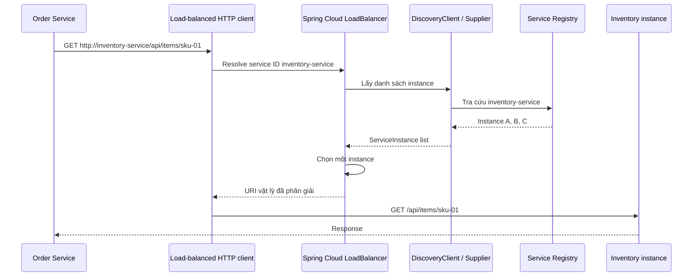

# Tên dịch vụ logic và địa chỉ mạng vật lý

## 1. Vì sao cần tách tên dịch vụ khỏi địa chỉ máy?

Trong hệ thống phân tán, một service thường có nhiều instance chạy trên các máy, container hoặc pod khác nhau. Mỗi instance có địa chỉ mạng riêng, chẳng hạn host và port. Khi triển khai lại, mở rộng số replica, chuyển vùng hoặc thay đổi hạ tầng, các địa chỉ đó có thể thay đổi.

Nếu mã nguồn của consumer gọi thẳng một địa chỉ như `http://10.24.8.21:8081`, ứng dụng đã gắn với một instance vật lý cụ thể. Khi instance bị thay thế hoặc chuyển sang node khác, consumer phải được cập nhật cấu hình tương ứng. Nếu nhiều consumer cùng giữ danh sách địa chỉ, việc đồng bộ và loại bỏ instance lỗi sẽ trở thành trách nhiệm của từng ứng dụng.

Spring Cloud đưa vào một lớp định danh ổn định hơn: **tên dịch vụ logic (logical service name/service ID)**. Consumer gọi theo tên dịch vụ, ví dụ `inventory-service`. Cơ chế service discovery và client-side load balancing tìm danh sách instance hiện có, chọn một instance, rồi chuyển lời gọi thành địa chỉ mạng vật lý phù hợp.

Bài học thuộc chương **Gọi dịch vụ** của **SPRING_CLOUD_CORE**. Mục tiêu là phân biệt service ID với hostname/IP/port, hiểu vai trò của DiscoveryClient và Spring Cloud LoadBalancer, và biết khi nào một URL là tên dịch vụ logic hoặc địa chỉ vật lý.

## 2. Tên dịch vụ logic và địa chỉ vật lý

Hai loại định danh giải quyết hai câu hỏi khác nhau:

- **Tên dịch vụ logic** trả lời: consumer muốn gọi chức năng của service nào?
- **Địa chỉ vật lý** trả lời: request cần được gửi tới host, port và scheme nào ngay lúc này?

Ví dụ một service quản lý kho có ba instance:

| Định danh | Giá trị ví dụ | Ý nghĩa |
| --- | --- | --- |
| Service ID | `inventory-service` | Tên logic để consumer yêu cầu dịch vụ kho |
| Instance A | `http://10.24.8.21:8081` | Địa chỉ mạng hiện tại của một instance |
| Instance B | `http://10.24.8.22:8081` | Địa chỉ mạng hiện tại của instance thứ hai |
| Instance C | `https://inventory-3.internal:8443` | Địa chỉ mạng và scheme của instance thứ ba |

Consumer nên phụ thuộc vào `inventory-service`. Hệ thống discovery duy trì ánh xạ từ service ID đến các instance đang có thể sử dụng. Load balancer chọn một instance từ danh sách đó cho mỗi request.

Một service ID không nhất thiết là hostname DNS có bản ghi A/AAAA. Khi dùng Spring Cloud LoadBalancer, URI như `http://inventory-service/api/items` sử dụng phần host `inventory-service` như một **virtual host/service name**. Client được đánh dấu `@LoadBalanced` sẽ chuyển tên này qua cơ chế chọn instance trước khi gửi request.

Ngược lại, URI `http://10.24.8.21:8081/api/items` đã chứa host và port vật lý. Không cần service discovery để tìm instance nếu client gửi trực tiếp tới URL đó, nhưng consumer sẽ tự chịu trách nhiệm cập nhật địa chỉ khi hạ tầng thay đổi.

## 3. Một lời gọi dịch vụ được phân giải như thế nào?

Với một HTTP client đã tích hợp Spring Cloud LoadBalancer, quy trình cơ bản gồm:

1. Consumer tạo request với URI có service ID, ví dụ `http://inventory-service/api/items/sku-01`.
2. Load-balancer interceptor hoặc exchange filter nhận biết request cần cân bằng tải.
3. Spring Cloud LoadBalancer lấy danh sách instance của service ID từ `ServiceInstanceListSupplier`.
4. Supplier thường lấy dữ liệu từ một `DiscoveryClient` đang có trên classpath hoặc từ cấu hình tĩnh của `SimpleDiscoveryClient`.
5. Load balancer chọn một `ServiceInstance` phù hợp.
6. Client thay virtual host bằng URI vật lý của instance được chọn, giữ lại path, query và các thành phần request cần thiết.
7. HTTP client gửi request tới địa chỉ host/port đã chọn.



Tên dịch vụ logic không tự thực hiện kết nối mạng. Nó cần một thành phần hiểu cách ánh xạ service ID thành instance. Nếu dùng HTTP client bình thường không có load-balancer integration, hostname trong URI sẽ được resolver thông thường xử lý như hostname DNS.

## 4. Vai trò của các abstraction trong Spring Cloud

Spring Cloud Commons định nghĩa các abstraction để consumer không phải phụ thuộc trực tiếp vào một nhà cung cấp registry cụ thể.

| Abstraction | Trách nhiệm |
| --- | --- |
| `DiscoveryClient` | Tra cứu các service và các instance của một service ID |
| `ServiceInstance` | Mô tả một instance, gồm service ID, host, port, URI, trạng thái secure và metadata |
| `ServiceRegistry` | Đăng ký hoặc hủy đăng ký một instance với registry |
| `Registration` | Mô tả thông tin instance cần đăng ký |
| `ServiceInstanceListSupplier` | Cung cấp danh sách instance cho LoadBalancer |
| `ReactiveLoadBalancer` | Chọn instance theo chiến lược cân bằng tải reactive |
| `BlockingLoadBalancerClient` | Tích hợp chọn instance cho các client blocking như RestTemplate và RestClient |

Các implementation discovery có thể đến từ Eureka, Consul, Zookeeper hoặc nhà cung cấp khác. Consumer dùng abstraction chung; provider cụ thể chịu trách nhiệm giao tiếp với registry tương ứng.

Với các Spring Cloud hiện hành, chỉ cần có implementation `DiscoveryClient` phù hợp trên classpath là có thể kích hoạt discovery/auto-registration; annotation `@EnableDiscoveryClient` không còn bắt buộc trong trường hợp thông thường. Hành vi tự đăng ký và thuộc tính đăng ký vẫn phụ thuộc implementation và cấu hình của registry.

## 5. Dùng service ID với RestClient

`RestClient` là HTTP client blocking của Spring Framework. Để gọi service bằng tên logic, tạo một `RestClient.Builder` được đánh dấu `@LoadBalanced`. Ứng dụng cũng cần Spring Cloud LoadBalancer trên classpath.

Ví dụ cấu hình:

```java
import org.springframework.cloud.client.loadbalancer.LoadBalanced;
import org.springframework.context.annotation.Bean;
import org.springframework.context.annotation.Configuration;
import org.springframework.web.client.RestClient;

@Configuration(proxyBeanMethods = false)
public class HttpClientConfiguration {

    @Bean
    @LoadBalanced
    RestClient.Builder loadBalancedRestClientBuilder() {
        return RestClient.builder();
    }
}
```

Consumer inject builder có qualifier tương ứng rồi gọi bằng service ID:

```java
import org.springframework.cloud.client.loadbalancer.LoadBalanced;
import org.springframework.stereotype.Component;
import org.springframework.web.client.RestClient;

record Item(String sku, int availableQuantity) {
}

@Component
public class InventoryClient {

    private final RestClient restClient;

    public InventoryClient(
            @LoadBalanced RestClient.Builder builder) {
        this.restClient = builder.build();
    }

    public Item findItem(String sku) {
        return restClient.get()
                .uri("http://inventory-service/api/items/{sku}", sku)
                .retrieve()
                .body(Item.class);
    }
}
```

Trong ví dụ, `inventory-service` là tên dịch vụ logic. Consumer không cần biết instance đang nằm ở host nào hoặc port nào. Khi LoadBalancer chọn instance, request được gửi đến URI vật lý tương ứng.

Nếu ứng dụng có nhiều `RestClient.Builder` cùng kiểu, dùng qualifier `@LoadBalanced` để phân biệt builder load-balanced với builder thông thường. Có thể khai báo builder thường riêng và đánh dấu nó bằng `@Primary` nếu muốn nó được inject mặc định ở các điểm không chỉ rõ qualifier.

Dependency cho LoadBalancer nên được quản lý qua Spring Cloud BOM tương thích:

```xml
<dependency>
    <groupId>org.springframework.cloud</groupId>
    <artifactId>spring-cloud-starter-loadbalancer</artifactId>
</dependency>
```

Nếu dùng Eureka/Consul/Zookeeper, bổ sung starter discovery tương ứng. Nếu không có registry-backed DiscoveryClient, Spring Cloud Commons có thể dùng `SimpleDiscoveryClient` với danh sách instance cấu hình tĩnh.

## 6. Các HTTP client khác cũng có thể dùng service ID

Spring Cloud Commons cung cấp tích hợp cho nhiều client. Điểm chung là request phải đi qua client được cấu hình với LoadBalancer.

### 6.1. RestTemplate

```java
import org.springframework.cloud.client.loadbalancer.LoadBalanced;
import org.springframework.context.annotation.Bean;
import org.springframework.context.annotation.Configuration;
import org.springframework.web.client.RestTemplate;

@Configuration(proxyBeanMethods = false)
public class LegacyHttpClientConfiguration {

    @Bean
    @LoadBalanced
    RestTemplate loadBalancedRestTemplate() {
        return new RestTemplate();
    }
}
```

Sử dụng:

```java
import org.springframework.cloud.client.loadbalancer.LoadBalanced;
import org.springframework.stereotype.Component;
import org.springframework.web.client.RestTemplate;

@Component
public class LegacyInventoryClient {

    private final RestTemplate restTemplate;

    public LegacyInventoryClient(@LoadBalanced RestTemplate restTemplate) {
        this.restTemplate = restTemplate;
    }

    public String getItems() {
        return restTemplate.getForObject(
                "http://inventory-service/api/items",
                String.class
        );
    }
}
```

`RestTemplate` không còn được tạo tự động bởi Spring Boot theo cách cũ; ứng dụng cần khai báo bean nếu muốn inject nó. Khi có cả RestTemplate thường và load-balanced, dùng `@Primary` hoặc qualifier để tránh inject nhầm.

### 6.2. WebClient

Với WebFlux, có thể tạo `WebClient.Builder` load-balanced:

```java
import org.springframework.cloud.client.loadbalancer.LoadBalanced;
import org.springframework.context.annotation.Bean;
import org.springframework.context.annotation.Configuration;
import org.springframework.web.reactive.function.client.WebClient;

@Configuration(proxyBeanMethods = false)
public class ReactiveHttpClientConfiguration {

    @Bean
    @LoadBalanced
    WebClient.Builder loadBalancedWebClientBuilder() {
        return WebClient.builder();
    }
}
```

Consumer gọi tên dịch vụ logic:

```java
import org.springframework.cloud.client.loadbalancer.LoadBalanced;
import org.springframework.stereotype.Component;
import org.springframework.web.reactive.function.client.WebClient;
import reactor.core.publisher.Mono;

@Component
public class ReactiveInventoryClient {

    private final WebClient webClient;

    public ReactiveInventoryClient(
            @LoadBalanced WebClient.Builder builder) {
        this.webClient = builder.build();
    }

    public Mono<Item> findItem(String sku) {
        return webClient.get()
                .uri("http://inventory-service/api/items/{sku}", sku)
                .retrieve()
                .bodyToMono(Item.class);
    }
}
```

Tích hợp reactive sử dụng `ReactiveLoadBalancer`. Cần có dependency Spring Cloud LoadBalancer và Spring WebFlux phù hợp.

### 6.3. Client thường và client load-balanced là hai lựa chọn riêng

Một ứng dụng có thể cần cả hai loại client:

| Client | Ví dụ URI | Cách xử lý |
| --- | --- | --- |
| Client thường | `https://partner.example.com/v1` | DNS/HTTP client thông thường phân giải hostname |
| Client load-balanced | `http://inventory-service/api/items` | Spring Cloud LoadBalancer phân giải service ID |
| Client gọi trực tiếp instance | `http://10.24.8.21:8081/api/items` | Gửi tới địa chỉ vật lý đã cấu hình |

Không nên đánh dấu mọi HTTP client là load-balanced một cách mặc định. Chỉ client được thiết kế để gọi service nội bộ qua service ID mới cần tích hợp này.

## 7. SimpleDiscoveryClient: dùng danh sách instance tĩnh

Nếu không có Service Registry-backed DiscoveryClient trên classpath, Spring Cloud Commons có thể dùng `SimpleDiscoveryClient`. Các instance được khai báo trong cấu hình theo service ID.

Ví dụ có hai instance của `inventory-service`:

```yaml
spring:
  cloud:
    discovery:
      client:
        simple:
          instances:
            inventory-service:
              - uri: http://inventory-1.internal:8081
              - uri: http://inventory-2.internal:8081
```

Đây là cách ánh xạ service ID sang danh sách URI vật lý mà không cần một registry bên ngoài. LoadBalancer vẫn có thể chọn một instance trong danh sách.

Cấu hình tĩnh hữu ích cho môi trường phát triển, kiểm thử, hệ thống nhỏ hoặc topology ít thay đổi. Khi instance được thêm, xóa hoặc đổi địa chỉ, danh sách cấu hình phải được cập nhật và nạp lại theo quy trình triển khai. Nó không tự phát hiện instance mới như registry động.

Trong tài liệu Spring Cloud Commons, dạng property tương đương là:

```properties
spring.cloud.discovery.client.simple.instances.inventory-service[0].uri=http://inventory-1.internal:8081
spring.cloud.discovery.client.simple.instances.inventory-service[1].uri=http://inventory-2.internal:8081
```

Tên `inventory-service` là service ID; `[0]` và `[1]` là chỉ số các instance; `uri` là địa chỉ vật lý thực tế.

## 8. Discovery động và registry

Trong môi trường production, registry thường lưu nhiều instance của cùng một service. Khi service khởi động, discovery implementation có thể đăng ký instance; khi instance dừng hoặc bị deregister, registry cập nhật danh sách có thể truy vấn.

Ví dụ minh họa:

| Service ID | Instance ID | Host | Port | Trạng thái |
| --- | --- | --- | --- | --- |
| `inventory-service` | `inventory-a` | `10.24.8.21` | `8081` | UP |
| `inventory-service` | `inventory-b` | `10.24.8.22` | `8081` | UP |
| `inventory-service` | `inventory-c` | `10.24.9.14` | `8081` | OUT_OF_SERVICE |

Consumer yêu cầu `inventory-service`. Discovery client trả các instance phù hợp; supplier/load balancer tiếp tục chọn một địa chỉ. Việc một instance có được coi là healthy hay không phụ thuộc registry, discovery implementation, metadata và cấu hình supplier/health-check.

Service Registry và LoadBalancer có trách nhiệm khác nhau:

- Registry giữ thông tin đăng ký và trạng thái instance.
- DiscoveryClient đọc danh sách instance từ registry.
- LoadBalancer chọn một instance trong danh sách mà supplier cung cấp.
- HTTP client gửi request tới địa chỉ vật lý được chọn.

Không nên coi registry là HTTP proxy. Trong mô hình client-side load balancing, consumer thường trực tiếp kết nối tới instance được chọn.

## 9. Tên dịch vụ logic khác với DNS service discovery

Hai cơ chế có thể cùng dùng một tên dễ nhớ nhưng hoạt động ở các lớp khác nhau.

| Tiêu chí | Spring Cloud service ID | DNS service discovery |
| --- | --- | --- |
| Thành phần phân giải | DiscoveryClient + LoadBalancer | DNS resolver của hệ điều hành/JVM hoặc DNS client |
| Dữ liệu đích | Danh sách `ServiceInstance` | Bản ghi DNS như A, AAAA, CNAME hoặc SRV tùy môi trường |
| Lựa chọn instance | LoadBalancer phía client | DNS resolver, network hoặc hạ tầng phụ thuộc cơ chế triển khai |
| Tích hợp HTTP client | Cần client/filter được đánh dấu load-balanced | Client bình thường có thể dùng hostname DNS |
| Thông tin metadata | Có thể có instance ID, zone, secure flag, metadata | DNS record thường không cung cấp metadata Spring `ServiceInstance` tương đương |
| Cập nhật địa chỉ | Theo registry/supplier/cache của LoadBalancer | Theo DNS record, TTL và cache của resolver |

Ví dụ, trong Kubernetes, một Service DNS name có thể trỏ tới ClusterIP ổn định; kube-proxy hoặc data plane của cluster chuyển tiếp traffic đến pod. Đó là cơ chế DNS + virtual IP của nền tảng. Khi dùng Spring Cloud LoadBalancer, service ID lại được phân giải thông qua DiscoveryClient/Supplier và client chọn instance.

Tên service có thể trùng nhau giữa hai cơ chế, nhưng không được giả định rằng `@LoadBalanced` tự động gọi DNS hoặc DNS tự động cung cấp `ServiceInstance` cho Spring Cloud.

## 10. Khi nào dùng tên logic, khi nào dùng địa chỉ vật lý?

Ưu tiên tên logic khi:

- Một service có nhiều instance.
- Địa chỉ instance thay đổi theo scale, rollout hoặc scheduling.
- Consumer cần lựa chọn instance ở phía client.
- Cần áp dụng chiến lược load balancing, zone preference hoặc metadata.
- Muốn tách cấu hình consumer khỏi chi tiết triển khai của provider.

Dùng địa chỉ vật lý khi:

- Tích hợp với endpoint bên ngoài có địa chỉ cố định hoặc DNS công khai.
- Một kết nối quản trị/diagnostic cần nhắm tới một node cụ thể.
- Hệ thống có topology cố định và không dùng discovery/load balancing.
- Nền tảng đã cung cấp một virtual IP hoặc reverse proxy làm điểm vào ổn định.

Nếu dùng địa chỉ vật lý trong cấu hình, hãy quản lý nó qua externalized configuration thay vì hard-code trong business code. Nếu service ID được sử dụng, bảo đảm client thật sự có LoadBalancer integration và có nguồn instance.

## 11. Những điều cần kiểm tra khi service ID không được phân giải

Một lỗi thường gặp là consumer gọi:

```text
http://inventory-service/api/items
```

nhưng nhận lỗi không thể resolve hostname `inventory-service`. Hãy kiểm tra theo thứ tự:

1. HTTP client có được tạo từ bean `@LoadBalanced` hay có exchange filter LoadBalancer không?
2. Dependency `spring-cloud-starter-loadbalancer` có trên runtime classpath không?
3. Có DiscoveryClient implementation hoặc SimpleDiscoveryClient instance config không?
4. Service ID trong URI có trùng với ID được đăng ký/cấu hình không?
5. DiscoveryClient có trả danh sách instance không?
6. Instance URI có host, port và scheme hợp lệ không?
7. Có cache instance cũ hoặc registry chưa cập nhật trạng thái không?
8. Network policy, firewall, route và TLS có cho phép kết nối tới địa chỉ vật lý không?

Nếu dùng client thường, `inventory-service` sẽ được resolver thông thường xử lý như hostname. Chỉ đổi chuỗi URL thành service ID không tự kích hoạt Spring Cloud LoadBalancer.

## 12. Quan sát và kiểm thử

Để xác nhận ánh xạ logical-to-physical hoạt động, không chỉ kiểm tra response cuối. Cần quan sát cả service ID, danh sách instance và địa chỉ đã chọn.

Các bài kiểm tra nên có:

- **Binding/Discovery test:** `DiscoveryClient.getInstances("inventory-service")` trả danh sách instance đúng như mong đợi.
- **LoadBalancer test:** với danh sách nhiều instance, request được phân phối theo chiến lược đã cấu hình.
- **Physical URI test:** request giữ đúng path/query sau khi service ID được thay bằng host/port.
- **Instance removal test:** khi một instance bị deregister hoặc đánh dấu không khả dụng, các request tiếp theo không tiếp tục chọn nó sau khi supplier/cache cập nhật.
- **No-instance test:** khi danh sách rỗng, client xử lý lỗi rõ ràng và không tự đoán địa chỉ.
- **Network test:** từ consumer container/pod, kết nối tới địa chỉ vật lý được registry công bố thực sự thành công.
- **TLS test:** scheme và certificate của instance secure phù hợp với cấu hình client.

Spring Cloud LoadBalancer có cache danh sách instance. Tài liệu hiện hành mặc định TTL cache là 35 giây và capacity là 256; có thể điều chỉnh bằng `spring.cloud.loadbalancer.cache.ttl` và `spring.cloud.loadbalancer.cache.capacity`. Nếu DiscoveryClient đã cache dữ liệu, cần xem xét tránh double caching hoặc đặt TTL phù hợp với yêu cầu cập nhật topology.

Không nên log toàn bộ header hoặc payload có thông tin nhạy cảm chỉ để xác định instance. Có thể thêm correlation ID và instance ID/metadata không nhạy cảm vào log hoặc metric để hỗ trợ truy vết.

## 13. Các lỗi thiết kế thường gặp

| Lỗi | Hậu quả | Cách xử lý |
| --- | --- | --- |
| Hard-code IP của một instance trong business code | Consumer gắn với một node và dễ hỏng khi triển khai thay đổi | Dùng service ID và LoadBalancer nếu service có nhiều instance |
| Dùng service ID với HTTP client thường | Resolver cố tìm hostname DNS, không đi qua DiscoveryClient | Đánh dấu builder/client bằng `@LoadBalanced` hoặc thêm filter phù hợp |
| Có LoadBalancer nhưng không có instance source | Không thể ánh xạ service ID sang URI vật lý | Cấu hình registry-backed DiscoveryClient hoặc SimpleDiscoveryClient |
| Nhầm DNS name với service ID | Debug sai tầng phân giải | Xác định client đang dùng DNS hay Spring Cloud LoadBalancer |
| Tưởng Service Registry trực tiếp proxy request | Hiểu sai đường đi dữ liệu và network policy | Consumer nhận instance rồi gọi trực tiếp instance |
| Cấu hình SimpleDiscoveryClient nhưng không cập nhật danh sách | Consumer tiếp tục dùng URI cũ | Quản lý danh sách tĩnh cùng quy trình triển khai |
| Dùng nhiều HTTP client nhưng inject nhầm bean | Request đi qua client không load-balanced | Dùng `@LoadBalanced`, `@Primary` và qualifier rõ ràng |
| Registry trả địa chỉ không thể truy cập từ consumer | Discovery thành công nhưng kết nối thất bại | Kiểm tra advertised host/port, network route, firewall và TLS |

## 14. Quy trình thiết kế lời gọi service

1. Xác định service ID ổn định cho provider, ví dụ `inventory-service`.
2. Xác định nguồn cung cấp instance: Eureka, Consul, Zookeeper, SimpleDiscoveryClient hoặc discovery provider khác.
3. Đảm bảo provider đăng ký host/port có thể truy cập từ consumer.
4. Thêm Spring Cloud LoadBalancer vào consumer nếu muốn client-side load balancing.
5. Tạo HTTP client có `@LoadBalanced` hoặc filter tương ứng.
6. Gọi bằng URI có service ID và path nghiệp vụ.
7. Cấu hình timeout, retry, TLS và observability ở HTTP client/LoadBalancer phù hợp.
8. Kiểm tra danh sách instance, URI được chọn và trạng thái registry trong môi trường tích hợp.
9. Kiểm thử khi scale up/down, instance lỗi và registry tạm thời không khả dụng.

## 15. Câu hỏi tự kiểm tra

1. Service ID khác hostname/IP của instance như thế nào?
2. Vì sao `http://inventory-service/...` có thể hoạt động với `@LoadBalanced RestClient.Builder` nhưng thất bại với RestClient thông thường?
3. `DiscoveryClient` và `ServiceInstanceListSupplier` đảm nhiệm những phần nào trong quá trình phân giải?
4. `ServiceRegistry` khác `DiscoveryClient` ở trách nhiệm nào?
5. `SimpleDiscoveryClient` lấy URI instance từ đâu?
6. Vì sao client-side load balancing khiến consumer kết nối trực tiếp đến instance thay vì đi qua registry?
7. DNS service discovery và Spring Cloud service ID khác nhau ở lớp phân giải nào?
8. Khi registry trả về địa chỉ vật lý không thể truy cập, cần kiểm tra những gì?
9. Vì sao cache instance có thể khiến thay đổi topology chưa được nhìn thấy ngay?
10. Khi nào nên dùng URL vật lý hoặc DNS name thay cho service ID?

## 16. Tài liệu tham khảo chính thức

- [Spring Cloud Commons — Common Abstractions](https://docs.spring.io/spring-cloud-commons/reference/spring-cloud-commons/common-abstractions.html) — `DiscoveryClient`, `ServiceRegistry`, `SimpleDiscoveryClient` và tích hợp load-balanced `RestTemplate`, `RestClient`, `WebClient`.
- [Spring Cloud LoadBalancer](https://docs.spring.io/spring-cloud-commons/reference/spring-cloud-commons/loadbalancer.html) — `ServiceInstanceListSupplier`, thuật toán chọn instance, cache, health-check và tích hợp HTTP client.
- [Spring Cloud Commons — Configuration Properties](https://docs.spring.io/spring-cloud-commons/reference/configprops.html) — các thuộc tính discovery và LoadBalancer.
- [Spring Framework — REST Clients](https://docs.spring.io/spring-framework/reference/integration/rest-clients.html) — API `RestClient` và `RestTemplate`.
- [Spring WebFlux — WebClient](https://docs.spring.io/spring-framework/reference/web/webflux-webclient.html) — client HTTP reactive.

*Tài liệu tập trung vào ranh giới giữa định danh logic và định tuyến tới instance vật lý. Tên service chỉ được LoadBalancer hiểu khi request đi qua client đã tích hợp; luôn xác nhận danh sách instance và địa chỉ quảng bá từ góc nhìn mạng của consumer.*
