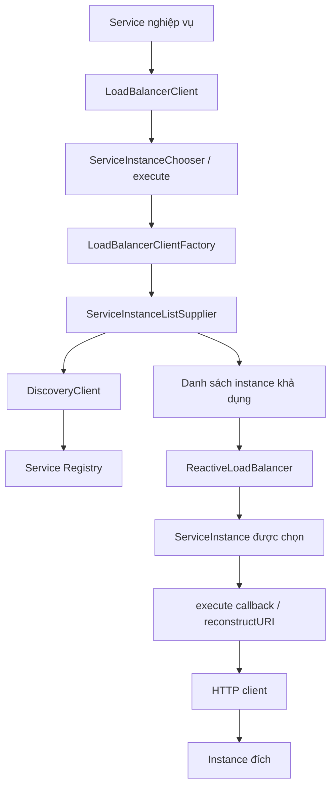

# Vai trò LoadBalancerClient trong hợp đồng gọi dịch vụ

Trong hệ thống microservices, mã gọi dịch vụ thường biết tên logic như inventory-service, payment-service hoặc catalog-service. Nó không nên phải giữ danh sách IP và port của từng replica, vì các instance có thể được thêm, gỡ, chuyển vùng hoặc thay địa chỉ trong lúc ứng dụng hoạt động.

Spring Cloud Commons định nghĩa hợp đồng **LoadBalancerClient** để ứng dụng yêu cầu chọn một **ServiceInstance** cho service ID, thực thi lời gọi trên instance đã chọn hoặc chuyển một URI logic thành địa chỉ vật lý. Hợp đồng này tách cách ứng dụng gọi dịch vụ khỏi cách hệ thống tìm instance và chọn đích đến.

Bài học thuộc chương **Gọi dịch vụ** của **SPRING_CLOUD_CORE**. Trọng tâm là hiểu trách nhiệm của LoadBalancerClient, các phương thức choose, execute và reconstructURI, mối quan hệ với DiscoveryClient và ServiceInstanceListSupplier, cũng như cách tích hợp với RestTemplate, RestClient và WebClient. Bài học tập trung vào hợp đồng gọi dịch vụ ở phía client; đăng ký service, giao thức HTTP và chính sách retry được giải thích ở mức cần thiết để sử dụng đúng abstraction.

## 1. Mục tiêu học tập

Sau bài này, người học có thể:

1. Giải thích vì sao caller nên dùng service ID thay vì cố định hostname/IP của một replica.
2. Phân biệt vai trò của DiscoveryClient, ServiceInstanceListSupplier, ReactiveLoadBalancer và LoadBalancerClient.
3. Mô tả dữ liệu mà ServiceInstance cung cấp cho một lời gọi.
4. Giải thích hợp đồng của choose(serviceId) và choose(serviceId, request).
5. Phân biệt hai overload execute và biết khi nào dùng instance đã chọn.
6. Dùng reconstructURI để chuyển URI logic sang URI vật lý.
7. Phân biệt API blocking LoadBalancerClient với nhánh reactive dùng ReactiveLoadBalancer.
8. Cấu hình HTTP client load-balanced bằng annotation @LoadBalanced.
9. Xử lý trường hợp không có instance, lỗi kết nối và danh sách instance cũ.
10. Kiểm thử việc chọn instance và quan sát kết quả load balancing.

## 2. Vấn đề mà hợp đồng LoadBalancerClient giải quyết

Giả sử hệ thống có ba instance của inventory-service:

| Service ID | Instance | Host | Port |
| --- | --- | --- | --- |
| inventory-service | inventory-1 | 10.20.1.11 | 8080 |
| inventory-service | inventory-2 | 10.20.1.12 | 8080 |
| inventory-service | inventory-3 | 10.20.1.13 | 8080 |

Một service khác cần gọi API:

```http
GET http://inventory-service/api/items/42
```

inventory-service là tên logic. Nó không nhất thiết là hostname DNS có thể phân giải trực tiếp. Ở thời điểm gọi, phía client cần chọn một instance cụ thể, rồi gửi request đến host và port của instance đó.

Nếu code tự quản lý địa chỉ:

```java
String[] inventoryHosts = {
    "http://10.20.1.11:8080",
    "http://10.20.1.12:8080",
    "http://10.20.1.13:8080"
};
```

ứng dụng sẽ phải tự xử lý danh sách địa chỉ, trạng thái instance, thay đổi topology, lựa chọn replica, cache và retry. Những trách nhiệm đó làm code nghiệp vụ phụ thuộc hạ tầng triển khai.

Với hợp đồng load balancing, code nghiệp vụ chỉ cần biết service ID:

```java
URI logicalUri =
    URI.create("http://inventory-service/api/items/42");
```

Spring Cloud có thể chọn instance phù hợp và chuyển URI logic sang địa chỉ thực tế. Khi một replica bị gỡ khỏi registry hoặc có replica mới, caller không cần sửa danh sách IP trong code.

## 3. Vị trí của LoadBalancerClient trong kiến trúc

LoadBalancerClient không tự đăng ký service vào registry. Nó cũng không phải chính service registry. Hợp đồng này nằm ở phía client, giữa logic gọi dịch vụ và cơ chế chọn instance.

Các thành phần thường phối hợp như sau:

- ServiceRegistry và discovery provider quản lý đăng ký instance.
- DiscoveryClient truy vấn danh sách instance của một service ID.
- ServiceInstanceListSupplier cung cấp, cache hoặc lọc danh sách instance cho LoadBalancer.
- ReactiveLoadBalancer chọn một instance từ danh sách phù hợp.
- LoadBalancerClient cung cấp API blocking để caller chọn instance, thực thi request hoặc dựng lại URI.
- HTTP client thực hiện kết nối mạng đến instance được chọn.



Trong Spring Cloud LoadBalancer hiện đại, bộ chọn cốt lõi là ReactiveLoadBalancer. Implementation blocking BlockingLoadBalancerClient triển khai hợp đồng LoadBalancerClient và kết nối các API blocking với cơ chế lựa chọn đó. Với WebClient reactive, Spring Cloud khuyến nghị dùng ReactorLoadBalancerExchangeFilterFunction và nhánh reactive tương ứng.

### 3.1. Discovery và load balancing là hai trách nhiệm khác nhau

DiscoveryClient trả lời câu hỏi: “Những instance nào đã đăng ký cho service ID này?”

LoadBalancerClient trả lời câu hỏi: “Trong các instance mà LoadBalancer có thể sử dụng, instance nào được chọn cho lời gọi này?”

Discovery không tự quyết định mọi request phải đến replica nào. Load balancing sử dụng danh sách instance và chính sách lựa chọn để đưa ra quyết định cho từng lần gọi.

Nếu không có registry-backed DiscoveryClient, Spring Cloud có thể sử dụng SimpleDiscoveryClient với danh sách instance khai báo trong cấu hình. Nhờ vậy, contract gọi dịch vụ vẫn có thể được kiểm thử mà không cần triển khai một service registry thật.

## 4. Service ID và ServiceInstance

### 4.1. Service ID là tên logic

serviceId là định danh của service mà caller muốn gọi, ví dụ:

- inventory-service
- payment-service
- catalog-service

Service ID được dùng để tìm cấu hình và LoadBalancer tương ứng. Nó không phải địa chỉ IP, port hoặc instance ID.

Tên service phải thống nhất với tên mà discovery provider đăng ký hoặc với key được cấu hình trong SimpleDiscoveryClient. Nếu caller truyền sai service ID, LoadBalancer có thể không tìm thấy danh sách instance.

### 4.2. ServiceInstance mô tả một replica cụ thể

ServiceInstance là abstraction mô tả endpoint của một instance:

| Phương thức | Ý nghĩa |
| --- | --- |
| getInstanceId() | ID riêng của instance nếu provider cung cấp |
| getServiceId() | Service ID mà instance đăng ký |
| getHost() | Hostname hoặc địa chỉ host |
| getPort() | Port của instance |
| isSecure() | Instance sử dụng HTTPS hay không |
| getUri() | URI của instance |
| getMetadata() | Metadata dạng key/value |
| getScheme() | Scheme nếu implementation cung cấp |

Ví dụ, một instance có thể có:

```text
serviceId = inventory-service
instanceId = inventory-2
host = 10.20.1.12
port = 8080
secure = false
metadata = { zone: zone-a, version: v2 }
```

Metadata có thể được dùng bởi supplier hoặc chính sách load balancing để lọc theo zone, phiên bản API, hint hoặc trọng số. Không phải mọi chính sách đều tự động hiểu mọi key metadata; cần cấu hình supplier tương ứng.

### 4.3. ServiceInstance không phải HTTP response

ServiceInstance chỉ mô tả đích đến. Nó không chứa response của API và cũng không chứng minh instance vẫn khỏe ở đúng thời điểm gửi request. Kết nối thực tế vẫn có thể thất bại do instance vừa dừng, network partition, firewall hoặc timeout.

Vì vậy, chọn được instance và gọi thành công là hai bước khác nhau.

## 5. Hợp đồng ServiceInstanceChooser

LoadBalancerClient kế thừa ServiceInstanceChooser. Hợp đồng này cung cấp hai cách chọn instance.

### 5.1. choose(serviceId)

```java
ServiceInstance instance =
    loadBalancerClient.choose("inventory-service");
```

Phương thức chọn một ServiceInstance phù hợp với service ID. Caller nhận instance để có thể đọc host, port, metadata hoặc xây dựng request.

Nếu không có instance khả dụng, implementation có thể trả về null. Caller phải kiểm tra kết quả trước khi truy cập thuộc tính của instance.

Ví dụ:

```java
ServiceInstance instance =
    loadBalancerClient.choose("inventory-service");

if (instance == null) {
    throw new IllegalStateException(
        "No inventory-service instance is available"
    );
}

log.info("Selected instance: {}:{}",
    instance.getHost(), instance.getPort());
```

Không nên giả định choose luôn trả về một instance. Trường hợp danh sách rỗng là một trạng thái vận hành cần được xử lý rõ ràng.

### 5.2. choose(serviceId, request)

Overload thứ hai nhận thêm một đối tượng Request:

```java
ServiceInstance instance =
    loadBalancerClient.choose("inventory-service", request);
```

Request context có thể mang thông tin để bộ chọn sử dụng khi quyết định instance. Ví dụ, một ứng dụng có thể truyền hint để chọn instance theo zone hoặc metadata. Việc hint có tác dụng hay không phụ thuộc implementation và ServiceInstanceListSupplier được cấu hình.

Không phải cứ truyền request context là LoadBalancer tự hiểu mọi header hoặc business field. Cần có supplier hoặc bộ chọn hỗ trợ context đó.

## 6. Hợp đồng execute

execute là phương thức thực thi request gắn với một service ID và instance được chọn.

### 6.1. execute(serviceId, request)

Phương thức này nhận service ID và một LoadBalancerRequest<T> callback:

```java
<T> T execute(
    String serviceId,
    LoadBalancerRequest<T> request
) throws IOException;
```

Callback được gọi với instance đã chọn. Nó có thể thực hiện lời gọi HTTP, trả về dữ liệu hoặc thực hiện một thao tác khác trên instance.

Ví dụ:

```java
InventoryDto inventory = loadBalancerClient.execute(
    "inventory-service",
    instance -> {
        URI logicalUri = URI.create(
            "http://inventory-service/api/items/42"
        );

        URI targetUri =
            loadBalancerClient.reconstructURI(instance, logicalUri);

        return plainRestTemplate.getForObject(
            targetUri, InventoryDto.class
        );
    }
);
```

Ở đây, LoadBalancer chọn instance trước khi callback chạy. Callback sử dụng instance đó để dựng URI đích và thực hiện request.

Hợp đồng cho phép implementation thực hiện các hành động trước/sau request, ví dụ thu thập metrics hoặc gọi lifecycle processors. Vì vậy, execute có ý nghĩa rộng hơn một lời gọi trực tiếp đến choose rồi tự gửi HTTP ở nơi khác.

### 6.2. execute(serviceId, serviceInstance, request)

Overload thứ hai nhận một instance đã được chọn:

```java
<T> T execute(
    String serviceId,
    ServiceInstance serviceInstance,
    LoadBalancerRequest<T> request
) throws IOException;
```

Nó hữu ích khi caller đã chọn instance và muốn thực thi trên chính instance đó.

Ví dụ:

```java
ServiceInstance selected =
    loadBalancerClient.choose("inventory-service");

if (selected == null) {
    throw new IllegalStateException("No inventory instance");
}

InventoryDto inventory = loadBalancerClient.execute(
    "inventory-service",
    selected,
    instance -> {
        URI logicalUri = URI.create(
            "http://inventory-service/api/items/42"
        );
        URI targetUri =
            loadBalancerClient.reconstructURI(instance, logicalUri);

        return plainRestTemplate.getForObject(
            targetUri, InventoryDto.class
        );
    }
);
```

Cần chú ý: nếu đã chọn instance rồi mà lại gọi execute(serviceId, request), overload này có thể thực hiện một lần lựa chọn mới. Khi muốn giữ đúng instance đã chọn, hãy dùng overload có tham số ServiceInstance.

### 6.3. Callback không thay thế HTTP client

LoadBalancerRequest mô tả hành động cần thực hiện với instance. Nó không tự gửi HTTP nếu callback không sử dụng HTTP client.

Caller vẫn chịu trách nhiệm về:

- HTTP method và path.
- Request body và header.
- Serialization/deserialization.
- Timeout của HTTP client.
- Xử lý status code và exception.
- Quy tắc nghiệp vụ của request.

LoadBalancer cung cấp đích đến và vòng đời load-balanced call; HTTP client thực hiện giao tiếp mạng.

## 7. Hợp đồng reconstructURI

### 7.1. Chuyển URI logic sang URI vật lý

Trong microservices, URI ban đầu có thể chứa tên service làm host:

```text
http://inventory-service/api/items/42?include=stock
```

Sau khi chọn được instance có host 10.20.1.12 và port 8080, ứng dụng cần chuyển sang địa chỉ vật lý tương ứng.

```java
URI logicalUri = URI.create(
    "http://inventory-service/api/items/42?include=stock"
);

URI physicalUri =
    loadBalancerClient.reconstructURI(instance, logicalUri);
```

Kết quả có thể có dạng:

```text
http://10.20.1.12:8080/api/items/42?include=stock
```

reconstructURI nhận instance và URI ban đầu, sau đó tạo URI phù hợp với host/port của instance. Scheme có thể phụ thuộc thông tin bảo mật của instance và cách implementation dựng URI.

### 7.2. Vì sao không tự nối chuỗi host và port?

Không nên tạo URL bằng cách ghép chuỗi trong mọi trường hợp:

```java
String url = "http://" + instance.getHost()
    + ":" + instance.getPort() + "/api/items/42";
```

Cách ghép thủ công dễ bỏ sót scheme HTTPS, IPv6 literal, encoding hoặc các thành phần URI khác. Dùng reconstructURI giúp giữ hợp đồng chuyển URI logic sang instance vật lý tập trung trong abstraction.

### 7.3. reconstructURI không gửi request

Phương thức này chỉ dựng URI. Nó không:

- Mở socket.
- Kiểm tra port có đang lắng nghe không.
- Xác thực TLS certificate.
- Retry khi kết nối thất bại.
- Xác nhận instance vẫn tồn tại trong registry.
- Gửi request HTTP.

Sau khi có URI vật lý, caller vẫn phải dùng HTTP client để gửi request.

## 8. Ví dụ hoàn chỉnh với LoadBalancerClient

Ví dụ dưới đây dùng một HTTP client không gắn @LoadBalanced vì code đã chủ động gọi LoadBalancerClient.execute. Nhờ vậy request chỉ được chọn instance một lần.

```java
@Configuration(proxyBeanMethods = false)
class InventoryHttpConfiguration {

    @Bean
    RestTemplate plainRestTemplate() {
        return new RestTemplate();
    }
}
```

Service gọi inventory:

```java
@Service
class InventoryGateway {

    private final LoadBalancerClient loadBalancerClient;
    private final RestTemplate plainRestTemplate;

    InventoryGateway(
            LoadBalancerClient loadBalancerClient,
            RestTemplate plainRestTemplate) {
        this.loadBalancerClient = loadBalancerClient;
        this.plainRestTemplate = plainRestTemplate;
    }

    InventoryDto getItem() throws IOException {
        return loadBalancerClient.execute(
            "inventory-service",
            instance -> {
                URI logicalUri = URI.create(
                    "http://inventory-service/api/items/42"
                );

                URI targetUri =
                    loadBalancerClient.reconstructURI(
                        instance, logicalUri
                    );

                return plainRestTemplate.getForObject(
                    targetUri, InventoryDto.class
                );
            }
        );
    }
}
```

Luồng thực hiện:

1. Caller truyền service ID inventory-service.
2. LoadBalancer lấy danh sách instance có thể dùng.
3. Chính sách load balancing chọn một instance.
4. Callback nhận ServiceInstance được chọn.
5. reconstructURI tạo URI vật lý.
6. RestTemplate gửi HTTP request đến instance.
7. Kết quả hoặc exception được trả về caller.

Nếu callback gọi một HTTP client đã được đánh dấu @LoadBalanced, request có thể bị load balance thêm lần nữa. Với cách gọi thủ công này, hãy dùng HTTP client không load-balanced để tránh lựa chọn lặp ngoài ý muốn.

## 9. Tích hợp tự động qua @LoadBalanced

Trong phần lớn ứng dụng, không cần gọi trực tiếp LoadBalancerClient cho mỗi request. Spring Cloud cung cấp tích hợp với các HTTP client để caller chỉ cần sử dụng service ID trong URI.

Để dùng implementation Spring Cloud LoadBalancer, thêm starter sau vào dependency của ứng dụng và quản lý phiên bản thông qua Spring Cloud release train tương thích với Spring Boot:

```xml
<dependency>
    <groupId>org.springframework.cloud</groupId>
    <artifactId>spring-cloud-starter-loadbalancer</artifactId>
</dependency>
```

Starter cung cấp các thành phần tích hợp và auto-configuration cần thiết. Nếu ứng dụng tự cung cấp HTTP client hoặc LoadBalancer configuration, hãy xác nhận bean tương ứng có mặt trong ApplicationContext.

### 9.1. RestTemplate

Đăng ký bean:

```java
@Configuration(proxyBeanMethods = false)
class HttpClientConfiguration {

    @Bean
    @LoadBalanced
    RestTemplate loadBalancedRestTemplate() {
        return new RestTemplate();
    }
}
```

Sử dụng:

```java
@Service
class InventoryGateway {

    private final RestTemplate restTemplate;

    InventoryGateway(
            @LoadBalanced RestTemplate restTemplate) {
        this.restTemplate = restTemplate;
    }

    InventoryDto getItem() {
        return restTemplate.getForObject(
            "http://inventory-service/api/items/42",
            InventoryDto.class
        );
    }
}
```

@LoadBalanced là qualifier đánh dấu bean HTTP client cần được cấu hình để sử dụng load balancing. Interceptor sẽ xử lý host logic trong URI và chuyển request đến instance cụ thể.

Spring Boot không tự tạo sẵn bean RestTemplate theo cách nhiều ví dụ cũ từng giả định; ứng dụng cần khai báo bean phù hợp. Nếu đồng thời có RestTemplate thường và RestTemplate load-balanced, hãy phân biệt chúng bằng qualifier hoặc @Primary để injection không mơ hồ.

### 9.2. RestClient

Với Spring Framework RestClient, có thể đánh dấu builder:

```java
@Configuration(proxyBeanMethods = false)
class RestClientConfiguration {

    @Bean
    @LoadBalanced
    RestClient.Builder loadBalancedRestClientBuilder() {
        return RestClient.builder();
    }
}
```

Sử dụng:

```java
@Service
class InventoryGateway {

    private final RestClient restClient;

    InventoryGateway(
            @LoadBalanced RestClient.Builder builder) {
        this.restClient = builder.build();
    }

    InventoryDto getItem() {
        return restClient.get()
            .uri("http://inventory-service/api/items/42")
            .retrieve()
            .body(InventoryDto.class);
    }
}
```

Trong ứng dụng thực tế, có thể dùng builder customizer/configurer của Spring Boot để giữ các thiết lập observability, message converter hoặc request factory mà ứng dụng cần.

### 9.3. WebClient reactive

Với WebClient, Spring Cloud cung cấp nhánh reactive. Đánh dấu builder:

```java
@Configuration(proxyBeanMethods = false)
class WebClientConfiguration {

    @Bean
    @LoadBalanced
    WebClient.Builder loadBalancedWebClientBuilder() {
        return WebClient.builder();
    }
}
```

Sử dụng:

```java
@Service
class InventoryReactiveGateway {

    private final WebClient webClient;

    InventoryReactiveGateway(
            @LoadBalanced WebClient.Builder builder) {
        this.webClient = builder.build();
    }

    Mono<InventoryDto> getItem() {
        return webClient.get()
            .uri("http://inventory-service/api/items/42")
            .retrieve()
            .bodyToMono(InventoryDto.class);
    }
}
```

Với starter Spring Cloud LoadBalancer và Spring WebFlux trên classpath, tích hợp reactive có thể dùng ReactorLoadBalancerExchangeFilterFunction. Nhánh này sử dụng ReactiveLoadBalancer thay vì gọi blocking LoadBalancerClient trực tiếp.

### 9.4. Khi nào dùng API nào?

| Nhu cầu | Cách tiếp cận |
| --- | --- |
| Gọi HTTP blocking thông thường | @LoadBalanced RestTemplate hoặc RestClient.Builder |
| Gọi HTTP reactive | @LoadBalanced WebClient.Builder |
| Tự chọn instance và thực hiện callback blocking | LoadBalancerClient.choose/execute |
| Chỉ cần dựng URI từ instance đã có | LoadBalancerClient.reconstructURI |
| Tùy biến lựa chọn theo request context | choose(serviceId, request) hoặc cấu hình supplier tương ứng |
| Tùy biến chiến lược cho một service ID | @LoadBalancerClient hoặc @LoadBalancerClients |

Không nên chuyển một luồng reactive sang blocking chỉ để dùng LoadBalancerClient. Hãy giữ đúng mô hình thực thi của HTTP client và framework đang sử dụng.

## 10. Spring Cloud LoadBalancer phía sau hợp đồng

### 10.1. ReactiveLoadBalancer

ReactiveLoadBalancer là abstraction chọn một server từ danh sách instance. Spring Cloud cung cấp các implementation như:

- RoundRobinLoadBalancer: chọn lần lượt qua các instance.
- RandomLoadBalancer: chọn ngẫu nhiên từ danh sách ứng viên.

Round-robin không có nghĩa mọi instance luôn nhận số request bằng nhau trong mọi khoảng thời gian. Sự khác nhau về thời gian request, cache, số lượng instance và lỗi kết nối có thể làm tải thực tế không đồng đều.

### 10.2. ServiceInstanceListSupplier

ServiceInstanceListSupplier cung cấp danh sách instance cho LoadBalancer. Supplier có thể lấy dữ liệu từ blocking hoặc reactive DiscoveryClient, sau đó áp dụng cache, health check, zone preference, hint, sticky session hoặc API version filtering.

Một chuỗi xử lý khái quát:


LoadBalancer chỉ có thể chọn trong danh sách mà supplier cung cấp. Nếu registry còn giữ instance cũ hoặc cache chưa được cập nhật, caller có thể chọn một instance đã dừng.

### 10.3. Context riêng theo service ID

Spring Cloud LoadBalancer tạo child context riêng cho từng service ID. Mặc định, các context này được khởi tạo lazy khi service ID lần đầu được load balance. Ứng dụng có thể cấu hình eager loading cho những client quan trọng để tránh chi phí khởi tạo ở request đầu tiên.

Điều này cũng cho phép cấu hình strategy và supplier riêng theo từng service, ví dụ payment-service có thể có policy khác inventory-service.

## 11. Cấu hình danh sách instance khi không có registry

Trong môi trường phát triển hoặc test, có thể sử dụng SimpleDiscoveryClient bằng cấu hình:

```yaml
spring:
  cloud:
    discovery:
      client:
        simple:
          instances:
            inventory-service:
              - uri: http://localhost:8081
                metadata:
                  zone: zone-a
              - uri: http://localhost:8082
                metadata:
                  zone: zone-b
```

Mỗi phần tử là một instance của service ID inventory-service. LoadBalancer có thể lấy danh sách này thông qua supplier dựa trên DiscoveryClient.

Cách cấu hình này hữu ích để:

- Kiểm thử logic chọn instance mà không cần Eureka/Consul.
- Chạy local nhiều service instance trên các port khác nhau.
- Kiểm tra việc chuyển URI logic sang host/port thực.
- Kiểm tra hành vi khi một service ID không có instance.

Đây là nguồn instance tĩnh theo cấu hình, không tự phản ánh health của process như một registry động.

## 12. Tùy biến LoadBalancer theo service ID

Nếu một service cần chính sách riêng, có thể dùng @LoadBalancerClient:

```java
@Configuration(proxyBeanMethods = false)
@LoadBalancerClient(
    name = "inventory-service",
    configuration = InventoryLoadBalancerConfiguration.class
)
class InventoryClientConfiguration {
}
```

Cấu hình riêng có thể cung cấp ServiceInstanceListSupplier hoặc ReactorLoadBalancer tùy nhu cầu. Ví dụ, service có thể ưu tiên instance cùng zone hoặc sử dụng chiến lược chọn khác.

Một cấu hình custom dùng trong @LoadBalancerClient nên được đặt ngoài phạm vi component scan thông thường hoặc không đánh dấu @Configuration theo cách khiến nó bị đăng ký nhầm vào context chính. Điều này giúp tránh bean tùy biến cho một service ID tác động đến tất cả service.

Không nên tùy biến thuật toán nếu round-robin mặc định đã đáp ứng yêu cầu. Hãy bắt đầu từ vấn đề vận hành có thể đo được, như phân vùng zone, health filtering, phiên bản API hoặc sticky session.

## 13. Xử lý khi không có instance

Không có instance là một tình huống khác với việc chọn được instance nhưng kết nối thất bại.

| Tình huống | Điều có thể xảy ra | Hướng xử lý |
| --- | --- | --- |
| Service ID sai | Supplier không tìm thấy danh sách | Kiểm tra service ID và registration |
| Chưa có instance đăng ký | Danh sách rỗng | Kiểm tra service startup và registry |
| Tất cả instance bị filter | Supplier trả về danh sách rỗng | Kiểm tra zone, hint, API version và health filter |
| Cache chưa cập nhật | Instance cũ có thể còn trong danh sách | Kiểm tra TTL, eviction và discovery refresh |
| Instance được chọn nhưng đã dừng | HTTP client gặp connection error/timeout | Dùng timeout, retry có kiểm soát và cập nhật health |
| LoadBalancer bị disable | Không có cơ chế load balancing được cấu hình | Kiểm tra dependency và spring.cloud.loadbalancer.enabled |

Với blocking implementation, choose có thể trả về null nếu không có instance. execute của implementation chuẩn thường ném IllegalStateException khi không tìm thấy instance cho service ID. Caller nên xử lý lỗi ở ranh giới gọi dịch vụ và ghi rõ service ID trong log.

Không nên trả về một giá trị nghiệp vụ giả chỉ vì không tìm được instance. Hãy chuyển lỗi thành response hoặc exception phù hợp với hợp đồng API của service gọi.

## 14. Retry không thuộc trách nhiệm duy nhất của choose

Chọn được một instance không đồng nghĩa request sẽ tự động được retry nếu kết nối thất bại. Retry là một cơ chế riêng có cấu hình và chính sách riêng.

Spring Cloud LoadBalancer có thể tích hợp retry cho các HTTP client load-balanced. Cách bật và các thuộc tính retry phụ thuộc blocking/reactive client, dependency và release train. Hãy kiểm tra tài liệu phiên bản đang sử dụng trước khi bật retry.

Khi thiết kế retry, cần cân nhắc:

- Chỉ retry các lỗi có khả năng tạm thời.
- Giới hạn số lần thử và tổng thời gian.
- Dùng backoff để tránh tạo burst traffic.
- Tránh retry vô hạn khi service đang down.
- Không retry thao tác ghi không idempotent nếu chưa có idempotency key hoặc cơ chế deduplication.
- Kiểm tra retry có chọn instance khác hay tiếp tục gọi instance cũ.

Ví dụ, request tạo thanh toán có thể đã được server xử lý và commit nhưng response bị mất. Nếu client retry mà không có idempotency, một giao dịch thứ hai có thể được tạo. Load balancing không giải quyết tính đúng đắn nghiệp vụ của retry.

## 15. Lifecycle, transformer và quan sát request

### 15.1. LoadBalancerLifecycle

LoadBalancerLifecycle cung cấp các callback để quan sát vòng đời lời gọi:

- onStart: bắt đầu quá trình load balancing.
- onStartRequest: instance đã được chọn và request chuẩn bị được thực thi.
- onComplete: request hoàn tất, bị discard hoặc gặp lỗi.

Thông tin completion có thể gồm instance được chọn, trạng thái thực thi, response nếu có và exception. Các callback này hữu ích cho metrics, tracing hoặc hành vi bổ sung gắn với lời gọi.

### 15.2. Request transformer

Với RestTemplate và RestClient, có thể khai báo LoadBalancerRequestTransformer để biến đổi HTTP request dựa trên instance đã chọn. Với WebClient, có LoadBalancerClientRequestTransformer.

Ví dụ, thêm header chứa instance ID để phục vụ kiểm tra hoặc trace:

```java
@Bean
LoadBalancerRequestTransformer instanceHeaderTransformer() {
    return (request, instance) -> {
        if (instance == null) {
            return request;
        }

        return new HttpRequestWrapper(request) {
            @Override
            public HttpHeaders getHeaders() {
                HttpHeaders headers = new HttpHeaders();
                headers.putAll(super.getHeaders());
                headers.add(
                    "X-Selected-Instance",
                    instance.getInstanceId()
                );
                return headers;
            }
        };
    };
}
```

Đây là ví dụ minh họa cho HTTP client blocking. Không nên dùng header do client tự thêm làm cơ chế xác thực hoặc phân quyền; metadata instance chỉ phục vụ routing/observability theo chính sách đã định.

### 15.3. Metrics

Spring Cloud LoadBalancer có lifecycle integration cho Micrometer. Khi bật thống kê và có MeterRegistry, các meter có thể bao gồm:

| Meter | Ý nghĩa |
| --- | --- |
| loadbalancer.requests.active | Số request load-balanced đang hoạt động |
| loadbalancer.requests.success | Thời gian các request hoàn tất thành công |
| loadbalancer.requests.failed | Thời gian các request kết thúc bằng exception |
| loadbalancer.requests.discard | Số request không tìm được instance để thực thi |

Metrics có thể gắn tag theo service và instance. Nếu thêm URI path chứa ID động, cardinality có thể tăng rất nhanh. Cần cân nhắc cấu hình metrics để không tạo quá nhiều time series.

## 16. Kiểm thử hợp đồng gọi dịch vụ

Một bộ kiểm thử tốt cần kiểm tra cả lựa chọn instance và kết quả thực thi, không chỉ kiểm tra bean LoadBalancerClient có được inject.

### 16.1. Kiểm tra service ID và instance được chọn

Với SimpleDiscoveryClient, cấu hình hai instance cho inventory-service rồi gọi:

```java
ServiceInstance instance =
    loadBalancerClient.choose("inventory-service");

assertThat(instance).isNotNull();
assertThat(instance.getServiceId())
    .isEqualTo("inventory-service");
assertThat(instance.getPort())
    .isIn(8081, 8082);
```

Không nên phụ thuộc cứng vào thứ tự instance nếu test không cố ý kiểm tra round-robin. Mục tiêu của test này là xác nhận service ID được ánh xạ sang một instance hợp lệ.

### 16.2. Kiểm tra reconstructURI

```java
@Test
void reconstructsLogicalUriToSelectedInstance() {
    ServiceInstance instance = new DefaultServiceInstance(
        "inventory-1",
        "inventory-service",
        "localhost",
        8081,
        false
    );

    URI logical = URI.create(
        "http://inventory-service/api/items/42"
    );

    URI physical =
        loadBalancerClient.reconstructURI(instance, logical);

    assertThat(physical.getHost()).isEqualTo("localhost");
    assertThat(physical.getPort()).isEqualTo(8081);
    assertThat(physical.getPath()).isEqualTo("/api/items/42");
}
```

Test này xác nhận host/port được chuyển sang instance cụ thể và path vẫn được giữ.

### 16.3. Kiểm tra không có instance

Tạo một service ID không có instance rồi xác nhận:

- choose không trả về instance hợp lệ.
- Caller không dereference một giá trị null.
- Lời gọi execute xử lý lỗi theo hợp đồng đã chọn.
- Log và metric ghi rõ service ID gặp vấn đề.

### 16.4. Kiểm thử HTTP end-to-end

Một integration test có thể khởi động hai HTTP server test trên hai port, đăng ký chúng trong SimpleDiscoveryClient, sau đó gọi qua URI logic:

```text
http://inventory-service/api/items/42
```

Test xác nhận response đến từ một instance trong danh sách. Nếu muốn kiểm tra round-robin, hãy gửi nhiều request, xác nhận cả hai instance được chọn theo policy và không giả định mọi lần gọi luôn luân phiên tuyệt đối khi có retry hoặc cache/filter tham gia.

## 17. Những hiểu lầm thường gặp

**“LoadBalancerClient chính là Service Registry.”** Registry lưu trạng thái đăng ký; DiscoveryClient truy vấn instance; LoadBalancerClient chọn đích cho lời gọi phía client.

**“serviceId là hostname thật.”** service ID là tên logic để tìm danh sách instance. Host/port thực tế nằm trong ServiceInstance.

**“choose gửi request HTTP.”** choose chỉ chọn instance. Muốn gửi request, caller cần HTTP client hoặc dùng execute.

**“reconstructURI gửi request đến instance.”** Phương thức chỉ dựng URI vật lý; HTTP client mới thực hiện kết nối.

**“Có instance trong registry nghĩa là instance chắc chắn khỏe.”** Registry/cache có thể trễ; instance có thể dừng ngay sau khi được chọn.

**“execute(serviceId, request) dùng lại instance đã chọn trước đó.”** Overload này có thể thực hiện lựa chọn riêng. Nếu cần dùng đúng instance đã chọn, truyền ServiceInstance vào overload tương ứng.

**“@LoadBalanced chỉ là tên qualifier.”** Annotation đánh dấu HTTP client để Spring Cloud gắn interceptor hoặc filter xử lý URI logic.

**“WebClient reactive nên gọi blocking LoadBalancerClient.”** WebClient reactive nên dùng ReactorLoadBalancerExchangeFilterFunction và ReactiveLoadBalancer.

**“Round-robin bảo đảm phân phối tải đều.”** Round-robin phân phối lượt chọn; thời gian xử lý và tải thực tế của từng instance có thể khác nhau.

**“Retry tự động làm request an toàn.”** Retry có thể tạo side effect trùng. Cần idempotency, timeout và giới hạn retry ở tầng nghiệp vụ.

## 18. Checklist khi thiết kế lời gọi dịch vụ

Trước khi đưa một lời gọi service-to-service vào production, hãy xác nhận:

1. Service ID có khớp tên trong discovery/configuration không?
2. HTTP client đang dùng là blocking hay reactive?
3. Client có được đánh dấu @LoadBalanced đúng cách không?
4. Nếu dùng API thủ công, callback có dùng đúng instance đã chọn không?
5. URI vật lý có đúng scheme, host, port, path và query không?
6. Có timeout cho kết nối và response không?
7. Trường hợp không có instance có được xử lý không?
8. Cache và discovery refresh có đáp ứng thời gian cập nhật instance không?
9. Retry có giới hạn, backoff và bảo vệ idempotency không?
10. Metrics/log có cho biết service ID, instance và trạng thái request không?
11. Có integration test với nhiều instance và trường hợp danh sách rỗng không?
12. Có kiểm tra compatibility giữa Spring Boot và Spring Cloud release train đang dùng không?

## 19. Bài tập áp dụng

### Bài tập 1. Phân biệt các abstraction

Một service order-service cần gọi payment-service. Hãy mô tả trách nhiệm của:

- ServiceRegistry.
- DiscoveryClient.
- ServiceInstanceListSupplier.
- ReactiveLoadBalancer.
- LoadBalancerClient.
- RestTemplate hoặc WebClient.

Vẽ sơ đồ từ lúc caller đưa service ID đến khi request đến một replica.

### Bài tập 2. Dùng execute và reconstructURI

Viết một gateway dùng LoadBalancerClient để gọi http://catalog-service/api/products/10. Yêu cầu:

- Chọn instance bằng execute.
- Dùng reconstructURI để tạo địa chỉ vật lý.
- Dùng HTTP client blocking không load-balanced trong callback.
- Xử lý trường hợp không có instance.
- Ghi lại instance ID được chọn.

### Bài tập 3. Tránh chọn instance hai lần

Một đoạn code gọi choose(serviceId), sau đó gọi execute(serviceId, request). Hãy giải thích vì sao instance thực thi có thể khác instance đã chọn và sửa bằng overload phù hợp.

### Bài tập 4. Tích hợp WebClient

Một ứng dụng WebFlux dùng WebClient để gọi inventory-service. Hãy cấu hình WebClient.Builder với @LoadBalanced và giải thích vai trò của ReactorLoadBalancerExchangeFilterFunction. Vì sao không nên chặn reactive pipeline để gọi LoadBalancerClient?

### Bài tập 5. Không có instance và retry

Một payment-service tạm thời không có instance trong registry. Hãy mô tả kết quả của choose và execute, sau đó thiết kế timeout/retry phù hợp. Giải thích vì sao thao tác tạo payment cần idempotency key.

### Câu hỏi tự kiểm tra

1. LoadBalancerClient kế thừa interface nào?
2. ServiceInstance chứa những thông tin gì?
3. choose(serviceId) khác execute(serviceId, request) ở đâu?
4. Khi nào dùng execute(serviceId, serviceInstance, request)?
5. reconstructURI giải quyết vấn đề nào?
6. Vì sao LoadBalancerClient không phải service registry?
7. ServiceInstanceListSupplier có thể làm những việc gì ngoài lấy danh sách instance?
8. BlockingLoadBalancerClient khác ReactiveLoadBalancer ở vai trò nào?
9. Vì sao WebClient nên dùng nhánh reactive?
10. Làm thế nào để kiểm thử lựa chọn instance mà không cần Eureka hoặc Consul?
11. Vì sao chọn được instance không bảo đảm request thành công?
12. Retry cần kết hợp với cơ chế nào để tránh tạo side effect trùng?

## 20. Nguồn tham chiếu

- [Spring Cloud Commons — Spring Cloud LoadBalancer](https://docs.spring.io/spring-cloud-commons/reference/spring-cloud-commons/loadbalancer.html): kiến trúc LoadBalancer, chiến lược lựa chọn, supplier, cache, tích hợp blocking/reactive và metrics.
- [Spring Cloud Commons — Common Abstractions](https://docs.spring.io/spring-cloud-commons/reference/spring-cloud-commons/common-abstractions.html): DiscoveryClient, ServiceRegistry và cách dùng @LoadBalanced với RestTemplate, RestClient, WebClient.
- [LoadBalancerClient.java — Spring Cloud Commons source](https://github.com/spring-cloud/spring-cloud-commons/blob/main/spring-cloud-commons/src/main/java/org/springframework/cloud/client/loadbalancer/LoadBalancerClient.java): hợp đồng choose/execute/reconstructURI.
- [ServiceInstanceChooser — Spring Cloud Commons API](https://javadoc.io/doc/org.springframework.cloud/spring-cloud-commons/5.0.4/org/springframework/cloud/client/loadbalancer/ServiceInstanceChooser.html): các phương thức chọn ServiceInstance.
- [ServiceInstance.java — Spring Cloud Commons source](https://github.com/spring-cloud/spring-cloud-commons/blob/main/spring-cloud-commons/src/main/java/org/springframework/cloud/client/ServiceInstance.java): thông tin host, port, scheme, instance ID và metadata.
- [Spring Guide — Client-Side Load-Balancing with Spring Cloud LoadBalancer](https://spring.io/guides/gs/spring-cloud-loadbalancer/): ví dụ thực hành cấu hình và gọi service qua LoadBalancer.

## Ghi nhớ

LoadBalancerClient là hợp đồng phía client để chọn và gọi một instance bằng service ID logic. choose trả về thông tin instance; execute chạy callback trên instance được chọn; reconstructURI chuyển URI logic thành địa chỉ vật lý. Hợp đồng này phối hợp với DiscoveryClient, ServiceInstanceListSupplier và chính sách của Spring Cloud LoadBalancer, nhưng không thay thế service registry, HTTP client, timeout hoặc xử lý lỗi nghiệp vụ. Với client blocking, có thể dùng LoadBalancerClient hoặc tích hợp @LoadBalanced; với WebClient reactive, nên dùng ReactiveLoadBalancer integration. Hãy kiểm thử cả lựa chọn instance, trường hợp không có instance và lỗi kết nối để hợp đồng gọi dịch vụ vận hành đáng tin cậy.
