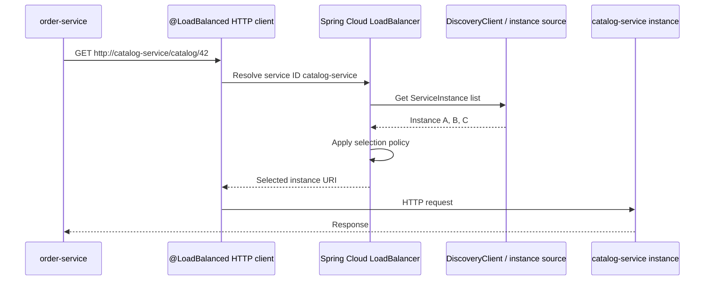

# Ý nghĩa @LoadBalanced và phụ thuộc implementation cần có

Trong một ứng dụng Spring Cloud, client thường gọi dịch vụ bằng tên logic như `catalog-service` thay vì gắn cứng địa chỉ IP của một Pod. Để tên logic đó được chuyển thành địa chỉ mạng thực tế, ứng dụng cần một cơ chế tra cứu instance và một thành phần chọn instance cho từng request. Annotation **`@LoadBalanced`** đánh dấu HTTP client hoặc builder cần được tích hợp với Spring Cloud LoadBalancer.

`@LoadBalanced` không tự tạo registry, không tự tìm instance và cũng không phải thuật toán cân bằng tải. Nó là dấu hiệu để Spring cấu hình client phù hợp. Để lời gọi hoạt động, runtime còn cần implementation Spring Cloud LoadBalancer, một nguồn cung cấp `ServiceInstance` (chẳng hạn Eureka/Consul hoặc `SimpleDiscoveryClient`) và HTTP client integration tương ứng.

Bài học thuộc chương **Gọi dịch vụ** của module `SPRING_CLOUD_CORE`. Mục tiêu là hiểu vai trò của `@LoadBalanced`, biết dependency nào cần có, phân biệt LoadBalancer với DiscoveryClient và registry provider, đồng thời cấu hình và kiểm thử lời gọi bằng service ID.

## 1. Bài toán: gọi bằng service ID thay vì host cố định

Giả sử `order-service` cần gọi `catalog-service`. Dịch vụ catalog chạy ba instance:

| Instance | Host | Port |
| --- | --- | ---: |
| catalog A | `catalog-a.internal` | 8080 |
| catalog B | `catalog-b.internal` | 8080 |
| catalog C | `catalog-c.internal` | 8080 |

Nếu client gắn cứng một địa chỉ:

```java
String url = "http://catalog-a.internal:8080/catalog/42";
```

thì khi instance A bị thay thế hoặc scale, ứng dụng phải biết địa chỉ mới. Cách gọi bằng service ID cho phép client sử dụng một tên logic:

```java
String url = "http://catalog-service/catalog/42";
```

Ở đây `catalog-service` không nhất thiết là hostname DNS. Với một HTTP client được tích hợp LoadBalancer, đây là service ID được dùng để tra cứu danh sách instance. LoadBalancer chọn một instance, sau đó client gửi request đến host/port của instance đó.



Nếu không có tích hợp LoadBalancer, HTTP client thường coi `catalog-service` là hostname và chuyển việc phân giải cho DNS. Vì vậy, chỉ viết URL có service ID là chưa đủ; client phải được cấu hình đúng.

## 2. `@LoadBalanced` thực sự có ý nghĩa gì?

`@LoadBalanced` thuộc package `org.springframework.cloud.client.loadbalancer`. Đây là annotation marker/qualifier được Spring Cloud dùng để nhận diện bean HTTP client cần áp dụng cơ chế client-side load balancing.

Ví dụ:

```java
import org.springframework.cloud.client.loadbalancer.LoadBalanced;
import org.springframework.context.annotation.Bean;
import org.springframework.context.annotation.Configuration;
import org.springframework.web.client.RestTemplate;

@Configuration(proxyBeanMethods = false)
public class HttpClientConfiguration {

    @Bean
    @LoadBalanced
    RestTemplate catalogRestTemplate() {
        return new RestTemplate();
    }
}
```

Trong các cấu hình tương thích, auto-configuration của Spring Cloud LoadBalancer tìm bean được đánh dấu `@LoadBalanced` và bổ sung thành phần chuyển tiếp request tới instance đã chọn. Với `RestTemplate`, việc tích hợp được thực hiện qua interceptor/customizer tương ứng.

Các điểm cần nhớ:

- Annotation đánh dấu client bean cần được tích hợp với LoadBalancer.
- Cơ chế chọn instance đến từ Spring Cloud LoadBalancer và các supplier/policy của nó.
- Danh sách instance đến từ DiscoveryClient hoặc nguồn discovery khác.
- HTTP client vẫn chịu trách nhiệm thực hiện request, timeout, TLS, serialization và xử lý response.
- `@LoadBalanced` không tự đăng ký ứng dụng hiện tại vào registry.

Nói cách khác, `@LoadBalanced` là điểm nối giữa HTTP client và LoadBalancer, không phải toàn bộ hệ thống service discovery.

## 3. Các implementation và dependency cần có

Một lời gọi dùng service ID thường cần các lớp chức năng sau:

| Lớp | Trách nhiệm | Dependency/implementation thường dùng |
| --- | --- | --- |
| HTTP client | Gửi HTTP request | `spring-boot-starter-web` cho RestTemplate; `spring-boot-starter-webflux` cho WebClient |
| Load balancing | Chọn một instance theo service ID | `spring-cloud-starter-loadbalancer` |
| Discovery/instance source | Cung cấp `ServiceInstance` | Eureka Client, Consul Discovery, Kubernetes discovery hoặc SimpleDiscoveryClient |
| Registry backend (nếu dùng) | Lưu và phân phối registration | Eureka Server, Consul, Kubernetes API hoặc nền tảng tương ứng |

### 3.1. Spring Cloud LoadBalancer

Khi sử dụng `@LoadBalanced`, ứng dụng cần Spring Cloud LoadBalancer tương thích. Starter thường dùng:

```xml
<dependency>
    <groupId>org.springframework.cloud</groupId>
    <artifactId>spring-cloud-starter-loadbalancer</artifactId>
</dependency>
```

Hoặc Gradle:

```groovy
dependencies {
    implementation "org.springframework.cloud:spring-cloud-starter-loadbalancer"
}
```

Starter này đưa implementation client-side load balancing vào runtime. Không nhầm nó với một registry server: LoadBalancer cần danh sách instance từ một nguồn discovery nhưng không phải nơi lưu registration của toàn cụm.

Một số starter discovery có thể kéo dependency LoadBalancer theo cấu hình/version nhất định. Nếu code trực tiếp dùng `@LoadBalanced`, nên kiểm tra runtime dependency tree và khai báo starter cần thiết một cách tường minh thay vì dựa vào một dependency bắc cầu không chắc chắn.

### 3.2. HTTP client stack

Nếu dùng `RestTemplate`, ứng dụng cần Spring Web, thường được cung cấp bởi `spring-boot-starter-web`.

Nếu dùng `WebClient`, ứng dụng cần Spring WebFlux, thường được cung cấp bởi `spring-boot-starter-webflux`.

Không phải cứ có LoadBalancer là mọi HTTP client tự động được tích hợp. Chọn đúng client stack và kiểu bean mà Spring Cloud release train đang hỗ trợ.

### 3.3. Discovery implementation hoặc nguồn instance

LoadBalancer cần một nguồn cung cấp danh sách `ServiceInstance`. Có thể chọn một trong các cách:

- Eureka Client khi registry là Eureka.
- Consul Discovery khi dùng Consul.
- Kubernetes discovery integration khi dùng Kubernetes service discovery theo mô hình đó.
- `SimpleDiscoveryClient` khi danh sách instance được khai báo tĩnh bằng properties.
- Một `ServiceInstanceListSupplier` hoặc discovery integration tùy biến nếu ứng dụng có nguồn instance riêng.

Ví dụ dependency discovery:

```xml
<!-- Chọn integration phù hợp với registry đang dùng. -->
<dependency>
    <groupId>org.springframework.cloud</groupId>
    <artifactId>spring-cloud-starter-netflix-eureka-client</artifactId>
</dependency>
```

Hoặc:

```xml
<dependency>
    <groupId>org.springframework.cloud</groupId>
    <artifactId>spring-cloud-starter-consul-discovery</artifactId>
</dependency>
```

Không thêm nhiều discovery provider chỉ để thử cho tới khi một provider hoạt động. Mỗi integration có cấu hình, registration lifecycle và nguồn dữ liệu riêng. Chọn provider thực sự được kiến trúc sử dụng.

### 3.4. Có nhất thiết phải cài registry server không?

Không phải mọi ứng dụng dùng `@LoadBalanced` đều cần tự vận hành Eureka Server hoặc Consul Server. Điều bắt buộc là LoadBalancer phải nhận được danh sách instance từ một nguồn phù hợp.

Ví dụ, `SimpleDiscoveryClient` có thể lấy các instance từ cấu hình tĩnh. Trong môi trường có Kubernetes hoặc nền tảng service discovery bên ngoài, nguồn instance có thể được cung cấp qua integration tương ứng. Registry server chỉ là một lựa chọn trong số đó.

## 4. Dùng `@LoadBalanced` với RestTemplate

### 4.1. Khai báo bean

```java
import org.springframework.cloud.client.loadbalancer.LoadBalanced;
import org.springframework.context.annotation.Bean;
import org.springframework.context.annotation.Configuration;
import org.springframework.web.client.RestTemplate;

@Configuration(proxyBeanMethods = false)
public class CatalogHttpConfiguration {

    @Bean
    @LoadBalanced
    RestTemplate catalogRestTemplate() {
        return new RestTemplate();
    }
}
```

Spring Cloud LoadBalancer nhận diện bean này và thêm tích hợp cần thiết cho `RestTemplate`.

### 4.2. Gọi bằng service ID

```java
import org.springframework.stereotype.Service;
import org.springframework.web.client.RestTemplate;

@Service
public class CatalogClient {

    private final RestTemplate restTemplate;

    public CatalogClient(RestTemplate catalogRestTemplate) {
        this.restTemplate = catalogRestTemplate;
    }

    public CatalogItem findById(String id) {
        return restTemplate.getForObject(
                "http://catalog-service/catalog/{id}",
                CatalogItem.class,
                id
        );
    }
}
```

Trong ví dụ, hostname `catalog-service` được hiểu là service ID bởi LoadBalancer integration. Client tra cứu instance tương ứng và gửi request tới endpoint đã chọn.

### 4.3. Vì sao không nên dùng một RestTemplate bất kỳ?

Nếu bean không được đánh dấu `@LoadBalanced`, request:

```java
restTemplate.getForObject(
        "http://catalog-service/catalog/42",
        CatalogItem.class
);
```

thường sẽ được xử lý như một HTTP URL bình thường. HTTP client sẽ cố phân giải hostname `catalog-service` bằng DNS. Nếu DNS không có bản ghi tương ứng, request thất bại dù service registry vẫn có instance.

Cần bảo đảm đúng bean được inject vào client. Khi ứng dụng có nhiều `RestTemplate`, hãy dùng qualifier phù hợp để tránh vô tình inject bean không có LoadBalancer integration.

## 5. Dùng `@LoadBalanced` với WebClient

Với ứng dụng reactive, Spring Cloud hỗ trợ tích hợp LoadBalancer cho `WebClient.Builder`.

### 5.1. Khai báo builder

```java
import org.springframework.cloud.client.loadbalancer.LoadBalanced;
import org.springframework.context.annotation.Bean;
import org.springframework.context.annotation.Configuration;
import org.springframework.web.reactive.function.client.WebClient;

@Configuration(proxyBeanMethods = false)
public class ReactiveHttpConfiguration {

    @Bean
    @LoadBalanced
    WebClient.Builder loadBalancedWebClientBuilder() {
        return WebClient.builder();
    }
}
```

Trong cấu hình phù hợp, Spring Cloud bổ sung filter cho builder để phân giải service ID và chuyển request qua LoadBalancer.

### 5.2. Sử dụng builder

```java
import org.springframework.stereotype.Component;
import org.springframework.web.reactive.function.client.WebClient;
import reactor.core.publisher.Mono;

@Component
public class ReactiveCatalogClient {

    private final WebClient webClient;

    public ReactiveCatalogClient(
            @LoadBalanced WebClient.Builder builder) {
        this.webClient = builder.build();
    }

    public Mono<CatalogItem> findById(String id) {
        return webClient.get()
                .uri("http://catalog-service/catalog/{id}", id)
                .retrieve()
                .bodyToMono(CatalogItem.class);
    }
}
```

`WebClient` được tạo từ builder đã tích hợp LoadBalancer. Nếu tự tạo `WebClient.builder()` ở nơi khác, không thể mặc định rằng builder mới cũng có filter này. Hãy inject builder đã được cấu hình hoặc tạo client qua factory có chủ đích.

### 5.3. Chọn đúng kiểu client

- `RestTemplate` phù hợp với lời gọi blocking trong ứng dụng Spring MVC hiện có.
- `WebClient` hỗ trợ reactive/non-blocking khi toàn bộ chuỗi xử lý được thiết kế phù hợp.
- Không chuyển sang WebClient chỉ để có load balancing; lựa chọn client nên dựa vào execution model và yêu cầu của ứng dụng.
- Hỗ trợ `RestClient` hoặc các HTTP client khác phụ thuộc phiên bản Spring Cloud và integration hiện có; kiểm tra tài liệu đúng release train trước khi áp dụng cùng annotation.

## 6. Nguồn instance: DiscoveryClient và SimpleDiscoveryClient

### 6.1. DiscoveryClient cung cấp danh sách instance

Trong cấu hình dùng registry, discovery integration triển khai abstraction `DiscoveryClient`. LoadBalancer có thể dùng dữ liệu đó để lấy danh sách `ServiceInstance` theo service ID.

Ví dụ tra cứu trực tiếp để chẩn đoán:

```java
List<ServiceInstance> instances =
        discoveryClient.getInstances("catalog-service");

if (instances.isEmpty()) {
    throw new IllegalStateException(
            "Không tìm thấy instance của catalog-service"
    );
}
```

Thông thường, khi đã dùng `@LoadBalanced`, code nghiệp vụ không cần gọi DiscoveryClient rồi tự chọn phần tử đầu tiên. LoadBalancer đảm nhận việc lấy danh sách và lựa chọn theo policy. Gọi trực tiếp DiscoveryClient hữu ích cho diagnostics, custom routing hoặc kiểm thử logic riêng.

### 6.2. SimpleDiscoveryClient với cấu hình tĩnh

Nếu không dùng registry server, có thể khai báo instance bằng properties:

```yaml
spring:
  cloud:
    discovery:
      client:
        simple:
          instances:
            catalog-service:
              - uri: http://localhost:8081
              - uri: http://localhost:8082
```

Hoặc:

```properties
spring.cloud.discovery.client.simple.instances.catalog-service[0].uri=http://localhost:8081
spring.cloud.discovery.client.simple.instances.catalog-service[1].uri=http://localhost:8082
```

Khi `SimpleDiscoveryClient` được chọn làm nguồn discovery, LoadBalancer có thể lấy các instance này theo service ID `catalog-service`.

Cách này phù hợp với local development, demo và test. Danh sách tĩnh không tự phát hiện Pod mới, không gửi heartbeat và không tự deregister khi process dừng. Khi topology thay đổi, cần cập nhật cấu hình và triển khai/refresh theo thiết kế.

### 6.3. Với Eureka hoặc Consul

Khi dùng Eureka hoặc Consul, discovery integration lấy thông tin từ registry provider. Ứng dụng cần cấu hình đúng registry endpoint, service name, địa chỉ quảng bá và cơ chế health/registration của provider.

Ví dụ tên service thường được liên hệ với:

```yaml
spring:
  application:
    name: catalog-service
```

Tuy nhiên, giá trị service ID thực tế còn phụ thuộc provider và thuộc tính tùy chỉnh. Hãy xác nhận tên được đăng ký trùng với hostname logic trong URL mà client sử dụng.

## 7. Phân biệt các thành phần thường bị nhầm

| Thành phần | Trách nhiệm | Không chịu trách nhiệm |
| --- | --- | --- |
| `@LoadBalanced` | Đánh dấu client bean cần tích hợp load balancing | Không lưu registry, không tự tìm instance |
| Spring Cloud LoadBalancer | Lấy danh sách và chọn instance theo policy | Không nhất thiết đăng ký ứng dụng vào registry |
| `DiscoveryClient` | Tra cứu service ID và trả `ServiceInstance` | Không phải HTTP client gửi request |
| `ServiceInstance` | Mô tả host, port, URI, secure và metadata | Không tự health check hoặc gửi request |
| `ServiceRegistry` | Đăng ký, cập nhật, hủy registration theo provider | Không phải client-side load balancer |
| HTTP client | Gửi request, đọc response, xử lý transport | Không tự hiểu service ID nếu chưa tích hợp discovery/load balancing |

Một ứng dụng có thể dùng LoadBalancer để gọi dịch vụ khác nhưng không tự đăng ký vào registry. Ngược lại, ứng dụng có thể tự đăng ký instance nhưng HTTP client của nó vẫn gọi host cố định nếu không được tích hợp LoadBalancer.

## 8. Dependency graph và cách kiểm tra classpath

Một cấu hình dùng RestTemplate với Eureka thường cần các nhóm sau:

```text
spring-boot-starter-web
    -> RestTemplate / Spring Web

spring-cloud-starter-loadbalancer
    -> Spring Cloud LoadBalancer
    -> LoadBalancer integration for supported clients

spring-cloud-starter-netflix-eureka-client
    -> Eureka DiscoveryClient / registration integration

spring-cloud-dependencies BOM
    -> Quản lý phiên bản Spring Cloud tương thích
```

Đây là sơ đồ vai trò, không phải cam kết về toàn bộ dependency bắc cầu của mọi phiên bản. Một starter provider có thể kéo thêm một số module liên quan; hãy xem dependency tree thực tế.

Maven:

```bash
mvn dependency:tree '-Dincludes=org.springframework.cloud:*'
```

Gradle:

```bash
./gradlew dependencies --configuration runtimeClasspath
./gradlew dependencyInsight --dependency spring-cloud-loadbalancer --configuration runtimeClasspath
```

Kiểm tra các điểm:

1. `spring-cloud-loadbalancer` có trong runtime classpath.
2. Có HTTP client stack phù hợp với bean được đánh dấu `@LoadBalanced`.
3. Có DiscoveryClient/provider hoặc cấu hình SimpleDiscoveryClient cung cấp instance.
4. Service ID trong URL khớp service ID mà discovery trả về.
5. Spring Boot và Spring Cloud release train nằm trong tổ hợp tương thích.
6. Không có nhiều phiên bản Spring Cloud hoặc Spring Framework bị ép lệch bởi dependency override.

Dùng Spring Cloud BOM để quản lý version của các module Spring Cloud. Tránh tự ghim version cho từng artifact nếu không có lý do tương thích cụ thể đã được kiểm thử.

## 9. Khi có nhiều HTTP client bean

Một ứng dụng có thể cần hai client: một client load-balanced để gọi service nội bộ và một client gọi URL cố định bên ngoài.

Ví dụ:

```java
import org.springframework.beans.factory.annotation.Qualifier;
import org.springframework.cloud.client.loadbalancer.LoadBalanced;
import org.springframework.context.annotation.Bean;
import org.springframework.context.annotation.Configuration;
import org.springframework.stereotype.Service;
import org.springframework.web.client.RestTemplate;

@Configuration(proxyBeanMethods = false)
public class HttpClientsConfiguration {

    @Bean
    @LoadBalanced
    RestTemplate serviceRestTemplate() {
        return new RestTemplate();
    }

    @Bean
    RestTemplate externalRestTemplate() {
        return new RestTemplate();
    }
}
```

Khi inject, nên dùng qualifier rõ ràng:

```java
@Service
public class CatalogClient {

    private final RestTemplate restTemplate;

    public CatalogClient(
            @Qualifier("serviceRestTemplate") RestTemplate restTemplate) {
        this.restTemplate = restTemplate;
    }
}
```

Trong một số cấu hình, có thể inject theo qualifier `@LoadBalanced` nếu kiểu bean và injection point được định nghĩa phù hợp. Khi có nhiều bean cùng kiểu, qualifier theo tên hoặc custom qualifier giúp tránh nhầm lẫn.

Không nên đánh dấu mọi RestTemplate trong ứng dụng bằng `@LoadBalanced`. Client gọi API public bằng hostname DNS thông thường không cần service discovery; thêm interceptor không cần thiết làm tăng độ phức tạp và có thể thay đổi cách xử lý URL.

## 10. Service ID trong URL và các quy tắc quan trọng

### 10.1. Hostname phải khớp service ID

Nếu registry lưu `catalog-service`, lời gọi phải dùng service ID tương ứng:

```java
restTemplate.getForObject(
        "http://catalog-service/catalog/42",
        CatalogItem.class
);
```

Nếu gọi `http://catalog/42` trong khi registry chỉ có `catalog-service`, LoadBalancer không tự suy ra tên gần giống. Hãy xác nhận service ID qua discovery provider hoặc `DiscoveryClient.getServices()`.

### 10.2. Không dùng IP/port của một replica trong URL load-balanced

Khi URL đã chỉ rõ IP/port cụ thể, client không còn yêu cầu chọn instance theo service ID. Dùng service ID logic để LoadBalancer có thể phân phối request.

### 10.3. Scheme và secure instance

Nếu instance được công bố là HTTPS, discovery metadata/ServiceInstance cần phản ánh đúng trạng thái secure và HTTP client phải có cấu hình TLS phù hợp. `@LoadBalanced` không tự cấp truststore, chứng chỉ client hoặc xác minh hostname.

### 10.4. Path và query vẫn thuộc API đích

LoadBalancer giải quyết phần service ID thành instance URI. Path, query parameter và HTTP method vẫn phải đúng với API của service đích. Lỗi 404 sau khi chọn instance thường là lỗi path/API version hoặc routing phía service, không phải lỗi chọn service ID.

## 11. Các giới hạn vận hành

`@LoadBalanced` và LoadBalancer giúp chọn instance nhưng không bảo đảm request thành công. Một số giới hạn cần thiết kế:

- Instance có thể chết sau khi được discovery trả về nhưng trước khi request tới nơi.
- Registry hoặc discovery cache có thể tạm thời chứa dữ liệu cũ.
- DNS/network policy có thể khiến host được công bố không truy cập được từ caller.
- Một service ID có thể không có instance khỏe mạnh.
- Retry có thể gửi lại request; thao tác ghi cần idempotency hoặc cơ chế chống thực hiện lặp.
- Timeout của HTTP client và timeout của downstream cần được cấu hình có chủ đích.
- TLS, authentication và authorization vẫn cần được thực hiện ở HTTP client/server.
- LoadBalancer không thay thế circuit breaker, bulkhead, rate limit hoặc observability.

Không nên bật retry vô hạn khi không có instance. Hãy đặt timeout hữu hạn, giới hạn retry và phân biệt lỗi không tìm thấy instance với lỗi HTTP từ service đích.

## 12. Kiểm thử `@LoadBalanced`

Kiểm thử nên tách ba lớp: client được đánh dấu, danh sách instance được cung cấp và request thực sự được gửi tới instance đã chọn.

| Mục tiêu | Cách kiểm thử | Điều cần xác nhận |
| --- | --- | --- |
| Bean được đánh dấu | Khởi động context và lấy bean theo qualifier | Đúng RestTemplate/WebClient builder được cấu hình |
| Dependency LoadBalancer | Kiểm tra runtime dependency tree | Có implementation LoadBalancer phù hợp |
| Discovery source | Cấu hình SimpleDiscoveryClient hoặc test provider | Có instance cho đúng service ID |
| Service ID resolution | Gọi URL dùng hostname logic | Request không đi qua DNS thông thường mà qua integration |
| Nhiều instance | Cung cấp hai hoặc nhiều ServiceInstance | Lựa chọn tuân theo policy đã cấu hình |
| Không có instance | Cấu hình danh sách rỗng | Lỗi được xử lý rõ, không treo vô hạn |
| Client không load-balanced | Dùng bean thường với service ID không có DNS | Xác nhận khác biệt với bean có `@LoadBalanced` |
| TLS | Cung cấp instance secure và TLS test server | Scheme/certificate được xử lý đúng |
| Multiple clients | Tạo cả bean load-balanced và bean thường | Mỗi caller inject đúng bean |
| Failure handling | Dừng một instance sau khi discovery trả danh sách | Timeout/retry/fallback theo policy |

### 12.1. Kiểm thử với SimpleDiscoveryClient

Một test integration có thể khai báo hai endpoint test cho `catalog-service`, dùng HTTP server giả trên hai port. Sau đó khởi động context với LoadBalancer và RestTemplate được đánh dấu `@LoadBalanced`, gửi nhiều request và quan sát request tới các server test.

Không nên assert rằng mọi lần gọi phải luân phiên tuyệt đối nếu policy, cache hoặc supplier được cấu hình khác. Hãy kiểm tra kết quả theo policy cụ thể của test.

### 12.2. Kiểm thử không có instance

Khi danh sách instance rỗng, LoadBalancer không thể chọn endpoint. Ứng dụng nên trả lỗi có thể chẩn đoán, áp dụng fallback nếu nghiệp vụ cho phép và ghi nhận metric phù hợp. Không thay thế lỗi bằng một địa chỉ host ngẫu nhiên.

### 12.3. Kiểm thử dependency thiếu

Có thể tạo một context test không có LoadBalancer starter để xác nhận cấu hình client không tự được tích hợp. Lỗi cụ thể phụ thuộc cách auto-configuration được kích hoạt; điều cần kiểm tra là không giả định annotation đơn lẻ mang theo implementation.

## 13. Các lỗi thường gặp và cách khắc phục

| Triệu chứng | Nguyên nhân có thể | Hướng kiểm tra |
| --- | --- | --- |
| `UnknownHostException: catalog-service` | HTTP client không được tích hợp LoadBalancer hoặc inject nhầm bean thường | Kiểm tra `@LoadBalanced`, qualifier và runtime starter |
| Không có bean `DiscoveryClient` mong đợi | Thiếu provider integration hoặc cấu hình discovery không hoạt động | Kiểm tra discovery starter và auto-configuration |
| Không tìm thấy instance | Service ID URL không khớp registry hoặc source trả danh sách rỗng | Kiểm tra `getServices()`/`getInstances()` và service ID |
| `@LoadBalanced` không có tác dụng | Thiếu `spring-cloud-starter-loadbalancer` hoặc client stack không được hỗ trợ | Kiểm tra dependency tree và loại builder/client |
| Bean injection bị ambiguous | Có nhiều RestTemplate/WebClient.Builder cùng kiểu | Dùng qualifier rõ ràng |
| Request tới sai service | Dùng nhầm hostname logic hoặc cấu hình alias | So sánh URL với service ID đăng ký |
| Request chọn instance nhưng kết nối timeout | Host/port không reachable hoặc instance đã dừng | Kiểm tra URI, network, health, timeout |
| HTTPS handshake thất bại | Secure flag, certificate hoặc truststore sai | Kiểm tra scheme và TLS configuration |
| Chỉ một instance nhận request | Policy/supplier/cache hoặc số instance khả dụng | Kiểm tra danh sách đầu vào và policy |
| Thay đổi replica nhưng client chưa thấy | Discovery cache chưa cập nhật hoặc registry chưa đồng bộ | Kiểm tra cache, heartbeat, health và refresh behavior |
| Retry tạo request ghi lặp | Retry không xét idempotency | Thiết kế idempotency key hoặc giới hạn retry |

Trình tự chẩn đoán:

1. Xác định bean HTTP client thực tế mà service đang inject.
2. Xác nhận bean có `@LoadBalanced` và đúng loại client được hỗ trợ.
3. Kiểm tra runtime classpath có Spring Cloud LoadBalancer.
4. Xác nhận có DiscoveryClient/provider hoặc SimpleDiscoveryClient.
5. Liệt kê service ID và instance để kiểm tra tên, host, port, secure.
6. Gọi thử từ đúng network namespace tới URI instance.
7. Kiểm tra LoadBalancer supplier/policy và log chọn instance.
8. Kiểm tra timeout, retry, TLS và response từ service đích.

## 14. Thực hành: cấu hình order-service gọi catalog-service

Giả sử muốn chạy ví dụ local với hai instance catalog trên port 8081 và 8082, chưa cần registry server.

### Bước 1 — Thêm dependency

Dùng Spring Boot Web và Spring Cloud LoadBalancer; version Spring Cloud được quản lý qua BOM tương thích.

```xml
<dependency>
    <groupId>org.springframework.boot</groupId>
    <artifactId>spring-boot-starter-web</artifactId>
</dependency>

<dependency>
    <groupId>org.springframework.cloud</groupId>
    <artifactId>spring-cloud-starter-loadbalancer</artifactId>
</dependency>
```

### Bước 2 — Khai báo instance tĩnh

```yaml
spring:
  cloud:
    discovery:
      client:
        simple:
          instances:
            catalog-service:
              - uri: http://localhost:8081
              - uri: http://localhost:8082
```

Hai server test cần thực sự lắng nghe trên các port tương ứng. Trong môi trường container, thay `localhost` bằng hostname có thể truy cập từ caller.

### Bước 3 — Tạo RestTemplate load-balanced

```java
@Configuration(proxyBeanMethods = false)
public class ClientConfiguration {

    @Bean
    @LoadBalanced
    RestTemplate catalogRestTemplate() {
        return new RestTemplate();
    }
}
```

### Bước 4 — Gọi bằng service ID

```java
@Service
public class CatalogClient {

    private final RestTemplate restTemplate;

    public CatalogClient(RestTemplate catalogRestTemplate) {
        this.restTemplate = catalogRestTemplate;
    }

    public String getCatalogItem() {
        return restTemplate.getForObject(
                "http://catalog-service/catalog/42",
                String.class
        );
    }
}
```

### Bước 5 — Xác minh

1. Khởi động hai server test trên port 8081 và 8082.
2. Khởi động order-service với cấu hình SimpleDiscoveryClient.
3. Gửi request tới endpoint của order-service.
4. Quan sát server nào nhận request và response trả về.
5. Tắt một server test, kiểm tra hành vi khi discovery source còn/không còn instance tương ứng.
6. Thử bỏ `@LoadBalanced` trong profile test để quan sát khác biệt khi hostname `catalog-service` không có DNS record.

Ví dụ này chứng minh vai trò của annotation và instance source mà không cần một registry server riêng. Khi chuyển sang Eureka/Consul, thay SimpleDiscoveryClient bằng discovery integration phù hợp; code gọi service ID có thể giữ nguyên.

### Câu hỏi tự kiểm tra

1. `@LoadBalanced` đánh dấu điều gì?
2. Vì sao annotation này không tự thực hiện load balancing nếu thiếu implementation?
3. Spring Cloud LoadBalancer và DiscoveryClient có trách nhiệm khác nhau thế nào?
4. Vì sao HTTP client cần được tích hợp interceptor/filter?
5. Nếu dùng RestTemplate, bean cần được khai báo ra sao?
6. Với WebClient, nên inject WebClient hay builder đã được đánh dấu trong ví dụ?
7. Khi nào SimpleDiscoveryClient đủ dùng và khi nào cần registry provider?
8. Vì sao URL `http://catalog-service/...` có thể gây `UnknownHostException`?
9. `@LoadBalanced` có tự đăng ký instance của ứng dụng hiện tại không?
10. Vì sao cần kiểm tra runtime dependency tree thay vì chỉ nhìn source annotation?

**Gợi ý đáp án:** (1) Bean HTTP client cần dùng client-side load balancing; (2) Annotation chỉ là marker/qualifier, implementation mới thực hiện chọn instance; (3) DiscoveryClient cung cấp danh sách instance, LoadBalancer chọn instance; (4) Để phân giải service ID và chuyển request tới URI vật lý; (5) Tạo bean `RestTemplate` có `@LoadBalanced`; (6) Builder đã được tích hợp; (7) SimpleDiscoveryClient phù hợp topology tĩnh/local/test, registry provider phù hợp đăng ký và khám phá động; (8) Vì client thường có thể coi tên đó là hostname DNS nếu không có integration; (9) Không; (10) Vì annotation không tự mang theo mọi dependency/auto-configuration cần thiết.

## 15. Những nguyên tắc cần nhớ

- `@LoadBalanced` là marker/qualifier để Spring Cloud nhận diện HTTP client hoặc builder cần tích hợp LoadBalancer.
- Spring Cloud LoadBalancer là implementation client-side chọn instance; annotation không thay thế implementation.
- LoadBalancer cần nguồn `ServiceInstance`, thường là DiscoveryClient/provider hoặc SimpleDiscoveryClient.
- HTTP client stack phải được hỗ trợ và được cấu hình đúng; RestTemplate và WebClient có cách tích hợp tương ứng.
- URL dùng service ID logic, ví dụ `http://catalog-service/...`, và service ID phải khớp với discovery source.
- `spring-cloud-starter-loadbalancer` là dependency chính cho LoadBalancer; discovery provider starter là dependency riêng theo registry.
- Không bắt buộc có registry server nếu dùng nguồn instance tĩnh hoặc discovery platform khác, nhưng phải có instance source.
- `@LoadBalanced` không tự đăng ký ứng dụng, không cấp TLS, không bảo đảm instance luôn khỏe và không thay thế timeout/retry/circuit breaker.
- Dùng Spring Cloud BOM tương thích, kiểm tra runtime dependency tree và qualifier khi có nhiều HTTP client bean.
- Kiểm thử cả trường hợp có nhiều instance, không có instance, thiếu dependency, sai service ID và lỗi network/TLS.

Hiểu đúng `@LoadBalanced` giúp ứng dụng gọi dịch vụ bằng tên logic mà không gắn cứng địa chỉ từng replica. Khi marker, LoadBalancer implementation, nguồn discovery và HTTP client integration được cấu hình đồng bộ, Spring Cloud có thể chọn instance phù hợp cho mỗi lời gọi và giữ mã nghiệp vụ ít phụ thuộc vào hạ tầng registry cụ thể.

## Tài liệu tham khảo

- [Spring Cloud Commons — Spring Cloud LoadBalancer](https://docs.spring.io/spring-cloud-commons/reference/spring-cloud-commons/loadbalancer.html)
- [Spring Cloud Commons — Common Abstractions](https://docs.spring.io/spring-cloud-commons/reference/spring-cloud-commons/common-abstractions.html)
- [Spring Cloud Commons — SimpleDiscoveryClient](https://docs.spring.io/spring-cloud-commons/reference/spring-cloud-commons/common-abstractions.html)
- [Spring Cloud Netflix — Eureka Client](https://docs.spring.io/spring-cloud-netflix/reference/spring-cloud-netflix.html)
