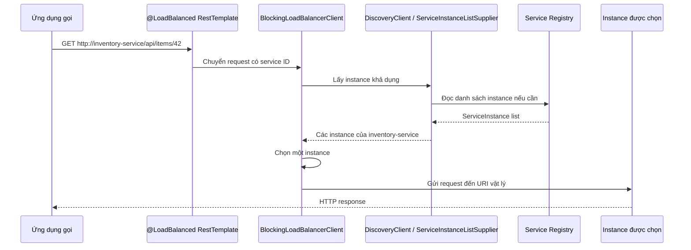

# Tạo RestTemplate dùng load balancer

## 1. Gọi dịch vụ bằng tên logic

Trong hệ thống phân tán, một dịch vụ thường có nhiều instance chạy trên các máy hoặc container khác nhau. Nếu ứng dụng gọi dịch vụ bằng IP và port cố định, mỗi lần scale, thay instance hoặc chuyển vùng triển khai, client có thể phải sửa địa chỉ.

Spring Cloud Commons cung cấp cơ chế để ứng dụng gọi một dịch vụ bằng **service ID**. Spring Cloud LoadBalancer chọn một instance từ danh sách discovery và chuyển request đến địa chỉ vật lý của instance đó. Với Spring MVC hoặc ứng dụng blocking, có thể dùng `RestTemplate` được đánh dấu `@LoadBalanced`.

Ví dụ, thay vì gọi một địa chỉ cố định:

```java
restTemplate.getForObject(
        "http://10.20.1.15:8080/api/items/{sku}",
        Item.class,
        sku
);
```

ứng dụng gọi bằng service ID:

```java
restTemplate.getForObject(
        "http://inventory-service/api/items/{sku}",
        Item.class,
        sku
);
```

`inventory-service` là tên logic được đăng ký trong service discovery. Spring Cloud LoadBalancer tìm instance phù hợp và thay phần host ảo bằng địa chỉ thực trước khi gửi HTTP request.

Bài học thuộc chương **Gọi dịch vụ** của module **SPRING_CLOUD_CORE**. Module tập trung vào Spring Cloud Commons, Spring Cloud Context, cấu hình ngoài, tương thích Spring Boot, refresh scope, discovery, service registry, giao tiếp dịch vụ và cách kiểm thử/vận hành các abstraction chung.

Sau bài này, người học có thể:

- Giải thích vai trò của `@LoadBalanced` trên một bean `RestTemplate`.
- Thêm Spring Cloud LoadBalancer vào classpath và khai báo bean đúng cách.
- Gọi dịch vụ bằng service ID thay vì địa chỉ instance cố định.
- Phân biệt `RestTemplate` dùng load balancer với `RestTemplate` gọi host thông thường.
- Inject đúng client khi ứng dụng có nhiều `RestTemplate`.
- Hiểu cách LoadBalancer lấy instance từ `DiscoveryClient` và chọn đích gọi.
- Cấu hình `SimpleDiscoveryClient` cho môi trường local/test.
- Kiểm tra cache, retry, timeout, lỗi không tìm thấy instance và hành vi khi registry thay đổi.
- Viết kiểm thử cho việc định tuyến đến các instance đã đăng ký.

## 2. Vị trí của RestTemplate trong luồng gọi dịch vụ

Một lời gọi qua `@LoadBalanced RestTemplate` đi qua các thành phần sau:



Các vai trò được tách biệt:

| Thành phần | Trách nhiệm |
| --- | --- |
| `RestTemplate` | Tạo và gửi HTTP request theo API blocking |
| `@LoadBalanced` | Đánh dấu bean để Spring áp dụng cấu hình load balancing |
| `BlockingLoadBalancerClient` | Phân giải service ID thành một instance vật lý |
| `DiscoveryClient` | Đọc danh sách service instance từ registry hoặc nguồn discovery |
| `ServiceInstanceListSupplier` | Cung cấp danh sách instance cho LoadBalancer, có thể áp dụng cache hoặc filter |
| `Spring Cloud LoadBalancer` | Chọn instance theo chiến lược đã cấu hình |
| Service Registry | Lưu thông tin instance do các dịch vụ đăng ký |

`@LoadBalanced` không tự tạo service registry và không tự đăng ký dịch vụ. Ứng dụng vẫn cần một `DiscoveryClient` phù hợp, ví dụ Eureka hoặc Consul. Trong môi trường đơn giản, có thể dùng `SimpleDiscoveryClient` với danh sách URI tĩnh.

## 3. Chuẩn bị dependency

Để `RestTemplate` có thể dùng LoadBalancer, ứng dụng cần Spring Cloud LoadBalancer trên classpath.

Với Maven:

```xml
<dependency>
    <groupId>org.springframework.cloud</groupId>
    <artifactId>spring-cloud-starter-loadbalancer</artifactId>
</dependency>
```

Nếu dùng registry thực, thêm starter của provider tương ứng, ví dụ Eureka Discovery Client hoặc Consul Discovery. Dependency của Spring Cloud nên được quản lý bằng Spring Cloud BOM tương thích với phiên bản Spring Boot của dự án; không tự chọn các phiên bản Spring Cloud và Spring Boot không tương thích.

Ví dụ các nhóm dependency có thể có:

| Nhu cầu | Dependency |
| --- | --- |
| Gọi dịch vụ bằng `RestTemplate` qua LoadBalancer | `spring-cloud-starter-loadbalancer` |
| Lấy instance từ Eureka | Starter Eureka Discovery Client |
| Lấy instance từ Consul | Starter Consul Discovery |
| Kiểm tra health endpoint và quan sát ứng dụng | `spring-boot-starter-actuator` |

Trong các phiên bản Spring Cloud hiện hành, không cần thêm `@EnableDiscoveryClient` chỉ để kích hoạt discovery nếu implementation phù hợp đã có trên classpath. Hãy kiểm tra cấu hình và starter của provider; có dependency không đồng nghĩa registry đã kết nối thành công hoặc đã có instance.

## 4. Khai báo RestTemplate có load balancing

### 4.1. Tạo bean với @LoadBalanced

Spring Boot không tự tạo một bean `RestTemplate` dùng chung cho mọi ứng dụng. Ứng dụng phải khai báo bean và đánh dấu bean cần load balancing bằng annotation:

- `org.springframework.cloud.client.loadbalancer.LoadBalanced`

Ví dụ:

```java
import org.springframework.cloud.client.loadbalancer.LoadBalanced;
import org.springframework.context.annotation.Bean;
import org.springframework.context.annotation.Configuration;
import org.springframework.web.client.RestTemplate;

@Configuration(proxyBeanMethods = false)
class HttpClientConfiguration {

    @Bean
    @LoadBalanced
    RestTemplate loadBalancedRestTemplate() {
        return new RestTemplate();
    }
}
```

Khi Spring tạo bean được đánh dấu `@LoadBalanced`, cấu hình Spring Cloud thêm interceptor của LoadBalancer vào `RestTemplate`. Interceptor này sử dụng `BlockingLoadBalancerClient` để phân giải service ID trong URI.

Tên bean `loadBalancedRestTemplate` giúp phân biệt client này với các HTTP client khác trong cùng application context.

### 4.2. Inject client qua RestOperations

`RestTemplate` triển khai interface `RestOperations`. Khi inject client load-balanced, có thể dùng chính qualifier `@LoadBalanced` trên constructor parameter:

```java
import org.springframework.cloud.client.loadbalancer.LoadBalanced;
import org.springframework.stereotype.Component;
import org.springframework.web.client.RestOperations;

@Component
class InventoryClient {

    private final RestOperations restOperations;

    InventoryClient(
            @LoadBalanced RestOperations restOperations) {
        this.restOperations = restOperations;
    }

    Item findItem(String sku) {
        return restOperations.getForObject(
                "http://inventory-service/api/items/{sku}",
                Item.class,
                sku
        );
    }
}
```

Dùng interface `RestOperations` cũng tránh một số vấn đề kiểu proxy. Trong một số cấu hình AOP, bean load-balanced có thể được bọc bằng JDK dynamic proxy chỉ triển khai interface; inject trực tiếp kiểu concrete `RestTemplate` khi đó có thể gây lỗi ép kiểu. Tài liệu Spring Cloud gợi ý inject `RestOperations` hoặc cấu hình class-based proxy nếu ứng dụng cần kiểu concrete.

### 4.3. Dùng RestTemplateBuilder

Nếu muốn tận dụng các tùy chỉnh Spring Boot cung cấp cho `RestTemplateBuilder`, có thể đánh dấu chính builder bằng `@LoadBalanced`, rồi tạo client từ builder đó:

```java
import org.springframework.boot.autoconfigure.web.client.RestTemplateBuilderConfigurer;
import org.springframework.boot.web.client.RestTemplateBuilder;
import org.springframework.cloud.client.loadbalancer.LoadBalanced;
import org.springframework.context.annotation.Bean;
import org.springframework.context.annotation.Configuration;

@Configuration(proxyBeanMethods = false)
class LoadBalancedBuilderConfiguration {

    @Bean
    @LoadBalanced
    RestTemplateBuilder loadBalancedRestTemplateBuilder(
            RestTemplateBuilderConfigurer configurer) {
        return configurer.configure(new RestTemplateBuilder());
    }
}
```

Inject builder đã được đánh dấu:

```java
@Component
class CatalogClient {

    private final RestTemplate restTemplate;

    CatalogClient(
            @LoadBalanced RestTemplateBuilder builder) {
        this.restTemplate = builder.build();
    }

    Item find(String sku) {
        return restTemplate.getForObject(
                "http://inventory-service/api/items/{sku}",
                Item.class,
                sku
        );
    }
}
```

Đây là một cách cấu hình thay thế cho việc khai báo trực tiếp `RestTemplate` bean. Không tạo builder load-balanced rồi lại tự tạo `new RestTemplate()` ở nơi sử dụng, vì instance mới sẽ không nhận interceptor đã được cấu hình cho builder.

## 5. Gọi dịch vụ bằng service ID

### 5.1. Cấu trúc URI

URI dùng với client load-balanced có dạng:

```text
http://<service-id>/<resource-path>
```

Ví dụ:

| URI | Ý nghĩa |
| --- | --- |
| `http://inventory-service/api/items/42` | Gọi service ID `inventory-service` |
| `http://payment-service/api/payments` | Gọi service ID `payment-service` |
| `http://notification-service/api/messages` | Gọi service ID `notification-service` |

Phần host trong URI là **service ID**, không phải hostname/IP của một instance. Scheme `http` hoặc `https` là scheme khởi đầu cho request; LoadBalancer có thể điều chỉnh URI theo thông tin bảo mật của `ServiceInstance` được chọn.

Với `RestTemplate`, cách dùng thông thường là URL `http://service-id/...` hoặc `https://service-id/...`. Cú pháp `lb://service-id` thường gặp trong cấu hình route của Spring Cloud Gateway; không dùng nó thay cho URL service ID thông thường của ví dụ `RestTemplate` này.

### 5.2. Tham số URI và dữ liệu request

Có thể sử dụng các overload chuẩn của `RestTemplate`:

```java
Item item = restOperations.getForObject(
        "http://inventory-service/api/items/{sku}",
        Item.class,
        sku
);

ResponseEntity<Item> response = restOperations.exchange(
        "http://inventory-service/api/items/{sku}",
        HttpMethod.GET,
        HttpEntity.EMPTY,
        Item.class,
        sku
);
```

Với POST:

```java
CreateOrderRequest request = new CreateOrderRequest(customerId, itemIds);

OrderResponse order = restOperations.postForObject(
        "http://order-service/api/orders",
        request,
        OrderResponse.class
);
```

LoadBalancer chọn instance trước khi request được gửi. Cách serialize body, convert response và xử lý HTTP status vẫn theo cơ chế `RestTemplate` và các `HttpMessageConverter` được cấu hình.

### 5.3. Service ID phải khớp với discovery

Service ID trong URI phải khớp với ID mà discovery provider công bố. Nếu registry dùng `inventory-service` nhưng client gọi `inventory`, LoadBalancer sẽ tra cứu một service khác và có thể không tìm thấy instance.

Nên thống nhất quy ước đặt tên giữa:

- `spring.application.name` của dịch vụ được đăng ký.
- Service ID được registry công bố.
- Service ID trong URI mà client gọi.
- Các cấu hình riêng của LoadBalancer cho service đó.

Không tự thêm hostname, port hoặc IP vào URI service ID nếu mục tiêu là để LoadBalancer chọn instance.

## 6. Cung cấp danh sách instance cho LoadBalancer

### 6.1. Dùng service registry động

Trong môi trường production, mỗi instance thường tự đăng ký với registry khi khởi động. Discovery provider đọc registration và cung cấp `ServiceInstance` cho LoadBalancer.

Ví dụ, `inventory-service` có thể có ba instance:

| Service ID | Host | Port |
| --- | --- | ---: |
| `inventory-service` | `inventory-1.internal` | 8080 |
| `inventory-service` | `inventory-2.internal` | 8080 |
| `inventory-service` | `inventory-3.internal` | 8080 |

Client không cần biết danh sách địa chỉ này. Nó chỉ gọi `http://inventory-service/...`; danh sách instance được cập nhật qua discovery provider và cơ chế cache tương ứng.

### 6.2. Dùng SimpleDiscoveryClient cho local/test

Nếu không có discovery implementation dựa trên registry trong classpath, Spring Cloud Commons có thể dùng `SimpleDiscoveryClient`, lấy URI instance từ cấu hình.

Ví dụ:

```yaml
spring:
  cloud:
    discovery:
      client:
        simple:
          instances:
            inventory-service:
              - uri: http://localhost:8081
              - uri: http://localhost:8082
            payment-service:
              - uri: http://localhost:8091
```

Khi đó, request đến `http://inventory-service/api/items/42` có thể được chuyển đến một trong hai URI local đã khai báo.

Cách này hữu ích cho:

- Chạy nhiều service local mà chưa cần dựng Eureka hoặc Consul.
- Integration test muốn kiểm soát tập instance.
- Demo cơ chế chọn instance.
- Môi trường tĩnh, ít thay đổi địa chỉ.

`SimpleDiscoveryClient` không tự theo dõi tiến trình nào đang sống. Nếu một địa chỉ cấu hình đã dừng, nó vẫn có thể xuất hiện trong danh sách cho đến khi cấu hình thay đổi. Với hệ thống động, nên dùng registry có cơ chế registration, health và deregistration phù hợp.

## 7. LoadBalancer chọn instance như thế nào?

### 7.1. Chiến lược mặc định

Spring Cloud LoadBalancer cung cấp client-side load balancing. Chiến lược mặc định hiện hành là `RoundRobinLoadBalancer`, chọn lần lượt các instance trong danh sách theo vòng tròn. Ngoài ra có thể cấu hình implementation khác, ví dụ `RandomLoadBalancer`.

Ví dụ với ba instance, một chuỗi request tuần tự có thể được phân phối như sau:

```text
Request 1 -> inventory-1
Request 2 -> inventory-2
Request 3 -> inventory-3
Request 4 -> inventory-1
Request 5 -> inventory-2
```

Đây là minh họa cho round robin. Khi có request đồng thời, instance list thay đổi hoặc cache được làm mới, không nên xem thứ tự trên là cam kết cố định cho từng request.

### 7.2. LoadBalancer context theo service ID

Spring Cloud LoadBalancer tạo child context riêng cho mỗi service ID. Các context này mặc định được khởi tạo lazy khi lần đầu có request cần load balance đến service đó.

Nếu muốn khởi tạo trước cho một số service quan trọng, có thể khai báo:

```yaml
spring:
  cloud:
    loadbalancer:
      eager-load:
        clients:
          - inventory-service
          - payment-service
```

Eager loading có thể giúp tránh chi phí khởi tạo context ở request đầu tiên, đổi lại thời gian startup và tài nguyên ban đầu có thể tăng.

### 7.3. Tùy chỉnh chiến lược

Nếu một service cần chính sách riêng, Spring Cloud cho phép cấu hình LoadBalancer theo service ID thông qua `@LoadBalancerClient` hoặc `@LoadBalancerClients`.

Ví dụ, có thể dùng `RandomLoadBalancer` cho một service thử nghiệm trong khi giữ round robin cho các service khác. Configuration class dành cho LoadBalancer client cần được đặt ngoài component scan thông thường hoặc không đánh dấu `@Configuration` theo cách khiến nó bị nạp vào context chính ngoài ý muốn.

Không nên tùy chỉnh thuật toán chỉ vì muốn phân phối đều hơn trong một lần thử. Trước hết hãy xác định tiêu chí: zone, weight, phiên bản, sticky session hay tải thực tế; sau đó chọn `ServiceInstanceListSupplier` và LoadBalancer phù hợp.

## 8. Nhiều RestTemplate trong cùng ứng dụng

Một ứng dụng có thể cần cả hai kiểu HTTP client:

- Client load-balanced để gọi service nội bộ bằng service ID.
- Client thông thường để gọi API bên ngoài bằng hostname cố định.

Hãy khai báo riêng và dùng qualifier để phân biệt:

```java
@Configuration(proxyBeanMethods = false)
class HttpClientsConfiguration {

    @Bean
    @LoadBalanced
    RestTemplate loadBalancedRestTemplate() {
        return new RestTemplate();
    }

    @Bean
    @Primary
    RestTemplate directRestTemplate() {
        return new RestTemplate();
    }
}
```

Sử dụng:

```java
@Component
class PartnerGateway {

    private final RestOperations internalServices;
    private final RestOperations externalApi;

    PartnerGateway(
            @LoadBalanced RestOperations internalServices,
            RestOperations externalApi) {
        this.internalServices = internalServices;
        this.externalApi = externalApi;
    }

    InventorySummary getInventory(String sku) {
        return internalServices.getForObject(
                "http://inventory-service/api/items/{sku}/summary",
                InventorySummary.class,
                sku
        );
    }

    PartnerStatus getPartnerStatus() {
        return externalApi.getForObject(
                "https://partner.example.com/status",
                PartnerStatus.class
        );
    }
}
```

`@Primary` giúp Spring chọn bean thông thường khi injection không có qualifier. Parameter `@LoadBalanced` chọn bean load-balanced. Nếu mọi injection đều dùng qualifier hoặc `@Qualifier` theo tên bean, có thể tổ chức lựa chọn theo quy ước riêng của ứng dụng.

Không nên dùng load-balanced `RestTemplate` để gọi hostname internet như `partner.example.com`: interceptor sẽ xem hostname trong URI như service ID và yêu cầu LoadBalancer tra cứu nó. Dùng client thông thường cho host cụ thể.

## 9. Cache, health và dữ liệu instance

### 9.1. Cache danh sách instance

Spring Cloud LoadBalancer cung cấp cache cho `ServiceInstanceListSupplier`. Cấu hình mặc định hiện hành có:

| Thuộc tính | Giá trị mặc định |
| --- | ---: |
| `spring.cloud.loadbalancer.cache.ttl` | 35 giây |
| `spring.cloud.loadbalancer.cache.capacity` | 256 |

Có thể điều chỉnh TTL:

```yaml
spring:
  cloud:
    loadbalancer:
      cache:
        ttl: 10s
        capacity: 512
```

TTL ngắn giúp thay đổi instance được phản ánh sớm hơn nhưng có thể tăng số lần truy vấn discovery. TTL dài giảm truy vấn nhưng có thể giữ địa chỉ đã cũ lâu hơn.

Nếu discovery provider đã cache instance, ví dụ một số cấu hình Eureka, cần đánh giá double caching. Khi hai tầng cùng cache, dữ liệu stale có thể tồn tại lâu hơn dự kiến; có thể tắt cache LoadBalancer bằng `spring.cloud.loadbalancer.cache.enabled=false` nếu provider đã đảm nhiệm cache phù hợp.

### 9.2. Health của instance

Danh sách instance không tự chứng minh rằng mọi endpoint vẫn sẵn sàng nhận request. Registry thực có thể lọc trạng thái theo health hoặc registration, nhưng thời điểm cập nhật và semantics phụ thuộc provider.

`HealthCheckServiceInstanceListSupplier` có thể chủ động gọi health endpoint của các instance. Cơ chế này đặc biệt hữu ích khi dùng `SimpleDiscoveryClient`, vì danh sách tĩnh không phản ánh tình trạng sống của tiến trình. Với registry đã cung cấp instance khỏe theo cơ chế riêng, không nên thêm health check lặp lại mà không có lý do.

Nếu dùng health-check mặc định `/actuator/health`, các service đích phải expose endpoint phù hợp và bảo vệ quyền truy cập đúng cách. Không để health check trở thành đường truy cập quản trị công khai.

## 10. Retry, timeout và lỗi gọi dịch vụ

### 10.1. Load balancing không đồng nghĩa retry

LoadBalancer chọn instance. Retry là chính sách riêng, quyết định có gửi lại request khi lần gọi trước thất bại hay không.

Với load-balanced `RestTemplate`, retry blocking có thể được kích hoạt khi Spring Retry có trên classpath. Nếu không muốn retry, có thể đặt:

```yaml
spring:
  cloud:
    loadbalancer:
      retry:
        enabled: false
```

Các thuộc tính retry có thể giới hạn số lần thử lại trên cùng instance và số lần chuyển sang instance khác:

```yaml
spring:
  cloud:
    loadbalancer:
      retry:
        max-retries-on-same-service-instance: 0
        max-retries-on-next-service-instance: 1
        retryable-status-codes:
          - 502
          - 503
          - 504
```

Hãy kiểm tra dependency và metadata của release train đang dùng để xác nhận retry được bật theo đúng cơ chế. Không mặc định mọi request đều được thử lại.

Đặc biệt, retry POST hoặc thao tác tạo giao dịch có thể tạo dữ liệu trùng nếu server đã xử lý request nhưng response bị mất. Chỉ retry operation có semantics an toàn hoặc có idempotency key; giới hạn số lần retry và tổng thời gian chờ.

### 10.2. Timeout thuộc HTTP client

LoadBalancer không thay thế timeout kết nối và timeout đọc của HTTP transport. Cần cấu hình request factory/client mà `RestTemplate` sử dụng:

- Connect timeout giới hạn thời gian thiết lập kết nối đến instance được chọn.
- Read/response timeout giới hạn thời gian chờ phản hồi.
- Pool-acquire timeout (nếu dùng connection pool) giới hạn thời gian chờ lấy connection.
- Overall deadline ở tầng gọi nghiệp vụ giới hạn tổng thời gian của request, kể cả retry và backoff.

Nếu timeout quá dài, request có thể giữ thread và connection lâu. Nếu quá ngắn, request hợp lệ có thể bị cắt khi hệ thống tải cao. Hãy chọn theo latency mục tiêu và timeout của upstream.

### 10.3. Không tìm thấy instance hoặc registry lỗi

Một số tình huống thường gặp:

| Tình huống | Biểu hiện | Hướng xử lý |
| --- | --- | --- |
| Service ID không tồn tại | Không có instance để chọn | Kiểm tra service ID, registration và profile môi trường |
| Registry chưa đồng bộ | Danh sách rỗng hoặc chưa có instance mới | Kiểm tra registration, health và propagation |
| Registry không truy cập được | Discovery provider có thể ném exception | Quan sát lỗi provider, retry có giới hạn và readiness |
| Instance đã dừng nhưng còn trong cache | Request đến địa chỉ cũ thất bại | Kiểm tra TTL, deregistration và cache nhiều tầng |
| Instance phản hồi 5xx | HTTP error từ instance | Phân loại status, kiểm tra health và chính sách retry |
| Timeout | Request không hoàn tất trong giới hạn | Kiểm tra latency, pool, timeout và tải upstream |

Không bắt mọi exception rồi trả về giá trị rỗng hoặc dữ liệu mặc định mà không ghi nhận. Cần phân biệt “không có instance” với “không truy cập được registry” và “instance đã nhận request nhưng xử lý lỗi”.

## 11. Kiểm thử RestTemplate load-balanced

Một kiểm thử tốt cần xác minh không chỉ service method tạo request đúng mà còn URI service ID được phân giải thành một trong các instance đã khai báo.

### 11.1. Unit test cho service client

Mock `RestOperations` để kiểm tra:

- Service client gọi đúng URI logic `http://inventory-service/...`.
- Path variable và request body được truyền đúng.
- Response được chuyển thành DTO mong muốn.
- Lỗi HTTP được xử lý theo chính sách của service client.

Unit test này kiểm tra logic ứng dụng; nó không chứng minh discovery hoặc LoadBalancer đã hoạt động.

### 11.2. Integration test với SimpleDiscoveryClient

Có thể tạo hai HTTP server giả lập trên hai port khác nhau, rồi cấu hình hai instance tĩnh:

```yaml
spring:
  cloud:
    discovery:
      client:
        simple:
          instances:
            inventory-service:
              - uri: http://localhost:18081
              - uri: http://localhost:18082
```

Mỗi server giả lập trả về một giá trị nhận diện riêng, ví dụ `instance-1` hoặc `instance-2`. Integration test inject `@LoadBalanced RestOperations`, gọi `http://inventory-service/test` nhiều lần và xác minh request thực sự đến các server đã cấu hình.

Để test ổn định:

- Dùng port ngẫu nhiên hoặc port do test harness cấp; không dùng port cố định nếu test chạy song song.
- Khởi động mock server trước khi application context cần truy vấn instance.
- Cô lập cấu hình discovery khỏi registry provider khác trong classpath.
- Không assert thứ tự round robin tuyệt đối khi có concurrency.
- Dừng mock server và đóng context sau test.

### 11.3. Kiểm thử với registry thật

Với Eureka, Consul hoặc provider thực tế, integration test nên kiểm tra:

1. Instance đăng ký thành công.
2. Client truy vấn được service ID.
3. LoadBalancer chọn instance có URI hợp lệ.
4. Khi một instance deregister hoặc chuyển trạng thái, danh sách cập nhật trong giới hạn chấp nhận được.
5. Khi registry tạm mất kết nối, ứng dụng ghi nhận lỗi và phục hồi theo policy.
6. Cache không giữ instance cũ lâu hơn yêu cầu vận hành.

Mock `DiscoveryClient` không thay thế được kiểm thử registration, consistency và health semantics của registry thật.

## 12. Các lỗi thường gặp

| Triệu chứng | Nguyên nhân | Cách xử lý |
| --- | --- | --- |
| `UnknownHostException: inventory-service` | `RestTemplate` chưa được load balance hoặc bean không có `@LoadBalanced` | Kiểm tra qualifier trên bean và dependency LoadBalancer |
| Không tìm thấy instance | Service ID sai hoặc discovery chưa có registration | Kiểm tra `spring.application.name`, provider và registry |
| `RestTemplate` không inject được | Có nhiều bean hoặc proxy không tương thích kiểu concrete | Dùng `@LoadBalanced` qualifier, `@Primary` và inject `RestOperations` |
| URL vẫn gọi IP cũ | Client đang dùng plain `RestTemplate` hoặc URL hard-code | Dùng bean load-balanced và service ID |
| Gọi API bên ngoài bị lỗi discovery | Dùng nhầm load-balanced client cho hostname internet | Dùng `RestTemplate` thông thường cho host cụ thể |
| Thay instance nhưng client vẫn gọi địa chỉ cũ | Cache ở registry client hoặc LoadBalancer | Kiểm tra TTL, double caching và thời gian deregistration |
| POST bị tạo dữ liệu lặp | Retry request không idempotent | Tắt retry hoặc dùng idempotency key và policy phù hợp |
| Request chờ quá lâu | Chưa cấu hình timeout ở HTTP transport hoặc retry budget quá lớn | Đặt connect/read/overall timeout và giới hạn retry |
| Test chỉ pass với mock | Chưa kiểm tra interceptor, discovery và URI resolution | Bổ sung integration test với `SimpleDiscoveryClient` hoặc registry thật |

## 13. Quan sát và vận hành

Khi triển khai production, cần biết request đã được gửi đến service ID nào, instance nào được chọn và kết quả ra sao.

Có thể bật thống kê Micrometer của LoadBalancer khi ứng dụng có `MeterRegistry` phù hợp:

```yaml
spring:
  cloud:
    loadbalancer:
      stats:
        micrometer:
          enabled: true
```

Các metric của LoadBalancer giúp quan sát số request thành công, thất bại hoặc bị loại bỏ vì không lấy được instance. Với `RestTemplate`, metric URI có thể chứa cả path; nếu path có ID biến thiên lớn, cần cân nhắc tắt path trong tag để tránh cardinality cao theo hướng dẫn cấu hình hiện hành.

Ngoài metric, log nên ghi service ID, correlation ID, loại lỗi và thông tin instance ở mức phù hợp. Tránh ghi header xác thực, token, dữ liệu cá nhân hoặc payload nhạy cảm. Không dùng log mỗi request ở mức INFO nếu lưu lượng cao; hãy chọn metric và trace để quan sát tổng thể.

## 14. Checklist trước khi đưa vào sử dụng

1. `spring-cloud-starter-loadbalancer` đã có trên classpath và tương thích với Spring Boot chưa?
2. Ứng dụng có DiscoveryClient provider hoặc `SimpleDiscoveryClient` phù hợp không?
3. Bean `RestTemplate` cần load balancing đã được đánh dấu `@LoadBalanced` chưa?
4. Service client có inject đúng bean qua qualifier hoặc `RestOperations` không?
5. URI dùng đúng service ID đã đăng ký chưa?
6. Có dùng plain `RestTemplate` cho host internet hoặc endpoint cố định không?
7. Có nhiều `RestTemplate` và đã phân biệt bằng `@Primary`/qualifier chưa?
8. Cache LoadBalancer có phù hợp với cache của registry provider không?
9. Retry có giới hạn và an toàn với HTTP method được gọi không?
10. Connect timeout, read timeout và overall deadline đã được cấu hình chưa?
11. Có kiểm thử với ít nhất hai instance và tình huống instance mất khả năng phục vụ không?
12. Metric, log và trace có đủ để xác định instance được chọn không?

## 15. Tài liệu tham khảo chính thức

- [Spring Cloud Commons — Common Abstractions](https://docs.spring.io/spring-cloud-commons/reference/spring-cloud-commons/common-abstractions.html): cấu hình `@LoadBalanced RestTemplate`, `RestTemplateBuilder`, URI service ID, nhiều `RestTemplate` và yêu cầu starter.
- [Spring Cloud LoadBalancer](https://docs.spring.io/spring-cloud-commons/reference/spring-cloud-commons/loadbalancer.html): thuật toán chọn instance, child context, cache, health check, retry và metric.
- [Spring Cloud Commons — Configuration Properties](https://docs.spring.io/spring-cloud-commons/reference/configprops.html): các thuộc tính cache, retry, timeout và thống kê của LoadBalancer.
- [Spring Boot — Calling REST Services with RestTemplate](https://docs.spring.io/spring-boot/reference/io/rest-client.html): cách Spring Boot cấu hình và sử dụng REST client.

**Ghi nhớ:** Để tạo `RestTemplate` dùng load balancer, khai báo bean có `@LoadBalanced`, thêm Spring Cloud LoadBalancer và dùng service ID trong URI như `http://inventory-service/...`. Discovery cung cấp danh sách instance; LoadBalancer chọn một instance; `RestTemplate` gửi request đến URI vật lý. Hãy tách client nội bộ load-balanced khỏi client gọi host cố định, rồi kiểm thử cả cache, timeout, retry và tình huống không có instance.
