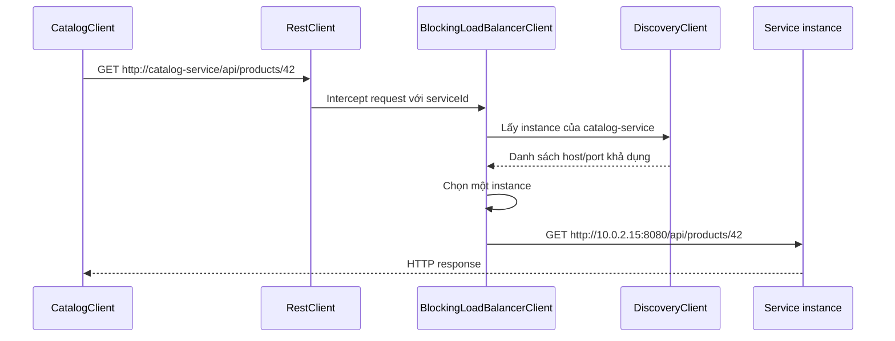

# Tạo RestClient.Builder dùng load balancer theo phiên bản

`RestClient` là HTTP client đồng bộ (blocking) có API fluent, được giới thiệu trong Spring Framework 6.1. Spring Boot 3.2 bổ sung hỗ trợ và auto-configuration cho client này. Spring Cloud Commons tích hợp `RestClient` với Spring Cloud LoadBalancer bằng bean `RestClient.Builder` được đánh dấu `@LoadBalanced`.

Cấu hình đúng giúp ứng dụng gọi dịch vụ bằng service ID, ví dụ `http://catalog-service`. Spring Cloud LoadBalancer tra cứu các instance của service đó, chọn một instance rồi chuyển request tới địa chỉ vật lý. Ứng dụng vẫn dùng API `RestClient` quen thuộc, còn việc chọn instance được thực hiện ở tầng client.

Bài học thuộc chương **Gọi dịch vụ** của module **SPRING_CLOUD_CORE**. Trọng tâm là tạo builder load-balanced đúng cách, giữ lại các tùy chỉnh của Spring Boot, phân biệt builder nội bộ với builder gọi API bên ngoài, và chọn đúng cặp Spring Boot/Spring Cloud để tránh dùng API không có trong phiên bản đang chạy.

## 1. Mục tiêu học tập

Sau bài học, người học có thể:

- Giải thích vai trò của `RestClient`, `RestClient.Builder` và Spring Cloud LoadBalancer.
- Xác định phiên bản Spring Boot tối thiểu có `RestClient`.
- Chọn Spring Cloud release train tương thích với Spring Boot.
- Khai báo dependency `spring-cloud-starter-loadbalancer` theo BOM.
- Tạo bean `RestClient.Builder` có qualifier `@LoadBalanced`.
- Dùng `RestClientBuilderConfigurer` để giữ các customizer và observability của Spring Boot.
- Inject đúng builder khi ứng dụng có cả client load-balanced và client thông thường.
- Gọi service bằng service ID thay vì hostname của một instance cụ thể.
- Kiểm thử việc phân giải service ID, chọn instance và xử lý khi không tìm thấy instance.

## 2. Phân biệt RestClient và RestClient.Builder

`RestClient` là đối tượng thực hiện HTTP request. `RestClient.Builder` là đối tượng cấu hình trước khi tạo client, ví dụ:

- Đặt base URL.
- Thêm header mặc định.
- Cấu hình message converter.
- Cấu hình request factory và interceptor.
- Cấu hình xử lý status code.
- Gắn observation registry và các tùy chỉnh phục vụ metrics/tracing.

Ví dụ client thông thường:

```java
RestClient client = RestClient.builder()
    .baseUrl("https://partner.example.com")
    .defaultHeader("Accept", "application/json")
    .build();
```

Địa chỉ `partner.example.com` là hostname thật được DNS phân giải. Nếu ứng dụng cần gọi một service nội bộ có nhiều instance, hostname cố định có thể không phản ánh danh sách instance đang đăng ký trong registry. Đây là trường hợp Spring Cloud LoadBalancer giải quyết.

### 2.1. RestClient là API đồng bộ

Một lời gọi `RestClient` chờ kết quả HTTP hoàn tất trước khi trả về. Vì vậy:

- Phù hợp với ứng dụng Spring MVC hoặc luồng xử lý đồng bộ.
- Không nên gọi trực tiếp trên event-loop thread của ứng dụng WebFlux.
- Nếu cần chuỗi xử lý reactive không blocking, dùng `WebClient` cùng reactive load balancer.

Không nhầm `RestClient` với `WebClient`. Cả hai đều có API fluent, nhưng mô hình thực thi và cách tích hợp load balancer khác nhau.

## 3. Điều kiện phiên bản để sử dụng RestClient

`RestClient` xuất hiện trong Spring Framework 6.1. Spring Boot 3.2 là thế hệ Boot đầu tiên tích hợp hỗ trợ chính thức cho API này. Spring Cloud Commons 4.1, thuộc release train 2023.0, đã có hướng dẫn tạo `@LoadBalanced RestClient.Builder`.

Do đó, mốc thực tế để dùng tích hợp này là **Spring Boot 3.2 trở lên và Spring Cloud release train tương thích**. Không nên ép một dự án Boot cũ dùng RestClient bằng cách ghi đè riêng phiên bản Spring Framework.

### 3.1. Bảng tương thích theo release train

| Spring Boot | Spring Cloud release train tương thích | Spring Cloud Commons tương ứng | Dùng RestClient? |
| --- | --- | --- | --- |
| 3.0.x – 3.1.x | 2022.0.x (Kilburn) | 4.0.x | Không có API RestClient trong Spring Framework 6.0 |
| 3.2.x | 2023.0.x (Leyton) | 4.1.x | Có |
| 3.3.x | 2023.0.2 trở lên | 4.1.x | Có |
| 3.4.x | 2024.0.x (Moorgate) | 4.2.x | Có |
| 3.5.x | 2025.0.x (Northfields) | 4.3.x | Có |
| 4.0.x | 2025.1.x (Oakwood) | 5.0.x | Có |
| 4.1.x | 2025.1.2 trở lên | 5.0.x | Có |

Bảng trên là ánh xạ tương thích giữa các thế hệ release train. Hãy kiểm tra trang Spring Cloud chính thức để biết service release mới nhất và tình trạng hỗ trợ trước khi nâng cấp. Tại thời điểm biên soạn, trang dự án liệt kê Spring Cloud 2025.1.4 là bản ổn định mới nhất; các release train cũ được đánh dấu EOL trong bảng hỗ trợ OSS.

### 3.2. Vì sao phải dùng BOM?

Spring Cloud gồm nhiều dự án có quan hệ phụ thuộc với Spring Boot và Spring Framework. Nếu tự chọn phiên bản riêng cho Commons, LoadBalancer hoặc discovery client, dependency có thể không tương thích.

Dùng BOM để quản lý đồng bộ:

```xml
<properties>
    <spring-cloud.version>2025.1.4</spring-cloud.version>
</properties>

<dependencyManagement>
    <dependencies>
        <dependency>
            <groupId>org.springframework.cloud</groupId>
            <artifactId>spring-cloud-dependencies</artifactId>
            <version>${spring-cloud.version}</version>
            <type>pom</type>
            <scope>import</scope>
        </dependency>
    </dependencies>
</dependencyManagement>
```

Nếu dự án dùng Spring Boot 3.5, phải chọn release train tương thích với Boot 3.5 thay vì sao chép phiên bản BOM ở ví dụ Boot 4.1. Giá trị trong ví dụ chỉ minh họa cách khai báo; phiên bản thật phải theo cặp Boot/Cloud của dự án.

### 3.3. Dependency cần thiết

Thêm starter của Spring Cloud LoadBalancer:

```xml
<dependency>
    <groupId>org.springframework.cloud</groupId>
    <artifactId>spring-cloud-starter-loadbalancer</artifactId>
</dependency>
```

Starter cung cấp hạ tầng load balancing cho các HTTP client tích hợp. Để có danh sách instance, ứng dụng cần một nguồn service discovery phù hợp, chẳng hạn Eureka, Consul hoặc Zookeeper. Nếu không có registry-backed discovery client, Spring Cloud có thể dùng `SimpleDiscoveryClient` với danh sách instance khai báo bằng properties.

Không tự thêm version cho starter khi đã import BOM. BOM sẽ chọn version tương thích.

## 4. Tạo RestClient.Builder được load balance

Để Spring Cloud áp dụng load balancer, hãy tạo bean `RestClient.Builder` và đánh dấu bằng `@LoadBalanced`:

```java
import org.springframework.boot.autoconfigure.web.client.RestClientBuilderConfigurer;
import org.springframework.cloud.client.loadbalancer.LoadBalanced;
import org.springframework.context.annotation.Bean;
import org.springframework.context.annotation.Configuration;
import org.springframework.web.client.RestClient;

@Configuration(proxyBeanMethods = false)
public class LoadBalancedRestClientConfiguration {

    @Bean
    @LoadBalanced
    RestClient.Builder loadBalancedRestClientBuilder(
            RestClientBuilderConfigurer configurer) {

        return configurer.configure(RestClient.builder());
    }
}
```

Hai thành phần có vai trò riêng:

- `@LoadBalanced` là qualifier đánh dấu builder dành cho request cần phân giải service ID qua Spring Cloud LoadBalancer.
- `RestClientBuilderConfigurer` áp dụng các customizer do Spring Boot cung cấp cho builder, bao gồm cấu hình HTTP client và observability khi các thành phần tương ứng có mặt.

Không bỏ qua `RestClientBuilderConfigurer` một cách tùy tiện. Nếu tự tạo builder mà không áp dụng cấu hình Boot, ứng dụng có thể mất các tùy chỉnh mặc định mà dự án đang dựa vào, ví dụ instrumentation cho HTTP client.

### 4.1. Vì sao không chỉ tạo RestClient.builder()?

`RestClient.builder()` tạo builder thuần của Spring Framework. Nó không tự biết rằng hostname trong URI là service ID và cần được tra cứu qua registry.

Bean `@LoadBalanced RestClient.Builder` được Spring Cloud nhận diện và bổ sung cơ chế load balancing. Khi client được build từ builder này, request tới hostname logic như `catalog-service` sẽ được xử lý qua `BlockingLoadBalancerClient`.

Nếu inject builder thường rồi gọi `http://catalog-service`, HTTP client có thể coi đó là hostname DNS thông thường. Khi DNS không có record tương ứng, request sẽ thất bại với lỗi phân giải tên.

## 5. Dùng builder để tạo client cho một service cụ thể

Ví dụ ứng dụng gọi dịch vụ catalog:

```java
import org.springframework.cloud.client.loadbalancer.LoadBalanced;
import org.springframework.stereotype.Component;
import org.springframework.web.client.RestClient;

@Component
public class CatalogClient {

    private final RestClient restClient;

    public CatalogClient(
            @LoadBalanced RestClient.Builder builder) {

        this.restClient = builder.clone()
            .baseUrl("http://catalog-service")
            .build();
    }

    public ProductResponse findProduct(String productId) {
        return restClient.get()
            .uri("/api/products/{id}", productId)
            .retrieve()
            .body(ProductResponse.class);
    }
}
```

Trong ví dụ:

- `catalog-service` là service ID được dùng trong discovery.
- `/api/products/{id}` là path của API trên instance được chọn.
- `builder.clone()` tạo bản sao để cấu hình base URL riêng mà không làm thay đổi builder được chia sẻ.
- `build()` tạo một `RestClient` có thể được giữ làm dependency bất biến của component.

`RestClient.Builder` là builder mutable và có phương thức `clone()`. Khi nhiều component cùng nhận một builder bean, hãy clone trước khi đặt base URL, default header hoặc interceptor riêng cho từng client. Điều này tránh cấu hình của client này ảnh hưởng client khác.

### 5.1. Gọi bằng URI đầy đủ

Có thể không đặt base URL mà truyền URI đầy đủ tại thời điểm request:

```java
@Service
public class PricingClient {

    private final RestClient restClient;

    public PricingClient(
            @LoadBalanced RestClient.Builder builder) {
        this.restClient = builder.clone().build();
    }

    public PriceResponse getPrice(String sku) {
        return restClient.get()
            .uri("http://pricing-service/api/prices/{sku}", sku)
            .retrieve()
            .body(PriceResponse.class);
    }
}
```

Cả hai cách đều dùng service ID trong phần host của URI. Chọn một cách thống nhất trong dự án để dễ kiểm tra và quản lý base path.

## 6. Service ID được phân giải thành địa chỉ vật lý như thế nào?

Khi `RestClient` gửi request qua builder load-balanced, luồng xử lý có thể hình dung như sau:



Trong URI logic `http://catalog-service`:

- Scheme `http` cho biết giao thức.
- Host `catalog-service` là service ID.
- Port và IP thực tế được lấy từ `ServiceInstance`.
- Path được giữ lại để gửi tới instance đã chọn.

Theo cấu hình mặc định, Spring Cloud LoadBalancer sử dụng thuật toán round-robin để chọn instance. Ứng dụng có thể cấu hình thuật toán hoặc danh sách instance supplier riêng theo từng service.

### 6.1. Dùng service ID, không dùng IP instance cố định

Ví dụ phù hợp:

```java
restClient.get()
    .uri("http://catalog-service/api/products")
    .retrieve()
    .body(ProductList.class);
```

Ví dụ không dùng load balancing:

```java
restClient.get()
    .uri("http://10.0.2.15:8080/api/products")
    .retrieve()
    .body(ProductList.class);
```

Trong ví dụ thứ hai, host là IP vật lý. LoadBalancer không có service ID để tra cứu danh sách instance. Request sẽ đi thẳng tới địa chỉ đã chỉ định.

Không dùng `lb://catalog-service` trong URI của `RestClient` theo cách cấu hình thông thường ở trên. Scheme `lb://` thường xuất hiện trong route của Spring Cloud Gateway; với `RestClient` load-balanced, dùng URI HTTP(S) có host là service ID.

## 7. Kết hợp với Service Discovery

Spring Cloud LoadBalancer cần biết các instance hiện có. Nguồn danh sách có thể là một discovery implementation hoặc cấu hình tĩnh.

### 7.1. Dùng Eureka hoặc Consul

Nếu ứng dụng dùng Eureka, thêm starter Eureka Client tương thích:

```xml
<dependency>
    <groupId>org.springframework.cloud</groupId>
    <artifactId>spring-cloud-starter-netflix-eureka-client</artifactId>
</dependency>
```

Hoặc dùng Consul Discovery:

```xml
<dependency>
    <groupId>org.springframework.cloud</groupId>
    <artifactId>spring-cloud-starter-consul-discovery</artifactId>
</dependency>
```

Khi discovery implementation được đưa vào classpath và cấu hình kết nối registry hợp lệ, Spring Cloud có thể cung cấp `DiscoveryClient`. Với các cấu hình hiện hành, không cần thêm `@EnableDiscoveryClient` chỉ để kích hoạt discovery; implementation trên classpath đã đủ để bật auto-configuration tương ứng.

Các instance phải đăng ký service ID phù hợp. Nếu service đăng ký dưới tên `catalog-api` nhưng client gọi `catalog-service`, LoadBalancer sẽ không tìm thấy instance.

### 7.2. Dùng SimpleDiscoveryClient khi chưa có registry

Trong môi trường thử nghiệm, có thể khai báo instance trực tiếp:

```yaml
spring:
  cloud:
    discovery:
      client:
        simple:
          instances:
            catalog-service:
              - uri: http://localhost:18081
              - uri: http://localhost:18082
```

Giờ đây request tới `http://catalog-service` có thể được phân phối tới một trong hai địa chỉ trên. Đây là cấu hình hữu ích để kiểm thử load balancing mà không cần dựng Eureka hoặc Consul.

`SimpleDiscoveryClient` được dùng khi không có discovery client dựa trên service registry trong classpath. Nếu ứng dụng đã có registry-backed client, hãy cấu hình hoặc mock đúng discovery implementation trong test thay vì giả định simple client sẽ tự động thắng.

## 8. Có cả builder thường và builder load-balanced

Một ứng dụng thường gọi cả service nội bộ lẫn API bên ngoài. Không nên dùng cùng một builder load-balanced cho mọi hostname.

- `@LoadBalanced RestClient.Builder` dành cho URI có host là service ID.
- Builder thông thường dành cho URI có hostname DNS thật, ví dụ API đối tác hoặc public endpoint.

Khi khai báo hai builder rõ ràng:

```java
import org.springframework.boot.autoconfigure.web.client.RestClientBuilderConfigurer;
import org.springframework.cloud.client.loadbalancer.LoadBalanced;
import org.springframework.context.annotation.Bean;
import org.springframework.context.annotation.Configuration;
import org.springframework.context.annotation.Primary;
import org.springframework.web.client.RestClient;

@Configuration(proxyBeanMethods = false)
public class HttpClientConfiguration {

    @Bean
    @LoadBalanced
    RestClient.Builder loadBalancedBuilder(
            RestClientBuilderConfigurer configurer) {
        return configurer.configure(RestClient.builder());
    }

    @Bean
    @Primary
    RestClient.Builder directBuilder(
            RestClientBuilderConfigurer configurer) {
        return configurer.configure(RestClient.builder());
    }
}
```

`@Primary` đánh dấu builder thường là lựa chọn mặc định khi injection không có qualifier. Nó không biến builder thường thành load-balanced. Khi cần gọi service nội bộ, luôn inject với `@LoadBalanced`.

Ví dụ component gọi API bên ngoài:

```java
@Component
public class PartnerClient {

    private final RestClient restClient;

    public PartnerClient(RestClient.Builder directBuilder) {
        this.restClient = directBuilder.clone()
            .baseUrl("https://partner.example.com")
            .build();
    }
}
```

Ví dụ component gọi service nội bộ:

```java
@Component
public class InventoryClient {

    private final RestClient restClient;

    public InventoryClient(
            @LoadBalanced RestClient.Builder loadBalancedBuilder) {
        this.restClient = loadBalancedBuilder.clone()
            .baseUrl("http://inventory-service")
            .build();
    }
}
```

Nếu chỉ có một builder load-balanced và không có builder thường, việc inject không qualifier có thể vẫn lấy bean đó tùy cấu hình context. Tuy nhiên, khi có nhiều builder, hãy dùng qualifier rõ ràng để tránh chọn sai client.

## 9. Giữ observability và cấu hình HTTP của Spring Boot

`RestClientBuilderConfigurer` là điểm nối để áp dụng các `RestClientCustomizer` và cấu hình do Spring Boot auto-configure. Điều này quan trọng khi ứng dụng dùng:

- Micrometer observations và metrics HTTP client.
- Tracing/correlation metadata.
- Request factory được Boot lựa chọn theo dependency trên classpath.
- Message converters và customizer chung của ứng dụng.

Mẫu cấu hình nên dùng:

```java
@Bean
@LoadBalanced
RestClient.Builder loadBalancedRestClientBuilder(
        RestClientBuilderConfigurer configurer) {

    return configurer.configure(RestClient.builder());
}
```

Nếu bỏ qua configurer, builder vẫn có thể gọi service thông qua LoadBalancer khi hạ tầng load-balanced đã được gắn, nhưng các tùy chỉnh mặc định của Boot có thể không được áp dụng. Khi đó metrics/tracing hoặc request factory có thể khác với client được Boot auto-configure.

Nếu cần custom timeout hoặc HTTP transport riêng, hãy cấu hình bằng request factory phù hợp với phiên bản Spring Framework/Boot đang dùng, sau đó kiểm thử rằng interceptor load balancer vẫn còn trong builder.

## 10. Kiểm thử RestClient.Builder load-balanced

Một bài kiểm thử tốt cần xác nhận ít nhất bốn điều:

1. Builder được inject là builder có qualifier `@LoadBalanced`.
2. URI dùng service ID thay vì hostname/IP của instance.
3. Discovery trả về các instance có thể chọn.
4. Request được gửi tới địa chỉ vật lý của instance và nhận đúng response.

### 10.1. Kiểm thử với hai instance cục bộ

Dùng hai HTTP server giả lập, chẳng hạn WireMock hoặc MockWebServer, chạy trên hai port khác nhau. Khai báo chúng cho `SimpleDiscoveryClient`:

```yaml
spring:
  cloud:
    discovery:
      client:
        simple:
          instances:
            catalog-service:
              - uri: http://localhost:18081
              - uri: http://localhost:18082
```

Sau đó gọi nhiều lần tới `http://catalog-service` và kiểm tra request được chuyển tới các instance theo thuật toán đã cấu hình. Với round-robin, một test có thể quan sát các lần chọn luân phiên nếu supplier và cache trong test được thiết lập để kết quả xác định.

Không nên khẳng định test phải luôn bắt đầu ở instance số 0. Thứ tự lựa chọn có thể phụ thuộc trạng thái của load balancer, context theo service ID và cache/supplier. Hãy kiểm tra tập instance được sử dụng hoặc cấu hình test supplier để tạo thứ tự xác định.

### 10.2. Kiểm tra service không tồn tại

Khai báo client gọi `http://missing-service` nhưng không cung cấp instance tương ứng. Kết quả cần là lỗi không tìm thấy instance từ LoadBalancer, không phải request được gửi đến một máy chủ ngẫu nhiên.

Ca test này giúp phát hiện khi:

- Service ID bị gõ sai.
- Registry chưa có instance.
- Instance đã bị deregister.
- Discovery client không kết nối được registry.
- Builder thực tế là builder thường và cố phân giải service ID như DNS.

### 10.3. Kiểm tra builder thường và builder load-balanced

Tạo hai bean có qualifier khác nhau, inject vào hai component và xác nhận:

- Builder load-balanced gọi service ID nội bộ.
- Builder thường gọi hostname DNS thật.
- Không có bean injection mơ hồ khi một builder được đánh dấu `@Primary`.
- Cấu hình riêng của từng client không ảnh hưởng builder còn lại.

### 10.4. Kiểm tra lỗi HTTP và timeout

Load balancing chỉ chọn instance và chuyển request. Nó không tự thay thế chính sách timeout, xử lý status code hoặc retry của ứng dụng.

Hãy kiểm thử riêng:

- Instance phản hồi 4xx/5xx.
- Instance đóng kết nối giữa chừng.
- Request vượt timeout.
- Không còn instance khả dụng.
- Một instance lỗi nhưng instance khác còn hoạt động.
- Retry được bật hay tắt theo cấu hình của release train.

Với thao tác ghi như POST thanh toán hoặc tạo đơn hàng, không bật retry mù quáng. Chỉ retry khi API có idempotency key hoặc hợp đồng nghiệp vụ bảo đảm không tạo tác dụng phụ trùng lặp.

## 11. Các lỗi thường gặp

| Triệu chứng | Nguyên nhân có thể | Cách kiểm tra |
| --- | --- | --- |
| `UnknownHostException: catalog-service` | Builder không được load balance hoặc starter thiếu | Kiểm tra bean `@LoadBalanced`, dependency và qualifier khi inject |
| Không tìm thấy instance | Service ID không khớp hoặc discovery không trả instance | Kiểm tra registry, service ID và `DiscoveryClient` |
| Bean `RestClient.Builder` bị mơ hồ | Có nhiều builder mà injection không có qualifier/primary | Đánh dấu builder thường `@Primary`, inject builder nội bộ bằng `@LoadBalanced` |
| Không tìm thấy class `RestClient` | Spring Boot/Framework quá cũ | Kiểm tra Boot 3.2+ và Spring Framework 6.1+ |
| Không tìm thấy `RestClientBuilderConfigurer` | Dependency Boot không đúng thế hệ hoặc import sai package | Kiểm tra Boot 3.2+ và package `org.springframework.boot.autoconfigure.web.client` |
| Request đi thẳng tới IP cố định | URI chứa hostname/IP thật thay vì service ID | Dùng host là service ID trong URI |
| API đối tác bị lỗi phân giải service | Đang dùng builder load-balanced cho hostname DNS bên ngoài | Dùng builder thường cho external API |
| Metrics/tracing của HTTP client thiếu | Builder tự tạo không áp dụng Boot configurer/customizer | Dùng `RestClientBuilderConfigurer` và kiểm tra observation registry |
| Cấu hình base URL của client khác bị thay đổi | Nhiều component sửa chung builder mutable | Clone builder trước khi đặt base URL hoặc header riêng |
| Gateway MVC báo không tìm thấy service instance | Internal proxy RestClient bị gắn `@LoadBalanced` không đúng chỗ | Dùng `lb()` filter/`lb://` route của Gateway thay vì load balance internal RestClient |

## 12. Lưu ý riêng theo phiên bản và cách triển khai

### 12.1. Dự án Boot 3.0 hoặc 3.1

Các phiên bản này dùng Spring Framework 6.0 và chưa có `RestClient`. Hãy dùng `RestTemplate` hoặc `WebClient` với tích hợp load balancer tương ứng. Đừng thêm riêng Spring Framework 6.1 vào dependency để lấy class `RestClient` trong khi vẫn giữ Spring Boot 3.0/3.1; việc trộn thế hệ Framework có thể phá vỡ dependency alignment.

### 12.2. Dự án Boot 3.2 trở lên

Boot 3.2 đi cùng Spring Framework 6.1 và cung cấp cấu hình `RestClient`. Chọn Spring Cloud 2023.0.x hoặc release train tương thích với Boot hiện tại. Spring Cloud Commons 4.1.x đã có tích hợp `RestClient` load-balanced.

Với Boot 3.3, chọn service release phù hợp của 2023.0.x; bảng compatibility chính thức bắt đầu ánh xạ Boot 3.3 từ 2023.0.2.

### 12.3. Dự án Boot 4.x

Boot 4.x cần Spring Cloud release train thuộc thế hệ tương ứng. Theo bảng tương thích hiện hành:

- Boot 4.0.x dùng Spring Cloud 2025.1.x.
- Boot 4.1.x cần Spring Cloud 2025.1.2 trở lên.

Không dùng Spring Cloud 2025.0.x với Boot 4.0.1+; release train 2025.1 được tạo để hỗ trợ thế hệ Boot 4.0 mới hơn. Hãy luôn kiểm tra service release mới nhất trước khi cập nhật.

### 12.4. Ứng dụng Spring Cloud Gateway

Gateway có cơ chế routing/load balancing riêng. Với Spring Cloud Gateway Server MVC, không gắn `@LoadBalanced` cho RestClient nội bộ mà Gateway dùng để proxy route. Gateway cần áp dụng `lb()` filter hoặc URI `lb://` ở route definition. Nếu một RestClient nội bộ bị load balance trước khi Gateway xử lý route, service ID chưa được giải quyết đúng thời điểm và có thể gây lỗi không tìm thấy instance.

## 13. Bài tập vận dụng

Một ứng dụng `order-service` cần gọi hai dịch vụ:

- `catalog-service` chạy ba instance trong Eureka.
- API đối tác `https://shipping.example.com` có hostname DNS cố định.

Hãy thực hiện:

1. Chọn Spring Boot và Spring Cloud release train tương thích để dùng `RestClient`.
2. Thêm BOM và `spring-cloud-starter-loadbalancer`.
3. Tạo bean `@LoadBalanced RestClient.Builder` dùng `RestClientBuilderConfigurer`.
4. Tạo `CatalogClient` gọi `http://catalog-service/api/products/{id}`.
5. Tạo builder thường cho `ShippingClient` gọi `https://shipping.example.com`.
6. Dùng `@Primary` và qualifier để giải quyết trường hợp có nhiều builder.
7. Kiểm tra registry trả đủ ba instance của `catalog-service`.
8. Gọi nhiều request và quan sát instance được chọn.
9. Xóa một instance khỏi registry rồi xác nhận client tiếp tục gọi các instance còn lại.
10. Kiểm thử service ID không tồn tại, timeout, HTTP 5xx và retry cho request có/không có tính idempotent.

**Tiêu chí hoàn thành:** ứng dụng chọn đúng release train; request nội bộ dùng service ID và được LoadBalancer phân phối; request đối tác dùng builder thường; không có bean injection mơ hồ; test chứng minh request đi tới instance được registry trả về.

## 14. Ghi nhớ

- `RestClient` là HTTP client đồng bộ được giới thiệu trong Spring Framework 6.1; Spring Boot 3.2 có hỗ trợ chính thức.
- Spring Cloud Commons 4.1 trở lên có tích hợp `@LoadBalanced RestClient.Builder`.
- Cần `spring-cloud-starter-loadbalancer` và một nguồn instance từ discovery hoặc `SimpleDiscoveryClient`.
- Đánh dấu builder load-balanced bằng `@LoadBalanced`; inject đúng qualifier khi tạo client.
- Dùng `RestClientBuilderConfigurer` để giữ customizer, request factory và observability của Spring Boot.
- URI load-balanced dùng service ID làm host, ví dụ `http://catalog-service`; LoadBalancer chuyển nó thành địa chỉ vật lý.
- Dùng builder thường cho API ngoài có hostname DNS thật.
- `RestClient.Builder` mutable; clone trước khi cấu hình base URL hoặc header riêng cho từng client.
- Boot 3.0/3.1 chưa có `RestClient`; Boot 3.2 trở lên mới dùng API này theo dependency alignment tương ứng.
- Load balancing không thay thế timeout, retry, circuit breaker, bảo mật hoặc kiểm tra khả năng truy cập của instance.

## 15. Tài liệu tham khảo

- [Spring Cloud Commons — Spring RestClient as a LoadBalancer Client](https://docs.spring.io/spring-cloud-commons/reference/spring-cloud-commons/common-abstractions.html): khai báo `@LoadBalanced RestClient.Builder`, `RestClientBuilderConfigurer`, URI service ID và nhiều builder.
- [Spring Cloud LoadBalancer](https://docs.spring.io/spring-cloud-commons/reference/spring-cloud-commons/loadbalancer.html): `BlockingLoadBalancerClient`, `ServiceInstanceListSupplier`, thuật toán chọn instance và cache.
- [Spring Cloud project — Release Train Compatibility](https://spring.io/projects/spring-cloud/): bảng tương thích Spring Boot/Spring Cloud và service release mới nhất.
- [Spring Boot 3.2 Release Notes — RestClient Support](https://github.com/spring-projects/spring-boot/wiki/Spring-Boot-3.2-Release-Notes): hỗ trợ `RestClient` trong Spring Boot 3.2.
- [Spring Framework 6.1 — RestClient](https://spring.io/blog/2023/07/13/new-in-spring-6-1-restclient): giới thiệu HTTP client đồng bộ `RestClient`.
- [RestClient.Builder API](https://docs.spring.io/spring-framework/docs/6.1.x/javadoc-api/org/springframework/web/client/RestClient.Builder.html): các thao tác builder, `baseUrl`, interceptor, request factory và `clone()`.
- [Spring Cloud Gateway MVC — LoadBalancer filter](https://docs.spring.io/spring-cloud-gateway/reference/spring-cloud-gateway-server-webmvc/filters/loadbalancer.html): cách Gateway MVC xử lý route load-balanced.

