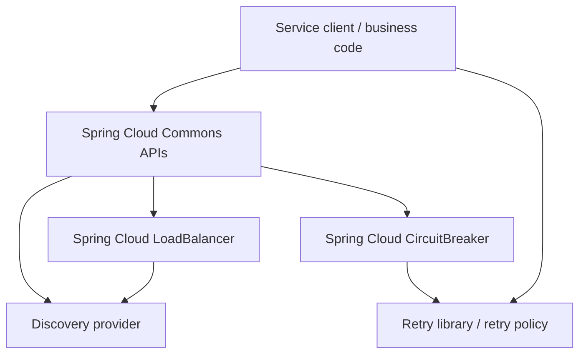

# Ranh giới của Commons với chính sách retry, circuit breaker và load balancing chuyên sâu

Spring Cloud Commons cung cấp các hợp đồng chung để ứng dụng làm việc với discovery, đăng ký dịch vụ, client-side load balancing và circuit breaker mà không phụ thuộc trực tiếp vào một nhà cung cấp cụ thể. Tuy nhiên, **abstraction không đồng nghĩa với policy implementation**. Commons giúp các thành phần trao đổi qua API thống nhất; thuật toán chọn instance, chiến lược retry, ngưỡng circuit breaker, cửa sổ thống kê và hành vi fallback thường do module triển khai chuyên biệt hoặc thư viện resilience đảm nhiệm.

Khi thiết kế một client gọi dịch vụ, cần phân biệt ba câu hỏi:

- **Tìm và chọn đích:** dịch vụ có những instance nào, và request này đi tới instance nào?
- **Thử lại:** nếu một lần gọi thất bại, có nên gửi lại request, gửi bao nhiêu lần và tới instance nào?
- **Ngắt mạch:** khi downstream đang lỗi kéo dài, khi nào nên từ chối lời gọi mới để tránh làm tình trạng xấu hơn?

Các cơ chế này phối hợp với nhau nhưng không thay thế nhau. Load balancing không tự tạo retry; retry không phải circuit breaker; circuit breaker không tự tìm instance. Bài học thuộc chương **Gọi dịch vụ** của module `SPRING_CLOUD_CORE`, tập trung vào ranh giới giữa Commons API và các implementation/policy chuyên sâu, cách chọn dependency, thứ tự áp dụng và cách kiểm thử.

## 1. Commons cung cấp hợp đồng chung, không quyết định mọi policy

Spring Cloud Commons là lớp nền chung cho nhiều tích hợp Spring Cloud. Nó định nghĩa các abstraction để ứng dụng không phải phụ thuộc trực tiếp vào API riêng của Eureka, Consul hoặc một thư viện resilience cụ thể.

Một số abstraction thường gặp:

| Abstraction | Vai trò | Điều nó không tự quyết định |
| --- | --- | --- |
| `DiscoveryClient` | Tra cứu service ID và danh sách `ServiceInstance` | Không tự chọn retry policy hoặc circuit breaker threshold |
| `ServiceRegistry` / `Registration` | Đăng ký, cập nhật trạng thái và hủy đăng ký instance | Không chọn instance cho từng HTTP request |
| `LoadBalancerClient` | API đồng bộ để chọn hoặc thực thi request trên một instance | Không phải toàn bộ thuật toán/policy load balancing |
| `ServiceInstance` | Mô tả host, port, URI, secure và metadata | Không kiểm tra endpoint sống tại thời điểm request |
| `CircuitBreaker` / `CircuitBreakerFactory` | Hợp đồng để gọi qua circuit breaker và tạo breaker theo ID | Không tự xác định mọi threshold, sliding window hay implementation |

Các interface này cho phép module khác cung cấp implementation. Ví dụ, discovery provider cung cấp `DiscoveryClient`; Spring Cloud LoadBalancer cung cấp cơ chế client-side chọn instance; Spring Cloud CircuitBreaker tích hợp thư viện như Resilience4j để thực thi circuit breaker.



Sơ đồ thể hiện ranh giới trách nhiệm ở mức khái niệm. Một ứng dụng không nhất thiết phải dùng mọi module; dependency graph thực tế phụ thuộc client stack và kiến trúc.

## 2. Ranh giới của từng lớp

### 2.1. Discovery và registration

`DiscoveryClient` trả danh sách instance theo service ID. Nó trả lời câu hỏi “dịch vụ nào đang được công bố và các endpoint của chúng là gì?”. `ServiceRegistry` liên quan đến đăng ký và trạng thái của instance hiện tại.

Ví dụ tra cứu:

```java
List<ServiceInstance> instances =
        discoveryClient.getInstances("catalog-service");
```

Đoạn code này chưa chọn instance theo round-robin, chưa gọi HTTP và chưa retry. Nó chỉ lấy dữ liệu discovery. Registry cũng không tự quyết định một request nên thử lại bao nhiêu lần.

### 2.2. Load balancing

Load balancing nhận danh sách instance và chọn một instance cho request. Trong Spring Cloud, `LoadBalancerClient` là abstraction ở Commons; Spring Cloud LoadBalancer là implementation phổ biến cung cấp các thành phần như `ReactorLoadBalancer`, `ServiceInstanceListSupplier` và các policy lựa chọn.

Ví dụ dùng API chọn instance:

```java
ServiceInstance instance =
        loadBalancerClient.choose("catalog-service");

if (instance == null) {
    throw new IllegalStateException(
            "No instance available for catalog-service");
}

URI target = instance.getUri();
```

Ví dụ này chỉ minh họa thao tác chọn một instance. Trong ứng dụng thông thường, nên dùng HTTP client tích hợp `@LoadBalanced` để LoadBalancer xử lý việc resolve service ID trong request. Không nên tự viết logic chọn instance trong mỗi service nếu đã có LoadBalancer integration.

### 2.3. Retry

Retry quyết định có gửi lại một thao tác sau lỗi hay không. Nó cần phân loại lỗi có thể thử lại, số lần thử tối đa, backoff, jitter, deadline và điều kiện dừng.

Retry có thể được triển khai bằng Spring Retry, Resilience4j Retry, retry support của Spring Cloud LoadBalancer hoặc một cơ chế riêng. Commons không áp đặt một chính sách retry nghiệp vụ chung cho mọi lời gọi.

### 2.4. Circuit breaker

Circuit breaker theo dõi kết quả lời gọi và tạm ngăn các lời gọi mới khi downstream có dấu hiệu lỗi vượt ngưỡng. Nó thường có các trạng thái:

- **Closed:** cho phép request đi qua và ghi nhận kết quả.
- **Open:** từ chối request ngay, thường chuyển sang fallback hoặc lỗi có kiểm soát.
- **Half-open:** cho phép một số request thăm dò để đánh giá downstream đã phục hồi chưa.

Commons cung cấp abstraction `CircuitBreaker` và factory tương ứng; Spring Cloud CircuitBreaker kết nối abstraction đó với implementation như Resilience4j. Circuit breaker không tự chọn service instance và không mặc định retry request bị lỗi.

## 3. Commons và Spring Cloud LoadBalancer

### 3.1. LoadBalancerClient là abstraction

`LoadBalancerClient` nằm trong nhóm API chung của Spring Cloud. Nó cung cấp cách chọn một `ServiceInstance` theo service ID và các thao tác thực thi request qua instance được chọn.

Code có thể phụ thuộc vào abstraction này thay vì một implementation registry cụ thể. Tuy nhiên, để hoạt động cần có implementation và nguồn instance phù hợp trong runtime.

### 3.2. Spring Cloud LoadBalancer cung cấp implementation

Spring Cloud LoadBalancer là module client-side load balancing. Nó cung cấp các extension point để kiểm soát cách danh sách instance được cung cấp và cách chọn một instance.

Các thành phần quan trọng:

| Thành phần | Vai trò |
| --- | --- |
| `ServiceInstanceListSupplier` | Cung cấp danh sách instance cho LoadBalancer |
| `ReactorLoadBalancer` | Hợp đồng lựa chọn instance trong flow reactive |
| `RoundRobinLoadBalancer` | Chọn instance theo vòng luân phiên |
| `RandomLoadBalancer` | Chọn instance ngẫu nhiên |
| `LoadBalancerLifecycle` | Hook theo dõi các giai đoạn của request |
| `LoadBalancerClient` | API đồng bộ ở lớp Commons để code gọi dùng abstraction |

Không phải tất cả policy nâng cao đều có sẵn dưới dạng một thuộc tính cấu hình duy nhất. Một số hành vi cần custom supplier, custom load balancer hoặc cấu hình theo service ID.

### 3.3. Các policy load balancing chuyên sâu

Các nhu cầu thường gặp:

| Nhu cầu | Cách tiếp cận |
| --- | --- |
| Round-robin | Dùng policy round-robin phù hợp |
| Random | Dùng policy random |
| Ưu tiên cùng zone | Cung cấp metadata zone và supplier/policy lọc theo zone |
| Loại instance không khỏe | Dùng health-check supplier hoặc nguồn discovery có health status phù hợp |
| Ưu tiên version/canary | Dùng metadata/hint và custom supplier/policy |
| Trọng số theo năng lực | Cần policy có trọng số hoặc custom implementation |
| Sticky session | Cần chính sách gắn request/user với instance; không mặc định có trong round-robin |
| Cache danh sách instance | Cấu hình cache supplier và TTL phù hợp với yêu cầu freshness |
| Retry sang instance khác | Dùng retry integration của LoadBalancer và chính sách loại instance đã thử |

Metadata chỉ có tác dụng khi supplier hoặc policy đọc và sử dụng nó. Việc đăng ký `zone=zone-a` không tự làm LoadBalancer ưu tiên zone đó nếu chưa cấu hình hành vi tương ứng.

### 3.4. Chọn instance không phải health guarantee

Một instance có trong danh sách discovery có thể vừa bị dừng, mất route hoặc quá tải. LoadBalancer lựa chọn từ dữ liệu hiện có; request vẫn có thể thất bại khi kết nối thực tế.

Cần kết hợp health registration, timeout, retry có giới hạn và circuit breaker. Không nên coi việc LoadBalancer chọn được instance là bằng chứng downstream chắc chắn xử lý được request.

## 4. Retry nằm ở đâu?

### 4.1. Retry nghiệp vụ và retry transport

Không phải lỗi nào cũng nên retry.

| Loại lỗi | Có thể retry? | Lưu ý |
| --- | --- | --- |
| Connection reset tạm thời | Có thể | Chỉ trong ngân sách retry và deadline |
| Timeout | Có thể, có điều kiện | Request có thể đã được server xử lý; cần idempotency |
| HTTP 503 / 502 | Có thể | Phụ thuộc Retry-After, nguyên nhân và chính sách |
| HTTP 400 do dữ liệu sai | Thường không | Gửi lại cùng payload không sửa được lỗi |
| HTTP 401 / 403 | Thường không | Cần xử lý credential/quyền, không lặp vô hạn |
| HTTP 404 | Thường không | Có ngoại lệ khi eventual consistency được thiết kế rõ |
| Validation/business rejection | Thường không | Retry không thay đổi điều kiện nghiệp vụ |
| No instance available | Có thể chờ hoặc retry ngắn | Cần tránh tạo vòng lặp chờ không giới hạn |

Retry nên chỉ áp dụng cho lỗi tạm thời có khả năng thành công ở lần tiếp theo. Phân loại lỗi phải dựa trên semantics API và transport, không chỉ bắt mọi `Exception`.

### 4.2. Số lần thử và backoff

Một retry policy thường định nghĩa:

- Số lần thử tối đa, tính rõ là tổng số lần gọi hay số lần retry thêm.
- Khoảng chờ giữa các lần thử.
- Backoff tăng dần, ví dụ exponential backoff.
- Jitter để nhiều client không retry đồng thời.
- Danh sách exception/status có thể retry.
- Deadline tổng của thao tác.
- Điều kiện hủy khi caller đã timeout hoặc request bị cancel.

Ví dụ policy minh họa:

```text
maxAttempts = 3
initialBackoff = 100 ms
backoffMultiplier = 2
maxBackoff = 1 second
jitter = enabled
retryOn = transient connection errors, selected 5xx
doNotRetryOn = validation errors, authentication errors
```

Giá trị trên chỉ là ví dụ. Cần tính theo SLA, latency downstream, số replica và ngân sách thời gian của request caller.

### 4.3. RetryTemplate là một lựa chọn riêng

Nếu ứng dụng dùng Spring Retry, có thể bao một lời gọi bằng `RetryTemplate`:

```java
public CatalogItem loadCatalogItem(String id) {
    return retryTemplate.execute(context ->
            catalogHttpClient.findById(id));
}
```

`retryTemplate` cần được cấu hình riêng về retryable exception, số lần thử, backoff và recovery. Việc dùng `RetryTemplate` không tự động làm LoadBalancer chọn instance khác ở lần thử tiếp theo; điều đó phụ thuộc cách lời gọi được tích hợp với LoadBalancer và vị trí retry trong call chain.

Spring Retry là thư viện riêng. Không nên gán chính sách retry của Spring Retry cho Spring Cloud Commons.

### 4.4. Retry của Spring Cloud LoadBalancer

Spring Cloud LoadBalancer có retry support cho các client integration được hỗ trợ. Nó có thể kết hợp lựa chọn instance và retry, bao gồm khả năng thử instance khác tùy cấu hình/supplier và loại request context.

Đây là retry ở lớp client-side load balancing, khác với retry nghiệp vụ ở service layer. Hãy đọc cấu hình retry của đúng release train, xác định exception/status nào được retry và cách supplier loại instance đã thử. Không giả định mọi HTTP client hoặc mọi request method đều có cùng behavior.

## 5. Circuit breaker: abstraction và implementation

### 5.1. CircuitBreaker trong Commons

Spring Cloud Commons định nghĩa abstraction circuit breaker để code có thể gọi qua một API thống nhất. Factory tạo breaker theo ID, còn implementation cụ thể do Spring Cloud CircuitBreaker starter cung cấp.

Ví dụ sử dụng ở mức API:

```java
import org.springframework.cloud.client.circuitbreaker.CircuitBreaker;
import org.springframework.cloud.client.circuitbreaker.CircuitBreakerFactory;

public class CatalogFacade {
    private final CircuitBreakerFactory<?, ?> circuitBreakerFactory;
    private final CatalogHttpClient catalogHttpClient;

    public CatalogFacade(
            CircuitBreakerFactory<?, ?> circuitBreakerFactory,
            CatalogHttpClient catalogHttpClient) {
        this.circuitBreakerFactory = circuitBreakerFactory;
        this.catalogHttpClient = catalogHttpClient;
    }

    public CatalogItem find(String id) {
        CircuitBreaker breaker =
                circuitBreakerFactory.create("catalog-read");

        return breaker.run(
                () -> catalogHttpClient.findById(id),
                error -> CatalogItem.unavailable(id)
        );
    }
}
```

`CatalogItem.unavailable` là phương thức minh họa của ứng dụng. Ví dụ cho thấy code gọi qua abstraction; nó không tự cấu hình ngưỡng mở mạch.

### 5.2. Spring Cloud CircuitBreaker

Spring Cloud CircuitBreaker cung cấp tích hợp với implementation cụ thể, phổ biến là Resilience4j. Dependency thường dùng cho ứng dụng imperative:

```xml
<dependency>
    <groupId>org.springframework.cloud</groupId>
    <artifactId>spring-cloud-starter-circuitbreaker-resilience4j</artifactId>
</dependency>
```

Với reactive stack, dùng starter Reactor tương ứng theo tài liệu release train:

```xml
<dependency>
    <groupId>org.springframework.cloud</groupId>
    <artifactId>spring-cloud-starter-circuitbreaker-reactor-resilience4j</artifactId>
</dependency>
```

Starter này cung cấp integration; policy cụ thể như failure rate threshold, sliding window, wait duration, half-open calls và exception predicate cần cấu hình theo yêu cầu. Không phải chỉ thêm dependency là hệ thống đã có policy phù hợp production.

### 5.3. Resilience4j trực tiếp và Spring Cloud CircuitBreaker

Có thể dùng API Resilience4j trực tiếp nếu ứng dụng muốn phụ thuộc cụ thể vào thư viện đó. Spring Cloud CircuitBreaker phù hợp khi muốn dùng abstraction của Spring Cloud và thay implementation theo integration được hỗ trợ.

| Lựa chọn | Ưu điểm | Trade-off |
| --- | --- | --- |
| Spring Cloud CircuitBreaker abstraction | Code ứng dụng phụ thuộc API Spring Cloud chung | Cần starter implementation và cấu hình tương ứng |
| Resilience4j API trực tiếp | Truy cập đầy đủ API/policy của Resilience4j | Code gắn với implementation cụ thể |
| Tự viết circuit breaker | Kiểm soát toàn bộ semantics | Rủi ro cao, phải tự xử lý concurrency, metrics, state transition và test |

Không nên tự viết circuit breaker chỉ để tránh một dependency. State machine, đồng bộ và thống kê lỗi rất dễ sai.

## 6. Phân biệt retry, circuit breaker và load balancing

| Cơ chế | Quyết định | Khi nào có tác dụng | Không làm thay |
| --- | --- | --- | --- |
| Load balancing | Chọn instance nào nhận request | Trước khi gửi request tới instance | Không tự retry hoặc mở mạch |
| Retry | Có gửi lại thao tác sau lỗi không | Sau lỗi thuộc nhóm có thể retry | Không theo dõi trạng thái lỗi dài hạn |
| Circuit breaker | Có cho request mới đi qua không | Khi trạng thái lỗi vượt ngưỡng | Không tự chọn instance hoặc bảo đảm fallback đúng |
| Timeout | Chờ tối đa bao lâu | Trong từng lần gọi hoặc toàn thao tác | Không tự quyết định có retry |
| Bulkhead | Giới hạn tài nguyên đồng thời | Khi nhiều request cùng gọi downstream | Không thay thế circuit breaker |

Các cơ chế này giải quyết các chiều khác nhau của độ tin cậy. Một hệ thống có thể dùng load balancing mà không retry; có retry mà không circuit breaker; hoặc dùng circuit breaker cho một endpoint cố định không cần discovery.

## 7. Thứ tự áp dụng các cơ chế

Thứ tự decorator/wrapper ảnh hưởng tới cách thống kê lỗi và số lần thử. Không có một thứ tự duy nhất đúng cho mọi nghiệp vụ.

### 7.1. Circuit breaker bao ngoài retry

```text
Caller
  -> CircuitBreaker
      -> Retry
          -> LoadBalancer
              -> HTTP request
```

Trong mô hình này, circuit breaker quan sát kết quả cuối cùng của toàn bộ chuỗi retry cho một logical call. Nếu retry thành công, breaker có thể ghi nhận logical call thành công; nếu hết retry vẫn lỗi, breaker ghi nhận lỗi.

Phù hợp khi muốn breaker phản ánh tỷ lệ thành công của thao tác sau khi đã áp dụng retry. Cần bảo đảm tổng thời gian retry không vượt timeout/deadline bên ngoài.

### 7.2. Retry bao ngoài circuit breaker

```text
Caller
  -> Retry
      -> CircuitBreaker
          -> LoadBalancer
              -> HTTP request
```

Ở đây mỗi attempt có thể đi qua breaker riêng. Nếu breaker mở giữa các attempt, các lần thử sau có thể bị từ chối nhanh. Cách này có thể làm breaker mở nhanh hơn vì nó nhìn thấy từng attempt thất bại.

Cần kiểm tra semantics của thư viện và cách decorator được ghép; không chỉ dựa vào sơ đồ. Một số integration có retry riêng trong LoadBalancer, khiến số tầng retry thực tế nhiều hơn dự kiến.

### 7.3. Timeout phải bao phủ cả thao tác

Một request caller thường có deadline tổng. Nếu mỗi attempt có timeout 2 giây và retry thêm 3 lần với backoff, tổng thời gian có thể vượt quá timeout của caller.

Ví dụ ngân sách:

```text
Overall deadline: 2.5 seconds
Per-attempt timeout: 700 ms
Maximum attempts: 2
Backoff: 100 ms
```

Đây chỉ là minh họa cách phân bổ. Hãy tính tổng worst-case gồm kết nối, TLS, response, backoff và xử lý fallback. Nếu deadline tổng đã hết, không nên tiếp tục retry ở background trừ khi nghiệp vụ cho phép xử lý bất đồng bộ.

## 8. Idempotency và rủi ro gửi lại request

Retry có thể khiến một thao tác được thực hiện nhiều lần. Đặc biệt với HTTP POST hoặc lệnh ghi dữ liệu, client timeout không chứng minh server chưa xử lý request.

Ví dụ:

1. `order-service` gửi yêu cầu tạo thanh toán.
2. `payment-service` nhận và tạo giao dịch.
3. Response bị mất trên mạng.
4. Client thấy timeout và retry.
5. Nếu server không chống lặp, giao dịch thứ hai có thể được tạo.

Giải pháp thường dùng:

- Dùng idempotency key duy nhất cho một logical operation.
- Lưu kết quả theo key ở phía server để request lặp trả cùng kết quả.
- Thiết kế API PUT hoặc thao tác có semantics idempotent khi phù hợp.
- Chỉ retry lỗi có khả năng tạm thời.
- Không retry mù quáng các lệnh ghi khi chưa có bảo đảm idempotency.

Một thao tác GET thường an toàn hơn để retry, nhưng vẫn cần xem xét side effect ẩn, rate limit và chi phí downstream. Không dựa riêng vào HTTP method để quyết định retry.

## 9. Chọn dependency theo trách nhiệm

Một ứng dụng có thể cần các dependency riêng:

| Nhu cầu | Dependency thường gặp | Trách nhiệm |
| --- | --- | --- |
| Discovery abstraction | Spring Cloud Commons qua starter/provider | API chung để tra cứu instance |
| Eureka discovery | `spring-cloud-starter-netflix-eureka-client` | Lấy registration từ Eureka |
| Consul discovery | `spring-cloud-starter-consul-discovery` | Tích hợp Consul |
| Client-side load balancing | `spring-cloud-starter-loadbalancer` | Chọn instance và tích hợp client |
| Circuit breaker abstraction + Resilience4j | `spring-cloud-starter-circuitbreaker-resilience4j` | Thực thi circuit breaker qua Spring Cloud API |
| Reactive circuit breaker | `spring-cloud-starter-circuitbreaker-reactor-resilience4j` | Tích hợp circuit breaker với reactive types |
| Retry riêng | `org.springframework.retry:spring-retry` hoặc Resilience4j Retry | Retry policy ngoài Commons |
| Metrics/observability | Micrometer và integration tương ứng | Quan sát latency, failure, retry và breaker state |

Không thêm tất cả dependency chỉ vì chúng đều liên quan resilience. Chọn theo client stack, discovery provider và policy thật sự cần. Quản lý Spring Cloud artifacts bằng Spring Cloud BOM tương thích với Spring Boot; để dependency management điều phối version Spring Security, Spring Framework và các thư viện liên quan.

## 10. Thiết kế một lời gọi catalog có giới hạn

Giả sử `order-service` đọc thông tin catalog. Một cấu trúc hợp lý có thể gồm:

- `DiscoveryClient` hoặc provider cung cấp instance.
- Spring Cloud LoadBalancer chọn instance cho service ID `catalog-service`.
- HTTP client `@LoadBalanced` gửi request.
- Timeout giới hạn thời gian một attempt.
- Retry ngắn cho lỗi kết nối hoặc một số 5xx được xác định.
- Circuit breaker ngăn tiếp tục gọi khi downstream lỗi kéo dài.
- Fallback trả trạng thái phù hợp với nghiệp vụ.

Ví dụ minh họa tầng ứng dụng:

```java
@Service
public class CatalogFacade {

    private final CatalogHttpClient client;
    private final RetryTemplate retryTemplate;
    private final CircuitBreakerFactory<?, ?> circuitBreakerFactory;

    public CatalogFacade(
            CatalogHttpClient client,
            RetryTemplate retryTemplate,
            CircuitBreakerFactory<?, ?> circuitBreakerFactory) {
        this.client = client;
        this.retryTemplate = retryTemplate;
        this.circuitBreakerFactory = circuitBreakerFactory;
    }

    public CatalogItem find(String id) {
        CircuitBreaker breaker =
                circuitBreakerFactory.create("catalog-read");

        return breaker.run(
                () -> retryTemplate.execute(
                        context -> client.findById(id)),
                error -> CatalogItem.unavailable(id)
        );
    }
}
```

Đoạn code cho thấy circuit breaker bao ngoài retry để breaker quan sát kết quả cuối cùng của retry operation. Cần cấu hình `RetryTemplate` chỉ retry lỗi tạm thời, giới hạn số lần thử/backoff; circuit breaker cần cấu hình failure threshold, window và open duration. `CatalogHttpClient` phải dùng client-side LoadBalancer nếu URL dùng service ID.

Không sao chép ví dụ vào production mà bỏ qua các cấu hình đó. Một fallback trả object mặc định cũng cần semantics rõ: không được biến lỗi hệ thống thành dữ liệu hợp lệ giả khiến nghiệp vụ tiếp tục sai.

## 11. Những policy load balancing nâng cao

### 11.1. Zone-aware

Nếu hệ thống chạy nhiều availability zone, có thể ưu tiên instance cùng zone để giảm latency và traffic liên vùng. Cần metadata zone được công bố và supplier/policy đọc metadata đó. Nếu zone hiện tại không có instance, phải xác định có fallback sang zone khác hay từ chối request.

### 11.2. Health-aware

Health check supplier có thể kiểm tra hoặc lọc instance theo trạng thái health. Tuy nhiên, health check chủ động tạo traffic và có thể tăng tải khi nhiều client cùng kiểm tra. Cần đặt interval, timeout, cache và failure policy hợp lý.

### 11.3. Version-aware và canary

Có thể gắn metadata version hoặc dùng hint để route một nhóm request tới phiên bản cụ thể. Cần bảo đảm compatibility giữa client và server, và có policy fallback khi không có instance đúng version. Metadata chỉ là tín hiệu định tuyến, không phải authorization.

### 11.4. Weighted routing

Khi instance có năng lực khác nhau, round-robin thuần túy có thể không phù hợp. Weighted routing cần nguồn trọng số đáng tin cậy và policy custom. Trọng số phải được cập nhật, kiểm thử và quan sát; không suy ra năng lực chỉ từ port hoặc instance ID.

### 11.5. Sticky routing

Một số hệ thống cần user/session tiếp tục tới cùng instance. Sticky routing cần key ổn định, policy phù hợp và xử lý khi instance biến mất. Không mặc định rằng round-robin hoặc cache danh sách instance cung cấp session affinity.

## 12. Các lỗi thiết kế thường gặp

| Anti-pattern | Hậu quả | Cách điều chỉnh |
| --- | --- | --- |
| Xem Commons như implementation đầy đủ | Thiếu module thực thi và policy runtime | Xác định abstraction và implementation riêng |
| Retry mọi exception | Tăng tải, lặp lỗi cấu hình/nghiệp vụ | Chỉ retry lỗi transient được chọn |
| Retry vô hạn | Request kéo dài và tạo retry storm | Giới hạn attempts, deadline, backoff và jitter |
| Không có idempotency cho thao tác ghi | Tạo side effect trùng | Dùng idempotency key và server-side deduplication |
| Circuit breaker đặt threshold tùy tiện | Mở mạch quá sớm hoặc quá muộn | Dùng traffic profile, metrics và thử tải |
| Fallback trả dữ liệu giả | Che giấu lỗi và làm sai nghiệp vụ | Trả trạng thái degraded rõ ràng hoặc propagate error |
| Retry chồng nhiều tầng | Attempts thực tế nhân lên ngoài dự kiến | Chỉ định một tầng sở hữu retry chính |
| Cho rằng LoadBalancer loại mọi instance lỗi | Vẫn có thể gọi instance stale hoặc chết giữa chừng | Health integration, timeout và failure handling |
| Dùng metadata như quyền truy cập | Có thể route tới instance không được phép | Authorization phải được thực hiện độc lập |
| Không đặt timeout | Thread/connection bị giữ quá lâu | Timeout từng attempt và deadline tổng |

## 13. Quan sát và vận hành

Để đánh giá policy, cần quan sát từng tầng thay vì chỉ nhìn tỷ lệ HTTP 5xx tổng thể.

Các chỉ số hữu ích:

- Số instance khả dụng theo service ID.
- Tỷ lệ chọn instance theo zone/version.
- LoadBalancer selection latency và lỗi không có instance.
- Request latency, timeout và connection error.
- Số lần retry trên mỗi logical request.
- Tỷ lệ retry thành công và retry exhausted.
- Circuit breaker state transitions: closed, open, half-open.
- Số request bị từ chối khi breaker open.
- Số lần fallback và kết quả fallback.
- Tỷ lệ request bị hủy khi deadline hết.

Log nên chứa correlation/trace ID, service ID, instance ID đã chọn, attempt number và breaker name/state khi có ích. Không log payload nhạy cảm hoặc token. Cần phân biệt một logical request với nhiều transport attempts để tránh đếm sai lưu lượng.

Khi circuit breaker mở, cần xác định quy trình phục hồi: theo dõi downstream, cho phép half-open probe, kiểm tra tỷ lệ thành công và xác nhận traffic trở lại bình thường. Không reset breaker liên tục chỉ để ép request đi qua khi downstream vẫn lỗi.

## 14. Kiểm thử các cơ chế riêng biệt và khi kết hợp

| Mục tiêu | Cách kiểm thử | Kết quả cần xác nhận |
| --- | --- | --- |
| Commons discovery | Stub/mock `DiscoveryClient` | Trả đúng service ID và instance list |
| Load balancing | Cung cấp nhiều `ServiceInstance` | Policy chọn đúng instance theo cấu hình |
| Zone/metadata policy | Tạo instance với metadata khác nhau | Supplier lọc hoặc ưu tiên đúng zone/version |
| Retry | Giả lập lỗi transient rồi thành công | Attempts và backoff nằm trong giới hạn |
| Non-retryable error | Giả lập 400/validation error | Chỉ một lần gọi, không retry |
| Circuit breaker closed | Downstream thành công | Request được chuyển tiếp |
| Circuit breaker open | Tạo đủ failure theo threshold | Request tiếp theo bị chặn/fallback |
| Half-open | Phục hồi downstream và cho phép probe | Breaker đóng lại hoặc mở tiếp theo kết quả |
| Timeout/deadline | Làm downstream chậm | Tổng thời gian không vượt ngân sách thiết kế quá mức |
| Idempotency | Gửi lặp cùng idempotency key | Server chỉ tạo một logical side effect |
| Retry + LoadBalancer | Một instance lỗi, instance khác khỏe | Hành vi chọn lại đúng policy |
| Multi-layer retry | Bật retry ở nhiều tầng trong test | Đếm tổng attempts và xác nhận không nhân lên bất ngờ |
| Fallback | Circuit open hoặc retry exhausted | Fallback đúng semantics nghiệp vụ |
| Metrics | Chạy success/failure/retry | Metrics phân biệt logical call và attempt |

Không chỉ test happy path. Đặc biệt cần kiểm tra trường hợp request đã được server xử lý nhưng response bị mất; đây là tình huống retry có thể tạo side effect trùng.

## 15. Trình tự chẩn đoán khi gọi dịch vụ không ổn định

1. Xác nhận service ID và DiscoveryClient có trả instance hay không.
2. Kiểm tra host, port, secure, metadata và khả năng kết nối từ caller.
3. Xác định LoadBalancer implementation và supplier/policy đang được sử dụng.
4. Kiểm tra timeout từng attempt và deadline tổng.
5. Đọc retry log/metrics để biết lỗi nào được retry và số lần thực tế.
6. Kiểm tra circuit breaker state và exception predicate.
7. Xác nhận fallback có che giấu lỗi hoặc trả dữ liệu không hợp lệ không.
8. Kiểm tra retry có được bật đồng thời ở HTTP client, LoadBalancer và service layer không.
9. Kiểm tra idempotency của request ghi.
10. Đối chiếu trace ID giữa logical request và các attempt.

Nếu discovery không có instance, tăng retry thường không giải quyết nguyên nhân. Nếu DNS/network sai, circuit breaker chỉ làm lỗi được từ chối nhanh hơn. Nếu downstream quá tải, retry không giới hạn có thể làm tình trạng nặng hơn. Chọn đúng tầng để xử lý sẽ giảm thời gian điều tra.

## 16. Thực hành: xây dựng policy cho catalog read và payment write

### Tình huống A — Đọc catalog

Yêu cầu:

- Có nhiều instance catalog.
- Ưu tiên instance trong cùng zone.
- Retry tối đa một lần cho lỗi kết nối tạm thời.
- Có circuit breaker để ngăn gọi liên tục khi catalog lỗi.
- Nếu breaker mở, trả trạng thái unavailable rõ ràng.

Cách thiết kế:

1. Discovery provider công bố các instance và metadata zone.
2. Spring Cloud LoadBalancer dùng supplier/policy zone-aware.
3. HTTP client tích hợp LoadBalancer bằng `@LoadBalanced`.
4. Timeout từng attempt được đặt ngắn hơn deadline tổng.
5. Retry chỉ áp dụng cho lỗi kết nối transient.
6. Circuit breaker bao ngoài retry nếu muốn thống kê kết quả cuối cùng của logical call.
7. Fallback trả trạng thái unavailable, không giả lập catalog item thành công.

### Tình huống B — Tạo thanh toán

Yêu cầu:

- Không tạo giao dịch trùng khi client timeout.
- Chỉ retry lỗi transient đã được xác định.
- Giới hạn tổng thời gian.
- Khi payment provider lỗi kéo dài, circuit breaker ngăn request mới.

Cách thiết kế:

1. Caller tạo idempotency key ổn định cho một yêu cầu thanh toán.
2. Payment service lưu kết quả theo idempotency key.
3. Retry policy có số lần nhỏ, backoff và deadline.
4. Circuit breaker theo dõi lỗi downstream và giới hạn traffic khi open.
5. Fallback không được trả kết quả “đã thanh toán” nếu chưa xác nhận.
6. Reconciliation xử lý trạng thái không rõ khi timeout xảy ra sau khi provider đã nhận lệnh.

Hai tình huống dùng chung abstraction discovery/load balancing nhưng retry semantics khác nhau vì một bên đọc dữ liệu, bên kia tạo side effect tài chính.

### Câu hỏi tự kiểm tra

1. Spring Cloud Commons cung cấp những loại abstraction nào cho discovery và gọi dịch vụ?
2. Vì sao `LoadBalancerClient` abstraction không đồng nghĩa đã có mọi policy load balancing?
3. Module nào cung cấp implementation Spring Cloud LoadBalancer?
4. `ServiceInstanceListSupplier` tham gia vào quá trình nào?
5. Retry khác circuit breaker ở quyết định cốt lõi nào?
6. Vì sao timeout không chứng minh server chưa thực hiện request?
7. Tại sao cần idempotency key cho thao tác ghi có retry?
8. `CircuitBreakerFactory` thuộc abstraction hay implementation cụ thể?
9. Vì sao thứ tự `CircuitBreaker(Retry(call))` và `Retry(CircuitBreaker(call))` có thể tạo thống kê khác nhau?
10. Khi nào metadata zone/version ảnh hưởng tới LoadBalancer?
11. Vì sao retry ở nhiều tầng có thể tạo retry storm?
12. Những metrics nào giúp phân biệt logical request với transport attempts?

**Gợi ý đáp án:** (1) DiscoveryClient, ServiceRegistry/Registration, LoadBalancerClient và circuit breaker abstractions; (2) Nó chỉ là hợp đồng, implementation/policy nằm ở module chuyên biệt; (3) Spring Cloud LoadBalancer; (4) Cung cấp danh sách instance cho LoadBalancer; (5) Retry gửi lại sau lỗi, circuit breaker chặn lời gọi khi trạng thái lỗi vượt ngưỡng; (6) Request có thể đã được xử lý nhưng response bị mất; (7) Để server nhận diện và loại side effect lặp; (8) Abstraction của Spring Cloud Commons; (9) Một bên breaker nhìn kết quả cuối logical call, bên kia có thể ghi nhận từng attempt; (10) Khi supplier/policy được cấu hình đọc metadata; (11) Số lần gọi nhân lên và tăng tải downstream; (12) Attempt count, retry exhausted, logical request count, latency và breaker metrics.

## 17. Những nguyên tắc cần nhớ

- Spring Cloud Commons cung cấp abstraction chung; implementation và policy chuyên sâu thường nằm ở module riêng.
- `DiscoveryClient` tìm instance; `ServiceRegistry` quản lý registration; `LoadBalancerClient` là abstraction chọn/thực thi request qua instance.
- Spring Cloud LoadBalancer cung cấp implementation và extension point cho chọn instance, supplier, health, zone, hint và retry integration.
- Retry chỉ nên áp dụng cho lỗi transient, có giới hạn attempts, backoff, jitter và deadline.
- Circuit breaker theo dõi trạng thái lỗi và ngăn request mới khi downstream suy giảm; nó không thay thế retry hoặc load balancing.
- Spring Cloud CircuitBreaker nối abstraction Commons với implementation như Resilience4j; threshold/window/state policy phải được cấu hình và kiểm thử.
- Timeout, retry, circuit breaker và bulkhead giải quyết các vấn đề khác nhau; cần xác định rõ thứ tự wrapper và ngân sách thời gian.
- Retry thao tác ghi cần idempotency; timeout không chứng minh server chưa thực hiện side effect.
- Tránh bật retry ở nhiều tầng mà không tính tổng attempts; theo dõi logical request riêng với từng transport attempt.
- Kiểm thử cả instance selection, retryable/non-retryable errors, breaker transitions, fallback, timeout, idempotency và metrics.

Khi phân định đúng ranh giới giữa Commons và các implementation chuyên biệt, ứng dụng có thể giữ code nghiệp vụ phụ thuộc vào abstraction ổn định nhưng vẫn lựa chọn policy phù hợp với từng downstream. Điều quan trọng là kiểm soát rõ ai chọn instance, ai retry, ai mở mạch và tổng thời gian một request được phép tiêu tốn.

## Tài liệu tham khảo

- [Spring Cloud Commons — Common Abstractions](https://docs.spring.io/spring-cloud-commons/reference/spring-cloud-commons/common-abstractions.html)
- [Spring Cloud Commons — Spring Cloud LoadBalancer](https://docs.spring.io/spring-cloud-commons/reference/spring-cloud-commons/loadbalancer.html)
- [Spring Cloud CircuitBreaker Reference](https://docs.spring.io/spring-cloud-circuitbreaker/reference/index.html)
- [Resilience4j Documentation](https://resilience4j.readme.io/docs)
- [Spring Retry Reference](https://github.com/spring-projects/spring-retry)
