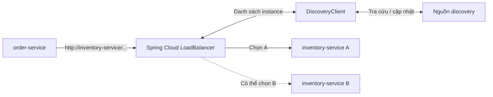

# Địa chỉ động và nhu cầu tìm instance theo tên dịch vụ

Trong hệ thống phân tán, một dịch vụ thường chạy trên nhiều tiến trình hoặc container. Mỗi tiến trình là một **instance** có địa chỉ mạng riêng, trong khi ứng dụng gọi đến dịch vụ chỉ cần biết **dịch vụ nào** có khả năng xử lý yêu cầu. Khi instance được tạo, thay thế, di chuyển hoặc dừng, địa chỉ IP và cổng có thể thay đổi. Vì vậy, mã nguồn gọi dịch vụ cần tách **danh tính logic của dịch vụ** khỏi **địa chỉ vật lý của từng instance**.

Đây là một vấn đề nền tảng mà hệ sinh thái **Spring Cloud** giải quyết thông qua các abstraction chung trong Spring Cloud Commons, đặc biệt là `DiscoveryClient`, `ServiceInstance` và khả năng kết hợp với Spring Cloud LoadBalancer. Bài học tập trung vào lý do cần tìm instance theo tên dịch vụ, đường đi của một lời gọi và cách áp dụng, quan sát, kiểm thử cơ chế này.

## 1. Vì sao không thể dựa mãi vào IP và cổng cố định?

Giả sử `order-service` cần hỏi `inventory-service` xem một mặt hàng còn tồn kho hay không. Cách gọi đơn giản nhất là cấu hình URL trực tiếp:

```properties
inventory.base-url=http://10.20.1.15:8080
```

Lúc đầu, `10.20.1.15:8080` có thể đúng. Tuy nhiên, khi triển khai trên máy ảo, container hoặc nền tảng điều phối như Kubernetes, các tình huống sau rất phổ biến:

- **Triển khai phiên bản mới:** instance cũ bị thay thế bằng instance ở IP khác.
- **Mở rộng hoặc thu hẹp:** từ một instance tăng lên ba instance khi lượng truy cập tăng, rồi giảm xuống khi ít tải.
- **Khôi phục sau lỗi:** instance lỗi bị dừng; instance mới được khởi tạo ở địa chỉ khác.
- **Di chuyển giữa máy chủ:** bộ lập lịch có thể chạy container trên node khác.
- **Nhiều môi trường:** địa chỉ của cùng một dịch vụ khác nhau giữa local, staging và production.

Nếu `order-service` ghi cứng một địa chỉ, nó có thể tiếp tục gửi yêu cầu tới instance đã biến mất hoặc bỏ qua các instance mới. Cập nhật thủ công cấu hình trên mọi dịch vụ gọi đến vừa chậm, vừa tạo thêm rủi ro khi hệ thống thay đổi liên tục.

**Yêu cầu thực sự:** `order-service` nói “tôi cần `inventory-service`”, còn hạ tầng hoặc thành phần khám phá dịch vụ xác định instance nào hiện có thể nhận yêu cầu.

## 2. Phân biệt tên dịch vụ, instance và địa chỉ mạng

Ba khái niệm sau cần được phân biệt rõ:

| Khái niệm | Ý nghĩa | Ví dụ |
| --- | --- | --- |
| **Service ID** (tên dịch vụ logic) | Danh tính ổn định mà bên gọi dùng để tìm dịch vụ | `inventory-service` |
| **Service instance** | Một bản chạy cụ thể của dịch vụ; nhiều instance có thể dùng chung một Service ID | `inventory-service` instance A, B, C |
| **Endpoint vật lý** | Địa chỉ mà mạng có thể kết nối đến một instance hoặc một điểm truy cập ổn định | `http://10.20.1.15:8080` |

Ví dụ, tại một thời điểm nguồn discovery có thể trả về:

```text
Service ID: inventory-service
  ├── instance A: http://10.20.1.15:8080
  ├── instance B: http://10.20.1.23:8080
  └── instance C: http://10.20.3.9:8080
```

Sau khi triển khai lại, A có thể biến mất và D xuất hiện ở `10.20.4.10:8080`. **Service ID vẫn là `inventory-service`**. Danh sách instance là trạng thái vận hành biến động, không phải hợp đồng cần nhúng vào từng nơi gọi.

Trong phần lớn hệ thống, bên gọi cần thêm thông tin ngoài IP: cổng, giao thức HTTP/HTTPS, trạng thái sẵn sàng phục vụ hoặc metadata như vùng triển khai. Cơ chế discovery có thể cung cấp một phần thông tin này; khả năng cụ thể phụ thuộc hệ thống đăng ký và bộ tích hợp đang dùng.

## 3. Service discovery giải quyết bài toán gì?

**Service discovery** là cơ chế ánh xạ từ một danh tính logic như `inventory-service` sang các endpoint có thể sử dụng tại thời điểm truy vấn. Nó thường có hai phần:

1. **Cập nhật nguồn thông tin instance:** khi một bản chạy xuất hiện, dừng hoặc không còn đủ điều kiện nhận lưu lượng, nguồn discovery cần phản ánh thay đổi đó. Thông tin có thể đến từ đăng ký trực tiếp, heartbeat/health check hoặc API của nền tảng điều phối.
2. **Tìm instance khi cần gọi:** thành phần phía client hoặc phía hạ tầng truy vấn thông tin dịch vụ, chọn endpoint thích hợp rồi chuyển yêu cầu đến đó.

Không có một cách đăng ký chung cho mọi hệ thống. Với Eureka hoặc Consul, ứng dụng có thể đăng ký qua client tích hợp và registry theo dõi sự hiện diện của nó. Với Kubernetes, Pod và Service/EndpointSlice do Kubernetes quản lý; ứng dụng có thể truy cập qua DNS và Service ổn định mà không cần tự đăng ký vào Eureka.

Ví dụ đường đi khi **client tự chọn instance**:



Sơ đồ mô tả trách nhiệm các thành phần, không có nghĩa mỗi HTTP request đều phải gọi qua registry. Client và load balancer có thể dùng bộ nhớ đệm danh sách instance; thời điểm đồng bộ phụ thuộc cấu hình và cơ chế discovery.

### Tìm thấy instance khác với chọn instance

Discovery trả lời câu hỏi: **“Những instance nào đang được biết đến cho Service ID này?”** Load balancing trả lời câu hỏi tiếp theo: **“Nên gửi lần gọi này đến instance nào?”**

Chẳng hạn, danh sách có A, B, C chưa đủ để đảm bảo A xử lý được yêu cầu. Bộ chọn có thể dùng round-robin hoặc chiến lược khác; tính khả dụng thực tế còn phụ thuộc health/readiness, độ trễ cập nhật, lỗi mạng và cấu hình retry. **Discovery không tự động bảo đảm request sẽ thành công.**

## 4. Hai mô hình tìm và định tuyến dịch vụ

| Khía cạnh | Client-side discovery | Server-side discovery |
| --- | --- | --- |
| Ai tìm và chọn instance? | Chính ứng dụng bên gọi, thông qua client/load balancer | Một thành phần trung gian như proxy, load balancer hoặc Kubernetes Service |
| Bên gọi biết gì? | Service ID và cơ chế phân giải thành instance | Địa chỉ ổn định của điểm truy cập trung gian |
| Luồng điển hình | Client → discovery/load balancer của client → instance | Client → điểm truy cập ổn định → instance |
| Ưu điểm | Client có thể chọn theo metadata hoặc chính sách cụ thể | Client đơn giản, ít phụ thuộc trực tiếp vào discovery |
| Đánh đổi | Cần tích hợp và vận hành logic ở client | Cần vận hành lớp định tuyến; chính sách nằm ở hạ tầng |
| Ví dụ | Spring Cloud LoadBalancer kết hợp một DiscoveryClient phù hợp | Kubernetes Service, reverse proxy hoặc load balancer tích hợp nguồn endpoint |

Hai cách có thể cùng tồn tại trong một kiến trúc. Chẳng hạn, ứng dụng Spring Boot gọi các dịch vụ trong Kubernetes thông qua DNS của Kubernetes Service; ở một môi trường khác, ứng dụng dùng Spring Cloud LoadBalancer để tự chọn instance từ Eureka hoặc Consul.

### DNS có thay thế service discovery không?

DNS giúp ánh xạ một tên sang địa chỉ, nên **có thể là một phần của giải pháp discovery**. Ví dụ, một Kubernetes Service có tên DNS ổn định và hệ thống Kubernetes định tuyến tới các Pod phù hợp. Tuy nhiên, DNS thông thường không cung cấp đầy đủ metadata, chính sách chọn instance hay trạng thái sức khỏe theo cách `DiscoveryClient` có thể biểu diễn. Khả năng và giới hạn phụ thuộc loại bản ghi, TTL, DNS cache và nền tảng.

Điều quan trọng là xác định **tên mà bên gọi sử dụng đang được ai phân giải**: DNS/hạ tầng hay một client có khả năng load balancing. Nếu dùng một `WebClient` thông thường với URL `http://inventory-service`, tên này chỉ hoạt động khi DNS/mạng thực sự phân giải được nó; chuỗi tên không tự biến thành yêu cầu tới Spring Cloud DiscoveryClient.

## 5. Các abstraction cốt lõi trong Spring Cloud Commons

Spring Cloud Commons tạo lớp API chung để ứng dụng ít phụ thuộc vào loại discovery provider cụ thể:

| Abstraction | Trách nhiệm | Điều cần nhớ |
| --- | --- | --- |
| `DiscoveryClient` | Truy vấn danh sách dịch vụ và instance theo Service ID | Không tự chịu trách nhiệm chọn instance tối ưu cho từng request |
| `ServiceInstance` | Biểu diễn một instance, gồm Service ID, host, port, URI, trạng thái bảo mật và metadata | Là thông tin endpoint từ nguồn discovery |
| `ServiceRegistry` / `Registration` | Abstraction liên quan tới đăng ký hoặc hủy đăng ký khi provider hỗ trợ | Không phải mọi kiến trúc đều đăng ký instance qua ứng dụng |
| Spring Cloud LoadBalancer | Chọn một instance từ nguồn cung cấp danh sách và hỗ trợ tích hợp client HTTP | Cần dependency và cấu hình tích hợp thích hợp |

Ví dụ truy vấn trực tiếp:

```java
import java.util.List;
import org.springframework.cloud.client.ServiceInstance;
import org.springframework.cloud.client.discovery.DiscoveryClient;
import org.springframework.stereotype.Service;

@Service
public class InventoryDirectory {
    private final DiscoveryClient discoveryClient;

    public InventoryDirectory(DiscoveryClient discoveryClient) {
        this.discoveryClient = discoveryClient;
    }

    public List<ServiceInstance> knownInstances() {
        return discoveryClient.getInstances("inventory-service");
    }
}
```

`getInstances("inventory-service")` có thể trả về danh sách rỗng khi chưa đăng ký instance nào, khi quá trình đồng bộ chưa hoàn tất hoặc khi cấu hình/khả năng kết nối tới nguồn discovery có vấn đề. Một danh sách được trả về cũng là **ảnh chụp thông tin tại thời điểm tra cứu**, không phải lời hứa rằng endpoint vẫn còn sống đến lúc request tới nơi.

Trong mã xử lý request thông thường, tránh tự lấy `instances.get(0)` rồi nối URL: cách đó bỏ qua chính sách cân bằng tải, xử lý danh sách rỗng và biến động của instance. Nên dùng client HTTP tích hợp LoadBalancer nếu ứng dụng chịu trách nhiệm chọn instance.

## 6. Ví dụ: gọi theo tên dịch vụ với Spring Cloud LoadBalancer

Giả sử cả `order-service` và `inventory-service` là ứng dụng Spring Boot. Ta muốn mã của `order-service` gọi theo Service ID mà không cần biết IP cụ thể.

### 6.1. Phụ thuộc cần thiết

Với dự án dùng `WebClient`, cần dependency cung cấp WebClient và Spring Cloud LoadBalancer (cùng một bộ Spring Boot/Spring Cloud tương thích):

```xml
<dependencies>
    <dependency>
        <groupId>org.springframework.boot</groupId>
        <artifactId>spring-boot-starter-webflux</artifactId>
    </dependency>
    <dependency>
        <groupId>org.springframework.cloud</groupId>
        <artifactId>spring-cloud-starter-loadbalancer</artifactId>
    </dependency>
</dependencies>
```

Đây chỉ là phần dependency liên quan; dự án vẫn cần quản lý phiên bản Spring Cloud bằng BOM/release train **phù hợp với phiên bản Spring Boot** đang dùng. Khi sử dụng Eureka, Consul hoặc một provider khác, bổ sung starter discovery tương ứng. Không tự chốt một phiên bản Spring Cloud tùy ý vì API và mức hỗ trợ phụ thuộc tổ hợp phiên bản.

### 6.2. Dữ liệu discovery đơn giản cho môi trường local

Để thực hành khi chưa có registry, có thể dùng `SimpleDiscoveryClient` của Spring Cloud Commons để khai báo instance tĩnh trong `application.yml` của `order-service`:

```yaml
spring:
  cloud:
    discovery:
      client:
        simple:
          instances:
            inventory-service:
              - uri: http://localhost:8081
              - uri: http://localhost:8082
```

Khởi chạy hai bản `inventory-service` tại cổng 8081 và 8082 để thử nghiệm. `SimpleDiscoveryClient` thuận tiện cho demo/test vì không cần registry; danh sách ở đây **không tự phát hiện các container mới**. Trong hệ thống triển khai động, dùng cơ chế discovery thực tế hoặc điểm truy cập ổn định do hạ tầng quản lý.

### 6.3. Cấu hình WebClient nhận biết Service ID

```java
import org.springframework.cloud.client.loadbalancer.LoadBalanced;
import org.springframework.context.annotation.Bean;
import org.springframework.context.annotation.Configuration;
import org.springframework.web.reactive.function.client.WebClient;

@Configuration
public class HttpClientConfig {
    @Bean
    @LoadBalanced
    WebClient.Builder loadBalancedWebClientBuilder() {
        return WebClient.builder();
    }
}
```

Bean có `@LoadBalanced` để Spring Cloud cấu hình bộ lọc chọn instance cho WebClient tương ứng. Khi gọi:

```java
import org.springframework.cloud.client.loadbalancer.LoadBalanced;
import org.springframework.stereotype.Service;
import org.springframework.web.reactive.function.client.WebClient;
import reactor.core.publisher.Mono;

@Service
public class InventoryClient {
    private final WebClient client;

    public InventoryClient(@LoadBalanced WebClient.Builder builder) {
        this.client = builder.baseUrl("http://inventory-service").build();
    }

    public Mono<StockResponse> checkStock(String sku) {
        return client.get()
                .uri("/api/stock/{sku}", sku)
                .retrieve()
                .bodyToMono(StockResponse.class);
    }

    public record StockResponse(String sku, int available) {}
}
```

Ở đây `http://inventory-service` là **URI logic**: `inventory-service` được Spring Cloud LoadBalancer hiểu là Service ID và phân giải thành một instance trước khi gửi request thực. Phần path `/api/stock/{sku}` vẫn là hợp đồng HTTP của dịch vụ đích.

Nếu không có tích hợp `@LoadBalanced`, request này sẽ đi qua cơ chế phân giải host thông thường của HTTP client. Trong môi trường không có DNS cho `inventory-service`, nó có thể thất bại vì không phân giải được tên.

Trong ứng dụng thực tế, cần bổ sung timeout, xử lý lỗi, quan sát và chính sách retry phù hợp với tính an toàn của thao tác. Với thao tác thay đổi trạng thái, retry tự động có thể tạo tác dụng phụ nếu endpoint không hỗ trợ idempotency.

### 6.4. Khi dùng registry thực tế

Khi chuyển sang Eureka/Consul hoặc provider tương thích:

1. Thiết lập registry và client discovery đúng với provider.
2. Đảm bảo mỗi instance `inventory-service` được đăng ký hoặc được nguồn discovery nhận diện với cùng **Service ID**.
3. Giữ nguyên phần gọi `http://inventory-service/api/stock/{sku}` ở `order-service`, nếu cách tích hợp HTTP vẫn là client-side discovery.
4. Kiểm tra điều kiện sẵn sàng, thời gian cập nhật danh sách, cách dừng instance và cách xử lý khi không tìm thấy instance.

Tính di động ở đây nằm ở abstraction chung; cách cấu hình đăng ký, health check, phát hiện hoặc metadata có thể khác nhau giữa các provider.

## 7. Vòng đời instance và tính nhất quán của danh sách

Hãy xét đợt triển khai rolling update:

| Thời điểm | Nguồn discovery biết gì? | Hệ quả đối với bên gọi |
| --- | --- | --- |
| Ban đầu | A và B đang phục vụ | Request có thể đến A hoặc B |
| C bắt đầu khởi động | C có thể chưa đạt readiness | Chỉ nên đưa C vào danh sách nhận lưu lượng khi đủ sẵn sàng |
| C sẵn sàng | A, B, C đều khả dụng | Bên gọi có thể dần thấy thêm C |
| A chuẩn bị dừng | A được đánh dấu không sẵn sàng hoặc loại khỏi định tuyến | Request mới nên chuyển sang B/C |
| A đã dừng | Một số client có thể vẫn còn thông tin cũ trong cache | Có thể xảy ra lỗi ngắn hạn; cần timeout và xử lý lỗi thích hợp |

Các sự kiện không nhất thiết được nhìn thấy tức thời tại mọi client: registry, polling, cache, DNS TTL và đường truyền đều tạo ra **độ trễ hội tụ**. Vì thế cần thiết kế đủ sức chịu được danh sách rỗng, instance hết hạn và lỗi mạng tạm thời.

Một số nguyên tắc thực hành:

- Đăng ký hoặc công bố endpoint **khi đủ điều kiện phục vụ**; gỡ khỏi lưu lượng trước khi tiến trình thực sự ngừng nếu nền tảng hỗ trợ.
- Phân biệt **liveness** (tiến trình còn hoạt động) và **readiness** (có thể nhận request); đừng coi mọi process đang chạy đều là endpoint sẵn sàng.
- Cân nhắc timeout và retry theo bản chất API. Discovery không thay thế circuit breaker, kiểm soát tài nguyên, xác thực hoặc giám sát.
- Tránh giả định mọi instance có cấu hình, phiên bản API hoặc vùng mạng như nhau; dùng metadata/chính sách định tuyến nếu cần.

## 8. Quan hệ với cấu hình ngoài và Refresh Scope

Trong Spring Cloud, externalized configuration và `@RefreshScope` có thể giúp cập nhật một số giá trị cấu hình của bean khi có cơ chế refresh phù hợp. Nhưng **địa chỉ instance thay đổi không đồng nghĩa phải refresh cấu hình mỗi lần scale**.

- Với **URL cố định** như `inventory.base-url=http://10.20.1.15:8080`, đổi IP có thể đòi hỏi cập nhật cấu hình, phân phối lại cấu hình và xử lý vòng đời bean.
- Với **Service ID + discovery**, URL logic `http://inventory-service` vẫn giữ nguyên; các endpoint mới được cập nhật qua nguồn discovery/cơ chế định tuyến.
- Với **Kubernetes Service hoặc load balancer có địa chỉ ổn định**, ứng dụng dùng địa chỉ hạ tầng ổn định, còn hạ tầng cập nhật endpoint bên dưới.

Hai cơ chế giải quyết hai bài toán khác nhau: externalized configuration quản lý **giá trị cấu hình ứng dụng**; service discovery quản lý **vị trí các instance có thể gọi**. Chúng có thể phối hợp nhưng không nên được đánh đồng.

## 9. Cách kiểm thử và vận hành

Để xác minh luồng tìm instance theo tên dịch vụ, có thể làm bài thực hành theo trình tự:

1. Khởi chạy `inventory-service` ở 8081 và 8082, mỗi instance trả thêm một mã nhận diện khác nhau trong response hoặc log.
2. Cấu hình `SimpleDiscoveryClient` như mục 6.2 và gọi qua `order-service` bằng `@LoadBalanced WebClient.Builder`.
3. Gửi nhiều request và đối chiếu log ở hai instance để thấy lời gọi được phân phối. Đừng giả định tỷ lệ chính xác nếu có ít request.
4. Kiểm tra `DiscoveryClient.getInstances("inventory-service")`: tên đúng phải trả danh sách đã khai báo; tên sai có thể trả danh sách rỗng.
5. Dừng một instance và quan sát lỗi có thể xuất hiện nếu cấu hình local vẫn chứa URL của instance đó. Sau đó sửa danh sách local hoặc thực hành với registry có cập nhật trạng thái thực tế.
6. Kiểm tra log/metrics/traces của bên gọi: Service ID được yêu cầu, instance đích được chọn (nếu có), mã lỗi, thời gian chờ, tỷ lệ lỗi và thời gian phục hồi.

| Hiện tượng | Nguyên nhân thường gặp | Hướng kiểm tra |
| --- | --- | --- |
| Không tìm thấy `inventory-service` | Sai Service ID, thiếu cấu hình discovery hoặc instance chưa hiện diện | So sánh tên logic; kiểm tra danh sách từ `DiscoveryClient`, cấu hình provider và trạng thái đăng ký |
| `UnknownHostException` khi gọi tên logic | HTTP client chưa tích hợp LoadBalancer, hoặc tên không tồn tại trong DNS | Kiểm tra bean `@LoadBalanced`, dependency và cơ chế phân giải tên thực tế |
| Có danh sách instance nhưng request vẫn lỗi | Endpoint chết, cổng sai, lỗi mạng, readiness sai hoặc giao thức không khớp | Thử kết nối theo endpoint, xem log, trạng thái health/readiness và timeout |
| Chỉ một instance nhận request | Danh sách chỉ có một instance, chính sách chọn hoặc số request quá ít | Kiểm tra discovery và cấu hình LoadBalancer; quan sát nhiều request |
| Vẫn gọi instance đã dừng | Cập nhật danh sách chậm, cache cũ hoặc dữ liệu local tĩnh | Kiểm tra vòng đời đăng ký, thời gian đồng bộ, cache và quy trình dừng mềm |

Khi tích hợp tracing, nên giữ tương quan giữa request tại `order-service` và `inventory-service`. Thông tin Service ID, endpoint đã chọn và exception giúp phân biệt lỗi **không tìm thấy instance**, lỗi **không kết nối được instance** và lỗi **ứng dụng ở instance đã xử lý nhưng trả mã HTTP lỗi**.

## 10. Những nhầm lẫn thường gặp

**“Có Service ID là đủ để gọi HTTP.”** Chưa đủ. Phải có cơ chế phân giải tên: DNS/hạ tầng hoặc HTTP client tích hợp discovery + load balancing.

**“DiscoveryClient tự cân bằng tải.”** `DiscoveryClient` cung cấp danh sách instance. Một thành phần như Spring Cloud LoadBalancer mới chịu trách nhiệm chọn instance cho mỗi lần gọi theo chính sách.

**“Đã tìm thấy instance nghĩa là instance khỏe.”** Dữ liệu có thể cũ, health check có thể chưa phản ánh lỗi hoặc mạng giữa hai dịch vụ có thể bị gián đoạn.

**“Ứng dụng Spring Cloud nào cũng cần Eureka.”** Không đúng. Commons là abstraction; nguồn thông tin có thể là Eureka, Consul, một cơ chế khác hoặc hệ thống DNS/định tuyến của Kubernetes.

**“Scale container thì phải sửa cấu hình URL trên mọi client.”** Khi truy cập theo Service ID hoặc địa chỉ ổn định của hạ tầng, thay đổi địa chỉ vật lý có thể được xử lý bằng discovery và định tuyến, miễn là các thành phần cập nhật trạng thái đúng cách.

## 11. Tình huống tự đánh giá

Hệ thống có ba instance của `payment-service`: P1, P2 và P3. Sau một lần triển khai, P1 bị xóa, P4 được tạo. `checkout-service` vẫn gọi `http://payment-service/payments`.

**Câu hỏi 1:** Vì sao `checkout-service` có thể giữ nguyên URL?

**Gợi ý đáp án:** Vì URL biểu diễn Service ID logic; client-side discovery/load balancing hoặc định tuyến hạ tầng ánh xạ tên này tới endpoint hiện có.

**Câu hỏi 2:** Nếu vẫn có lỗi tới P1 trong ít giây, đó có phải là bằng chứng discovery hoàn toàn không hoạt động?

**Gợi ý đáp án:** Không nhất thiết. Có thể danh sách instance chưa đồng bộ hoặc cache chưa hết hạn. Cần phân biệt khả năng tìm instance, cơ chế chọn, cách gỡ instance khỏi lưu lượng và lỗi mạng thực tế.

**Câu hỏi 3:** Nếu `checkout-service` dùng Kubernetes Service và DNS ổn định, có bắt buộc phải thêm `@LoadBalanced`?

**Gợi ý đáp án:** Không. Khi Kubernetes Service đã đảm nhiệm định tuyến và tên được DNS phân giải, HTTP client thông thường có thể gọi tới địa chỉ Service đó. `@LoadBalanced` cần khi muốn Spring Cloud LoadBalancer xử lý tên logic ở phía client.

## Ghi nhớ

Đối với các hệ thống phân tán dùng Spring Cloud, **Service ID là hợp đồng ổn định giữa bên gọi và dịch vụ đích**, còn tập hợp instance là trạng thái thay đổi theo triển khai và vận hành. Spring Cloud Commons chuẩn hóa việc đọc thông tin instance; Spring Cloud LoadBalancer có thể dùng thông tin đó để chọn đích. Thiết kế đúng phải tính đến cả **khả năng phân giải tên**, **độ trễ cập nhật instance** và **cách xử lý lỗi** khi hệ thống thay đổi.
