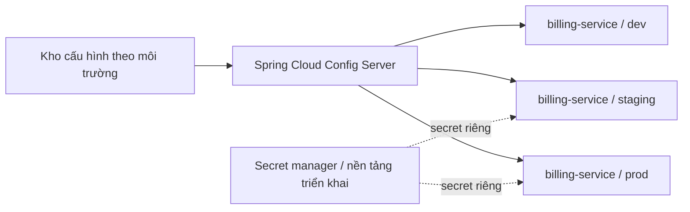

# Cấu hình bên ngoài và khác biệt giữa các môi trường

Trong hệ thống phân tán, cùng một dịch vụ thường chạy ở máy lập trình viên, môi trường kiểm thử, staging và production. Mã nguồn và bản đóng gói có thể giống nhau, nhưng địa chỉ dịch vụ phụ thuộc, giới hạn kết nối, mức ghi log và thông tin xác thực thường khác. **Cấu hình bên ngoài (externalized configuration)** cho phép thay đổi các giá trị đó theo môi trường triển khai mà không phải sửa mã hoặc đóng gói lại ứng dụng.

Bài học thuộc chương **Nền tảng phân tán** của **SPRING_CLOUD_CORE**. Trọng tâm là cách Spring Boot tổ chức và ưu tiên cấu hình, cách Spring Cloud bổ sung cấu hình tập trung và khả năng cập nhật cấu hình ở thời gian chạy, cùng những nguyên tắc triển khai và kiểm thử an toàn.

## 1. Mục tiêu học tập

Sau bài học, người học có thể:

- Phân biệt **mã ứng dụng**, **cấu hình theo môi trường** và **bí mật (secret)**; giải thích vì sao một artifact nên triển khai được ở nhiều môi trường.
- Sử dụng `application.yml`, profile, biến môi trường và tham số dòng lệnh để cấu hình một dịch vụ Spring Boot.
- Hiểu vai trò của `Environment`, `PropertySource`, thứ tự ưu tiên nguồn cấu hình và cách bind cấu hình có kiểu bằng `@ConfigurationProperties`.
- Giải thích vị trí của Spring Cloud Config Client/Server trong nền tảng Spring Cloud, sự khác biệt giữa cấu hình lúc khởi động và refresh lúc chạy.
- Tổ chức cấu hình dev/staging/prod, bảo vệ secret, kiểm thử và xử lý các sự cố cấu hình thường gặp.

## 2. Vì sao hệ thống phân tán cần cấu hình bên ngoài?

Giả sử dịch vụ `billing-service` gọi `payment-service`. Khi chạy trên máy cá nhân, payment có thể là mock server ở `localhost`. Trên staging, billing gọi một hệ thống thử nghiệm; trên production, billing gọi endpoint thật, có chứng chỉ, thời gian chờ và hạn mức khác.

Nếu ghi cứng URL hoặc khóa truy cập trong Java, mỗi thay đổi môi trường sẽ đòi hỏi sửa mã và tạo lại artifact. Cách này dễ dẫn đến triển khai nhầm cấu hình, khó theo dõi và khó khôi phục khi lỗi. Cấu hình bên ngoài giữ **một bản build** trong nhiều môi trường và chuyển khác biệt sang quy trình triển khai.

| Thành phần | Ví dụ | Nơi phù hợp |
| --- | --- | --- |
| Logic ứng dụng | Cách tạo hóa đơn và xác thực giao dịch | Mã nguồn và artifact |
| Cấu hình dùng chung | Timeout mặc định, tên ứng dụng, định dạng log | `application.yml` |
| Cấu hình môi trường | Endpoint thanh toán, mức log, kích thước pool | Profile, biến môi trường hoặc hệ thống cấu hình |
| Secret | API key, mật khẩu database, token | Secret manager, secret được mount hoặc biến môi trường do nền tảng cung cấp |
| Trạng thái vận hành | Số kết nối hiện tại, kết quả health check | Metrics, logs, hệ thống giám sát; không phải nguồn cấu hình |

Ví dụ, một thay đổi timeout có thể điều chỉnh qua cấu hình; nhưng đổi quy tắc tính tiền vẫn là thay đổi hành vi nghiệp vụ, cần sửa mã và kiểm thử.

## 3. Spring Boot đọc cấu hình như thế nào?

Spring Boot xây dựng một đối tượng `Environment` từ nhiều `PropertySource`. Mỗi nguồn cung cấp các cặp khóa–giá trị như `payment.connect-timeout=2s`. Khi ứng dụng hỏi một khóa, Spring tra cứu theo **thứ tự ưu tiên**; giá trị ở nguồn có ưu tiên cao hơn sẽ thắng.

Các nguồn quen thuộc gồm:

- `application.yml` hoặc `application.properties` nằm trong artifact và/hoặc ngoài artifact;
- tài liệu cấu hình kích hoạt theo profile như `application-dev.yml`, `application-prod.yml`;
- biến môi trường của tiến trình, ví dụ `PAYMENT_BASE_URL`;
- Java system properties, ví dụ `-Dpayment.connect-timeout=3s`;
- tham số ứng dụng, ví dụ `--payment.connect-timeout=1s`;
- nguồn bổ sung qua `spring.config.import`, chẳng hạn Spring Cloud Config Server hoặc config tree.

**Quy tắc thực hành:** cấu hình trong artifact là mặc định; giá trị bên ngoài và giá trị được truyền ở lúc chạy có thể ghi đè. Trong các trường hợp phổ biến, tham số `--key=value` ưu tiên hơn biến môi trường, và biến môi trường có thể ghi đè giá trị trong `application.yml`. Tuy nhiên, thứ tự đầy đủ còn phụ thuộc vị trí file, profile, tài liệu cấu hình, import và cách khởi tạo ứng dụng. Khi hai nguồn mâu thuẫn, hãy kiểm tra **nguồn gốc giá trị thực tế** thay vì dựa vào một quy tắc ưu tiên quá đơn giản.

### 3.1. Ví dụ dùng các nguồn cấu hình

`src/main/resources/application.yml`:

```yaml
spring:
  application:
    name: billing-service

payment:
  connect-timeout: 2s

feature:
  use-sandbox: false
```

Khi khởi động:

```bash
java -jar billing-service.jar --spring.profiles.active=prod --payment.connect-timeout=1s
```

Tham số trên kích hoạt profile `prod` và đặt timeout thành `1s`. Nếu cấu hình prod khai báo `4s`, tham số dòng lệnh vẫn ghi đè thành `1s` trong cấu hình Spring Boot thông thường.

Spring Boot hỗ trợ **relaxed binding**: `payment.connect-timeout` có thể được cung cấp qua biến môi trường `PAYMENT_CONNECT_TIMEOUT`. Với biến môi trường, cách chuyển đổi tên thường là thay dấu chấm bằng dấu gạch dưới, loại bỏ dấu gạch ngang và viết hoa.

```bash
# Ví dụ với shell kiểu Unix; trên Windows dùng cách đặt biến môi trường tương ứng.
PAYMENT_CONNECT_TIMEOUT=5s java -jar billing-service.jar --spring.profiles.active=prod
```

Không đặt cả biến môi trường lẫn tham số dòng lệnh cho cùng một khóa nếu không có lý do rõ ràng; điều đó làm việc xác định cấu hình hiệu lực khó hơn.

### 3.2. Đọc cấu hình theo kiểu dữ liệu

Lấy trực tiếp từng giá trị qua `@Value("${...}")` phù hợp với một vài thuộc tính đơn giản. Với một nhóm cấu hình nghiệp vụ, nên dùng `@ConfigurationProperties` để kiểm tra kiểu, gom nhóm và validate lúc khởi động.

```java
import java.time.Duration;
import jakarta.validation.constraints.NotBlank;
import jakarta.validation.constraints.NotNull;
import org.springframework.boot.context.properties.ConfigurationProperties;
import org.springframework.validation.annotation.Validated;

@Validated
@ConfigurationProperties(prefix = "payment")
public record PaymentProperties(
    @NotBlank String baseUrl,
    @NotNull Duration connectTimeout
) {}
```

Đăng ký quét các lớp cấu hình trong ứng dụng:

```java
import org.springframework.boot.SpringApplication;
import org.springframework.boot.autoconfigure.SpringBootApplication;
import org.springframework.boot.context.properties.ConfigurationPropertiesScan;

@SpringBootApplication
@ConfigurationPropertiesScan
public class BillingApplication {
    public static void main(String[] args) {
        SpringApplication.run(BillingApplication.class, args);
    }
}
```

Ứng dụng cần có dependency validation tương ứng (thường là `spring-boot-starter-validation`). `base-url` được bind vào `baseUrl`; `2s` được bind vào `Duration`. Khi thiếu endpoint bắt buộc hoặc timeout không thể chuyển kiểu, ứng dụng có thể báo lỗi ngay lúc khởi động thay vì đợi đến lần gọi thanh toán đầu tiên.

Có thể inject `PaymentProperties` vào một service qua constructor; tránh dùng các hằng số `static final` để cất những giá trị có khả năng thay đổi theo môi trường.

## 4. Phân tách cấu hình dev, staging và prod bằng profile

**Profile** là nhãn dùng để kích hoạt một tập cấu hình hoặc bean. Các tên `dev`, `staging`, `prod`, `test` chỉ là quy ước của đội phát triển; Spring không tự hiểu rằng `prod` phải an toàn hơn `dev`.

Một cấu trúc đơn giản:

```text
src/main/resources/
  application.yml
  application-dev.yml
  application-staging.yml
  application-prod.yml
```

Giữ giá trị dùng chung trong `application.yml`, chỉ khai báo **khác biệt** trong các file có profile.

`application-dev.yml`:

```yaml
payment:
  base-url: http://localhost:9090

feature:
  use-sandbox: true

logging:
  level:
    com.example.billing: DEBUG
```

`application-staging.yml`:

```yaml
payment:
  base-url: ${PAYMENT_BASE_URL}
  connect-timeout: 3s

feature:
  use-sandbox: true
```

`application-prod.yml`:

```yaml
payment:
  base-url: ${PAYMENT_BASE_URL}
  connect-timeout: 4s

feature:
  use-sandbox: false
```

Trong staging/prod, nền tảng triển khai phải cung cấp `PAYMENT_BASE_URL`. Nhờ kết hợp placeholder với validation, một môi trường thiếu endpoint có thể bị chặn trước khi dịch vụ nhận traffic. Không đặt giá trị mặc định `localhost` cho những cấu hình production bắt buộc, vì nó có thể che giấu lỗi triển khai.

| Đặc điểm | dev | staging | prod |
| --- | --- | --- | --- |
| Đối tượng kết nối | Mock hoặc sandbox cục bộ | Dịch vụ thử nghiệm | Dịch vụ thật |
| Logging | Có thể bật DEBUG có chọn lọc | INFO và thông tin phục vụ chẩn đoán | INFO/WARN, không log dữ liệu nhạy cảm |
| Secret | Tài khoản thử nghiệm, quyền hạn hẹp | Secret thử nghiệm do nền tảng quản lý | Secret sản xuất, quyền tối thiểu |
| Mục đích | Phát triển nhanh | Xác minh gần với triển khai thật | Độ ổn định, bảo mật và quan sát |
| Cấu hình lỗi | Dễ thử nghiệm thất bại | Diễn tập failure | Fail fast với thuộc tính bắt buộc |

Kích hoạt profile theo một trong các cách:

```bash
java -jar billing-service.jar --spring.profiles.active=dev
java -jar billing-service.jar --spring.profiles.active=staging
java -jar billing-service.jar --spring.profiles.active=prod
```

Hoặc nền tảng đặt biến `SPRING_PROFILES_ACTIVE=prod` trước khi chạy tiến trình. Tránh đưa `spring.profiles.active` vào `application-prod.yml`: thuộc tính kích hoạt profile phải đến từ một nguồn hợp lệ trước/ngoài tài liệu chỉ dành cho profile đó.

Spring cho phép nhiều profile cùng hoạt động, nhưng khi cấu hình trùng khóa, thứ tự profile và nguồn cấu hình có thể làm thay đổi kết quả. Với môi trường quan trọng, nên chọn quy tắc kích hoạt profile nhất quán, ghi rõ trong quy trình deploy và kiểm tra thuộc tính cuối cùng.

### Profile không phải hàng rào bảo mật

Một file `application-prod.yml` không làm ứng dụng tự động an toàn. Chỉ cần đặt sai `SPRING_PROFILES_ACTIVE` là đã có thể gọi nhầm endpoint. Cần bổ sung kiểm tra lúc khởi động, chính sách mạng, phân quyền secret, quy trình review và giám sát.

## 5. Khi một dịch vụ chạy ở nhiều nơi: Spring Cloud Config

Với vài dịch vụ, mỗi ứng dụng có thể tự nhận cấu hình qua file và biến môi trường. Khi có hàng chục dịch vụ và nhiều môi trường, việc quản lý giá trị trùng lặp, lịch sử thay đổi và quyền truy cập trở nên phức tạp. **Spring Cloud Config** cung cấp mô hình quản lý cấu hình tập trung:



Config Server đọc các nguồn cấu hình được cấu hình cho máy chủ (thường là Git hoặc một backend khác), sau đó cung cấp dữ liệu theo **tên ứng dụng, profile và label**. Config Client tải cấu hình về khi khởi động. Cách tổ chức này giúp các nhóm quản lý thay đổi tập trung, nhưng tạo thêm phụ thuộc vận hành vào Config Server và đường truyền đến nó.

### 5.1. Cấu hình client

Ứng dụng dùng dependency Spring Cloud Config Client, thường là `spring-cloud-starter-config`, với bộ phiên bản Spring Cloud tương thích Spring Boot. Ví dụ `application.yml`:

```yaml
spring:
  application:
    name: billing-service
  config:
    import: "configserver:http://config-server:8888"
```

Với `spring.profiles.active=prod`, client yêu cầu cấu hình tương ứng `billing-service` và `prod`. Nếu backend có label/nhánh `main`, một endpoint minh họa của Config Server là:

```text
GET http://config-server:8888/billing-service/prod/main
```

Đường dẫn trên minh họa giao diện truy vấn của Config Server; nhánh, đường dẫn và chính sách xác thực thực tế phụ thuộc cấu hình máy chủ. Không để lộ endpoint này ra Internet khi dữ liệu chứa thông tin nội bộ.

Có thể khai báo cấu hình import tùy chọn:

```yaml
spring:
  config:
    import: "optional:configserver:http://config-server:8888"
```

- **Không có `optional:`**: khi không thể tải cấu hình từ nguồn bắt buộc, ứng dụng có thể dừng khởi động; phù hợp khi thiếu cấu hình là rủi ro nghiêm trọng.
- **Có `optional:`**: ứng dụng có thể tiếp tục với nguồn còn lại khi Config Server không truy cập được. Phải đảm bảo các thuộc tính quan trọng vẫn được validate; nếu không, dịch vụ có thể chạy với giá trị mặc định sai.

Mỗi lựa chọn phải dựa vào mức độ phụ thuộc của ứng dụng vào cấu hình tập trung. Không bật fallback chỉ để che lỗi hạ tầng.

### 5.2. Cấu hình từ xa ghi đè cấu hình cục bộ như thế nào?

Spring Cloud thêm các `PropertySource` từ nguồn từ xa vào `Environment` của ứng dụng. Độ ưu tiên cụ thể phụ thuộc cơ chế nạp cấu hình, cách import, profile và phiên bản Spring Boot/Spring Cloud. Không thể mặc định rằng mọi giá trị ở Config Server luôn ưu tiên hơn mọi biến môi trường hoặc ngược lại.

Ví dụ nếu `payment.connect-timeout` xuất hiện ở cả file local, cấu hình từ xa và biến môi trường, hãy xác minh giá trị cuối cùng trong ứng dụng đang chạy. Các điểm quan trọng là **giá trị nào có hiệu lực, giá trị đến từ đâu và liệu ứng dụng có nhận đúng profile/label hay không**.

### 5.3. Bootstrapping và tương thích phiên bản

Các thế hệ Spring Boot/Spring Cloud khác nhau có cách nạp cấu hình đầu vòng đời khác nhau:

- Từ **Spring Boot 2.4**, cơ chế **Config Data** giới thiệu `spring.config.import` và là cách phổ biến để tích hợp Config Client ở các thế hệ tương ứng.
- Một số dự án cũ dùng `bootstrap.yml` và bootstrap context; hành vi này không nên mặc định áp dụng cho dự án mới. Muốn dùng bootstrap legacy cần cấu hình/thành phần phù hợp với phiên bản.
- Chọn Spring Cloud release train theo **bảng tương thích chính thức với Spring Boot**. Dependency BOM cần đồng bộ; chỉ chỉnh độc lập số phiên bản starter có thể dẫn đến lỗi auto-configuration hoặc classpath.

Bài học tập trung vào nguyên lý ổn định giữa các phiên bản; trước khi triển khai cần tra tài liệu ứng với đúng phiên bản đang sử dụng.

## 6. Cấu hình lúc khởi động khác gì refresh lúc chạy?

Một lần khởi động thông thường diễn ra theo chuỗi:

1. Nền tảng truyền profile, biến môi trường, file được mount và các tham số khởi động.
2. Spring Boot/Spring Cloud tải và hợp nhất các nguồn vào `Environment`.
3. Bean được tạo, thuộc tính được bind; validation kiểm tra cấu hình bắt buộc.
4. Dịch vụ bắt đầu nhận request với cấu hình hiệu lực lúc đó.

Việc sửa file Git trên Config Server **không tự động khiến mọi instance đang chạy thay đổi**. Cần một cơ chế cập nhật, chẳng hạn restart, gọi endpoint refresh được bảo vệ hoặc phát sự kiện refresh qua hạ tầng thích hợp.

### 6.1. `@RefreshScope` trong Spring Cloud Context

Spring Cloud Context cung cấp `@RefreshScope` cho các bean cần được tạo lại sau sự kiện refresh. Ví dụ:

```java
import org.springframework.beans.factory.annotation.Value;
import org.springframework.cloud.context.config.annotation.RefreshScope;
import org.springframework.stereotype.Component;

@Component
@RefreshScope
public class FeatureGate {
    private final boolean useSandbox;

    public FeatureGate(@Value("${feature.use-sandbox:false}") boolean useSandbox) {
        this.useSandbox = useSandbox;
    }

    public boolean useSandbox() {
        return useSandbox;
    }
}
```

Khi cơ chế refresh cập nhật `Environment` và làm mất hiệu lực bean trong refresh scope, instance mới của `FeatureGate` sẽ được tạo khi truy cập tiếp theo, lấy giá trị mới. Đây là **làm mới bean được hỗ trợ**, không phải cập nhật mọi giá trị, mọi đối tượng hoặc mọi kết nối trên toàn JVM.

Muốn dùng endpoint `/actuator/refresh`, ứng dụng cần các dependency Spring Cloud/Actuator tương ứng và phải cấu hình exposure, xác thực, phân quyền và giới hạn mạng phù hợp. Endpoint này nhạy cảm vì có thể thay đổi hành vi dịch vụ; không mở công khai chỉ để tiện thử nghiệm.

### 6.2. Những giới hạn của refresh

- Bean thường, hằng số tĩnh và những giá trị đã copy sang đối tượng khác có thể giữ giá trị cũ.
- `@RefreshScope` không đảm bảo rằng mọi cấu hình được cập nhật an toàn khi các request đang chạy.
- Việc đổi database URL, credential, connection pool hoặc cấu hình bảo mật có thể cần khởi tạo lại tài nguyên hoặc **restart** để nhất quán.
- Khi nhiều instance cùng chạy, refresh một instance không đồng nghĩa mọi instance đã nhận cùng phiên bản cấu hình.
- Spring Cloud Bus và các cơ chế phát sự kiện có thể hỗ trợ lan truyền thay đổi, nhưng cần thiết kế thứ tự cập nhật, xác thực, độ tin cậy và khả năng rollback.

Với thay đổi ảnh hưởng kết nối hay bảo mật, rolling restart trên từng nhóm instance thường dễ kiểm soát hơn cố gắng làm mới mọi thứ động.

## 7. Secret, phân quyền và quản trị thay đổi

Cấu hình bên ngoài không đồng nghĩa secret an toàn. Một mật khẩu được lấy từ biến môi trường vẫn có thể lộ qua log, diagnostic dump, công cụ quản trị tiến trình hoặc quyền truy cập máy chủ nếu hệ thống cấu hình sai.

Các nguyên tắc thực tế:

1. **Không commit secret thật** vào mã nguồn, `application-prod.yml`, ví dụ tài liệu hay Git repository cấu hình thông thường.
2. Dùng secret manager hoặc secret do nền tảng triển khai quản lý; áp dụng quyền tối thiểu cho từng dịch vụ và môi trường. Không dùng credential production ở dev/staging.
3. Tránh in giá trị nhạy cảm trong log, thông báo lỗi, endpoint chẩn đoán hoặc pipeline CI. Bảo vệ `/actuator/env` và `/actuator/configprops` nếu dùng để kiểm tra cấu hình; dữ liệu được che theo quy tắc của phiên bản và cấu hình, không nên coi đó là bảo vệ duy nhất.
4. Quản lý thay đổi cấu hình bằng review, version/label rõ ràng, kiểm thử trên staging, rollout theo đợt và phương án rollback.
5. Xác định thời điểm secret được nạp và cách rotate: biến môi trường thường được gắn với tiến trình lúc chạy; thay đổi ở secret manager không chắc tự động cập nhật bean hoặc connection pool.

Spring Boot còn hỗ trợ import **config tree**, thuận tiện khi Kubernetes hoặc nền tảng khác mount từng khóa cấu hình thành một file:

```properties
spring.config.import=optional:configtree:/etc/app-secrets/
```

Ví dụ file `/etc/app-secrets/payment.api-key` chứa giá trị có thể được nạp dưới khóa `payment.api-key`. Chỉ mount các secret cần thiết, đặt quyền truy cập file thích hợp và tránh ghi nội dung file ra log. Thư mục, tên khóa và cơ chế mount phải phù hợp với nền tảng triển khai thực tế.

## 8. Kiểm thử và quan sát cấu hình

Các lỗi cấu hình thường chỉ xuất hiện khi ứng dụng rời khỏi máy lập trình viên: profile sai, property bị ghi đè, secret thiếu, URL trỏ nhầm, Config Server lỗi hoặc refresh chưa có hiệu lực. Vì thế nên kiểm tra cấu hình cùng với kiểm thử chức năng.

### 8.1. Profile riêng cho bài test

Ví dụ `src/test/resources/application-test.yml`:

```yaml
payment:
  base-url: http://localhost:18080
  connect-timeout: 500ms

feature:
  use-sandbox: true
```

Bài kiểm thử:

```java
import org.junit.jupiter.api.Test;
import org.springframework.beans.factory.annotation.Autowired;
import org.springframework.boot.test.context.SpringBootTest;
import org.springframework.test.context.ActiveProfiles;

import static org.assertj.core.api.Assertions.assertThat;

@SpringBootTest
@ActiveProfiles("test")
class PaymentConfigurationTest {
    @Autowired
    private PaymentProperties properties;

    @Test
    void bindsConfigurationForTestProfile() {
        assertThat(properties.baseUrl())
            .isEqualTo("http://localhost:18080");
        assertThat(properties.connectTimeout())
            .isEqualTo(java.time.Duration.ofMillis(500));
    }
}
```

Nếu ứng dụng thực tế bắt buộc tải Config Server, hãy cấu hình môi trường test để tránh phụ thuộc ngoài không mong muốn (chẳng hạn vô hiệu hóa Config Client khi phù hợp, hoặc dùng nguồn cấu hình test kiểm soát được). Với kết nối động như Testcontainers, `@DynamicPropertySource` có thể cung cấp URL/port tại thời điểm chạy test.

### 8.2. Các phép kiểm tra đáng có trong CI/CD

| Kiểm tra | Lỗi giúp phát hiện |
| --- | --- |
| Bind `@ConfigurationProperties` và validation | Thiếu khóa bắt buộc, sai kiểu timeout, URL rỗng |
| Test mỗi profile được hỗ trợ | Trùng/thiếu thuộc tính dev, staging, prod |
| Kiểm tra cấu hình hiệu lực trong môi trường thử nghiệm | Biến môi trường ghi đè ngoài dự kiến |
| Thử mất kết nối Config Server | Chính sách fail fast hoặc fallback sai |
| Kiểm tra cập nhật/restart trên nhiều instance | Một số instance giữ cấu hình cũ |
| Kiểm tra secret và quyền truy cập | Lộ thông tin hoặc dùng credential sai môi trường |

Khi cần chẩn đoán, có thể dùng log khởi động, actuator được bảo vệ và thông tin property origin mà nền tảng cung cấp. Ghi nhận **tên profile, version/label cấu hình và nguồn thuộc tính**, nhưng không ghi giá trị secret.

## 9. Tình huống thực tế: sai endpoint khi triển khai production

Giả sử sau triển khai, `billing-service` ở production vẫn gọi sandbox payment. Quy trình tìm nguyên nhân hợp lý:

1. Xác nhận artifact đang chạy, profile hoạt động và biến `SPRING_PROFILES_ACTIVE` của chính instance lỗi.
2. Kiểm tra thuộc tính hiệu lực `payment.base-url`, kèm nguồn gốc nếu có thể, qua kênh chẩn đoán đã được bảo vệ.
3. Kiểm tra `PAYMENT_BASE_URL` được inject vào đúng deployment/container hay chưa; so khớp tên biến với khóa cấu hình.
4. Nếu dùng Config Server, kiểm tra `spring.application.name`, profile, label/nhánh, khả năng kết nối và version cấu hình đã tải.
5. Kiểm tra liệu cấu hình đã được đổi nhưng instance chưa restart/refresh, hay một bean/cache vẫn giữ địa chỉ cũ.
6. Sửa nguồn cấu hình, rollout có kiểm soát, kiểm tra tất cả instance và theo dõi lỗi thanh toán. Với giá trị nhạy cảm, kiểm tra bằng dấu hiệu an toàn thay vì in toàn bộ giá trị ra log.

Đây là lý do các hệ thống phân tán cần quy ước cấu hình chung: **một bản build, nguồn cấu hình rõ ràng, kiểm tra sớm, truy vết được thay đổi và khởi động lại có kiểm soát**.

## 10. Bài tập vận dụng

Thiết kế cấu hình cho `order-service` gọi `inventory-service` trên ba môi trường:

- **dev:** gọi inventory mock ở `http://localhost:8089`, timeout `1s`.
- **staging:** đọc endpoint từ biến `INVENTORY_BASE_URL`, timeout `2s`.
- **prod:** đọc endpoint từ biến `INVENTORY_BASE_URL`, timeout `3s`, thiếu endpoint phải thất bại khi khởi động.

Yêu cầu: tạo `application.yml` và các file theo profile; định nghĩa `InventoryProperties` có validation; viết test cho profile `test`; mô tả nguồn nào thắng nếu biến môi trường timeout là `5s` nhưng ứng dụng được chạy với `--inventory.connect-timeout=4s`. Sau đó giải thích bạn sẽ xử lý thế nào nếu Config Server tạm thời không truy cập được trong lúc deploy production.

**Gợi ý đối chiếu:** trong cấu hình Spring Boot thông thường, tham số dòng lệnh `4s` thắng biến môi trường `5s`; endpoint production phải được inject và validate; việc dùng hay bỏ `optional:configserver:` phụ thuộc vào việc ứng dụng có thể hoạt động an toàn với cấu hình còn lại hay không.

## 11. Ghi nhớ

- **Spring Boot** cung cấp cơ chế cấu hình bên ngoài, profile, `Environment`, binding và validation.
- **Spring Cloud Config/Context** bổ sung các khả năng dùng chung trong hệ thống phân tán như cấu hình tập trung và refresh scope; chúng không tự thay thế quản lý secret hay chiến lược rollout.
- Khác biệt giữa dev/staging/prod nên do cấu hình được kiểm soát quyết định, không do những nhánh mã riêng cho từng môi trường.
- Luôn xác minh **giá trị hiệu lực và nguồn gốc của nó** trên instance thực tế, đặc biệt khi có nhiều lớp ghi đè.
- Thay đổi cấu hình ở nguồn, tải lại cấu hình và áp dụng an toàn trên mọi instance là ba việc khác nhau.
