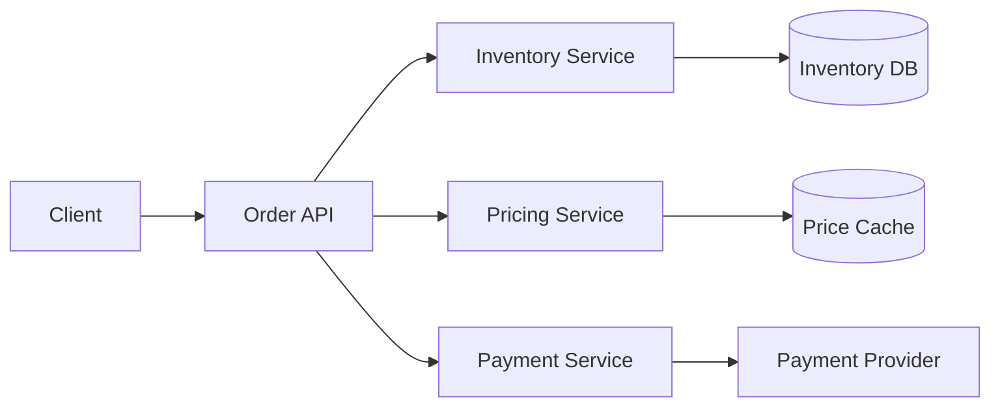
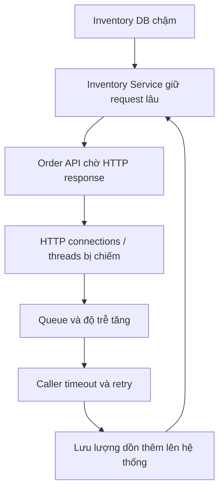

# Lỗi một phần, độ trễ mạng và tài nguyên phụ thuộc

Trong hệ thống phân tán, một yêu cầu có thể đi qua nhiều tiến trình, máy chủ, mạng và dịch vụ bên ngoài. Vì vậy, việc **một thành phần còn hoạt động** không có nghĩa là **toàn bộ yêu cầu sẽ thành công**. Ba vấn đề thường xuất hiện cùng nhau là **lỗi một phần** (*partial failure*), **độ trễ mạng** (*network latency*) và **tài nguyên phụ thuộc** (*dependent resources*). Hiểu mối liên hệ giữa chúng là nền tảng để thiết kế hệ thống có thể phục hồi và vận hành được.

Bài học thuộc chương **Nền tảng phân tán** của module **SPRING_CLOUD_CORE**. Các ví dụ kết nối nguyên lý phân tán với những abstraction cốt lõi của Spring Cloud như **Spring Cloud Commons**, **Spring Cloud Context**, cấu hình bên ngoài, discovery, service registry, giao tiếp giữa dịch vụ và khả năng kiểm thử. Spring Cloud giúp tích hợp các cơ chế này vào ứng dụng Spring Boot, nhưng thiết kế giới hạn thời gian, tải và hành vi khi lỗi vẫn là trách nhiệm của hệ thống.

## 1. Kết quả học tập

Sau bài này, người học có thể:

1. Phân biệt lỗi một phần với lỗi toàn hệ thống và giải thích vì sao timeout không đồng nghĩa với thao tác thất bại ở phía nhận.
2. Tính ngân sách độ trễ cho luồng gọi tuần tự, song song, có retry; nhận ra tác động của độ trễ đuôi (*tail latency*).
3. Vẽ đồ thị phụ thuộc, nhận diện điểm nghẽn như connection pool, thread pool, cơ sở dữ liệu, registry và hệ thống cấu hình.
4. Chọn timeout, retry, circuit breaker, bulkhead, backpressure và fallback theo tính chất của từng thao tác.
5. Nêu đúng vai trò và giới hạn của các abstraction Spring Cloud khi triển khai, kiểm thử và giám sát các trường hợp lỗi.

## 2. Một yêu cầu nhỏ có nhiều điểm có thể thất bại

Xét API tạo đơn hàng: nó cần kiểm tra tồn kho, tính giá và xác nhận thanh toán. Mỗi bước lại dựa vào tài nguyên khác.



Giả sử Order API hoạt động, Pricing Service phản hồi, nhưng Inventory Service chờ một truy vấn cơ sở dữ liệu quá lâu. Đối với Order API, **chỉ một nhánh bị lỗi**; đối với người dùng, **cả thao tác đặt hàng có thể thất bại** nếu thông tin tồn kho là bắt buộc.

Có ba câu hỏi thiết kế khác nhau:

- **Có thể hoàn thành nghiệp vụ không?** Kiểm tra tồn kho là điều kiện bắt buộc; gợi ý sản phẩm có thể là thông tin tùy chọn.
- **Có thể hoàn thành trong thời gian cho phép không?** Một phản hồi đúng đến sau deadline của người gọi vẫn vô ích cho yêu cầu đó.
- **Thành phần nào sẽ bị ảnh hưởng tiếp?** Khi nhiều request cùng chờ Inventory, thread, connection hoặc hàng đợi của Order API cũng có thể cạn kiệt.

Đây là lý do xử lý lỗi của hệ thống phân tán cần xem xét **toàn bộ chuỗi phụ thuộc**, không chỉ `try/catch` ở từng phương thức.

## 3. Lỗi một phần và trạng thái kết quả không chắc chắn

### 3.1. Các dạng lỗi thường gặp

| Tình huống | Quan sát từ phía gọi | Điều thực sự có thể xảy ra |
| --- | --- | --- |
| Không kết nối được máy đích | Connect error hoặc connect timeout | Instance dừng, sai địa chỉ, DNS hoặc đường mạng gặp vấn đề, cổng chưa sẵn sàng |
| Mất kết nối trong khi gửi/nhận | I/O exception | Máy nhận có thể chưa xử lý, đang xử lý hoặc đã xử lý một phần |
| Quá thời gian chờ phản hồi | Read timeout hoặc deadline exceeded | Máy nhận có thể vẫn đang làm việc, kể cả đã hoàn tất thao tác ghi |
| Phía nhận trả `503` | Service unavailable | Quá tải, bảo trì hoặc dependency phía sau không sẵn sàng |
| Phía nhận trả `429` | Too many requests | Bị giới hạn lưu lượng; cần tôn trọng chính sách chờ và retry |
| Registry trả địa chỉ cũ | Tìm thấy instance nhưng gọi thất bại | Thông tin discovery chưa đồng bộ với tình trạng instance thực tế |
| Một dependency phản hồi sai dữ liệu | HTTP có thể vẫn là `200` | Lỗi ngữ nghĩa hoặc dữ liệu cũ; retry không chắc sửa được |

**Timeout là kết quả quan sát của bên gọi, không phải xác nhận rollback.** Chẳng hạn, Order API gửi `POST /payments`, Payment Service đã ghi nhận giao dịch nhưng phản hồi bị mất. Nếu Order API tự gửi lại lệnh thanh toán mà không có cơ chế chống trùng, người dùng có nguy cơ bị tính tiền hai lần.

Muốn retry thao tác ghi an toàn, phải có thiết kế tương ứng: **idempotency key**, ràng buộc duy nhất ở phía nhận, lưu trạng thái xử lý và API truy vấn kết quả khi trạng thái chưa rõ. Việc đặt khóa idempotency ở phía gọi mà phía nhận không lưu và kiểm tra khóa vẫn chưa đủ.

Không phải mọi lỗi HTTP đều là lỗi hạ tầng. Ví dụ `404` vì mã sản phẩm không tồn tại hoặc `400` vì dữ liệu không hợp lệ thường là kết quả nghiệp vụ, không phải lý do để retry tự động.

### 3.2. Tính cục bộ của thông tin

Trong mạng, Order API không thể biết tức thì một instance còn sống hay vừa mất kết nối. Tín hiệu health, dữ liệu registry và cache đều có độ trễ cập nhật. Bởi vậy:

- Một địa chỉ được `DiscoveryClient` trả về **không bảo đảm** request tiếp theo sẽ kết nối thành công.
- Một instance vừa chuyển sang *unhealthy* vẫn có thể còn request đang chạy.
- Một timeout ở tầng HTTP không nói được trạng thái commit của transaction ở dịch vụ đích.
- Một phép kiểm tra health thành công chỉ phản ánh trạng thái tại thời điểm và phạm vi được kiểm tra.

Thiết kế tốt cần thừa nhận **trạng thái không chắc chắn** và cung cấp cách xử lý phù hợp, thay vì suy luận rằng không nhận được phản hồi nghĩa là công việc chưa diễn ra.

## 4. Độ trễ là một phần của tính đúng đắn

### 4.1. Độ trễ đầu cuối được hình thành thế nào?

Thời gian phản hồi gồm nhiều thành phần: chờ lấy kết nối, DNS hoặc chọn instance, bắt tay kết nối khi cần, truyền gói tin, chờ hàng đợi, xử lý nghiệp vụ, truy vấn dữ liệu và truyền phản hồi. Một dịch vụ phản hồi chậm không nhất thiết có CPU cao: nó có thể đang chờ một tài nguyên khác.

Với ba lời gọi tuần tự, xấp xỉ:

\[
T_{\text{tuần tự}} \approx T_1 + T_2 + T_3 + T_{\text{xử lý chung}}
\]

Với hai lời gọi độc lập được thực hiện song song:

\[
T_{\text{song song}} \approx \max(T_1,T_2) + T_{\text{phối hợp}}
\]

Ví dụ Inventory mất 180 ms, Pricing mất 260 ms và chi phí kết hợp kết quả là 20 ms. Gọi tuần tự tốn khoảng **460 ms**; gọi song song tốn khoảng **280 ms**. Tuy nhiên, chạy song song tạo thêm lưu lượng đồng thời lên các dependency và chỉ đúng khi hai thao tác thật sự độc lập.

### 4.2. Tail latency và fan-out

Trung bình 100 ms không có nghĩa là mọi request đều hoàn thành gần 100 ms. **p95 = 400 ms** nghĩa là 95% phép đo không vượt quá 400 ms; **p99 = 900 ms** nghĩa là 99% không vượt quá 900 ms, trong chính tập dữ liệu đo. Khi mỗi request phải chờ nhiều lời gọi con, khả năng gặp một nhánh chậm tăng lên.

Giả sử tám lời gọi độc lập chạy song song và mỗi lời gọi có 99% xác suất hoàn thành trước ngưỡng `t`. Xác suất **ít nhất một** lời gọi vượt ngưỡng là:

\[
1 - 0{,}99^8 \approx 7{,}7\%
\]

Đây là ví dụ theo giả định độc lập, không phải công thức áp dụng nguyên xi cho mọi hệ thống. Nó cho thấy vì sao **fan-out lớn** dễ làm p95/p99 của luồng tổng xấu đi dù latency trung bình của từng service có vẻ tốt.

### 4.3. Timeout theo ngân sách, không theo cảm tính

Giả sử API phía ngoài có **deadline 1.500 ms**. Nhóm quyết định dành khoảng 200 ms cho xác thực, xử lý và tạo phản hồi; phần còn lại tối đa 1.300 ms cho một chuỗi truy cập dependency. Chính sách giả định:

| Thành phần | Ngân sách |
| --- | ---: |
| Mỗi lần thử: thiết lập kết nối tối đa | 200 ms |
| Mỗi lần thử: chờ đọc phản hồi tối đa | 400 ms |
| Số lần thử tối đa | 2 lần |
| Nghỉ giữa hai lần thử, nếu đủ thời gian | 100 ms |
| **Cận trên lý tưởng cho các phần được liệt kê** | **2 × (200 + 400) + 100 = 1.300 ms** |

Phép cộng trên **chưa bao gồm** mọi chi phí DNS, scheduling, xếp hàng hoặc xử lý khác. Hơn nữa, *read timeout* thường giới hạn từng giai đoạn chờ đọc, **không tự động trở thành deadline tuyệt đối của toàn request**. Một kết nối vẫn truyền dữ liệu từng ít một có thể vượt thời gian tổng mong muốn. Vì vậy, cần truyền hoặc áp đặt **deadline tổng** tại tầng điều phối và chỉ retry khi thời gian còn lại đủ; con số này là ví dụ phân bổ ngân sách, không phải cam kết thời gian thực tế.

Phân biệt các khái niệm:

- **Connect timeout:** chặn việc chờ kết nối quá lâu.
- **Read/response timeout:** giới hạn việc chờ dữ liệu hoặc phản hồi theo cơ chế của HTTP client.
- **Deadline tổng:** thời điểm cuối cùng caller còn quan tâm đến kết quả, bao gồm những lần thử và thời gian backoff.
- **Cancellation:** khi caller không còn chờ, nên dừng công việc có thể hủy ở phía thực thi; việc hủy không bảo đảm rollback công việc đã commit.

## 5. Tài nguyên phụ thuộc và lỗi lan truyền

Một dependency không chỉ là một HTTP endpoint. Nó còn là pool kết nối, CPU, worker thread, giới hạn file descriptor, hàng đợi, database, cache, message broker, DNS, registry hoặc nhà cung cấp bên ngoài.

| Tài nguyên / phụ thuộc | Kiểu suy giảm | Hậu quả ở dịch vụ gọi |
| --- | --- | --- |
| Connection pool đến database hoặc HTTP | Hết slot, rò rỉ connection | Request xếp hàng dù dịch vụ đích còn chạy |
| Thread pool / event loop | Tác vụ block lâu, quá nhiều tác vụ đồng thời | Không còn năng lực xử lý request mới |
| Queue / broker | Consumer chậm, độ dài queue tăng | Tăng thời gian chờ và nguy cơ trễ dữ liệu |
| Cache | Miss hàng loạt, cache outage | Dồn truy vấn xuống database (*cache stampede*) |
| Discovery / service registry | Instance cũ, registry tạm thời không truy cập được | Chọn nhầm địa chỉ hoặc không tìm được instance mới |
| Config Server / cấu hình bên ngoài | Không lấy được cấu hình tại lần khởi động hoặc refresh | Service không khởi động được hoặc tiếp tục dùng cấu hình hiện tại tùy thiết lập |
| API nhà cung cấp bên ngoài | Rate limit, biến động latency | Timeout, chi phí retry và xếp hàng tăng |

### 5.1. Một lỗi chậm có thể trở thành lỗi toàn hệ thống



Vòng phản hồi này là **cascading failure**: lỗi ban đầu thuộc một dependency nhưng lan qua tài nguyên của các service còn lại. Retry không giới hạn có thể làm tình trạng nặng hơn. Ví dụ, nếu ba tầng đều tự thử tối đa ba lần cho cùng một thao tác, số lượt gọi xuống tầng cuối có thể tăng đến **27** trong một nhánh thực thi xấu nhất, tùy cách retry lồng nhau.

Khi hệ thống ở trạng thái ổn định, định luật Little mô tả mối liên hệ `L = λ × W` giữa số công việc đang ở trong hệ thống (`L`), thông lượng (`λ`) và thời gian ở trong hệ thống (`W`). Nếu thông lượng giữ nguyên nhưng thời gian chờ tăng, số request đang chờ cũng tăng. Khi vượt công suất xử lý, hàng đợi tiếp tục tích tụ; **thêm timeout ở phía gọi mà không giới hạn tải lên phía nhận** thường chưa đủ.

### 5.2. Phân biệt phụ thuộc ở từng thời điểm

Không phải dependency nào cũng nằm trên đường đi của *mỗi* request:

- **Đường đi lúc khởi động:** nạp cấu hình, lấy danh tính, kiểm tra kết nối ban đầu, đăng ký service. Lỗi tại đây có thể ngăn ứng dụng sẵn sàng nhận traffic.
- **Đường đi lúc phục vụ request:** database, các dịch vụ HTTP, cache, broker. Lỗi ảnh hưởng trực tiếp đến kết quả và latency của request.
- **Đường đi khi cấu hình thay đổi:** cập nhật nguồn cấu hình và kích hoạt refresh theo cách đã triển khai. Lỗi ở đây có thể khiến giá trị hiện tại tiếp tục tồn tại hoặc việc cập nhật không thành công.

Ví dụ, sử dụng **Spring Cloud Config Client** để nạp cấu hình từ Config Server lúc khởi động **không đồng nghĩa** với việc mọi request kinh doanh phải gọi Config Server. Tương tự, dùng `@RefreshScope` trong **Spring Cloud Context** không tự tạo ra cơ chế phát hiện thay đổi, tự refresh mọi instance hay đảm bảo request đang chạy chuyển sang cấu hình mới một cách nguyên tử.

## 6. Các kỹ thuật hạn chế phạm vi lỗi

Các cơ chế dưới đây bổ sung cho nhau và phải được chọn theo ngữ nghĩa nghiệp vụ.

| Kỹ thuật | Mục đích | Điều cần lưu ý |
| --- | --- | --- |
| **Timeout / deadline** | Giới hạn thời gian chiếm tài nguyên và chờ kết quả | Timeout không xác nhận thao tác đích đã bị hủy hoặc rollback |
| **Retry có giới hạn** | Vượt qua lỗi tạm thời như kết nối chập chờn hoặc `503` | Cần giới hạn số lần, deadline, exponential backoff và jitter; ưu tiên thao tác idempotent |
| **Circuit breaker** | Từ chối tạm các lời gọi đến dependency đang lỗi liên tục | Không sửa lỗi ở dependency; cần cấu hình ngưỡng và cách thử phục hồi |
| **Bulkhead** | Cách ly concurrency hoặc tài nguyên giữa các nhóm công việc | Kích thước giới hạn sai có thể làm giảm throughput hoặc gây nghẽn sớm |
| **Backpressure / admission control** | Giữ lưu lượng nhận vào trong khả năng xử lý | Phải có chính sách trả lỗi / chờ rõ ràng khi từ chối |
| **Fallback / graceful degradation** | Trả kết quả thay thế khi chức năng không bắt buộc lỗi | Chỉ dùng dữ liệu dự phòng khi nghiệp vụ chấp nhận; đừng biến lỗi thành dữ liệu giả |
| **Idempotency / deduplication** | Tránh tác dụng phụ lặp trong thao tác ghi | Phía nhận cần lưu và kiểm tra khóa, phạm vi và vòng đời khóa |

**Chính sách theo mức quan trọng:**

| Tác vụ | Xử lý hợp lý khi lỗi |
| --- | --- |
| Tra cứu gợi ý sản phẩm | Trả danh sách rỗng hoặc cache có TTL, kèm dấu hiệu dữ liệu dự phòng nếu cần |
| Đọc tồn kho để hiển thị | Có thể hiển thị “chưa xác định” theo yêu cầu nghiệp vụ; không tự xem timeout là còn hàng |
| Xác nhận tồn kho trước chốt đơn | Từ chối hoặc chuyển sang chờ xử lý nếu không thể xác minh; tránh xác nhận đơn không có căn cứ |
| Thu tiền | Dùng idempotency key và trạng thái giao dịch; truy vấn/reconcile trước khi tạo giao dịch mới khi kết quả không rõ |

### 6.1. Retry khi nào là an toàn?

Một chính sách retry có kỷ luật thường cần tất cả điều kiện sau:

1. **Phân loại lỗi có thể phục hồi:** ví dụ connect timeout nhất thời, `503`; không retry mọi `4xx` và lỗi validate.
2. **Đảm bảo ngữ nghĩa:** `GET` thuần đọc thường phù hợp hơn; `POST` tạo tác dụng phụ cần thiết kế idempotency riêng.
3. **Giới hạn:** số lần thử nhỏ, deadline chung, backoff tăng dần có jitter để tránh đồng loạt gửi lại.
4. **Một tầng chịu trách nhiệm retry:** tránh retry lồng nhau trên nhiều tầng không được phối hợp.
5. **Theo dõi tải bổ sung:** đo cả request logic từ người dùng và **attempt** thực gửi xuống dependency.

Khi dependency đang quá tải, retry có thể làm giảm khả năng phục hồi. Với `429`, cân nhắc chỉ dẫn `Retry-After` và ngân sách thời gian còn lại; không có đủ ngân sách thì kết thúc có kiểm soát.

## 7. Các abstraction Spring Cloud liên quan

Spring Cloud tập trung cung cấp **abstraction và tích hợp**, còn chính sách phục hồi phụ thuộc thư viện, phiên bản và cấu hình mà ứng dụng chọn.

| Thành phần | Vai trò trong tình huống phân tán | Không nên mặc định suy luận |
| --- | --- | --- |
| **Spring Cloud Commons – `DiscoveryClient`** | Tra cứu `ServiceInstance` theo tên service | Instance tìm thấy chắc chắn còn sống hoặc request sẽ nhanh |
| **Spring Cloud Commons – `ServiceRegistry`** | Abstraction đăng ký và trạng thái đăng ký với registry hỗ trợ | Registry luôn cập nhật tức thì theo health thật |
| **Spring Cloud LoadBalancer** | Chọn instance cho lời gọi theo tên service thông qua tích hợp được bật | Tự xử lý được mọi deadline, retry, circuit breaker và lỗi nghiệp vụ |
| **Spring Cloud Context – `@RefreshScope`** | Cho phép bean thuộc scope được tạo lại với cấu hình được cập nhật khi có refresh phù hợp | Tự phát hiện mọi đổi cấu hình hoặc chuyển đổi nguyên tử các request đang chạy |
| **Spring Cloud Config Client** | Nạp cấu hình bên ngoài theo cơ chế được cấu hình | Config Server được gọi trên mỗi request kinh doanh |
| **Spring Cloud CircuitBreaker** | API tích hợp circuit breaker khi bổ sung implementation tương ứng | Có sẵn circuit breaker chỉ vì đã dùng `DiscoveryClient` |
| **Spring Boot Actuator / Micrometer** | Tín hiệu health, metrics, observations/traces tùy cấu hình | Endpoint health thay thế được timeout hoặc kiểm tra nghiệp vụ đầu cuối |

Ở đây, Spring Cloud Commons định nghĩa cách ứng dụng **diễn đạt** việc khám phá và gọi dịch vụ; registry cụ thể (ví dụ Eureka, Consul hoặc cơ chế tích hợp môi trường) cung cấp cách lưu trạng thái. Spring Cloud LoadBalancer chỉ hoạt động khi có starter, tích hợp và danh sách instance thích hợp. Circuit breaker, retry và bulkhead cũng cần dependency hoặc cấu hình tương ứng; chúng không xuất hiện tự động chỉ nhờ khai báo tên dịch vụ.

**Tương thích phiên bản:** Khi cấu hình Spring Boot, Spring Cloud và starter, cần chọn *release train* Spring Cloud tương thích với phiên bản Spring Boot của dự án theo ma trận chính thức tương ứng. API và auto-configuration thay đổi theo phiên bản; không nên sao chép snippet cho một phiên bản khác rồi giả định có đầy đủ hành vi tương tự.

## 8. Ví dụ: gọi Inventory theo tên service và đặt timeout

Giả sử Inventory Service đã được công bố qua một discovery implementation và ứng dụng có Spring Cloud LoadBalancer. Đoạn mã sau minh họa một HTTP client sử dụng **tên logic** `inventory-service`, đồng thời cấu hình thời gian chờ kết nối và đọc. Ví dụ dùng `RestClient` của Spring Framework hiện đại; các import đã được lược bỏ cho dễ đọc.

`application.yml`:

```yaml
client:
  inventory:
    connect-timeout: 200ms
    read-timeout: 400ms
```

Các lớp Java:

```java
@ConfigurationProperties(prefix = "client.inventory")
public record InventoryTimeouts(
        Duration connectTimeout,
        Duration readTimeout
) {}

@Configuration
@EnableConfigurationProperties(InventoryTimeouts.class)
class InventoryClientConfiguration {
    @Bean
    @LoadBalanced
    RestClient.Builder inventoryRestClientBuilder(InventoryTimeouts timeout) {
        var factory = new SimpleClientHttpRequestFactory();
        factory.setConnectTimeout(Math.toIntExact(timeout.connectTimeout().toMillis()));
        factory.setReadTimeout(Math.toIntExact(timeout.readTimeout().toMillis()));
        return RestClient.builder().requestFactory(factory);
    }
}

record StockAvailability(String sku, int available) {}

@Service
class InventoryGateway {
    private final RestClient inventory;

    InventoryGateway(@LoadBalanced RestClient.Builder builder) {
        this.inventory = builder.baseUrl("http://inventory-service").build();
    }

    StockAvailability getAvailability(String sku) {
        return inventory.get()
                .uri("/api/inventory/{sku}", sku)
                .retrieve()
                .body(StockAvailability.class);
    }
}
```

**Phân tích ví dụ:**

- `@LoadBalanced` đánh dấu builder để tích hợp load balancing có thể phân giải tên logic thành instance; cần starter, discovery hoặc nguồn instance được cấu hình phù hợp.
- `connect-timeout` và `read-timeout` ở đây chỉ cấu hình hành vi của request factory, **không phải deadline tổng**, không tự triển khai retry hoặc fallback.
- `SimpleClientHttpRequestFactory` làm ví dụ ngắn gọn; ở hệ thống có tải, phải đánh giá HTTP transport và connection pooling phù hợp, giới hạn kết nối, thời gian chờ lấy connection và quản lý vòng đời tài nguyên.
- Nếu không có instance khả dụng hoặc lời gọi thất bại, tầng nghiệp vụ phải xử lý rõ ràng: lỗi trả về, trạng thái “chưa xác định”, hoặc fallback hợp lệ; không nên tùy ý biến lỗi mạng thành `available = 0`.
- Không nên bật retry đại trà ngay trên mọi client. Nếu cần retry cho `GET` này, thêm chính sách có giới hạn và gắn với deadline tổng, đồng thời ghi nhận số attempt.

Để tính thời gian đầu cuối, tầng điều phối gọi Inventory còn phải giới hạn thời gian chờ phối hợp với các công việc khác. Khi cấu hình runtime có thể refresh, cần quyết định **client có được tạo lại để nhận timeout mới hay không** và điều gì xảy ra với lời gọi đang chạy. `@RefreshScope` chỉ có ý nghĩa khi bean được đặt trong scope này và cơ chế refresh được kích hoạt phù hợp.

## 9. Kiểm thử lỗi phải tái hiện hành vi, không chỉ kiểm HTTP `200`

Kiểm thử tích hợp có thể dùng mock HTTP server, proxy mô phỏng lỗi mạng hoặc môi trường thử nghiệm có service discovery; trọng tâm là kiểm chứng **chính sách thực tế**. Một tập kịch bản tối thiểu:

| Thử nghiệm | Cách tạo tình huống | Kết quả cần xác nhận |
| --- | --- | --- |
| Dependency chậm | Inventory trì hoãn trả phản hồi lâu hơn deadline | Order API dừng chờ trong ngân sách đã định; không giữ tài nguyên vô hạn |
| Lỗi tạm thời | Lần đầu `503`, lần sau `200` | Chỉ retry nếu chính sách cho phép, không vượt số attempt và deadline |
| Lỗi liên tục | Inventory luôn `503` hoặc không kết nối được | Circuit breaker/bulkhead nếu có được kích hoạt đúng; luồng lỗi/fallback phù hợp |
| Registry trả instance cũ | Cấu hình địa chỉ không còn tiếp nhận kết nối | Hệ thống xử lý connect error; không coi discovery là bảo đảm sống |
| Tài nguyên cạn | Giới hạn nhỏ connection pool hoặc số concurrency | Có giới hạn chờ và từ chối rõ ràng, không kéo sập các đường gọi độc lập |
| Phản hồi thanh toán bị mất | Phía nhận đã commit nhưng caller timeout | Không thu tiền trùng; có idempotency và đối soát trạng thái |
| Config Server gặp lỗi | Thử riêng khi startup và khi kích hoạt refresh | Kiểm tra đúng chính sách lấy cấu hình của môi trường, không giả định mất Config Server đồng nghĩa với dừng mọi request |

Các bài kiểm thử nên đo **độ trễ thực**, **số request logic**, **số attempt thực tế**, **số kết nối / tác vụ đang chờ** và **kết quả nghiệp vụ**. Kiểm thử chỉ xác nhận exception được ném chưa chứng minh hệ thống có giới hạn tải hoặc tránh tác dụng phụ lặp.

## 10. Quan sát và vận hành trong production

Để phân biệt nguyên nhân gốc và hậu quả dây chuyền, cần quan sát ở cả phía gọi lẫn phía nhận:

1. **Latency và tỷ lệ lỗi theo dependency:** p50, p95, p99, timeout, connect error, `429`, `503`, tách request logic và retry attempt.
2. **Độ bão hòa tài nguyên:** số connection đang dùng/đang chờ, số thread bận, queue depth, CPU, memory, database connection và khả năng xử lý của dependency.
3. **Hành vi phòng vệ:** retry count, fallback count, trạng thái circuit breaker, số request bị từ chối vì bulkhead hoặc rate limit.
4. **Distributed tracing:** trace được đường đi Order → Inventory / Pricing / Payment, thời gian từng span và nhánh lỗi; dùng correlation ID để liên hệ log giữa các service.
5. **Health và readiness:** phân biệt tiến trình đang sống (*liveness*) với khả năng nhận traffic (*readiness*); không biến mọi dependency tùy chọn thành điều kiện khiến cả ứng dụng bị loại khỏi tải.

Ví dụ, nếu p99 Order API tăng nhưng CPU của Order thấp, hãy xem trước **thời gian chờ Inventory**, số connection đang chờ và độ trễ của database phía sau. Nếu số attempt tăng mạnh ngay sau khi lỗi xuất hiện, retry amplification có thể là nguyên nhân khiến hệ thống khó hồi phục. Một dashboard chỉ có CPU và HTTP status ở cổng vào thường không đủ để kết luận.

Ghi nhận metric theo tên dependency, loại kết quả và môi trường; tránh dùng ID người dùng hoặc ID request làm nhãn metric có số giá trị quá lớn. Log lỗi nên chứa ngữ cảnh kỹ thuật hữu ích (đích, timeout, attempt, correlation ID) nhưng tránh ghi thông tin nhạy cảm.

## 11. Checklist thiết kế và câu hỏi vận dụng

Trước khi đưa một lời gọi liên dịch vụ vào đường xử lý quan trọng, hãy tự trả lời:

- Dependency này **bắt buộc** hay **tùy chọn** để hoàn thành nghiệp vụ?
- Nếu timeout, có thể biết phía nhận đã commit hay chưa? Thao tác có idempotent không?
- Deadline của yêu cầu đầu cuối là bao nhiêu? Timeout và retry con có thể vượt ngân sách đó không?
- Có giới hạn concurrency, connection pool và queue để một dependency chậm không giữ hết tài nguyên chung chưa?
- Một instance được discovery trả về có thể lỗi; client có xử lý được và có đủ quan sát để phát hiện không?
- Nếu Config Server hoặc registry tạm thời không sẵn sàng, tác động xảy ra lúc startup, refresh hay trên đường phục vụ request?
- Metric và tracing có tách được lỗi gốc, lỗi lan truyền và lưu lượng phát sinh do retry không?

**Bài tập 1 — Ngân sách thời gian.** Một API có deadline 1.200 ms. Auth mất 100 ms, xác nhận nghiệp vụ 100 ms. Hai lời gọi Inventory và Pricing độc lập, chạy song song, lần lượt mất 280 ms và 450 ms. Bỏ qua overhead khác, tổng thời gian tối thiểu theo cấu trúc này là **650 ms** (`100 + max(280, 450) + 100`). Nếu Pricing phải gọi lại sau timeout, cần tính cả thời gian thử lại vào deadline; không thể chỉ cộng thời gian của lần cuối thành công.

**Bài tập 2 — Trạng thái không rõ.** Order API timeout sau khi gửi lệnh thanh toán. Hãy giải thích vì sao không được mặc định tạo một lệnh thanh toán mới; đề xuất idempotency key và thao tác truy vấn kết quả giao dịch trước khi quyết định tiếp.

**Bài tập 3 — Phân tích lỗi lan truyền.** Inventory DB chậm, Inventory Service giữ kết nối, Order API tăng số thread đang chờ, sau đó gateway xuất hiện `504`. Hãy xác định lỗi gốc, điểm lan truyền và những metric cần xem trước khi nâng số thread hoặc số lần retry.

Trong một hệ thống Spring Cloud, sự hiện diện của discovery, registry và cấu hình tập trung giúp các thành phần **tìm thấy và quản lý phụ thuộc** thuận tiện hơn; độ tin cậy thực tế đến từ việc giới hạn thời gian, giới hạn tải, bảo toàn ngữ nghĩa thao tác và quan sát được cách lỗi lan truyền qua từng dependency.
