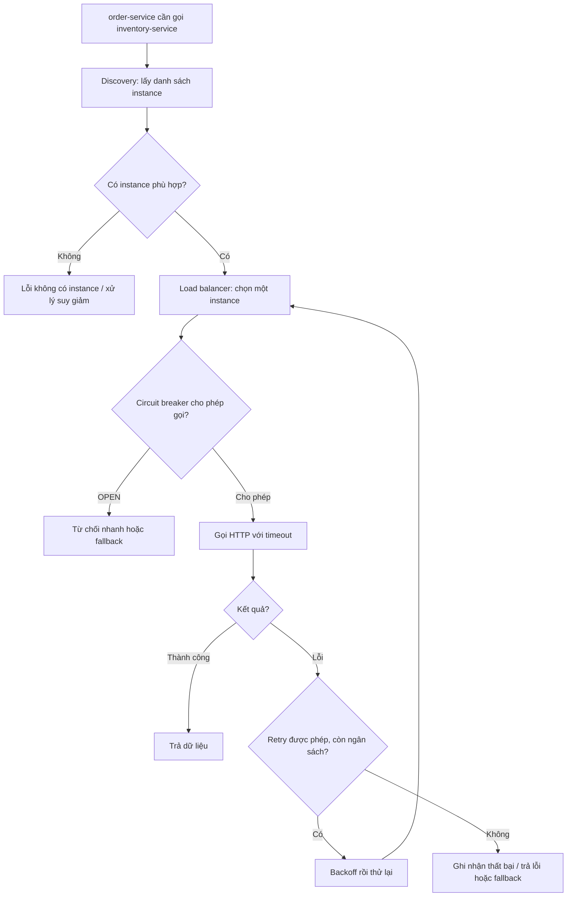
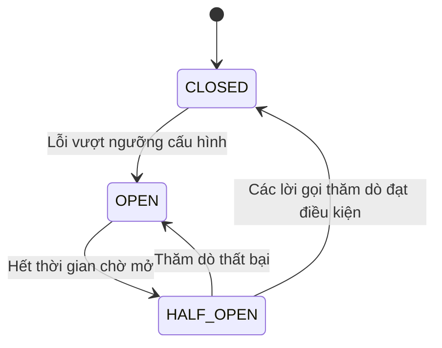

# Phân biệt discovery, load balancing, retry và circuit breaker

> **Chương:** Nền tảng phân tán  
> **Phạm vi:** Spring Cloud Core — các abstraction chung trong Spring Cloud Commons, cách tìm dịch vụ, chọn instance và bảo vệ lời gọi giữa các dịch vụ.  
> **Trọng tâm:** Bốn cơ chế giải quyết **bốn câu hỏi khác nhau** trong quá trình gọi một dịch vụ phân tán.

## 1. Tình huống xuất phát

Giả sử hệ thống thương mại điện tử gồm `order-service`, `inventory-service` và `payment-service`. Khi người dùng xác nhận đơn hàng, `order-service` cần kiểm tra tồn kho qua `inventory-service`. Dịch vụ tồn kho có thể chạy trên nhiều instance:

- `inventory-1` tại `10.0.1.11:8080`;
- `inventory-2` tại `10.0.1.12:8080`;
- `inventory-3` tại `10.0.1.13:8080`.

Các instance có thể được tạo mới, khởi động lại, đổi địa chỉ hoặc lỗi tạm thời. Nếu `order-service` chỉ lưu một IP cố định, toàn bộ yêu cầu phụ thuộc vào một máy và cấu hình nhanh chóng lỗi thời.

Bốn câu hỏi xuất hiện theo trình tự:

1. **Discovery:** Hiện có thể liên hệ những instance nào của `inventory-service`?
2. **Load balancing:** Trong những instance đó, nên gửi lời gọi này đến instance nào?
3. **Retry:** Nếu lời gọi thất bại theo cách có khả năng phục hồi, có nên thử lại không, thử bao nhiêu lần và cách nhau bao lâu?
4. **Circuit breaker:** Nếu đích đang lỗi liên tục, có nên tiếp tục gửi yêu cầu đến đó hay tạm ngừng gọi để tránh làm tình hình tệ hơn?

Chúng phối hợp với nhau nhưng không thay thế cho nhau. Discovery biết **địa chỉ**, load balancing quyết định **đích của một lần gọi**, retry quyết định **có thực hiện thêm lần gọi**, circuit breaker quyết định **có cho phép lời gọi đi qua**.

### Kết quả học tập

Sau bài này, người học có thể:

- phân biệt mục đích, đầu vào, đầu ra và giới hạn của từng cơ chế;
- giải thích cách Spring Cloud Commons kết nối discovery với Spring Cloud LoadBalancer;
- chọn chính sách retry phù hợp với HTTP method, idempotency và ngân sách thời gian;
- mô tả các trạng thái CLOSED, OPEN, HALF_OPEN của circuit breaker;
- sắp xếp retry và circuit breaker, dự đoán hiệu ứng khi downstream suy giảm;
- đề xuất phép thử và metric để kiểm chứng hệ thống hoạt động đúng khi có lỗi.

## 2. Bản đồ khái niệm: bốn cơ chế nằm ở đâu?

| Cơ chế | Câu hỏi chính | Đầu vào | Kết quả | Không tự giải quyết |
| --- | --- | --- | --- | --- |
| **Service discovery** | Dịch vụ tên `inventory-service` đang ở đâu? | Tên dịch vụ, dữ liệu đăng ký hoặc nguồn khám phá | Danh sách `ServiceInstance` hoặc endpoint khả dụng theo nguồn dữ liệu | Không chọn một instance cho mỗi request; không tự thử lại |
| **Load balancing** | Chọn instance nào cho lần gọi này? | Danh sách instance, chiến lược chọn và thông tin request | Một đích cụ thể để gửi request | Không làm instance chết sống lại; không mặc định đảm bảo retry |
| **Retry** | Có nên gọi lại sau lỗi vừa gặp? | Loại lỗi, tính an toàn của thao tác, giới hạn số lần/thời gian | Một hoặc vài lần thử có điều kiện | Không chặn lưu lượng dài hạn khi dịch vụ hỏng liên tục |
| **Circuit breaker** | Có cho phép gọi vào dependency đang bất ổn? | Lịch sử thành công/thất bại và cấu hình ngưỡng | Cho phép gọi, từ chối nhanh hoặc gọi fallback | Không tìm đích, không phân tải, không tự sửa downstream |

**Ghi nhớ:** Một cơ chế thường tạo dữ liệu hoặc điều kiện cho cơ chế khác. Ví dụ, load balancer có thể lấy danh sách instance từ discovery; retry có thể thực hiện lại một HTTP request và mỗi lần đó được load balancer chọn lại đích; circuit breaker có thể bao quanh cả chuỗi retry.

### Luồng lời gọi minh họa



Sơ đồ giúp hình dung vai trò, **không áp đặt duy nhất một thứ tự triển khai**. Thực tế, breaker có thể đặt bên ngoài toàn bộ thao tác retry hoặc bên trong mỗi lần thử. Điểm đặt quyết định nó đếm số lần thất bại như thế nào; phần 7 sẽ phân tích cụ thể.

## 3. Service discovery: biến tên logic thành địa chỉ thực tế

### 3.1. Vấn đề mà discovery giải quyết

Trong môi trường tự động mở rộng, container và instance liên tục thay đổi. Thay vì cấu hình cứng `http://10.0.1.11:8080`, client dùng tên logic `inventory-service`. Một cơ chế discovery cung cấp thông tin về các instance đang được đăng ký cho tên đó.

Có hai kiểu phổ biến:

- **Client-side discovery:** client hoặc thư viện ở phía client hỏi registry, nhận danh sách instance rồi chọn đích. Thường được kết hợp với client-side load balancing.
- **Server-side discovery:** client gọi một địa chỉ ổn định như gateway, proxy hay DNS; thành phần phía hạ tầng phân giải và chọn đích. Ứng dụng có thể không trực tiếp sử dụng một `DiscoveryClient`.

Trong các hệ thống có registry, nhà cung cấp có thể là Eureka, Consul hoặc cơ chế discovery của môi trường Kubernetes. Mỗi nhà cung cấp có quy tắc đăng ký, đồng bộ, health check và cập nhật riêng. **Có đăng ký trong registry không đồng nghĩa instance chắc chắn đang khỏe tại đúng thời điểm request.**

### 3.2. Abstraction liên quan trong Spring Cloud

Spring Cloud Commons định nghĩa các interface dùng chung, nhờ đó code nghiệp vụ ít lệ thuộc vào hệ thống registry:

- `DiscoveryClient`: tra cứu tên dịch vụ và lấy danh sách `ServiceInstance`.
- `ServiceInstance`: mô tả một instance, chẳng hạn service ID, host, port, URI và metadata.
- `ServiceRegistry` cùng các abstraction liên quan: hỗ trợ đăng ký/hủy đăng ký khi triển khai có cung cấp khả năng tương ứng.
- `ReactiveDiscoveryClient`: biến thể theo lập trình reactive khi phù hợp với ứng dụng.

Ví dụ chỉ **truy vấn thông tin**, chưa thực hiện cân bằng tải:

```java
@Service
class InventoryDirectory {
    private final DiscoveryClient discoveryClient;

    InventoryDirectory(DiscoveryClient discoveryClient) {
        this.discoveryClient = discoveryClient;
    }

    List<URI> availableEndpoints() {
        return discoveryClient.getInstances("inventory-service")
                .stream()
                .map(ServiceInstance::getUri)
                .toList();
    }
}
```

Đây là code minh họa, lược bỏ `import`. Để có danh sách thực tế, ứng dụng cần cấu hình một nguồn discovery phù hợp; chỉ có interface của Spring Cloud Commons không tự tạo registry.

### 3.3. Những giới hạn thường bị hiểu nhầm

- Registry có thể cập nhật chậm hoặc client đang dùng cache. Danh sách gồm ba instance **không bảo đảm** cả ba đều trả lời được.
- Discovery trả về danh sách rỗng khi thiếu đăng ký hoặc nguồn dữ liệu gặp vấn đề; retry HTTP mù quáng chưa chắc khắc phục được.
- Health check của registry, timeout tại client và tình trạng tải thực tế là các tín hiệu khác nhau.
- DNS hoặc gateway cũng có thể giải quyết bài toán tìm đường; không phải ứng dụng phân tán nào cũng cần thêm một service registry riêng.

**Ví dụ:** `inventory-2` vừa chết nhưng chưa bị xóa khỏi registry. Discovery vẫn có thể trả về địa chỉ cũ. Load balancer chọn nó, request thất bại và retry hợp lệ có thể thử lại qua instance khác. Mỗi cơ chế xử lý một phần của sự kiện đó.

## 4. Load balancing: chọn đích cho từng lời gọi

### 4.1. Load balancer cần gì?

Load balancer nhận tập đích khả dụng và chọn một nơi để xử lý yêu cầu. Chiến lược có thể là round-robin, random hoặc một chính sách tùy biến có xét vùng mạng, metadata và trạng thái hệ thống.

Spring Cloud LoadBalancer hỗ trợ chọn `ServiceInstance` cho tên dịch vụ và tích hợp với một số HTTP client khi được cấu hình đúng. Trong trường hợp dùng discovery, danh sách instance thường được cung cấp qua một supplier dựa trên `DiscoveryClient`; danh sách có thể được lọc hoặc cache theo cấu hình.

**Round-robin không có nghĩa tải CPU luôn cân bằng.** Nếu request có chi phí rất khác nhau, chia đều số request vẫn có thể tạo ra lệch tải. Load balancer cũng không mặc nhiên hiểu session affinity, vùng địa lý, dữ liệu nóng hoặc giới hạn kết nối.

### 4.2. Client-side và server-side load balancing

| Đặc điểm | Client-side | Server-side |
| --- | --- | --- |
| Ai chọn instance? | Thư viện phía caller | Proxy, ingress, gateway hoặc hạ tầng |
| Caller biết nhiều instance? | Thường có | Có thể chỉ biết một endpoint ổn định |
| Ví dụ | Spring Cloud LoadBalancer tích hợp `RestClient` hoặc `WebClient` | Reverse proxy, Kubernetes Service, ingress |
| Điểm cần quan sát | Tập instance mà từng client thấy, thuật toán và cache | Cấu hình proxy, health check, connection pool |

Hai tầng có thể cùng tồn tại, nhưng cần hiểu request thực sự đi qua tầng nào để tránh cấu hình trùng lặp, khó truy lỗi.

### 4.3. Một ví dụ tích hợp Spring Cloud LoadBalancer

Ứng dụng đồng bộ sử dụng Spring Framework `RestClient` có thể định nghĩa builder được đánh dấu `@LoadBalanced`:

```java
@Configuration
class DownstreamClientConfiguration {
    @Bean
    @LoadBalanced
    RestClient.Builder loadBalancedRestClientBuilder() {
        return RestClient.builder();
    }
}

@Service
class InventoryHttpClient {
    private final RestClient restClient;

    InventoryHttpClient(@LoadBalanced RestClient.Builder builder) {
        this.restClient = builder.build();
    }

    StockResponse findStock(String sku) {
        return restClient.get()
                .uri("http://inventory-service/api/stocks/{sku}", sku)
                .retrieve()
                .body(StockResponse.class);
    }
}

record StockResponse(String sku, Integer quantity, String status) {}
```

Ở đây `inventory-service` là **service ID logic** để bộ tích hợp load balancer phân giải, không nhất thiết là tên DNS thông thường. Mã mẫu giả định ứng dụng có Spring Cloud LoadBalancer, nguồn instance phù hợp và phiên bản Spring Boot/Spring Cloud tương thích. Phải xác nhận bộ phiên bản theo ma trận tương thích của release train đang dùng, thay vì chọn độc lập phiên bản của từng starter.

Nếu không có instance nào, load balancer không thể tự tạo endpoint. Cần quyết định caller sẽ trả lỗi, dùng dữ liệu dự phòng hay xử lý suy giảm ra sao.

## 5. Retry: thử lại khi lỗi có khả năng thoáng qua

### 5.1. Retry là một chính sách, không phải phản xạ với mọi lỗi

Một request có thể lỗi vì mất kết nối ngắn, timeout hoặc upstream đang tái khởi động. Thử lại đôi khi thành công. Nhưng nếu thao tác sai dữ liệu hoặc downstream quá tải, retry có thể tăng độ trễ và nhân thêm tải.

Chính sách retry phải trả lời rõ:

1. **Lỗi nào được thử lại?** Phân biệt lỗi mạng, timeout, HTTP `429`/`503` với lỗi nghiệp vụ hoặc input không hợp lệ.
2. **Thao tác có an toàn để làm lại?** Xét idempotency và side effect, không chỉ nhìn vào HTTP method.
3. **Tối đa bao nhiêu lần thử?** Ví dụ ba lần **tính cả lần đầu**, tức tối đa hai retry.
4. **Khoảng cách giữa các lần?** Có backoff, thường cộng thêm jitter để tránh nhiều client gọi lại cùng lúc.
5. **Ngân sách tổng là bao nhiêu?** Nếu deadline của `order-service` chỉ còn 300 ms, retry lần ba sau 2 giây là vô nghĩa.

| Loại kết quả | Retry thường có phù hợp? | Lưu ý |
| --- | --- | --- |
| Lỗi kết nối tạm thời trước khi nhận phản hồi | Có điều kiện | Caller không phải lúc nào cũng biết request đã đến server hay chưa |
| HTTP `429` | Có điều kiện | Tuân thủ `Retry-After` khi có, giới hạn tần suất và deadline |
| HTTP `502`, `503`, `504` | Có điều kiện | Chỉ thử khi downstream có khả năng hồi phục; tránh tạo retry storm |
| HTTP `400` do dữ liệu gửi sai | Thường không | Cần sửa request, gửi lặp không có ích |
| HTTP `401`/`403` do xác thực, phân quyền | Thường không | Xử lý token/quyền truy cập theo nguyên nhân; không retry mù |
| HTTP `404` đúng theo nghiệp vụ | Thường không | Không có bản ghi là kết quả hợp lệ trong nhiều API |
| Lệnh thanh toán hoặc tạo đơn có side effect | Không tự động | Cần idempotency key và hợp đồng chống xử lý trùng |

**Idempotency** là tính chất gọi cùng một thao tác nhiều lần mà hiệu ứng cuối cùng vẫn như một lần theo hợp đồng API. `GET` thường được thiết kế an toàn; `POST` tạo thanh toán có thể gây trùng giao dịch nếu retry sau khi server đã ghi nhận thành công nhưng response bị mất.

### 5.2. Backoff, jitter và retry amplification

Retry liên tục không chờ thường làm hại upstream đang quá tải. Exponential backoff tăng khoảng chờ qua mỗi lần; jitter phân tán thời điểm thử lại giữa các client.

Ví dụ minh họa, với tối đa ba lần thử, các khoảng chờ dự kiến có thể xấp xỉ 200 ms rồi 400 ms và được điều chỉnh ngẫu nhiên. Giá trị cụ thể phụ thuộc thư viện và cấu hình. Khi cộng thêm thời gian xử lý của từng request, tổng thời gian **phải nhỏ hơn deadline** của lời gọi nghiệp vụ.

Nếu `order-service` retry ba lần khi gọi `billing-service`, và `billing-service` cũng retry ba lần khi gọi một hệ thống khác, một yêu cầu phía trên có thể làm phát sinh tới chín lần gọi phía dưới. Cần có **retry budget** trên toàn chuỗi, đặt timeout hợp lý ở mỗi tầng và chỉ retry tại nơi đủ thông tin để quyết định.

### 5.3. Retry trong hệ sinh thái Spring

Retry có thể được triển khai bằng Spring Retry, Resilience4j Retry hoặc tính năng retry tại một HTTP client/load balancer cụ thể. **Spring Cloud Commons không mặc định biến mọi request thành request có retry.** Tính năng nào được bật còn phụ thuộc starter, client, cấu hình và phiên bản đang dùng.

Nếu mỗi lần retry tạo một lời gọi mới qua client tích hợp Spring Cloud LoadBalancer, load balancer **có thể chọn một instance khác**; điều đó phụ thuộc chiến lược, cache và các tính năng tránh instance trước đó. Không nên mặc định hiểu rằng retry luôn chuyển máy.

Một retry an toàn cần được định nghĩa theo **loại tác vụ và loại lỗi**, sau đó mới cấu hình thư viện.

## 6. Circuit breaker: cắt đường gọi khi dependency bất ổn

### 6.1. Breaker quan sát điều gì?

Circuit breaker theo dõi các lời gọi được thực hiện qua nó. Khi tỷ lệ lỗi hoặc tín hiệu khác vượt ngưỡng đã cấu hình trong một cửa sổ quan sát đủ lớn, breaker có thể tạm ngừng cho gọi thật. Nhờ vậy, caller thất bại nhanh hoặc dùng fallback và giảm áp lực lên dependency đang lỗi.

Ba trạng thái điển hình:



- **CLOSED:** Cho phép request đi qua và ghi nhận kết quả. Tên “closed” nghĩa mạch đóng, lưu lượng thông.
- **OPEN:** Từ chối lời gọi thật trong một khoảng thời gian; có thể trả lỗi nhanh hoặc gọi fallback.
- **HALF_OPEN:** Cho phép một lượng nhỏ lời gọi thăm dò để đánh giá khả năng hồi phục.

Từng thư viện có chi tiết riêng về sliding window, số lượng mẫu tối thiểu, tỷ lệ lỗi, slow call, thời gian chờ và quy tắc chuyển trạng thái. Breaker không tự biết service đã khôi phục chỉ nhờ registry báo “healthy”; nó cần dữ liệu phù hợp từ các lời gọi được phép đi qua.

### 6.2. Circuit breaker khác retry ở đâu?

Retry dành cho **một lần tác vụ có thể gặp lỗi thoáng qua**; circuit breaker học từ **nhiều lời gọi trong một khoảng thời gian** để hạn chế việc liên tục tấn công cùng một dependency đang hỏng.

Giả sử `inventory-service` trả `503` trong 10 phút:

- Chỉ có retry: mỗi order có thể thử ba lần, khiến số request lên upstream tăng đáng kể.
- Có circuit breaker: sau đủ dữ liệu lỗi và vượt ngưỡng, các lời gọi tiếp theo có thể bị từ chối nhanh; upstream nhận ít traffic hơn và caller phản hồi sớm.
- Khi đến giai đoạn HALF_OPEN: một số ít request thử đường đi thật; nếu đạt điều kiện, breaker trở lại CLOSED.

**Fallback không phải lúc nào cũng là dữ liệu hợp lệ.** Với kiểm tra tồn kho, trả số lượng `0` khi service lỗi có thể khiến hệ thống hiểu sai là “hết hàng”. Tốt hơn là biểu diễn `UNKNOWN`, tạm dừng bước checkout hoặc trả lỗi nghiệp vụ có thể xử lý được.

### 6.3. Breaker cũng có phạm vi bảo vệ

Một breaker có thể được đặt theo dependency logic (ví dụ `inventory-service`) hoặc theo nhóm endpoint/operation. Breaker theo service có thể mở vì một instance xấu đang được chọn thường xuyên, dù instance khác vẫn khỏe. Breaker theo instance cần chính sách tạo, thu hồi và cập nhật key khi instance thay đổi. Không có một phạm vi tối ưu cho mọi ứng dụng.

Circuit breaker cũng không thay thế **timeout**, **bulkhead**, **rate limiting** và **backpressure**. Nếu request treo vô hạn, chỉ đếm lỗi sau khi có kết quả là chưa đủ; nếu một dependency chiếm hết thread pool, cần cơ chế giới hạn tài nguyên song song.

## 7. Ghép các cơ chế trong một lời gọi Spring Cloud

Giả sử ứng dụng có:

- một nguồn discovery được cấu hình để tìm `inventory-service`;
- Spring Cloud LoadBalancer để phân giải URI theo service ID;
- Spring Retry cho những lỗi tạm thời đã chọn;
- Spring Cloud CircuitBreaker cùng implementation Resilience4j để bảo vệ dependency.

Ví dụ đồng bộ dưới đây minh họa **breaker bao quanh toàn bộ retry**. Phần `import`, cấu hình provider discovery, timeout HTTP và chính sách HTTP cụ thể được lược bỏ để tập trung vào luồng điều khiển.

```java
@Configuration
class InventoryClientConfig {
    @Bean
    @LoadBalanced
    RestClient.Builder inventoryRestClientBuilder() {
        return RestClient.builder();
    }

    @Bean
    RetryTemplate inventoryRetry() {
        return RetryTemplate.builder()
                .maxAttempts(3) // Tổng cộng tối đa 3 lần gọi, tính cả lần đầu
                .exponentialBackoff(200, 2.0, 1_000, true)
                .retryOn(ResourceAccessException.class)
                .build();
    }
}

@Service
class InventoryGateway {
    private final RestClient client;
    private final RetryTemplate retry;
    private final CircuitBreaker breaker;

    InventoryGateway(
            @LoadBalanced RestClient.Builder builder,
            RetryTemplate inventoryRetry,
            CircuitBreakerFactory<?, ?> circuitBreakerFactory) {
        this.client = builder.build();
        this.retry = inventoryRetry;
        this.breaker = circuitBreakerFactory.create("inventory-service");
    }

    StockResult check(String sku) {
        return breaker.run(
                () -> retry.execute(context ->
                        client.get()
                                .uri("http://inventory-service/api/stocks/{sku}", sku)
                                .retrieve()
                                .body(StockResult.class)),
                error -> new StockResult(sku, null, "UNKNOWN"));
    }
}

record StockResult(String sku, Integer quantity, String status) {}
```

Giải thích chính xác những gì code làm:

1. `@LoadBalanced` trên `RestClient.Builder` yêu cầu phần tích hợp load balancer xử lý tên dịch vụ logic trong URI.
2. `RetryTemplate` cấu hình **tối đa ba lần thử**, có backoff và chỉ chủ động retry `ResourceAccessException` trong ví dụ. HTTP `503` mặc định được `RestClient.retrieve()` chuyển thành lỗi HTTP, **không thuộc nhóm retry** đã cấu hình ở mẫu này.
3. `CircuitBreakerFactory` tạo một breaker mang key `inventory-service`; implementation và quy tắc mở mạch được cấu hình riêng.
4. Khi gọi thất bại cuối cùng hoặc breaker không cho đi qua, fallback trả trạng thái `UNKNOWN`. Ứng dụng tiêu thụ phải coi `quantity = null` là **chưa biết**, không phải bằng 0.
5. Code minh họa chưa định nghĩa timeout, tracing, phân loại lỗi chi tiết, kiểm tra null hay điều kiện nghiệp vụ cho fallback. Các điều kiện đó phải được thiết kế trước khi đưa vào production.

Các starter/thư viện cần có phải khớp với bộ Spring Boot và **Spring Cloud release train** của dự án. Các artifact liên quan thường gồm `spring-cloud-starter-loadbalancer`, `spring-cloud-starter-circuitbreaker-resilience4j` và `spring-retry`, cộng với dependency discovery provider khi ứng dụng dùng registry. Spring Cloud Context quản lý một số cơ chế cấu hình và refresh của ứng dụng, nhưng **refresh cấu hình không đồng nghĩa tự khôi phục network call hoặc thay cho bốn cơ chế này**.

### 7.1. Đặt retry bên trong hay bên ngoài breaker?

Đây là một lựa chọn có hệ quả thực tế:

| Thứ tự bao bọc | Pseudocode | Breaker nhìn thấy | Điều cần cân nhắc |
| --- | --- | --- | --- |
| **Breaker ngoài, retry trong** | `breaker(retry(call))` | Kết quả cuối cùng của một tác vụ sau khi retry | Một tác vụ có thể đã gửi nhiều request; breaker có thể nhận ít tín hiệu lỗi hơn |
| **Retry ngoài, breaker trong** | `retry(breaker(call))` | Kết quả của từng lần gọi qua breaker | Các lỗi riêng lẻ dễ đẩy mạch mở nhanh hơn; cần tránh retry tiếp khi breaker đã OPEN |

Không nên retry liên tiếp ngoại lệ “circuit breaker đang OPEN”: các lần thử mới thường bị từ chối ngay và chỉ tiêu tốn tài nguyên. Cũng cần xác định timeout bao quanh mỗi attempt hay bao quanh tổng tác vụ; tốt nhất có **deadline tổng** và giới hạn thời gian cho từng attempt.

### 7.2. Khi cần chọn lại instance

Nếu một request đến `inventory-2` lỗi kết nối, retry có thể thực hiện thêm một lần gọi qua `inventory-service`. Load balancer lúc này có cơ hội chọn `inventory-1` hoặc `inventory-3`. Tuy nhiên, thuật toán có thể tiếp tục chọn `inventory-2`; chỉ thêm retry **không bảo đảm failover**. Cần kiểm tra khả năng tránh instance vừa lỗi, cơ chế cập nhật danh sách và health filtering của cấu hình thực tế.

## 8. Phân tích các tình huống hay gặp

| Sự cố | Discovery giúp gì? | Load balancing giúp gì? | Retry giúp gì? | Circuit breaker giúp gì? |
| --- | --- | --- | --- | --- |
| Thêm instance để mở rộng | Phát hiện instance mới sau khi dữ liệu được cập nhật | Phân phối một phần lời gọi sang instance mới | Không bắt buộc | Không trực tiếp |
| Một instance ngừng hoạt động | Có thể loại khỏi danh sách sau một độ trễ | Chọn các instance còn lại nếu có thông tin đúng | Có thể thử lại nếu lỗi thoáng qua và thao tác an toàn | Hạn chế gọi khi sự cố lặp lại |
| Registry trả dữ liệu cũ | Có thể cần cơ chế làm mới/health check | Có nguy cơ chọn đích đã chết | Có thể cứu một số request, không bảo đảm | Giảm tác động khi các lời gọi liên tục lỗi |
| Cả dịch vụ không có instance | Danh sách trống hoặc không phân giải được | Không có đích để chọn | Thường không hữu ích nếu thiếu đích kéo dài | Trả lỗi nhanh/fallback theo thiết kế |
| Downstream quá tải, trả `503` | Thường không đủ thông tin về tải | Có thể phân đều request, vẫn quá tải | Chỉ nên retry có backoff, deadline và giới hạn | Tạm giảm traffic khi vượt ngưỡng lỗi |
| Request `POST` đã ghi dữ liệu nhưng mất response | Không xác nhận được kết quả nghiệp vụ | Không xác nhận được kết quả nghiệp vụ | Có nguy cơ tạo bản ghi trùng | Giảm request khi lỗi diện rộng, nhưng không giải quyết duplicate |

Một số bài toán nằm **ngoài** bốn cơ chế:

- Bảo đảm thanh toán không trùng cần idempotency key, transaction hoặc thiết kế nghiệp vụ thích hợp.
- Đảm bảo tính nhất quán liên dịch vụ cần mô hình dữ liệu và giao thức phù hợp; load balancing không tạo tính nhất quán.
- Cô lập tài nguyên cần bulkhead, pool giới hạn và timeout.
- Khả năng quan sát cần log, metric, tracing và correlation ID.

## 9. Thiết kế timeout, retry và fallback theo ngân sách thời gian

Giả sử `order-service` có **800 ms** để trả kết quả trước khi client hết kiên nhẫn. Một cấu hình giả định như sau chỉ nhằm minh họa cách tính:

| Thành phần | Ngân sách giả định |
| --- | ---: |
| Xử lý nghiệp vụ trước/sau khi gọi inventory | 100 ms |
| Tối đa hai attempt gọi inventory, mỗi attempt 200 ms | 400 ms |
| Chờ backoff giữa hai attempt | 100 ms |
| Phần dự phòng cho network jitter, serialization, scheduling | 200 ms |
| **Tổng** | **800 ms** |

Nếu còn 50 ms trước deadline, bắt đầu một attempt 200 ms sẽ khiến response phía trên hết hạn trước. Hệ thống cần đo **thời gian còn lại thực tế** thay vì chỉ dựa trên số lần retry cố định.

Lựa chọn fallback phụ thuộc độ quan trọng của dữ liệu:

- Với một khối gợi ý sản phẩm: có thể trả danh sách rỗng hoặc dữ liệu cache cũ nếu người dùng được thông báo phù hợp.
- Với số dư tài khoản, tồn kho hoặc kết quả thanh toán: không được ngụy tạo giá trị thành công. Có thể trả trạng thái `UNKNOWN`, báo thử lại sau hoặc chuyển workflow sang bước đối soát.
- Với API yêu cầu tính nhất quán mạnh: fail fast có thể đúng hơn sử dụng cache cũ.

Đặt timeout cho kết nối và đọc response, retry theo loại lỗi, circuit breaker theo dependency và fallback theo hợp đồng nghiệp vụ. Chúng cần được thiết kế **cùng nhau** để không phá vỡ SLA.

## 10. Kiểm thử: làm sao chứng minh bốn cơ chế đang chạy đúng?

Không nên chỉ kiểm tra happy path. Các phép thử dưới đây giúp phân biệt lỗi cấu hình của từng tầng:

| Phép thử | Cách mô phỏng | Điều cần xác nhận |
| --- | --- | --- |
| Discovery | Đăng ký hoặc gỡ một instance trong môi trường kiểm thử | Danh sách instance thay đổi theo cơ chế và độ trễ đã biết |
| Load balancing | Hai instance trả về `instanceId` khác nhau | Request được phân phối theo chính sách, không phụ thuộc IP cố định |
| Retry | Stub trả lỗi kết nối một lần rồi thành công | Tổng số attempt đúng giới hạn; có backoff; không nhân đôi side effect |
| Retry không hợp lệ | Stub trả HTTP `400` hoặc một lỗi nghiệp vụ | Caller không thử lại khi chính sách cấm |
| Circuit breaker | Stub lỗi liên tiếp đủ mẫu theo cấu hình | Breaker chuyển OPEN và từ chối nhanh các request tiếp theo |
| Phục hồi | Sau thời gian OPEN, cho downstream trả lời thành công | HALF_OPEN thử có giới hạn rồi chuyển CLOSED nếu đạt điều kiện |
| Deadline | Downstream chậm hoặc treo | Tổng thời gian không vượt quá ngân sách được thiết kế |
| Fallback | Downstream mất hoàn toàn | Giá trị thay thế phản ánh “không biết/không sẵn sàng” đúng nghiệp vụ |

Trong kiểm thử integration, dùng một HTTP stub hoặc fake service có thể điều khiển response, độ trễ và số lần nhận request. Với circuit breaker, cấu hình cửa sổ quan sát ngắn trong profile test để kiểm chứng chuyển trạng thái có tính quyết định; đừng dựa vào thời gian chờ dài của môi trường production.

### 10.1. Metric và log cần theo dõi

- **Discovery:** số instance đã thấy, thời điểm làm mới, lỗi kết nối registry.
- **Load balancing:** số request theo service/instance, trường hợp không có instance, độ lệch phân phối.
- **Retry:** số attempt, số retry, lý do retry, độ trễ tăng thêm, tỷ lệ thành công sau retry.
- **Circuit breaker:** trạng thái, số lời gọi được phép/bị từ chối, tỷ lệ thất bại, số lần chuyển OPEN/HALF_OPEN/CLOSED.
- **Đầu cuối:** latency p95/p99, error rate và mức sử dụng tài nguyên của cả caller lẫn downstream.

Dùng Micrometer/observability theo stack của dự án, nhưng tránh gắn tag metric có cardinality vô hạn như request ID hoặc SKU cho mọi mẫu. Correlation ID phù hợp hơn ở trace/log.

## 11. Những nhầm lẫn cần tránh

**“Đã có Eureka/Consul thì tự động cân bằng tải.”**  
Không nhất thiết. Registry cung cấp thông tin instance; phải có tầng chọn instance và tích hợp HTTP client tương ứng. Nếu caller gọi URL IP cố định, danh sách discovery không giúp phân tải request đó.

**“Round-robin sẽ bỏ qua máy đang chết.”**  
Không tự bảo đảm. Danh sách có thể cũ; thuật toán vẫn có thể chọn máy lỗi nếu chưa bị loại. Health check, lọc instance, timeout và xử lý lỗi vẫn cần thiết.

**“Retry là tăng độ tin cậy vô điều kiện.”**  
Sai. Retry nhầm vào lỗi không phục hồi được hoặc vào thao tác có side effect có thể tạo trùng dữ liệu và retry storm.

**“Circuit breaker sửa được upstream.”**  
Breaker bảo vệ caller và giảm tải gọi vào dependency; nó không sửa logic, mạng hoặc database của upstream.

**“Mở circuit breaker nghĩa là không có instance nào.”**  
Không đúng. Breaker OPEN mô tả **quyết định bảo vệ dựa trên các lời gọi mà nó quan sát**; discovery vẫn có thể báo nhiều instance.

**“Fallback luôn là kết quả thành công.”**  
Fallback là quyết định nghiệp vụ khi dependency không sẵn sàng. Một số nghiệp vụ phải từ chối hoặc để trạng thái chờ, thay vì trả dữ liệu giả.

**“Refresh cấu hình Spring Cloud Context sẽ tự retry/cứu mọi request.”**  
Refresh scope có thể làm mới một số bean/cấu hình theo điều kiện, nhưng không thay cho việc xác định instance, timeout, retry policy hay breaker. Cũng cần tránh tự thay đổi các tham số resilience khi chưa hiểu tác động đến các request đang chạy.

## 12. Bài tập vận dụng

**Bài tập 1 — Chọn đúng cơ chế.** Hệ thống tăng từ hai lên sáu instance. Một số caller vẫn gọi IP cũ và traffic gần như dồn vào một máy. Hãy xác định lỗi về discovery, load balancing hoặc cấu hình client; nêu phép thử để phân biệt từng nguyên nhân.

**Bài tập 2 — Retry có an toàn không?** `payment-service` nhận `POST /charges`. Server đã ghi thanh toán nhưng response về caller bị timeout. Hãy giải thích vì sao retry trực tiếp có thể tạo giao dịch trùng; đề xuất idempotency key và quy trình tra cứu trạng thái giao dịch trước khi retry.

**Bài tập 3 — Mạch mở.** Trong 60 giây, 80% request đến `inventory-service` lỗi. Một circuit breaker đã OPEN nhưng dashboard discovery vẫn thấy ba instance. Hãy giải thích vì sao hai thông tin không mâu thuẫn; đề xuất metric để xác nhận caller đang fail fast thay vì tiếp tục gọi thật.

**Bài tập 4 — Thứ tự decorator.** So sánh `breaker(retry(call))` và `retry(breaker(call))` khi mỗi tác vụ được phép ba attempt. Cách nào khiến breaker thường quan sát một kết quả tổng hợp, cách nào khiến breaker có thể quan sát từng attempt? Chọn một cách và giải thích cách bạn tránh retry khi breaker OPEN.

### Tự kiểm tra nhanh

1. Discovery có tự chọn instance cho mỗi HTTP request không? **Không**; đó là trách nhiệm của load balancing hoặc một tầng định tuyến khác.
2. Retry có bảo đảm lần sau trúng instance khác không? **Không**; phụ thuộc client, thuật toán và cấu hình.
3. Circuit breaker OPEN có đồng nghĩa server đã tắt không? **Không**; đây là trạng thái bảo vệ ở phía gọi.
4. Retry `POST` sau timeout có mặc nhiên an toàn không? **Không**; phải xét hợp đồng idempotency và side effect.
5. Có thể dùng cả bốn cơ chế trong một đường gọi không? **Có**; cần thiết kế thứ tự, phạm vi và ngân sách thời gian rõ ràng.

## 13. Kết nối với Spring Cloud Core

Trong hệ thống phân tán dùng Spring Cloud, có thể hình dung các lớp trách nhiệm:

- **Spring Cloud Commons** cung cấp contract chung như `DiscoveryClient`, `ServiceInstance` và các abstraction liên quan.
- **Discovery implementation** đưa thông tin instance từ registry hoặc hạ tầng vào ứng dụng.
- **Spring Cloud LoadBalancer** chọn instance và có thể tích hợp với HTTP client hỗ trợ.
- **Spring Retry, Resilience4j và Spring Cloud CircuitBreaker** giúp bổ sung chính sách chịu lỗi ở tầng gọi phụ thuộc.
- **Spring Cloud Context và cấu hình ngoài** hỗ trợ cách ứng dụng nhận hoặc làm mới một số cấu hình; phải quản lý thay đổi và tương thích Spring Boot/Spring Cloud theo release train.

Khi phân tích lỗi thực tế, hãy hỏi theo đúng thứ tự: **caller tìm được instance chưa, đã chọn instance nào, lỗi xảy ra ở attempt nào, retry có hợp lệ không, và breaker đang ở trạng thái nào?** Trả lời đủ năm câu đó thường giúp xác định nguyên nhân nhanh hơn việc gom tất cả thành một nhãn “service discovery bị lỗi”.

**Tài liệu tham khảo để đọc tiếp:** Tài liệu chính thức của Spring Cloud Commons (DiscoveryClient và ServiceRegistry), Spring Cloud LoadBalancer, Spring Cloud CircuitBreaker; Spring Retry; Resilience4j CircuitBreaker; cùng ma trận tương thích Spring Cloud release train/Spring Boot của phiên bản dự án đang sử dụng.
