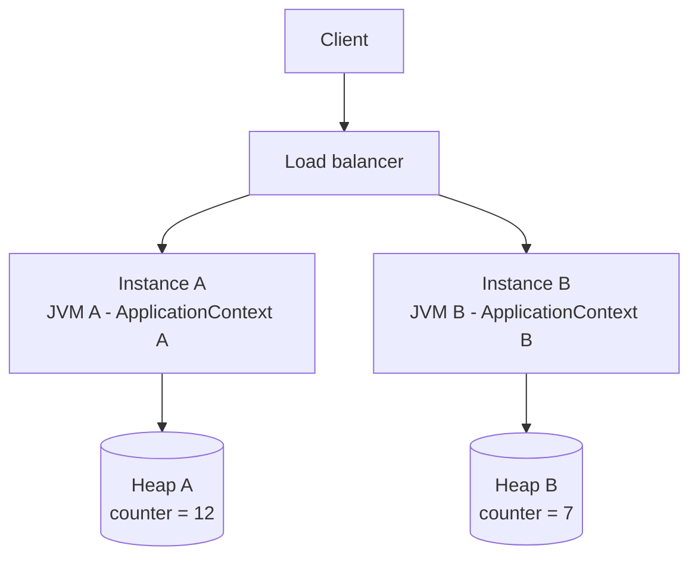
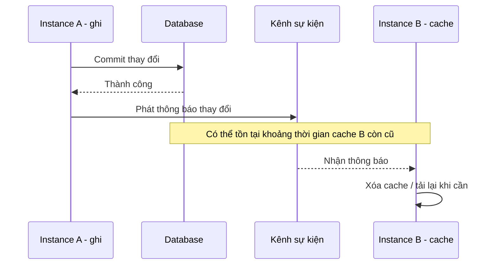
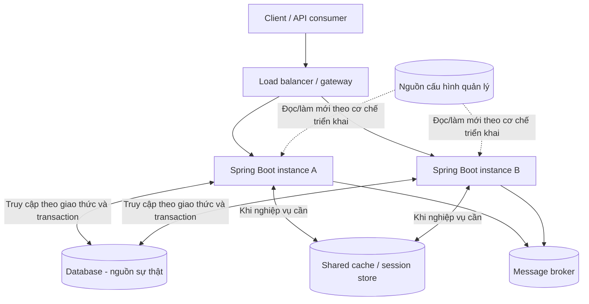

# Trạng thái cục bộ và giới hạn đồng bộ giữa nhiều instance

Trong một ứng dụng Spring Boot chạy đơn lẻ, việc lưu thông tin vào một bean `@Service`, biến `static`, bộ nhớ đệm hoặc `HttpSession` có thể tạo cảm giác rằng dữ liệu đó tồn tại cho **toàn bộ ứng dụng**. Khi triển khai nhiều instance, mỗi instance thường là một tiến trình JVM riêng, có heap, vòng đời và `ApplicationContext` riêng. Trạng thái đặt trong bộ nhớ của instance A vì thế **không tự xuất hiện** ở instance B.

Đây là một nền tảng cần nắm trước khi sử dụng các abstraction của **Spring Cloud Core**: Spring Cloud Commons giúp khám phá và gọi dịch vụ theo abstraction chung; Spring Cloud Context giúp ứng dụng xử lý cấu hình, ngữ cảnh và một số cơ chế làm mới. Những khả năng đó không biến bộ nhớ của nhiều JVM thành một kho trạng thái phân tán thống nhất.

## 1. Mục tiêu học tập

Sau bài này, người học có thể:

1. Phân biệt trạng thái **cục bộ theo request, thread, bean, process/instance** với trạng thái được chia sẻ qua một hệ thống bên ngoài.
2. Giải thích vì sao load balancing, service discovery, service registry và refresh cấu hình không đồng nghĩa với đồng bộ dữ liệu nghiệp vụ.
3. Nhận diện lỗi khi nhiều instance cùng xử lý session, cache, bộ đếm, tác vụ nền, khóa và các yêu cầu cập nhật đồng thời.
4. Chọn nơi lưu trạng thái, cơ chế nhất quán và chiến lược xử lý lỗi theo yêu cầu nghiệp vụ.
5. Thiết kế và kiểm thử các kịch bản chạy nhiều instance, kể cả restart, failover và cập nhật cấu hình không đồng thời.

## 2. Trạng thái cục bộ thực sự có phạm vi nào?

**Trạng thái (state)** là thông tin có thể thay đổi theo thời gian và ảnh hưởng đến hành vi xử lý tiếp theo. Phạm vi tồn tại của trạng thái phụ thuộc vào nơi giữ nó, không phụ thuộc vào việc các instance có cùng mã nguồn hoặc cùng tên dịch vụ hay không.

| Nơi lưu trạng thái | Phạm vi điển hình | Ví dụ | Điều thường xảy ra khi restart instance |
| --- | --- | --- | --- |
| Biến cục bộ trong phương thức | Một lần gọi | Biến trung gian để tính giá | Kết thúc cùng lần gọi |
| `ThreadLocal` | Thread thực thi, khi được quản lý đúng | Context phục vụ xử lý request | Không tồn tại qua restart; còn có nguy cơ rò rỉ trên thread pool nếu không dọn |
| Bean Spring mặc định (`singleton`) | Một `ApplicationContext` | `AtomicLong`, `Map` trong `@Service` | Mất nếu chỉ giữ trong heap |
| `static` | Class loader/JVM tương ứng | Bộ nhớ đệm tự tạo | Mất khi JVM kết thúc; không chia sẻ với JVM khác |
| Cache trong tiến trình | Instance tương ứng | Cache Caffeine hoặc `ConcurrentHashMap` | Mất nếu không có cơ chế nạp lại |
| `HttpSession` lưu trong bộ nhớ | Session trong phạm vi ứng dụng/instance | Giỏ hàng tạm, bước đăng nhập | Có thể mất hoặc không truy cập được khi request sang node khác |
| Kho dữ liệu dùng chung | Theo phạm vi của kho và cấu hình truy cập | PostgreSQL, Redis, object storage | Không phụ thuộc vào việc một instance ứng dụng restart; vẫn phụ thuộc độ sẵn sàng của kho |

Spring bean `singleton` nghĩa là **một bean trong một Spring container**, không phải một bean duy nhất trong toàn cụm. `volatile`, `synchronized`, `ReentrantLock` hay `AtomicLong` có thể giúp phối hợp thread **trong cùng JVM**, nhưng tự chúng không đồng bộ giữa các JVM.

Hãy hình dung hai bản sao của cùng một dịch vụ:



Cả A và B đều phục vụ cùng một API, nhưng `counter = 12` trên A và `counter = 7` trên B không mâu thuẫn về mặt JVM: đó là **hai bản sao trạng thái riêng**. Một request do bộ cân bằng tải chuyển sang B sẽ chỉ thấy trạng thái mà B có thể truy cập.

> **Nguyên tắc:** Cần hỏi “thông tin này phải nhất quán đối với những ai, trong khoảng thời gian nào, và sau sự cố nào?” trước khi quyết định giữ nó trong bộ nhớ của instance.

## 3. Những giới hạn không biến mất khi có nhiều instance

### 3.1. Cùng một mã nguồn không có nghĩa là cùng một bộ nhớ

Hai pod Kubernetes hoặc hai tiến trình `java -jar` có thể chạy từ cùng một image. Chúng vẫn có heap độc lập; thông điệp, giao dịch hoặc hệ thống lưu trữ chung phải tạo ra sự phối hợp nếu nghiệp vụ cần nó. Không có quan hệ *happens-before* xuyên JVM chỉ nhờ gọi `synchronized` trong Java.

### 3.2. Load balancing chỉ phân phối lưu lượng

Load balancer chọn một điểm đích theo chính sách định tuyến. Nó không sao chép session, bộ nhớ đệm hoặc các thay đổi vào bean. Một người dùng có thể lần lượt gọi A rồi B, khiến dữ liệu trong bộ nhớ nhìn như bị “lùi về trước”.

**Sticky session** giảm khả năng chuyển node bằng cách cố gắng đưa cùng người dùng về cùng instance; nó không tự tạo bản sao dự phòng. Khi A lỗi, bị thay thế, scale down hoặc hệ thống bỏ tính bám dính, trạng thái chỉ có trên A vẫn có thể mất. Dùng sticky session cần được xem là lựa chọn định tuyến, không phải chiến lược bền vững dữ liệu.

### 3.3. Discovery và registry biết địa chỉ dịch vụ, không biết dữ liệu nghiệp vụ

Các abstraction như `DiscoveryClient` và `ServiceRegistry` trong Spring Cloud Commons liên quan đến tìm kiếm, đăng ký và quản lý thông tin instance dịch vụ. Chúng có thể giúp hệ thống biết có A và B để gọi, nhưng **không lưu số lượng hàng tồn, giỏ hàng, token nghiệp vụ hay kết quả cập nhật** của các instance.

Tương tự, một lời gọi HTTP qua service discovery không tự bảo đảm đúng một lần thực thi. Retry sau timeout có thể khiến cùng tác vụ thực hiện hai lần, dù request đầu tiên đã ghi dữ liệu thành công.

### 3.4. Mỗi instance có vòng đời độc lập

Rolling deployment, autoscaling, health-check thay thế pod, GC pause hoặc mất kết nối có thể khiến các instance thấy những trạng thái khác nhau tại những thời điểm khác nhau. Thiết kế đúng phải chịu được việc một instance xuất hiện, biến mất hoặc nhận request giữa chừng mà không cần toàn cụm dừng cùng lúc.

## 4. Thí nghiệm: bộ đếm trong bean không phải bộ đếm toàn cụm

Xét controller Spring Boot sau:

```java
import java.util.concurrent.atomic.AtomicLong;
import org.springframework.web.bind.annotation.GetMapping;
import org.springframework.web.bind.annotation.PostMapping;
import org.springframework.web.bind.annotation.RestController;

@RestController
public class LocalCounterController {
    private final AtomicLong counter = new AtomicLong();

    @PostMapping("/demo/counter")
    public long increment() {
        return counter.incrementAndGet();
    }

    @GetMapping("/demo/counter")
    public long current() {
        return counter.get();
    }
}
```

`AtomicLong` làm thao tác tăng an toàn khi nhiều thread cùng truy cập **một đối tượng**. Nếu hai instance khởi động độc lập, mỗi instance có một `AtomicLong` riêng:

| Thời điểm | Request | A trả về | B trả về | Diễn giải |
| --- | --- | --- | --- | --- |
| T0 | Khởi động A, B | `0` | `0` | Mỗi JVM khởi tạo đối tượng của nó |
| T1 | `POST` đến A | `1` | `0` | Chỉ biến trên A được tăng |
| T2 | `POST` đến B | `1` | `1` | Chỉ biến trên B được tăng |
| T3 | `POST` đến A | `2` | `1` | Không có bộ đếm chung có giá trị `3` |
| T4 | Restart A | `0` | `1` | A mất dữ liệu chỉ lưu trong heap |

Có thể tự kiểm tra bằng cách chạy **cùng ứng dụng** trên hai cổng (chỉ khi ứng dụng đã có controller minh họa):

```bash
# Hai terminal độc lập; dùng cùng một tệp JAR đã build.
java -jar app.jar --server.port=8081
java -jar app.jar --server.port=8082

# Gửi lần lượt đến từng instance.
curl -X POST http://localhost:8081/demo/counter
curl -X POST http://localhost:8082/demo/counter
curl http://localhost:8081/demo/counter
curl http://localhost:8082/demo/counter
```

Kết quả `1`, `1`, `1`, `1` sau hai lần POST là hành vi dự kiến. Đây không phải lỗi của `AtomicLong` hay Spring Cloud; yêu cầu về một bộ đếm toàn cụm chưa được thiết kế.

### Chuyển thao tác cập nhật sang kho dùng chung

Nếu **nghiệp vụ cần một chuỗi tăng toàn cụm**, mọi instance phải gọi cùng một hệ thống bảo đảm tăng nguyên tử. Ví dụ sau dành cho **PostgreSQL**, minh họa thao tác SQL duy nhất thay cho quy trình nguy hiểm “đọc giá trị rồi cộng trong Java rồi ghi lại”:

```sql
CREATE TABLE counters (
    id TEXT PRIMARY KEY,
    value BIGINT NOT NULL
);

INSERT INTO counters (id, value)
VALUES ('order-sequence', 1)
ON CONFLICT (id)
DO UPDATE SET value = counters.value + 1
RETURNING value;
```

Câu lệnh này thực thi trên **cùng một cơ sở dữ liệu** và sử dụng bảo đảm đồng thời của PostgreSQL để cập nhật một dòng; các instance nhận kết quả từ kho chung. Một abstraction như `CounterRepository.nextValue()` có thể che giấu cách lưu thực tế khỏi controller.

Không nên suy ra rằng mọi phép `SELECT` rồi `UPDATE` riêng rẽ cũng an toàn. Các thao tác ghi phải phù hợp với mô hình transaction và ràng buộc dữ liệu của kho được chọn. Bộ đếm nguyên tử cũng **chưa giải quyết** trường hợp một yêu cầu nghiệp vụ bị retry hai lần; việc chống trùng lặp cần được thiết kế riêng.

## 5. Các nhóm trạng thái và nơi nên đặt chúng

Không phải mọi trạng thái đều cần chuyển ra bên ngoài. Quyết định dựa vào phạm vi sử dụng, hậu quả của mất dữ liệu, độ trễ cho phép và yêu cầu nhất quán:

| Nhóm | Ví dụ | Định hướng thiết kế |
| --- | --- | --- |
| Trạng thái tính toán nhất thời | Biến trong request, buffer xử lý | Giữ cục bộ; không giả định tồn tại sau request hoặc restart |
| Dữ liệu nghiệp vụ cần bền vững | Đơn hàng, thanh toán, hạn mức | Hệ quản trị dữ liệu có transaction/ràng buộc phù hợp; instance ứng dụng không phải nguồn sự thật |
| Session cần tồn tại qua nhiều node | Giỏ hàng hoặc session phía server | Kho session chung (ví dụ Spring Session với backing store phù hợp), hoặc thiết kế giao thức ít phụ thuộc session |
| Cache có thể tái tạo | Danh mục, cấu hình tra cứu | Cache cục bộ có TTL nếu chấp nhận stale; cache dùng chung và cơ chế invalidation khi cần |
| Cấu hình runtime | Ngưỡng, endpoint, feature flag | Nguồn cấu hình được quản lý, có version và kế hoạch rollout; phân biệt **nguồn cấu hình chung** với **giá trị đang có hiệu lực ở từng instance** |
| Phối hợp tác vụ nền | Lập lịch chỉ chạy một lần, phân công job | Cơ chế điều phối/claim công việc bền vững, hàng đợi hoặc scheduler hỗ trợ nhiều node |
| Khóa và quyền sở hữu tài nguyên | Xử lý một invoice đúng một tiến trình | Transaction, ràng buộc unique, optimistic locking hoặc cơ chế khóa phân tán phù hợp |
| Telemetry | Log, metric, trace | Gửi về hạ tầng thu thập chung; việc gom số liệu khác với đồng bộ trạng thái nghiệp vụ |

Nếu cache A cũ hơn cache B trong vài giây nhưng chỉ phục vụ gợi ý tìm kiếm, có thể chấp nhận. Nếu A và B cùng cho phép trừ tiền vượt số dư vì giữ hai bản sao của số dư trong heap, hậu quả khác hẳn. **Yêu cầu nhất quán được xác định theo bất biến nghiệp vụ**, không chỉ theo tên công nghệ.

### Ba câu hỏi để chọn phương án

1. **Ai cần quan sát cùng một giá trị?** Một request, một người dùng, một instance, hay toàn hệ thống?
2. **Có được mất hoặc thấy chậm dữ liệu không?** Mất sau restart, đọc dữ liệu trễ vài giây và cập nhật trùng lặp là ba rủi ro khác nhau.
3. **Ai chịu trách nhiệm điều phối cập nhật?** Database, message broker, cache store, coordinator hay giao thức nghiệp vụ? Nếu câu trả lời chỉ là “mỗi node tự cập nhật một biến”, cần xem lại.

## 6. Nhất quán dữ liệu khác với thông báo thay đổi

Một hệ thống có thể nhận tín hiệu “dữ liệu đã đổi” mà vẫn chưa có bản dữ liệu mới nhất. Cần phân biệt rõ:

- **Nguồn sự thật (source of truth):** nơi lưu dữ liệu có thẩm quyền, thực thi các ràng buộc mà nghiệp vụ cần.
- **Bản sao (replica/cache):** dữ liệu suy ra từ nguồn sự thật và có thể cũ trong một khoảng thời gian.
- **Thông báo (event/invalidation):** tín hiệu để bản sao cập nhật hoặc loại bỏ dữ liệu; bản thân tín hiệu không bảo đảm mọi node đã xử lý thành công.
- **Ranh giới giao dịch:** tập các thao tác được hệ thống lưu trữ cam kết xử lý cùng nhau; transaction của một database không tự mở rộng thành transaction trên mọi dịch vụ.

Chẳng hạn, một service cập nhật giá sản phẩm trong database rồi phát sự kiện để các instance xóa cache. Giữa thời điểm commit và thời điểm từng instance nhận sự kiện, có thể tồn tại cửa sổ dữ liệu cũ. Nếu sự kiện bị mất hoặc consumer gián đoạn, TTL, đối soát, retry hoặc cơ chế đọc lại từ nguồn là những lớp bảo vệ bổ sung.



Sơ đồ mô tả luồng lý tưởng để giải thích độ trễ; việc bảo đảm phát sự kiện sau commit, chống mất sự kiện hoặc xử lý khi consumer lỗi đòi hỏi thiết kế bổ sung (chẳng hạn transactional outbox), tùy mức độ tin cậy yêu cầu.

### Nhất quán mạnh, nhất quán cuối cùng và lựa chọn thực tế

**Nhất quán mạnh theo yêu cầu nghiệp vụ** thường đòi hỏi truy cập qua một cơ chế phối hợp ghi/đọc thích hợp, ví dụ giao dịch và khóa/ràng buộc của database. **Nhất quán cuối cùng (eventual consistency)** chấp nhận các bản sao có thể khác nhau tạm thời nhưng sẽ hội tụ nếu cập nhật được truyền và xử lý đúng. Cả hai đều có chi phí về độ trễ, khả dụng, hạ tầng và khả năng vận hành. Không nên khẳng định “dùng Redis/Kafka là tự động nhất quán”: kết quả phụ thuộc cấu hình, giao thức, thứ tự, retry và mô hình thất bại.

## 7. Trường hợp dễ nhầm trong Spring Cloud Core: làm mới cấu hình

### 7.1. Cấu hình bên ngoài vẫn được đọc vào từng instance

Giả sử hai instance của dịch vụ cùng dùng cấu hình:

```yaml
pricing:
  discount-limit: 10
```

Khi ứng dụng khởi động, mỗi `ApplicationContext` nhận các property theo thứ tự nguồn cấu hình và cơ chế khởi tạo riêng. Nếu nguồn trung tâm đổi `discount-limit` thành `15`, không có lý do gì để kết luận rằng **mọi bean đã chạy** tại A và B cùng đổi ngay lập tức.

Các vấn đề cần xem xét riêng:

1. Instance có lấy được giá trị mới từ `PropertySource` hay nguồn cấu hình không?
2. Instance đó đã chạy cơ chế refresh/rebind tương ứng hay chưa?
3. Bean tiêu thụ cấu hình có hỗ trợ nhận giá trị mới hay phải khởi tạo lại/restart?
4. Các instance có cần chuyển phiên bản cấu hình đồng thời để giữ bất biến nghiệp vụ không?

### 7.2. `@RefreshScope` có phạm vi cục bộ theo ứng dụng

Spring Cloud Context có hỗ trợ **refresh scope** để một bean dùng proxy có thể được tái tạo khi scope được làm mới. Ví dụ minh họa:

```java
import org.springframework.beans.factory.annotation.Value;
import org.springframework.cloud.context.config.annotation.RefreshScope;
import org.springframework.stereotype.Service;

@Service
@RefreshScope
public class DiscountPolicy {
    private final int limit;

    public DiscountPolicy(@Value("${pricing.discount-limit:10}") int limit) {
        this.limit = limit;
    }

    public boolean accepts(int discountPercent) {
        return discountPercent <= limit;
    }
}
```

Sau khi **instance đó** nhận refresh hợp lệ và nguồn cấu hình mới đã có sẵn, target bean trong refresh scope được loại khỏi cache của scope; lần truy cập tiếp theo có thể tạo target mới với cấu hình mới. Cơ chế này không tự biến đổi mọi đối tượng Java đã từng giữ dữ liệu, và không phải công cụ đồng bộ các thay đổi nghiệp vụ giữa nhiều JVM. Các bean ngoài scope, các giá trị được chép ra biến khác, hoặc các thành phần không hỗ trợ refresh có thể vẫn dùng dữ liệu cũ.

Các bean kiểu `@ConfigurationProperties` có cơ chế binding/rebinding liên quan đến Spring Cloud Context tùy cấu hình và phiên bản. Đừng mặc định mọi loại bean, đặc biệt bean immutable hoặc giá trị đã tính trước, đều đổi tức thì khi nguồn cấu hình đổi. Hãy kiểm tra hành vi trong **phiên bản Spring Boot/Spring Cloud thực tế** đang chạy.

### 7.3. Endpoint refresh và Spring Cloud Bus không phải transaction toàn cụm

Trong ứng dụng có Spring Boot Actuator và các thành phần Spring Cloud phù hợp, endpoint `POST /actuator/refresh` có thể được cung cấp khi được bật và cho phép truy cập. Nó xử lý việc cập nhật môi trường/refresh trong **instance nhận request**; không mặc nhiên gọi tới tất cả instance còn lại.

Spring Cloud Bus (nếu được chủ động thêm và cấu hình) có thể truyền sự kiện như yêu cầu refresh đến các instance qua message broker. Tuy nhiên, cơ chế truyền sự kiện không tạo bảo đảm mọi instance cùng chuyển cấu hình trong **một thời điểm nguyên tử**, cũng không biến Bus thành kho đồng bộ trạng thái nghiệp vụ.

Ví dụ theo thời gian:

| Thời điểm | Nguồn cấu hình | Instance A | Instance B |
| --- | --- | --- | --- |
| T0 | `discount-limit=10` | Đang dùng `10` | Đang dùng `10` |
| T1 | Đổi thành `15` | Có thể vẫn dùng `10` | Có thể vẫn dùng `10` |
| T2 | Chỉ A nhận refresh thành công | Dùng `15` sau khi bean cần thiết cập nhật | Vẫn dùng `10` |
| T3 | B được refresh/restart phù hợp | Dùng `15` | Dùng `15` |

Giữa T2 và T3, cùng một request hợp lệ có thể được A chấp nhận nhưng B từ chối. Với ngưỡng ảnh hưởng nghiệp vụ, nên có kế hoạch rollout, compatibility giữa phiên bản, theo dõi version cấu hình và khả năng rollback. Trường hợp yêu cầu quyết định nhất quán tức thời có thể cần một nguồn kiểm soát quyết định tập trung thay vì quy tắc cục bộ được refresh rời rạc.

**Lưu ý vận hành:** Endpoint làm mới cấu hình phải được quản trị và bảo vệ; không công khai tùy tiện. Khi kiểm thử, chỉ bật endpoint trong môi trường được phép và theo chính sách bảo mật tương ứng. Khả năng refresh thực tế phụ thuộc các dependency, phiên bản và cách cấp cấu hình.

## 8. Những lỗi phân tán thường gặp và cách xử lý

### 8.1. Session được lưu trong RAM của node

Người dùng đăng nhập qua A, nhưng request tiếp theo đến B và B không tìm thấy session. Việc cấu hình sticky session có thể che giấu vấn đề trong ngày thường nhưng không loại bỏ lỗi khi failover. Các cách tiếp cận gồm dùng cơ chế session chia sẻ (ví dụ Spring Session với kho phù hợp), hoặc API thiết kế theo hướng ít phụ thuộc session phía server. Dù sử dụng token tự chứa, các trạng thái như thu hồi token hoặc giới hạn quyền tức thời vẫn có thể đòi hỏi nơi kiểm soát chung.

### 8.2. Cache cục bộ chứa dữ liệu cũ

A cập nhật danh mục, B chưa xóa cache nên vẫn trả giá cũ. Các lựa chọn gồm TTL, version cache, phát sự kiện invalidation, cache phân tán hoặc đọc trực tiếp nguồn sự thật với dữ liệu nhạy cảm. Thời hạn stale cho phép cần được định nghĩa cụ thể, ví dụ “tối đa 30 giây cho thông tin gợi ý”, chứ không chỉ nói “cache sẽ cập nhật”.

### 8.3. Hai scheduler cùng chạy một tác vụ

Nếu mỗi instance có một `@Scheduled` method, khi scale từ một lên ba instance, tác vụ có thể chạy **ba lần** theo lịch của từng JVM. Các biện pháp gồm phân vùng công việc, cơ chế claim bằng database, job queue hoặc scheduler hỗ trợ cụm. Chỉ dùng khóa `synchronized` bên trong method không ngăn node khác chạy cùng tác vụ.

### 8.4. Request bị retry và side effect xảy ra hai lần

Client gửi yêu cầu tạo thanh toán; A đã commit nhưng response bị mất. Retry đến B có thể tạo thêm bản ghi nếu hệ thống không nhận ra đây là cùng một yêu cầu. Giải pháp có thể dùng `idempotencyKey` do client cung cấp, unique constraint và lưu trạng thái kết quả trong kho chung.

```sql
-- Ví dụ ý tưởng với PostgreSQL: khóa định danh yêu cầu phải là duy nhất.
CREATE TABLE payment_requests (
    idempotency_key TEXT PRIMARY KEY,
    payment_id TEXT NOT NULL,
    status TEXT NOT NULL
);
```

Ràng buộc duy nhất giúp hai instance không tạo **hai dòng yêu cầu cùng key** trong bảng này. Để đảm bảo thanh toán không bị thực thi hai lần, quy trình còn phải thiết kế giao dịch ghi kết quả, trạng thái khi đang xử lý, xử lý concurrent requests và idempotency tại hệ thống thanh toán bên ngoài nếu có. Unique constraint riêng lẻ không phải lời giải hoàn chỉnh cho mọi side effect.

### 8.5. Khóa cục bộ bị hiểu nhầm là khóa phân tán

`ReentrantLock` ở A không khóa cùng tài nguyên ở B. Nếu cần điều phối xuyên node, hãy ưu tiên bất biến ở nơi dữ liệu được ghi (constraint, version column, transaction). Với distributed lock, phải xử lý lease hết hạn, process pause, mất kết nối và trường hợp chủ cũ vẫn ghi sau khi lease đã bị cấp lại. **Fencing token** hoặc kiểm soát phiên bản tại nguồn ghi có thể cần thiết để chống ghi của chủ sở hữu lỗi thời.

### 8.6. Phụ thuộc vào đồng hồ hoặc thứ tự đến của từng node

Timestamp tại các instance có thể lệch; hai sự kiện có thể được xử lý khác thứ tự được gửi. “Giá trị nào có timestamp lớn nhất thì thắng” không phải quy tắc an toàn cho mọi nghiệp vụ. Khi thứ tự quyết định kết quả, sử dụng sequence/version có thẩm quyền, kiểm tra điều kiện cập nhật hoặc cơ chế tuần tự hóa phù hợp.

## 9. Mẫu kiến trúc: instance ít trạng thái, dữ liệu nghiệp vụ có chủ sở hữu rõ ràng



Trong mẫu này, instance có thể giữ state tạm thời cho một request hoặc cache tái tạo được, còn dữ liệu quan trọng có nguồn sự thật riêng. Điều này **không loại bỏ mọi bài toán phân tán**: database, broker và cache cũng có mô hình lỗi và giới hạn nhất quán của chúng. Lợi ích là vị trí kiểm soát dữ liệu và trách nhiệm điều phối được xác định rõ.

Các nguyên tắc thiết kế cụ thể:

1. **Đưa bất biến đến gần dữ liệu.** Ví dụ không cho tồn kho âm phải được bảo vệ bởi transaction/điều kiện cập nhật chung, thay vì kiểm tra trên từng bản sao cache.
2. **Tách thao tác đọc và quyết định ghi.** Đọc từ cache có thể được chấp nhận cho hiển thị; bước xác nhận thanh toán hoặc giữ chỗ cần kiểm tra lại tại nguồn có thẩm quyền.
3. **Đặt khóa idempotency trên thao tác có thể retry.** Timeout không cho biết chắc request đầu tiên đã được thực thi hay chưa.
4. **Xác định cửa sổ dữ liệu cũ và khả năng phục hồi.** TTL, retry, reconciliation và monitoring cần gắn với yêu cầu nghiệp vụ cụ thể.
5. **Giữ các phiên bản tương thích trong rolling deployment.** Trong một khoảng thời gian, instance cũ và mới có thể cùng phục vụ request, xử lý event và đọc cùng database.
6. **Không dùng đồng bộ cấu hình để đồng bộ dữ liệu.** Refresh thuộc vòng đời context và các giá trị cấu hình; dữ liệu nghiệp vụ cần cơ chế lưu trữ và nhất quán riêng.

## 10. Kiểm thử khi chạy nhiều instance

Các unit test trên một `ApplicationContext` thường không phát hiện sự khác biệt giữa hai JVM. Nên có kịch bản kiểm thử với **ít nhất hai tiến trình/container độc lập**, cùng kết nối tới các dependency thật hoặc tương đương trong môi trường kiểm thử.

| Kịch bản | Cách thực hiện | Điều cần quan sát |
| --- | --- | --- |
| Phân phối request | Luân phiên gửi request đến A và B | Đáp ứng có phụ thuộc heap của instance hay không |
| Restart / thay thế node | Ghi dữ liệu qua A, restart A, đọc qua B và A mới | Dữ liệu nào phải còn, dữ liệu nào được phép mất |
| Ghi đồng thời | Gửi nhiều request cùng cập nhật một thực thể | Không vi phạm unique, số dư, tồn kho; không có lost update |
| Timeout rồi retry sang node khác | Giả lập response lỗi sau khi thao tác đã commit | Side effect không lặp ngoài mức được cho phép |
| Cache stale | Ghi qua A, đọc qua B trước/sau invalidation hoặc TTL | Độ trễ hội tụ nằm trong giới hạn đã công bố |
| Refresh từng node | Chỉ refresh A trước, sau đó B | Phiên bản cấu hình và hành vi khác nhau có được hệ thống chấp nhận không |
| Scale scheduler | Chạy nhiều replica cùng lịch | Số lần tác vụ thực sự được claim/xử lý |
| Mất liên lạc với kho chung | Ngắt kết nối trong quá trình đọc/ghi | Chính sách lỗi, timeout, retry và khả năng khôi phục |

Với cấu hình runtime, có thể bổ sung log/metric thể hiện **instance ID**, **config version**, **thời điểm refresh** và **kết quả refresh**. Với dữ liệu nghiệp vụ, theo dõi số lần retry, lỗi unique conflict, độ tuổi cache và các tác vụ quá hạn. Những dữ kiện này hữu ích hơn việc chỉ nhìn trạng thái `UP` của từng instance.

### Phác thảo bài kiểm thử tích hợp

Giả sử hệ thống cung cấp `POST /orders` với `Idempotency-Key` và `GET /orders/{id}`. Một bài kiểm thử nhiều node có thể:

1. Khởi động hai instance A/B dùng **cùng database**, nhưng mỗi instance có kết nối và `ApplicationContext` riêng.
2. Gửi `POST` có cùng idempotency key đến A và B gần như đồng thời.
3. Giả lập một response bị timeout rồi thử lại trên node còn lại.
4. Đọc database và xác nhận bất biến: **một yêu cầu logic chỉ tạo đúng một kết quả nghiệp vụ được cam kết**.
5. Restart A, gọi `GET` qua A mới và B, xác nhận kết quả vẫn tồn tại.

Kiểm thử này đánh giá hợp đồng nghiệp vụ. Cách viết assertion và cách dựng hạ tầng phụ thuộc framework test, database và API cụ thể; không nên chỉ kiểm tra rằng cả hai node đều trả HTTP `200`.

## 11. Tình huống suy luận và câu hỏi tự kiểm tra

**Tình huống A — Giỏ hàng “biến mất”.** Một hệ thống có hai replica. Người dùng thêm sản phẩm qua A rồi tải trang qua B; giỏ hàng trống. Cần kiểm tra vị trí lưu session/cart, chính sách load balancing, các khóa session và cách truy cập kho dùng chung. Tăng số replica hoặc thêm `DiscoveryClient` sẽ không tự sửa trạng thái cục bộ.

**Tình huống B — Hai node áp dụng hai ngưỡng chiết khấu.** Nguồn cấu hình vừa đổi, chỉ A được refresh. Một request qua A được duyệt, qua B bị từ chối. Cần kiểm tra khả năng refresh của bean, trạng thái config version từng node và thiết kế rollout. Nếu việc duyệt bắt buộc nhất quán tức thời, cần một cơ chế ra quyết định thống nhất cho toàn hệ thống.

**Tình huống C — Bán vượt tồn kho.** A và B đều đọc còn `1` sản phẩm, mỗi node nhận một đơn và cùng quyết định bán. Cache nhanh hơn không giải quyết được race condition. Bất biến không bán quá số lượng phải được kiểm soát tại bước ghi có thẩm quyền, ví dụ cập nhật có điều kiện trong transaction.

Tự trả lời các câu hỏi sau trước khi xem gợi ý:

1. Vì sao `AtomicLong` đủ an toàn cho nhiều thread trên một instance nhưng không đủ cho bộ đếm toàn cụm?
2. Nếu `POST /actuator/refresh` thành công trên A, có thể khẳng định bean của B đã dùng cấu hình mới chưa?
3. Sticky session có bảo đảm giữ giỏ hàng sau khi pod A bị thay thế không?
4. Có thể chỉ dùng event “xóa cache” để bảo đảm tất cả node luôn đọc giá mới nhất không?
5. Tại sao retry một request thanh toán có thể cần idempotency key dù đã có load balancer và service discovery?

**Gợi ý đáp án:** (1) Vì `AtomicLong` chỉ bảo vệ một đối tượng trong một JVM; (2) Không, B có vòng đời refresh riêng; (3) Không, trừ khi có lưu trữ và phục hồi session phù hợp; (4) Không, vì tồn tại độ trễ và lỗi phát/nhận sự kiện; (5) Vì timeout/retry có thể thực thi lại side effect trên một node khác.

## 12. Ghi nhớ để học tiếp Spring Cloud

- **Spring Cloud Commons** cung cấp abstraction kết nối và nhận diện dịch vụ; **Spring Cloud Context** cung cấp các cơ chế liên quan cấu hình, context và refresh. Các abstraction này không thay thế kho dữ liệu chung, giao dịch hay giao thức đồng bộ trạng thái nghiệp vụ.
- Một JVM, một bean `singleton`, một cache cục bộ hay một `HttpSession` trong RAM có ranh giới tồn tại riêng. Chạy nhiều bản sao cùng service làm những ranh giới này hiện rõ.
- Đồng bộ *thông tin thay đổi* không đồng nghĩa với đồng bộ *kết quả đã cam kết*. Thiết kế phải chỉ rõ nguồn sự thật, bất biến dữ liệu, thời hạn stale, retry và phương án phục hồi.
- Cách chứng minh hệ thống sẵn sàng mở rộng là kiểm thử hai hoặc nhiều instance, đồng thời ghi, mất node, retry và rollout cấu hình lệch thời điểm.

Nền tảng này sẽ được dùng lại khi tìm hiểu **service discovery**, **service registry**, **giao tiếp giữa dịch vụ**, **`@RefreshScope`**, **configuration refresh**, **kiểm thử** và **vận hành** trong Spring Cloud Core.
