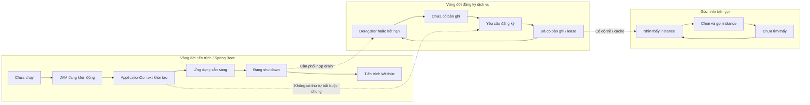
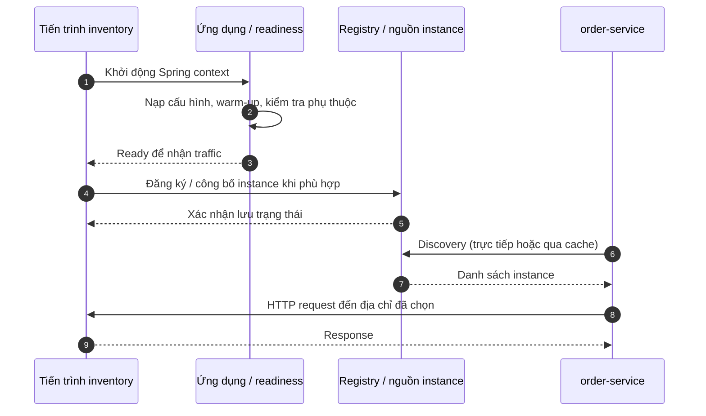
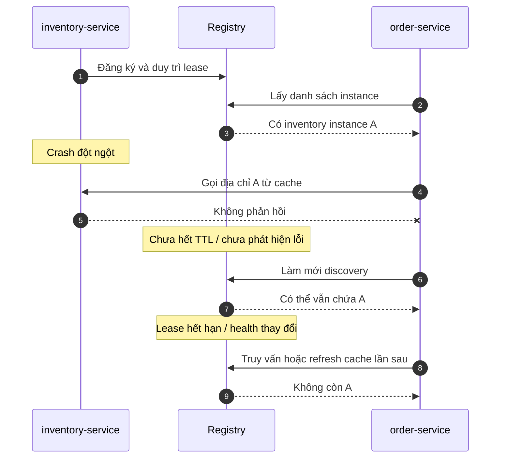

# Phân biệt vòng đời tiến trình với vòng đời đăng ký dịch vụ

## 1. Bài toán trong hệ thống phân tán

Trong một ứng dụng đơn, câu hỏi “ứng dụng có đang chạy không?” thường được trả lời bằng việc tiến trình Java còn tồn tại và API có phản hồi. Trong hệ thống phân tán, câu trả lời đó chưa đủ: một instance có thể **đang chạy nhưng chưa sẵn sàng phục vụ**, **đã sẵn sàng nhưng chưa xuất hiện trong service discovery**, hoặc **đã dừng nhưng địa chỉ cũ vẫn còn được một client sử dụng**.

Bài học thuộc chương **Nền tảng phân tán** của module **SPRING_CLOUD_CORE**. Mục tiêu là hiểu các nền tảng cốt lõi của Spring Cloud trong hệ thống phân tán, đặc biệt **Spring Cloud Commons**, **Spring Cloud Context**, cấu hình bên ngoài và tương thích với Spring Boot. Trọng tâm ở đây là phân biệt vòng đời tiến trình với vòng đời đăng ký dịch vụ để vận dụng đúng các abstraction `DiscoveryClient`, `ServiceRegistry`, `ServiceInstance`, readiness, giao tiếp giữa dịch vụ, kiểm thử và vận hành.

Sau bài này, người học cần giải thích được:

- Vì sao **process alive**, **application ready**, **registered** và **routable** không tương đương.
- Spring Boot/Spring Framework chịu trách nhiệm về vòng đời ứng dụng ra sao, còn Spring Cloud Commons biểu diễn đăng ký và tra cứu dịch vụ thế nào.
- Điều gì xảy ra khi khởi động chậm, mất kết nối registry, shutdown có kiểm soát hoặc tiến trình bị kill đột ngột.
- Làm sao thiết kế, kiểm thử và quan sát để không gửi request vào instance chưa sẵn sàng hoặc đã ngừng phục vụ.

## 2. Bốn trạng thái cần quan sát độc lập

Để tránh nhầm lẫn, không nên dùng duy nhất một biến `UP/DOWN` để biểu diễn mọi khía cạnh của instance.

| Tầng | Câu hỏi | Ví dụ tín hiệu | Điều tín hiệu **không** bảo đảm |
| --- | --- | --- | --- |
| **Tiến trình / hệ điều hành** | Tiến trình Java còn tồn tại không? | PID, process exit code, container running | HTTP server đã mở cổng hay nghiệp vụ có thể xử lý |
| **Ứng dụng / Spring Boot** | Application context đã khởi tạo, ứng dụng có sẵn sàng nhận traffic không? | `ApplicationReadyEvent`, `ApplicationAvailability`, readiness health group | Instance đã đăng ký vào registry hoặc caller đã nhìn thấy |
| **Đăng ký dịch vụ** | Instance có được công bố trong registry hoặc nguồn danh sách instance không? | Registration, lease/heartbeat, trạng thái hoặc metadata ở registry | Instance vẫn khỏe và tiếp nhận request ngay lúc này |
| **Khám phá và định tuyến** | Client/proxy có chọn và kết nối được đến instance không? | Kết quả `DiscoveryClient`, cache, LoadBalancer, DNS/EndpointSlice | Kết quả discovery là mới nhất, kết nối hoặc nghiệp vụ chắc chắn thành công |

Cùng một thời điểm, bốn trạng thái có thể lệch nhau. Đặc biệt:

**`process running` không suy ra `ready`; `ready` không suy ra `registered`; `registered` không suy ra `routable`; `routable` cũng không suy ra một request nghiệp vụ chắc chắn thành công.**

Ví dụ, `inventory-service` đã mở cổng 8081, nhưng còn nạp cache hoặc chờ kết nối database. Tiến trình sống và TCP có thể kết nối, song readiness nên là `REFUSING_TRAFFIC`. Nếu instance đã xuất hiện trong registry quá sớm, `order-service` có thể gọi đến nó và nhận lỗi mặc dù phép kiểm tra “PID còn không?” trả lời có.

### 2.1. Sơ đồ các trạng thái liên quan nhưng không đồng nhất



Các mũi tên nét đứt chỉ quan hệ vận hành thường gặp, **không phải thứ tự bất biến** của mọi discovery provider. Có hệ thống đăng ký trước thời điểm ứng dụng báo sẵn sàng; có hệ thống không cho ứng dụng tự đăng ký, mà nền tảng điều khiển danh sách endpoint. Spring Boot, Spring Cloud và hệ thống điều phối triển khai mỗi bên quản lý một phần.

## 3. Vòng đời tiến trình: từ start đến stop

Một tiến trình Spring Boot thông thường đi qua những giai đoạn sau:

1. **OS/container tạo tiến trình:** JVM bắt đầu chạy, classpath và tham số môi trường được đọc.
2. **Spring khởi tạo application context:** Spring Framework tạo bean, inject phụ thuộc, chạy các bước lifecycle và áp dụng configuration.
3. **Web server khởi tạo:** nếu là ứng dụng web, server có thể bind port trong giai đoạn startup. Cổng mở chưa có nghĩa mọi thành phần nghiệp vụ đã sẵn sàng.
4. **Ứng dụng chuyển sang trạng thái sẵn sàng:** trong Spring Boot, `ApplicationReadyEvent` và `ApplicationAvailability` cho phép quan sát trạng thái sau khi tiến trình khởi tạo ứng dụng.
5. **Ứng dụng phục vụ request:** còn phụ thuộc database, broker, giới hạn tài nguyên, các service khác và chính sách readiness.
6. **Nhận tín hiệu dừng:** quy trình shutdown có thể thay đổi readiness, ngừng nhận request mới, chờ request đang xử lý, đóng bean và tài nguyên; sau đó JVM thoát.

Sự khác biệt đáng chú ý giữa một số tín hiệu Boot:

| Sự kiện/trạng thái | Ý nghĩa | Lưu ý |
| --- | --- | --- |
| `ApplicationStartedEvent` | Context đã được refresh, trước khi các `ApplicationRunner` / `CommandLineRunner` hoàn tất | Chưa nên đồng nhất với ứng dụng sẵn sàng |
| `ApplicationReadyEvent` | Ứng dụng đã hoàn tất quy trình startup bình thường, gần thời điểm sẵn sàng phục vụ | Không tự xác nhận bản ghi registry đã khả dụng với mọi caller |
| `LivenessState.CORRECT` | Ứng dụng đang ở trạng thái sống theo mô hình availability của Boot | Không dùng liveness để diễn đạt phụ thuộc ngoài tạm thời bị lỗi |
| `ReadinessState.ACCEPTING_TRAFFIC` | Ứng dụng cho biết mình có thể nhận traffic | Chỉ hiệu quả với router/registry nếu chúng thực sự sử dụng tín hiệu này |
| `ContextClosedEvent` | Spring context đang đóng | Không được phát nếu JVM/container bị kết thúc cưỡng bức trước khi đóng context |

Liveness và readiness là hai khái niệm khác nhau. Liveness thường chỉ trả lời liệu tiến trình có cần được khởi động lại; readiness quyết định có nên tiếp tục đưa traffic đến instance hay không. Một lỗi database tạm thời không nhất thiết đồng nghĩa JVM phải bị kill và restart.

## 4. Vòng đời đăng ký dịch vụ: từ công bố đến biến mất

Đăng ký dịch vụ là việc đưa thông tin một instance vào nguồn có thể được dùng để tìm dịch vụ: service ID, host/IP, port, instance ID, metadata, đôi khi còn có health/status hoặc lease.

Vòng đời đăng ký thường có các bước:

1. **Xác định danh tính instance:** chẳng hạn `inventory-service`, instance ID, IP/hostname và port.
2. **Đăng ký:** ứng dụng, agent hoặc nền tảng gửi thông tin lên registry hoặc cập nhật danh sách endpoint.
3. **Duy trì đăng ký:** tùy provider có heartbeat, lease renewal, TTL, kiểm tra sức khỏe hoặc đồng bộ trạng thái.
4. **Khám phá:** caller lấy danh sách instance qua client, DNS hoặc hạ tầng; có thể tồn tại cache nhiều tầng.
5. **Thay đổi trạng thái / rút đăng ký:** instance trở nên không phù hợp để nhận request, deregister hoặc bị loại khỏi nguồn endpoint.
6. **Dọn bản ghi cũ:** sau deregistration, lease expiration hay đồng bộ của hệ thống; thời điểm biến mất ở mỗi client có thể chậm hơn.

Đó là **vòng đời bản ghi/hệ thống discovery**, không phải vòng đời PID. Không có quy tắc buộc bản ghi biến mất ngay khi JVM thoát.

### 4.1. Spring Cloud Commons đóng vai trò gì?

Spring Cloud Commons định nghĩa các abstraction chung để code nghiệp vụ giảm phụ thuộc vào một registry cụ thể:

| Thành phần | Trách nhiệm |
| --- | --- |
| `ServiceInstance` | Biểu diễn một instance có service ID, host, port, URI, metadata… |
| `DiscoveryClient` | Tra cứu service IDs hoặc tập instance cho một service ID |
| `ReactiveDiscoveryClient` | Biến thể tra cứu instance theo kiểu reactive |
| `Registration` | Biểu diễn đăng ký của chính một instance, kế thừa thông tin của `ServiceInstance` |
| `ServiceRegistry<Registration>` | Giao diện register, deregister, xem/đổi status hoặc đóng registry client theo khả năng implementation |
| `AbstractAutoServiceRegistration` và các tích hợp cụ thể | Cơ chế hỗ trợ tự động đăng ký trong những provider sử dụng mô hình này |

Đây là **hợp đồng lập trình**. Chúng không tự dựng server Eureka, Consul, một cụm Kubernetes hay tự bảo đảm tính nhất quán tức thời.

Các provider có cách duy trì trạng thái khác nhau. Ví dụ:

- **Eureka:** có cơ chế client registration và lease/heartbeat; khi instance biến mất bất thường, registry có thể giữ bản ghi một khoảng thời gian.
- **Consul:** có đăng ký service và health checks với mô hình quản lý sức khỏe riêng.
- **Kubernetes:** danh sách Pod endpoint có thể được controller và readiness của nền tảng quản lý; một ứng dụng dùng Kubernetes Service DNS không nhất thiết đăng ký qua `ServiceRegistry` trong JVM.

Vì vậy, khi nói “service đã được đăng ký”, phải chỉ rõ **đăng ký vào đâu, do ai thực hiện, với trạng thái/health nào và caller sử dụng nguồn nào**.

### 4.2. Auto-registration có nghĩa gì?

Với những Spring Cloud discovery implementations hỗ trợ auto-registration, việc thêm starter và cấu hình phù hợp có thể khiến instance tự đăng ký khi ứng dụng khởi động. Spring Cloud Commons có thuộc tính chung:

```yaml
spring:
  cloud:
    service-registry:
      auto-registration:
        enabled: false
```

Cấu hình trên dùng để **tắt cơ chế auto-registration chung** khi implementation tôn trọng cơ chế đó; đây không phải cách tắt JVM hay ngăn ứng dụng Boot phục vụ HTTP. Ngoài ra, không phải mọi môi trường dùng discovery đều triển khai mô hình tự đăng ký từ ứng dụng.

Thứ tự registration so với `ApplicationReadyEvent` **phụ thuộc implementation, version và điểm tích hợp lifecycle**. Không nên thiết kế hệ thống dựa trên giả định “Boot ready luôn xảy ra trước khi đăng ký” hoặc “đăng ký xong chắc chắn đã sẵn sàng”. Chính sách readiness, trạng thái registry và router phải được ghép nối có chủ ý.

## 5. Các mốc thời gian dễ nhầm lẫn

Giả sử `order-service` tìm `inventory-service` bằng service ID. Kịch bản khởi động lý tưởng có thể được hình dung như sau:



**Chú ý:** đây là một *trình tự mong muốn về mặt thiết kế*, không phải lịch trình chung mà mọi starter Spring Cloud mặc định áp dụng. Trong thực tế, đăng ký có thể diễn ra trước mốc ready; một hạ tầng tách traffic dựa trên readiness vẫn có thể ngăn request đi vào instance đó.

Bảng sau minh họa các tình huống khác nhau tại cùng một thời điểm:

| Tình huống | Process | Boot readiness | Registry | Góc nhìn caller |
| --- | --- | --- | --- | --- |
| Vừa bắt đầu startup | Alive | Chưa sẵn sàng | Thường chưa có; có thể đã đăng ký sớm | Có thể chưa thấy |
| Đã mở port nhưng còn warm-up | Alive | Có thể từ chối traffic | Có thể đã có bản ghi | Không nên định tuyến nếu chưa ready |
| Hoạt động bình thường | Alive | Sẵn sàng | Có bản ghi hợp lệ | Có thể gọi khi network và client hoạt động |
| Mất kết nối đến registry | Alive | Có thể vẫn sẵn sàng | Trạng thái từ xa có thể hết hạn hoặc cập nhật chậm | Instance có thể “biến mất” khỏi discovery dù API còn tốt |
| Process crash | Dead | Không còn đánh giá được | Có thể còn bản ghi đến khi TTL/health xử lý | Client có thể còn cache địa chỉ cũ |
| Đang graceful shutdown | Alive một thời gian | Nên từ chối traffic mới khi drain | Đang chuyển trạng thái hoặc deregister | Có thể tiếp tục nhìn thấy bản ghi cũ trong lúc chuyển tiếp |

Kết luận vận hành từ bảng: **không nên lấy mỗi trạng thái process, readiness, registry hoặc discovery cache để khẳng định tuyệt đối về ba trạng thái còn lại**.

## 6. Hai kịch bản dừng ứng dụng

### 6.1. Graceful shutdown có thể phối hợp rút traffic

Khi một instance chuẩn bị dừng vì rolling deployment hoặc scale-down, thứ tự *mục tiêu* thường là:

1. Báo cho router/load balancer/nguồn endpoint rằng instance **không nhận traffic mới** (đổi readiness/status hoặc deregister tùy nền tảng).
2. Chờ đủ thời gian để thay đổi lan truyền đến registry, proxy, DNS hoặc discovery cache liên quan; đồng thời bắt đầu drain traffic đúng khả năng server/hạ tầng.
3. Hoàn tất hoặc giới hạn thời gian các request đang xử lý, rồi đóng tài nguyên và dừng tiến trình.
4. Xác minh địa chỉ cũ không còn được chọn và các request mới chuyển sang instance còn khỏe.

Không nên hiểu trình tự trên là thứ tự callback đã được bảo đảm sẵn bởi Spring Boot hoặc mọi auto-registration implementation. Trong một số hạ tầng, bước thông báo router và ngừng nhận request do platform xử lý; trong hệ thống khác, ứng dụng cần quản lý trạng thái đăng ký và drain rõ ràng.

Spring Boot hỗ trợ cấu hình graceful shutdown cho web server tương thích:

```yaml
server:
  shutdown: graceful

spring:
  lifecycle:
    timeout-per-shutdown-phase: 20s
```

Các thuộc tính này điều khiển **quá trình shutdown của ứng dụng**. Chúng không bảo đảm registry đã xóa bản ghi, client cache đã hết hạn hay một upstream proxy đã hoàn tất drain. Timeout 20 giây là giá trị ví dụ, phải chọn theo request duration và ngân sách shutdown/termination grace period thực tế.

### 6.2. Crash hoặc kill cưỡng bức không có cơ hội deregister sạch

Một tình huống khác là OOM kill, container bị mất điện, `SIGKILL` hoặc node mất mạng. JVM không thể dựa vào `ContextClosedEvent` hay shutdown hook để gọi deregister. Tùy registry, instance cũ chỉ biến mất khi:

- Lease/heartbeat hết hạn hoặc health check đánh dấu unhealthy;
- Control plane phát hiện endpoint không còn hợp lệ;
- Một tác nhân vận hành xóa entry;
- Cache phía client cập nhật hoặc hết hạn sau đó.

Trong “khoảng trống” này, caller vẫn có thể thấy bản ghi cũ và gặp `connection refused`, timeout hoặc lỗi mạng. Đây là lý do hệ thống phân tán cần kết hợp health checking, giới hạn timeout, tái khám phá endpoint và chính sách chịu lỗi, thay vì chỉ đặt kỳ vọng vào deregistration khi shutdown.



## 7. Quan sát đúng tầng trong ứng dụng Spring

### 7.1. Theo dõi trạng thái của chính ứng dụng Boot

Ví dụ Java theo dõi mốc ứng dụng đã ready và context đang đóng:

```java
import org.slf4j.Logger;
import org.slf4j.LoggerFactory;
import org.springframework.boot.context.event.ApplicationReadyEvent;
import org.springframework.context.event.ContextClosedEvent;
import org.springframework.context.event.EventListener;
import org.springframework.stereotype.Component;

@Component
class LocalLifecycleLogger {
    private static final Logger log =
            LoggerFactory.getLogger(LocalLifecycleLogger.class);

    @EventListener
    void onReady(ApplicationReadyEvent event) {
        log.info("ApplicationReadyEvent: ung dung da hoan tat startup");
    }

    @EventListener
    void onClosing(ContextClosedEvent event) {
        log.info("ContextClosedEvent: dang dong application context");
    }
}
```

Hai log này cho biết về **lifecycle bên trong ứng dụng**. Chúng **không** xác nhận đăng ký Eureka/Consul đã thành công, cũng không xác nhận một caller khác đã loại instance khỏi cache.

Spring Boot còn cung cấp `ApplicationAvailability` để đọc trạng thái hiện hành:

```java
import org.springframework.boot.availability.ApplicationAvailability;
import org.springframework.boot.availability.ReadinessState;
import org.springframework.stereotype.Component;

@Component
class ReadinessInspector {
    private final ApplicationAvailability availability;

    ReadinessInspector(ApplicationAvailability availability) {
        this.availability = availability;
    }

    boolean mayAcceptTraffic() {
        return availability.getReadinessState()
                == ReadinessState.ACCEPTING_TRAFFIC;
    }
}
```

Đây là trạng thái readiness **Boot quản lý**; muốn một discovery provider hoặc load balancer phản ứng theo trạng thái này thì phải đảm bảo đúng integration và quy tắc health/traffic. Một số dependency nghiệp vụ cần được xét trong readiness qua cơ chế health indicator khi phù hợp, nhưng không phải mọi dependency bên ngoài đều nên biến thành điều kiện liveness.

### 7.2. Xem phía caller thực sự khám phá được gì

Đoạn code Spring Cloud Commons sau tra cứu tập instance theo service ID:

```java
import java.util.List;
import org.springframework.cloud.client.ServiceInstance;
import org.springframework.cloud.client.discovery.DiscoveryClient;
import org.springframework.stereotype.Service;

@Service
class InventoryDiscoveryProbe {
    private final DiscoveryClient discoveryClient;

    InventoryDiscoveryProbe(DiscoveryClient discoveryClient) {
        this.discoveryClient = discoveryClient;
    }

    List<String> instanceUris() {
        List<ServiceInstance> instances =
                discoveryClient.getInstances("inventory-service");
        return instances.stream()
                .map(instance -> instance.getUri().toString())
                .toList();
    }
}
```

Nếu danh sách có URI `http://10.0.0.12:8081`, điều đó chỉ chứng minh **discovery implementation đang trả về instance này cho caller** tại thời điểm tra cứu. Nó chưa chứng minh kết nối thành công hay readiness của instance đích. Nếu discovery client dùng cache, kết quả còn có thể phản ánh trạng thái trước đó.

Trong hệ thống nhiều instance, cần đối chiếu dữ liệu từ **hai phía**: log/availability của instance được gọi và danh sách instance mà caller thực sự nhìn thấy. Chỉ kiểm tra health trên máy chủ không đủ để phát hiện lỗi discovery/routing.

### 7.3. Readiness endpoint và giới hạn

Khi dùng Spring Boot Actuator và bật readiness/liveness probes phù hợp, ứng dụng có thể cung cấp các health group như `/actuator/health/readiness`. Ví dụ cấu hình thực hành:

```yaml
management:
  endpoint:
    health:
      probes:
        enabled: true
```

Endpoint readiness chỉ có ích nếu platform, service mesh, ingress hoặc discovery integration **thực sự dùng kết quả đó** để quyết định traffic. Ngược lại, readiness hiển thị `UP` cũng không tạo ra một bản ghi đăng ký trong registry. Phải kiểm soát truy cập endpoint quản trị theo chính sách triển khai.

## 8. Tình huống thực tế: deploy phiên bản mới của inventory-service

Hệ thống có hai instance:

| Instance | Phiên bản | Trạng thái ban đầu |
| --- | --- | --- |
| A | v1 | Running, ready, discoverable |
| B | v2 | Mới bắt đầu khởi tạo |

Mục tiêu là chuyển request sang B mà không gián đoạn.

**Giai đoạn 1 — B khởi động:** JVM đã chạy, Boot tạo context và mở server; B có thể vẫn đang warm-up. B không nên được chọn cho traffic sản xuất cho đến khi đáp ứng điều kiện nhận request. Nếu auto-registration thực hiện sớm, traffic gating phải được xử lý bằng health/readiness hoặc cơ chế tương đương.

**Giai đoạn 2 — B đủ điều kiện:** B sẵn sàng và xuất hiện trong nguồn endpoint mà caller sử dụng. Đội vận hành cần kiểm tra cả phản hồi của B **và** tuyến gọi thực tế từ `order-service` hoặc upstream, không chỉ nhìn log `ApplicationReadyEvent`.

**Giai đoạn 3 — drain A:** A được rút khỏi tập endpoint phù hợp để nhận request mới, còn request đang chạy được xử lý theo timeout và termination grace period. Một client với cache cũ có thể vẫn cố chọn A; thời gian drain phải phản ánh cơ chế cache/routing thật.

**Giai đoạn 4 — A dừng:** sau khi phối hợp drain, A đóng application context và JVM thoát. Nếu A bị kill ngay trong giai đoạn đầu, bản ghi và cache có thể tồn tại thêm một khoảng thời gian và gây request lỗi.

Kịch bản này cho thấy một deployment thành công cần ba kết quả riêng: **instance mới thực sự ready**, **router/discovery biết đúng instance**, và **instance cũ rút traffic đúng cách**.

## 9. Những trường hợp lỗi và hướng chẩn đoán

| Triệu chứng | Nguyên nhân khả dĩ | Kiểm tra đúng |
| --- | --- | --- |
| Process đang chạy, API trả 503 | Ứng dụng chưa ready hoặc phụ thuộc nghiệp vụ chưa sẵn sàng | Readiness, ứng dụng, database/broker; đừng kết luận chỉ từ PID |
| App local gọi được nhưng caller tìm không thấy | Chưa đăng ký, sai service ID, mất kết nối registry, lease hết hạn | Registration status, cấu hình provider, discovery từ phía caller |
| Registry có instance nhưng kết nối bị từ chối | Bản ghi cũ, port sai, server đã dừng, network policy | Địa chỉ/port/metadata và kết nối từ phía caller, TTL/health |
| Đã deregister nhưng caller vẫn gọi tới | Cache client/proxy/DNS còn giá trị cũ, propagation delay | Cache TTL, polling/refresh, log lựa chọn instance, upstream router |
| Ứng dụng Boot ready nhưng không có auto-registration | Chưa cài đúng implementation, tính năng bị tắt, môi trường dùng DNS/platform discovery | Dependency, property auto-registration, kiến trúc discovery |
| Mỗi lần rollout có lỗi ngắt quãng | Instance mới nhận traffic quá sớm hoặc instance cũ bị kill trước khi drain | Readiness gating, termination grace period, thứ tự rollout |
| Registry mất nhưng API trực tiếp vẫn hoạt động | Lifecycle discovery độc lập với process | Khả dụng của registry, cache, health và hành vi failover của caller |
| Actuator health báo `UP` nhưng nghiệp vụ lỗi | Health check chưa đại diện điều kiện nghiệp vụ, hoặc lỗi phụ thuộc sau thời điểm probe | Test API thực tế, timeout, metrics/error log, độ sâu health checks |

Một lỗi liên quan registry không nhất thiết được giải quyết bằng restart JVM. Restart có thể chỉ khiến instance có bản ghi mới trong khi gốc lỗi là network partition hoặc registry không khả dụng.

## 10. Kiểm thử sự tách biệt vòng đời

Để kiểm chứng hành vi thực tế, xây dựng bộ kịch bản theo ma trận sau thay vì chỉ test “service khởi động được”:

| Test | Tác động giả lập | Kỳ vọng cần quan sát |
| --- | --- | --- |
| Startup chậm | Trì hoãn warm-up hoặc dependency readiness | Process sống nhưng không nhận traffic mới trước khi sẵn sàng |
| Registry unavailable | Chặn kết nối registry trong lúc API đang chạy | Biết rõ policy hoạt động: đăng ký thất bại, retry, cache/fallback; không đánh đồng process chết |
| Kill không cleanup | Kết thúc cưỡng bức instance đã đăng ký trong môi trường test | Quan sát thời gian registry và caller loại instance cũ, lỗi timeout trong khoảng chuyển tiếp |
| Shutdown có kiểm soát | Rolling restart hoặc scale-down | Request mới ngừng đến instance cũ; request đang chạy được drain theo timeout |
| Cache cũ | Cố định/delay cập nhật danh sách instance phía caller | Xác minh retry/re-discovery/timeout hoạt động như thiết kế |
| Readiness xuống khi process vẫn sống | Đổi trạng thái readiness trong môi trường test | Traffic được hạn chế bởi router phù hợp, process không bị hiểu nhầm đã chết |
| Đổi địa chỉ/port | Khởi động instance thay IP hoặc port | Service ID ánh xạ đến URI thực, không gọi địa chỉ cũ sau thời gian hội tụ |

Với logic thuần túy có thể dùng test double cho `DiscoveryClient`. Để kiểm tra lifecycle thật, cần integration test với **registry hoặc nền tảng đang triển khai**, các instance và caller cụ thể; mock `DiscoveryClient` không thể chứng minh thời gian lease expiration, propagation delay hay hành vi drain của proxy.

Những tín hiệu nên ghi nhận:

- Thời gian **process start → application ready** và **application ready → instance được discovery nhìn thấy**.
- Số lần đăng ký/hủy đăng ký, lỗi đăng ký/heartbeat và trạng thái lease theo provider.
- Số instance được mỗi caller thấy, các instance thực sự được LoadBalancer chọn và tỷ lệ lỗi kết nối.
- Độ trễ từ khi rút traffic đến khi không còn request mới, số request bị ngắt khi shutdown.
- Phân biệt log theo `service ID`, `instance ID`, version/deployment và địa chỉ; tránh đưa credential vào log.

Về vận hành Spring Cloud Core, kiểm tra phiên bản Spring Boot và Spring Cloud release train tương thích trước khi diễn giải các sự kiện lifecycle hoặc thuộc tính auto-registration: chi tiết implementation thay đổi theo phiên bản/provider. Spring Cloud Context hỗ trợ một số hành vi refresh cấu hình, nhưng **refresh scope không tương đương restart tiến trình, cũng không tự bảo đảm deregister/re-register**. Thay đổi cấu hình địa chỉ, port hoặc instance metadata khi ứng dụng đang chạy cần xem rõ implementation có cập nhật registration hay cần restart/rollout.

## 11. Những ngộ nhận phổ biến

| Ngộ nhận | Cách hiểu đúng |
| --- | --- |
| “JVM còn chạy thì dịch vụ chắc chắn có thể được gọi.” | Tiến trình có thể còn sống nhưng ứng dụng chưa ready, thiếu dependency hoặc bị ngắt kết nối mạng. |
| “Có `ApplicationReadyEvent` là Eureka/Consul đã đăng ký xong.” | Đây là sự kiện Boot; registration là lifecycle khác, thời điểm phụ thuộc provider. |
| “Registry hiển thị instance là instance đang khỏe.” | Bản ghi có thể stale; health check, lease và consumer cache cần được xét riêng. |
| “`DiscoveryClient` lúc nào cũng là nguồn sự thật tức thời.” | Kết quả có thể qua cache và chịu độ trễ hội tụ. |
| “Shutdown hook luôn xóa bản ghi.” | Crash/`SIGKILL` bỏ qua cleanup; registry cần cơ chế phát hiện hết hạn hoặc nền tảng điều phối. |
| “Actuator readiness sẽ tự deregister mọi provider.” | Readiness chỉ ảnh hưởng routing khi có tích hợp cụ thể sử dụng nó. |
| “Thêm Cloud starter thì không cần xử lý lỗi mạng.” | Discovery/load balancing không thay thế timeout, retry có kiểm soát, circuit breaker và xử lý lỗi nghiệp vụ. |
| “Refresh config chính là vòng đời đăng ký lại.” | `@RefreshScope` xử lý tạo lại một số bean; đăng ký dịch vụ có cơ chế riêng. |

## 12. Câu hỏi tự kiểm tra

1. Vì sao một instance còn PID và đang lắng nghe cổng HTTP vẫn có thể phải từ chối traffic?
2. Nếu service registry mất kết nối trong 30 giây nhưng API trực tiếp vẫn truy cập được, trạng thái process, registration và discovery có thể khác nhau ra sao?
3. Sự kiện `ApplicationReadyEvent` chứng minh điều gì và không chứng minh điều gì về `ServiceRegistry`?
4. Vì sao `SIGKILL` có thể làm một service đã chết còn xuất hiện trong discovery?
5. Trong rolling deployment, cần kiểm tra những dấu hiệu nào trước khi dừng instance cũ?
6. Khi `DiscoveryClient.getInstances(...)` trả địa chỉ, vì sao vẫn cần thử kết nối và theo dõi lỗi từ caller?
7. Khi chuyển từ registry do ứng dụng tự đăng ký sang Kubernetes Service DNS, ai trở thành chủ thể điều khiển danh sách endpoint?

## 13. Tài liệu tham khảo

- [Spring Boot — Application Availability](https://docs.spring.io/spring-boot/reference/features/spring-application.html#features.spring-application.application-availability): liveness/readiness, availability state và các sự kiện liên quan.
- [Spring Boot — Graceful Shutdown](https://docs.spring.io/spring-boot/reference/web/graceful-shutdown.html): cấu hình và hành vi shutdown của ứng dụng web.
- [Spring Boot Actuator — Kubernetes Probes](https://docs.spring.io/spring-boot/reference/actuator/endpoints.html#actuator.endpoints.kubernetes-probes): các health group liveness/readiness.
- [Spring Cloud Commons](https://docs.spring.io/spring-cloud-commons/reference/): `DiscoveryClient`, `ServiceInstance`, service registry, auto-registration và load balancing.
- [Spring Cloud — Release trains](https://spring.io/projects/spring-cloud): kiểm tra tương thích với Spring Boot theo dòng phát hành.

**Ghi nhớ:** Vòng đời **tiến trình** trả lời *mã ứng dụng còn chạy và ở giai đoạn nào*; vòng đời **đăng ký** trả lời *instance đang được công bố/duy trì trong nguồn khám phá ra sao*; **readiness** trả lời *instance có nên nhận traffic*; còn **discovery và routing** cho biết *caller hiện có thể nhìn thấy và chọn địa chỉ nào*. Thiết kế hệ thống ổn định đòi hỏi theo dõi cả bốn, đặc biệt trong startup, crash và shutdown.
