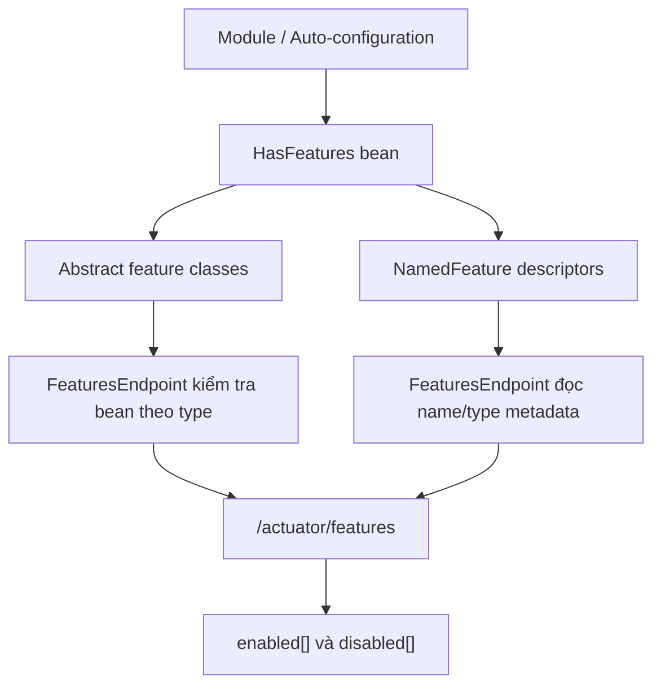

# Khai báo HasFeatures và NamedFeature

## 1. Vì sao cần khai báo khả năng hệ thống?

Trong ứng dụng Spring Cloud, nhiều thành phần có thể được bật hoặc không tùy theo dependency, cấu hình và điều kiện khởi tạo bean. Ví dụ, một ứng dụng có thể dùng service discovery, load balancing, circuit breaker, API gateway hoặc Spring Cloud Bus. Khi vận hành nhiều dịch vụ, đội ngũ cần biết mỗi ứng dụng đang có những khả năng nào được tích hợp.

Spring Cloud Commons cung cấp abstraction `HasFeatures` và `NamedFeature` để các module công bố metadata về những khả năng đó. Các khai báo được tập hợp tại endpoint Actuator `/features`, nơi hiển thị danh sách feature đang được khai báo là enabled và các abstract feature không tìm thấy bean tương ứng.

Bài học thuộc chương **Khả năng hệ thống** của module **SPRING_CLOUD_CORE**. Module tập trung vào Spring Cloud Commons, Spring Cloud Context, cấu hình ngoài, tương thích Spring Boot, refresh scope, discovery, service registry, giao tiếp dịch vụ và cách kiểm thử/vận hành các abstraction chung.

Sau bài này, người học có thể:

- Giải thích vai trò của `HasFeatures` và `NamedFeature`.
- Phân biệt abstract feature với named feature.
- Khai báo một hoặc nhiều feature bằng các factory method của `HasFeatures`.
- Hiểu cách endpoint `/features` xác định trạng thái enabled/disabled.
- Đọc metadata type, name, version và vendor.
- Đăng ký feature trong cấu hình có điều kiện để metadata phản ánh đúng thành phần thực tế.
- Expose và bảo vệ endpoint Actuator phù hợp với môi trường triển khai.
- Kiểm thử kết quả feature inventory và tránh nhầm nó với health check hoặc feature toggle.

## 2. HasFeatures và NamedFeature là gì?

Hai lớp thuộc package:

- `org.springframework.cloud.client.actuator.HasFeatures`
- `org.springframework.cloud.client.actuator.NamedFeature`

`HasFeatures` là một bean mô tả một nhóm khả năng của module. Nó giữ hai danh sách:

- **Abstract features:** các kiểu Java (interface hoặc abstract class) đại diện cho khả năng có thể kiểm tra bằng bean trong Spring ApplicationContext.
- **Named features:** các feature được khai báo bằng một tên dễ hiểu và một kiểu Java dùng để mô tả metadata.

`NamedFeature` là descriptor gồm tên hiển thị và class đại diện cho feature. Class đó cung cấp thông tin type, version và vendor trong kết quả endpoint.

Có thể hình dung quan hệ:



Một module có thể khai báo nhiều bean `HasFeatures`. Endpoint thu thập tất cả các bean này và tổng hợp kết quả.

### 2.1. Abstract feature

Abstract feature phù hợp khi một khả năng có abstraction hoặc contract rõ ràng trong Spring context, ví dụ:

- `DiscoveryClient`
- `LoadBalancerClient`
- `ReactiveDiscoveryClient`
- `ReactiveLoadBalancer`
- `LockService`

Khi endpoint xử lý một abstract feature, nó dùng class/interface đã khai báo để tìm bean theo type trong ApplicationContext.

- Tìm thấy bean: feature được đưa vào danh sách `enabled`.
- Không tìm thấy bean: tên đơn giản của kiểu được đưa vào danh sách `disabled`.

Ví dụ, nếu khai báo `DiscoveryClient.class`, endpoint tìm một bean có thể được inject theo kiểu `DiscoveryClient`. Tên hiển thị là `DiscoveryClient`; trường type trong kết quả phản ánh class thực tế của bean được tìm thấy.

Abstract feature cho phép khai báo trước một tập capability mà module quan tâm, sau đó để ApplicationContext xác nhận capability nào đang có bean.

### 2.2. Named feature

Named feature phù hợp khi một capability không có abstraction chung để tìm bean theo interface, hoặc khi muốn công bố tên sản phẩm/chức năng cụ thể:

- Circuit Breaker
- API Gateway
- Spring Cloud Bus
- Một bộ xử lý chính sách nghiệp vụ riêng của ứng dụng
- Một integration với hệ thống bên ngoài

Khai báo named feature cần một tên và một class đại diện:

```java
new NamedFeature("API Gateway", GatewayAutoConfiguration.class)
```

Điểm cần hiểu rõ: `FeaturesEndpoint` đưa named feature đã khai báo trực tiếp vào danh sách `enabled`. Nó không tìm bean theo type của `NamedFeature` như cách xử lý abstract feature. Vì vậy, cấu hình tạo named feature phải được bảo vệ bằng các điều kiện phù hợp; nếu khai báo vô điều kiện trong khi chức năng thực tế không được bật, endpoint vẫn có thể báo feature đó là enabled.

## 3. Các factory method của HasFeatures

Spring Cloud Commons cung cấp các factory method để tạo descriptor ngắn gọn.

### 3.1. Khai báo abstract features

```java
import org.springframework.cloud.client.actuator.HasFeatures;
import org.springframework.cloud.client.discovery.DiscoveryClient;
import org.springframework.cloud.client.loadbalancer.LoadBalancerClient;
import org.springframework.context.annotation.Bean;
import org.springframework.context.annotation.Configuration;

@Configuration(proxyBeanMethods = false)
class DiscoveryFeatureConfiguration {

    @Bean
    HasFeatures discoveryFeatures() {
        return HasFeatures.abstractFeatures(
                DiscoveryClient.class,
                LoadBalancerClient.class
        );
    }
}
```

Endpoint sẽ kiểm tra hai kiểu bean trong ApplicationContext. Nếu chỉ có `DiscoveryClient`, kết quả có thể báo `DiscoveryClient` enabled và `LoadBalancerClient` disabled.

Ví dụ này minh họa cách một module công bố các abstraction mà nó hỗ trợ. Trong ứng dụng đã có auto-configuration của Spring Cloud Commons, các feature chuẩn có thể đã được khai báo sẵn; không cần đăng ký trùng lặp chỉ để endpoint hiển thị lại.

### 3.2. Khai báo named feature

```java
import org.springframework.cloud.client.actuator.HasFeatures;
import org.springframework.cloud.client.actuator.NamedFeature;
import org.springframework.context.annotation.Bean;
import org.springframework.context.annotation.Configuration;

@Configuration(proxyBeanMethods = false)
class IntegrationFeatureConfiguration {

    @Bean
    HasFeatures integrationFeatures() {
        return HasFeatures.namedFeatures(
                new NamedFeature(
                        "Payment Gateway",
                        PaymentGatewayClient.class
                ),
                new NamedFeature(
                        "Fraud Screening",
                        FraudScreeningClient.class
                )
        );
    }
}
```

Trong ví dụ, tên hiển thị do ứng dụng chọn. Class truyền vào cung cấp type và package metadata. Vì named feature được đưa trực tiếp vào danh sách enabled, hãy chỉ tạo bean `HasFeatures` khi integration tương ứng thực sự được bật.

### 3.3. Khai báo một named feature

Nếu chỉ có một capability, có thể dùng factory method rút gọn:

```java
@Bean
HasFeatures paymentFeature() {
    return HasFeatures.namedFeature(
            "Payment Gateway",
            PaymentGatewayClient.class
    );
}
```

Method này tương đương với việc tạo một `NamedFeature` rồi đưa vào `HasFeatures.namedFeatures(...)`.

### 3.4. Kết hợp cả hai loại

Một module có thể cần vừa công bố contract chung vừa công bố capability riêng:

```java
@Bean
HasFeatures applicationFeatures() {
    return new HasFeatures(
            List.of(
                    DiscoveryClient.class,
                    LoadBalancerClient.class
            ),
            List.of(
                    new NamedFeature(
                            "Order Policy Engine",
                            OrderPolicyEngine.class
                    )
            )
    );
}
```

Constructor nhận hai danh sách: abstract feature classes và named feature descriptors. Factory method thường dễ đọc hơn khi chỉ khai báo một loại; constructor hữu ích khi cần kết hợp cả hai.

## 4. Endpoint /features tổng hợp dữ liệu như thế nào?

Spring Cloud Commons cung cấp Actuator endpoint có ID là `features`. Endpoint là read-only và trả về hai nhóm:

- `enabled`: các feature được xác định là enabled.
- `disabled`: tên các abstract feature không tìm thấy bean phù hợp.

Các bước xử lý khái quát:

1. Endpoint nhận danh sách bean `HasFeatures` từ ApplicationContext.
2. Với từng abstract feature class, endpoint gọi `ApplicationContext.getBean(type)`.
3. Nếu tìm thấy bean, endpoint tạo metadata với tên là simple name của kiểu khai báo và type là class thực tế của bean.
4. Nếu không tìm thấy bean, endpoint thêm simple name vào `disabled`.
5. Với từng `NamedFeature`, endpoint dùng tên và class được khai báo để tạo metadata rồi thêm trực tiếp vào `enabled`.
6. Endpoint trả object kết quả cho Actuator để serialize thành JSON.

### 4.1. Cấu trúc phản hồi

Ví dụ minh họa:

```json
{
  "enabled": [
    {
      "type": "com.example.discovery.EurekaDiscoveryClient",
      "name": "DiscoveryClient",
      "version": "5.0.4",
      "vendor": "Example Vendor"
    },
    {
      "type": "com.example.payment.PaymentGatewayClient",
      "name": "Payment Gateway",
      "version": null,
      "vendor": null
    }
  ],
  "disabled": [
    "LoadBalancerClient"
  ]
}
```

Đây là JSON minh họa để giải thích cấu trúc, không phải kết quả cố định của mọi ứng dụng. Class, version và vendor phụ thuộc implementation cùng metadata trong package.

### 4.2. Ý nghĩa các trường

| Trường | Ý nghĩa |
| --- | --- |
| `enabled` | Danh sách feature được endpoint đưa vào trạng thái enabled |
| `disabled` | Danh sách tên abstract feature không tìm thấy bean |
| `name` | Tên đơn giản của abstract type hoặc tên do named feature khai báo |
| `type` | Tên class đầy đủ của implementation (abstract feature) hoặc class khai báo (named feature) |
| `version` | Package implementation version của class được dùng làm type |
| `vendor` | Package implementation vendor của class được dùng làm type |

Version và vendor lấy từ package metadata Java. Khi chạy trong môi trường development, class được build mà không có implementation metadata, hai trường này có thể là `null`. Không nên xem version null là bằng chứng feature bị tắt.

### 4.3. Hai kiểu khai báo có semantics khác nhau

| Đặc điểm | Abstract feature | Named feature |
| --- | --- | --- |
| Đầu vào | Class/interface | Tên hiển thị và class |
| Cách xác định enabled | Tìm bean theo type trong ApplicationContext | Được đưa vào enabled theo khai báo |
| Khi không có bean | Tên feature được đưa vào disabled | Endpoint không tự kiểm tra bean để chuyển sang disabled |
| Tên trong kết quả | Simple name của abstract type | Tên do ứng dụng khai báo |
| Type trong kết quả | Class thực tế của bean | Class được truyền vào NamedFeature |
| Mục đích | Kiểm tra sự hiện diện của abstraction | Công bố capability có tên riêng |

Đây là khác biệt quan trọng nhất khi thiết kế feature inventory. Abstract feature phản ánh việc bean có tồn tại trong context; named feature phản ánh metadata mà cấu hình module đã chủ động công bố.

## 5. Đăng ký feature có điều kiện

### 5.1. Dùng điều kiện khi capability phụ thuộc cấu hình

Ví dụ, Payment Gateway chỉ được bật khi cấu hình ứng dụng cho phép:

```java
import org.springframework.boot.autoconfigure.condition.ConditionalOnProperty;
import org.springframework.cloud.client.actuator.HasFeatures;
import org.springframework.cloud.client.actuator.NamedFeature;
import org.springframework.context.annotation.Bean;
import org.springframework.context.annotation.Configuration;

@Configuration(proxyBeanMethods = false)
@ConditionalOnProperty(
        prefix = "app.payment",
        name = "enabled",
        havingValue = "true"
)
class PaymentGatewayFeatureConfiguration {

    @Bean
    HasFeatures paymentGatewayFeature() {
        return HasFeatures.namedFeature(
                "Payment Gateway",
                PaymentGatewayClient.class
        );
    }
}
```

Khi cấu hình `app.payment.enabled=true`, bean `HasFeatures` được đăng ký và named feature xuất hiện trong danh sách enabled. Khi điều kiện không thỏa, cấu hình không tạo bean feature và endpoint không liệt kê named feature đó.

Điều kiện trên chỉ đúng nếu cùng điều kiện cũng kiểm soát việc tạo integration thực tế. Nếu client không được tạo do một điều kiện khác, named feature có thể vẫn bị báo enabled. Hãy đặt điều kiện ở cấu hình chung hoặc gom việc tạo client và khai báo feature vào cùng một auto-configuration.

### 5.2. Dùng điều kiện classpath

Với module tùy chọn, có thể dùng `@ConditionalOnClass` để chỉ đăng ký metadata khi thư viện cần thiết hiện diện:

```java
@Configuration(proxyBeanMethods = false)
@ConditionalOnClass(PaymentGatewayClient.class)
class OptionalPaymentFeatureConfiguration {

    @Bean
    HasFeatures paymentGatewayFeature() {
        return HasFeatures.namedFeature(
                "Payment Gateway",
                PaymentGatewayClient.class
        );
    }
}
```

Trong auto-configuration có dependency tùy chọn, nên dùng dạng tên class trong `@ConditionalOnClass(name = "...")` khi cần tránh tham chiếu trực tiếp tới kiểu không có trên classpath. Cách tổ chức này giúp cấu hình không bị nạp khi module tùy chọn không tồn tại.

### 5.3. Abstract feature khi muốn endpoint tự phát hiện bean

Nếu một abstraction có thể tồn tại hoặc không tùy điều kiện auto-configuration, có thể khai báo abstract feature:

```java
@Bean
HasFeatures optionalClientFeatures() {
    return HasFeatures.abstractFeatures(
            PaymentGatewayClient.class
    );
}
```

Nếu bean `PaymentGatewayClient` được tạo, endpoint báo enabled; nếu không, endpoint báo disabled. Cách này phù hợp khi muốn endpoint phản ánh trực tiếp sự hiện diện của bean theo contract.

Không khai báo class implementation cụ thể nếu điều cần kiểm tra là abstraction chung. Ví dụ, dùng `DiscoveryClient.class` thay vì `EurekaDiscoveryClient.class` giúp metadata vẫn có ý nghĩa khi ứng dụng thay provider từ Eureka sang Consul.

## 6. Spring Cloud Commons tự khai báo feature nào?

Spring Cloud Commons có các auto-configuration đăng ký feature chuẩn khi điều kiện tương ứng được thỏa mãn.

### 6.1. Blocking discovery

Khi blocking discovery được bật và có bean `DiscoveryClient`, cấu hình Commons đăng ký abstract features:

- `DiscoveryClient`
- `LoadBalancerClient`

Endpoint tìm bean theo các type này. Vì vậy, nếu discovery client có mặt nhưng load balancer client không có, kết quả có thể hiển thị trạng thái riêng cho từng abstraction.

### 6.2. Reactive discovery

Reactive Commons có thể đăng ký:

- `ReactiveDiscoveryClient`
- `ReactiveLoadBalancer`

Việc khai báo phụ thuộc điều kiện reactive discovery và các bean/loại tương ứng. Không nên suy ra ứng dụng có reactive load balancing chỉ vì nó có blocking `DiscoveryClient`.

### 6.3. Feature của module bên thứ ba

Các module Spring Cloud khác có thể tự đăng ký `HasFeatures` trong cấu hình của mình. Ví dụ tài liệu Commons minh họa cách module Consul công bố feature theo tên như Spring Cloud Bus và một capability khác.

Mỗi module nên đặt bean `HasFeatures` trong cấu hình có điều kiện phù hợp. Cách này giúp danh sách `/features` phản ánh các capability thực sự được tích hợp trong ApplicationContext.

## 7. Bật và truy cập endpoint Actuator

### 7.1. Dependency cần thiết

Endpoint `/features` là endpoint Actuator của Spring Cloud Commons. Ứng dụng cần có Spring Boot Actuator và Spring Cloud Commons tương thích trong classpath.

Với Maven, dependency Actuator thường được khai báo như sau:

```xml
<dependency>
    <groupId>org.springframework.boot</groupId>
    <artifactId>spring-boot-starter-actuator</artifactId>
</dependency>
```

Spring Cloud Commons cung cấp endpoint; Spring Boot Actuator cung cấp hạ tầng quản lý và expose endpoint qua web hoặc JMX.

### 7.2. Expose endpoint qua HTTP

Spring Boot không expose mọi endpoint Actuator qua HTTP mặc định. Có thể cấu hình rõ danh sách endpoint cần công khai:

```yaml
management:
  endpoints:
    web:
      exposure:
        include:
          - health
          - info
          - features
```

Sau khi ứng dụng khởi động, endpoint web mặc định có dạng:

```text
GET /actuator/features
```

Nếu ứng dụng thay đổi `management.endpoints.web.base-path`, đường dẫn thực tế cũng thay đổi theo cấu hình đó.

### 7.3. Tắt endpoint

Spring Cloud Commons hỗ trợ thuộc tính:

```yaml
spring:
  cloud:
    features:
      enabled: false
```

Khi đặt `spring.cloud.features.enabled=false`, auto-configuration của endpoint features bị tắt. Giá trị mặc định cho phép tính năng này được bật khi các điều kiện Actuator phù hợp.

Việc endpoint có được tạo trong context và việc endpoint có được expose qua HTTP là hai điều kiện khác nhau. Cần kiểm tra cả cấu hình Spring Cloud lẫn cấu hình exposure của Actuator.

### 7.4. Bảo vệ dữ liệu feature inventory

Endpoint chỉ đọc nhưng có thể tiết lộ:

- Tên các integration và capability nội bộ.
- Tên class hoặc implementation.
- Version và vendor package.
- Những abstraction đang có hoặc chưa được tạo bean.

Trong production, chỉ expose endpoint trên management network hoặc yêu cầu xác thực và phân quyền cho nhóm vận hành. Không expose toàn bộ Actuator chỉ để lấy feature inventory; chỉ đưa `features` vào allow-list endpoint cần thiết.

## 8. Kiểm thử HasFeatures và NamedFeature

Kiểm thử cần bao phủ cả hai semantics: abstract feature phụ thuộc bean trong context, còn named feature phụ thuộc việc khai báo descriptor.

### 8.1. Kiểm thử abstract feature có và không có bean

Một integration test cho endpoint có thể khai báo hai abstract feature:

```java
@Configuration(proxyBeanMethods = false)
class TestFeatureConfiguration {

    @Bean
    HasFeatures testFeatures() {
        return HasFeatures.abstractFeatures(
                PresentClient.class,
                MissingClient.class
        );
    }

    @Bean
    PresentClient presentClient() {
        return new PresentClient();
    }
}
```

Kết quả mong đợi:

- `PresentClient` xuất hiện trong `enabled`.
- `MissingClient` xuất hiện trong `disabled`.

Test này xác nhận endpoint tra bean theo type, không chỉ kiểm tra class có nằm trên classpath.

### 8.2. Kiểm thử named feature

Khai báo:

```java
@Bean
HasFeatures namedFeature() {
    return HasFeatures.namedFeature(
            "Order Policy Engine",
            OrderPolicyEngine.class
    );
}
```

Xác nhận `enabled` có phần tử với `name=Order Policy Engine` và `type` bằng canonical class name của `OrderPolicyEngine`. Test cũng cần xác nhận rằng nếu bean `HasFeatures` được đăng ký, named feature được liệt kê theo khai báo; endpoint không tự xác minh bean `OrderPolicyEngine` có tồn tại.

### 8.3. Kiểm thử HTTP endpoint

Có thể dùng MockMvc để xác nhận endpoint được expose và trả đúng metadata:

```java
@SpringBootTest(properties = {
        "management.endpoints.web.exposure.include=health,features",
        "spring.cloud.features.enabled=true"
})
@AutoConfigureMockMvc
class FeaturesEndpointIntegrationTest {

    @Autowired
    MockMvc mockMvc;

    @Test
    void returnsFeatureInventory() throws Exception {
        mockMvc.perform(get("/actuator/features"))
                .andExpect(status().isOk())
                .andExpect(jsonPath("$.enabled").isArray())
                .andExpect(jsonPath("$.disabled").isArray());
    }
}
```

Nếu ứng dụng có Spring Security, test cần cấu hình user/role phù hợp hoặc mock authentication theo chính sách bảo vệ management endpoint. Không tắt bảo mật trong production chỉ để làm cho test endpoint chạy.

### 8.4. Ma trận kiểm thử

| Trường hợp | Kết quả mong đợi |
| --- | --- |
| Abstract feature có bean | Tên feature xuất hiện trong `enabled` |
| Abstract feature không có bean | Tên simple class xuất hiện trong `disabled` |
| Named feature được khai báo | Xuất hiện trong `enabled` theo tên đã khai báo |
| Named feature bean implementation bị thiếu nhưng descriptor vẫn tồn tại | Endpoint vẫn liệt kê enabled; test cần phát hiện cấu hình khai báo sai |
| Nhiều bean `HasFeatures` | Endpoint tổng hợp các khai báo |
| Package không có implementation version/vendor | Metadata tương ứng có thể null |
| `spring.cloud.features.enabled=false` | Auto-configuration endpoint bị tắt |
| Endpoint chưa được web exposure | HTTP route không được expose dù endpoint có thể tồn tại trong context |
| Security chặn management endpoint | Request không xác thực/không đủ quyền bị từ chối theo policy |

## 9. Phân biệt feature inventory với health và feature toggle

Tên endpoint có từ “features” dễ gây hiểu nhầm. `/features` không phải hệ thống bật/tắt chức năng cho người dùng và cũng không thay thế health indicator.

| Cơ chế | Câu hỏi nó trả lời | Ví dụ |
| --- | --- | --- |
| `HasFeatures` / `NamedFeature` | Ứng dụng khai báo những capability nào và abstraction nào có bean? | Có `DiscoveryClient`, có `Payment Gateway` |
| Health endpoint | Thành phần có đang hoạt động tốt theo health check không? | Registry có truy cập được không? |
| Feature toggle | Một chức năng nghiệp vụ có được bật cho người dùng/nhóm nào không? | Bật giao diện thanh toán mới cho 10% người dùng |
| Service discovery | Những instance nào đang được registry biết đến? | Danh sách instance của `inventory-service` |

Một abstract feature có bean vẫn có thể không hoạt động đúng vì backend đang lỗi. Ngược lại, một named feature được khai báo enabled không có nghĩa mọi request tới hệ thống bên ngoài đều thành công. Hãy dùng health indicator, metric, tracing và feature flag chuyên dụng cho các câu hỏi đó.

## 10. Lỗi thường gặp và cách xử lý

| Triệu chứng | Nguyên nhân | Cách xử lý |
| --- | --- | --- |
| Không thấy `/actuator/features` | Thiếu Actuator, endpoint auto-configuration bị tắt hoặc chưa expose | Kiểm tra dependency, `spring.cloud.features.enabled` và web exposure |
| Abstract feature hiển thị disabled | Không có bean phù hợp theo type trong context | Kiểm tra auto-configuration, điều kiện classpath/property và bean registration |
| Named feature hiển thị enabled dù client không hoạt động | NamedFeature được đưa thẳng vào enabled, không probe bean | Đặt điều kiện tạo HasFeatures đồng bộ với điều kiện bật integration |
| Version/vendor là null | Package không có implementation metadata | Kiểm tra build/package manifest; không xem null là disabled |
| Cùng capability xuất hiện nhiều lần | Nhiều bean HasFeatures khai báo cùng feature | Chọn một nơi sở hữu metadata hoặc thống nhất cách khai báo |
| Tên hiển thị không rõ ràng | Dùng simple class name khó hiểu hoặc named feature đặt tên tùy tiện | Đặt tên capability ổn định, ngắn và có nghĩa vận hành |
| Endpoint trả 401/403 | Management endpoint bị Spring Security bảo vệ | Dùng credential/role vận hành đúng policy |
| Endpoint không truy cập được từ ngoài | Chỉ expose trên management port hoặc network nội bộ | Kiểm tra management port, base path và network policy |

## 11. Checklist khai báo và vận hành

Trước khi công bố feature inventory, hãy xác nhận:

1. Feature có abstraction/interface phù hợp để kiểm tra bean hay cần một tên riêng?
2. Nếu dùng abstract feature, class khai báo có phải contract thực sự mà ứng dụng inject không?
3. Nếu dùng named feature, class type có mô tả đúng implementation/capability không?
4. Điều kiện tạo bean `HasFeatures` có đồng bộ với điều kiện bật capability không?
5. Có khai báo trùng feature từ nhiều module không?
6. Version/vendor package metadata có được đóng gói nếu cần quan sát không?
7. Actuator đã có dependency và endpoint `features` được expose đúng mức chưa?
8. Có giới hạn truy cập endpoint trong production không?
9. Người vận hành có hiểu `enabled` là metadata inventory, không phải health status không?
10. Có integration test cho abstract feature có/không có bean và named feature không?
11. Có kiểm tra endpoint khi feature bị tắt bởi property hoặc thiếu dependency không?
12. Có dùng health indicator và feature toggle chuyên dụng cho đúng mục đích không?

## 12. Tài liệu tham khảo chính thức

- [Spring Cloud Commons — Common Abstractions, Enabled Features](https://docs.spring.io/spring-cloud-commons/reference/spring-cloud-commons/common-abstractions.html): hai loại feature, cách khai báo `HasFeatures` và endpoint `/features`.
- [HasFeatures.java — Spring Cloud Commons](https://github.com/spring-cloud/spring-cloud-commons/blob/main/spring-cloud-commons/src/main/java/org/springframework/cloud/client/actuator/HasFeatures.java): constructor và factory methods `abstractFeatures`, `namedFeatures`, `namedFeature`.
- [FeaturesEndpoint.java — Spring Cloud Commons](https://github.com/spring-cloud/spring-cloud-commons/blob/main/spring-cloud-commons/src/main/java/org/springframework/cloud/client/actuator/FeaturesEndpoint.java): cách tổng hợp enabled/disabled và tạo metadata type, name, version, vendor.
- [FeaturesEndpointTests.java — Spring Cloud Commons](https://github.com/spring-cloud/spring-cloud-commons/blob/main/spring-cloud-commons/src/test/java/org/springframework/cloud/client/actuator/FeaturesEndpointTests.java): kiểm thử feature có bean, feature thiếu bean và named feature.
- [Spring Boot Actuator — Endpoints](https://docs.spring.io/spring-boot/reference/actuator/endpoints.html): expose, truy cập và bảo vệ endpoint quản trị.

**Ghi nhớ:** `HasFeatures` gom metadata capability của module. Abstract feature được endpoint kiểm tra bằng cách tìm bean theo type; named feature được công bố theo tên và class đã khai báo. `/features` là danh mục khả năng tích hợp của ứng dụng, không phải phép kiểm tra sức khỏe hay cơ chế bật/tắt tính năng nghiệp vụ.
