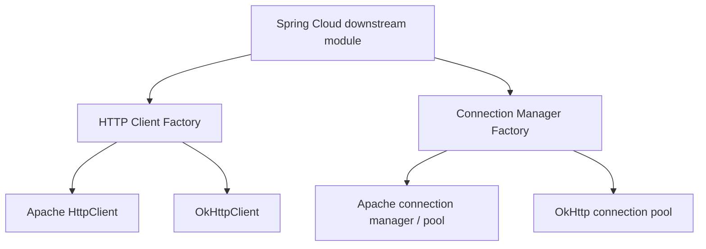

# Vai trò HTTP client factory dùng chung và tình trạng hỗ trợ theo phiên bản

## 1. Bối cảnh

Một ứng dụng Spring Cloud thường gọi nhiều dịch vụ HTTP: Config Server, service discovery, API nghiệp vụ, dịch vụ OAuth hoặc các endpoint bên ngoài. Mỗi HTTP client cần một số quyết định kỹ thuật như:

- Chọn thư viện truyền tải: Apache HttpClient, OkHttp, Reactor Netty, Jetty hoặc JDK HttpClient.
- Tạo và tái sử dụng connection pool.
- Đặt giới hạn tổng số kết nối và số kết nối cho mỗi route.
- Cấu hình timeout, proxy, TLS, redirect và xác thực.
- Đóng tài nguyên khi ứng dụng dừng.

Trong các phiên bản Spring Cloud cũ, Spring Cloud Commons từng cung cấp một nhóm **HTTP Client Factories** để tạo Apache HttpClient và OkHttp client theo một cách dùng chung. Các module phía trên có thể dùng factory đó hoặc thay thế cách tạo client mà không phải tự quản lý toàn bộ connection manager.

API này có lịch sử thay đổi quan trọng: các lớp và interface trong package `org.springframework.cloud.commons.httpclient` đã bị loại khỏi Spring Cloud Commons từ dòng 4.0. Vì vậy, khi đọc tài liệu cũ hoặc nâng cấp ứng dụng, cần phân biệt vai trò lịch sử của factory với các cơ chế tạo HTTP client đang được Spring Boot và Spring Cloud OpenFeign hỗ trợ hiện nay.

Bài thuộc chương **Khả năng hệ thống** của mô-đun **SPRING_CLOUD_CORE**. Mô-đun giúp người học hiểu các nền tảng cốt lõi của Spring Cloud trong hệ thống phân tán, đặc biệt Spring Cloud Commons, Context, cấu hình ngoài và khả năng tương thích với Spring Boot.

Sau bài học, người học có thể:

- Giải thích vai trò của HTTP client factory và connection manager factory trong Spring Cloud Commons.
- Phân biệt factory của Spring Cloud cũ với `ClientHttpRequestFactory` của Spring Framework.
- Nhận diện các lớp Apache và OkHttp từng được cung cấp.
- Xác định mốc loại bỏ API và release train tương ứng.
- Chọn cơ chế cấu hình thay thế cho RestClient, RestTemplate, WebClient và OpenFeign.
- Tránh phụ thuộc vào package đã bị loại khi nâng cấp Spring Cloud.

## 2. HTTP client factory giải quyết vấn đề gì?

HTTP client là thành phần thực hiện kết nối mạng và trao đổi request/response. Việc tạo client không chỉ là gọi constructor. Với các thư viện có connection pool, ứng dụng còn phải quản lý vòng đời pool, chính sách tái sử dụng kết nối, giới hạn đồng thời và cấu hình transport.

Nếu mỗi module tự tạo client theo cách riêng, ứng dụng dễ gặp các vấn đề:

- Nhiều connection pool cho cùng một dịch vụ hoặc cùng một loại transport.
- Cấu hình timeout và proxy không nhất quán giữa các module.
- Một module không áp dụng TLS hoặc connection limits giống module khác.
- Khó thay thư viện HTTP khi nâng cấp framework.
- Không đóng pool đúng lúc, dẫn đến rò rỉ thread hoặc socket.

Factory cung cấp một điểm tạo client có quy ước chung. Module cần HTTP client có thể yêu cầu factory tạo client hoặc connection manager. Ứng dụng có thể thay factory mặc định hoặc cung cấp builder để điều chỉnh cách client được tạo.

Có thể hình dung vai trò lịch sử của các thành phần như sau:



Factory không tự gửi request và cũng không quyết định service discovery hay load balancing. Nó tập trung vào việc tạo client và tài nguyên kết nối mà module sử dụng.

## 3. Các factory từng có trong Spring Cloud Commons

Trong các dòng Spring Cloud Commons cũ, tài liệu mô tả các bean sau:

| Factory | Vai trò |
| --- | --- |
| `ApacheHttpClientFactory` | Tạo Apache HTTP client. |
| `OkHttpClientFactory` | Tạo OkHttp client; bean chỉ được tạo khi thư viện OkHttp có trên classpath. |
| `ApacheHttpClientConnectionManagerFactory` | Tạo connection manager cho Apache HTTP client. |
| `OkHttpClientConnectionPoolFactory` | Tạo connection pool cho OkHttp client. |

Các lớp và interface này thuộc package:

```text
org.springframework.cloud.commons.httpclient
```

Tài liệu Spring Cloud Commons 3.1.9 mô tả rằng module downstream có thể cung cấp implementation riêng của các factory để tùy chỉnh cách tạo client. Nếu ứng dụng cung cấp bean `HttpClientBuilder` hoặc `OkHttpClient.Builder`, factory mặc định có thể sử dụng builder đó làm cơ sở cho builder trả về downstream module.

### 3.1. Vai trò của connection manager và connection pool

HTTP client có thể mở một kết nối mới cho từng request, nhưng cách này tốn thời gian thiết lập TCP/TLS và tạo tải không cần thiết. Connection pool giữ các kết nối có thể tái sử dụng.

Một connection manager hoặc connection pool thường quản lý:

- Số kết nối tối đa trên toàn client.
- Số kết nối tối đa tới một host/route.
- Thời gian sống tối đa của kết nối.
- Chính sách tái sử dụng và thu hồi kết nối.
- Thời gian chờ khi pool không còn kết nối trống.
- Tài nguyên socket và thread liên quan.

Ví dụ, nếu một client có tối đa 200 kết nối và tối đa 50 kết nối cho mỗi route, nhiều request tới cùng một host có thể phải chờ khi route đó đã dùng hết 50 kết nối, dù các route khác vẫn còn chỗ trong pool.

Factory giúp module sử dụng chung chính sách tạo pool. Tuy nhiên, factory không tự quyết định giới hạn nào phù hợp cho workload. Người vận hành vẫn cần chọn giá trị dựa trên số request đồng thời, số upstream, timeout và khả năng xử lý của dịch vụ đích.

### 3.2. Builder bean là điểm tùy chỉnh

Trong các phiên bản cũ, tài liệu cho phép cung cấp bean `HttpClientBuilder` hoặc `OkHttpClient.Builder`. Factory mặc định dùng builder được cung cấp làm nền để tạo client.

Ví dụ minh họa cho dòng Commons 3.1.x với Apache HttpClient 4:

```java
import org.apache.http.impl.client.HttpClientBuilder;
import org.apache.http.impl.client.HttpClients;
import org.springframework.context.annotation.Bean;
import org.springframework.context.annotation.Configuration;

@Configuration(proxyBeanMethods = false)
public class LegacyHttpClientConfiguration {

    @Bean
    HttpClientBuilder httpClientBuilder() {
        return HttpClients.custom()
                .setMaxConnTotal(200)
                .setMaxConnPerRoute(50);
    }
}
```

Đây là ví dụ cho stack cũ, trong đó builder thuộc Apache HttpClient 4 (`org.apache.http.*`). Không sao chép nguyên import hoặc cấu hình này sang Spring Cloud 4.x/5.x hay Spring Framework 6/7: các API Commons cũ đã bị loại, và Spring Framework 6 chuyển sang Apache HttpComponents 5.

Với OkHttp, builder cũ có kiểu `okhttp3.OkHttpClient.Builder`. Tương tự, ứng dụng chỉ nên cung cấp builder này khi đang dùng release train còn có factory tương ứng và dependency OkHttp phù hợp.

### 3.3. Bật hoặc tắt bean factory trong phiên bản cũ

Các thuộc tính từng được tài liệu hóa:

```yaml
spring:
  cloud:
    httpclientfactories:
      apache:
        enabled: true
      ok:
        enabled: false
```

Hai khóa tương ứng:

- `spring.cloud.httpclientfactories.apache.enabled`
- `spring.cloud.httpclientfactories.ok.enabled`

Chúng điều khiển việc tạo bean factory Apache và OkHttp trong các phiên bản Commons có hỗ trợ nhóm API này. Việc đặt `enabled: false` không phải cách thay thế client; module downstream cần có cơ chế tạo client khác nếu nó vẫn yêu cầu transport đó.

Các khóa trên là một phần của cấu hình lịch sử. Chúng không thể khôi phục các class đã bị loại khỏi Commons 4.x/5.x. Khi nâng cấp, phải chuyển code sử dụng factory sang API thuộc module còn hỗ trợ.

## 4. Factory của Commons khác ClientHttpRequestFactory như thế nào?

Tên gọi gần giống nhau nhưng đây là các abstraction khác nhau.

| Tiêu chí | HTTP Client Factories cũ của Commons | `ClientHttpRequestFactory` của Spring Framework |
| --- | --- | --- |
| Phạm vi | Tạo Apache/OkHttp client và connection manager dùng bởi module downstream. | Tạo một `ClientHttpRequest` cho request của Spring REST client. |
| Package | `org.springframework.cloud.commons.httpclient` | `org.springframework.http.client` |
| Đối tượng chính | Native HTTP client, builder và pool. | Adapter giữa Spring REST API và thư viện HTTP bên dưới. |
| Nơi sử dụng | Các module Spring Cloud từng tích hợp factory chung. | RestTemplate và RestClient theo cách cấu hình của Spring Framework/Boot. |
| Trạng thái hiện nay | Đã bị loại khỏi Commons từ 4.0. | Vẫn là abstraction của Spring Framework. |

Ví dụ, `HttpComponentsClientHttpRequestFactory` dùng Apache HttpComponents client để thực hiện request. Nó không phải `ApacheHttpClientFactory` cũ của Spring Cloud Commons.

Một ứng dụng có thể dùng Spring Framework `ClientHttpRequestFactory` mà không cần Spring Cloud Commons HTTP client factory. Tương tự, việc dùng Spring Cloud LoadBalancer để phân giải service ID không đồng nghĩa ứng dụng phải dùng nhóm factory cũ.

## 5. Lịch sử hỗ trợ theo phiên bản

Nhóm factory này từng được mô tả trong tài liệu các release train cũ, gồm Hoxton, 2020.0 và 2021.0. Bước thay đổi lớn diễn ra khi Spring Cloud Commons chuyển sang 4.0.

| Spring Cloud release train | Spring Cloud Commons | Spring Boot tương ứng | Trạng thái nhóm factory Commons |
| --- | --- | --- | --- |
| Hoxton | 2.2.x | 2.2.x / 2.3.x | Có trong tài liệu legacy. |
| 2020.0 (Ilford) | 3.0.x | 2.4.x / 2.5.x | Có trong tài liệu legacy. |
| 2021.0 (Jubilee) | 3.1.x | 2.6.x / 2.7.x | Có trong tài liệu 3.1.x. |
| 2022.0 (Kilburn) | 4.0.x | 3.0.x / 3.1.x | Đã loại bỏ các class/interface trong package `org.springframework.cloud.commons.httpclient`. |
| 2023.0 (Leyton) | 4.1.x | 3.2.x / 3.3.x | Không còn API Commons cũ. |
| 2024.0 (Moorgate) | 4.2.x | 3.4.x | Không còn API Commons cũ. |
| 2025.0 (Northfields) | 4.3.x | 3.5.x | Không còn API Commons cũ. |
| 2025.1 (Oakwood) | 5.0.x | 4.0.x | Không còn API Commons cũ. |

Mốc loại bỏ là Spring Cloud Commons 4.0.0-RC2. Release notes của Spring Cloud 2022.0 nêu rõ các interface dựa trên Apache HttpClient 4 bị loại, các interface OkHttp cũng bị loại vì chỉ còn Spring Cloud OpenFeign sử dụng chúng; phần cần thiết được chuyển vào OpenFeign. Cùng release train này, các dự án Spring Cloud chuyển sang Apache HttpClient 5.

### 5.1. Phân biệt hai loại “hỗ trợ”

Không nên đánh đồng:

1. **API có tồn tại trong artifact hay không:** package và class có được cung cấp trong phiên bản Commons đang dùng không?
2. **Release train còn được hỗ trợ hay không:** phiên bản đó còn nằm trong chính sách hỗ trợ OSS của Spring Cloud/Spring Boot không?

Một phiên bản Commons cũ có thể từng chứa factory nhưng release train tương ứng đã hết thời gian hỗ trợ. Ngược lại, một release train mới còn được hỗ trợ vẫn có thể không chứa API factory cũ.

Theo bảng Supported Versions được cập nhật ngày 19-03-2026, các dòng 2025.1 và 2025.0 vẫn nằm trong nhóm release train được hỗ trợ tại thời điểm bảng được cập nhật; các dòng 2024.0 và cũ hơn được đánh dấu ngoài chính sách hỗ trợ OSS. Spring Cloud nêu chính sách hỗ trợ major tối thiểu ba năm và minor tối thiểu mười hai tháng, đồng thời vòng đời release train gắn với phiên bản Spring Boot tương ứng.

Khi xác định trạng thái hỗ trợ tại thời điểm nâng cấp, hãy kiểm tra lại bảng Supported Versions và vòng đời Spring Boot hiện hành. Bảng trên dùng để chỉ ra quan hệ phiên bản và trạng thái API, không phải cam kết hỗ trợ bảo mật vĩnh viễn cho từng bản phát hành.

## 6. Vì sao Spring Cloud Commons loại bỏ nhóm factory này?

Trong quá trình chuyển sang Spring Boot 3 và Spring Framework 6, Spring Cloud Commons loại bỏ các class/interface cũ trong package `org.springframework.cloud.commons.httpclient`.

Issue #1171 của Spring Cloud Commons ghi nhận rằng các abstraction này chỉ còn được Spring Cloud OpenFeign sử dụng; các dự án khác không còn phụ thuộc vào chúng. Vì vậy, phần cần thiết được chuyển sang OpenFeign thay vì tiếp tục duy trì một abstraction dùng chung nhưng ít consumer.

Có hai thay đổi liên quan:

- Spring Framework 6 loại bỏ hỗ trợ Apache HttpClient 4 trong `HttpComponentsClientHttpRequestFactory`; Apache HttpClient 5 là hướng thay thế.
- OpenFeign quản lý việc tích hợp HTTP client trong chính module OpenFeign, bao gồm Apache HttpClient 5 và OkHttp.

Đây là thay đổi về vị trí sở hữu và API, không có nghĩa Spring Cloud ngừng hỗ trợ HTTP client. Các ứng dụng vẫn có thể dùng Apache HttpClient 5, OkHttp, JDK HttpClient, Reactor Netty hoặc Jetty qua integration tương ứng.

### 6.1. Tài liệu legacy có thể gây hiểu nhầm

Một số URL reference HTML cũ vẫn còn đoạn mô tả HTTP Client Factories dù các class đã bị loại. Issue #1171 còn ghi nhận việc tài liệu HTTP Client Factories tại reference 4.2.1 đã trở nên không còn chính xác; tài liệu cũ sau đó được gỡ khỏi reference mới.

Vì vậy, khi thấy đoạn tài liệu cũ:

- Kiểm tra đúng phiên bản Spring Cloud Commons mà ứng dụng đang dùng.
- Kiểm tra package/class trong API Javadoc hoặc artifact tương ứng.
- Đối chiếu release notes và issue loại bỏ API.
- Ưu tiên reference hiện hành của phiên bản đang chạy thay vì copy cấu hình từ trang legacy.

Tài liệu Spring Cloud Commons 5.0.4 hiện hành tập trung vào các abstraction còn được duy trì và không còn mục HTTP Client Factories cũ.

## 7. Cơ chế thay thế cho ứng dụng hiện nay

Sau khi nhóm factory Commons bị loại, hãy chọn abstraction theo loại HTTP client mà ứng dụng sử dụng.

| Nhu cầu | Cơ chế nên dùng |
| --- | --- |
| RestClient | Spring Boot `RestClient.Builder`, `ClientHttpRequestFactoryBuilder`, `RestClientCustomizer` và `spring.http.clients`. |
| RestTemplate | Spring Boot `RestTemplateBuilder`, `RestTemplateCustomizer` và `ClientHttpRequestFactory`. |
| WebClient | Spring Boot `WebClient.Builder`, `WebClientCustomizer`, `ClientHttpConnectorBuilder` và `spring.http.clients.reactive`. |
| OpenFeign | Cấu hình thuộc `spring-cloud-openfeign`, Apache HttpClient 5 hoặc OkHttp integration. |
| Module nội bộ có transport riêng | Tạo abstraction thuộc ứng dụng/module đó hoặc dùng trực tiếp API client của thư viện được chọn. |

Spring Boot chịu trách nhiệm phát hiện client có trên classpath và tạo request factory/connector phù hợp. Spring Cloud Commons không còn là nơi cung cấp factory chung cho Apache và OkHttp như trước.

### 7.1. RestClient và RestTemplate

Với Spring Boot 4.0, `RestClient.Builder` được auto-configure và sử dụng `ClientHttpRequestFactory` phù hợp với thư viện có trên classpath. Có thể cấu hình client toàn cục qua `spring.http.clients` hoặc chọn factory cho nhóm imperative client.

Ví dụ:

```yaml
spring:
  http:
    clients:
      imperative:
        factory: jdk
      connect-timeout: 2s
      read-timeout: 5s
      redirects: dont-follow
```

Tên và tập giá trị property phụ thuộc phiên bản Spring Boot. Với các yêu cầu phức tạp, có thể cung cấp `ClientHttpRequestFactoryBuilder` hoặc `ClientHttpRequestFactoryBuilderCustomizer`.

Ví dụ tùy chỉnh builder cho JDK HttpClient:

```java
import java.net.ProxySelector;

import org.springframework.boot.http.client.ClientHttpRequestFactoryBuilder;
import org.springframework.context.annotation.Bean;
import org.springframework.context.annotation.Configuration;

@Configuration(proxyBeanMethods = false)
class HttpClientConfiguration {

    @Bean
    ClientHttpRequestFactoryBuilder<?> clientHttpRequestFactoryBuilder(
            ProxySelector proxySelector) {
        return ClientHttpRequestFactoryBuilder.jdk()
                .withHttpClientCustomizer(builder ->
                        builder.proxy(proxySelector));
    }
}
```

Ví dụ này dùng API của Spring Boot 4.0. Với Boot 3.x, hãy kiểm tra đúng phiên bản Spring Boot vì tên property và builder API có thể khác.

### 7.2. WebClient

WebClient sử dụng `ClientHttpConnector`. Spring Boot tự phát hiện connector theo thư viện có trên classpath. Với Boot 4.0, có thể chọn connector qua:

```yaml
spring:
  http:
    clients:
      reactive:
        connector: jetty
```

Hoặc cung cấp `ClientHttpConnectorBuilder` / `ClientHttpConnectorBuilderCustomizer` để tùy chỉnh sâu hơn. Nếu cần tùy chỉnh theo từng WebClient, inject `WebClient.Builder` và áp dụng `WebClientCustomizer` ở phạm vi phù hợp.

Không dùng `ClientHttpRequestFactoryBuilder` cho WebClient: imperative client dùng request factory, reactive client dùng connector.

### 7.3. Spring Cloud OpenFeign

OpenFeign hiện quản lý HTTP client trong module của nó. Với Apache HttpClient 5, cần có HttpClient 5 trên classpath; có thể tắt integration bằng `spring.cloud.openfeign.httpclient.hc5.enabled=false`. Ứng dụng có thể cung cấp bean `CloseableHttpClient` hoặc dùng các property và customizer dành riêng cho HC5.

Ví dụ:

```yaml
spring:
  cloud:
    openfeign:
      httpclient:
        hc5:
          enabled: true
          socket-timeout: 5
          socket-timeout-unit: seconds
        max-connections: 200
        max-connections-per-route: 50
```

Nếu dùng OkHttp với OpenFeign, thêm dependency OkHttp và bật `spring.cloud.openfeign.okhttp.enabled=true`. Không tìm `OkHttpClientFactory` trong Commons 4.x/5.x; integration hiện thuộc OpenFeign.

Với Apache HttpClient 5, OpenFeign còn cung cấp `HttpClientBuilderCustomizer` và `HttpClientConnectionManagerBuilderCustomizer` để tùy chỉnh builder và connection manager. Đây là extension point của OpenFeign, không phải factory Commons cũ.

## 8. Lựa chọn HTTP client và quản lý connection pool

Không nên chọn thư viện chỉ vì nó từng được factory Commons hỗ trợ. Hãy dựa trên kiểu ứng dụng, dependency và yêu cầu vận hành.

| Client | Trường hợp thường gặp | Lưu ý |
| --- | --- | --- |
| Apache HttpClient 5 | Ứng dụng cần kiểm soát pool, proxy, route, TLS và chính sách kết nối chi tiết. | Dùng integration của Spring Boot, Spring Framework hoặc OpenFeign tùy client. |
| OkHttp | Ứng dụng đã dùng OkHttp hoặc cần hệ sinh thái API của OkHttp. | Với OpenFeign, cần dependency và property bật OkHttp. |
| Reactor Netty | WebClient/reactive workload. | Spring Boot WebFlux thường đưa Reactor Netty vào classpath mặc định. |
| Jetty client | Hệ thống đã dùng Jetty hoặc muốn dùng Jetty reactive client. | Cần dependency client phù hợp. |
| JDK HttpClient | Muốn dựa vào JDK, giảm dependency HTTP bên ngoài. | Kiểm tra khả năng và tùy chọn cấu hình theo JDK/Spring Boot. |

### 8.1. Chọn giới hạn pool theo workload

Khi cấu hình connection pool, cần xem xét:

- Số request đồng thời mà ứng dụng có thể phát đi.
- Số route/upstream mà client gọi.
- Thời gian trung bình và p95/p99 của request.
- Thời gian chờ kết nối và thời gian chờ response.
- Số replica của ứng dụng; mỗi replica có pool riêng.
- Giới hạn kết nối và khả năng xử lý của dịch vụ đích.

Ví dụ, nếu mỗi pod có tối đa 200 kết nối và triển khai 10 pod, upstream có thể nhận tới khoảng 2.000 kết nối từ ứng dụng đó. Tăng pool trên mỗi pod mà không tính số replica có thể gây quá tải cho upstream.

Không đặt connection timeout quá dài khiến request xếp hàng lâu khi pool cạn. Cũng không đặt timeout quá ngắn khi upstream có độ trễ bình thường cao. Nên đo bằng metric và kiểm thử tải trước khi chốt giá trị.

### 8.2. Vòng đời và đóng tài nguyên

HTTP client có thể sở hữu connection pool, scheduler hoặc event loop. Nên tạo client dưới dạng bean singleton hoặc theo vòng đời rõ ràng, tránh tạo client mới cho từng request.

Khi ứng dụng dừng, phải đóng tài nguyên mà client sở hữu theo contract của thư viện. Với Spring Boot auto-configuration, framework thường quản lý lifecycle của bean được tạo; nếu tự tạo client, hãy kiểm tra cách đóng client/connection manager và không giữ pool không còn được sử dụng.

## 9. Những lỗi thường gặp khi nâng cấp

| Triệu chứng | Nguyên nhân có thể | Cách xử lý |
| --- | --- | --- |
| Không tìm thấy `ApacheHttpClientFactory` | Code còn import package Commons đã bị loại từ 4.0 | Chuyển sang Spring Boot request factory hoặc integration Apache HC5 phù hợp. |
| Không tìm thấy `OkHttpClientFactory` | Dùng API Commons cũ trong phiên bản mới | Nếu là OpenFeign, dùng `spring.cloud.openfeign.okhttp.enabled`; nếu là ứng dụng thường, cấu hình OkHttp qua client API phù hợp. |
| `NoClassDefFoundError` hoặc `NoSuchMethodError` | Trộn module Spring Cloud khác release train hoặc giữ dependency Commons cũ | Dùng Spring Cloud BOM tương thích với Spring Boot và loại bỏ dependency ép phiên bản không cần thiết. |
| Apache HttpClient 4 không tương thích Spring Framework 6 | Framework mới yêu cầu HttpComponents 5 cho request factory tương ứng | Chuyển sang Apache HttpClient 5 và API cấu hình đúng phiên bản. |
| Cấu hình `spring.cloud.httpclientfactories.*` không tạo bean | Property thuộc cơ chế cũ, class factory đã bị loại | Dùng property/customizer của Boot hoặc OpenFeign. |
| Pool được tạo nhiều lần | Tạo client trong mỗi lần gọi hoặc bean client không phải singleton | Tái sử dụng client/pool theo vòng đời ứng dụng. |
| Timeout và giới hạn kết nối không được áp dụng | Cấu hình nhầm tầng hoặc custom builder không được dùng bởi client đang chạy | Xác định client cụ thể được auto-configure và áp dụng đúng extension point. |
| WebClient không nhận cấu hình của RestClient | Hai loại client dùng connector/request factory khác nhau | Dùng `ClientHttpConnector` và `WebClientCustomizer` cho WebClient. |

### 9.1. Quy trình kiểm tra trước khi nâng cấp

1. Tìm các import bắt đầu bằng `org.springframework.cloud.commons.httpclient`.
2. Tìm các bean hoặc property `spring.cloud.httpclientfactories.*`.
3. Xác định module nào đang inject hoặc gọi factory đó.
4. Phân loại consumer: RestTemplate, RestClient, WebClient, OpenFeign hay module nội bộ.
5. Chọn API thay thế theo loại consumer.
6. Kiểm tra version Spring Boot và Spring Cloud BOM.
7. Chạy test tích hợp xác nhận timeout, TLS, proxy, connection pool và shutdown.

Không chỉ xóa dependency hoặc import để làm build qua. Phải kiểm tra client thực tế có còn dùng đúng connection pool, timeout và TLS policy sau migration hay không.

## 10. Kiểm thử cấu hình HTTP client

Kiểm thử nên tập trung vào hành vi quan sát được thay vì chỉ kiểm tra một factory bean có tồn tại.

| Hạng mục | Điều cần xác minh |
| --- | --- |
| Client selection | Đúng thư viện HTTP được chọn theo dependency và cấu hình. |
| Connection pool | Kết nối được tái sử dụng; giới hạn tổng và theo route có hiệu lực. |
| Timeout | Connect timeout, connection-request timeout và response/socket timeout được áp dụng đúng. |
| Proxy | Request đi qua proxy theo cấu hình; các host được bypass đúng nếu có. |
| TLS | Trust store, certificate, hostname verification và protocol hoạt động như mong đợi. |
| Redirect | Client tuân thủ chính sách follow/deny redirect. |
| Error handling | Lỗi kết nối, timeout và HTTP status được chuyển thành kết quả phù hợp. |
| Lifecycle | Pool và thread được đóng khi context dừng. |
| Load test | Số kết nối không vượt ngân sách của upstream khi scale nhiều replica. |
| Compatibility | Ứng dụng chạy với đúng Spring Boot/Spring Cloud release train được quản lý bởi BOM. |

Với OpenFeign, kiểm thử thêm client singleton và số connection pool được tạo. Với WebClient, kiểm thử connector reactive. Với RestClient/RestTemplate, kiểm tra request factory được tạo theo cấu hình Boot.

## 11. Câu hỏi tự kiểm tra

1. HTTP Client Factory trong Spring Cloud Commons cũ tạo ra những loại đối tượng nào?
2. Vì sao connection manager hoặc connection pool cần được quản lý như tài nguyên có vòng đời?
3. `ApacheHttpClientFactory` khác `ClientHttpRequestFactory` của Spring Framework ở điểm nào?
4. Vì sao `OkHttpClientFactory` chỉ được tạo khi thư viện OkHttp có trên classpath?
5. Những builder bean nào có thể dùng để tùy chỉnh factory trong Commons 3.1.x?
6. Mốc phiên bản nào loại bỏ package `org.springframework.cloud.commons.httpclient`?
7. Vì sao không thể khôi phục API factory cũ chỉ bằng cách bật `spring.cloud.httpclientfactories.apache.enabled=true` trên Commons 4.x?
8. OpenFeign hiện cấu hình Apache HttpClient 5 và OkHttp ở module nào?
9. Spring Boot dùng abstraction nào để cấu hình imperative HTTP client và reactive HTTP client?
10. Khi nâng cấp, cần kiểm thử những hành vi nào để chắc chắn client mới giữ đúng timeout, TLS và connection pool?

## 12. Tài liệu tham khảo chính thức

- [Spring Cloud Commons 3.1.9 — HTTP Client Factories](https://docs.spring.io/spring-cloud-commons/docs/3.1.9/reference/html/)
- [Spring Cloud Commons 5.0.4 — Common Abstractions](https://docs.spring.io/spring-cloud-commons/reference/spring-cloud-commons/common-abstractions.html)
- [Spring Cloud 2022.0 Release Notes](https://github.com/spring-cloud/spring-cloud-release/wiki/Spring-Cloud-2022.0-Release-Notes)
- [Spring Cloud Commons issue #1171 — Remove HttpClient Interfaces and Classes](https://github.com/spring-cloud/spring-cloud-commons/issues/1171)
- [Spring Cloud Supported Versions](https://github.com/spring-cloud/spring-cloud-release/wiki/Supported-Versions)
- [Spring Boot 4.0 — Calling REST Services](https://docs.spring.io/spring-boot/4.0/reference/io/rest-client.html)
- [Spring Cloud OpenFeign 5.0.4 — HTTP Client Configuration](https://docs.spring.io/spring-cloud-openfeign/reference/spring-cloud-openfeign.html)

Các factory trong bài là API lịch sử của Spring Cloud Commons 2.x/3.x. Với Commons 4.x/5.x, hãy dùng cơ chế của Spring Boot, Spring Framework hoặc module HTTP client chuyên biệt như OpenFeign. Luôn kiểm tra tài liệu đúng release train và không dựa vào trang reference legacy còn giữ nội dung đã lỗi thời.
