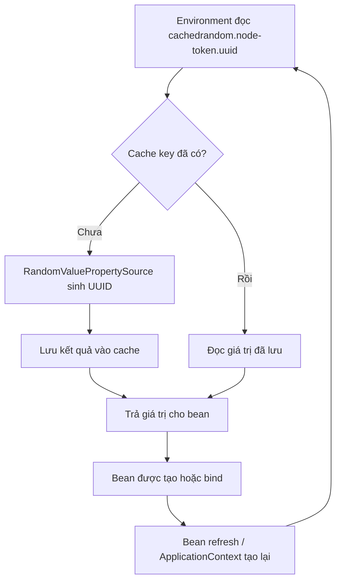

# CachedRandomPropertySource và nhu cầu giữ giá trị trong bộ nhớ đệm

> **Chương:** Giá trị ngẫu nhiên
> **Module:** `SPRING_CLOUD_CORE` — hiểu các nền tảng cốt lõi của Spring Cloud trong hệ thống phân tán, đặc biệt Spring Cloud Commons, Context, cấu hình bên ngoài và tương thích phiên bản với Spring Boot. Người học tìm hiểu refresh scope, discovery, service registry, giao tiếp dịch vụ và cách kiểm thử, vận hành các abstraction chung.
> **Trọng tâm:** Spring Boot có `RandomValuePropertySource` để sinh giá trị ngẫu nhiên khi đọc property. Spring Cloud Context bổ sung `CachedRandomPropertySource` để giữ lại giá trị đã sinh theo một cache key. Bài học tập trung vào cú pháp, vòng đời của cache, phạm vi ổn định của giá trị và cách dùng an toàn trong cấu hình ứng dụng.

## 1. Vì sao cần cache một giá trị ngẫu nhiên?

Giá trị ngẫu nhiên hữu ích khi ứng dụng cần một giá trị mặc định mà người vận hành không phải tự tạo trước. Spring Boot cung cấp các property như `${random.uuid}`, `${random.int}` và `${random.value}`. Chúng có thể được dùng trong cấu hình hoặc test.

Tuy nhiên, có tình huống ứng dụng cần một giá trị ngẫu nhiên nhưng muốn giữ nguyên giá trị đó khi Spring `ApplicationContext` được khởi tạo lại trong cùng tiến trình. Ví dụ, một bean được tạo lại sau refresh hoặc ứng dụng có nhiều context lần lượt được đóng và mở lại. Nếu property được sinh lại mỗi lần truy vấn, thành phần mới có thể nhận giá trị khác thành phần cũ.

Spring Cloud Context giải quyết nhu cầu này bằng `CachedRandomPropertySource`. Property source này lưu giá trị đã sinh theo một key và trả lại giá trị đã lưu cho những lần tra cứu tiếp theo cùng key. Nó hoạt động giống `RandomValuePropertySource` của Spring Boot ngoài phần cache.

Có thể hình dung sự khác nhau như sau:

- `random.*` yêu cầu sinh một giá trị ngẫu nhiên khi property được truy vấn.
- `cachedrandom.*` yêu cầu lấy giá trị ngẫu nhiên gắn với một cache key; nếu key đã có giá trị thì trả lại giá trị đó.

Ví dụ:

```properties
# Giá trị ngẫu nhiên thông thường
demo.random-id=${random.uuid}

# Giá trị ngẫu nhiên được giữ theo cache key "application-id"
demo.cached-id=${cachedrandom.application-id.uuid}
```

Nếu cùng một cache key được tra cứu nhiều lần, `CachedRandomPropertySource` giữ kết quả đã tạo để các lần đọc sau nhận cùng giá trị. Đây là điểm hữu ích khi các bean hoặc context cần nhìn thấy cùng một giá trị trong suốt vòng đời cache.

## 2. RandomValuePropertySource và CachedRandomPropertySource

### 2.1. RandomValuePropertySource của Spring Boot

`RandomValuePropertySource` là một `PropertySource` của Spring Boot. Nó nhận diện các property có tiền tố `random.` và sinh giá trị tương ứng. Các dạng thường dùng gồm:

| Property | Kết quả |
| --- | --- |
| `random.value` | Chuỗi giá trị ngẫu nhiên |
| `random.int` | Số nguyên ngẫu nhiên |
| `random.long` | Số nguyên kiểu long ngẫu nhiên |
| `random.uuid` | UUID ngẫu nhiên |
| `random.int(10)` | Số nguyên từ 0 đến nhỏ hơn 10 |
| `random.int[1024,65536]` | Số nguyên từ 1024 đến nhỏ hơn 65536 |

Với dạng khoảng có cả cận dưới và cận trên, cận dưới được tính vào phạm vi còn cận trên không được tính. Cú pháp dấu mở/đóng trong ví dụ là một phần của cú pháp range mà Spring Boot hỗ trợ.

Ví dụ:

```yaml
demo:
  token: "${random.uuid}"
  shard-number: "${random.int[0,16]}"
  test-port: "${random.int[10000,20000]}"
```

Mỗi lần property source thực sự được hỏi để sinh một random property, nó có thể tạo ra kết quả mới. Vì thế, không nên giả định hai lần đọc `${random.uuid}` ở hai vị trí độc lập sẽ tự động có cùng UUID.

### 2.2. CachedRandomPropertySource của Spring Cloud

`CachedRandomPropertySource` bổ sung cache theo key vào cơ chế random của Spring Boot. Cú pháp tổng quát:

```text
cachedrandom.[yourkey].[type]
```

Trong đó:

- `cachedrandom` là tiền tố để chọn property source có cache.
- `yourkey` là tên key dùng để nhận diện giá trị cần giữ.
- `type` là kiểu random được hỗ trợ bởi `RandomValuePropertySource` của Spring Boot.

Ví dụ tài liệu Spring Cloud:

```properties
myrandom=${cachedrandom.appname.value}
```

Ở đây `appname` là cache key và `value` là kiểu giá trị. Có thể dùng các kiểu random khác do Spring Boot hỗ trợ:

```yaml
demo:
  stable-id: "${cachedrandom.instance-id.uuid}"
  stable-number: "${cachedrandom.worker-number.int}"
  stable-long: "${cachedrandom.sequence-seed.long}"
  stable-token: "${cachedrandom.local-token.value}"
```

Hãy đặt key có tên thể hiện mục đích của giá trị. Mỗi giá trị logic nên có một key riêng; giữ ổn định cả key và kiểu đã chọn ở mọi nơi sử dụng. Không tái sử dụng cùng key cho các property có mục đích hoặc kiểu khác nhau.

### 2.3. Cache thay đổi điều gì?

Cache không biến random thành một giá trị được cấu hình cố định trong source code. Nó chỉ ghi nhớ kết quả đã sinh trong phạm vi cache đang hoạt động.

| Khía cạnh | `random.*` | `cachedrandom.*` |
| --- | --- | --- |
| Sinh giá trị | Sinh khi random property được truy vấn | Sinh khi cache key chưa có giá trị |
| Các lần đọc cùng property | Có thể nhận kết quả khác | Nhận lại giá trị đã cache |
| Mục tiêu | Cần giá trị ngẫu nhiên mới | Cần giá trị ngẫu nhiên ổn định theo key |
| Hành vi khi context khởi tạo lại | Có thể sinh giá trị mới | Có thể giữ giá trị cũ khi cache còn tồn tại |
| Nơi lưu | Random property source | Cache trong bộ nhớ của ứng dụng |

`CachedRandomPropertySource` phù hợp khi điều cần thiết là sự nhất quán giữa các lần đọc, không phải lưu trữ dữ liệu lâu dài.

## 3. Vòng đời và phạm vi ổn định của cache

### 3.1. Giữ nguyên qua lần khởi tạo lại ApplicationContext

Tài liệu Spring Cloud mô tả use case của property source này là giữ một giá trị ngẫu nhiên nhất quán ngay cả khi Spring `ApplicationContext` được restart. Ví dụ, ứng dụng có một context được đóng và tạo lại trong cùng tiến trình; khi context mới đọc lại cùng cache key, nó có thể nhận giá trị đã được cache trước đó.

Điều này hữu ích khi một thành phần được dựng lại nhưng ứng dụng vẫn muốn giữ nguyên một giá trị nhận diện tạm thời. Giá trị đó không cần được người vận hành nhập vào cấu hình, đồng thời các thành phần được khởi tạo ở các thời điểm khác nhau có thể dùng chung kết quả.

### 3.2. Không phải persistent storage

Cần phân biệt restart của Spring `ApplicationContext` với restart của tiến trình Java:

| Sự kiện | Có nên kỳ vọng giữ giá trị? |
| --- | --- |
| Đọc lại cùng property trong cùng context | Có |
| Tạo bean mới hoặc refresh bean trong cùng tiến trình | Có, nếu dùng cùng key và cache chưa bị xóa |
| Đóng và tạo lại ApplicationContext trong cùng tiến trình | Đây là use case mà Spring Cloud mô tả |
| Khởi động lại JVM/process | Không nên kỳ vọng cache còn tồn tại |
| Khởi động pod/replica khác | Không chia sẻ cache của process hiện tại |
| Chạy ứng dụng trên máy khác | Không có cơ chế đồng bộ cache giữa các máy |

Cache này nằm trong bộ nhớ của ứng dụng. Nó không phải database, file store, distributed cache hoặc secret store. Khi tiến trình kết thúc, vùng nhớ của tiến trình bị giải phóng; lần chạy mới có thể sinh một giá trị khác.

Nếu cần giữ ID qua lần deploy, restart máy hoặc tạo lại pod, hãy lưu ID ở nơi có tính bền vững như database hoặc cấu hình được quản lý. Nếu cần nhiều replica dùng chung một giá trị, hãy cung cấp giá trị đó từ một nguồn cấu hình chung có cơ chế quản lý phù hợp.

### 3.3. Phạm vi theo tiến trình và class loader

Cache trong bộ nhớ không phải một hợp đồng đồng bộ giữa các instance của hệ thống phân tán. Hai JVM độc lập có thể dùng cùng một cache key nhưng mỗi JVM tự sinh và lưu một kết quả riêng.

Ví dụ, hai replica cùng khai báo:

```yaml
app:
  instance-id: "${cachedrandom.instance-id.uuid}"
```

Mỗi replica có cache riêng. Vì vậy, hai replica có thể nhận hai UUID khác nhau. Nếu hệ thống cần một cluster ID dùng chung, hãy cấp phát nó qua configuration store, database hoặc một cơ chế điều phối phù hợp.

Cũng cần tránh suy luận rằng cache key là danh tính toàn cục. Nó chỉ có ý nghĩa trong phạm vi cache mà ứng dụng hiện tại đang sử dụng.

## 4. Cách dùng trong Spring Environment và cấu hình ứng dụng

### 4.1. Khai báo trong application.yml

Có thể dùng cached random property trực tiếp trong YAML:

```yaml
app:
  identity:
    local-instance-id: "${cachedrandom.local-instance-id.uuid}"
    startup-seed: "${cachedrandom.startup-seed.long}"
  diagnostics:
    sample-number: "${cachedrandom.diagnostic-sample.int[100,1000]}"
```

Nên đặt placeholder trong dấu nháy kép để YAML đọc giá trị như chuỗi trước khi Spring phân giải placeholder. Khi bind sang kiểu đích, Spring Boot sẽ chuyển đổi giá trị phù hợp.

### 4.2. Đọc bằng Environment

Một bean có thể đọc property thông qua `Environment`:

```java
import org.springframework.core.env.Environment;
import org.springframework.stereotype.Component;

@Component
public class InstanceIdentity {

    private final String instanceId;

    public InstanceIdentity(Environment environment) {
        this.instanceId = environment.getRequiredProperty(
                "app.identity.local-instance-id"
        );
    }

    public String getInstanceId() {
        return instanceId;
    }
}
```

Bean này đọc property đã được Spring Environment phân giải. Nếu một bean khác đọc cùng property, nó nhận cùng giá trị cache khi key vẫn tồn tại trong cache.

### 4.3. Bind bằng ConfigurationProperties

Với cấu hình có cấu trúc, có thể bind bằng `@ConfigurationProperties`:

```yaml
app:
  identity:
    local-instance-id: "${cachedrandom.local-instance-id.uuid}"
    startup-seed: "${cachedrandom.startup-seed.long}"
```

```java
import org.springframework.boot.context.properties.ConfigurationProperties;

@ConfigurationProperties(prefix = "app.identity")
public class InstanceIdentityProperties {

    private String localInstanceId;
    private long startupSeed;

    public String getLocalInstanceId() {
        return localInstanceId;
    }

    public void setLocalInstanceId(String localInstanceId) {
        this.localInstanceId = localInstanceId;
    }

    public long getStartupSeed() {
        return startupSeed;
    }

    public void setStartupSeed(long startupSeed) {
        this.startupSeed = startupSeed;
    }
}
```

Có thể đăng ký class cấu hình này bằng cơ chế scan hoặc `@EnableConfigurationProperties` phù hợp với ứng dụng. Khi bean được bind lại, placeholder cached random vẫn trỏ tới cùng cache key.

### 4.4. Dùng với @Value

Đối với một property đơn giản:

```java
import org.springframework.beans.factory.annotation.Value;
import org.springframework.stereotype.Component;

@Component
public class StartupMetadata {

    private final String nodeToken;

    public StartupMetadata(
            @Value("${cachedrandom.node-token.uuid}") String nodeToken) {
        this.nodeToken = nodeToken;
    }

    public String getNodeToken() {
        return nodeToken;
    }
}
```

Dù dùng `@Value`, `Environment` hay `@ConfigurationProperties`, nguồn giá trị vẫn là property source. Chọn cách bind dựa trên cấu trúc cấu hình và nhu cầu kiểm thử của ứng dụng.

## 5. Quan hệ với refresh và việc tạo lại bean

Spring Cloud Context có các cơ chế refresh cấu hình và `@RefreshScope`. Khi bean thuộc refresh scope bị làm mới, target bean có thể được tạo lại ở lần truy cập tiếp theo. Nếu bean đó đọc `cachedrandom.node-token.uuid`, cache key vẫn còn trong bộ nhớ thì giá trị được phân giải vẫn giống trước khi refresh.

Ví dụ về luồng:



Điểm quan trọng là refresh bean không đồng nghĩa xóa cache random. Hai vòng đời này khác nhau:

- Refresh scope quản lý vòng đời của bean được tạo trong scope.
- Cached random property source quản lý giá trị random theo cache key.

Vì vậy, nếu mục tiêu là cấp một giá trị mới mỗi lần refresh, `cachedrandom.*` không phải lựa chọn phù hợp. Hãy dùng một cơ chế sinh giá trị theo sự kiện refresh hoặc cập nhật property từ nguồn cấu hình được quản lý.

Tương tự, nếu ứng dụng thay đổi một property nguồn khác nhưng cache key vẫn giống, cached random không tự sinh lại giá trị chỉ vì một bean được bind lại.

## 6. Khi nào nên sử dụng CachedRandomPropertySource?

### 6.1. Các trường hợp phù hợp

| Nhu cầu | Vì sao cached random có thể hữu ích |
| --- | --- |
| Giá trị nhận diện tạm thời của một tiến trình | Nhiều bean cần đọc cùng một ID trong vòng đời ứng dụng |
| Seed phục vụ chẩn đoán hoặc thử nghiệm | Các thành phần khởi tạo lệch thời điểm vẫn dùng cùng seed |
| Giá trị mặc định trong môi trường local/test | Không cần chuẩn bị giá trị cố định cho mọi lần chạy |
| Bean được tạo lại sau refresh | Bean mới có thể nhận lại giá trị đã cache |
| Nhiều ApplicationContext trong cùng tiến trình | Các context có thể dùng chung cache key theo cơ chế cache hiện hành |

### 6.2. Các trường hợp không phù hợp

Không dùng cached random như cơ chế thay thế cho:

- ID nghiệp vụ phải tồn tại qua restart hoặc deploy;
- khóa chính cần được cấp phát duy nhất và lưu bền vững;
- secret, mật khẩu, API token hoặc khóa ký cần quản lý vòng đời;
- giá trị cần giống nhau giữa các replica hoặc cluster;
- số thứ tự giao dịch cần tăng đơn điệu;
- idempotency key phải được khôi phục sau khi tiến trình chết;
- cấu hình phải tái tạo chính xác từ repository hoặc hệ thống quản lý cấu hình.

Một UUID ngẫu nhiên có xác suất va chạm rất thấp, nhưng cached random không phải dịch vụ cấp phát ID có điều phối. Nếu tính duy nhất là ràng buộc nghiệp vụ, cần dùng cơ chế cấp phát và lưu trữ có kiểm soát.

### 6.3. Không dùng cache key làm bí mật

Tên key như `instance-id`, `startup-seed` hoặc `local-token` chỉ là nhãn định danh giá trị. Tên key không phải mật khẩu, salt bảo mật hoặc quyền truy cập. Tránh đặt giá trị nhạy cảm vào log, endpoint chẩn đoán hoặc metadata công khai.

Nếu cần secret, hãy lấy secret từ secret manager hoặc nguồn quản lý credential phù hợp, có quyền truy cập, audit, rotation và chính sách lưu trữ rõ ràng.

## 7. Kiểm thử và cô lập trạng thái cache

### 7.1. Kiểm tra hai lần đọc cùng key

Một kiểm thử có thể xác minh rằng cùng cache key trả lại cùng giá trị:

```java
import static org.assertj.core.api.Assertions.assertThat;

import org.junit.jupiter.api.Test;
import org.springframework.cloud.util.random.CachedRandomPropertySource;
import org.springframework.core.env.PropertySource;

class CachedRandomPropertySourceTest {

    @Test
    void returnsSameValueForSameCacheKey() {
        PropertySource<?> randomSource =
                new org.springframework.boot.env.RandomValuePropertySource();

        CachedRandomPropertySource cached =
                new CachedRandomPropertySource(randomSource);

        Object first = cached.getProperty("cachedrandom.test-id.uuid");
        Object second = cached.getProperty("cachedrandom.test-id.uuid");

        assertThat(second).isEqualTo(first);
    }
}
```

Đây là ví dụ kiểm tra trực tiếp property source. Khi kiểm thử tích hợp Spring Boot, nên kiểm tra thêm việc placeholder được phân giải qua Environment và giá trị được bind vào bean.

### 7.2. Xóa cache trong test

API `CachedRandomPropertySource.clearCache()` được cung cấp để xóa cache. Có thể dùng nó để cô lập trạng thái giữa các test:

```java
import org.junit.jupiter.api.AfterEach;
import org.junit.jupiter.api.BeforeEach;
import org.springframework.cloud.util.random.CachedRandomPropertySource;

class RandomConfigurationTest {

    @BeforeEach
    void clearBeforeTest() {
        CachedRandomPropertySource.clearCache();
    }

    @AfterEach
    void clearAfterTest() {
        CachedRandomPropertySource.clearCache();
    }
}
```

Kiểm tra API này trong đúng phiên bản Spring Cloud Context của dự án trước khi sử dụng. Nếu test chạy song song và cùng dùng cache key, một test gọi `clearCache()` có thể ảnh hưởng test khác. Có thể tắt parallel execution cho nhóm test này hoặc thiết kế key riêng để tránh tranh chấp.

Không gọi xóa cache tùy tiện trong production khi nhiều bean đang sử dụng giá trị đó. Sau khi cache bị xóa, lần đọc tiếp theo có thể sinh giá trị mới trong khi một số bean hiện tại vẫn giữ giá trị cũ đã bind. Kết quả là các thành phần trong cùng ứng dụng có thể tạm thời không nhất quán.

### 7.3. Kiểm thử vòng đời ApplicationContext

Để kiểm tra đúng use case của bài học:

1. Khởi tạo context thứ nhất và đọc một cached random property.
2. Đóng context thứ nhất nhưng giữ nguyên tiến trình test.
3. Khởi tạo context thứ hai trong cùng tiến trình.
4. Đọc lại property với cùng cache key.
5. So sánh hai giá trị.
6. Xóa cache có chủ đích rồi đọc lại để xác nhận cache đã được làm mới.

Bài kiểm thử này cần giữ cache trong cùng tiến trình. Nếu test fork JVM riêng cho từng giai đoạn, cache trong bộ nhớ không thể được chia sẻ giữa các JVM.

## 8. Lỗi thường gặp và cách chẩn đoán

| Hiện tượng | Nguyên nhân có thể | Cách xử lý |
| --- | --- | --- |
| Placeholder còn nguyên `${cachedrandom...}` | Property source chưa được đăng ký hoặc placeholder không được phân giải | Kiểm tra dependency Spring Cloud Context, Environment và cấu hình property |
| Giá trị thay đổi sau khi restart process | Cache chỉ tồn tại trong bộ nhớ tiến trình | Dùng database/configuration store nếu cần giá trị bền vững |
| Hai replica có giá trị khác nhau | Mỗi JVM có cache độc lập | Cấp giá trị dùng chung từ nguồn cấu hình hoặc storage tập trung |
| Hai bean nhận giá trị khác nhau | Khác cache key hoặc khác kiểu property | So sánh nguyên văn key và type trong placeholder |
| Giá trị đổi sau khi gọi clearCache | Cache đã bị xóa và lần đọc tiếp theo sinh giá trị mới | Chỉ xóa trong test hoặc quy trình reset có kiểm soát |
| Refresh bean nhưng giá trị không đổi | Cache key vẫn tồn tại, đây là hành vi mong đợi | Dùng cơ chế sinh lại theo refresh nếu yêu cầu là giá trị mới |
| Test phụ thuộc kết quả test trước | Static cache còn dữ liệu từ test trước | Xóa cache trước/sau test và tránh chạy song song cùng key |
| Giá trị bị bind sai kiểu | Type random không tương thích với property đích | Chọn kiểu int, long, uuid hoặc value phù hợp và kiểm tra conversion |

Khi chẩn đoán, kiểm tra chính xác chuỗi placeholder, cache key, kiểu random, thời điểm đọc property và việc có thao tác xóa cache hay không. Không suy luận chỉ từ giá trị nhìn thấy trong một bean vì bean có thể giữ giá trị đã bind trước đó.

## 9. Quy trình lựa chọn và vận hành

Trước khi dùng `CachedRandomPropertySource`, hãy trả lời các câu hỏi sau:

1. Giá trị có cần thay đổi mỗi lần đọc hay phải ổn định theo key?
2. Có cần giữ giá trị khi một bean hoặc ApplicationContext được tạo lại không?
3. Giá trị chỉ cần tồn tại trong một tiến trình hay phải sống qua restart/deploy?
4. Các replica có cần dùng chung một giá trị không?
5. Có cần audit, khôi phục hoặc rotation giá trị không?
6. Property được bind một lần hay được đọc lại nhiều lần?
7. Có test nào cần xóa cache để tránh phụ thuộc thứ tự chạy không?

Nếu giá trị chỉ cần ổn định trong cache của ứng dụng, cached random là một công cụ gọn nhẹ. Nếu cần độ bền, đồng bộ hoặc quản lý vòng đời, hãy chọn storage hoặc configuration service có các thuộc tính đó.

## 10. Bài tập vận dụng

### Bài tập 1 — Random value thay đổi giữa các lần đọc

Một ứng dụng có hai bean cùng đọc `${random.uuid}`. Sau khi refresh một bean, UUID mới không còn khớp với UUID mà bean kia giữ.

Hãy giải thích vai trò của `RandomValuePropertySource` và viết lại property bằng `cachedrandom.` để hai bean đọc cùng một giá trị theo cache key.

### Bài tập 2 — Giữ instance ID qua refresh

Một service dùng `@RefreshScope` cho bean chứa thông tin instance. Sau khi bean được tạo lại, nhóm muốn instance ID không đổi.

Hãy đề xuất cấu hình cached random và mô tả vì sao cache random vẫn giữ giá trị khi target bean bị tạo lại trong cùng tiến trình.

### Bài tập 3 — Hai replica có cùng cache key

Hai pod cùng chạy ứng dụng với `${cachedrandom.cluster-id.uuid}`. Nhóm kỳ vọng cả hai có cùng cluster ID nhưng quan sát được hai giá trị khác nhau.

Hãy giải thích phạm vi cache và đề xuất nguồn cấu hình phù hợp để chia sẻ cluster ID.

### Bài tập 4 — Khởi động lại JVM

Một ứng dụng dùng cached random để tạo ID lưu vào bảng database. Sau khi triển khai phiên bản mới, ID thay đổi và dữ liệu liên kết không còn khớp.

Hãy phân tích vì sao cache trong bộ nhớ không thể bảo đảm ID qua process restart. Đề xuất nơi lưu trữ ID bền vững.

### Bài tập 5 — Test chạy không ổn định

Một test đọc cached random, test kế tiếp cũng dùng key đó và kỳ vọng giá trị mới. Kết quả phụ thuộc thứ tự chạy test.

Hãy đề xuất cách dùng `clearCache()` và cách cô lập key để các test có thể chạy độc lập.

### Tự kiểm tra nhanh

1. `CachedRandomPropertySource` thuộc thành phần nào? **Spring Cloud Context.**
2. Prefix dùng để đọc cached random là gì? **`cachedrandom.`.**
3. Cú pháp tổng quát của property là gì? **`cachedrandom.[yourkey].[type]`.**
4. `type` được hỗ trợ dựa trên property source nào? **Spring Boot `RandomValuePropertySource`.**
5. Cache có giữ giá trị qua lần tạo lại ApplicationContext trong cùng tiến trình không? **Đây là use case được tài liệu Spring Cloud mô tả.**
6. Cache có chia sẻ giữa hai JVM không? **Không.**
7. Cache có tồn tại sau khi process kết thúc không? **Không nên kỳ vọng.**
8. Refresh bean có tự động xóa cached random không? **Không.**
9. API nào có thể xóa cache trong test? **`CachedRandomPropertySource.clearCache()`, nếu phiên bản đang dùng cung cấp API này.**
10. Có nên dùng cached random làm ID nghiệp vụ bền vững không? **Không.**

**Thông điệp cốt lõi:** `CachedRandomPropertySource` giải quyết nhu cầu sinh một giá trị ngẫu nhiên rồi giữ lại kết quả theo cache key trong bộ nhớ. Nó hữu ích khi các lần đọc hoặc các bean được tạo lại trong cùng tiến trình cần dùng cùng giá trị. Cache không phải nơi lưu trữ bền vững, không chia sẻ giữa các replica và không thay thế hệ thống cấp phát ID hoặc quản lý secret.

**Tài liệu tham khảo:**

- [Spring Cloud Commons 5.0.4 — CachedRandomPropertySource](https://docs.spring.io/spring-cloud-commons/reference/spring-cloud-commons/cachedrandompropertysource.html)
- [Spring Boot — Externalized Configuration: Configuring Random Values](https://docs.spring.io/spring-boot/reference/features/external-config.html)
- [Spring Boot API — RandomValuePropertySource](https://docs.spring.io/spring-boot/api/java/org/springframework/boot/env/RandomValuePropertySource.html)
- [Spring Cloud Context API — CachedRandomPropertySource](https://javadoc.io/doc/org.springframework.cloud/spring-cloud-context/latest/org/springframework/cloud/util/random/CachedRandomPropertySource.html)

Các kiểu random và chi tiết API có thể thay đổi theo phiên bản Spring Boot/Spring Cloud. Hãy kiểm tra tài liệu của release train tương thích với ứng dụng trước khi triển khai.
