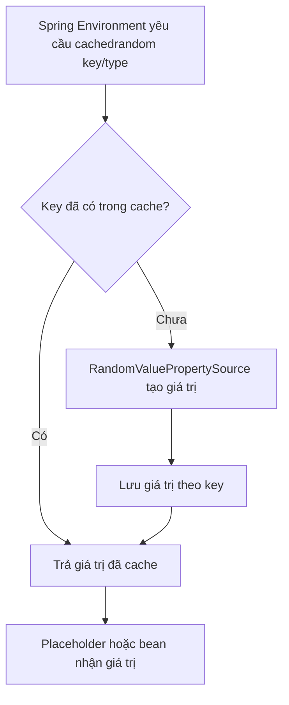

# Cú pháp cachedrandom.<key>.<type>

Trong ứng dụng Spring, có những giá trị cần được tạo ngẫu nhiên nhưng vẫn giữ nguyên khi `ApplicationContext` được khởi động lại. Ví dụ, một ứng dụng có thể cần một mã nhận diện cục bộ, một giá trị cấu hình dùng trong suốt vòng đời của tiến trình hoặc một giá trị thử nghiệm ổn định giữa các lần tạo context.

Spring Boot cung cấp `RandomValuePropertySource` với các thuộc tính `random.*`. Mỗi lần giá trị được tạo, nguồn này sử dụng bộ sinh ngẫu nhiên theo kiểu được yêu cầu. Spring Cloud Context bổ sung `CachedRandomPropertySource`, cho phép cache giá trị ngẫu nhiên theo một khóa. Cú pháp của nó là:

```text
cachedrandom.<key>.<type>
```

Trong đó `key` xác định ô cache và `type` chọn kiểu giá trị ngẫu nhiên theo khả năng của Spring Boot `RandomValuePropertySource`. Nhờ cache, cùng một khóa có thể trả lại giá trị đã tạo khi ứng dụng tạo lại Spring `ApplicationContext` trong cùng vòng đời tiến trình.

Bài học thuộc chương **Giá trị ngẫu nhiên** của **SPRING_CLOUD_CORE**. Nội dung tập trung vào cách đọc cú pháp, chọn khóa, dùng các kiểu giá trị, cấu hình trong Properties/YAML, truy cập qua Spring `Environment` và hiểu đúng phạm vi tồn tại của cache.

## 1. Mục tiêu học tập

Sau bài này, bạn có thể:

- Giải thích vai trò của `CachedRandomPropertySource` trong Spring Cloud Context.
- Phân biệt `cachedrandom.*` với `random.*` của Spring Boot.
- Đọc đúng cấu trúc `cachedrandom.<key>.<type>`.
- Chọn `key` ổn định và không gây trùng lặp ngoài ý muốn.
- Dùng các kiểu `value`, `int`, `long`, `uuid` và các kiểu số có giới hạn.
- Cấu hình cached random value trong `application.properties` và `application.yml`.
- Truy cập giá trị qua `@Value`, `Environment` và `@ConfigurationProperties`.
- Giải thích vì sao giá trị ổn định qua lần tạo lại context nhưng không phải dữ liệu lưu bền.
- Thiết kế kiểm thử cho hành vi cache.
- Nhận biết các trường hợp không phù hợp để dùng cached random value.

## 2. CachedRandomPropertySource là gì?

`CachedRandomPropertySource` là một `PropertySource` do Spring Cloud Context cung cấp. Nó tạo giá trị ngẫu nhiên theo cơ chế tương thích với `RandomValuePropertySource` của Spring Boot, đồng thời cache kết quả dựa trên một khóa.

Spring Boot có thể tạo các giá trị như số nguyên, số dài, UUID hoặc giá trị ngẫu nhiên dạng chuỗi thông qua các placeholder `random.*`. Spring Cloud bổ sung tiền tố `cachedrandom` để cho phép giữ lại kết quả theo khóa.

Ví dụ chính thức:

```properties
myrandom=${cachedrandom.appname.value}
```

Trong ví dụ trên:

- `cachedrandom` chọn nguồn thuộc tính có cache.
- `appname` là khóa được dùng để nhận diện giá trị trong cache.
- `value` là kiểu giá trị ngẫu nhiên được yêu cầu.
- `myrandom` là thuộc tính ứng dụng nhận kết quả sau khi placeholder được phân giải.

`CachedRandomPropertySource` là một nguồn thuộc tính trong Spring `Environment`. Nó không phải một trường cấu hình riêng của Config Server, cũng không phải một dịch vụ lưu trữ ngẫu nhiên từ xa.

Trong cách tích hợp tiêu chuẩn, Spring Cloud Context đưa nguồn thuộc tính này vào `Environment` qua `EnvironmentPostProcessor` của module. Vì vậy, ứng dụng cần có Spring Cloud Context trên classpath và cơ chế khởi động Spring Boot phải nạp processor đó. Thông thường không cần tự tạo một bean `PropertySource` cho từng thuộc tính. Nếu placeholder không được phân giải, hãy kiểm tra dependency và danh sách property source trong `Environment`.

## 3. Cấu trúc cachedrandom.<key>.<type>

Cú pháp tổng quát:

```text
cachedrandom.<key>.<type>
```

| Thành phần | Vai trò | Ví dụ |
| --- | --- | --- |
| `cachedrandom` | Tiền tố để chọn nguồn random có cache | `cachedrandom` |
| `<key>` | Tên khóa dùng để tìm giá trị trong cache | `checkout-node-id` |
| `<type>` | Kiểu random mà Spring Boot hỗ trợ | `uuid`, `int`, `long`, `value` |

Một số biểu thức hoàn chỉnh:

```properties
app.node-id=${cachedrandom.checkout-node-id.uuid}
app.shard=${cachedrandom.checkout-shard.int}
app.token=${cachedrandom.checkout-token.value}
app.test-number=${cachedrandom.checkout-test-number.int[1000,9000]}
```

### 3.1. Key là định danh cache, không phải seed

`key` giúp Spring Cloud xác định giá trị đã được cache. Nó không phải seed để tính ra một kết quả ngẫu nhiên có thể tái tạo độc lập.

Ví dụ:

```properties
app.node-id=${cachedrandom.checkout-node-id.uuid}
```

Tên `checkout-node-id` không làm UUID trở thành một giá trị cố định được tính toán từ chuỗi đó. Lần đầu khóa được yêu cầu, một giá trị ngẫu nhiên được tạo và cache. Những lần truy cập tiếp theo dùng lại giá trị đã cache.

Vì vậy:

- Đổi key sẽ yêu cầu một mục cache khác.
- Giữ nguyên key giúp tham chiếu lại giá trị đã được cache.
- Key không thay thế một seed hoặc thuật toán sinh số xác định.
- Key không khiến các JVM hoặc replica khác nhau tự động có cùng giá trị.

### 3.2. Chọn key có ý nghĩa

Nên đặt key theo mục đích của giá trị:

```properties
app.node-id=${cachedrandom.checkout-node-id.uuid}
app.local-token=${cachedrandom.checkout-local-token.value}
app.test-port=${cachedrandom.checkout-test-port.int[10000,20000]}
```

Tên key có ý nghĩa giúp người đọc biết giá trị phục vụ mục đích gì và giảm nguy cơ vô tình dùng chung một cache entry.

Nếu hai thuộc tính cần dùng cùng một giá trị, hãy tham chiếu cùng biểu thức key và type. Nếu hai thuộc tính cần giá trị độc lập, hãy đặt hai key khác nhau.

Không nên thay đổi key tùy tiện giữa các lần triển khai nếu ứng dụng mong muốn tiếp tục sử dụng giá trị cache cũ trong cùng tiến trình.

## 4. Các kiểu giá trị được hỗ trợ

Phần `type` có thể dùng các kiểu được Spring Boot `RandomValuePropertySource` hỗ trợ. Các kiểu phổ biến:

| Type | Kết quả | Ví dụ |
| --- | --- | --- |
| `value` | Giá trị ngẫu nhiên dạng value/chuỗi | `cachedrandom.app-token.value` |
| `int` | Số nguyên ngẫu nhiên | `cachedrandom.shard.int` |
| `long` | Số nguyên dài ngẫu nhiên | `cachedrandom.sequence.long` |
| `uuid` | UUID ngẫu nhiên | `cachedrandom.instance.uuid` |
| `int(max)` | Số nguyên từ 0 đến max - 1 | `cachedrandom.port.int(100)` |
| `int[min,max]` | Số nguyên trong khoảng có cận trên loại trừ | `cachedrandom.slot.int[10,20]` |
| `long(max)` | Số long từ 0 đến max - 1 | `cachedrandom.limit.long(100000)` |
| `long[min,max]` | Số long trong khoảng có cận trên loại trừ | `cachedrandom.offset.long[1000,9000]` |

Các kiểu và cách phân tích hậu tố phụ thuộc phiên bản Spring Boot tương thích mà ứng dụng đang dùng. Khi cần cú pháp cụ thể, hãy đối chiếu tài liệu `RandomValuePropertySource` của phiên bản đó.

### 4.1. Type value

Dùng `value` khi cần một giá trị ngẫu nhiên dạng chuỗi:

```properties
app.random-label=${cachedrandom.checkout-label.value}
```

Ví dụ trong YAML:

```yaml
app:
  random-label: "${cachedrandom.checkout-label.value}"
```

Đây là lựa chọn gần với ví dụ `myrandom=${cachedrandom.appname.value}` trong tài liệu Spring Cloud.

### 4.2. Type int

Dùng `int` khi cần một số nguyên ngẫu nhiên:

```properties
app.shard-number=${cachedrandom.checkout-shard.int}
```

Giá trị được tạo trong miền số nguyên mà bộ sinh random hỗ trợ. Nếu nghiệp vụ yêu cầu một khoảng cụ thể, hãy dùng cú pháp giới hạn thay vì tự giả định phạm vi.

### 4.3. Type long

Dùng `long` khi cần một giá trị số nguyên dài:

```properties
app.local-sequence=${cachedrandom.checkout-sequence.long}
```

Kiểu này phù hợp với cấu hình cần miền số rộng hơn `int`. Nó vẫn chỉ là giá trị random được cache theo key, không phải bộ cấp phát sequence có tính duy nhất toàn hệ thống.

### 4.4. Type uuid

Dùng `uuid` để tạo định danh dạng UUID:

```properties
app.instance-id=${cachedrandom.checkout-instance.uuid}
```

UUID thuận tiện cho định danh instance cục bộ. Nếu nhiều replica cần một định danh được quản lý tập trung hoặc cần kiểm soát vòng đời định danh, phải dùng cơ chế cấp phát phù hợp với kiến trúc.

## 5. Cú pháp giới hạn khoảng cho int và long

Spring Boot hỗ trợ hậu tố chỉ định giới hạn cho `int` và `long`. Spring Cloud `CachedRandomPropertySource` dùng cùng cơ chế type của nguồn random này.

Có hai dạng phổ biến:

```text
int(max)
int[min,max]
```

và:

```text
long(max)
long[min,max]
```

Nếu chỉ cung cấp `max`, cận dưới là `0` và cận trên là `max` nhưng không bao gồm `max`.

Nếu cung cấp cả `min` và `max`, giá trị được lấy từ `min` đến trước `max`.

### 5.1. Một cận trên

Ví dụ:

```properties
app.worker-index=${cachedrandom.worker-index.int(8)}
```

Giá trị nằm trong khoảng:

\[
0 \leq x < 8
\]

Các kết quả hợp lệ là `0` đến `7`.

Với `long`:

```properties
app.worker-offset=${cachedrandom.worker-offset.long(100000)}
```

Giá trị nằm trong khoảng:

\[
0 \leq x < 100000
\]

### 5.2. Cả cận dưới và cận trên

Ví dụ:

```properties
app.test-port=${cachedrandom.test-port.int[10000,20000]}
```

Giá trị nằm trong khoảng:

\[
10000 \leq x < 20000
\]

Cận trên không được bao gồm. Vì vậy, `20000` không phải kết quả hợp lệ.

Với `long`:

```properties
app.batch-offset=${cachedrandom.batch-offset.long[100000,900000]}
```

Giá trị nằm trong khoảng:

\[
100000 \leq x < 900000
\]

### 5.3. Không nhầm dấu phân cách với giá trị đóng khoảng

Trong cú pháp `[min,max]`, dấu `]` là ký tự đóng của biểu thức placeholder. Theo quy tắc random range của Spring Boot, giá trị `max` vẫn là cận loại trừ.

Ví dụ:

```text
cachedrandom.worker.int[1,10]
```

không có nghĩa là lấy cả `1` và `10`; kết quả hợp lệ là từ `1` đến `9`.

### 5.4. Giới hạn phải hợp lệ

Khi cấu hình khoảng, cần bảo đảm:

- Các giới hạn có thể phân tích thành số nguyên đúng kiểu.
- Cận dưới nhỏ hơn cận trên.
- Giá trị không vượt miền biểu diễn của `int` hoặc `long`.
- Khoảng phù hợp với mục đích sử dụng của ứng dụng.

Nếu khoảng không hợp lệ, quá trình phân giải có thể phát sinh lỗi thay vì trả một giá trị hợp lệ.

## 6. Dùng trong application.properties

Trong file `application.properties`, biểu thức cached random có thể được gán trực tiếp cho thuộc tính ứng dụng:

```properties
spring.application.name=checkout-service

app.instance-id=${cachedrandom.checkout-instance.uuid}
app.shard-index=${cachedrandom.checkout-shard.int[0,16]}
app.local-token=${cachedrandom.checkout-local-token.value}
app.retry-window=${cachedrandom.checkout-retry-window.long[1000,5000]}
```

Sau khi placeholder được phân giải:

- `app.instance-id` nhận UUID đã cache.
- `app.shard-index` nhận số nguyên từ `0` đến `15`.
- `app.local-token` nhận giá trị random theo kiểu `value`.
- `app.retry-window` nhận số long từ `1000` đến trước `5000`.

Có thể dùng các thuộc tính này ở những vị trí khác thông qua placeholder thông thường:

```properties
app.instance-description=checkout-${app.instance-id}
```

Không cần lặp lại biểu thức `cachedrandom` ở mọi thuộc tính nếu đã có một thuộc tính trung gian.

## 7. Dùng trong application.yml

Trong YAML, nên đặt placeholder trong dấu nháy kép để biểu thức được giữ như một scalar string:

```yaml
spring:
  application:
    name: checkout-service

app:
  instance-id: "${cachedrandom.checkout-instance.uuid}"
  shard-index: "${cachedrandom.checkout-shard.int[0,16]}"
  local-token: "${cachedrandom.checkout-local-token.value}"
  retry-window: "${cachedrandom.checkout-retry-window.long[1000,5000]}"
```

Có thể tham chiếu thuộc tính đã khai báo:

```yaml
app:
  instance:
    id: "${cachedrandom.checkout-instance.uuid}"
    description: "checkout-${app.instance.id}"
```

Cách tổ chức này giúp biểu thức random nằm ở một vị trí rõ ràng, còn những thuộc tính phụ thuộc chỉ dùng placeholder thông thường.

### 7.1. Vì sao nên đặt dấu nháy kép?

Dấu nháy kép giúp YAML hiểu toàn bộ biểu thức `${...}` là một giá trị chuỗi. Điều này đặc biệt hữu ích khi biểu thức chứa dấu ngoặc hoặc dấu phẩy trong phần giới hạn:

```yaml
app:
  shard: "${cachedrandom.checkout-shard.int[0,16]}"
```

Không nên để parser YAML tự suy diễn các ký tự trong biểu thức thành cấu trúc dữ liệu khác.

## 8. Truy cập qua @Value

Sau khi thuộc tính được khai báo trong file cấu hình, có thể inject như một thuộc tính Spring bình thường:

```java
@Component
public class CheckoutIdentity {

    private final String instanceId;
    private final String localToken;

    public CheckoutIdentity(
            @Value("${app.instance-id}") String instanceId,
            @Value("${app.local-token}") String localToken) {
        this.instanceId = instanceId;
        this.localToken = localToken;
    }

    public String getInstanceId() {
        return instanceId;
    }

    public String getLocalToken() {
        return localToken;
    }
}
```

Bean không cần biết giá trị đến từ `CachedRandomPropertySource`, file YAML, biến môi trường hay một nguồn cấu hình khác. Nó chỉ đọc thuộc tính cuối cùng đã được phân giải trong Spring `Environment`.

## 9. Truy cập qua Environment

Nếu cần đọc giá trị theo chương trình, có thể inject `Environment`:

```java
@Component
public class RuntimeIdentityReporter {

    private final Environment environment;

    public RuntimeIdentityReporter(Environment environment) {
        this.environment = environment;
    }

    public void report() {
        String instanceId = environment.getProperty("app.instance-id");
        Integer shardIndex = environment.getProperty(
                "app.shard-index",
                Integer.class);

        // Use the resolved values in application logic.
    }
}
```

Nên đọc thuộc tính ứng dụng đã được khai báo, ví dụ `app.instance-id`, thay vì để nhiều thành phần tự xây dựng biểu thức `cachedrandom.*` riêng. Cách này giúp tập trung chính sách key và type ở cấu hình.

## 10. Kết hợp với ConfigurationProperties

`CachedRandomPropertySource` hoạt động ở tầng `Environment`. Vì vậy, thuộc tính đã phân giải có thể được bind vào một class `@ConfigurationProperties`.

Ví dụ YAML:

```yaml
app:
  identity:
    instance-id: "${cachedrandom.checkout-instance.uuid}"
    shard-index: "${cachedrandom.checkout-shard.int[0,16]}"
```

Class cấu hình:

```java
@ConfigurationProperties(prefix = "app.identity")
public record IdentityProperties(
        String instanceId,
        Integer shardIndex) {
}
```

Đăng ký cấu hình:

```java
@Configuration(proxyBeanMethods = false)
@EnableConfigurationProperties(IdentityProperties.class)
public class IdentityConfiguration {
}
```

Sử dụng:

```java
@Service
public class CheckoutIdentityService {

    private final IdentityProperties properties;

    public CheckoutIdentityService(IdentityProperties properties) {
        this.properties = properties;
    }

    public String instanceId() {
        return properties.instanceId();
    }

    public Integer shardIndex() {
        return properties.shardIndex();
    }
}
```

Ưu điểm của cách tiếp cận này:

- Cấu hình có kiểu dữ liệu rõ ràng.
- Logic ứng dụng không phụ thuộc trực tiếp vào cú pháp `cachedrandom`.
- Có thể kiểm tra và validate cấu hình ở một nơi.
- Dễ thay nguồn giá trị khi kiến trúc thay đổi.

## 11. Cách cache hoạt động qua vòng đời context

Điểm khác biệt quan trọng giữa `cachedrandom` và `random` là kết quả được giữ lại theo key.

Luồng khái quát:



Lần đầu một key được phân giải, nguồn random tạo giá trị tương ứng rồi lưu vào cache. Những lần truy cập tiếp theo dùng lại giá trị đó.

Tài liệu Spring Cloud mô tả mục đích của cơ chế này là giữ giá trị nhất quán ngay cả khi Spring `ApplicationContext` được khởi động lại.

### 11.1. Context restart trong cùng tiến trình

Ví dụ:

1. Ứng dụng khởi tạo context thứ nhất.
2. `app.instance-id` được phân giải từ key `checkout-instance`.
3. Context thứ nhất bị đóng.
4. Ứng dụng tạo context mới trong cùng tiến trình JVM.
5. Cùng key được yêu cầu lại.
6. Giá trị đã cache được trả về.

Điều này hữu ích với các ứng dụng có cơ chế restart context nhưng vẫn cần giữ một giá trị nhận diện cục bộ.

### 11.2. Không đồng nghĩa với lưu bền qua JVM restart

`CachedRandomPropertySource` không phải cơ chế lưu trữ bền vững như database, file hoặc secret manager.

Tài liệu cam kết tính nhất quán qua lần khởi động lại `ApplicationContext`. Không nên dựa vào nó để giữ giá trị sau khi tiến trình JVM kết thúc rồi khởi động lại.

Nếu cần giữ một giá trị qua lần triển khai mới, lần khởi động máy mới hoặc nhiều replica, hãy lưu giá trị đó ở một hệ thống lưu trữ phù hợp.

### 11.3. Không phải cache phân tán

Hai replica chạy trong hai JVM khác nhau không tự chia sẻ cache chỉ vì chúng sử dụng cùng một key:

```text
checkout-instance
```

Mỗi tiến trình có vòng đời và trạng thái cache riêng. Vì vậy, không được giả định:

```text
Replica A: cachedrandom.checkout-instance.uuid
Replica B: cachedrandom.checkout-instance.uuid
```

sẽ tạo ra cùng một UUID.

Nếu cần một giá trị dùng chung giữa các instance, hãy dùng nguồn dữ liệu tập trung hoặc một cơ chế cấp phát có tính nhất quán.

## 12. So sánh random và cachedrandom

| Tiêu chí | `random.*` | `cachedrandom.*` |
| --- | --- | --- |
| Nguồn | Spring Boot `RandomValuePropertySource` | Spring Cloud Context `CachedRandomPropertySource` |
| Mục đích | Tạo giá trị ngẫu nhiên | Tạo và cache giá trị ngẫu nhiên theo key |
| Cú pháp | `random.<type>` | `cachedrandom.<key>.<type>` |
| Key cache tường minh | Không | Có |
| Tính nhất quán qua context restart | Không được bảo đảm | Có theo key trong cache |
| Chia sẻ giữa nhiều JVM | Không | Không |
| Lưu bền qua process restart | Không | Không được bảo đảm |

Ví dụ:

```properties
app.temporary-id=${random.uuid}
app.stable-context-id=${cachedrandom.checkout-context-id.uuid}
```

`app.temporary-id` dùng nguồn random thông thường. `app.stable-context-id` dùng một key riêng để giữ giá trị đã cache qua các lần tạo lại context trong cùng tiến trình.

Không nên suy luận rằng `random.uuid` và `cachedrandom.checkout-context-id.uuid` sẽ tạo cùng kết quả chỉ vì cùng sử dụng bộ sinh random.

## 13. Chọn key khi có nhiều thuộc tính

Giả sử ứng dụng cần ba giá trị:

- ID của instance.
- Mã shard.
- Nhãn phiên bản khởi tạo.

Có thể cấu hình:

```yaml
app:
  identity:
    instance-id: "${cachedrandom.checkout-instance-id.uuid}"
    shard-id: "${cachedrandom.checkout-shard-id.int[0,32]}"
    startup-label: "${cachedrandom.checkout-startup-label.value}"
```

Mỗi mục đích dùng một key riêng. Điều này giúp các giá trị có vòng đời độc lập và tránh việc một thay đổi type hoặc mục đích sử dụng làm ảnh hưởng đến thuộc tính khác.

### 13.1. Dùng lại cùng key khi cần cùng giá trị

```yaml
app:
  identity:
    instance-id: "${cachedrandom.checkout-instance-id.uuid}"
  diagnostics:
    owner-instance-id: "${cachedrandom.checkout-instance-id.uuid}"
```

Hai thuộc tính tham chiếu cùng key và cùng type nên có thể dùng lại giá trị cache.

Nếu thay đổi key hoặc type, hãy xem đó là một mục đích cache khác và kiểm thử lại hành vi trong phiên bản đang sử dụng.

### 13.2. Không dùng chung key cho các mục đích không liên quan

Ví dụ không nên đặt:

```yaml
app:
  node-id: "${cachedrandom.shared-key.uuid}"
  test-token: "${cachedrandom.shared-key.value}"
```

Hai thuộc tính có mục đích khác nhau nhưng lại dùng cùng key. Điều này khiến cấu hình khó hiểu và phụ thuộc vào chi tiết cache của implementation.

Nên tách thành:

```yaml
app:
  node-id: "${cachedrandom.checkout-node-id.uuid}"
  test-token: "${cachedrandom.checkout-test-token.value}"
```

## 14. Trường hợp sử dụng phù hợp

`CachedRandomPropertySource` hữu ích khi ứng dụng cần một giá trị random có tính ổn định trong vòng đời cache.

Một số trường hợp:

- ID cục bộ được giữ qua lần tạo lại context trong cùng JVM.
- Giá trị phục vụ diagnostics hoặc correlation trong một tiến trình.
- Cấu hình thử nghiệm cần ổn định giữa các lần tạo context.
- Một giá trị khởi tạo chỉ cần được sinh một lần trong vòng đời tiến trình.
- Một nhãn hoặc định danh nội bộ không yêu cầu chia sẻ giữa nhiều replica.

Ví dụ:

```yaml
app:
  diagnostics:
    boot-marker: "${cachedrandom.checkout-boot-marker.uuid}"
```

Nếu context được tạo lại trong cùng JVM, ứng dụng có thể tiếp tục dùng boot marker đã cache. Nếu tiến trình JVM kết thúc, không nên kỳ vọng marker đó được khôi phục từ `CachedRandomPropertySource`.

## 15. Trường hợp không nên sử dụng

Không dùng cached random value như một cơ chế thay thế cho dữ liệu bền vững hoặc chia sẻ.

| Nhu cầu | Vì sao không phù hợp | Hướng tiếp cận |
| --- | --- | --- |
| Khóa ký JWT dùng chung giữa replica | Mỗi JVM có cache riêng | Secret manager hoặc KMS |
| Mật khẩu database cần giữ qua lần triển khai | Cache không phải nơi lưu bền | Vault hoặc secret store |
| ID phải duy nhất trên toàn cluster | Không có cơ chế phối hợp giữa JVM | ID service hoặc database sequence |
| Token cần thu hồi và xoay vòng có kiểm soát | Key cache không cung cấp lifecycle quản trị secret | Secret management |
| Cấu hình cần giống nhau trên nhiều môi trường | Random value không tạo kết quả xác định theo key | Cấu hình cố định hoặc nguồn cấu hình tập trung |
| Giá trị cần khôi phục sau JVM restart | Cache không bảo đảm persistence | Database hoặc persistent store |

Ngay cả khi một giá trị được sinh bằng bộ sinh ngẫu nhiên mạnh, điều đó không làm cho cache trở thành hệ thống quản lý bí mật. Khả năng bảo vệ, lưu bền, phân phối và xoay vòng secret là các trách nhiệm khác.

## 16. Tương tác với refresh và cấu hình bên ngoài

`cachedrandom` là một biểu thức placeholder được phân giải trong Spring `Environment`. Khi thuộc tính đã được đưa vào bean hoặc cấu hình, giá trị được sử dụng theo cơ chế cache của nguồn random.

Không nên coi việc refresh cấu hình là thao tác tự động tạo một giá trị cached random mới. Cơ chế cache được thiết kế để giữ lại kết quả theo key.

Nếu muốn một giá trị random khác, có thể chọn key mới cho một mục đích mới. Tuy nhiên, việc thay key không tương đương với quy trình xoay vòng secret an toàn hoặc cập nhật đồng bộ trên toàn cluster.

### 16.1. Với Config Server

Config Server có thể cung cấp thuộc tính chứa placeholder cho ứng dụng client. Khi client phân giải placeholder, nguồn `cachedrandom` phải có mặt trong `Environment` của client.

Ví dụ, cấu hình nhận từ nguồn bên ngoài có thể chứa:

```yaml
app:
  instance-id: "${cachedrandom.checkout-instance-id.uuid}"
```

Điều này không có nghĩa Config Server tạo và lưu UUID cho tất cả client. Giá trị được phân giải ở môi trường ứng dụng tiêu thụ cấu hình, theo cache của tiến trình đó.

Nếu nhiều client cần cùng một giá trị, hãy cung cấp giá trị đã được quản lý tập trung thay vì yêu cầu từng JVM tự tạo cached random value.

## 17. Kiểm thử cached random value

Kiểm thử cần phân biệt hai yêu cầu:

1. Cùng key được dùng lại trong cache.
2. Các type và giới hạn số được phân giải đúng.

### 17.1. Kiểm thử ổn định qua context restart

Một integration test có thể tạo hai Spring Boot context lần lượt trong cùng JVM:

```java
String firstValue = startContextAndRead("app.instance-id");
closeCurrentContext();

String secondValue = startContextAndRead("app.instance-id");

assertThat(secondValue).isEqualTo(firstValue);
```

`startContextAndRead` là helper minh họa: khởi chạy ứng dụng với cùng cấu hình key, đọc thuộc tính qua `Environment`, rồi đóng context.

Test này cần bảo đảm:

- Cả hai context chạy trong cùng JVM.
- Cùng một key và type được sử dụng.
- `CachedRandomPropertySource` đã được đăng ký trong Environment.
- Cache không bị xóa giữa hai lần khởi động.

### 17.2. Kiểm thử khoảng số

Với cấu hình:

```properties
app.shard=${cachedrandom.checkout-shard.int[10,20]}
```

Có thể xác minh:

```java
Integer shard = environment.getProperty("app.shard", Integer.class);

assertThat(shard).isNotNull();
assertThat(shard).isGreaterThanOrEqualTo(10);
assertThat(shard).isLessThan(20);
```

Không nên kiểm thử bằng cách yêu cầu giá trị luôn bằng một số cụ thể, vì mục đích của property này là sinh giá trị ngẫu nhiên.

### 17.3. Không kiểm thử tính khác nhau bằng một lần so sánh ngẫu nhiên

Nếu hai key khác nhau tạo hai số nguyên ngẫu nhiên, về lý thuyết vẫn có thể trùng giá trị. Vì vậy, không nên viết test chỉ dựa trên giả định:

```java
assertThat(first).isNotEqualTo(second);
```

với hai giá trị số nguyên có miền nhỏ.

Nếu cần xác minh key được cấu hình độc lập, hãy kiểm tra biểu thức và hành vi cache theo từng key thay vì dựa vào một kết quả ngẫu nhiên đơn lẻ.

### 17.4. Cô lập test

Vì cache có thể sống lâu hơn một `ApplicationContext`, test suite nên dùng key riêng cho từng test hoặc nhóm test.

Không nên để nhiều test vô tình dùng chung một key rồi phụ thuộc vào thứ tự thực thi.

## 18. Chẩn đoán lỗi thường gặp

| Triệu chứng | Nguyên nhân có thể | Cách kiểm tra |
| --- | --- | --- |
| Placeholder `cachedrandom` không được phân giải | Spring Cloud Context hoặc property source chưa được nạp | Kiểm tra dependency và các PropertySource trong Environment |
| Giá trị không ổn định sau khi tạo context mới | Key/type thay đổi hoặc cache bị xóa | So sánh biểu thức ở cả hai context |
| Hai replica nhận giá trị khác nhau | Cache không được chia sẻ giữa JVM | Dùng nguồn cấu hình hoặc store tập trung nếu cần cùng giá trị |
| Giá trị số nằm ngoài khoảng mong đợi | Cú pháp range hoặc cận bị hiểu sai | Nhớ cận trên là exclusive |
| YAML không phân giải biểu thức như mong đợi | Scalar chứa ký tự đặc biệt chưa được quote | Đặt placeholder trong dấu nháy kép |
| `@ConfigurationProperties` nhận giá trị không mong muốn | Placeholder chưa được phân giải hoặc kiểu bind không phù hợp | Kiểm tra Environment trước khi kiểm tra bean |
| Giá trị thay đổi sau lần triển khai mới | JVM mới có cache mới | Không dùng cache này cho persistence |
| Nhiều thuộc tính vô tình dùng chung giá trị | Dùng lại cùng key | Đặt key riêng cho từng mục đích |
| Test phụ thuộc thứ tự chạy | Nhiều test dùng chung key cache | Dùng key test riêng và kiểm tra cùng một JVM |

## 19. Quy trình triển khai thực tế

Khi đưa `cachedrandom` vào ứng dụng, có thể thực hiện theo các bước:

1. Xác định giá trị có cần ổn định qua lần tạo lại `ApplicationContext` hay không.
2. Xác định giá trị chỉ cần trong một JVM hay phải dùng chung giữa nhiều replica.
3. Chọn `key` mô tả đúng mục đích.
4. Chọn `type` phù hợp với kiểu dữ liệu cần dùng.
5. Nếu dùng `int` hoặc `long`, xác định rõ cận dưới và cận trên.
6. Khai báo placeholder trong Properties hoặc YAML.
7. Đọc giá trị qua `@Value`, `Environment` hoặc `@ConfigurationProperties`.
8. Kiểm thử hai context trong cùng JVM nếu cần xác minh tính ổn định.
9. Kiểm tra cấu hình triển khai có vô tình yêu cầu chia sẻ giá trị giữa nhiều JVM hay không.
10. Chuyển sang secret store hoặc persistent store nếu giá trị cần được quản lý lâu dài.

## 20. Nguyên tắc thiết kế

- Dùng `cachedrandom.<key>.<type>` khi cần random value được cache theo key.
- Xem key là định danh cache, không phải seed.
- Dùng key riêng cho các mục đích độc lập.
- Dùng cùng key và type khi cần tham chiếu lại cùng giá trị.
- Dùng cú pháp range để giới hạn `int` hoặc `long`.
- Nhớ cận trên của range là giá trị loại trừ.
- Đặt placeholder trong dấu nháy kép khi viết YAML.
- Truy cập qua thuộc tính ứng dụng để giảm phụ thuộc trực tiếp vào cú pháp random.
- Chỉ kỳ vọng tính ổn định qua context restart trong cùng tiến trình.
- Không giả định cache được chia sẻ giữa các JVM hoặc replica.
- Không dùng cached random value làm nơi lưu secret hoặc dữ liệu cần persistence.
- Viết integration test để xác minh cache trong đúng vòng đời ứng dụng.

## 21. Tổng kết

`CachedRandomPropertySource` của Spring Cloud Context bổ sung khả năng cache random value theo key cho cơ chế random property của Spring Boot. Cú pháp `cachedrandom.<key>.<type>` gồm tiền tố nguồn, khóa cache và kiểu giá trị.

`type` có thể dùng các dạng mà `RandomValuePropertySource` hỗ trợ như `value`, `int`, `long`, `uuid` và các dạng số có giới hạn. Giá trị được tạo khi key được yêu cầu lần đầu rồi dùng lại từ cache, giúp giữ tính nhất quán qua lần tạo lại `ApplicationContext` trong cùng tiến trình.

Cơ chế này phù hợp với định danh hoặc cấu hình random cục bộ có vòng đời tiến trình. Nó không tạo giá trị xác định từ key, không chia sẻ cache giữa nhiều JVM và không lưu bền qua lần khởi động lại tiến trình. Khi cần secret, ID dùng chung hoặc dữ liệu phải tồn tại qua triển khai, hãy sử dụng hệ thống quản lý và lưu trữ chuyên dụng.

## 22. Tài liệu tham khảo

- [Spring Cloud Commons — CachedRandomPropertySource](https://docs.spring.io/spring-cloud-commons/reference/spring-cloud-commons/cachedrandompropertysource.html)
- [Spring Boot — Configuring Random Values](https://docs.spring.io/spring-boot/reference/features/external-config.html#features.external-config.random-values)
- [Spring Boot API — RandomValuePropertySource](https://docs.spring.io/spring-boot/api/java/org/springframework/boot/env/RandomValuePropertySource.html)
- [Spring Cloud Commons — GitHub Project](https://github.com/spring-cloud/spring-cloud-commons)

