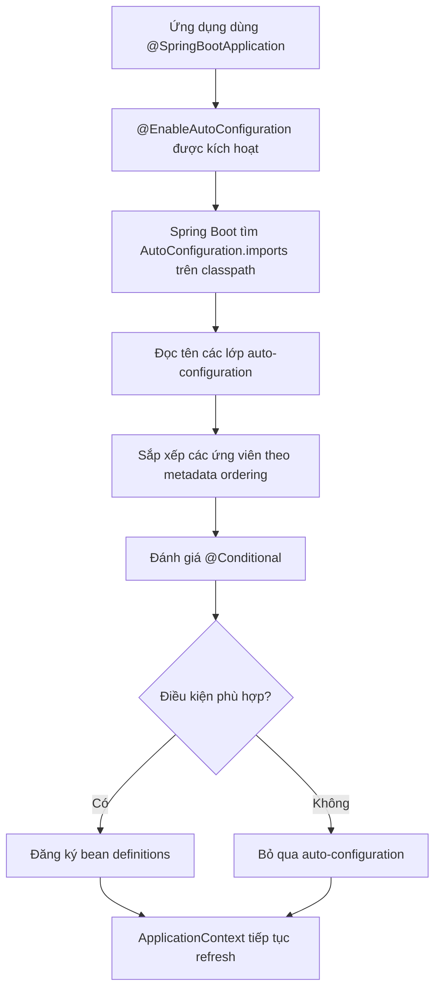

# Đăng ký auto-configuration qua AutoConfiguration.imports

Một thư viện Spring Boot có thể cung cấp các bean mặc định để ứng dụng sử dụng ngay khi thêm dependency. Ví dụ, thư viện client có thể tự tạo `AcmeClient`, bộ cấu hình timeout và health indicator khi dependency tương ứng có mặt. Cơ chế này được gọi là *auto-configuration*.

Spring Boot cần biết những lớp nào là ứng viên auto-configuration trong các JAR trên classpath. Từ Spring Boot 2.7, cách đăng ký chuẩn là khai báo tên lớp trong file:

```text
META-INF/spring/org.springframework.boot.autoconfigure.AutoConfiguration.imports
```

Mỗi dòng chứa tên đầy đủ của một lớp auto-configuration. Khi ứng dụng bật `@EnableAutoConfiguration` hoặc dùng `@SpringBootApplication`, Spring Boot đọc các file này từ những JAR phù hợp, nạp các ứng viên rồi đánh giá điều kiện của chúng.

Bài học thuộc chương **Tùy biến tự động cấu hình** của **SPRING_CLOUD_CORE**. Nội dung tập trung vào định dạng và vị trí file `AutoConfiguration.imports`, cách viết lớp `@AutoConfiguration`, điều kiện tạo bean, thứ tự áp dụng, tương thích với `spring.factories`, kiểm thử và xác minh JAR đã đóng gói.

## 1. Mục tiêu học tập

Sau bài này, bạn có thể:

- Giải thích vì sao một thư viện cần đăng ký auto-configuration.
- Xác định chính xác vị trí và tên file `AutoConfiguration.imports`.
- Viết danh sách fully qualified class name, mỗi lớp một dòng.
- Tạo lớp cấu hình bằng `@AutoConfiguration`.
- Kết hợp `@ConditionalOnClass`, `@ConditionalOnMissingBean` và `@ConditionalOnProperty`.
- Phân biệt đăng ký auto-configuration với component scanning và `@Import`.
- Thiết lập thứ tự bằng `before`, `after`, `@AutoConfigureBefore`, `@AutoConfigureAfter` và `@AutoConfigureOrder`.
- Hiểu sự thay đổi từ `spring.factories` sang `AutoConfiguration.imports` trong Spring Boot 2.7 và 3.x.
- Phân biệt `@ImportAutoConfiguration` với cơ chế khám phá auto-configuration mặc định.
- Kiểm thử bằng `ApplicationContextRunner`.
- Xác minh metadata được đưa vào JAR và xử lý lỗi khi đóng gói nhiều thư viện.

## 2. Auto-configuration được phát hiện như thế nào?

Auto-configuration cho phép Spring Boot cấu hình ứng dụng dựa trên dependency, property và bean đã có. Ứng dụng bật cơ chế này thông qua `@EnableAutoConfiguration`, thường được bao gồm trong `@SpringBootApplication`.

Luồng khái quát:



File `AutoConfiguration.imports` chỉ cung cấp danh sách ứng viên. Nó không trực tiếp tạo bean và cũng không ép mọi cấu hình trong file phải được áp dụng. Các annotation điều kiện quyết định một cấu hình có phù hợp với ứng dụng hiện tại hay không.

### 2.1. Vì sao cần file đăng ký?

Giả sử một thư viện cung cấp:

```text
com.example.acme.autoconfigure.AcmeAutoConfiguration
```

Nếu lớp này chỉ có `@Configuration`, Spring Boot không tự động tìm thấy nó từ mọi dependency JAR. Ứng dụng có thể phải `@Import` thủ công hoặc component-scan package chứa lớp đó.

File `AutoConfiguration.imports` giải quyết việc công bố ứng viên cho Spring Boot. Người dùng chỉ cần thêm dependency tương ứng và bật auto-configuration của Spring Boot; không phải biết package nội bộ của thư viện.

### 2.2. File nằm trong JAR của thư viện

Một thư viện có thể có cấu trúc:

```text
acme-spring-boot-autoconfigure/
└── src/
    └── main/
        ├── java/
        │   └── com/example/acme/autoconfigure/
        │       └── AcmeAutoConfiguration.java
        └── resources/
            └── META-INF/
                └── spring/
                    └── org.springframework.boot.autoconfigure.AutoConfiguration.imports
```

File này phải được đóng gói vào JAR phát hành. Khi ứng dụng tiêu thụ JAR, Spring Boot mới có thể tìm thấy resource trên classpath.

## 3. Đường dẫn và định dạng AutoConfiguration.imports

Đường dẫn đầy đủ trong source resource là:

```text
src/main/resources/META-INF/spring/org.springframework.boot.autoconfigure.AutoConfiguration.imports
```

Sau khi build, đường dẫn bên trong JAR là:

```text
META-INF/spring/org.springframework.boot.autoconfigure.AutoConfiguration.imports
```

Tên file phải chính xác. Không thêm đuôi `.txt`, không đổi tên class key và không đặt file ở thư mục gốc `META-INF` thay vì `META-INF/spring`.

### 3.1. Mỗi dòng là một fully qualified class name

Ví dụ nội dung:

```text
com.example.acme.autoconfigure.AcmeAutoConfiguration
com.example.acme.autoconfigure.AcmeWebAutoConfiguration
com.example.acme.autoconfigure.AcmeMetricsAutoConfiguration
```

Mỗi dòng khai báo một lớp. Dùng tên đầy đủ gồm package và class name; không ghi `.class`.

Ví dụ sai:

```text
AcmeAutoConfiguration
com.example.acme.autoconfigure.AcmeAutoConfiguration.class
```

Ví dụ đúng:

```text
com.example.acme.autoconfigure.AcmeAutoConfiguration
```

### 3.2. Có thể thêm comment

Dòng bắt đầu bằng `#` được dùng làm comment:

```text
# Core client configuration
com.example.acme.autoconfigure.AcmeAutoConfiguration

# Optional web integration
com.example.acme.autoconfigure.AcmeWebAutoConfiguration
```

Comment giúp người duy trì hiểu mục đích của từng nhóm cấu hình. Không đặt comment ở cuối một tên lớp nếu chưa xác minh parser của phiên bản đang dùng hỗ trợ định dạng đó; cách rõ ràng là để comment trên dòng riêng.

### 3.3. Lớp lồng nhau

Thông thường, auto-configuration nên là top-level class. Trong trường hợp hiếm khi cần liệt kê một lớp lồng nhau trực tiếp, dùng dấu `$` để phân tách tên lớp ngoài và lớp trong:

```text
com.example.acme.autoconfigure.AcmeConfigurations$WebAutoConfiguration
```

Không dùng dấu `.` thay cho `$` trong tên nhị phân của nested class.

### 3.4. Không khai báo trùng lặp

Mỗi auto-configuration nên xuất hiện một lần trong file. Tránh sao chép cùng một class vào nhiều dòng hoặc nhiều resource do build/shading tạo ra. Nếu một thư viện được đóng gói lại cùng resource từ nhiều dependency, cần kiểm tra cách công cụ đóng gói hợp nhất file thay vì giả định các bản ghi sẽ tự được xử lý như mong muốn.

## 4. Viết lớp @AutoConfiguration

Spring Boot cung cấp annotation `@AutoConfiguration` từ phiên bản 2.7. Annotation này là một dạng `@Configuration` chuyên biệt cho auto-configuration và luôn dùng `proxyBeanMethods = false`.

Ví dụ tối thiểu:

```java
package com.example.acme.autoconfigure;

import org.springframework.boot.autoconfigure.AutoConfiguration;
import org.springframework.context.annotation.Bean;

@AutoConfiguration
public class AcmeAutoConfiguration {

    @Bean
    AcmeClient acmeClient() {
        return new AcmeClient();
    }
}
```

Lớp này phải được liệt kê trong `AutoConfiguration.imports`:

```text
com.example.acme.autoconfigure.AcmeAutoConfiguration
```

### 4.1. @AutoConfiguration và @Configuration

| Annotation | Vai trò |
| --- | --- |
| `@Configuration` | Khai báo lớp cấu hình Spring thông thường |
| `@AutoConfiguration` | Khai báo lớp cấu hình được thiết kế để Spring Boot tự động áp dụng |

`@AutoConfiguration` được meta-annotated với `@Configuration(proxyBeanMethods = false)`. Vì vậy, các phương thức `@Bean` không được proxy để hỗ trợ gọi chéo giữa các phương thức như chế độ full `@Configuration`.

Thiết kế auto-configuration nên ưu tiên method parameter injection:

```java
@AutoConfiguration
public class AcmeAutoConfiguration {

    @Bean
    AcmeClient acmeClient(AcmeProperties properties) {
        return new AcmeClient(properties.endpoint());
    }

    @Bean
    AcmeHealthIndicator acmeHealthIndicator(AcmeClient acmeClient) {
        return new AcmeHealthIndicator(acmeClient);
    }
}
```

Cách này thể hiện dependency qua tham số, phù hợp với `proxyBeanMethods = false`.

### 4.2. Có thể dùng @Configuration không?

Một lớp `@Configuration` vẫn là cấu hình Spring hợp lệ, nhưng với lớp auto-configuration được đăng ký qua file imports, nên dùng `@AutoConfiguration` trên top-level class. Các lớp cấu hình lồng bên trong hoặc được import bởi auto-configuration vẫn có thể dùng `@Configuration(proxyBeanMethods = false)`.

### 4.3. Không đưa lớp auto-configuration vào component scan

Spring Boot khuyến nghị auto-configuration chỉ được nạp thông qua file imports. Đặt các lớp này trong package riêng, không để chúng trở thành mục tiêu của component scanning thông thường.

Cũng không nên bật `@ComponentScan` từ auto-configuration để tìm thêm component. Hãy dùng `@Import` cho các cấu hình cụ thể hoặc khai báo bean tường minh.

Lý do: component scan khiến cấu hình có thể được nạp theo một đường khác với cơ chế auto-configuration, làm điều kiện, thứ tự và hành vi loại trừ khó dự đoán.

## 5. Ví dụ hoàn chỉnh: AcmeAutoConfiguration

Giả sử thư viện Acme cung cấp client kết nối tới một dịch vụ ngoài. Auto-configuration chỉ nên tạo client khi thư viện client có trên classpath và người dùng chưa tự khai báo bean.

### 5.1. Lớp properties

```java
package com.example.acme.autoconfigure;

import org.springframework.boot.context.properties.ConfigurationProperties;

@ConfigurationProperties("acme.client")
public class AcmeProperties {

    private String endpoint = "https://acme.internal";
    private int connectTimeoutMillis = 2000;

    public String getEndpoint() {
        return endpoint;
    }

    public void setEndpoint(String endpoint) {
        this.endpoint = endpoint;
    }

    public int getConnectTimeoutMillis() {
        return connectTimeoutMillis;
    }

    public void setConnectTimeoutMillis(int connectTimeoutMillis) {
        this.connectTimeoutMillis = connectTimeoutMillis;
    }
}
```

### 5.2. Auto-configuration

```java
package com.example.acme.autoconfigure;

import com.example.acme.client.AcmeClient;
import org.springframework.boot.autoconfigure.AutoConfiguration;
import org.springframework.boot.autoconfigure.condition.ConditionalOnClass;
import org.springframework.boot.autoconfigure.condition.ConditionalOnMissingBean;
import org.springframework.boot.context.properties.EnableConfigurationProperties;
import org.springframework.context.annotation.Bean;

@AutoConfiguration
@ConditionalOnClass(AcmeClient.class)
@EnableConfigurationProperties(AcmeProperties.class)
public class AcmeAutoConfiguration {

    @Bean
    @ConditionalOnMissingBean
    AcmeClient acmeClient(AcmeProperties properties) {
        return new AcmeClient(
                properties.getEndpoint(),
                properties.getConnectTimeoutMillis());
    }
}
```

### 5.3. File imports

```text
com.example.acme.autoconfigure.AcmeAutoConfiguration
```

### 5.4. Cấu hình ứng dụng

```yaml
acme:
  client:
    endpoint: https://acme.prod.internal
    connect-timeout-millis: 3500
```

Khi ứng dụng thêm dependency Acme client và Spring Boot bật auto-configuration:

1. Spring Boot đọc file imports trong JAR.
2. Lớp `AcmeAutoConfiguration` được xem là ứng viên.
3. `@ConditionalOnClass` kiểm tra `AcmeClient` có trên classpath.
4. `AcmeProperties` được đăng ký để bind property.
5. `@ConditionalOnMissingBean` kiểm tra người dùng đã cung cấp `AcmeClient` hay chưa.
6. Nếu không có bean thay thế, bean mặc định được tạo.

## 6. Điều kiện để auto-configuration không xâm lấn

Auto-configuration tốt cần tự lùi lại khi ứng dụng đã cung cấp cấu hình riêng. Các condition annotation thường dùng gồm:

| Annotation | Điều kiện |
| --- | --- |
| `@ConditionalOnClass` | Class cần thiết có trên classpath |
| `@ConditionalOnMissingClass` | Class chỉ định không có trên classpath |
| `@ConditionalOnBean` | Bean phù hợp đã tồn tại |
| `@ConditionalOnMissingBean` | Bean phù hợp chưa tồn tại |
| `@ConditionalOnProperty` | Property thỏa điều kiện |
| `@ConditionalOnResource` | Resource được chỉ định tồn tại |
| `@ConditionalOnWebApplication` | Ứng dụng là web application theo loại được chỉ định |
| `@ConditionalOnNotWebApplication` | Ứng dụng không phải web application |
| `@ConditionalOnExpression` | Biểu thức SpEL trả về true |

### 6.1. ConditionalOnClass

Dùng để chỉ bật cấu hình khi thư viện tùy chọn có mặt:

```java
@AutoConfiguration
@ConditionalOnClass(AcmeClient.class)
public class AcmeAutoConfiguration {
    // ...
}
```

Điều này hữu ích khi auto-configuration JAR không bắt buộc kéo theo mọi dependency tích hợp. Người dùng không dùng Acme client có thể không cần dependency đó.

**Lưu ý với kiểu trả về của @Bean:** nếu class tùy chọn không có trên classpath, một method `@Bean` trả về kiểu đó có thể khiến JVM phải resolve kiểu khi xử lý cấu hình. Đặt `@ConditionalOnClass` trên chính method không phải lúc nào cũng đủ để cách ly việc nạp class.

Nếu cần bảo vệ một kiểu tùy chọn, hãy tách nó vào một nested configuration class có điều kiện ở cấp class:

```java
@AutoConfiguration
public class AcmeAutoConfiguration {

    @Configuration(proxyBeanMethods = false)
    @ConditionalOnClass(AcmeClient.class)
    static class AcmeClientConfiguration {

        @Bean
        @ConditionalOnMissingBean
        AcmeClient acmeClient(AcmeProperties properties) {
            return new AcmeClient(properties.getEndpoint());
        }
    }
}
```

Spring Boot có thể đọc metadata điều kiện của lớp cấu hình trước khi cần xử lý các phương thức bean bên trong. Cách này giúp tránh tham chiếu sớm tới class không tồn tại.

### 6.2. ConditionalOnMissingBean

Đây là điều kiện quan trọng để người dùng thay thế bean mặc định:

```java
@Bean
@ConditionalOnMissingBean(AcmeClient.class)
AcmeClient acmeClient(AcmeProperties properties) {
    return new AcmeClient(properties.getEndpoint());
}
```

Nếu ứng dụng đã khai báo `AcmeClient` riêng, bean mặc định không được tạo.

Ví dụ cấu hình thay thế từ ứng dụng:

```java
@Configuration(proxyBeanMethods = false)
public class CustomAcmeConfiguration {

    @Bean
    AcmeClient customAcmeClient() {
        return new AcmeClient("https://custom-acme.internal");
    }
}
```

Khi bean người dùng được đăng ký trước khi auto-configuration được xử lý, `@ConditionalOnMissingBean` cho phép auto-configuration lùi lại.

### 6.3. ConditionalOnProperty

Có thể cho phép người dùng bật/tắt một tính năng:

```java
@Bean
@ConditionalOnProperty(
        prefix = "acme.client",
        name = "enabled",
        havingValue = "true",
        matchIfMissing = true)
AcmeClient acmeClient(AcmeProperties properties) {
    return new AcmeClient(properties.getEndpoint());
}
```

Cấu hình:

```yaml
acme:
  client:
    enabled: false
```

Khi `enabled=false`, bean không được tạo. `matchIfMissing=true` có nghĩa property không được khai báo vẫn được coi là phù hợp trong ví dụ này.

### 6.4. ConditionalOnBean

Dùng khi một bean chỉ có ý nghĩa nếu dependency khác đã tồn tại:

```java
@Bean
@ConditionalOnBean(AcmeClient.class)
AcmeHealthIndicator acmeHealthIndicator(AcmeClient client) {
    return new AcmeHealthIndicator(client);
}
```

Điều kiện bean phụ thuộc vào thứ tự bean definitions đã được xử lý. Spring Boot khuyến nghị dùng `@ConditionalOnBean` và `@ConditionalOnMissingBean` chủ yếu trong auto-configuration, vì auto-configuration được áp dụng sau các bean definitions do người dùng khai báo.

### 6.5. Tránh phụ thuộc bean quá sớm trong SpEL

`@ConditionalOnExpression` có thể kiểm tra biểu thức SpEL. Tuy nhiên, tham chiếu một bean trong biểu thức có thể làm bean đó được khởi tạo rất sớm trong quá trình refresh, trước một số post-processing như binding `@ConfigurationProperties`.

Ưu tiên các condition chuyên biệt như `@ConditionalOnClass`, `@ConditionalOnProperty` và `@ConditionalOnMissingBean` khi chúng biểu đạt được yêu cầu.

## 7. Đăng ký nhiều auto-configuration

Một thư viện có thể cung cấp nhiều nhóm tích hợp:
- Core client.
- Web MVC integration.
- WebFlux integration.
- Metrics.
- Health indicator.
- Discovery integration.

Có thể khai báo nhiều lớp trong cùng file:

```text
com.example.acme.autoconfigure.AcmeCoreAutoConfiguration
com.example.acme.autoconfigure.AcmeWebMvcAutoConfiguration
com.example.acme.autoconfigure.AcmeWebFluxAutoConfiguration
com.example.acme.autoconfigure.AcmeMetricsAutoConfiguration
```

Mỗi lớp nên có trách nhiệm rõ ràng và condition phù hợp.

Ví dụ, cấu hình MVC có thể chỉ áp dụng khi ứng dụng là servlet web application và thư viện MVC có mặt:

```java
@AutoConfiguration
@ConditionalOnWebApplication(type = ConditionalOnWebApplication.Type.SERVLET)
@ConditionalOnClass(name = "org.springframework.web.servlet.DispatcherServlet")
public class AcmeWebMvcAutoConfiguration {
    // MVC-specific beans
}
```

Cấu hình WebFlux có thể được tách riêng để tránh kéo dependency không cần thiết vào ứng dụng servlet.

## 8. Thứ tự áp dụng auto-configuration

Khi một auto-configuration cần dựa trên bean definitions từ một auto-configuration khác, có thể khai báo quan hệ thứ tự.

`@AutoConfiguration` hỗ trợ:

- `before`
- `beforeName`
- `after`
- `afterName`

Ví dụ:

```java
@AutoConfiguration(after = DataSourceAutoConfiguration.class)
public class AcmeDatabaseAutoConfiguration {
    // ...
}
```

Nếu không muốn phụ thuộc trực tiếp vào class của auto-configuration khác, có thể dùng tên:

```java
@AutoConfiguration(
        afterName = "org.springframework.boot.autoconfigure.jdbc.DataSourceAutoConfiguration")
public class AcmeDatabaseAutoConfiguration {
    // ...
}
```

Hoặc dùng annotation riêng:

```java
@AutoConfigureAfter(DataSourceAutoConfiguration.class)
```

```java
@AutoConfigureBefore(SomeOtherAutoConfiguration.class)
```

### 8.1. AutoConfigureOrder

Nếu cần đặt thứ tự tổng quát mà không có quan hệ trực tiếp giữa hai cấu hình, có thể dùng:

```java
@AutoConfiguration
@AutoConfigureOrder(100)
public class AcmeBaseAutoConfiguration {
}
```

`@AutoConfigureOrder` có semantics tương tự `@Order`, nhưng dành riêng cho thứ tự auto-configuration.

### 8.2. Thứ tự cấu hình không phải thứ tự tạo bean

Ordering chỉ ảnh hưởng tới thứ tự các auto-configuration được áp dụng và bean definitions được đăng ký. Nó không bảo đảm bean instance sẽ được khởi tạo theo đúng thứ tự đó.

Việc tạo bean vẫn được quyết định bởi dependency graph, các quan hệ `@DependsOn` và lifecycle của container.

Nếu một bean cần bean khác, hãy thể hiện dependency qua tham số phương thức `@Bean` hoặc constructor injection thay vì dựa vào `@AutoConfigureBefore` để điều khiển thứ tự khởi tạo.

### 8.3. Dùng tên khi dependency là tùy chọn

Nếu auto-configuration A cần chạy sau một cấu hình có thể không có mặt trên classpath, dùng `afterName` giúp tránh compile-time dependency trực tiếp.

Với annotation dùng như meta-annotation, Javadoc của `@AutoConfiguration` khuyến nghị dùng `beforeName` và `afterName` thay vì tham chiếu `Class<?>` có thể không tồn tại.

## 9. Phân biệt AutoConfiguration.imports, @Import và @ImportAutoConfiguration

Ba cơ chế có liên quan nhưng mục đích khác nhau.

| Cơ chế | Mục đích |
| --- | --- |
| `AutoConfiguration.imports` | Công bố các ứng viên để Spring Boot khám phá qua `@EnableAutoConfiguration` |
| `@Import` | Import rõ ràng một cấu hình hoặc selector vào cấu hình hiện tại |
| `@ImportAutoConfiguration` | Import một tập auto-configuration cụ thể theo quy tắc ordering của Spring Boot |

### 9.1. @Import

Ví dụ:

```java
@Configuration(proxyBeanMethods = false)
@Import(AcmeTransportConfiguration.class)
public class AcmeInternalConfiguration {
}
```

`@Import` phù hợp để auto-configuration chính nạp các cấu hình con có liên quan. Nó không thay thế file đăng ký auto-configuration toàn cục.

### 9.2. @ImportAutoConfiguration

Ví dụ:

```java
@ImportAutoConfiguration(AcmeAutoConfiguration.class)
class AcmeIntegrationTestConfiguration {
}
```

Annotation này thường hữu ích trong test hoặc khi cần import có chủ đích một tập auto-configuration. Nó áp dụng quy tắc ordering tương tự `@EnableAutoConfiguration`, nhưng giới hạn trong các lớp được chỉ định thay vì khám phá toàn bộ `ImportCandidates`.

Khi không truyền `classes`, `@ImportAutoConfiguration` có thể đọc file trong `META-INF/spring` có tên dựa trên fully qualified name của class được annotate, với hậu tố `.imports`. File này không phải `org.springframework.boot.autoconfigure.AutoConfiguration.imports`.

Một entry trong file riêng của `@ImportAutoConfiguration` có thể dùng tiền tố `optional:` để bỏ qua class không có trên classpath.

### 9.3. Không nhầm file imports của hai cơ chế

File đăng ký auto-configuration toàn cục:

```text
META-INF/spring/org.springframework.boot.autoconfigure.AutoConfiguration.imports
```

File imports riêng cho một class được annotate bằng `@ImportAutoConfiguration`:

```text
META-INF/spring/com.example.acme.AcmeTestConfiguration.imports
```

Tên file thứ hai phụ thuộc fully qualified name của class được annotate. Không đặt tên tùy ý nếu muốn annotation tự tìm file.

## 10. Tương thích với spring.factories

Trước Spring Boot 2.7, auto-configuration thường được đăng ký trong `META-INF/spring.factories` dưới key:

```properties
org.springframework.boot.autoconfigure.EnableAutoConfiguration=\
com.example.acme.autoconfigure.AcmeAutoConfiguration,\
com.example.acme.autoconfigure.AcmeWebAutoConfiguration
```

Spring Boot 2.7 giới thiệu `AutoConfiguration.imports` và vẫn hỗ trợ ngược các entry cũ trong `spring.factories` cho auto-configuration.

Spring Boot 3 loại bỏ hỗ trợ đăng ký auto-configuration qua key `org.springframework.boot.autoconfigure.EnableAutoConfiguration` trong `spring.factories`. Các key khác của `spring.factories` không bị ảnh hưởng bởi thay đổi này.

### 10.1. Bảng tương thích

| Phiên bản Spring Boot | Cơ chế đăng ký auto-configuration |
| --- | --- |
| 2.6 trở xuống | `spring.factories` với key `EnableAutoConfiguration` |
| 2.7.x | `AutoConfiguration.imports` là cách mới; `spring.factories` cũ vẫn được hỗ trợ để tương thích |
| 3.x và mới hơn | Dùng `AutoConfiguration.imports`; key auto-configuration cũ trong `spring.factories` không còn được hỗ trợ |

### 10.2. Thư viện hỗ trợ cả Boot 2.7 và Boot 3

Trong giai đoạn chuyển đổi, thư viện có thể liệt kê lớp trong cả hai file để hỗ trợ nhiều phiên bản:

`META-INF/spring/org.springframework.boot.autoconfigure.AutoConfiguration.imports`:

```text
com.example.acme.autoconfigure.AcmeAutoConfiguration
```

`META-INF/spring.factories`:

```properties
org.springframework.boot.autoconfigure.EnableAutoConfiguration=\
com.example.acme.autoconfigure.AcmeAutoConfiguration
```

Spring Boot 2.7 hỗ trợ cả hai nơi và loại bỏ entry trùng lặp. Spring Boot 3 sử dụng file imports mới.

Nếu cần hỗ trợ cả Spring Boot 2.6 trở xuống, cần kiểm tra thêm khả năng tương thích binary của chính class auto-configuration. Chỉ thêm hai file metadata không bảo đảm annotation/API mới như `@AutoConfiguration` có sẵn trong runtime cũ. Hãy xác định baseline Boot thấp nhất và chọn annotation/API tương thích với baseline đó.

### 10.3. spring.factories vẫn còn vai trò khác

Không nên xóa toàn bộ `spring.factories` chỉ vì auto-configuration đã chuyển sang file imports. File này vẫn có thể chứa các extension point khác, ví dụ `ApplicationListener`, `EnvironmentPostProcessor` hoặc một số factory được Spring Boot hỗ trợ.

Chỉ di chuyển entry auto-configuration có key `EnableAutoConfiguration`; không tự động chuyển hoặc xóa các key khác.

## 11. Đóng gói và phân phối file imports

Trong dự án Maven hoặc Gradle thông thường, resource nằm dưới `src/main/resources` sẽ được copy vào output và đóng gói trong JAR.

Cấu trúc nguồn:

```text
src/main/resources/
└── META-INF/
    └── spring/
        └── org.springframework.boot.autoconfigure.AutoConfiguration.imports
```

Sau khi build, JAR phải chứa:

```text
META-INF/spring/org.springframework.boot.autoconfigure.AutoConfiguration.imports
```

### 11.1. Kiểm tra JAR

Có thể dùng lệnh:

```bash
jar tf acme-spring-boot-autoconfigure.jar
```

Tìm đúng resource:

```text
META-INF/spring/org.springframework.boot.autoconfigure.AutoConfiguration.imports
```

Đọc nội dung file từ JAR:

```bash
unzip -p acme-spring-boot-autoconfigure.jar \
  META-INF/spring/org.springframework.boot.autoconfigure.AutoConfiguration.imports
```

Nếu resource không có trong JAR, Spring Boot không thể khám phá auto-configuration qua file đó, dù class Java vẫn tồn tại.

### 11.2. Khi dùng Maven Shade Plugin

Nếu dùng Maven Shade Plugin để tạo một JAR hợp nhất từ nhiều dependency, nhiều dependency có thể cùng chứa file `AutoConfiguration.imports`. Nếu resource bị ghi đè thay vì nối nội dung, một số auto-configuration sẽ biến mất.

Cần cấu hình transformer để append resource:

```xml
<transformer implementation=
    "org.apache.maven.plugins.shade.resource.AppendingTransformer">
    <resource>
        META-INF/spring/org.springframework.boot.autoconfigure.AutoConfiguration.imports
    </resource>
</transformer>
```

### 11.3. Khi dùng Gradle Shadow Plugin

Với Gradle Shadow Plugin, cần append file imports khi hợp nhất:

```kotlin
tasks.shadowJar {
    append(
        "META-INF/spring/org.springframework.boot.autoconfigure.AutoConfiguration.imports"
    )
}
```

Cú pháp chính xác có thể khác theo phiên bản Shadow Plugin; hãy kiểm tra cấu hình plugin đang dùng. Sau khi đóng gói, vẫn cần kiểm tra nội dung resource trong JAR cuối cùng.

### 11.4. Không kiểm tra chỉ trên IDE classpath

IDE có thể chạy ứng dụng trực tiếp từ thư mục classes/resources. Trường hợp này không chứng minh JAR phát hành có metadata chính xác.

Hãy kiểm tra artifact thực tế được publish hoặc JAR hợp nhất cuối cùng. Nếu có nhiều module, xác minh dependency chứa auto-configuration đã được kéo vào ứng dụng consumer.

## 12. AutoConfiguration.replacements khi đổi tên class

Auto-configuration class có thể được tham chiếu trong:
- `before` / `after`.
- `exclude` và `excludeName`.
- Các cấu hình hoặc thư viện bên ngoài dựa vào tên class.

Nếu đổi package hoặc tên class, có thể khai báo file:

```text
META-INF/spring/org.springframework.boot.autoconfigure.AutoConfiguration.replacements
```

Ví dụ nội dung:

```text
com.example.acme.autoconfigure.AcmeAutoConfiguration=com.example.acme.autoconfigure.core.AcmeAutoConfiguration
```

File này ánh xạ tên cũ sang tên mới để Spring Boot xử lý các tham chiếu cũ trong ordering và exclusions.

Khi thay thế class:

1. Cập nhật `AutoConfiguration.imports` để chỉ liệt kê class mới.
2. Thêm mapping cũ sang mới trong `AutoConfiguration.replacements`.
3. Giữ tương thích API công khai theo chính sách versioning của thư viện.
4. Kiểm thử exclusion và ordering từ ứng dụng tiêu thụ.

Không giữ cả hai class cũ và mới trong imports nếu chúng cùng tạo một tập bean, trừ khi có lý do và điều kiện loại trừ rõ ràng.

## 13. Kiểm thử auto-configuration bằng ApplicationContextRunner

`ApplicationContextRunner` cho phép dựng một context nhỏ với tổ hợp dependency, property và user configuration cụ thể. Đây là cách phù hợp để kiểm thử auto-configuration mà không cần khởi động toàn bộ ứng dụng.

Ví dụ khung test:

```java
import org.junit.jupiter.api.Test;
import org.springframework.boot.autoconfigure.AutoConfigurations;
import org.springframework.boot.test.context.runner.ApplicationContextRunner;

import static org.assertj.core.api.Assertions.assertThat;

class AcmeAutoConfigurationTests {

    private final ApplicationContextRunner contextRunner =
            new ApplicationContextRunner()
                    .withConfiguration(
                            AutoConfigurations.of(AcmeAutoConfiguration.class));

    @Test
    void createsDefaultClient() {
        this.contextRunner.run(context -> {
            assertThat(context).hasSingleBean(AcmeClient.class);
        });
    }
}
```

`AutoConfigurations.of(...)` đăng ký trực tiếp class được kiểm thử. Test này tập trung vào điều kiện và bean behavior; nó **không chứng minh** file `AutoConfiguration.imports` đã được đóng gói hoặc được Spring Boot khám phá.

### 13.1. Kiểm thử user bean thay thế

```java
@Configuration(proxyBeanMethods = false)
static class UserConfiguration {

    @Bean
    AcmeClient customAcmeClient() {
        return new AcmeClient("https://custom.internal");
    }
}

@Test
void backsOffWhenUserProvidesClient() {
    this.contextRunner
            .withUserConfiguration(UserConfiguration.class)
            .run(context -> {
                assertThat(context).hasSingleBean(AcmeClient.class);
                assertThat(context.getBean(AcmeClient.class).endpoint())
                        .isEqualTo("https://custom.internal");
            });
}
```

Test này xác minh `@ConditionalOnMissingBean` cho phép ứng dụng thay thế default.

### 13.2. Kiểm thử property condition

```java
@Test
void doesNotCreateClientWhenDisabled() {
    this.contextRunner
            .withPropertyValues("acme.client.enabled=false")
            .run(context -> {
                assertThat(context).doesNotHaveBean(AcmeClient.class);
            });
}
```

Test nên bao gồm cả trường hợp property bị thiếu, `true`, `false` và các giá trị không hợp lệ theo chính sách cấu hình.

### 13.3. Kiểm thử classpath condition

Dùng `FilteredClassLoader` để mô phỏng dependency không có trên classpath:

```java
@Test
void backsOffWhenClientLibraryIsMissing() {
    this.contextRunner
            .withClassLoader(new FilteredClassLoader(AcmeClient.class))
            .run(context -> {
                assertThat(context).doesNotHaveBean(AcmeClient.class);
            });
}
```

Test này xác minh cấu hình được bỏ qua khi class tùy chọn không có. Nếu auto-configuration có nhiều lớp con, cần kiểm tra từng nhánh condition.

### 13.4. Kiểm thử web context

Nếu auto-configuration chỉ hoạt động trong ứng dụng servlet hoặc reactive, dùng `WebApplicationContextRunner` hoặc `ReactiveWebApplicationContextRunner` tương ứng để dựng đúng loại context.

Không dùng một context non-web để kết luận cấu hình web hoạt động đúng.

## 14. Kiểm thử file imports thực tế

Ngoài unit test cho điều kiện, thư viện nên có kiểm tra packaging/discovery.

Các bước:
1. Build JAR của module auto-configuration.
2. Kiểm tra resource `META-INF/spring/org.springframework.boot.autoconfigure.AutoConfiguration.imports` có trong JAR.
3. Xác minh nội dung resource có đúng fully qualified class name.
4. Dùng JAR như dependency của một ứng dụng consumer test.
5. Khởi động consumer với `@SpringBootApplication` mà không `@Import` thủ công auto-configuration.
6. Xác minh bean được tạo khi điều kiện phù hợp.
7. Thử loại dependency hoặc thêm bean tùy chỉnh để xác minh back-off.

Ví dụ ứng dụng consumer:

```java
@SpringBootApplication
public class AcmeConsumerApplication {

    public static void main(String[] args) {
        SpringApplication.run(AcmeConsumerApplication.class, args);
    }
}
```

Consumer không cần biết tên `AcmeAutoConfiguration`. Nếu bean vẫn xuất hiện khi chỉ thêm JAR và bật auto-configuration, cơ chế discovery đã hoạt động.

## 15. Chẩn đoán lỗi thường gặp

| Triệu chứng | Nguyên nhân có thể | Cách xử lý |
| --- | --- | --- |
| Auto-configuration không được phát hiện | Sai tên hoặc sai vị trí file imports | Kiểm tra đường dẫn trong JAR |
| Class có trong JAR nhưng bean không xuất hiện | Condition không khớp | Kiểm tra classpath, property và bean condition |
| Hoạt động trong IDE nhưng không hoạt động sau publish | Resource không được đóng gói hoặc bị ghi đè | Kiểm tra JAR phát hành |
| Một số auto-configuration biến mất sau shading | File imports bị ghi đè khi hợp nhất JAR | Dùng transformer/append resource |
| Bean mặc định ghi đè bean người dùng | Thiếu hoặc sai `@ConditionalOnMissingBean` | Thêm condition và kiểm thử back-off |
| NoClassDefFoundError với dependency tùy chọn | Kiểu tùy chọn bị tham chiếu quá sớm | Cô lập bằng nested configuration có `@ConditionalOnClass` |
| Auto-configuration chạy hai lần | Class được nạp qua imports và component scan/import thủ công | Chỉ đăng ký theo cơ chế auto-configuration chuẩn |
| `@AutoConfiguration` không resolve khi dùng Boot cũ | Annotation chưa có trong baseline runtime | Chọn API tương thích với phiên bản Boot tối thiểu |
| Ordering không như mong muốn | Dùng nhầm `@Order` hoặc kỳ vọng thứ tự tạo bean | Dùng auto-configuration ordering và kiểm tra dependency graph |
| Boot 3 bỏ qua entry cũ | Đăng ký chỉ nằm trong `spring.factories` key cũ | Chuyển sang `AutoConfiguration.imports` |
| `ApplicationContextRunner` pass nhưng ứng dụng không tự cấu hình | Test import class trực tiếp, không test discovery file | Thêm consumer/packaging integration test |
| Nested class không được tìm thấy | Sai tên nhị phân của nested class | Dùng `$` khi liệt kê nested class trực tiếp |

### 15.1. Dùng debug để xem condition report

Có thể chạy ứng dụng với:

```bash
java -jar app.jar --debug
```

Spring Boot sẽ ghi condition evaluation report, giúp xác định:
- Auto-configuration nào được áp dụng.
- Auto-configuration nào bị bỏ qua.
- Condition nào không khớp.
- Bean nào đã tồn tại khiến cấu hình mặc định lùi lại.

Khi cần xem chi tiết hơn, kiểm tra log của `ConditionEvaluationReport` và bật mức log phù hợp cho package auto-configuration.

### 15.2. Kiểm tra class name trong file

Đối chiếu ba điểm:
- Package khai báo trong source Java.
- Tên class đã compile.
- Fully qualified name trong imports file.

Một ký tự sai trong package hoặc class name cũng đủ làm candidate không được nạp như mong muốn.

## 16. Thiết kế module autoconfigure và starter

Một thư viện có thể tách thành hai module:

```text
acme-spring-boot/
    API và implementation
    AutoConfiguration.imports
    ConfigurationProperties

acme-spring-boot-starter/
    Dependency tới acme-spring-boot
    Các dependency tích hợp thường dùng
```

Module autoconfigure chứa:
- Lớp auto-configuration.
- API và integration code.
- `@ConfigurationProperties`.
- File `AutoConfiguration.imports`.
- Condition và bean factory methods.

Module starter thường là JAR nhỏ tập hợp các dependency cần thiết để người dùng thêm một dependency là đủ.

Tách module không bắt buộc. Nếu thư viện đơn giản và không có nhiều tích hợp tùy chọn, có thể gộp auto-configuration và starter vào một module.

### 16.1. Dependency tùy chọn

Nếu một tính năng chỉ cần khi thư viện ngoài có mặt, hãy thiết kế dependency và condition để ứng dụng không sử dụng tính năng đó không phải kéo theo toàn bộ thư viện tùy chọn.

Đánh dấu dependency phù hợp là optional trong module autoconfigure và dùng `@ConditionalOnClass` để chỉ bật bean khi thư viện có mặt.

### 16.2. Namespace property riêng

Dùng prefix thuộc quyền sở hữu của thư viện, ví dụ:

```yaml
acme:
  client:
    endpoint: https://acme.internal
    connect-timeout: 2s
```

Tránh đặt property riêng của thư viện vào namespace chung như `spring`, `server` hoặc `management`. Tên namespace riêng giúp giảm xung đột và làm rõ trách nhiệm cấu hình.

### 16.3. Metadata cho IDE

Nếu thư viện cung cấp `@ConfigurationProperties`, nên thêm mô tả cho từng property và cấu hình annotation processor `spring-boot-autoconfigure-processor` phù hợp với build tool. Metadata được sinh ra giúp IDE hỗ trợ autocomplete và documentation.

Metadata cấu hình này khác với `AutoConfiguration.imports`:
- `AutoConfiguration.imports` đăng ký class auto-configuration.
- `spring-configuration-metadata.json` mô tả property cho IDE và tooling.

## 17. Quy trình tạo và phát hành auto-configuration

Có thể triển khai theo quy trình:

1. Tạo package riêng cho auto-configuration.
2. Viết lớp top-level bằng `@AutoConfiguration`.
3. Khai báo các bean mặc định bằng method injection.
4. Bổ sung condition cho classpath, property và user bean.
5. Tách nested configuration cho dependency tùy chọn nếu cần.
6. Đăng ký lớp trong `META-INF/spring/org.springframework.boot.autoconfigure.AutoConfiguration.imports`.
7. Đặt ordering nếu có quan hệ thực sự với auto-configuration khác.
8. Viết `ApplicationContextRunner` tests cho các condition chính.
9. Build JAR và kiểm tra resource imports.
10. Chạy consumer test chỉ thêm dependency, không import class thủ công.
11. Kiểm tra artifact sau shading/repackaging nếu có.
12. Phát hành module autoconfigure và starter theo version compatibility đã công bố.

## 18. Nguyên tắc thiết kế

- Dùng đúng đường dẫn `META-INF/spring/org.springframework.boot.autoconfigure.AutoConfiguration.imports`.
- Ghi fully qualified class name, mỗi dòng một lớp.
- Dùng `@AutoConfiguration` cho top-level auto-configuration trên Spring Boot 2.7 trở lên.
- Không dựa vào component scan để phát hiện auto-configuration.
- Dùng `@Import` cho cấu hình con cần thiết.
- Dùng `@ConditionalOnClass` cho dependency tùy chọn.
- Dùng `@ConditionalOnMissingBean` để người dùng thay thế bean mặc định.
- Dùng `@ConditionalOnProperty` cho tính năng có thể bật/tắt.
- Tách nested configuration khi cần tránh nạp kiểu tùy chọn quá sớm.
- Dùng `before`/`after` hoặc `@AutoConfigureOrder` khi có yêu cầu ordering thực sự.
- Không nhầm thứ tự đăng ký bean definition với thứ tự khởi tạo bean instance.
- Di chuyển key `EnableAutoConfiguration` khỏi `spring.factories` khi hỗ trợ Boot 3.
- Không xóa các key `spring.factories` khác còn được sử dụng.
- Kiểm tra resource trong JAR cuối cùng, nhất là khi shading.
- Dùng `ApplicationContextRunner` cho điều kiện và consumer test cho discovery.
- Giữ namespace property riêng và tài liệu hóa cấu hình.

## 19. Tổng kết

`AutoConfiguration.imports` là cơ chế chuẩn để Spring Boot khám phá auto-configuration trong các dependency JAR. File nằm tại `META-INF/spring/org.springframework.boot.autoconfigure.AutoConfiguration.imports` và liệt kê fully qualified class name, mỗi lớp một dòng.

Các lớp được liệt kê thường dùng `@AutoConfiguration`, kết hợp condition để chỉ tạo bean khi dependency phù hợp và người dùng chưa cung cấp bean thay thế. `before`/`after` và `@AutoConfigureOrder` điều khiển thứ tự áp dụng auto-configuration, còn dependency graph quyết định thứ tự khởi tạo bean thực tế.

Spring Boot 2.7 giới thiệu file imports mới và duy trì tương thích với entry cũ trong `spring.factories`; Spring Boot 3 loại bỏ key auto-configuration cũ nhưng vẫn giữ các key `spring.factories` khác. Để bảo đảm thư viện hoạt động sau khi phát hành, cần kiểm tra file trong JAR, xử lý resource khi shading và có consumer test xác minh Spring Boot tự khám phá cấu hình mà không cần import thủ công.

## 20. Tài liệu tham khảo

- [Spring Boot Reference — Creating Your Own Auto-configuration](https://docs.spring.io/spring-boot/reference/features/developing-auto-configuration.html)
- [Spring Boot API — AutoConfiguration](https://docs.spring.io/spring-boot/api/java/org/springframework/boot/autoconfigure/AutoConfiguration.html)
- [Spring Boot API — ImportAutoConfiguration](https://docs.spring.io/spring-boot/api/java/org/springframework/boot/autoconfigure/ImportAutoConfiguration.html)
- [Spring Boot Reference — Auto-configuration](https://docs.spring.io/spring-boot/reference/using/auto-configuration.html)
- [Spring Boot 2.7 Release Notes — Auto-configuration Registration](https://github.com/spring-projects/spring-boot/wiki/Spring-Boot-2.7-Release-Notes)
- [Spring Boot 3.0 Migration Guide — Auto-configuration Files](https://github.com/spring-projects/spring-boot/wiki/Spring-Boot-3.0-Migration-Guide)

