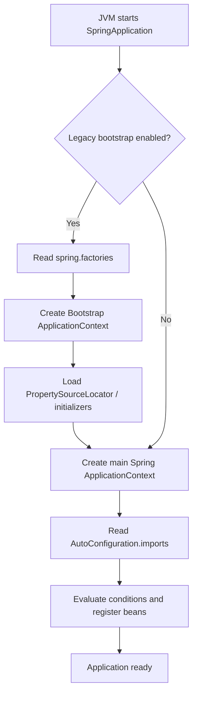

# Phân biệt AutoConfiguration.imports với BootstrapConfiguration trong spring.factories

## 1. Vì sao có hai cơ chế đăng ký?

Trong một ứng dụng Spring Cloud, có những cấu hình cần được nạp cùng ApplicationContext chính của Spring Boot, nhưng cũng có cấu hình phải tham gia vào giai đoạn bootstrap sớm hơn để chuẩn bị Environment hoặc khởi tạo nguồn cấu hình bên ngoài.

Hai cơ chế thường gặp có tên khá giống nhau:

- `META-INF/spring/org.springframework.boot.autoconfigure.AutoConfiguration.imports`: danh sách auto-configuration class mà Spring Boot đọc để cấu hình ApplicationContext chính.
- `META-INF/spring.factories` với key `org.springframework.cloud.bootstrap.BootstrapConfiguration`: danh sách cấu hình mà Spring Cloud dùng để tạo Bootstrap ApplicationContext trong cơ chế bootstrap legacy.

Điểm dễ nhầm là cả hai đều đăng ký các lớp cấu hình trong JAR, nhưng chúng được đọc bởi các cơ chế khác nhau, ở những thời điểm khác nhau và phục vụ những mục đích khác nhau. `AutoConfiguration.imports` không thay thế toàn bộ `spring.factories`; nó chỉ là cơ chế đăng ký auto-configuration của Spring Boot hiện hành.

Sau bài học, người đọc có thể:

- Chọn đúng file metadata cho auto-configuration và bootstrap configuration.
- Giải thích thời điểm mỗi loại cấu hình được nạp trong vòng đời khởi động.
- Đăng ký một auto-configuration trong JAR bằng `AutoConfiguration.imports`.
- Đăng ký `BootstrapConfiguration` trong `spring.factories` và bật bootstrap legacy.
- Phân biệt bootstrap legacy với Spring Boot Config Data qua `spring.config.import`.
- Kiểm tra JAR đã đóng gói và thiết kế test phù hợp cho từng cơ chế.

## 2. Hai cơ chế phục vụ hai giai đoạn khác nhau

### 2.1. AutoConfiguration.imports

`AutoConfiguration.imports` thuộc Spring Boot. Khi ứng dụng bật auto-configuration thông qua `@EnableAutoConfiguration` hoặc `@SpringBootApplication`, Spring Boot tìm các resource có đường dẫn:

`META-INF/spring/org.springframework.boot.autoconfigure.AutoConfiguration.imports`

Mỗi dòng trong file là tên đầy đủ của một lớp auto-configuration. Spring Boot đưa các lớp này vào quy trình đánh giá điều kiện và đăng ký bean trong ApplicationContext chính.

Auto-configuration thường được đánh dấu bằng `@AutoConfiguration`, đồng thời dùng các điều kiện như `@ConditionalOnClass`, `@ConditionalOnProperty` và `@ConditionalOnMissingBean` để chỉ cấu hình khi dependency phù hợp có mặt và ứng dụng chưa cung cấp bean thay thế.

Ví dụ:

```text
com.example.inventory.autoconfigure.InventoryAutoConfiguration
com.example.inventory.autoconfigure.InventoryWebAutoConfiguration
```

File này không có key dạng `key=value`. Nó chỉ là danh sách tên lớp, mỗi dòng một lớp. Có thể dùng dòng bắt đầu bằng `#` để ghi chú.

### 2.2. BootstrapConfiguration

`BootstrapConfiguration` thuộc Spring Cloud và chỉ được dùng khi cơ chế bootstrap legacy được bật. Spring Cloud tìm file:

`META-INF/spring.factories`

và đọc key:

`org.springframework.cloud.bootstrap.BootstrapConfiguration`

Giá trị của key là danh sách phân tách bằng dấu phẩy, gồm các lớp `@Configuration` được dùng để tạo Bootstrap ApplicationContext.

Ví dụ:

```properties
org.springframework.cloud.bootstrap.BootstrapConfiguration=\
com.example.bootstrap.InventoryBootstrapConfiguration,\
com.example.bootstrap.RemotePropertySourceBootstrapConfiguration
```

Bootstrap context được tạo làm parent context của ứng dụng chính. Nó thường chứa các thành phần cần chạy sớm như `PropertySourceLocator` hoặc `ApplicationContextInitializer`. Các property source do bootstrap phase nạp có thể được đưa vào Environment trước khi ApplicationContext chính hoàn tất việc cấu hình.

### 2.3. Bảng phân biệt nhanh

| Tiêu chí | AutoConfiguration.imports | BootstrapConfiguration |
| --- | --- | --- |
| Hệ sinh thái | Spring Boot | Spring Cloud |
| File metadata | `META-INF/spring/org.springframework.boot.autoconfigure.AutoConfiguration.imports` | `META-INF/spring.factories` |
| Cơ chế đăng ký | Danh sách tên lớp, một lớp mỗi dòng | Key `org.springframework.cloud.bootstrap.BootstrapConfiguration` với danh sách lớp phân tách bằng dấu phẩy |
| Thời điểm | Giai đoạn Spring Boot xử lý auto-configuration của context ứng dụng | Giai đoạn bootstrap trước khi context ứng dụng chính được tạo |
| Context đích | ApplicationContext chính | Bootstrap ApplicationContext, là parent của context chính |
| Mục đích | Cung cấp bean và tích hợp mặc định cho ứng dụng | Chuẩn bị cấu hình sớm, PropertySource và initializer |
| Kiểu lớp | Thường dùng `@AutoConfiguration` | Dùng `@Configuration` |
| Cơ chế kích hoạt | `@EnableAutoConfiguration` hoặc `@SpringBootApplication` | `spring-cloud-starter-bootstrap` hoặc `spring.cloud.bootstrap.enabled=true` từ system property/environment |
| Ví dụ điển hình | Tạo client, gateway, converter, health indicator mặc định | Tạo `PropertySourceLocator`, nạp nguồn cấu hình trước main context |

## 3. Vòng đời khởi động và vị trí của từng cơ chế

Sơ đồ sau minh họa luồng tổng quát khi ứng dụng sử dụng bootstrap legacy:



Nếu bootstrap legacy không được bật, nhánh đọc `BootstrapConfiguration` không chạy. Spring Boot vẫn có thể đọc `AutoConfiguration.imports` bình thường khi auto-configuration được bật.

### 3.1. Bootstrap context là parent context

Trong mô hình legacy, Spring Cloud tạo Bootstrap ApplicationContext trước context chính. Bootstrap context là parent của context chính; các bean trong parent có thể được tra cứu từ child context theo quy tắc phân cấp ApplicationContext của Spring.

Hai context chia sẻ Environment trong cơ chế bootstrap được mô tả bởi Spring Cloud. Bootstrap context có thể nạp property source từ nguồn bên ngoài và chuyển các initializer sang SpringApplication chính trước khi ứng dụng khởi tạo.

Không nên đồng nhất `bootstrap.yml` với `BootstrapConfiguration`:

- `bootstrap.yml` là file property dùng để cấu hình bootstrap context.
- `BootstrapConfiguration` là lớp Java được đăng ký trong `spring.factories` để tạo bean cho bootstrap context.
- Có thể dùng BootstrapConfiguration mà không cần một `bootstrap.yml` nếu không cần các thuộc tính trong file đó.

### 3.2. Auto-configuration chạy trong context chính

Auto-configuration không phải cơ chế tạo parent context. Nó bổ sung các bean mặc định vào ApplicationContext chính sau khi Spring Boot bật auto-configuration.

Auto-configuration thường được thiết kế để có thể lùi lại khi ứng dụng khai báo bean riêng. Ví dụ, `@ConditionalOnMissingBean` giúp starter cung cấp implementation mặc định nhưng không ghi đè cấu hình do ứng dụng chủ động tạo.

Vì vậy, một `@AutoConfiguration` phù hợp cho việc tạo `InventoryClient`, `InventoryGateway` hoặc `InventoryHealthIndicator` khi ứng dụng cần dùng capability. Nếu cần tải remote property source trước khi main context xử lý cấu hình, đó là bài toán bootstrap hoặc Config Data, không phải mục đích của `AutoConfiguration.imports`.

## 4. Khai báo auto-configuration bằng AutoConfiguration.imports

Giả sử nhóm phát triển tạo một starter cung cấp gateway cho dịch vụ inventory.

### 4.1. Viết lớp auto-configuration

```java
package com.example.inventory.autoconfigure;

import com.example.inventory.client.InventoryClient;
import com.example.inventory.service.InventoryGateway;
import org.springframework.boot.autoconfigure.AutoConfiguration;
import org.springframework.boot.autoconfigure.condition.ConditionalOnBean;
import org.springframework.boot.autoconfigure.condition.ConditionalOnClass;
import org.springframework.boot.autoconfigure.condition.ConditionalOnMissingBean;
import org.springframework.boot.autoconfigure.condition.ConditionalOnProperty;
import org.springframework.context.annotation.Bean;

@AutoConfiguration
@ConditionalOnClass(InventoryClient.class)
@ConditionalOnProperty(
        prefix = "acme.inventory",
        name = "enabled",
        havingValue = "true",
        matchIfMissing = true
)
public class InventoryAutoConfiguration {

    @Bean
    @ConditionalOnBean(InventoryClient.class)
    @ConditionalOnMissingBean
    InventoryGateway inventoryGateway(InventoryClient inventoryClient) {
        return new InventoryGateway(inventoryClient);
    }
}
```

Lớp này chỉ được áp dụng khi `InventoryClient` có trên classpath và property `acme.inventory.enabled` cho phép. Bean mặc định không được tạo nếu ứng dụng đã có bean `InventoryGateway` phù hợp.

### 4.2. Đặt file imports trong resources

Trong module auto-configuration, tạo đúng đường dẫn:

```text
src/main/resources/
└── META-INF/
    └── spring/
        └── org.springframework.boot.autoconfigure.AutoConfiguration.imports
```

Nội dung file:

```text
com.example.inventory.autoconfigure.InventoryAutoConfiguration
```

Khi build JAR, resource phải được đóng gói với đường dẫn tương ứng:

```text
META-INF/spring/org.springframework.boot.autoconfigure.AutoConfiguration.imports
```

Không đặt file này trong `META-INF/spring.factories`. Spring Boot hiện hành tìm auto-configuration candidates từ resource `AutoConfiguration.imports`.

### 4.3. Ordering và component scanning

Nếu auto-configuration cần đứng trước hoặc sau một auto-configuration khác, có thể dùng các thuộc tính `before`, `beforeName`, `after`, `afterName` trên `@AutoConfiguration`, hoặc `@AutoConfigureBefore` và `@AutoConfigureAfter`.

Auto-configuration nên nằm trong package riêng của thư viện và không được vô tình trở thành mục tiêu của component scan từ ứng dụng. Spring Boot yêu cầu auto-configuration được nạp thông qua file imports; không dùng `@ComponentScan` trong auto-configuration để quét thêm toàn bộ package.

## 5. Khai báo BootstrapConfiguration trong spring.factories

Giả sử cần nạp một property source bổ sung trước khi context chính khởi tạo. Có thể cung cấp một `PropertySourceLocator` trong BootstrapConfiguration.

### 5.1. Viết bootstrap configuration

```java
package com.example.inventory.bootstrap;

import java.util.Collections;

import org.springframework.cloud.bootstrap.config.PropertySourceLocator;
import org.springframework.context.annotation.Bean;
import org.springframework.context.annotation.Configuration;
import org.springframework.core.env.Environment;
import org.springframework.core.env.MapPropertySource;
import org.springframework.core.env.PropertySource;

@Configuration(proxyBeanMethods = false)
public class InventoryBootstrapConfiguration {

    @Bean
    PropertySourceLocator inventoryPropertySourceLocator() {
        return new PropertySourceLocator() {
            @Override
            public PropertySource<?> locate(Environment environment) {
                String applicationName =
                        environment.getProperty("spring.application.name", "unknown");

                return new MapPropertySource(
                        "inventoryBootstrap",
                        Collections.<String, Object>singletonMap(
                                "inventory.bootstrap.application",
                                applicationName
                        )
                );
            }
        };
    }
}
```

Ví dụ tạo property source đơn giản để minh họa vị trí hoạt động của `PropertySourceLocator`. Trong hệ thống thật, locator có thể truy vấn một dịch vụ cấu hình hoặc nguồn dữ liệu khác; cần thiết kế timeout, xác thực, retry và xử lý lỗi riêng.

### 5.2. Đăng ký lớp trong spring.factories

Tạo file:

```text
src/main/resources/META-INF/spring.factories
```

Thêm key và tên lớp:

```properties
org.springframework.cloud.bootstrap.BootstrapConfiguration=\
com.example.inventory.bootstrap.InventoryBootstrapConfiguration
```

Spring Cloud dùng danh sách lớp này để tạo bootstrap context. Có thể đăng ký nhiều lớp, phân tách bằng dấu phẩy. Nếu cần điều khiển thứ tự, dùng `@Order`; mặc định thứ tự là cuối cùng.

### 5.3. Bật bootstrap legacy

Từ các thế hệ Spring Boot/Spring Cloud dùng Config Data, bootstrap legacy không còn tự động bật chỉ vì có `spring-cloud-starter-config`. Cần bật rõ ràng bằng một trong hai cách:

- Thêm dependency `org.springframework.cloud:spring-cloud-starter-bootstrap`.
- Đặt `spring.cloud.bootstrap.enabled=true` dưới dạng system property hoặc environment variable trước khi SpringApplication bắt đầu.

Ví dụ chạy JVM:

```bash
java -Dspring.cloud.bootstrap.enabled=true -jar inventory-service.jar
```

Hoặc đặt biến môi trường trước khi chạy:

```bash
SPRING_CLOUD_BOOTSTRAP_ENABLED=true
```

Chỉ ghi `spring.cloud.bootstrap.enabled=true` trong `application.yml` thường là quá muộn để kích hoạt cơ chế tạo bootstrap context, vì chính file application được nạp trong quá trình khởi tạo context chính. Hãy dùng system property, environment variable hoặc bootstrap starter theo hướng dẫn của phiên bản đang dùng.

### 5.4. Cẩn thận với component scan

Spring Cloud khuyến cáo không để các lớp BootstrapConfiguration bị quét nhầm vào ApplicationContext chính. Nên đặt package bootstrap riêng, nằm ngoài phạm vi `@ComponentScan` hoặc package gốc của `@SpringBootApplication`.

Nếu cùng một lớp vừa được component scan trong main context vừa được bootstrap loader tạo trong parent context, ứng dụng có thể xuất hiện hai bean instance ở hai context. Điều này gây nhầm lẫn về lifecycle, dependency và cấu hình.

## 6. spring.factories không biến mất

`spring.factories` là cơ chế đăng ký nhiều loại extension của hệ sinh thái Spring thông qua `SpringFactoriesLoader`. `BootstrapConfiguration` là một trong các key mà Spring Cloud đọc.

Việc Spring Boot chuyển auto-configuration sang `AutoConfiguration.imports` không có nghĩa mọi key trong `spring.factories` đều phải chuyển sang file mới.

| Nội dung đăng ký | Cơ chế |
| --- | --- |
| Spring Boot auto-configuration hiện hành | `AutoConfiguration.imports` |
| Spring Cloud legacy bootstrap configuration | `spring.factories` với key `org.springframework.cloud.bootstrap.BootstrapConfiguration` |
| Một số Spring/Boot factory extension khác | Tiếp tục dùng `spring.factories` nếu extension point yêu cầu |
| Spring Boot auto-configuration trong các phiên bản cũ trước cơ chế imports | Từng dùng key `org.springframework.boot.autoconfigure.EnableAutoConfiguration` trong `spring.factories` |

Trong các phiên bản Spring Boot cũ, thư viện auto-configuration thường có file:

```properties
org.springframework.boot.autoconfigure.EnableAutoConfiguration=\
com.example.inventory.autoconfigure.InventoryAutoConfiguration
```

Đây là key lịch sử để đăng ký auto-configuration của Boot. Nó không phải key của Spring Cloud bootstrap. Với thư viện nhắm Spring Boot hiện hành, hãy dùng `AutoConfiguration.imports` theo tài liệu phiên bản đó; không nhầm key cũ của Boot với `org.springframework.cloud.bootstrap.BootstrapConfiguration`.

## 7. Config Data hiện đại và bootstrap legacy

Spring Boot 2.4 giới thiệu Config Data API thông qua `spring.config.import`. Spring Cloud Config Client hiện dùng đây là cách mặc định để lấy cấu hình từ Config Server.

Ví dụ trong `application.yml`:

```yaml
spring:
  config:
    import: "optional:configserver:"
```

Hoặc trong `application.properties`:

```properties
spring.config.import=optional:configserver:
```

Với cách này, không cần file `bootstrap.yml` chỉ để kết nối Config Server. Nếu bỏ tiền tố `optional:`, ứng dụng sẽ fail startup khi không thể kết nối Config Server; nếu giữ `optional:`, việc kết nối có thể không bắt buộc khi server không sẵn sàng.

### 7.1. So sánh hai cách lấy cấu hình

| Tiêu chí | Config Data API | Bootstrap legacy |
| --- | --- | --- |
| Cách kích hoạt | `spring.config.import=configserver:` | `spring-cloud-starter-bootstrap` hoặc system property/environment `spring.cloud.bootstrap.enabled=true` |
| Thời điểm | Trong quá trình Spring Boot xử lý Config Data | Tạo bootstrap context trước main context |
| File thường dùng | `application.yml` hoặc `application.properties` | Có thể dùng `bootstrap.yml` hoặc `bootstrap.properties` |
| Customization chính | Config Data resolver/loader và cơ chế import | `BootstrapConfiguration`, `PropertySourceLocator`, `ApplicationContextInitializer` |
| Thứ tự nguồn cấu hình | Theo thứ tự import và quy tắc Config Data | Theo bootstrap context và thứ tự property source của Spring Cloud |
| Khuyến nghị | Cách mặc định hiện đại cho Config Server | Chỉ dùng khi cần tương thích hoặc hành vi bootstrap legacy |

`AutoConfiguration.imports` và `BootstrapConfiguration` không phải hai lựa chọn thay thế trực tiếp cho nhau. Config Data API cũng không phải một cách viết khác của BootstrapConfiguration; nó là cơ chế nạp cấu hình riêng của Spring Boot.

### 7.2. Khi nào còn cần BootstrapConfiguration?

Cơ chế bootstrap legacy có thể vẫn phù hợp khi:

- Ứng dụng đang dùng integration cũ dựa trên `PropertySourceLocator`.
- Cần một `ApplicationContextInitializer` chạy trước khi main context được tạo.
- Hệ thống đang duy trì hành vi bootstrap tương thích với một nền tảng Spring Cloud cũ.
- Một thư viện nội bộ được thiết kế rõ ràng để tham gia bootstrap context.

Nếu chỉ cần lấy cấu hình từ Spring Cloud Config Server trong ứng dụng mới, nên bắt đầu bằng Config Data import. Chỉ bật bootstrap legacy khi có yêu cầu kỹ thuật cụ thể và đã kiểm tra hướng dẫn phiên bản Spring Cloud đang sử dụng.

## 8. Một JAR có thể chứa cả hai cơ chế không?

Có. Một thư viện có thể cung cấp auto-configuration cho context chính và một bootstrap integration cho ứng dụng dùng legacy bootstrap. Khi đó JAR có thể chứa hai resource độc lập:

```text
META-INF/
├── spring/
│   └── org.springframework.boot.autoconfigure.AutoConfiguration.imports
└── spring.factories
```

Nội dung ví dụ:

```text
# META-INF/spring/org.springframework.boot.autoconfigure.AutoConfiguration.imports
com.example.inventory.autoconfigure.InventoryAutoConfiguration
```

```properties
# META-INF/spring.factories
org.springframework.cloud.bootstrap.BootstrapConfiguration=\
com.example.inventory.bootstrap.InventoryBootstrapConfiguration
```

Hai resource được hai cơ chế đọc độc lập. Khi bootstrap legacy không bật, phần BootstrapConfiguration không được sử dụng; auto-configuration của Boot vẫn có thể được nạp.

Nếu thư viện hỗ trợ cả hai kiểu khởi tạo, cần tách rõ trách nhiệm của các lớp. Không đăng ký cùng một lớp vào cả hai file chỉ để “chắc chắn được nạp”, vì hai context có lifecycle khác nhau và có thể tạo bean trùng ở hai cấp.

## 9. Những lỗi thường gặp

| Triệu chứng | Nguyên nhân có thể | Cách xử lý |
| --- | --- | --- |
| Auto-configuration không xuất hiện | Sai đường dẫn hoặc sai tên resource imports | Kiểm tra đúng `META-INF/spring/org.springframework.boot.autoconfigure.AutoConfiguration.imports` trong JAR |
| `BootstrapConfiguration` không được gọi | Bootstrap legacy chưa bật | Thêm bootstrap starter hoặc đặt system property/environment trước khi chạy |
| Đã ghi BootstrapConfiguration vào AutoConfiguration.imports nhưng không có bootstrap context | Đăng ký nhầm cơ chế | Chuyển đăng ký sang `spring.factories` với key của Spring Cloud |
| Đã ghi auto-configuration vào spring.factories nhưng Boot hiện hành không nạp | Dùng cơ chế đăng ký cũ | Đăng ký lớp trong `AutoConfiguration.imports` |
| Bootstrap bean xuất hiện hai lần | Bootstrap class cũng bị component scan vào main context | Đưa bootstrap package ra ngoài component scan |
| Property source không có trong Environment | `PropertySourceLocator` không được đăng ký hoặc bootstrap chưa hoạt động | Kiểm tra resource, key, bootstrap activation và log khởi động |
| Config Server không được gọi | Đang dùng Config Data nhưng lại chỉ cấu hình bootstrap legacy | Thêm `spring.config.import` hoặc chủ động bật legacy bootstrap theo nhu cầu |
| Property trong bootstrap.yml không có tác dụng | Bootstrap context chưa được kích hoạt | Kiểm tra starter hoặc system property/environment |
| Ứng dụng khởi động nhưng auto-configuration không tạo bean | Điều kiện classpath/property/bean không khớp | Xem Condition Evaluation Report và dependency tree |
| Cùng một JAR hoạt động khác nhau giữa các phiên bản Boot | Khác biệt cơ chế đăng ký theo phiên bản | Kiểm tra ma trận tương thích và resource metadata của từng artifact |

## 10. Kiểm tra nội dung JAR đã đóng gói

Không chỉ kiểm tra file trong `src/main/resources`; cần kiểm tra resource thật trong JAR phát hành.

Liệt kê các resource:

```bash
jar tf target/inventory-autoconfigure.jar
```

Kết quả cần có đường dẫn:

```text
META-INF/spring/org.springframework.boot.autoconfigure.AutoConfiguration.imports
META-INF/spring.factories
```

Nếu thư viện chỉ hỗ trợ auto-configuration, resource `spring.factories` có thể không tồn tại. Nếu chỉ hỗ trợ bootstrap legacy, `AutoConfiguration.imports` có thể không tồn tại. Điều quan trọng là resource đúng phải được đóng gói và nội dung trỏ tới lớp có thật.

Kiểm tra nội dung resource bằng công cụ giải nén JAR hoặc mở JAR như ZIP. Với JAR multi-module, cần kiểm tra artifact cuối cùng mà ứng dụng consumer thực sự kéo vào, không chỉ kiểm tra module source.

## 11. Kiểm thử từng cơ chế

Không nên dùng một loại test để kết luận cả hai cơ chế hoạt động.

### 11.1. Test AutoConfiguration.imports

Đối với auto-configuration, có thể dùng `ApplicationContextRunner` để nạp trực tiếp lớp cấu hình và kiểm tra bean/điều kiện:

```java
class InventoryAutoConfigurationTests {

    private final ApplicationContextRunner contextRunner =
            new ApplicationContextRunner()
                    .withConfiguration(
                            AutoConfigurations.of(InventoryAutoConfiguration.class)
                    );

    @Test
    void createsDefaultGatewayWhenEnabled() {
        contextRunner
                .withPropertyValues("acme.inventory.enabled=true")
                .withBean(InventoryClient.class, FakeInventoryClient::new)
                .run(context -> assertThat(context)
                        .hasSingleBean(InventoryGateway.class));
    }

    @Test
    void backsOffWhenApplicationProvidesGateway() {
        contextRunner
                .withPropertyValues("acme.inventory.enabled=true")
                .withBean(InventoryClient.class, FakeInventoryClient::new)
                .withBean(InventoryGateway.class, CustomInventoryGateway::new)
                .run(context -> assertThat(context)
                        .hasSingleBean(InventoryGateway.class));
    }
}
```

Test này kiểm tra điều kiện bean và hành vi back-off của auto-configuration. Để xác minh resource discovery thực sự, nên có thêm integration test chạy ứng dụng từ artifact đã đóng gói mà không import trực tiếp lớp cấu hình.

### 11.2. Test BootstrapConfiguration

`ApplicationContextRunner` không tự mô phỏng đầy đủ lifecycle bootstrap legacy. Cần chạy một `SpringApplication` hoặc integration test với bootstrap được bật và kiểm tra:

1. Bootstrap context được tạo trước main context.
2. Lớp khai báo trong `spring.factories` được nạp.
3. `PropertySourceLocator` thêm property source vào Environment.
4. `ApplicationContextInitializer` được áp dụng trước khi main context refresh.
5. Bean bootstrap không bị component scan tạo thêm một bản sao trong main context.

Test phải bật bootstrap qua system property hoặc test JVM argument, hoặc dùng bootstrap starter trong test runtime. Không chỉ đặt `spring.cloud.bootstrap.enabled=true` trong `application.yml` rồi kết luận cơ chế đã được bật.

### 11.3. Test Config Data

Nếu ứng dụng dùng `spring.config.import`, kiểm thử riêng việc import cấu hình:

```yaml
spring:
  config:
    import: "optional:configserver:"
```

Có thể chạy với Config Server test hoặc mock endpoint phù hợp, xác nhận property từ nguồn ngoài xuất hiện trong Environment và kiểm tra hành vi khi server không sẵn sàng. Đây là test của Config Data flow, không phải test của BootstrapConfiguration.

## 12. Checklist khi phát triển thư viện dùng chung

Trước khi phát hành starter hoặc thư viện tích hợp Spring Cloud, hãy kiểm tra:

1. Xác định lớp cấu hình cần chạy trong main context hay bootstrap context.
2. Dùng `@AutoConfiguration` và `AutoConfiguration.imports` cho auto-configuration của Spring Boot hiện hành.
3. Chỉ dùng `BootstrapConfiguration` trong `spring.factories` khi thực sự cần legacy bootstrap.
4. Nếu dùng bootstrap legacy, nêu rõ cách bật bootstrap bằng starter hoặc system property/environment.
5. Đặt bootstrap classes ở package riêng ngoài component scan của ứng dụng.
6. Dùng điều kiện classpath, property và bean để tránh tạo cấu hình khi dependency không tồn tại.
7. Cho phép ứng dụng thay thế bean mặc định bằng `@ConditionalOnMissingBean`.
8. Không dùng `AutoConfiguration.imports` để thay thế một `PropertySourceLocator` cần chạy trong bootstrap phase.
9. Với Config Server trên ứng dụng mới, ưu tiên `spring.config.import` trừ khi có lý do dùng legacy bootstrap.
10. Kiểm tra metadata resource bên trong JAR đã đóng gói.
11. Test auto-configuration và bootstrap lifecycle bằng các bài test riêng.
12. Kiểm tra tương thích với các phiên bản Spring Boot và Spring Cloud mà thư viện công bố hỗ trợ.

## 13. Tài liệu tham khảo

- [Spring Boot — Creating Your Own Auto-configuration](https://docs.spring.io/spring-boot/reference/features/developing-auto-configuration.html): `@AutoConfiguration`, resource `AutoConfiguration.imports`, điều kiện, ordering và kiểm thử.
- [Spring Cloud Commons — Application Context Services](https://docs.spring.io/spring-cloud-commons/reference/spring-cloud-commons/application-context-services.html): Bootstrap ApplicationContext, `BootstrapConfiguration`, `spring.factories`, `PropertySourceLocator` và context hierarchy.
- [Spring Cloud Config Client](https://docs.spring.io/spring-cloud-config/reference/client.html): Config Data import, Config First Bootstrap và cách bật bootstrap legacy.
- [Spring Boot 2.7 — Creating Your Own Auto-configuration](https://docs.spring.io/spring-boot/docs/2.7.17/reference/htmlsingle/index.html): tài liệu auto-configuration sử dụng `AutoConfiguration.imports` trong thế hệ Boot 2.7.

`AutoConfiguration.imports` đăng ký auto-configuration của Spring Boot để tạo bean trong ApplicationContext chính. `BootstrapConfiguration` đăng ký cấu hình cho Bootstrap ApplicationContext của Spring Cloud legacy thông qua key riêng trong `spring.factories`. Chọn đúng cơ chế dựa trên thời điểm cần chạy và loại context cần cấu hình; nếu chỉ cần nạp cấu hình từ Config Server trong ứng dụng mới, hãy bắt đầu với Config Data API qua `spring.config.import`.
