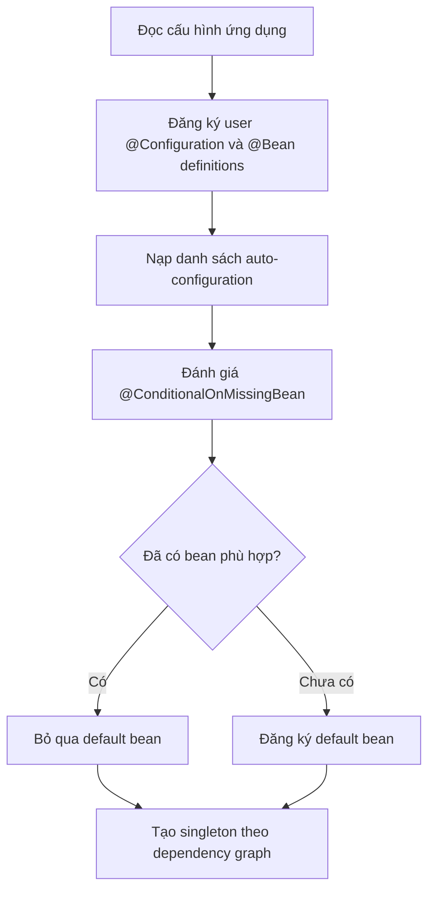

# Thiết kế bean tùy biến để cấu hình mặc định tự nhường

## 1. Bài toán

Spring Boot và Spring Cloud cung cấp nhiều bean tự động cấu hình để ứng dụng có thể chạy với ít mã thiết lập. Ví dụ, ứng dụng có thể nhận một DiscoveryClient, ServiceRegistry hoặc ReactiveLoadBalancer từ các starter đã thêm vào classpath.

Khi cấu hình mặc định không đáp ứng yêu cầu, ứng dụng có thể cần thay thế nó bằng implementation riêng. Cách thiết kế tốt là để auto-configuration tự nhường khi đã có bean phù hợp. Nhờ vậy, ứng dụng chọn được hành vi mong muốn mà không phải sửa mã của thư viện hoặc tạo hai bean cạnh tranh.

Một tình huống điển hình:

- Starter cung cấp GreetingService mặc định.
- Ứng dụng muốn dùng GreetingService có quy tắc riêng.
- Nếu ứng dụng không khai báo bean, starter tạo default bean.
- Nếu ứng dụng đã khai báo bean phù hợp, starter bỏ qua default bean.

Spring Boot hỗ trợ mẫu này bằng ConditionalOnMissingBean. Tuy nhiên, annotation chỉ hoạt động đúng khi bean tùy biến được đăng ký trong đúng ApplicationContext, có kiểu phù hợp và được xử lý trước auto-configuration cần nhường.

Bài thuộc chương **Tùy biến tự động cấu hình** của mô-đun **SPRING_CLOUD_CORE**. Mô-đun giúp người học hiểu các abstraction cốt lõi của Spring Cloud, Spring Cloud Context, cấu hình ngoài, discovery, service registry, giao tiếp dịch vụ và khả năng kiểm thử, vận hành.

Sau bài học, người học có thể:

- Giải thích cách auto-configuration tạo bean mặc định có điều kiện.
- Dùng ConditionalOnMissingBean để cho phép ứng dụng thay implementation.
- Thiết kế @Bean method có kiểu trả về đủ cụ thể để condition nhận diện.
- Phân biệt back-off với Primary, Qualifier và bean definition overriding.
- Chọn giữa property, customizer, custom bean và loại bỏ toàn bộ auto-configuration.
- Tùy biến cấu hình Spring Cloud LoadBalancer theo từng service ID.
- Kiểm thử cả trường hợp dùng default bean và trường hợp ứng dụng cung cấp bean riêng.

## 2. Auto-configuration và bean mặc định

Auto-configuration là cơ chế Spring Boot tự đăng ký cấu hình dựa trên classpath, bean definitions đã có, môi trường và loại ứng dụng. Một auto-configuration thường có các điều kiện để chỉ tạo bean khi các điều kiện phù hợp.

Ví dụ, thư viện có thể tạo một service mặc định:

```java
@AutoConfiguration
public class GreetingAutoConfiguration {

    @Bean
    @ConditionalOnMissingBean(GreetingService.class)
    DefaultGreetingService defaultGreetingService() {
        return new DefaultGreetingService();
    }
}
```

Khi chưa có bean nào thỏa GreetingService, method trên tạo DefaultGreetingService. Nếu ứng dụng đã đăng ký một bean implement GreetingService, condition không khớp và method không đăng ký bean mặc định.

Điều này giúp starter cung cấp hành vi dùng được ngay, đồng thời giữ quyền tùy biến cho ứng dụng sử dụng starter.

### 2.1. Auto-configuration được nạp như thế nào?

Với Spring Boot 3.x và 4.x, thư viện công bố auto-configuration qua resource:

```text
META-INF/spring/org.springframework.boot.autoconfigure.AutoConfiguration.imports
```

Nội dung resource liệt kê tên đầy đủ của từng lớp auto-configuration, mỗi lớp một dòng:

```text
com.example.greeting.autoconfigure.GreetingAutoConfiguration
```

Ứng dụng sử dụng starter không cần component-scan package của thư viện để tìm auto-configuration. Spring Boot nạp lớp đã được công bố qua imports resource rồi đánh giá các condition.

Với các dòng Spring Boot cũ, cơ chế đăng ký auto-configuration có thể dùng EnableAutoConfiguration trong META-INF/spring.factories. Khi nâng cấp thư viện, cần dùng định dạng đăng ký phù hợp với phiên bản Boot mục tiêu.

## 3. ConditionalOnMissingBean hoạt động ra sao?

ConditionalOnMissingBean là condition chỉ khớp khi chưa có bean thỏa tiêu chí được chỉ định trong BeanFactory.

Ví dụ:

```java
@Bean
@ConditionalOnMissingBean(GreetingService.class)
DefaultGreetingService defaultGreetingService() {
    return new DefaultGreetingService();
}
```

Condition kiểm tra theo kiểu GreetingService. Bất kỳ bean nào phù hợp với kiểu này đều có thể khiến default bean không được đăng ký, kể cả khi implementation của bean đó có tên khác.

Nếu không chỉ định value, type, name hoặc annotation, kiểu mặc định được suy ra từ kiểu trả về của @Bean method. Khi thiết kế auto-configuration, nên ghi rõ kiểu cần kiểm tra nếu contract là một interface hoặc abstraction ổn định.

### 3.1. Condition chỉ nhìn thấy bean definitions đã được xử lý

Condition được đánh giá dựa trên những bean definitions mà application context đã xử lý tại thời điểm đó. Nó không đợi tất cả singleton được khởi tạo rồi mới quyết định.

Đây là lý do Spring Boot khuyến nghị đặt ConditionalOnBean và ConditionalOnMissingBean trên auto-configuration: auto-configuration được nạp sau các bean definitions do người dùng khai báo.

Thứ tự khái quát:



Nếu condition được đặt trong một cấu hình thông thường được xử lý quá sớm, bean tùy biến được khai báo ở cấu hình khác có thể chưa xuất hiện trong danh sách bean definitions tại thời điểm kiểm tra. Không nên dựa vào thứ tự component scan ngẫu nhiên để tạo back-off.

### 3.2. Phân biệt điều kiện trên class và trên bean method

Có thể đặt condition ở cấp lớp:

```java
@AutoConfiguration
@ConditionalOnMissingBean(GreetingService.class)
public class GreetingAutoConfiguration {

    @Bean
    DefaultGreetingService defaultGreetingService() {
        return new DefaultGreetingService();
    }
}
```

Hoặc đặt trên bean method:

```java
@AutoConfiguration
public class GreetingAutoConfiguration {

    @Bean
    @ConditionalOnMissingBean(GreetingService.class)
    DefaultGreetingService defaultGreetingService() {
        return new DefaultGreetingService();
    }
}
```

Condition ở cấp lớp ngăn chính lớp configuration được đăng ký như một bean khi condition không khớp. Condition ở bean method chỉ ngăn method tương ứng tạo bean; các bean method khác trong cùng configuration vẫn có thể được đăng ký.

Với một default bean riêng lẻ, đặt condition trực tiếp trên @Bean method thường giúp phạm vi back-off rõ ràng hơn.

### 3.3. Sắp xếp giữa các auto-configuration

Bean condition có thể phụ thuộc vào bean do một auto-configuration khác tạo ra. Khi đó, auto-configuration đang kiểm tra phải được xử lý sau cấu hình cung cấp bean đó. Có thể khai báo thứ tự bằng thuộc tính after/before của @AutoConfiguration:

```java
@AutoConfiguration(after = MetricsAutoConfiguration.class)
public class GreetingMetricsAwareAutoConfiguration {
    // Các bean ở đây được định nghĩa sau MetricsAutoConfiguration.
}
```

Thứ tự này điều khiển thời điểm đăng ký bean definitions để condition nhìn thấy đúng ứng viên. Nó không điều khiển thứ tự khởi tạo singleton; việc khởi tạo vẫn dựa trên dependency graph và các quan hệ phụ thuộc.

## 4. Ví dụ hoàn chỉnh: ứng dụng cung cấp bean riêng

Giả sử thư viện định nghĩa contract:

```java
public interface GreetingService {
    String greet(String name);
}
```

Implementation mặc định:

```java
public class DefaultGreetingService implements GreetingService {

    @Override
    public String greet(String name) {
        return "Hello, " + name;
    }
}
```

Auto-configuration:

```java
import org.springframework.boot.autoconfigure.AutoConfiguration;
import org.springframework.boot.autoconfigure.condition.ConditionalOnMissingBean;
import org.springframework.context.annotation.Bean;

@AutoConfiguration
public class GreetingAutoConfiguration {

    @Bean
    @ConditionalOnMissingBean(GreetingService.class)
    DefaultGreetingService defaultGreetingService() {
        return new DefaultGreetingService();
    }
}
```

Ứng dụng muốn thay đổi cách chào có thể khai báo bean:

```java
import org.springframework.context.annotation.Bean;
import org.springframework.context.annotation.Configuration;

@Configuration(proxyBeanMethods = false)
public class ApplicationGreetingConfiguration {

    @Bean
    CustomGreetingService customGreetingService() {
        return new CustomGreetingService();
    }
}
```

Implementation tùy biến:

```java
public class CustomGreetingService implements GreetingService {

    @Override
    public String greet(String name) {
        return "Xin chào, " + name + "!";
    }
}
```

Khi ApplicationGreetingConfiguration được đăng ký trong application context, bean CustomGreetingService xuất hiện trước khi Spring đánh giá auto-configuration. Condition tìm thấy một bean implement GreetingService, vì vậy defaultGreetingService() không được gọi để đăng ký default bean.

Hãy bảo đảm ApplicationGreetingConfiguration thực sự được nạp: đặt nó trong phạm vi component scan của ứng dụng hoặc import rõ ràng bằng @Import nếu nằm ngoài phạm vi đó.

Consumer chỉ phụ thuộc contract:

```java
@Service
public class WelcomeController {

    private final GreetingService greetingService;

    public WelcomeController(GreetingService greetingService) {
        this.greetingService = greetingService;
    }

    public String welcome(String name) {
        return greetingService.greet(name);
    }
}
```

Consumer không cần biết bean đến từ starter hay ứng dụng. Đây là lợi ích của việc thiết kế auto-configuration dựa trên abstraction thay vì phụ thuộc implementation mặc định.

### 4.1. Kiểu trả về của @Bean method rất quan trọng

Khi khai báo bean tùy biến, nên trả về kiểu concrete phù hợp:

```java
@Bean
CustomGreetingService customGreetingService() {
    return new CustomGreetingService();
}
```

Spring Boot có thể dùng thông tin kiểu trả về của method để đánh giá bean conditions mà không cần khởi tạo bean. Nếu method chỉ trả về Object, một kiểu quá tổng quát hoặc một kiểu không thể hiện contract cần kiểm tra, condition có thể không nhận diện bean như mong muốn ở giai đoạn xử lý definitions.

Nên để ConditionalOnMissingBean kiểm tra contract mà consumer sử dụng, chẳng hạn GreetingService.class, và khai báo kiểu trả về cụ thể ở method tạo bean mặc định.

## 5. Những cách làm dễ nhầm với back-off

ConditionalOnMissingBean quyết định có đăng ký default bean hay không. Một số cơ chế khác có mục đích khác.

| Cơ chế | Tác dụng | Có làm auto-configuration tự nhường không? |
| --- | --- | --- |
| ConditionalOnMissingBean | Bỏ qua bean mặc định nếu đã có bean phù hợp. | Có, nếu condition và thứ tự xử lý đúng. |
| Primary | Ưu tiên một bean khi injection có nhiều ứng viên cùng kiểu. | Không. Default bean vẫn có thể được tạo. |
| Qualifier | Chỉ định bean cụ thể tại điểm injection. | Không. |
| Cùng bean name | Định danh bean theo tên trong context. | Không tự tạo back-off theo kiểu; chỉ ảnh hưởng condition nếu condition kiểm tra name. |
| spring.main.allow-bean-definition-overriding | Cho phép bean definition mới thay definition cùng tên trong một số trường hợp. | Không phải cơ chế back-off; có thể che giấu cấu hình trùng. |
| Exclude auto-configuration | Không nạp toàn bộ auto-configuration được chọn. | Có loại bỏ cấu hình, nhưng phạm vi rộng hơn thay một bean. |

### 5.1. Primary không khiến default bean biến mất

Ví dụ:

```java
@Bean
@Primary
CustomGreetingService customGreetingService() {
    return new CustomGreetingService();
}
```

Nếu auto-configuration không có condition phù hợp hoặc condition không nhìn thấy bean này, cả default bean và custom bean có thể cùng tồn tại. Primary chỉ giúp Spring chọn custom bean cho injection theo kiểu khi có nhiều ứng viên. Bean mặc định vẫn nằm trong context và có thể được lấy theo tên hoặc qualifier.

Nếu mục tiêu là thay default implementation, hãy dùng contract bean condition để default bean không được tạo. Chỉ dùng Primary khi thật sự muốn giữ nhiều implementation và chọn một implementation làm ứng viên mặc định cho injection.

### 5.2. Bean name override là cơ chế khác

Giả sử auto-configuration khai báo bean tên greetingService, còn ứng dụng cũng khai báo bean cùng tên. Đây là xung đột tên bean definition. Kết quả phụ thuộc chính sách overriding và cách context đăng ký definitions.

Không nên dùng cùng tên bean để thay thế một default bean được thiết kế theo kiểu ConditionalOnMissingBean. Hãy khai báo bean theo contract và để condition thực hiện back-off. Cách này rõ ràng hơn, không phụ thuộc spring.main.allow-bean-definition-overriding và dễ kiểm thử hơn.

## 6. Chọn đúng mức tùy biến

Không phải mọi thay đổi đều cần thay cả bean. Nên chọn mức tùy biến nhỏ nhất đáp ứng yêu cầu.

| Nhu cầu | Cách tiếp cận |
| --- | --- |
| Thay đổi URL, timeout, tên service hoặc feature flag | Dùng configuration properties nếu auto-configuration hỗ trợ. |
| Bổ sung header, interceptor, converter hoặc callback | Dùng customizer/hook được thư viện cung cấp. |
| Thay thuật toán hoặc hành vi cốt lõi | Cung cấp bean implementation theo contract mà auto-configuration kiểm tra. |
| Không muốn dùng toàn bộ integration | Exclude auto-configuration tương ứng. |

### 6.1. Ưu tiên property khi chỉ cần thay giá trị

Nếu thư viện cung cấp ConfigurationProperties, thay đổi giá trị cấu hình thường ít rủi ro hơn thay bean.

Ví dụ:

```yaml
spring:
  cloud:
    loadbalancer:
      retry:
        enabled: false
      cache:
        ttl: 20s
```

Property chỉ có tác dụng nếu auto-configuration của module đọc và hỗ trợ nó. Không tự giả định một property có thể thay đổi mọi implementation.

### 6.2. Dùng customizer khi muốn giữ cấu hình mặc định

Customizer cho phép bổ sung một phần hành vi mà không phải tự tạo lại toàn bộ bean.

Ví dụ khái quát:

```java
import org.springframework.boot.web.client.RestClientCustomizer;
import org.springframework.context.annotation.Bean;

@Bean
RestClientCustomizer restClientCustomizer() {
    return builder -> builder.defaultHeader(
            "X-Application", "inventory-api");
}
```

Ví dụ dùng RestClientCustomizer của Spring Boot 3.2 trở lên. Customizer phù hợp khi muốn giữ client, connection pool và lifecycle do framework quản lý, nhưng cần bổ sung header hoặc tùy chỉnh một phần builder. Với Spring Boot 4, RestClientCustomizer chuyển sang package org.springframework.boot.restclient; cần dùng import tương ứng với phiên bản Boot của ứng dụng.

Tên customizer và phạm vi áp dụng phụ thuộc module. Cần kiểm tra tài liệu của client cụ thể để biết customizer tác động lên mọi client hay chỉ một builder/instance.

### 6.3. Thay bean khi cần thay hành vi

Nếu yêu cầu thay đổi thuật toán, state hoặc integration, cung cấp bean theo abstraction mà auto-configuration dùng làm điểm mở rộng. Ví dụ có thể là ServiceInstanceListSupplier, ReactorLoadBalancer, DiscoveryClient hoặc một service do ứng dụng định nghĩa.

Khi thay bean, cần hiểu các dependency mà implementation mới phải cung cấp, lifecycle và các hook mà consumer kỳ vọng. Một bean cùng kiểu nhưng thiếu hành vi phụ trợ có thể làm ứng dụng khởi động thành công nhưng lỗi khi chạy.

### 6.4. Exclude khi không dùng integration

Nếu ứng dụng không muốn toàn bộ một auto-configuration, có thể loại bỏ bằng thuộc tính spring.autoconfigure.exclude hoặc thuộc tính exclude của @SpringBootApplication / @EnableAutoConfiguration.

Ví dụ:

```yaml
spring:
  autoconfigure:
    exclude:
      - com.example.greeting.autoconfigure.GreetingAutoConfiguration
```

Exclude làm mất tất cả bean mà auto-configuration đó cung cấp. Nếu chỉ muốn thay một bean, hãy dùng back-off condition thay vì loại bỏ cả cấu hình rồi tự xây lại mọi thành phần.

## 7. Condition khác có thể phối hợp với back-off

Auto-configuration thường cần nhiều điều kiện cùng lúc:

| Annotation | Kiểm tra |
| --- | --- |
| ConditionalOnClass | Class cần thiết có trên classpath. |
| ConditionalOnMissingClass | Một class không có trên classpath. |
| ConditionalOnBean | Đã có bean phụ thuộc cần thiết. |
| ConditionalOnMissingBean | Chưa có bean mà cấu hình muốn cung cấp mặc định. |
| ConditionalOnProperty | Property có giá trị phù hợp. |
| ConditionalOnResource | Resource cần thiết tồn tại. |
| ConditionalOnWebApplication | Ứng dụng chạy trong web context phù hợp. |
| ConditionalOnSingleCandidate | Có một ứng viên bean duy nhất hoặc một ứng viên primary. |

Ví dụ:

```java
@AutoConfiguration
@ConditionalOnClass(GreetingService.class)
@ConditionalOnProperty(
        prefix = "example.greeting",
        name = "enabled",
        havingValue = "true",
        matchIfMissing = true)
public class GreetingAutoConfiguration {

    @Bean
    @ConditionalOnMissingBean(GreetingService.class)
    DefaultGreetingService defaultGreetingService() {
        return new DefaultGreetingService();
    }
}
```

Trong ví dụ, auto-configuration chỉ được xét khi class có mặt và property cho phép bật. Sau đó, bean method chỉ tạo default service nếu chưa có bean phù hợp.

Không nên gom mọi điều kiện vào một expression khó đọc. Mỗi condition nên phản ánh một yêu cầu cụ thể của integration.

## 8. Tùy biến Spring Cloud LoadBalancer theo service ID

Spring Cloud LoadBalancer là ví dụ thực tế về cấu hình tùy biến theo từng client. Ứng dụng có thể dùng cấu hình riêng cho stores mà vẫn giữ cấu hình mặc định cho các service khác.

Đăng ký cấu hình riêng:

```java
import org.springframework.cloud.loadbalancer.annotation.LoadBalancerClient;
import org.springframework.context.annotation.Configuration;

@Configuration(proxyBeanMethods = false)
@LoadBalancerClient(
        value = "stores",
        configuration = StoresLoadBalancerConfiguration.class)
public class LoadBalancerClientRegistration {
}
```

Lớp cấu hình dành cho client stores:

```java
import org.springframework.cloud.client.ServiceInstance;
import org.springframework.cloud.loadbalancer.core.RandomLoadBalancer;
import org.springframework.cloud.loadbalancer.core.ReactorLoadBalancer;
import org.springframework.cloud.loadbalancer.core.ServiceInstanceListSupplier;
import org.springframework.cloud.loadbalancer.support.LoadBalancerClientFactory;
import org.springframework.context.annotation.Bean;
import org.springframework.core.env.Environment;

public class StoresLoadBalancerConfiguration {

    @Bean
    ReactorLoadBalancer<ServiceInstance> randomLoadBalancer(
            Environment environment,
            LoadBalancerClientFactory loadBalancerClientFactory) {

        String serviceId = environment.getProperty(
                LoadBalancerClientFactory.PROPERTY_NAME);

        return new RandomLoadBalancer(
                loadBalancerClientFactory.getLazyProvider(
                        serviceId, ServiceInstanceListSupplier.class),
                serviceId);
    }
}
```

Trong ví dụ, cấu hình stores cung cấp một ReactorLoadBalancer riêng để thay thuật toán round-robin mặc định của client đó bằng random. Cần có dependency Spring Cloud LoadBalancer và các import phù hợp với release train đang dùng.

Lớp được truyền vào @LoadBalancerClient nên không được component-scan thành cấu hình toàn cục ngoài ý muốn. Theo hướng dẫn Spring Cloud, lớp cấu hình client nên không gắn @Configuration hoặc phải nằm ngoài phạm vi component scan. Nó được nạp vào context riêng của LoadBalancer client.

Nếu muốn tùy biến ServiceInstanceListSupplier, có thể cung cấp bean supplier trong cùng client configuration. Hãy giữ đúng thứ tự delegate, cache và filter; cấu hình sai thứ tự có thể khiến health-check hoặc filtering không hoạt động như dự kiến.

### 8.1. Khi nào custom bean chỉ áp dụng cho một service?

LoadBalancerClient(value = "stores", ...) chỉ định service ID dùng cấu hình riêng. Consumer gọi stores sẽ dùng context cấu hình đó; các client khác tiếp tục dùng cấu hình mặc định hoặc cấu hình riêng đã đăng ký.

Điều này khác với việc đưa bean tùy biến vào application context gốc. Một bean toàn cục có thể ảnh hưởng tới nhiều client hoặc làm thay đổi candidate resolution ở phạm vi rộng hơn dự kiến.

## 9. Kiểm thử back-off

Một auto-configuration nên được kiểm thử ít nhất hai tình huống:

1. Không có bean người dùng: default bean được tạo.
2. Có bean người dùng: default bean không được tạo và consumer nhận custom bean.

ApplicationContextRunner giúp tạo context nhỏ, có thể kiểm soát auto-configuration, user configuration, property và classpath.

Ví dụ test:

```java
import org.junit.jupiter.api.Test;
import org.springframework.boot.autoconfigure.AutoConfigurations;
import org.springframework.boot.test.context.runner.ApplicationContextRunner;

import static org.assertj.core.api.Assertions.assertThat;

class GreetingAutoConfigurationTests {

    private final ApplicationContextRunner contextRunner =
            new ApplicationContextRunner()
                    .withConfiguration(
                            AutoConfigurations.of(GreetingAutoConfiguration.class));

    @Test
    void createsDefaultWhenUserDoesNotProvideService() {
        contextRunner.run(context -> {
            assertThat(context).hasSingleBean(GreetingService.class);
            assertThat(context.getBean(GreetingService.class))
                    .isInstanceOf(DefaultGreetingService.class);
        });
    }

    @Test
    void backsOffWhenUserProvidesCustomService() {
        contextRunner
                .withUserConfiguration(ApplicationGreetingConfiguration.class)
                .run(context -> {
                    assertThat(context).hasSingleBean(GreetingService.class);
                    assertThat(context.getBean(GreetingService.class))
                            .isInstanceOf(CustomGreetingService.class);
                    assertThat(context)
                            .doesNotHaveBean(DefaultGreetingService.class);
                });
    }
}
```

Hai test xác nhận hành vi quan trọng: default bean có mặt khi không có custom bean và biến mất khi custom bean xuất hiện. Không chỉ kiểm tra getBean(GreetingService.class) trả đúng instance; cần xác minh context không còn default bean để tránh trường hợp hai implementation cùng tồn tại nhưng Primary che mất vấn đề.

### 9.1. Kiểm thử điều kiện classpath và property

Nếu auto-configuration phụ thuộc thư viện hoặc property, bổ sung test:

- Class cần thiết có mặt: auto-configuration được áp dụng.
- Class bị loại khỏi classpath: cấu hình không tạo bean.
- Property bật: bean mặc định được tạo nếu chưa có custom bean.
- Property tắt: auto-configuration không tạo bean.
- Property bị thiếu: xác minh hành vi theo matchIfMissing.
- Custom bean có mặt cùng lúc: default bean vẫn phải nhường.

### 9.2. Đọc ConditionEvaluationReport

Khi ứng dụng không tạo bean hoặc tạo nhầm default bean, hãy kiểm tra lý do condition match/mismatch:

- Chạy ứng dụng với --debug để in condition evaluation report.
- Nếu Actuator được cấu hình, xem endpoint conditions để biết auto-configuration nào khớp hoặc không khớp.
- Kiểm tra bean definitions trong đúng ApplicationContext, đặc biệt khi có parent/child context.

Report giúp xác định condition nào không thỏa. Ví dụ, default bean vẫn được tạo có thể do custom bean chưa được component-scan, sai kiểu, ở context khác hoặc được đăng ký sau khi condition đã được đánh giá.

## 10. Lỗi thiết kế thường gặp

| Triệu chứng | Nguyên nhân | Cách xử lý |
| --- | --- | --- |
| Default bean vẫn xuất hiện | Custom bean chưa được đăng ký trong cùng context hoặc sai contract type | Kiểm tra component scan, import cấu hình và kiểu bean. |
| Có hai bean cùng interface | Dùng Primary thay cho back-off hoặc auto-configuration không có missing-bean condition | Thêm condition đúng trên default bean method. |
| Condition không nhận diện custom bean | @Bean method trả về kiểu quá tổng quát hoặc definition chưa được xử lý | Khai báo kiểu trả về cụ thể và kiểm tra thứ tự. |
| Cấu hình mặc định biến mất hoàn toàn | Đặt ConditionalOnMissingBean ở cấp lớp trong khi chỉ muốn bỏ một bean | Chuyển condition xuống bean method phù hợp. |
| Custom LoadBalancer ảnh hưởng mọi service | Configuration class bị component-scan vào context gốc | Đưa class ra ngoài scan hoặc bỏ @Configuration theo hướng dẫn. |
| Property tắt nhưng bean vẫn có | Property không thuộc prefix/condition của auto-configuration | Kiểm tra property metadata và condition evaluation report. |
| Bật bean overriding để che xung đột | Nhầm bean name override với back-off theo type | Dùng ConditionalOnMissingBean và contract rõ ràng. |
| Exclude làm mất nhiều thành phần | Loại toàn bộ auto-configuration để thay một bean | Dùng bean override hoặc customizer. |
| Test pass nhưng production fail | Test không mô phỏng đúng context hierarchy, classpath hoặc auto-config order | Dùng ApplicationContextRunner với cấu hình gần production và integration test. |

## 11. Quy trình thiết kế

1. Xác định bean mặc định và abstraction mà consumer thực sự phụ thuộc.
2. Kiểm tra auto-configuration có cung cấp property hoặc customizer cho yêu cầu chưa.
3. Nếu phải thay bean, xác định chính xác condition đang kiểm tra theo type hay name.
4. Khai báo custom bean trong đúng ApplicationContext và trả về kiểu cụ thể.
5. Đặt ConditionalOnMissingBean trên default @Bean method trong auto-configuration.
6. Kiểm tra thứ tự khi default bean phụ thuộc bean của auto-configuration khác; dùng after/before khi cần.
7. Với cấu hình per-service của Spring Cloud LoadBalancer, dùng LoadBalancerClient và giữ config class ngoài component scan toàn cục.
8. Viết test cho cả default path và custom path.
9. Dùng condition report để chẩn đoán nếu kết quả không như dự kiến.

## 12. Câu hỏi tự kiểm tra

1. Vì sao auto-configuration nên cung cấp bean mặc định thay vì yêu cầu mọi ứng dụng tự khai báo?
2. ConditionalOnMissingBean kiểm tra điều gì?
3. Vì sao condition chỉ thấy bean definitions đã được xử lý tại thời điểm đánh giá?
4. Tại sao Spring Boot khuyến nghị dùng ConditionalOnMissingBean trên auto-configuration?
5. Khác biệt giữa condition đặt trên lớp và đặt trên @Bean method là gì?
6. Vì sao kiểu trả về cụ thể của @Bean method giúp condition hoạt động đáng tin cậy hơn?
7. Primary có làm default bean biến mất khỏi context không?
8. Khi nào nên dùng property, customizer, custom bean hoặc exclude auto-configuration?
9. Vì sao cấu hình của LoadBalancerClient cần nằm ngoài component scan toàn cục?
10. Hãy viết hai test ApplicationContextRunner chứng minh default bean được tạo khi không có custom bean và tự nhường khi ứng dụng cung cấp bean riêng.

## 13. Tài liệu tham khảo chính thức

- [Spring Boot — Creating Your Own Auto-configuration](https://docs.spring.io/spring-boot/reference/features/developing-auto-configuration.html)
- [Spring Boot — ConditionalOnMissingBean API](https://docs.spring.io/spring-boot/4.0/api/java/org/springframework/boot/autoconfigure/condition/ConditionalOnMissingBean.html)
- [Spring Boot — Testing Auto-configuration](https://docs.spring.io/spring-boot/reference/features/developing-auto-configuration.html#features.developing-auto-configuration.testing)
- [Spring Boot 3.5 — RestClientCustomizer API](https://docs.spring.io/spring-boot/3.5/api/java/org/springframework/boot/web/client/RestClientCustomizer.html)
- [Spring Boot 4.0 — RestClientCustomizer API](https://docs.spring.io/spring-boot/4.0/api/java/org/springframework/boot/restclient/RestClientCustomizer.html)
- [Spring Cloud Commons — Custom LoadBalancer Configuration](https://docs.spring.io/spring-cloud-commons/reference/spring-cloud-commons/loadbalancer.html)

Điều kiện và extension point cụ thể thay đổi theo module và release train. Khi tùy biến một bean của Spring Cloud, hãy kiểm tra đúng auto-configuration, contract type và context nơi bean được tạo trong phiên bản đang sử dụng.
