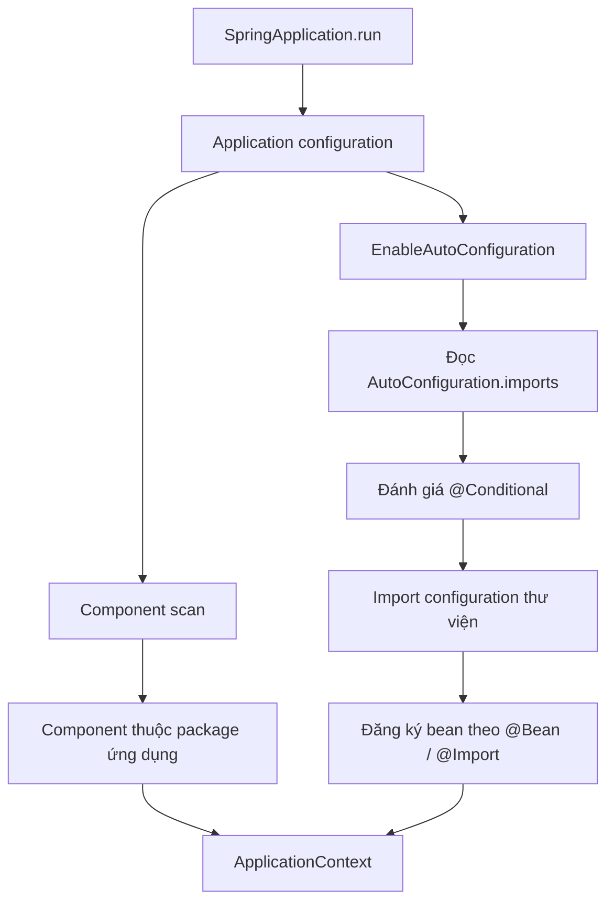

# Giới hạn component scan của thư viện dùng chung

Một thư viện dùng chung thường đóng gói service, repository, controller, configuration, health indicator hoặc adapter để nhiều ứng dụng có thể tái sử dụng. Khi thư viện được đưa vào dependency của một ứng dụng Spring Boot, không có nghĩa mọi class mang annotation Spring đều nên tự động trở thành bean của ứng dụng đó.

Ranh giới component scan quyết định package nào được Spring duyệt để tìm component. Nếu ứng dụng hoặc thư viện đặt base package quá rộng, scan có thể kéo cả implementation nội bộ, configuration không liên quan, controller hoặc bean dành riêng cho một ứng dụng khác vào ApplicationContext. Hậu quả có thể là bean trùng tên, cấu hình ngoài ý muốn, dependency thiếu, endpoint xuất hiện không cần thiết và hành vi thay đổi khi thêm một dependency mới.

Với thư viện dùng chung, Spring Boot khuyến nghị thiết kế auto-configuration trong package riêng, đăng ký bằng metadata của Boot và import các configuration/component cần thiết một cách tường minh. Nếu ứng dụng thật sự cần component scan thư viện, phạm vi scan nên được opt-in và giới hạn vào package chuyên biệt.

Bài học thuộc chương **Tùy biến tự động cấu hình** của **SPRING_CLOUD_CORE**. Trọng tâm là hiểu phạm vi của `@ComponentScan`, cách `@SpringBootApplication` xác định package mặc định, cách thiết kế package boundary cho thư viện, khi nào dùng `@Import` hoặc auto-configuration, và cách kiểm thử để bảo đảm thư viện chỉ đăng ký đúng các bean mà hợp đồng của nó cung cấp.

## 1. Mục tiêu học tập

Sau bài này, người học có thể:

1. Giải thích phạm vi và cách hoạt động của component scan trong Spring.
2. Xác định package mặc định được quét bởi `@ComponentScan` và `@SpringBootApplication`.
3. Nhận diện rủi ro khi scan package gốc quá rộng hoặc scan package của thư viện dùng chung.
4. Thiết kế package layout tách ứng dụng, API công khai, implementation nội bộ và auto-configuration.
5. Phân biệt component scan với auto-configuration.
6. Sử dụng `@Import` để đăng ký configuration hoặc component cụ thể.
7. Đăng ký auto-configuration qua `AutoConfiguration.imports`.
8. Dùng `basePackageClasses`, include filter và exclude filter khi ứng dụng chủ động cần scan.
9. Phân biệt component scan với `@ConfigurationPropertiesScan`, `@EntityScan` và repository scan.
10. Kiểm thử phạm vi bean bằng `ApplicationContextRunner` và kiểm tra ApplicationContext thực tế.

## 2. Vấn đề khi thư viện dùng chung mở rộng component scan

Giả sử một công ty có ba ứng dụng:

- `order-service` xử lý đơn hàng.
- `inventory-service` quản lý tồn kho.
- `payment-service` tích hợp cổng thanh toán.

Cả ba ứng dụng dùng thư viện `acme-shared-platform`. Thư viện chứa các package:

```text
com.acme.shared
├── api
│   ├── ClockProvider.java
│   └── RequestContext.java
├── client
│   ├── InventoryClient.java
│   └── PaymentClient.java
├── internal
│   ├── DefaultClockProvider.java
│   └── HttpRequestContextFilter.java
├── web
│   └── SharedDiagnosticsController.java
└── autoconfigure
    └── SharedPlatformAutoConfiguration.java
```

Không phải ứng dụng nào cũng cần mọi thành phần:

- `order-service` có thể cần `ClockProvider` và `RequestContext`.
- `inventory-service` có thể chỉ cần `ClockProvider`.
- `payment-service` có thể cần HTTP client và một số health indicator.
- Controller chẩn đoán có thể chỉ được bật trong môi trường nội bộ.

Nếu ứng dụng đặt `@ComponentScan("com.acme")`, scanner có thể tìm thấy component của cả ba ứng dụng và toàn bộ thư viện có package bắt đầu bằng `com.acme`. Một class mới được thêm vào thư viện ở lần phát hành sau có thể tự động trở thành bean, dù ứng dụng hiện tại không có ý định sử dụng nó.

Đây là vấn đề về ranh giới cấu hình: dependency của thư viện được chia sẻ, nhưng quyền quyết định bean nào tham gia ApplicationContext phải rõ ràng.

## 3. Component scan hoạt động như thế nào?

`@ComponentScan` yêu cầu Spring tìm các class phù hợp trong package đã chỉ định và đăng ký chúng thành bean definition.

Ví dụ:

```java
@Configuration(proxyBeanMethods = false)
@ComponentScan(basePackages = "com.acme.orders")
class OrdersConfiguration {
}
```

Nếu không khai báo `basePackages` hoặc `basePackageClasses`, Spring bắt đầu scan từ package chứa class khai báo `@ComponentScan` và đi xuống các package con.

Theo bộ lọc mặc định, scanner nhận diện các class có `@Component` hoặc annotation được meta-annotate bằng `@Component`, chẳng hạn:

- `@Component`
- `@Service`
- `@Repository`
- `@Controller`
- `@RestController`
- `@Configuration`

Vì vậy, một class `@Configuration` trong package được quét cũng có thể được phát hiện như một component.

### 3.1. Scan đệ quy theo package con

Nếu base package là `com.acme.orders`, scanner duyệt package đó và các package con, ví dụ:

```text
com.acme.orders
com.acme.orders.api
com.acme.orders.application
com.acme.orders.domain
com.acme.orders.infrastructure
```

Package ngang hàng như `com.acme.shared` không nằm dưới `com.acme.orders`, nên không được quét bởi cấu hình này.

Nếu base package là `com.acme`, phạm vi mở rộng thành mọi package con bắt đầu từ `com.acme`, bao gồm `com.acme.orders`, `com.acme.inventory`, `com.acme.payment` và `com.acme.shared`.

### 3.2. Bộ lọc mặc định không chỉ tìm @Component trực tiếp

Một annotation nghiệp vụ có thể được meta-annotate bằng `@Component`. Ví dụ, một annotation nội bộ như `@SharedPlatformComponent` có thể khiến class được scanner phát hiện nếu annotation đó được thiết kế như stereotype của Spring.

Vì vậy, khi điều tra vì sao một class xuất hiện trong context, hãy kiểm tra cả annotation trực tiếp và annotation meta. Không chỉ tìm chuỗi `@Component` trong source.

### 3.3. Component scan không tạo bean cho mọi class Java

Một class không mang stereotype phù hợp sẽ không tự động trở thành bean chỉ vì nằm trong package được quét. Có thể đăng ký class đó bằng `@Bean`, `@Import`, registrar hoặc cơ chế cấu hình khác.

Component scan là một cách tìm component theo metadata, không phải thao tác đăng ký toàn bộ class trong package.

## 4. @SpringBootApplication xác định phạm vi scan mặc định

`@SpringBootApplication` kết hợp ba khả năng chính:

- `@SpringBootConfiguration`: đánh dấu configuration chính của ứng dụng.
- `@EnableAutoConfiguration`: bật cơ chế auto-configuration.
- `@ComponentScan`: bật component scan từ package của class ứng dụng.

Ví dụ:

```java
package com.acme.orders;

@SpringBootApplication
public class OrdersApplication {

    public static void main(String[] args) {
        SpringApplication.run(OrdersApplication.class, args);
    }
}
```

Trong ví dụ, package mặc định được scan là `com.acme.orders` và các package con. Đặt application class ở package gốc của ứng dụng giúp các component nghiệp vụ được tìm thấy mà không cần chỉ định package bằng chuỗi.

### 4.1. Vì sao không nên đặt application class quá cao?

Nếu đặt main class tại `com.acme`, package mặc định sẽ bao phủ cả `com.acme.orders`, `com.acme.shared`, `com.acme.payment` và các package con khác.

Trong một hệ thống nhiều module, cách đặt này có thể làm ứng dụng tự động nhận component từ thư viện hoặc module không liên quan. Nếu các module có controller, repository hoặc configuration riêng, chúng có thể được đưa vào context ngoài dự kiến.

Nên đặt main class trong package gốc riêng của ứng dụng, ví dụ `com.acme.orders`, thay vì package tổ chức chung như `com.acme`.

### 4.2. scanBasePackages mở rộng phạm vi

`@SpringBootApplication` cung cấp `scanBasePackages` và `scanBasePackageClasses` như alias cho thuộc tính tương ứng của `@ComponentScan`.

Ví dụ:

```java
@SpringBootApplication(
    scanBasePackages = {
        "com.acme.orders",
        "com.acme.shared"
    }
)
public class OrdersApplication {
}
```

Cấu hình này yêu cầu scan cả hai package và các package con của chúng. Đây là một lựa chọn tường minh, nhưng nếu `com.acme.shared` chứa nhiều component nội bộ thì ứng dụng vẫn có thể đăng ký nhiều bean hơn nhu cầu.

Không nên dùng `scanBasePackages = "com"` hoặc một package tổ chức quá rộng chỉ để khắc phục một bean bị thiếu. Hãy xác định đúng package cần đăng ký.

## 5. Thiết kế package boundary cho thư viện dùng chung

Một package layout rõ ràng giúp ứng dụng chỉ quét component thuộc quyền sở hữu của nó.

Ví dụ:

```text
com.acme.orders
├── OrdersApplication.java
├── api
├── application
├── domain
└── infrastructure

com.acme.sharedplatform
├── api
├── internal
├── web
└── autoconfigure

com.acme.sharedplatform.autoconfigure
└── SharedPlatformAutoConfiguration.java
```

Ứng dụng đặt main class trong `com.acme.orders`, nên default component scan không đi sang `com.acme.sharedplatform`.

Thư viện có thể cung cấp các bean cần thiết thông qua auto-configuration. Spring Boot nạp auto-configuration theo metadata của thư viện, không cần mở rộng component scan của ứng dụng sang toàn bộ package thư viện.

### 5.1. Tách API công khai và implementation nội bộ

Một cách tổ chức hữu ích:

| Package | Nội dung | Cách đăng ký |
| --- | --- | --- |
| `api` | Interface, DTO, contract công khai | Không nhất thiết là bean |
| `internal` | Implementation, adapter, helper | Đăng ký qua configuration/import |
| `web` | Filter, controller, endpoint | Chỉ bật khi ứng dụng có nhu cầu |
| `autoconfigure` | Các lớp cấu hình Spring Boot | Đăng ký qua AutoConfiguration.imports |
| `properties` | Kiểu cấu hình `@ConfigurationProperties` | Bật qua `@EnableConfigurationProperties` hoặc cơ chế scan riêng |

Không cần gắn `@Component` cho mọi class trong thư viện. Nếu class chỉ là implementation được tạo bởi một phương thức `@Bean`, hãy giữ nó là class Java thông thường và để configuration kiểm soát cách tạo.

### 5.2. Tránh đặt auto-configuration dưới package ứng dụng được quét rộng

Spring Boot khuyến nghị auto-configuration phải nằm trong package riêng và không trở thành mục tiêu của component scan. Nếu ứng dụng quét một package cha bao trùm cả thư viện, auto-configuration có thể bị phát hiện như một configuration thông thường ngoài đường nạp auto-configuration.

Hãy kiểm tra quan hệ package thực tế giữa main class và package thư viện. Việc hai module cùng dùng một Maven group hoặc cùng nằm trong một repository không có nghĩa chúng nên nằm dưới cùng một component-scan root.

## 6. Phân biệt component scan và auto-configuration

Hai cơ chế này có mục tiêu khác nhau:

| Cơ chế | Mục đích | Cách Spring tìm cấu hình |
| --- | --- | --- |
| Component scan | Tìm component trong package đã chọn | Duyệt package và áp dụng component filters |
| Auto-configuration | Tự động áp dụng cấu hình thư viện khi điều kiện phù hợp | Đọc danh sách auto-configuration được khai báo trong metadata |
| `@Import` | Đăng ký configuration hoặc component cụ thể | Nhận class được chỉ định tường minh |
| `@Bean` | Khai báo một bean trong configuration | Gọi factory method trong configuration đã được nạp |

Component scan phụ thuộc package boundary. Auto-configuration phụ thuộc metadata và điều kiện. `@Import` phụ thuộc class được chỉ định. Những cơ chế này có thể phối hợp nhưng không nên bị xem là thay thế hoàn toàn cho nhau.

### 6.1. Auto-configuration là lựa chọn phù hợp cho thư viện có starter

Nếu thư viện muốn tự cấu hình khi ứng dụng thêm starter, hãy xây dựng một lớp auto-configuration:

```java
@AutoConfiguration
@ConditionalOnClass(SharedClock.class)
@ConditionalOnProperty(
    prefix = "acme.shared",
    name = "enabled",
    havingValue = "true",
    matchIfMissing = true
)
@Import(SharedClockConfiguration.class)
public class SharedPlatformAutoConfiguration {
}
```

Configuration được nạp khi class cần thiết có trong classpath và property cho phép. `@Import` đưa configuration nội bộ vào context mà không phải scan toàn bộ package thư viện.

Trong configuration được import:

```java
@Configuration(proxyBeanMethods = false)
class SharedClockConfiguration {

    @Bean
    @ConditionalOnMissingBean
    SharedClock sharedClock() {
        return new DefaultSharedClock();
    }
}
```

`@ConditionalOnMissingBean` cho phép ứng dụng cung cấp implementation riêng. Nếu ứng dụng đã khai báo `SharedClock`, auto-configuration có thể lùi lại theo điều kiện của bean method.

### 6.2. Không đặt @ComponentScan trong auto-configuration

Spring Boot khuyến nghị auto-configuration không bật component scan để tìm các component bổ sung. Thay vào đó, hãy dùng `@Import` cho các configuration/component cụ thể.

Ví dụ cần tránh:

```java
@AutoConfiguration
@ComponentScan("com.acme.sharedplatform")
public class SharedPlatformAutoConfiguration {
}
```

Cách này mở rộng scan vào toàn package thư viện. Khi thư viện thêm controller, configuration hoặc implementation mới, các class đó có thể tự động được đăng ký trong mọi ứng dụng dùng starter.

Thay bằng:

```java
@AutoConfiguration
@Import({
    SharedClockConfiguration.class,
    SharedRequestContextConfiguration.class
})
public class SharedPlatformAutoConfiguration {
}
```

Mỗi configuration chịu trách nhiệm tạo bean cụ thể và có thể đặt điều kiện riêng. Thư viện giữ được quyền kiểm soát phạm vi đăng ký.

## 7. Đăng ký auto-configuration bằng AutoConfiguration.imports

Với Spring Boot 2.7 trở lên, thư viện khai báo các auto-configuration trong resource:

```text
META-INF/spring/org.springframework.boot.autoconfigure.AutoConfiguration.imports
```

Ví dụ nội dung file:

```text
com.acme.sharedplatform.autoconfigure.SharedPlatformAutoConfiguration
com.acme.sharedplatform.autoconfigure.SharedWebAutoConfiguration
```

Mỗi dòng là tên đầy đủ của một auto-configuration class. Có thể dùng dấu `#` để ghi chú trong file.

Spring Boot đọc resource trong JAR thư viện khi cơ chế auto-configuration được bật bởi `@EnableAutoConfiguration` hoặc `@SpringBootApplication`.

### 7.1. Package auto-configuration cần tách biệt

Auto-configuration nên được đặt trong package dành riêng, ví dụ `com.acme.sharedplatform.autoconfigure`. Tách package giúp người dùng nhận biết đây là cấu hình do Boot nạp qua metadata.

Không đưa auto-configuration class vào package ứng dụng đang được component scan. Không dựa vào việc scanner tìm thấy class `@Configuration` để thư viện tự hoạt động.

### 7.2. Khác biệt với cơ chế cũ

Các phiên bản Spring Boot trước 2.7 sử dụng file `META-INF/spring.factories` với key `org.springframework.boot.autoconfigure.EnableAutoConfiguration` để liệt kê auto-configuration.

Từ Boot 2.7, `AutoConfiguration.imports` là cơ chế được tài liệu hóa cho danh sách auto-configuration. Khi thư viện hỗ trợ nhiều thế hệ Spring Boot, cần đối chiếu đúng hướng dẫn của từng phiên bản và kiểm thử artifact được đóng gói. Không giả định một resource metadata duy nhất luôn được mọi phiên bản Boot nhận diện giống nhau.

## 8. Dùng @Import thay cho scan khi biết rõ component cần đăng ký

Nếu thư viện có một số component cố định, có thể import chúng trực tiếp.

Ví dụ:

```java
@Configuration(proxyBeanMethods = false)
@Import({
    SharedRequestContextFilter.class,
    SharedClockConfiguration.class
})
class SharedPlatformConfiguration {
}
```

`@Import` có thể đăng ký configuration class, component class, `ImportSelector` hoặc `ImportBeanDefinitionRegistrar`. Việc import tường minh giúp người đọc thấy rõ thành phần nào được đưa vào context.

Nếu cần import auto-configuration trong bài kiểm thử hoặc cấu hình slice, sử dụng cơ chế `@ImportAutoConfiguration` hoặc API test tương ứng của Spring Boot. Auto-configuration có quy tắc nạp và thứ tự riêng; không nên dùng `@Import` thông thường để thay thế cơ chế auto-configuration của Boot.

## 9. Khi ứng dụng thật sự cần scan package thư viện

Có những trường hợp ứng dụng muốn chủ động scan một package nhỏ của thư viện, ví dụ thư viện chỉ cung cấp các component thuần Spring và không phát hành starter.

Khi đó, ứng dụng có thể mở rộng scan bằng marker class:

```java
package com.acme.sharedplatform.components;

public interface SharedComponentsMarker {
}
```

Ứng dụng:

```java
@SpringBootApplication(
    scanBasePackageClasses = {
        OrdersApplication.class,
        SharedComponentsMarker.class
    }
)
public class OrdersApplication {
}
```

`scanBasePackageClasses` là lựa chọn type-safe. Spring lấy package chứa class marker làm package gốc để scan. Nếu package marker là `com.acme.sharedplatform.components`, các package con của nó cũng được quét.

Hãy đặt marker trong package hẹp chỉ chứa component mà ứng dụng được phép nhận. Đừng đặt marker tại `com.acme` hoặc package gốc quá cao.

### 9.1. basePackageClasses an toàn hơn chuỗi package

So sánh:

```java
@ComponentScan(basePackages = "com.acme.sharedplatform.components")
class SharedComponentsConfiguration {
}
```

và:

```java
@ComponentScan(basePackageClasses = SharedComponentsMarker.class)
class SharedComponentsConfiguration {
}
```

Cách thứ hai tránh lỗi đánh máy tên package và giúp IDE refactor package cùng với marker class. Dù vậy, marker không tự thu hẹp scan; phạm vi vẫn là package chứa marker và các package con.

## 10. Thu hẹp scan bằng includeFilters và excludeFilters

Khi package chứa cả component được phép và component cần loại, có thể dùng filter.

Ví dụ, thư viện định nghĩa annotation riêng:

```java
@Target(ElementType.TYPE)
@Retention(RetentionPolicy.RUNTIME)
@Documented
@Component
public @interface SharedPlatformComponent {
}
```

Ứng dụng chỉ scan class được đánh dấu annotation này:

```java
@Configuration(proxyBeanMethods = false)
@ComponentScan(
    basePackageClasses = SharedComponentsMarker.class,
    useDefaultFilters = false,
    includeFilters = @ComponentScan.Filter(
        type = FilterType.ANNOTATION,
        classes = SharedPlatformComponent.class
    )
)
class SharedComponentsConfiguration {
}
```

Với `useDefaultFilters = false`, scanner không tự động nhận các stereotype mặc định. `includeFilters` chỉ đưa vào những class phù hợp với annotation được chỉ định trong phạm vi package gốc.

Nếu không tắt default filters, include filter được áp dụng bổ sung bên cạnh bộ lọc mặc định. Vì vậy, mọi `@Component`, `@Service`, `@Repository`, `@Controller` hoặc `@Configuration` khác trong package vẫn có thể được phát hiện.

### 10.1. Các loại filter thường dùng

| Filter type | Mục đích | Ví dụ |
| --- | --- | --- |
| `ANNOTATION` | Tìm annotation có mặt trực tiếp hoặc meta trên class | `@SharedPlatformComponent` |
| `ASSIGNABLE_TYPE` | Tìm class triển khai hoặc kế thừa một kiểu | `SharedExtension.class` |
| `REGEX` | Khớp tên class bằng regular expression | `.*Shared.*Adapter` |
| `ASPECTJ` | Khớp type expression của AspectJ | `com.acme..*Service+` |
| `CUSTOM` | Dùng implementation `TypeFilter` riêng | `SharedTypeFilter.class` |

### 10.2. Dùng excludeFilters khi có một số class ngoại lệ

Ví dụ loại controller khỏi một package scan:

```java
@Configuration(proxyBeanMethods = false)
@ComponentScan(
    basePackageClasses = SharedComponentsMarker.class,
    excludeFilters = @ComponentScan.Filter(
        type = FilterType.ANNOTATION,
        classes = RestController.class
    )
)
class SharedComponentsConfiguration {
}
```

Exclude filter hữu ích khi phạm vi package đã tương đối hẹp nhưng có một số class cần loại. Nếu phải thêm nhiều ngoại lệ liên tục, hãy xem lại package layout và chia package theo chức năng thay vì duy trì danh sách exclude dài.

## 11. Component scan không thay thế các cơ chế scan chuyên biệt

Một số annotation của Spring Boot có phạm vi riêng:

| Cơ chế | Tìm kiếm gì? | Ví dụ |
| --- | --- | --- |
| `@ComponentScan` | Spring component | `@Component`, `@Service`, `@Controller` |
| `@ConfigurationPropertiesScan` | Class cấu hình được đánh dấu `@ConfigurationProperties` | `SharedPlatformProperties` |
| `@EnableConfigurationProperties` | Đăng ký các kiểu configuration properties được chỉ định | `@EnableConfigurationProperties(SharedPlatformProperties.class)` |
| `@EntityScan` | JPA entity package | `@EntityScan(basePackageClasses = OrderEntity.class)` |
| Spring Data repository scan | Repository interface | `@EnableJpaRepositories` |

Ví dụ, `@SpringBootApplication(scanBasePackages = "...")` chỉ tùy chỉnh component scan. Nó không tự mở rộng `@EntityScan` hoặc `@ConfigurationPropertiesScan` sang cùng package.

Với thư viện, cách tường minh thường dễ kiểm soát hơn:

```java
@AutoConfiguration
@EnableConfigurationProperties(SharedPlatformProperties.class)
@Import(SharedPlatformConfiguration.class)
public class SharedPlatformAutoConfiguration {
}
```

Không yêu cầu ứng dụng quét toàn bộ package thư viện chỉ để đăng ký một class properties hoặc một JPA entity. Hãy dùng cơ chế đúng với loại metadata cần đăng ký.

## 12. Những rủi ro khi scan quá rộng

### 12.1. Đăng ký bean ngoài ý muốn

Một class mới được thêm vào thư viện có thể tự động trở thành bean nếu nằm trong package được quét và có stereotype phù hợp. Hành vi ứng dụng có thể thay đổi chỉ vì nâng cấp dependency.

### 12.2. Trùng bean hoặc xung đột tên

Hai thư viện có thể có component cùng tên bean mặc định. Nếu cùng được quét, context có thể gặp lỗi xung đột bean definition hoặc hành vi phụ thuộc cấu hình cho phép ghi đè.

Không nên dùng `spring.main.allow-bean-definition-overriding=true` để che một package scan không được kiểm soát. Hãy xác định bean nào cần tồn tại và đặt tên hoặc điều kiện rõ ràng.

### 12.3. Tạo controller hoặc filter ngoài ý định

Một thư viện có `@RestController`, `Filter`, `HandlerInterceptor` hoặc `WebMvcConfigurer` có thể ảnh hưởng HTTP surface của ứng dụng nếu bị scan. Điều này có thể làm xuất hiện endpoint, thay đổi CORS, security chain, request mapping hoặc filter order.

### 12.4. Thiếu dependency do component không phù hợp môi trường

Một implementation được viết cho servlet stack có thể bị scan trong ứng dụng reactive hoặc ngược lại. Bean được tạo có thể thất bại do thiếu class hoặc dependency không có trên classpath.

Auto-configuration có thể dùng `@ConditionalOnClass` và các condition khác để chỉ đăng ký bean khi môi trường đáp ứng yêu cầu. Component scan không tự cung cấp cùng một chính sách điều kiện.

### 12.5. Startup chậm và khó chẩn đoán

Scan package rộng khiến Spring phải đọc nhiều class metadata và đánh giá nhiều candidate hơn. Quan trọng hơn, phạm vi đăng ký khó đoán khi dependency tăng lên. Giữ package scan hẹp giúp startup và hành vi context dễ giải thích hơn.

## 13. Tương tác giữa component scan và auto-configuration

Một ứng dụng Spring Boot thường dùng cả hai cơ chế:

- Component scan tìm component thuộc ứng dụng.
- Auto-configuration imports cấu hình từ các starter/thư viện.
- User configuration có thể override bean mặc định thông qua `@ConditionalOnMissingBean`.

Ví dụ:



Auto-configuration được áp dụng theo cơ chế riêng và thường lùi lại nếu ứng dụng đã khai báo bean tùy chỉnh phù hợp. Điều này giúp thư viện cung cấp mặc định mà không buộc ứng dụng phải scan package của thư viện.

### 13.1. Tránh nạp auto-configuration theo hai đường

Không đưa auto-configuration class vào package được component scan và đồng thời khai báo nó trong `AutoConfiguration.imports`. Spring Boot yêu cầu auto-configuration chỉ được nạp thông qua metadata tương ứng và không trở thành mục tiêu component scan.

Nạp một class cấu hình theo hai đường có thể làm điều kiện, thứ tự và nguồn đăng ký trở nên khó dự đoán. Hãy để auto-configuration nằm trong package riêng và chỉ xuất hiện trong imports metadata.

## 14. Ví dụ hoàn chỉnh cho một shared library

Giả sử thư viện cung cấp `SharedClock` và `RequestContextFilter`.

Package layout:

```text
com.acme.sharedplatform
├── api
│   └── SharedClock.java
├── internal
│   ├── DefaultSharedClock.java
│   └── RequestContextFilter.java
└── autoconfigure
    ├── SharedClockConfiguration.java
    └── SharedPlatformAutoConfiguration.java

META-INF/spring/
└── org.springframework.boot.autoconfigure.AutoConfiguration.imports
```

API:

```java
public interface SharedClock {
    Instant now();
}
```

Configuration:

```java
@Configuration(proxyBeanMethods = false)
class SharedClockConfiguration {

    @Bean
    @ConditionalOnMissingBean
    SharedClock sharedClock() {
        return new DefaultSharedClock();
    }

    @Bean
    @ConditionalOnProperty(
        prefix = "acme.shared.request-context",
        name = "enabled",
        havingValue = "true"
    )
    RequestContextFilter requestContextFilter() {
        return new RequestContextFilter();
    }
}
```

Auto-configuration:

```java
@AutoConfiguration
@ConditionalOnClass(SharedClock.class)
@ConditionalOnProperty(
    prefix = "acme.shared",
    name = "enabled",
    havingValue = "true",
    matchIfMissing = true
)
@EnableConfigurationProperties(SharedPlatformProperties.class)
@Import(SharedClockConfiguration.class)
public class SharedPlatformAutoConfiguration {
}
```

Metadata file:

```text
com.acme.sharedplatform.autoconfigure.SharedPlatformAutoConfiguration
```

Ứng dụng:

```java
package com.acme.orders;

@SpringBootApplication
public class OrdersApplication {
}
```

Ứng dụng không cần mở rộng component scan sang `com.acme.sharedplatform`. Khi starter được đưa vào classpath và auto-configuration được bật, Boot nạp `SharedPlatformAutoConfiguration` qua metadata. Configuration chỉ đăng ký các bean có điều kiện phù hợp.

Nếu ứng dụng tự định nghĩa `SharedClock`, bean mặc định của thư viện lùi lại nhờ `@ConditionalOnMissingBean`.

## 15. Kiểm thử phạm vi scan và auto-configuration

Kiểm thử nên xác nhận cả bean cần có và bean không được phép xuất hiện. Một test chỉ kiểm tra ứng dụng khởi động thành công chưa đủ để phát hiện scan quá rộng.

### 15.1. Kiểm thử auto-configuration bằng ApplicationContextRunner

```java
class SharedPlatformAutoConfigurationTests {

    private final ApplicationContextRunner contextRunner =
        new ApplicationContextRunner()
            .withConfiguration(
                AutoConfigurations.of(
                    SharedPlatformAutoConfiguration.class
                )
            );

    @Test
    void registersSharedClockWhenEnabled() {
        contextRunner
            .withPropertyValues("acme.shared.enabled=true")
            .run(context -> {
                assertThat(context)
                    .hasSingleBean(SharedClock.class);

                assertThat(context)
                    .doesNotHaveBean(OrdersController.class);
            });
    }

    @Test
    void backsOffWhenApplicationProvidesClock() {
        contextRunner
            .withUserConfiguration(CustomClockConfiguration.class)
            .run(context -> {
                assertThat(context)
                    .hasSingleBean(SharedClock.class);

                assertThat(context.getBean(SharedClock.class))
                    .isInstanceOf(CustomSharedClock.class);
            });
    }
}
```

`ApplicationContextRunner` cho phép dựng context nhỏ với các auto-configuration, user configuration và property được kiểm soát. Test có thể kiểm tra điều kiện, bean mặc định và hành vi back-off mà không cần khởi chạy toàn bộ ứng dụng.

### 15.2. Kiểm thử component scan không vượt ranh giới

Có thể dùng context test để xác nhận package ứng dụng chỉ đăng ký component thuộc package đã chọn:

```java
new ApplicationContextRunner()
    .withUserConfiguration(OrdersApplication.class)
    .run(context -> {
        assertThat(context).hasSingleBean(OrdersService.class);
        assertThat(context).doesNotHaveBean(PaymentAdminController.class);
    });
```

Trong test thực tế, cần cấu hình đầy đủ dependency hoặc dùng slice/context configuration tối thiểu phù hợp với ứng dụng. Mục tiêu là chứng minh component của module khác không bị đăng ký chỉ vì nằm trong cùng package tổ chức.

### 15.3. Kiểm thử filters

Với scan có include/exclude filters, hãy tạo một số fixture:

- Một class có `@SharedPlatformComponent`.
- Một class chỉ có `@Service`.
- Một class có `@RestController`.
- Một class nằm ngoài base package.

Xác nhận class được include xuất hiện, các class bị loại không xuất hiện. Điều này giúp phát hiện thay đổi ngoài ý muốn khi package hoặc annotation của thư viện được refactor.

### 15.4. Kiểm thử artifact đã đóng gói

Auto-configuration metadata nằm trong resource của JAR. Unit test chạy trực tiếp trên classpath IDE có thể không phát hiện lỗi resource bị thiếu khi đóng gói.

Trong pipeline phát hành thư viện, hãy kiểm tra JAR chứa đúng:

```text
META-INF/spring/org.springframework.boot.autoconfigure.AutoConfiguration.imports
```

và nội dung resource liệt kê đầy đủ auto-configuration class. Với thư viện hỗ trợ nhiều phiên bản Boot, kiểm thử artifact theo ma trận phiên bản tương ứng.

## 16. Chẩn đoán khi bean xuất hiện ngoài dự kiến

Khi một bean của thư viện bất ngờ có trong ApplicationContext, hãy kiểm tra theo thứ tự:

1. Xác định bean name, bean type và resource/class chứa class đó.
2. Xem package của class có nằm dưới base package của `@ComponentScan` không.
3. Kiểm tra main class có dùng `scanBasePackages` hoặc `scanBasePackageClasses` mở rộng không.
4. Tìm các `@ComponentScan` khác trong configuration được import.
5. Kiểm tra annotation trực tiếp và meta-annotation trên class.
6. Xem class có được đăng ký bằng `@Import` hoặc `@Bean` hay không.
7. Kiểm tra auto-configuration imports và điều kiện tạo bean.
8. Dùng Actuator `beans` nếu endpoint được expose an toàn để quan sát bean hiện diện.
9. Dùng Actuator `conditions` hoặc debug condition report để tìm lý do auto-configuration match.
10. Viết test nhỏ tái hiện phạm vi scan trước khi thay đổi package hoặc annotation.

Lưu ý rằng endpoint `conditions` tập trung vào auto-configuration conditions. Một component được tìm thấy bởi component scan có thể không xuất hiện như một auto-configuration match trong report đó. Hãy kết hợp bean inventory với cấu hình scan thực tế.

## 17. Khả năng tương thích theo phiên bản Spring Boot

Cơ chế component scan và các thuộc tính `basePackages`, `basePackageClasses`, include/exclude filters đã tồn tại lâu trong Spring Framework. Tuy nhiên, cách thư viện công bố auto-configuration candidates thay đổi theo thế hệ Spring Boot.

| Thế hệ | Cách khai báo auto-configuration |
| --- | --- |
| Spring Boot trước 2.7 | `META-INF/spring.factories` với key `EnableAutoConfiguration` |
| Spring Boot 2.7 trở lên | `META-INF/spring/org.springframework.boot.autoconfigure.AutoConfiguration.imports` |
| Spring Boot 3.x | Tiếp tục dùng `AutoConfiguration.imports` và `@AutoConfiguration` |

`@AutoConfiguration` là annotation chuyên biệt cho auto-configuration trong Spring Boot hiện đại. Với codebase cũ, có thể gặp class dùng `@Configuration` cùng metadata `spring.factories`.

Khi thư viện hỗ trợ nhiều release train Spring Cloud và Spring Boot, hãy kiểm tra compatibility matrix của dự án và tài liệu đúng phiên bản. Không nên sao chép resource metadata từ một phiên bản mới sang một dự án Boot cũ mà không kiểm tra cơ chế discovery của nó.

## 18. Những hiểu lầm thường gặp

**“Thêm dependency là mọi component trong thư viện tự được quét.”** Chỉ component nằm trong package scan và phù hợp filter mới được phát hiện. Auto-configuration dùng metadata riêng.

**“Đặt main class ở package gốc tổ chức luôn tốt.”** Nếu package gốc bao trùm nhiều ứng dụng và thư viện, component scan có thể mở rộng quá mức. Hãy dùng package gốc riêng cho từng ứng dụng.

**“@SpringBootApplication chỉ bật auto-configuration.”** Annotation này cũng bật component scan từ package chứa application class.

**“scanBasePackages chỉ thêm một vài class.”** Nó mở rộng package scan đệ quy, có thể bao gồm nhiều component khác trong package con.

**“Thư viện nên tự scan toàn package của mình.”** Spring Boot khuyến nghị auto-configuration dùng `@Import` cụ thể thay vì bật component scan bên trong auto-configuration.

**“@Import và component scan giống nhau.”** `@Import` chỉ định class cụ thể; component scan tìm candidate theo package và filter.

**“excludeFilters là cách tốt nhất để sửa scan quá rộng.”** Nếu phải loại quá nhiều class, hãy thu hẹp base package hoặc tổ chức lại package boundary.

**“@ComponentScan tự tìm mọi @ConfigurationProperties và JPA entity.”** Các loại này có cơ chế đăng ký riêng; component scan không thay thế `@ConfigurationPropertiesScan`, `@EnableConfigurationProperties`, `@EntityScan` hoặc repository scan.

**“AutoConfiguration.imports là file cấu hình YAML.”** Đây là resource text liệt kê fully qualified class name, mỗi class trên một dòng.

**“Một test context khởi động được chứng minh scan đã đúng.”** Cần assert cả bean mong muốn và bean không được phép xuất hiện.

## 19. Checklist thiết kế thư viện dùng chung

Trước khi phát hành một shared library hoặc starter, hãy xác nhận:

1. Package ứng dụng có tách khỏi package thư viện không?
2. Main application class có nằm trong package gốc riêng của ứng dụng không?
3. Có base package scan nào bao trùm package tổ chức quá rộng không?
4. Auto-configuration class có nằm trong package riêng không?
5. Auto-configuration có bị component scan tìm thấy không?
6. Auto-configuration có dùng `@Import` cụ thể thay cho `@ComponentScan` không?
7. Các bean mặc định có condition phù hợp như `@ConditionalOnClass`, `@ConditionalOnProperty` và `@ConditionalOnMissingBean` không?
8. `AutoConfiguration.imports` có nằm đúng resource path trong JAR không?
9. Component scan tùy chọn có marker package hẹp không?
10. Include/exclude filters có được kiểm thử không?
11. Configuration properties, JPA entity và repository có dùng cơ chế scan chuyên biệt không?
12. Có test khẳng định component ngoài phạm vi không bị đăng ký không?
13. Artifact đã đóng gói có được kiểm tra trên các phiên bản Boot hỗ trợ không?

## 20. Bài tập áp dụng

### Bài tập 1. Tìm nguyên nhân scan quá rộng

Ứng dụng `order-service` đặt main class trong package `com.acme` và dùng `@SpringBootApplication`. Dependency có `inventory-service`, `payment-service` và `shared-platform`, tất cả đều dùng package bắt đầu bằng `com.acme`.

Hãy giải thích vì sao controller của các module có thể xuất hiện trong ApplicationContext. Đề xuất package layout để `order-service` chỉ scan code của chính nó.

### Bài tập 2. Thiết kế auto-configuration cho shared library

Thư viện có `SharedClock`, `SharedRequestFilter` và `SharedDiagnosticsController`. Hãy thiết kế auto-configuration sao cho:

- `SharedClock` được tạo nếu ứng dụng chưa có bean thay thế.
- `SharedRequestFilter` chỉ bật khi property tương ứng là true.
- Controller chẩn đoán chỉ bật trong profile hoặc property dành cho môi trường nội bộ.
- Không dùng `@ComponentScan` trong auto-configuration.

### Bài tập 3. Dùng marker class

Ứng dụng cần scan đúng package `com.acme.sharedplatform.components`, không scan `internal`, `web` hoặc `autoconfigure`.

Hãy tạo marker class và cấu hình `scanBasePackageClasses`. Giải thích vì sao vị trí của marker quyết định phạm vi scan.

### Bài tập 4. Viết include filter

Một thư viện có annotation `@SharedPlatformComponent`. Hãy cấu hình `@ComponentScan` chỉ phát hiện class mang annotation đó, đồng thời giải thích vai trò của `useDefaultFilters=false`.

### Bài tập 5. Phân biệt các cơ chế đăng ký

Một class `SharedPlatformProperties` được đánh dấu `@ConfigurationProperties`, một class `OrderEntity` là JPA entity và một class `SharedClock` là `@Component`.

Hãy chọn cơ chế phù hợp để đăng ký từng loại và giải thích vì sao chỉ mở rộng `@ComponentScan` không giải quyết đầy đủ cả ba trường hợp.

### Bài tập 6. Kiểm thử artifact

Thiết kế kiểm thử cho shared library để xác nhận:

- Auto-configuration được nạp từ JAR metadata.
- Bean mặc định có mặt khi điều kiện thỏa mãn.
- Bean tùy chỉnh của ứng dụng được ưu tiên.
- Component ngoài package scan không xuất hiện.
- Auto-configuration class không bị đăng ký qua component scan.

## 21. Câu hỏi tự kiểm tra

1. `@ComponentScan` mặc định bắt đầu từ package nào?
2. Vì sao `@SpringBootApplication` có thể làm component scan mở rộng ngoài ý muốn?
3. `scanBasePackages` và `scanBasePackageClasses` khác nhau ở điểm nào?
4. Component scan có duyệt đệ quy các package con không?
5. Những stereotype nào được bộ lọc mặc định phát hiện?
6. Vì sao auto-configuration của thư viện không nên bị component scan?
7. `@Import` giúp giới hạn bean registration như thế nào?
8. `AutoConfiguration.imports` nằm ở resource path nào?
9. Khi nào nên dùng `basePackageClasses` làm marker?
10. `useDefaultFilters=false` thay đổi hành vi include filter ra sao?
11. Vì sao `@ConfigurationPropertiesScan` và `@EntityScan` có vai trò riêng?
12. Làm thế nào kiểm thử một bean không được xuất hiện ngoài phạm vi?
13. Auto-configuration metadata khác component scan ở điểm nào?
14. Vì sao cần kiểm tra JAR sau khi đóng gói?
15. Những thay đổi metadata nào cần lưu ý khi thư viện hỗ trợ Boot trước và sau 2.7?

## 22. Nguồn tham chiếu

- [Spring Boot Reference — Creating Your Own Auto-configuration](https://docs.spring.io/spring-boot/reference/features/developing-auto-configuration.html): cách tạo auto-configuration cho thư viện dùng chung, AutoConfiguration.imports, điều kiện và khuyến nghị dùng @Import thay component scan.
- [Spring Boot Reference — Using the @SpringBootApplication Annotation](https://docs.spring.io/spring-boot/reference/using/using-the-springbootapplication-annotation.html): quan hệ giữa @SpringBootConfiguration, @EnableAutoConfiguration và @ComponentScan, cùng cách thay đổi package scan.
- [Spring Framework Reference — Classpath Scanning and Managed Components](https://docs.spring.io/spring/reference/6.2/core/beans/classpath-scanning.html): component scan, stereotype, include/exclude filters và các loại filter.
- [ComponentScan API — Spring Framework 6.1](https://docs.spring.io/spring-framework/docs/6.1.1/javadoc-api/org/springframework/context/annotation/ComponentScan.html): basePackages, basePackageClasses, useDefaultFilters, includeFilters và excludeFilters.
- [Spring Boot 2.7 Reference — Creating Your Own Auto-configuration](https://docs.spring.io/spring-boot/docs/2.7.17/reference/htmlsingle/): cách khai báo auto-configuration và resource imports trong thế hệ Boot 2.7.
- [Spring Boot 2.7.0-M2 Reference](https://docs.spring.io/spring-boot/docs/2.7.0-M2/reference/htmlsingle/): ví dụ cơ chế spring.factories trong tài liệu phát triển trước khi chuyển sang imports resource.

## Ghi nhớ

Component scan là ranh giới tìm component theo package, không phải cơ chế tự động bật mọi tính năng của một thư viện. Với thư viện dùng chung, hãy giữ package ứng dụng riêng, đặt auto-configuration trong package chuyên biệt, đăng ký qua AutoConfiguration.imports và dùng @Import để nạp configuration/component cần thiết. Nếu ứng dụng chủ động scan package thư viện, hãy dùng marker class và package hẹp, bổ sung filter khi cần, rồi kiểm thử cả bean cần có lẫn bean không được phép xuất hiện.
