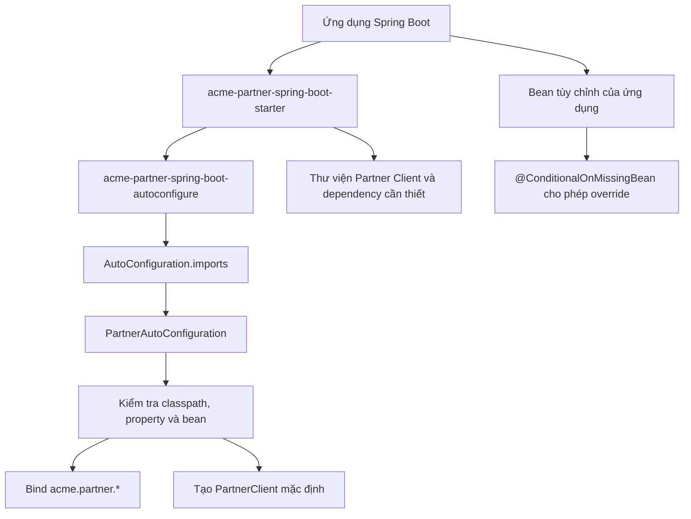

# Đóng gói starter nội bộ với thuộc tính có namespace rõ ràng

## 1. Vì sao starter cần namespace cấu hình riêng?

Một thư viện dùng chung trong tổ chức thường cần cung cấp bean, client hoặc hạ tầng được khởi tạo tự động trong nhiều ứng dụng Spring Boot. Nếu mỗi ứng dụng phải tự khai báo các bean và dependency giống nhau, cấu hình dễ bị sao chép, sai lệch và khó nâng cấp.

Một **starter nội bộ** gom các dependency cần thiết và kết nối chúng với auto-configuration. Ứng dụng chỉ cần thêm một dependency, sau đó tùy chỉnh hành vi qua các property được thiết kế cho thư viện đó.

Ví dụ, công ty có thư viện gọi dịch vụ đối tác. Starter có thể cung cấp `PartnerClient`, timeout mặc định và cách tạo HTTP transport. Ứng dụng tiêu thụ cấu hình bằng các khóa:

```yaml
acme:
  partner:
    enabled: true
    base-url: https://partner.example
    connect-timeout: 2s
    read-timeout: 5s
    max-attempts: 3
```

Namespace `acme.partner` thuộc quyền sở hữu của tổ chức phát hành starter. Các ứng dụng khác có thể dùng thêm nhiều starter nội bộ mà không phải lo các property chung chung ghi đè lẫn nhau.

Bài học thuộc chương **Tùy biến tự động cấu hình** của module **SPRING_CLOUD_CORE**. Module giúp người học hiểu Spring Cloud Commons, Spring Cloud Context, cấu hình ngoài, tương thích Spring Boot, refresh scope, discovery, service registry, giao tiếp dịch vụ và cách kiểm thử/vận hành các abstraction chung.

Sau bài này, người học có thể:

- Phân biệt module thư viện, module auto-configuration và module starter.
- Thiết kế namespace cấu hình ổn định, tránh xung đột với Spring Boot và Spring Cloud.
- Bind property bằng `@ConfigurationProperties` theo kiểu dữ liệu rõ ràng.
- Tạo metadata để IDE hỗ trợ gợi ý và kiểm tra cấu hình.
- Đăng ký auto-configuration bằng `AutoConfiguration.imports`.
- Dùng điều kiện classpath, property và bean để bật cấu hình phù hợp.
- Cho phép ứng dụng thay thế bean mặc định bằng bean riêng.
- Đóng gói dependency mà không kéo theo các integration tùy chọn không cần thiết.
- Kiểm thử starter ở nhiều tổ hợp classpath và property.
- Quản lý tương thích, deprecation và thay đổi namespace qua các phiên bản.

## 2. Cấu trúc một starter nội bộ

### 2.1. Phân chia trách nhiệm

Với một thư viện có một tính năng chính, có thể bắt đầu bằng hai module:

```text
acme-partner/
  acme-partner-spring-boot-autoconfigure/
    src/main/java/
      com/acme/partner/autoconfigure/
        PartnerAutoConfiguration.java
        PartnerProperties.java
    src/main/resources/
      META-INF/spring/
        org.springframework.boot.autoconfigure.AutoConfiguration.imports

  acme-partner-spring-boot-starter/
    pom.xml
```

- **Autoconfigure module:** chứa class cấu hình tự động, property class, callback/API mở rộng và metadata cần thiết.
- **Starter module:** khai báo dependency đến autoconfigure module cùng những thư viện cần thiết để người dùng bắt đầu sử dụng tính năng.

Starter thường là JAR gần như rỗng về code. Vai trò chính của nó là tập hợp dependency theo một lựa chọn mặc định hợp lý. Nếu thư viện rất nhỏ và không có dependency tùy chọn, có thể gộp hai module. Nếu có nhiều integration hoặc nhiều biến thể, tách module giúp người dùng chỉ chọn phần cần thiết.

Ví dụ tên artifact:

| Module | Artifact |
| --- | --- |
| Auto-configuration | `acme-partner-spring-boot-autoconfigure` |
| Starter chính | `acme-partner-spring-boot-starter` |
| Starter dành cho test (nếu cần) | `acme-partner-spring-boot-starter-test` |

Không đặt tên module bắt đầu bằng `spring-boot`. Dùng tên sản phẩm hoặc namespace của tổ chức ở đầu để tránh gây nhầm lẫn với starter chính thức của Spring Boot.

### 2.2. Package của auto-configuration

Đặt class auto-configuration trong package riêng, ví dụ:

```text
com.acme.partner.autoconfigure
```

Không đặt class này dưới package ứng dụng tiêu thụ với kỳ vọng component scan sẽ tìm thấy nó. Spring Boot nạp auto-configuration từ file imports trong JAR. Auto-configuration không nên tự bật component scan để tìm bean khác; hãy dùng `@Import` cụ thể khi cần đưa một cấu hình hoặc thành phần vào context.

Cách tổ chức này giúp ứng dụng tiêu thụ chỉ nhận các cấu hình đã được công bố, đồng thời tránh việc vô tình quét những component nội bộ không thuộc hợp đồng starter.

### 2.3. Luồng khi ứng dụng thêm starter



Ứng dụng có thể dùng cấu hình mặc định hoặc cung cấp bean riêng. Starter không nên ép ứng dụng phải dùng một implementation duy nhất nếu có thể cung cấp một abstraction thay thế được.

## 3. Thiết kế namespace có chủ quyền

### 3.1. Chọn prefix riêng của tổ chức

Spring Boot khuyến nghị mỗi starter tự sở hữu một namespace duy nhất. Với ví dụ này, prefix là `acme.partner`.

Không đặt property riêng của thư viện vào các namespace chung như:

- `spring.*`
- `server.*`
- `management.*`
- `logging.*`

Các namespace đó thuộc hợp đồng của Spring Boot hoặc thành phần nền tảng. Nếu starter tự thêm key vào đó, thay đổi trong framework tương lai có thể làm xung đột hoặc thay đổi semantics của thư viện.

Tên prefix nên thể hiện owner và chức năng:

| Namespace | Đánh giá |
| --- | --- |
| `acme.partner.*` | Rõ tổ chức và chức năng |
| `acme.messaging.kafka.*` | Có thể phù hợp nếu tổ chức sở hữu integration riêng |
| `spring.partner.*` | Không nên; dùng namespace của framework |
| `timeout.*` | Quá chung, dễ trùng |
| `partner.*` | Có thể trùng với thư viện khác nếu không có namespace tổ chức |

Nếu tổ chức có nhiều starter, thống nhất một root namespace rồi chia thành các nhánh theo sản phẩm hoặc domain.

### 3.2. Dùng kebab-case và tên property có nghĩa

Property file nên dùng dạng chữ thường, phân tách từ bằng dấu gạch ngang:

```yaml
acme:
  partner:
    connect-timeout: 2s
    read-timeout: 5s
    max-attempts: 3
```

Tên property nên thể hiện đúng ý nghĩa. Dùng `connect-timeout` thay cho `timeout1`; dùng `max-attempts` thay cho `retry` nếu property thực sự điều khiển số lần thử tối đa.

Với boolean, dùng tên có thể đọc thành câu hỏi, chẳng hạn `enabled`, `log-request-details` hoặc `follow-redirects`. Cần ghi rõ mặc định và phạm vi tác động.

### 3.3. Cấu trúc property theo nhóm

Khi số lượng property tăng, chia thành nhóm theo chức năng thay vì tạo một danh sách dài:

```yaml
acme:
  partner:
    enabled: true
    endpoint:
      base-url: https://partner.example
      connect-timeout: 2s
      read-timeout: 5s
    retry:
      max-attempts: 3
      initial-backoff: 100ms
    observability:
      include-request-id: true
```

Cấu trúc lồng nhau giúp người dùng nhận biết property nào liên quan đến endpoint, retry hay observability. Đây là ví dụ về một schema nhiều nhóm; class `@ConfigurationProperties` tương ứng phải có các object lồng nhau. Record phẳng ở phần tiếp theo dùng schema `acme.partner.base-url`, `acme.partner.connect-timeout` và `acme.partner.read-timeout`. Không tạo tầng lồng quá sâu nếu nó không thể hiện một nhóm cấu hình có ý nghĩa.

### 3.4. Chú ý biến môi trường

Spring Boot hỗ trợ relaxed binding. Với biến môi trường, dấu chấm được đổi thành dấu gạch dưới, dấu gạch ngang bị loại bỏ và tên được chuyển thành chữ hoa.

Ví dụ:

| Property | Biến môi trường |
| --- | --- |
| `acme.partner.enabled` | `ACME_PARTNER_ENABLED` |
| `acme.partner.base-url` | `ACME_PARTNER_BASEURL` |
| `acme.partner.connect-timeout` | `ACME_PARTNER_CONNECTTIMEOUT` |

Không tự thêm dấu gạch dưới vào giữa các từ thay cho quy tắc chuẩn của Spring Boot. Hãy kiểm tra cách bind trong integration test và tài liệu triển khai của starter.

## 4. Bind cấu hình bằng @ConfigurationProperties

### 4.1. Vì sao nên dùng kiểu dữ liệu có cấu trúc?

`@ConfigurationProperties` phù hợp với một nhóm cấu hình của thư viện hơn là rải nhiều biểu thức `@Value` trong các bean.

Nó cung cấp:

- Binding theo kiểu dữ liệu và relaxed binding.
- Hỗ trợ cấu trúc lồng nhau, collection và map.
- Metadata để IDE gợi ý property.
- Khả năng validation.
- Một object cấu hình có thể inject vào nhiều bean.
- Một điểm tập trung để quản lý default và tài liệu property.

Ví dụ class dùng Java record:

```java
package com.acme.partner.autoconfigure;

import java.net.URI;
import java.time.Duration;

import jakarta.validation.constraints.Min;
import jakarta.validation.constraints.NotNull;

import org.springframework.boot.context.properties.ConfigurationProperties;
import org.springframework.boot.context.properties.bind.DefaultValue;
import org.springframework.validation.annotation.Validated;

@ConfigurationProperties("acme.partner")
@Validated
public record PartnerProperties(
        @DefaultValue("false") boolean enabled,
        @NotNull URI baseUrl,
        @DefaultValue("2s") Duration connectTimeout,
        @DefaultValue("5s") Duration readTimeout,
        @DefaultValue("3") @Min(1) int maxAttempts) {
}
```

Ví dụ dùng constructor binding của record theo mô hình Spring Boot hiện hành. `@DefaultValue` cung cấp default cho tham số khi property không được khai báo. Nếu dùng JavaBean thay vì record, có thể khai báo field mặc định cùng getter/setter.

Trong code production, cần viết mô tả property trong Javadoc của field hoặc tham số record để annotation processor tạo metadata dễ hiểu. Với record, mô tả tham số có thể được khai báo bằng Javadoc tag `@param` ở cấp class.

### 4.2. Chọn kiểu dữ liệu thay vì số nguyên không đơn vị

Dùng `Duration` cho timeout và khoảng chờ:

```yaml
acme:
  partner:
    connect-timeout: 1500ms
    read-timeout: 5s
```

Cách này làm rõ đơn vị và tránh hiểu nhầm một số nguyên là millisecond, second hay minute.

Tương tự:

- Dùng `DataSize` cho kích thước buffer hoặc payload.
- Dùng `URI` hoặc `URL` cho endpoint.
- Dùng enum cho lựa chọn có tập giá trị hữu hạn.
- Dùng `List` hoặc `Map` cho tập cấu hình lặp lại.
- Dùng boolean cho trạng thái bật/tắt rõ ràng.

Tránh dùng `String` cho mọi property rồi tự parse ở nhiều bean. Việc parse và kiểm tra kiểu nên diễn ra một lần ở bước binding.

### 4.3. Validation và cấu hình bắt buộc

`@Validated` cho phép Spring Boot thực hiện validation trên bean cấu hình khi có implementation Jakarta Validation trên classpath. Các annotation như `@NotNull`, `@Min`, `@Max`, `@Positive` giúp từ chối cấu hình không hợp lệ sớm.

Ví dụ:

```java
@Validated
@ConfigurationProperties("acme.partner")
public record PartnerProperties(
        @DefaultValue("false") boolean enabled,
        @NotNull URI baseUrl,
        @DefaultValue("2s") Duration connectTimeout,
        @DefaultValue("5s") Duration readTimeout,
        @DefaultValue("3") @Min(1) int maxAttempts) {
}
```

Trong ví dụ, `baseUrl` là bắt buộc khi bean property được đăng ký. Nếu tính năng mặc định tắt, có thể chỉ đăng ký properties trong nested configuration khi tính năng được bật, như ví dụ auto-configuration ở phần sau. Như vậy, ứng dụng không phải khai báo endpoint khi không dùng integration.

Nếu cần validation có điều kiện phức tạp, hãy dùng class validator hoặc tách property object theo nhóm tính năng. Tránh để một property bắt buộc của integration tùy chọn làm ứng dụng không thể khởi động dù integration đã tắt.

### 4.4. Đăng ký properties bean

Auto-configuration có thể dùng `@EnableConfigurationProperties`:

```java
@EnableConfigurationProperties(PartnerProperties.class)
@Configuration(proxyBeanMethods = false)
class PartnerClientConfiguration {
    // Bean sử dụng PartnerProperties
}
```

Với starter, nên đăng ký properties từ chính auto-configuration để người dùng chỉ cần thêm dependency. Không bắt ứng dụng tiêu thụ phải nhớ thêm `@EnableConfigurationProperties` hoặc quét package của thư viện.

Dùng `@ConfigurationPropertiesScan` ở ứng dụng chính có thể phù hợp với cấu hình do chính ứng dụng sở hữu, nhưng không nên yêu cầu người dùng phải scan package nội bộ của starter để auto-configuration hoạt động.

## 5. Sinh configuration metadata cho IDE

### 5.1. Metadata làm gì?

Khi người dùng gõ `acme.partner.` trong file YAML hoặc properties, IDE có thể gợi ý tên property, kiểu dữ liệu, default và mô tả nếu starter đóng gói configuration metadata.

Spring Boot cung cấp annotation processor:

```text
org.springframework.boot:spring-boot-configuration-processor
```

Trong Gradle:

```groovy
dependencies {
    annotationProcessor("org.springframework.boot:spring-boot-configuration-processor")
    annotationProcessor("org.springframework.boot:spring-boot-autoconfigure-processor")
}
```

Với Maven, cấu hình compiler plugin để đưa các processor cần dùng vào annotation processor path. `spring-boot-configuration-processor` sinh property metadata; `spring-boot-autoconfigure-processor` thu thập condition metadata để Boot có thể lọc sớm các auto-configuration không phù hợp. Đặt processor trong cấu hình build/compile, không đưa chúng thành dependency runtime của ứng dụng tiêu thụ.

### 5.2. Viết mô tả property

Mỗi property nên có mô tả cụ thể, chẳng hạn:

```java
@ConfigurationProperties("acme.partner")
public class PartnerProperties {

    /**
     * Whether the partner integration is enabled.
     */
    private boolean enabled = false;

    /**
     * Timeout for establishing a connection to the partner.
     */
    private Duration connectTimeout = Duration.ofSeconds(2);

    // getters and setters
}
```

Mô tả nên nói rõ ý nghĩa và đơn vị. Với boolean, có thể bắt đầu bằng “Whether” hoặc “Enable”. Với collection, nói rõ đây là danh sách gì. Với `Duration`, ghi đơn vị mặc định nếu người dùng không cung cấp suffix.

### 5.3. Metadata thủ công

Annotation processor tự suy ra phần lớn property từ `@ConfigurationProperties`, nhưng một số default hoặc hint không thể suy ra từ source. Khi cần, có thể thêm:

```text
META-INF/additional-spring-configuration-metadata.json
```

File metadata bổ sung có thể mô tả default, deprecation, value hints hoặc property không được bind trực tiếp vào một bean. Chỉ thêm file này khi có thông tin cần bổ sung; không tạo file rỗng chỉ để có mặt trong JAR.

Sau khi build, kiểm tra `META-INF/spring-configuration-metadata.json` trong artifact autoconfigure và thử dùng starter trong một ứng dụng mẫu để xác nhận IDE hiển thị đúng tên, kiểu và mô tả.

## 6. Viết auto-configuration

### 6.1. Dùng @AutoConfiguration

Class auto-configuration dùng `@AutoConfiguration`:

```java
package com.acme.partner.autoconfigure;

import org.springframework.boot.autoconfigure.AutoConfiguration;

@AutoConfiguration
public class PartnerAutoConfiguration {
}
```

`@AutoConfiguration` là dạng chuyên biệt của `@Configuration` dành cho auto-configuration. Có thể dùng thêm các condition để giới hạn khi cấu hình được áp dụng.

Auto-configuration phải được đăng ký qua file imports. Chỉ đặt class trong package không đủ để Spring Boot tự phát hiện nếu nó nằm ngoài component scan.

### 6.2. Tạo bean mặc định có thể override

Ví dụ một integration client chỉ được tạo khi thư viện hiện diện và người dùng bật tính năng:

```java
package com.acme.partner.autoconfigure;

import com.acme.partner.client.PartnerClient;

import org.springframework.boot.autoconfigure.AutoConfiguration;
import org.springframework.boot.autoconfigure.condition.ConditionalOnClass;
import org.springframework.boot.autoconfigure.condition.ConditionalOnMissingBean;
import org.springframework.boot.autoconfigure.condition.ConditionalOnProperty;
import org.springframework.boot.context.properties.EnableConfigurationProperties;
import org.springframework.context.annotation.Bean;
import org.springframework.context.annotation.Configuration;

@AutoConfiguration
public class PartnerAutoConfiguration {

    @Configuration(proxyBeanMethods = false)
    @ConditionalOnClass(PartnerClient.class)
    @ConditionalOnProperty(
            prefix = "acme.partner",
            name = "enabled",
            havingValue = "true"
    )
    @EnableConfigurationProperties(PartnerProperties.class)
    static class PartnerClientConfiguration {

        @Bean
        @ConditionalOnMissingBean
        PartnerClient partnerClient(PartnerProperties properties) {
            return new PartnerClient(
                    properties.baseUrl(),
                    properties.connectTimeout(),
                    properties.readTimeout(),
                    properties.maxAttempts()
            );
        }
    }
}
```

Điểm đáng chú ý:

- `@ConditionalOnClass` kiểm tra thư viện client có trên classpath.
- `@ConditionalOnProperty` yêu cầu người dùng bật `acme.partner.enabled=true`. Khi property không có, cấu hình không khớp vì không đặt `matchIfMissing=true`.
- `@EnableConfigurationProperties` đăng ký property bean trong nhánh cấu hình đã bật.
- `@ConditionalOnMissingBean` cho phép ứng dụng cung cấp `PartnerClient` của riêng mình.
- Bean method trả về kiểu cụ thể để condition có đủ thông tin kiểu khi đánh giá.

Ví dụ giả định constructor của `PartnerClient` nhận các giá trị tương ứng. Khi dùng thư viện thực tế, hãy ánh xạ đúng API của client và chỉ tạo resource sau khi điều kiện cấu hình đã thỏa mãn.

### 6.3. Cô lập dependency tùy chọn

Nếu class được kiểm tra bằng `@ConditionalOnClass` là dependency tùy chọn, cần cẩn thận với kiểu class xuất hiện trong method signature của cấu hình ngoài. Một cách an toàn là đặt các method tham chiếu trực tiếp đến class tùy chọn trong nested configuration được bảo vệ bằng class condition.

Tài liệu Spring Boot minh họa nested static configuration cho trường hợp này. Condition ở nested class giúp JVM không phải xử lý các method reference đến loại class không có trên classpath trước khi điều kiện được đánh giá.

### 6.4. Đăng ký AutoConfiguration.imports

Tạo file đúng đường dẫn:

```text
src/main/resources/META-INF/spring/org.springframework.boot.autoconfigure.AutoConfiguration.imports
```

Nội dung:

```text
com.acme.partner.autoconfigure.PartnerAutoConfiguration
```

Mỗi dòng là một class auto-configuration đầy đủ package. Có thể có comment bắt đầu bằng `#`.

Spring Boot đọc file này trong các JAR trên classpath để tìm auto-configuration candidate. Nếu quên file hoặc sai tên class, auto-configuration có thể không được nạp dù code compile thành công.

Với Spring Boot 2.7 trở lên, dùng cơ chế imports này. Các phiên bản cũ hơn có cơ chế đăng ký legacy qua `META-INF/spring.factories`; không trộn hai cơ chế mà không xác định rõ phiên bản Boot mục tiêu.

### 6.5. Không component scan toàn thư viện

Auto-configuration nên khai báo bean cụ thể bằng `@Bean` hoặc dùng `@Import` để đưa cấu hình cần thiết vào context. Tránh:

```java
@ComponentScan("com.acme.partner")
```

trong auto-configuration chỉ để tìm tất cả component của thư viện. Việc scan rộng có thể đưa các bean nội bộ, cấu hình thử nghiệm hoặc integration không mong muốn vào ứng dụng.

Thay vào đó, import một configuration cụ thể hoặc khai báo bean rõ ràng. Điều này giúp người dùng kiểm soát những gì được thêm vào context.

## 7. Thiết kế condition và default behavior

### 7.1. Những condition thường dùng

| Condition | Mục đích | Ví dụ |
| --- | --- | --- |
| `@ConditionalOnClass` | Chỉ cấu hình khi class/dependency có mặt | Có thư viện Partner Client |
| `@ConditionalOnMissingBean` | Tạo bean mặc định khi người dùng chưa tự khai báo | Tạo `PartnerClient` mặc định |
| `@ConditionalOnBean` | Chỉ tạo thành phần khi dependency bean đã tồn tại | Có một `CredentialsProvider` |
| `@ConditionalOnProperty` | Bật/tắt theo cấu hình | `acme.partner.enabled=true` |
| `@ConditionalOnResource` | Yêu cầu resource tồn tại | File truststore |
| `@ConditionalOnWebApplication` | Chỉ áp dụng trong ứng dụng web | Web interceptor |
| `@ConditionalOnExpression` | Điều kiện SpEL đặc biệt | Chỉ dùng khi condition đơn giản không đáp ứng |

Ưu tiên condition rõ ràng theo classpath, bean và property. Tránh dùng SpEL tham chiếu đến bean trong condition nếu không cần thiết; điều đó có thể khiến bean được khởi tạo quá sớm trong quá trình refresh context.

### 7.2. Chọn default có chủ đích

Với integration gọi hệ thống bên ngoài, default tắt thường an toàn hơn nếu người dùng chưa khai báo endpoint hoặc credential. Ví dụ:

```yaml
acme:
  partner:
    enabled: false
```

Người dùng bật rõ ràng:

```yaml
acme:
  partner:
    enabled: true
    base-url: https://partner.example
```

Nếu một starter được thiết kế để luôn cung cấp bean cốt lõi khi dependency có mặt, có thể chọn default bật bằng `matchIfMissing=true`. Hãy ghi rõ quyết định này trong tài liệu và bảo đảm các default không tạo kết nối mạng, thread hoặc resource ngoài ý muốn trong lúc startup.

### 7.3. Condition trên class và bean

Khi dùng `@ConditionalOnClass` cho dependency tùy chọn, tách cấu hình liên quan thành nested configuration nếu các method signature tham chiếu trực tiếp đến class đó.

Với `@ConditionalOnMissingBean`, Spring Boot khuyến nghị đặt condition ở auto-configuration vì auto-configuration được áp dụng sau bean definitions do người dùng khai báo. Điều này giúp ứng dụng có cơ hội cung cấp bean thay thế trước khi bean mặc định được tạo.

Không dựa vào thứ tự khởi tạo bean để sửa condition. Thứ tự auto-configuration điều khiển thời điểm bean definition được đăng ký; thứ tự khởi tạo instance vẫn phụ thuộc dependency và lifecycle.

### 7.4. Ordering khi thực sự cần thiết

Nếu auto-configuration của thư viện cần áp dụng trước hoặc sau một cấu hình khác, có thể dùng:

- `@AutoConfiguration(before = ...)`
- `@AutoConfiguration(after = ...)`
- `@AutoConfigureBefore`
- `@AutoConfigureAfter`
- `@AutoConfigureOrder`

Chỉ thêm ordering khi có quan hệ phụ thuộc thực sự. Không dùng ordering như cách che giấu bean condition không rõ ràng hoặc ép bean được khởi tạo trước.

## 8. Đóng gói dependency cho starter

### 8.1. Dependency của autoconfigure module

Module auto-configuration thường cần:

- `spring-boot-autoconfigure` để dùng annotation và condition.
- Thư viện client mà auto-configuration tích hợp.
- `spring-boot-configuration-processor` trong annotation processor path để sinh property metadata.
- `spring-boot-autoconfigure-processor` trong annotation processor path nếu cần metadata lọc condition theo hướng dẫn Boot.

Nếu một integration là tùy chọn, đánh dấu dependency tương ứng optional/provided theo hệ build để người dùng có thể thêm autoconfigure module mà không bắt buộc kéo thư viện đó. Cấu hình có condition phải xử lý được trường hợp dependency không có mặt.

### 8.2. Dependency của starter module

Starter module tập hợp các dependency cần thiết để dùng tính năng:

```xml
<dependencies>
    <dependency>
        <groupId>com.acme</groupId>
        <artifactId>acme-partner-spring-boot-autoconfigure</artifactId>
    </dependency>

    <dependency>
        <groupId>com.acme</groupId>
        <artifactId>partner-client</artifactId>
    </dependency>

    <dependency>
        <groupId>org.springframework.boot</groupId>
        <artifactId>spring-boot-starter</artifactId>
    </dependency>

    <dependency>
        <groupId>org.springframework.boot</groupId>
        <artifactId>spring-boot-starter-validation</artifactId>
    </dependency>
</dependencies>
```

Đây là ví dụ dependency aggregator. Phiên bản được quản lý bởi parent/BOM tương thích của tổ chức, không pin tùy tiện một phiên bản Spring Boot hoặc Spring Cloud khác với ứng dụng tiêu thụ.

Nếu validation không phải tính năng mặc định của starter, hãy để nó là tùy chọn hoặc tách thành starter variant. Không kéo theo mọi thư viện mà đội phát triển từng dùng trong quá trình triển khai.

### 8.3. Không ghi đè dependency management của ứng dụng

Starter nội bộ nên phối hợp với dependency management mà ứng dụng đã chọn:

- Dùng Spring Boot BOM hoặc parent phù hợp để quản lý phiên bản Spring Boot.
- Dùng Spring Cloud BOM tương thích với dòng Spring Boot được hỗ trợ.
- Tránh khai báo phiên bản cố định cho từng module Spring Framework/Spring Boot trong starter.
- Không ép một ứng dụng phải đổi release train chỉ vì thêm starter nếu chưa có kế hoạch nâng cấp.
- Công bố rõ ma trận phiên bản Boot, Spring Cloud và JDK đã được kiểm thử.

Một starter tốt giảm cấu hình lặp lại mà không giành quyền quyết định dependency version của ứng dụng chủ.

## 9. Ứng dụng tiêu thụ và khả năng tùy chỉnh

### 9.1. Chỉ thêm một dependency

Trong ứng dụng tiêu thụ, thêm:

```xml
<dependency>
    <groupId>com.acme</groupId>
    <artifactId>acme-partner-spring-boot-starter</artifactId>
</dependency>
```

Nếu auto-configuration được đăng ký đúng, Spring Boot tự nạp cấu hình từ JAR. Người dùng không cần import class auto-configuration thủ công.

### 9.2. Cấu hình qua namespace riêng

Ứng dụng khai báo:

```yaml
acme:
  partner:
    enabled: true
    base-url: https://partner.example
    connect-timeout: 1s
    read-timeout: 4s
    max-attempts: 2
```

Các giá trị này được bind vào `PartnerProperties`. Các bean trong starter inject properties object thay vì đọc Environment ở nhiều nơi.

### 9.3. Override bean mặc định

Nếu ứng dụng cần behavior riêng, khai báo bean cùng kiểu:

```java
@Configuration(proxyBeanMethods = false)
class ApplicationPartnerConfiguration {

    @Bean
    PartnerClient partnerClient() {
        return new CustomPartnerClient();
    }
}
```

Nếu `CustomPartnerClient` triển khai kiểu `PartnerClient` phù hợp, `@ConditionalOnMissingBean` trong auto-configuration sẽ khiến bean mặc định lùi lại.

Hợp đồng của starter nên xác định rõ bean nào có thể override, qualifier hoặc bean name nào được công bố, và những property nào vẫn được dùng bởi các bean khác. Tránh dựa vào tên bean nội bộ không được tài liệu hóa.

### 9.4. Tắt starter hoặc từng capability

Người dùng nên có cách tắt integration:

```yaml
acme:
  partner:
    enabled: false
```

Nếu starter có nhiều capability, dùng nhánh property riêng cho từng phần, ví dụ `acme.partner.metrics.enabled` hoặc `acme.partner.web.enabled`. Mỗi nhánh phải có default và semantics rõ ràng.

Không nên dùng một property mơ hồ như `acme.enabled` để điều khiển nhiều integration độc lập.

## 10. Kiểm thử auto-configuration

### 10.1. Dùng ApplicationContextRunner

`ApplicationContextRunner` giúp kiểm thử một auto-configuration trong context nhỏ, xác định rõ property và user configuration.

Ví dụ:

```java
class PartnerAutoConfigurationTests {

    private final ApplicationContextRunner contextRunner =
            new ApplicationContextRunner()
                    .withConfiguration(
                            AutoConfigurations.of(PartnerAutoConfiguration.class)
                    );

    @Test
    void createsClientWhenEnabled() {
        this.contextRunner
                .withPropertyValues(
                        "acme.partner.enabled=true",
                        "acme.partner.base-url=https://partner.example"
                )
                .run(context -> {
                    assertThat(context).hasSingleBean(PartnerClient.class);
                    assertThat(context).hasSingleBean(PartnerProperties.class);
                });
    }
}
```

Mỗi test tạo một context riêng nên dễ mô tả tổ hợp classpath, property và bean khác nhau. Đây là công cụ phù hợp để kiểm tra condition và back-off behavior mà không cần khởi động toàn bộ ứng dụng.

### 10.2. Kiểm thử default disabled

```java
@Test
void doesNotCreateClientWhenDisabled() {
    this.contextRunner
            .withPropertyValues("acme.partner.enabled=false")
            .run(context -> {
                assertThat(context).doesNotHaveBean(PartnerClient.class);
            });
}
```

Cũng nên kiểm tra trường hợp property `enabled` không được khai báo. Với ví dụ opt-in ở trên, cấu hình không được kích hoạt khi thiếu property.

### 10.3. Kiểm thử bean override

```java
@Test
void backsOffWhenApplicationProvidesClient() {
    this.contextRunner
            .withPropertyValues(
                    "acme.partner.enabled=true",
                    "acme.partner.base-url=https://partner.example"
            )
            .withUserConfiguration(UserPartnerConfiguration.class)
            .run(context -> {
                assertThat(context).hasSingleBean(PartnerClient.class);
                assertThat(context.getBean(PartnerClient.class))
                        .isInstanceOf(CustomPartnerClient.class);
            });
}

@Configuration(proxyBeanMethods = false)
static class UserPartnerConfiguration {

    @Bean
    PartnerClient customPartnerClient() {
        return new CustomPartnerClient();
    }
}
```

Test này chứng minh auto-configuration không tạo bean mặc định khi người dùng đã cung cấp implementation riêng.

### 10.4. Kiểm thử thiếu dependency

Nếu client library là optional, dùng `FilteredClassLoader` để mô phỏng classpath không có thư viện:

```java
@Test
void backsOffWhenClientLibraryIsMissing() {
    this.contextRunner
            .withClassLoader(
                    new FilteredClassLoader(PartnerClient.class)
            )
            .withPropertyValues("acme.partner.enabled=true")
            .run(context -> {
                assertThat(context).doesNotHaveBean(PartnerClient.class);
            });
}
```

Cấu hình không được lỗi chỉ vì dependency tùy chọn không có mặt. Test này đặc biệt quan trọng nếu starter cho phép người dùng chỉ thêm autoconfigure module hoặc chọn nhiều integration khác nhau.

### 10.5. Kiểm thử binding và validation

Kiểm tra:

- `Duration` được bind đúng với suffix như `ms` hoặc `s`.
- Default được áp dụng khi property không khai báo.
- Giá trị không hợp lệ làm context fail với thông báo rõ ràng.
- Property có namespace đúng và không đọc nhầm key từ namespace khác.
- Biến môi trường được bind theo relaxed binding.
- Các nested properties và collection có cấu trúc đúng.

### 10.6. Kiểm thử JAR đã đóng gói

`ApplicationContextRunner` với `AutoConfigurations.of(...)` kiểm tra class auto-configuration nhưng không chứng minh file imports trong artifact đã được đóng gói đúng. Cần thêm smoke test hoặc kiểm tra artifact để xác nhận JAR chứa:

```text
META-INF/spring/org.springframework.boot.autoconfigure.AutoConfiguration.imports
META-INF/spring-configuration-metadata.json
```

Một test tiêu thụ starter như ứng dụng bên ngoài sẽ phát hiện lỗi mà test trong module autoconfigure có thể bỏ sót, chẳng hạn thiếu resource imports hoặc thiếu dependency runtime.

## 11. Quản lý thay đổi và tương thích property

### 11.1. Namespace là hợp đồng công khai

Ngay cả khi starter chỉ dùng trong nội bộ, property của nó vẫn là hợp đồng giữa nhóm phát triển thư viện và các ứng dụng tiêu thụ.

Khi đã phát hành, tránh đổi tùy tiện:

- Prefix namespace.
- Tên property.
- Kiểu dữ liệu.
- Default behavior.
- Ý nghĩa của giá trị.
- Điều kiện bật/tắt.

Một thay đổi tên property có thể làm nhiều ứng dụng không còn cấu hình được client sau khi nâng cấp.

### 11.2. Thêm property mới

Thay đổi thường an toàn hơn là thêm property có default hợp lý. Cần bảo đảm default mới không làm tăng chi phí, bật network access hoặc thay đổi hành vi ngoài ý muốn.

Nếu property mới là bắt buộc cho một capability mới, hãy chỉ validate nó khi capability đó được bật.

### 11.3. Deprecate property cũ

Nếu cần thay `acme.partner.timeout` bằng `acme.partner.read-timeout`:

1. Giữ khả năng đọc property cũ trong giai đoạn chuyển tiếp.
2. Đánh dấu property cũ deprecated bằng metadata phù hợp.
3. Ghi rõ property thay thế.
4. Log cảnh báo có giới hạn nếu người dùng vẫn cấu hình key cũ.
5. Cập nhật ví dụ và tài liệu.
6. Chỉ xóa alias sau thời gian migration đã công bố.

Spring Boot hỗ trợ metadata deprecation để IDE có thể cảnh báo và gợi ý property thay thế. Đừng âm thầm bỏ key cũ trong một bản phát hành minor nếu ứng dụng nội bộ vẫn đang sử dụng.

### 11.4. Thay đổi major và ma trận tương thích

Khi thay đổi major version của starter:

- Kiểm tra lại package API và signature bean có thể override.
- Xác nhận Spring Boot và Spring Cloud release train tương thích.
- Kiểm thử trên các JDK được hỗ trợ.
- Kiểm tra behavior của property binding và validation.
- Xác minh auto-configuration imports và metadata trong JAR.
- Công bố các property bị xóa, đổi tên hoặc thay default.

Không giả định một artifact build cho một major Spring Boot có thể dùng nguyên trạng với major khác. Nếu cần hỗ trợ nhiều dòng, hãy biên dịch và kiểm thử rõ ràng cho từng dòng hoặc phát hành artifact tương ứng.

## 12. Lỗi thường gặp và cách xử lý

| Triệu chứng | Nguyên nhân | Cách xử lý |
| --- | --- | --- |
| Starter được thêm nhưng không có bean | Thiếu hoặc sai file `AutoConfiguration.imports` | Kiểm tra resource path, tên class và nội dung JAR |
| Auto-configuration không chạy | Class không nằm trên classpath hoặc condition không thỏa | Kiểm tra `@ConditionalOnClass` và condition report |
| Property không được bind | Prefix hoặc tên property không khớp | Dùng namespace canonical và kiểm tra `@ConfigurationProperties` |
| IDE không gợi ý property | Thiếu configuration processor hoặc metadata không được đóng gói | Kiểm tra annotation processor và metadata JAR |
| Ứng dụng bị lỗi dù integration tắt | Properties bắt buộc được bind/validate vô điều kiện | Đăng ký properties trong nhánh condition phù hợp |
| Bean tùy chỉnh bị trùng | Thiếu `@ConditionalOnMissingBean` hoặc condition sai kiểu | Cho phép override theo abstraction công bố |
| ClassNotFoundException khi thiếu dependency optional | Method signature của cấu hình ngoài tham chiếu class tùy chọn | Cô lập code vào nested configuration có `@ConditionalOnClass` |
| Property xung đột với starter khác | Dùng prefix chung hoặc namespace framework | Chuyển về namespace do tổ chức sở hữu |
| Starter kéo theo quá nhiều dependency | Starter aggregator thêm integration tùy chọn mặc định | Tách starter variant hoặc để dependency optional |
| Nâng cấp làm mất cấu hình | Đổi tên property hoặc default không tương thích | Deprecate, hỗ trợ alias và migration theo phiên bản |
| Auto-configuration nạp hai lần | Vừa component scan vừa đăng ký imports hoặc khai báo duplicate | Chỉ dùng cơ chế imports cho auto-configuration |
| Startup chậm hoặc side effect bất ngờ | Tạo connection/thread ngay khi context khởi động | Lazy init hoặc tạo resource theo lifecycle và nhu cầu thực |

## 13. Checklist phát hành starter nội bộ

Trước khi publish artifact, hãy xác nhận:

1. Tên module và artifact có namespace của tổ chức không?
2. Auto-configuration và starter có được tách hợp lý theo dependency tùy chọn không?
3. Tất cả property riêng đều nằm dưới prefix do tổ chức sở hữu không?
4. Tên property có dùng canonical kebab-case và có mô tả không?
5. Property dùng kiểu dữ liệu như `Duration`, `DataSize`, `URI` thay cho string/number không đơn vị khi phù hợp không?
6. Default behavior có an toàn và được tài liệu hóa không?
7. Property bắt buộc chỉ được validate khi capability tương ứng bật không?
8. Configuration metadata được sinh và đóng gói không?
9. Auto-configuration có `@AutoConfiguration` và file imports đúng không?
10. Auto-configuration có nằm ngoài component scan và tránh scan toàn package không?
11. Classpath/property/bean conditions có được kiểm thử không?
12. Bean mặc định có thể được ứng dụng override không?
13. Dependency optional có được cô lập và không gây ClassNotFoundException không?
14. Starter có tránh ép phiên bản Boot/Cloud của ứng dụng không?
15. Có kiểm thử JAR đã đóng gói từ góc nhìn ứng dụng tiêu thụ không?
16. Có ma trận tương thích và chính sách deprecation cho property không?

## 14. Tài liệu tham khảo chính thức

- [Spring Boot — Creating Your Own Auto-configuration](https://docs.spring.io/spring-boot/reference/features/developing-auto-configuration.html): cấu trúc auto-configuration, imports file, condition, starter module, namespace property và kiểm thử.
- [Spring Boot — Externalized Configuration](https://docs.spring.io/spring-boot/reference/features/external-config.html): binding, relaxed binding, validation và khác biệt giữa `@ConfigurationProperties` với `@Value`.
- [Spring Boot — Configuration Metadata Annotation Processor](https://docs.spring.io/spring-boot/specification/configuration-metadata/annotation-processor.html): sinh metadata từ `@ConfigurationProperties`, Javadoc, nested properties và metadata bổ sung.
- [Spring Boot — Auto-configuration API](https://docs.spring.io/spring-boot/api/java/org/springframework/boot/autoconfigure/AutoConfiguration.html): annotation dành cho auto-configuration.
- [Spring Cloud — Supported Versions](https://spring.io/projects/spring-cloud#overview): ma trận tương thích giữa Spring Cloud release train và Spring Boot.

**Ghi nhớ:** Starter nội bộ nên cung cấp một dependency dễ dùng, còn namespace cấu hình phải do tổ chức sở hữu và được xem như hợp đồng ổn định. `@ConfigurationProperties` quản lý property có kiểu và metadata; `AutoConfiguration.imports` đăng ký auto-configuration; các condition cho phép starter hoạt động khi dependency phù hợp có mặt, tôn trọng cấu hình bật/tắt và lùi lại khi ứng dụng cung cấp bean riêng.
