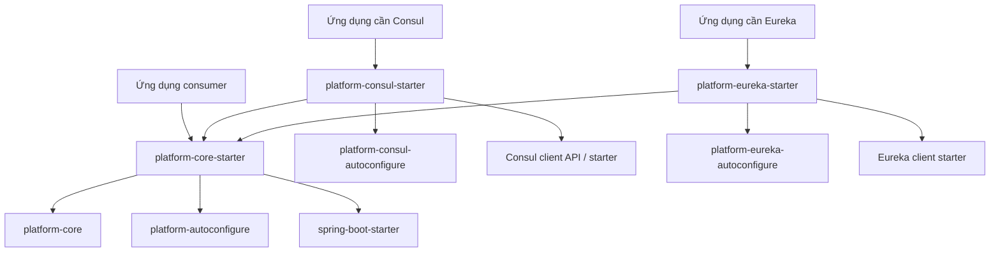

# Tránh đưa phụ thuộc hạ tầng không cần thiết vào starter nền tảng

## 1. Vấn đề của một starter kéo theo quá nhiều hạ tầng

Một starter nền tảng thường được dùng trong nhiều ứng dụng: API service, batch worker, command-line tool, service chạy trong container hoặc ứng dụng chỉ cần một vài abstraction của Spring Cloud. Nếu starter nền tảng mặc định kéo theo client của mọi hệ thống hạ tầng như Consul, Eureka, Redis, Kafka, database driver, cloud SDK và tracing exporter, mọi consumer đều phải mang một classpath lớn dù không sử dụng các tính năng đó.

Ví dụ, một ứng dụng chỉ cần đọc Spring Environment và gọi abstraction DiscoveryClient có thể vô tình nhận thêm nhiều thư viện mạng, serializer, client SDK và native dependency. Hệ quả thường thấy:

- Artifact và image triển khai lớn hơn, thời gian tải và đóng gói tăng.
- Dependency graph có nhiều phiên bản thư viện có thể xung đột với ứng dụng.
- Bề mặt rà soát CVE, license và supply-chain lớn hơn.
- Auto-configuration có thể được kích hoạt ngoài ý muốn hoặc khởi tạo connection tới hạ tầng không cần thiết.
- Consumer khó biết thư viện nào thực sự cần cho chức năng đang sử dụng.
- Nâng cấp một integration có thể ảnh hưởng tất cả ứng dụng dùng starter nền tảng.

Mục tiêu của thiết kế starter là cung cấp đủ thành phần cốt lõi để ứng dụng bắt đầu sử dụng, đồng thời để mỗi integration hạ tầng có dependency và auto-configuration riêng. Một starter nền tảng tốt nên thể hiện rõ **phần nào luôn cần**, **phần nào chỉ cần khi chọn provider**, và **điều kiện nào làm cho bean được tạo**.

Bài học thuộc chương **Tùy biến tự động cấu hình** của **SPRING_CLOUD_CORE**. Trọng tâm là cách tổ chức module, cách khai báo dependency trong Maven/Gradle, bảo vệ auto-configuration bằng condition và kiểm thử rằng classpath tối thiểu vẫn khởi động được.

## 2. Phân loại dependency trước khi thiết kế starter

Trước khi thêm một thư viện vào starter, hãy trả lời nó thuộc nhóm nào:

| Nhóm | Ví dụ | Có nên nằm trong starter nền tảng? |
| --- | --- | --- |
| API và abstraction cốt lõi | Spring Boot core, Spring Cloud Commons, interface nội bộ | Thường có, nếu mọi consumer đều cần |
| Auto-configuration cốt lõi | Bean mặc định, binding properties, converter dùng chung | Có, nếu hoạt động an toàn khi không có provider |
| Client của một provider cụ thể | Eureka, Consul, Zookeeper, Redis, Kafka, Vault | Không; đưa vào integration/starter riêng |
| Driver hoặc SDK tùy chọn | PostgreSQL driver, AWS SDK, Azure SDK, cloud database client | Không; ứng dụng chọn công nghệ thì tự thêm |
| Công cụ kiểm thử | JUnit, Mockito, Testcontainers, embedded broker | Chỉ trong test scope hoặc starter-test |
| Dependency quản lý version | BOM và dependency constraints | Đặt trong dependency management; không tự thêm artifact vào classpath |

Cần phân biệt ba khái niệm:

- **Dependency management** quản lý version và constraint của artifact.
- **Dependency declaration** đưa artifact vào graph và classpath.
- **Auto-configuration condition** quyết định bean/cấu hình có được kích hoạt khi ứng dụng chạy hay không.

Import Spring Cloud BOM trong dependencyManagement không có nghĩa là tất cả module Spring Cloud sẽ được đưa vào ứng dụng. Ngược lại, thêm một starter vào dependencies có thể kéo theo cả cây dependency của starter đó.

Một dependency được đánh dấu optional cũng không tự động làm bean trở nên optional. Dependency graph và điều kiện khởi tạo bean là hai lớp kiểm soát riêng.

## 3. Cấu trúc module nên dùng

Với một nền tảng có nhiều provider, nên tách module theo ranh giới chức năng. Ví dụ nền tảng nội bộ cần API chung và có thể tích hợp Consul hoặc Eureka:



Vai trò từng module:

| Module | Trách nhiệm | Dependency đặc trưng |
| --- | --- | --- |
| `platform-core` | Contract, model, service API và cấu hình dùng chung | Spring Cloud Commons nếu API công khai cần abstraction đó |
| `platform-autoconfigure` | Bean mặc định không gắn với provider cụ thể | `platform-core`, Spring Boot auto-configuration |
| `platform-core-starter` | Điểm vào tối thiểu cho đa số ứng dụng | Core, auto-config và `spring-boot-starter` |
| `platform-consul-autoconfigure` | Điều kiện và bean tích hợp Consul | Consul API ở compile/test; chỉ kích hoạt khi class có mặt |
| `platform-consul-starter` | Lựa chọn rõ ràng để dùng Consul | Consul auto-config và Consul discovery starter |
| `platform-eureka-autoconfigure` | Điều kiện và bean tích hợp Eureka | Eureka API ở compile/test; chỉ kích hoạt khi class có mặt |
| `platform-eureka-starter` | Lựa chọn rõ ràng để dùng Eureka | Eureka auto-config và Eureka client starter |
| `platform-starter-test` | Helper và test fixture cho consumer | Test libraries, không kéo vào runtime production |

Nếu nền tảng chỉ có một tính năng đơn giản và không có flavor tùy chọn, có thể gộp auto-configuration và starter. Khi có nhiều provider hoặc nhiều feature độc lập, tách module giúp biểu đạt rõ lựa chọn và giảm dependency không cần thiết.

Không nên đặt implementation của Consul, Eureka, Redis hoặc Kafka trong `platform-core`. Core chỉ nên phụ thuộc abstraction cần thiết. Adapter/provider-specific code thuộc module integration tương ứng.

## 4. Starter nền tảng chỉ kéo những gì thực sự cần

Một starter thường là artifact mỏng, mục đích chính là gom dependency hợp lý cho một trường hợp sử dụng. Ví dụ Maven POM rút gọn của `platform-core-starter`:

```xml
<dependencies>
    <dependency>
        <groupId>com.example.platform</groupId>
        <artifactId>platform-core</artifactId>
    </dependency>

    <dependency>
        <groupId>com.example.platform</groupId>
        <artifactId>platform-autoconfigure</artifactId>
    </dependency>

    <dependency>
        <groupId>org.springframework.boot</groupId>
        <artifactId>spring-boot-starter</artifactId>
    </dependency>
</dependencies>
```

Starter này không khai báo Consul, Eureka, Redis hay Kafka. Một ứng dụng chỉ thêm `platform-core-starter` sẽ nhận API và auto-configuration chung.

Ứng dụng muốn dùng Consul thêm starter chuyên biệt:

```xml
<dependencies>
    <dependency>
        <groupId>com.example.platform</groupId>
        <artifactId>platform-consul-starter</artifactId>
    </dependency>
</dependencies>
```

POM của `platform-consul-starter` mới khai báo các dependency cần cho tích hợp đó:

```xml
<dependencies>
    <dependency>
        <groupId>com.example.platform</groupId>
        <artifactId>platform-core-starter</artifactId>
    </dependency>

    <dependency>
        <groupId>com.example.platform</groupId>
        <artifactId>platform-consul-autoconfigure</artifactId>
    </dependency>

    <dependency>
        <groupId>com.vendor</groupId>
        <artifactId>consul-client-api</artifactId>
    </dependency>
</dependencies>
```

Ứng dụng muốn dùng Eureka chọn `platform-eureka-starter`. Nhờ vậy, lựa chọn provider thể hiện ngay trong dependency declaration và có thể kiểm tra bằng dependency tree.

### 4.1. Quản lý version không đồng nghĩa thêm dependency

Có thể import BOM để các module dùng version tương thích:

```xml
<dependencyManagement>
    <dependencies>
        <dependency>
            <groupId>org.springframework.cloud</groupId>
            <artifactId>spring-cloud-dependencies</artifactId>
            <version>SPRING_CLOUD_RELEASE_TRAIN_VERSION</version>
            <type>pom</type>
            <scope>import</scope>
        </dependency>
    </dependencies>
</dependencyManagement>
```

`SPRING_CLOUD_RELEASE_TRAIN_VERSION` là placeholder cần thay bằng release train tương thích với Spring Boot baseline của dự án. BOM quản lý version khi artifact được khai báo; nó không tự thêm Eureka, Consul hoặc các starter khác vào classpath.

Giữ version trong BOM hoặc dependency constraints tập trung để tránh mỗi integration tự chọn một version khác nhau. Nhưng chỉ khai báo artifact trong dependencies khi module thực sự cần nó.

## 5. Maven optional có nghĩa gì?

Trong Maven, `<optional>true</optional>` thay đổi việc truyền dependency xuống consumer. Nó **không loại dependency khỏi classpath của module đang khai báo nó**.

Giả sử `platform-consul-autoconfigure` cần compile với API của Consul nhưng không muốn `platform-autoconfigure` hoặc ứng dụng chỉ dùng core nhận dependency này gián tiếp:

```xml
<dependency>
    <groupId>com.vendor</groupId>
    <artifactId>consul-client-api</artifactId>
    <optional>true</optional>
</dependency>
```

Trong module `platform-consul-autoconfigure`, dependency vẫn có mặt để biên dịch và chạy test. Khi một dự án khác chỉ khai báo module này làm dependency, Maven không tự truyền `consul-client-api` sang dự án đó. Consumer phải khai báo dependency provider trực tiếp, thường thông qua `platform-consul-starter`.

Ví dụ không ghi `<version>` vì giả định artifact đã được quản lý trong BOM của nền tảng hoặc provider. Nếu không có dependency management, hãy khai báo version rõ ràng.

Đây là điểm quan trọng:

| Nơi xét | Dependency optional có mặt không? |
| --- | --- |
| Compile classpath của chính module khai báo optional dependency | Có |
| Runtime classpath của chính module đó theo scope tương ứng | Có |
| Consumer chỉ phụ thuộc module đó | Không được truyền tự động |
| Consumer khai báo thêm provider starter trực tiếp | Có, do provider starter đưa dependency vào graph |

`optional` không có nghĩa dependency chỉ tải khi gọi một method, cũng không tự bật/tắt bean. Nó là metadata về transitivity ở ranh giới consumer.

### 5.1. Khi nào dùng optional, khi nào tách module?

Maven xem optional dependency là một cách xử lý khi không thể tách feature ra module riêng. Nếu feature có thể tách, module chuyên biệt thường dễ hiểu hơn:

- `platform-core` chứa phần mọi ứng dụng cần.
- `platform-consul-autoconfigure` chứa code chỉ liên quan Consul.
- `platform-consul-starter` đưa Consul integration vào ứng dụng theo lựa chọn rõ ràng.

Dùng optional khi một module không thể tách hợp lý hoặc cần hỗ trợ một số flavor trong cùng artifact. Nếu có nhiều integration lớn, giữ tất cả trong một module rồi đánh dấu optional sẽ khiến source code, test và auto-configuration phức tạp hơn.

Không dùng `<scope>provided</scope>` để giả lập optional. `provided` có ý nghĩa dependency được môi trường triển khai cung cấp; nó không biểu đạt cùng semantics với optional transitivity.

## 6. Gradle: hiểu đúng các configuration dependency

Gradle không dùng đúng mô hình `<optional>true</optional>` của Maven cho dependency declaration thông thường. Với Java Library plugin, các configuration có vai trò khác nhau:

| Configuration | Classpath của module hiện tại | Consumer compile classpath | Consumer runtime |
| --- | --- | --- | --- |
| `api` | Compile và runtime | Có | Có |
| `implementation` | Compile và runtime | Không | Có |
| `compileOnly` | Compile | Không | Không |
| `runtimeOnly` | Runtime | Không | Có |
| `testImplementation` | Test compile và test runtime | Không | Không |
| `testRuntimeOnly` | Test runtime | Không | Không |

Điểm dễ nhầm là `implementation` **vẫn được truyền sang runtime của consumer**. Nó chỉ không được đưa vào compile classpath của consumer. Vì thế, đổi một dependency từ `api` sang `implementation` chưa đủ để loại provider SDK khỏi runtime application.

Ví dụ module auto-config compile với API Consul nhưng không muốn tự truyền thư viện đó cho mọi consumer:

```kotlin
plugins {
    `java-library`
}

dependencies {
    implementation(project(":platform-core"))

    // Chỉ cần để biên dịch phần integration có điều kiện.
    compileOnly("com.vendor:consul-client-api")

    // Có mặt khi chạy test cho nhánh Consul được bật.
    testImplementation("com.vendor:consul-client-api")
}
```

Module starter riêng thêm provider vào runtime:

```kotlin
plugins {
    `java-library`
}

dependencies {
    implementation(project(":platform-core-starter"))
    implementation(project(":platform-consul-autoconfigure"))

    // Provider client chỉ đi cùng starter Consul.
    runtimeOnly("com.vendor:consul-client-api")
}
```

`runtimeOnly` phù hợp khi consumer chỉ cần thư viện ở runtime và public API của starter không để lộ type từ provider. Nếu consumer phải compile code trực tiếp với type của provider, hãy cân nhắc dependency công khai phù hợp và chấp nhận rằng provider là một phần của API sử dụng.

Dùng `api` khi type của dependency xuất hiện trong public API của thư viện, chẳng hạn superclass, interface, public method parameter hoặc annotation công khai. Nếu dependency chỉ được dùng nội bộ, ưu tiên `implementation`. Với thư viện tùy chọn, cân nhắc `compileOnly` và module/starter chuyên biệt thay vì đưa nó vào `api`.

Gradle còn hỗ trợ feature variants cho thư viện công bố nhiều optional feature. Đây là lựa chọn nâng cao khi cần một artifact mô tả nhiều capability riêng. Với starter Spring Boot, các module/starter theo provider thường dễ hiểu và dễ kiểm tra hơn.

Nếu build dùng Spring Cloud BOM, Gradle có thể import platform để quản lý version mà không thêm mọi artifact vào runtime:

```kotlin
dependencies {
    implementation(platform(
        "org.springframework.cloud:spring-cloud-dependencies:SPRING_CLOUD_RELEASE_TRAIN_VERSION"
    ))
}
```

Thay placeholder bằng release train tương thích với Spring Boot baseline. Sau đó khai báo riêng từng artifact trong configuration phù hợp như `implementation`, `compileOnly` hoặc `runtimeOnly`.

## 7. Auto-configuration phải chịu được classpath tối thiểu

Tách dependency chỉ giải quyết một nửa bài toán. Auto-configuration cũng phải hoạt động khi thư viện provider không có trên classpath.

Spring Boot cung cấp các condition thường dùng:

| Condition | Câu hỏi |
| --- | --- |
| `@ConditionalOnClass` | Class cần thiết có trên classpath không? |
| `@ConditionalOnMissingClass` | Một class cụ thể có vắng mặt không? |
| `@ConditionalOnBean` | Context đã có bean phụ thuộc chưa? |
| `@ConditionalOnMissingBean` | Consumer đã tự cung cấp bean thay thế chưa? |
| `@ConditionalOnProperty` | Người dùng đã bật feature bằng property chưa? |
| `@ConditionalOnResource` | Resource cần thiết có tồn tại không? |

Một integration thường cần kết hợp nhiều điều kiện:

- Provider API phải có trên classpath.
- Feature phải được bật bằng property nếu muốn opt-in.
- Các bean phụ thuộc phải tồn tại.
- Auto-configuration chỉ tạo bean mặc định khi consumer chưa tự định nghĩa bean tương ứng.

Ví dụ, feature Consul chỉ bật khi người dùng yêu cầu rõ ràng:

```yaml
platform:
  discovery:
    consul:
      enabled: true
```

Điều kiện property nên có default an toàn. Nếu một feature mở kết nối mạng hoặc tạo resource ngoài ứng dụng, thường nên dùng opt-in (mặc định không match khi property bị thiếu) để chỉ bật khi consumer cấu hình.

## 8. Cô lập tham chiếu tới class tùy chọn

Một lỗi thường gặp là auto-configuration có method signature tham chiếu class provider dù provider không có trên classpath. Ví dụ một bean method trả về `ConsulClient`, nhưng điều kiện `@ConditionalOnClass` chỉ đặt trên chính method đó. JVM có thể cần load class hoặc xử lý method signature trước khi method condition được đánh giá, dẫn tới `NoClassDefFoundError`.

Cách an toàn là đặt phần code phụ thuộc provider trong một configuration riêng, được bảo vệ bằng class condition. Ví dụ sau dùng type minh họa `com.vendor.consul.ConsulClient`; trong dự án thực tế thay bằng API class của provider đã chọn:

```java
package com.example.platform.autoconfigure.consul;

import com.vendor.consul.ConsulClient;
import com.example.platform.ConsulAdapter;
import org.springframework.boot.autoconfigure.AutoConfiguration;
import org.springframework.boot.autoconfigure.condition.ConditionalOnBean;
import org.springframework.boot.autoconfigure.condition.ConditionalOnClass;
import org.springframework.boot.autoconfigure.condition.ConditionalOnMissingBean;
import org.springframework.boot.autoconfigure.condition.ConditionalOnProperty;
import org.springframework.context.annotation.Bean;
import org.springframework.context.annotation.Configuration;

@AutoConfiguration
public class PlatformConsulAutoConfiguration {

    @Configuration(proxyBeanMethods = false)
    @ConditionalOnClass(name = "com.vendor.consul.ConsulClient")
    static class ConsulClientConfiguration {

        @Bean
        @ConditionalOnBean(ConsulClient.class)
        @ConditionalOnProperty(
                prefix = "platform.discovery.consul",
                name = "enabled",
                havingValue = "true"
        )
        @ConditionalOnMissingBean
        ConsulAdapter consulAdapter(ConsulClient consulClient) {
            return new ConsulAdapter(consulClient);
        }
    }
}
```

Cấu trúc này có bốn lớp bảo vệ:

1. Nested configuration chỉ được xử lý khi class provider tồn tại.
2. Bean chỉ được tạo khi context có bean client cần thiết.
3. Property phải được bật rõ ràng trước khi tạo integration bean.
4. `@ConditionalOnMissingBean` cho phép consumer tự cung cấp `ConsulAdapter`.

Đặt class condition trên configuration tách biệt giúp Spring Boot đọc annotation metadata và loại bỏ nhánh trước khi cần xử lý method signature có type tùy chọn. Nếu chỉ dùng `@ConditionalOnClass` trên `@Bean` method mà return type hoặc parameter type đã tham chiếu class vắng mặt, điều kiện có thể đến quá muộn.

Không để class provider xuất hiện trong field, superclass, interface, annotation hoặc static initializer của auto-configuration luôn được nạp. Cô lập tất cả tham chiếu đó trong nested configuration hoặc module riêng.

## 9. Đăng ký auto-configuration trong JAR

Với Spring Boot hiện đại, auto-configuration được liệt kê trong file:

```text
META-INF/spring/org.springframework.boot.autoconfigure.AutoConfiguration.imports
```

Ví dụ file của module `platform-consul-autoconfigure`:

```text
com.example.platform.autoconfigure.consul.PlatformConsulAutoConfiguration
```

Mỗi dòng là một class auto-configuration. Auto-configuration nên được đặt trong package riêng và chỉ được nạp qua imports file; không dùng component scan rộng để vô tình nạp configuration provider khi consumer không cần.

Nếu phải hỗ trợ một baseline Spring Boot cũ hơn, hãy dùng cơ chế đăng ký auto-configuration mà baseline đó hỗ trợ và kiểm tra compatibility matrix của dự án. Không sao chép file metadata của một release khác mà không xác nhận version.

Có thể đặt auto-configuration cốt lõi và auto-configuration của từng provider trong các artifact riêng. Generic starter chỉ đưa core auto-configuration vào; provider starter mới thêm provider auto-configuration.

## 10. BOM và starter có trách nhiệm khác nhau

BOM giúp các module dùng version tương thích. Starter quyết định dependency nào được đưa vào ứng dụng.

Ví dụ:

- `platform-dependencies` quản lý version của `platform-core`, provider adapters và Spring Cloud modules.
- `platform-core-starter` khai báo dependency tối thiểu cho core.
- `platform-consul-starter` khai báo core cùng Consul integration.
- `platform-eureka-starter` khai báo core cùng Eureka integration.

Không thêm mọi provider vào BOM chỉ để chúng xuất hiện trong ứng dụng. BOM có thể quản lý version của nhiều artifact mà không đưa artifact nào vào classpath.

Ngược lại, nếu starter khai báo một provider starter trong dependencies, provider đó sẽ được resolve theo metadata của dependency, bất kể version được quản lý ở BOM hay khai báo trực tiếp.

Khi consumer dùng nhiều starter, BOM giúp tránh version drift giữa các module nhưng không thay thế việc chọn đúng starter.

## 11. Kiểm thử auto-configuration khi dependency có hoặc không có

Một bộ test tốt phải chứng minh hai trường hợp: classpath tối thiểu vẫn chạy, và integration được kích hoạt khi dependency cùng cấu hình đã có.

Spring Boot cung cấp `ApplicationContextRunner` để tạo ApplicationContext nhỏ, độc lập cho từng tình huống. `FilteredClassLoader` mô phỏng việc một class hoặc package không có trên runtime classpath.

Ví dụ kiểm tra auto-configuration không tạo adapter khi provider class vắng mặt:

Module test cần `spring-boot-starter-test` ở test scope và provider API ở test compile/runtime để có thể tạo `FilteredClassLoader` cho class cần mô phỏng.

```java
import com.vendor.consul.ConsulClient;
import com.example.platform.ConsulAdapter;
import com.example.platform.autoconfigure.consul.PlatformConsulAutoConfiguration;
import org.junit.jupiter.api.Test;
import org.springframework.boot.autoconfigure.AutoConfigurations;
import org.springframework.boot.test.context.runner.ApplicationContextRunner;
import org.springframework.boot.test.context.FilteredClassLoader;

import static org.assertj.core.api.Assertions.assertThat;

class PlatformConsulAutoConfigurationTests {

    private final ApplicationContextRunner runner =
            new ApplicationContextRunner()
                    .withConfiguration(
                            AutoConfigurations.of(
                                    PlatformConsulAutoConfiguration.class
                            )
                    );

    @Test
    void backsOffWhenConsulLibraryIsMissing() {
        runner.withClassLoader(new FilteredClassLoader(ConsulClient.class))
                .withPropertyValues(
                        "platform.discovery.consul.enabled=true"
                )
                .run(context ->
                        assertThat(context)
                                .doesNotHaveBean(ConsulAdapter.class)
                );
    }
}
```

Trong test trên, provider class có mặt ở test compile classpath để test có thể tham chiếu tới nó, sau đó `FilteredClassLoader` giả lập runtime không có class đó. Test không cần khởi động Consul thật.

Bổ sung các tình huống:

| Tình huống | Kết quả cần xác nhận |
| --- | --- |
| Không có provider class | Auto-configuration provider không tạo bean và context không lỗi |
| Có provider class nhưng property không bật | Không tạo bean hoặc không mở kết nối |
| Có provider class và property bật | Bean integration được tạo nếu các điều kiện còn lại thỏa |
| Consumer tự khai báo bean | Auto-configuration lùi lại, không tạo bean trùng |
| Chỉ có core starter | Không có provider SDK trong runtime dependency graph |
| Có provider starter | Provider SDK và integration auto-configuration xuất hiện |
| Nhiều provider starter | Các adapter không xung đột, bean có điều kiện và qualifier rõ ràng |

Nên dùng mock hoặc fake client cho unit/context test. Integration test với Consul/Eureka/Redis/Kafka thật thuộc test suite chuyên biệt và có thể dùng Testcontainers khi cần. Không buộc mọi consumer phải chạy hạ tầng ngoài chỉ để xác nhận starter nền tảng có thể khởi động.

## 12. Kiểm tra dependency graph thực tế

Không chỉ đọc POM hoặc build script. Hãy kiểm tra graph sau khi dependency management và transitive resolution được áp dụng.

### 12.1. Maven

Xem cây dependency của generic starter:

```bash
./mvnw -pl platform-core-starter dependency:tree
```

Lọc riêng các artifact hạ tầng:

```bash
./mvnw -pl platform-core-starter dependency:tree \
  -Dincludes=com.vendor:consul-client-api
```

Nếu kết quả có Consul dù generic starter không chủ đích hỗ trợ Consul, lần theo đường dependency đưa artifact đó vào. Dùng `dependency:analyze` để tìm dependency khai báo nhưng không dùng và dependency được sử dụng nhưng chưa khai báo trực tiếp.

Kiểm tra `effective-pom` khi version hoặc scope được kế thừa từ parent/BOM làm kết quả khác với file POM đang nhìn.

### 12.2. Gradle

Xem runtime classpath:

```bash
./gradlew :platform-core-starter:dependencies --configuration runtimeClasspath
```

Tìm đường đưa một artifact cụ thể vào graph:

```bash
./gradlew :platform-core-starter:dependencyInsight \
  --dependency consul-client-api \
  --configuration runtimeClasspath
```

Phân biệt `compileClasspath` với `runtimeClasspath`. Một dependency không xuất hiện trên compile classpath của consumer vẫn có thể xuất hiện ở runtime vì module trung gian khai báo nó bằng `implementation`.

### 12.3. Đưa dependency budget vào review

Có thể duy trì danh sách artifact hạ tầng không được phép xuất hiện trong generic starter. CI có thể kiểm tra dependency tree hoặc dùng rule/enforcer tương ứng để build thất bại khi một provider ngoài danh sách xuất hiện.

Khi thêm dependency mới, pull request nên giải thích:

- Feature nào cần thư viện này?
- Tất cả consumer có cần không?
- Có thể chuyển dependency sang provider-specific module không?
- Auto-configuration có điều kiện theo classpath và property chưa?
- Generic starter runtime graph có tăng ngoài dự kiến không?
- License, CVE và kích thước artifact có thay đổi không?

## 13. Những cách làm dễ gây lỗi

| Cách làm | Vấn đề | Cách xử lý |
| --- | --- | --- |
| Thêm mọi provider starter vào generic starter | Tất cả ứng dụng phải mang mọi client hạ tầng | Tạo starter riêng cho từng provider |
| Đánh dấu dependency optional nhưng không có starter provider | Consumer không nhận dependency nên feature không thể chạy | Provider-specific starter phải khai báo dependency đó trực tiếp |
| Nghĩ optional=true loại dependency khỏi module build | Module vẫn cần dependency để compile/test | Hiểu optional là quy tắc transitivity sang consumer |
| Đổi Gradle implementation rồi nghĩ dependency biến mất khỏi runtime | implementation vẫn là runtime dependency của consumer | Dùng module riêng hoặc compileOnly khi đúng mục đích |
| Dùng compileOnly nhưng quên provider runtime dependency | Auto-configuration không tìm thấy class khi chạy | Provider starter bổ sung dependency runtime |
| Đặt optional class trong signature của auto-configuration luôn được nạp | Có thể gặp NoClassDefFoundError trước khi condition có hiệu lực | Cô lập trong nested configuration có ConditionalOnClass |
| Chỉ dùng property condition | Property bật nhưng thư viện provider không có | Kết hợp class condition và property condition |
| Tạo connection ngay trong constructor bean mặc định | Ứng dụng có thể kết nối hạ tầng dù không dùng feature | Opt-in, lazy/resource lifecycle và timeout rõ ràng |
| Dùng exclusions để sửa mọi dependency graph | Có thể loại thư viện mà nhánh khác thực sự cần | Sửa dependency tại module sở hữu hoặc tách integration |
| Dùng BOM như một cách thêm starter | BOM chỉ quản lý version | Khai báo dependency riêng trong starter phù hợp |
| Test chỉ trên classpath đầy đủ | Không phát hiện nhánh thiếu provider class | Dùng FilteredClassLoader và test từng condition |

## 14. Quy trình thiết kế một integration mới

Khi thêm provider mới vào nền tảng, thực hiện theo thứ tự:

1. Xác định contract cốt lõi mà ứng dụng cần; giữ contract trong `platform-core`.
2. Tạo module auto-configuration riêng cho provider.
3. Đặt dependency provider ở compile/test scope cần thiết của module integration; không truyền nó qua generic starter.
4. Dùng `@ConditionalOnClass` để cô lập code tham chiếu provider.
5. Dùng `@ConditionalOnProperty` để kiểm soát việc bật feature nếu integration cần opt-in.
6. Dùng `@ConditionalOnMissingBean` để consumer có thể thay implementation mặc định.
7. Đăng ký auto-configuration trong metadata đúng với Spring Boot baseline.
8. Tạo provider-specific starter khai báo provider dependency một cách trực tiếp.
9. Viết `ApplicationContextRunner` test cho classpath có và không có provider.
10. Kiểm tra dependency tree của generic starter và provider starter.
11. Xác nhận generic starter không mở connection tới hạ tầng tùy chọn khi ứng dụng khởi động.
12. Ghi rõ dependency và property cần thiết trong tài liệu của provider starter.

Quy trình này giúp mỗi integration có vòng đời version, điều kiện kích hoạt và test riêng, trong khi consumer core vẫn có classpath nhỏ và hành vi dễ dự đoán.

## 15. Câu hỏi tự kiểm tra

1. Vì sao starter nền tảng không nên kéo theo mọi provider hạ tầng?
2. Dependency management khác dependency declaration như thế nào?
3. Maven optional=true ảnh hưởng classpath của module khai báo và consumer ra sao?
4. Vì sao tách provider-specific module thường rõ ràng hơn gom mọi API vào một module optional?
5. Gradle implementation có được truyền vào runtime classpath của consumer không?
6. Khi nào nên dùng Gradle api, implementation, compileOnly và runtimeOnly?
7. Vì sao class condition cần được cô lập khỏi method signature có type tùy chọn?
8. ConditionalOnClass, ConditionalOnProperty và ConditionalOnMissingBean giải quyết các điều kiện khác nhau nào?
9. AutoConfiguration.imports có vai trò gì trong JAR auto-configuration?
10. Làm thế nào dùng ApplicationContextRunner và FilteredClassLoader để kiểm tra classpath thiếu provider?
11. Vì sao dependency tree runtime quan trọng hơn việc chỉ xem compile classpath?
12. Một provider-specific starter cần khai báo những thành phần nào để feature hoạt động?

## 16. Tài liệu tham khảo chính thức

- [Spring Boot — Creating Your Own Auto-configuration](https://docs.spring.io/spring-boot/reference/features/developing-auto-configuration.html) — cấu trúc auto-configuration/starter, ConditionalOnClass, ConditionalOnMissingBean, imports metadata và ApplicationContextRunner.
- [Maven — Optional Dependencies and Dependency Exclusions](https://maven.apache.org/guides/introduction/introduction-to-optional-and-excludes-dependencies.html) — semantics của optional, transitivity và khi nào nên tách module.
- [Maven — Introduction to the Dependency Mechanism](https://maven.apache.org/guides/introduction/introduction-to-dependency-mechanism.html) — dependency scope, transitive resolution, BOM và dependency tree.
- [Gradle — The Java Library Plugin](https://docs.gradle.org/current/userguide/java_library_plugin.html) — api, implementation, compileOnly, runtimeOnly và dependency variants.
- [Gradle — Dependency Configurations](https://docs.gradle.org/current/userguide/dependency_configurations.html) — vai trò declarable, resolvable và consumable của dependency configuration.

*Tài liệu tập trung vào việc giữ starter nền tảng nhỏ, tách provider theo nhu cầu và bảo đảm auto-configuration an toàn khi thư viện tùy chọn vắng mặt. Hãy kiểm tra cả dependency graph ở runtime lẫn hành vi của ApplicationContext trên classpath tối thiểu.*
