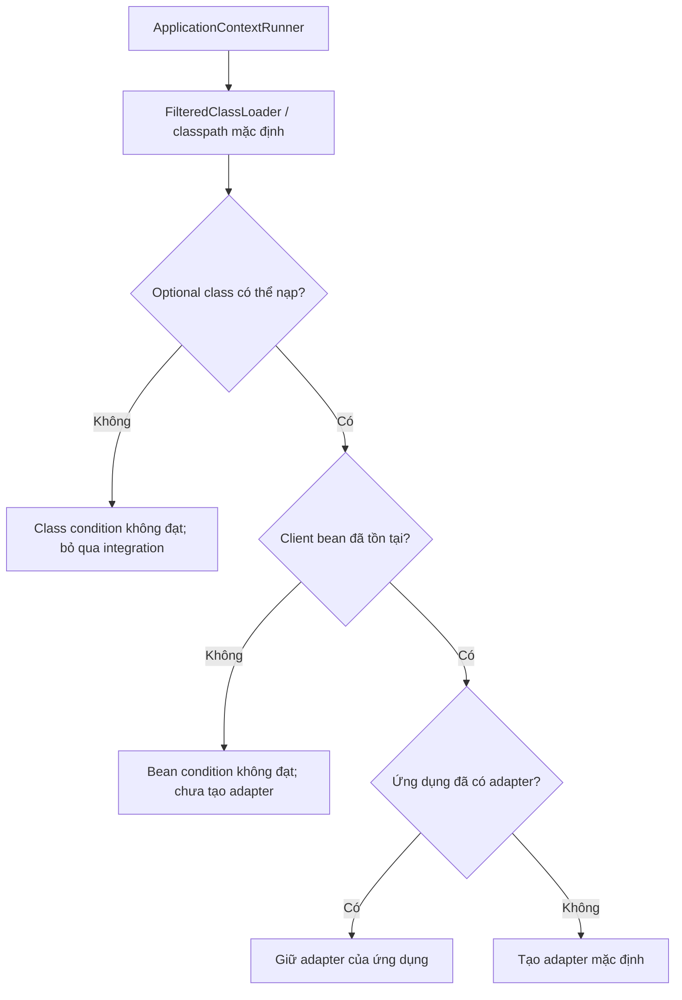

# Mô phỏng classpath thiếu hoặc có implementation

Một auto-configuration của Spring Cloud thường tích hợp với thư viện tùy chọn: client của Eureka, Consul, một SDK nội bộ hoặc một implementation `DiscoveryClient`. Ứng dụng có thể chỉ thêm thư viện đó trong một số môi trường. Khi dependency có mặt, Spring cần tạo bean tích hợp; khi dependency không có, context vẫn phải khởi động bình thường và không được tham chiếu tới class bị thiếu.

Kiểm thử cả hai tình huống chỉ bằng một classpath cố định thường không đủ. Nếu test luôn chạy với đầy đủ dependency, nhánh “không có implementation” sẽ không được kiểm tra. Spring Boot cung cấp `FilteredClassLoader` để mô phỏng việc một class hoặc package không thể được nạp, kết hợp với `ApplicationContextRunner` để dựng context nhỏ theo từng kịch bản.

Bài học thuộc chương **Kiểm thử** của **SPRING_CLOUD_CORE**. Nội dung tập trung vào cách mô phỏng implementation có mặt hoặc vắng mặt, phân biệt classpath condition với bean condition, kiểm tra auto-configuration của Spring Cloud, và xác minh rằng ứng dụng vẫn hoạt động khi provider tùy chọn không được cài đặt.

## 1. Mục tiêu học tập

Sau bài này, bạn có thể:

- Phân biệt class có trên classpath với bean đã được đăng ký trong `ApplicationContext`.
- Giải thích vai trò của `@ConditionalOnClass`, `@ConditionalOnMissingClass`, `@ConditionalOnBean` và `@ConditionalOnMissingBean`.
- Dùng `ApplicationContextRunner` để kiểm thử một auto-configuration trong context cô lập.
- Dùng `FilteredClassLoader` để ẩn class hoặc package trong một lần chạy test.
- Kiểm thử nhánh có implementation và nhánh không có implementation.
- Phân biệt trường hợp class có mặt nhưng bean chưa được tạo.
- Kiểm tra hành vi khi ứng dụng cung cấp bean thay thế.
- Mô phỏng các cờ bật/tắt discovery của Spring Cloud.
- Nhận biết vai trò của metadata đăng ký provider như `META-INF/spring.factories`.
- Tránh lỗi `NoClassDefFoundError` khi dependency là tùy chọn.
- Thiết kế integration test để kiểm tra dependency thực sự vắng mặt trong artifact.
- Đọc condition evaluation report để giải thích vì sao cấu hình được bật hoặc bỏ qua.

## 2. Hai câu hỏi cần kiểm thử riêng

Khi một implementation tùy chọn được tích hợp, có hai câu hỏi độc lập:

1. **Class có thể được nạp từ classpath không?**
2. **Bean cần thiết đã được đăng ký trong Spring context chưa?**

Một class có thể hiện diện nhưng không có bean nào sử dụng nó. Ngược lại, một bean có thể được cung cấp bởi ứng dụng hoặc một cấu hình khác mà không cần auto-configuration tạo bean mặc định.

| Tình huống | Class trên classpath? | Bean trong context? | Ý nghĩa |
| --- | --- | --- | --- |
| Không cài SDK | Không | Không | Auto-configuration tùy chọn phải lùi lại |
| Cài SDK nhưng chưa tạo client bean | Có | Không | Classpath condition đạt, bean condition có thể chưa đạt |
| Cài SDK và cấu hình client bean | Có | Có | Có thể bật adapter tích hợp |
| Ứng dụng tự cung cấp adapter | Có thể có hoặc không tùy thiết kế | Có adapter do ứng dụng tạo | Auto-configuration nên back off nếu có bean thay thế |
| Cài provider discovery | Có implementation provider | Provider bean được tạo nếu metadata và điều kiện phù hợp | Có thể dùng provider để discovery |
| Không cài provider discovery | Không có implementation provider | Spring Cloud dùng `SimpleDiscoveryClient` nếu không có service-registry-backed client | Không nên kết luận rằng mọi `DiscoveryClient` đều biến mất |

Điểm quan trọng: **`@ConditionalOnClass` kiểm tra khả năng nạp class; `@ConditionalOnBean` kiểm tra bean đã tồn tại trong context.** Hai điều kiện không thể thay thế cho nhau.



## 3. Các condition liên quan

Spring Boot cung cấp các annotation condition thường dùng trong auto-configuration.

| Annotation | Điều kiện được kiểm tra | Trường hợp sử dụng |
| --- | --- | --- |
| `@ConditionalOnClass` | Một hoặc nhiều class có trên classpath | SDK hoặc API tùy chọn có mặt |
| `@ConditionalOnMissingClass` | Một hoặc nhiều class không có trên classpath | Bật nhánh thay thế khi thư viện khác vắng mặt |
| `@ConditionalOnBean` | Bean phù hợp đã được đăng ký | Chỉ tạo adapter khi client bean tồn tại |
| `@ConditionalOnMissingBean` | Bean phù hợp chưa tồn tại | Tạo default bean và cho phép ứng dụng thay thế |
| `@ConditionalOnProperty` | Property thỏa giá trị hoặc quy tắc chỉ định | Bật/tắt tính năng theo cấu hình |
| `@ConditionalOnResource` | Resource được chỉ định có thể tìm thấy | Tích hợp phụ thuộc file metadata hoặc resource |

### 3.1. Kiểm tra classpath bằng ConditionalOnClass

Ví dụ:

```java
@AutoConfiguration
@ConditionalOnClass(AcmeRegistryClient.class)
public class AcmeRegistryAutoConfiguration {
    // Beans that require AcmeRegistryClient
}
```

Khi `AcmeRegistryClient` không có trên classpath, cấu hình không nên được áp dụng.

Có thể dùng tên class dạng chuỗi:

```java
@ConditionalOnClass(
        name = "com.acme.registry.AcmeRegistryClient")
```

Dạng `name` hữu ích khi auto-configuration module không có dependency compile-time bắt buộc tới SDK tùy chọn. Nó giúp tránh phải tham chiếu class literal trong chính annotation.

### 3.2. Kiểm tra bean bằng ConditionalOnBean

Class có mặt không có nghĩa client bean đã được tạo:

```java
@Bean
@ConditionalOnBean(AcmeRegistryClient.class)
AcmeDiscoveryAdapter acmeDiscoveryAdapter(
        AcmeRegistryClient client) {
    return new AcmeDiscoveryAdapter(client);
}
```

Nếu SDK có trên classpath nhưng không có `AcmeRegistryClient` bean, method này không được dùng để tạo adapter.

### 3.3. Cho phép ứng dụng thay thế bằng ConditionalOnMissingBean

```java
@Bean
@ConditionalOnMissingBean(AcmeDiscoveryAdapter.class)
AcmeDiscoveryAdapter acmeDiscoveryAdapter(
        AcmeRegistryClient client) {
    return new AcmeDiscoveryAdapter(client);
}
```

Nếu ứng dụng đã cung cấp `AcmeDiscoveryAdapter`, auto-configuration mặc định sẽ lùi lại. Đây là cách giúp thư viện tích hợp có thể tùy biến mà không ép ứng dụng dùng một implementation cố định.

### 3.4. Kiểm tra property độc lập với classpath

```java
@Bean
@ConditionalOnProperty(
        prefix = "acme.discovery",
        name = "enabled",
        havingValue = "true",
        matchIfMissing = true)
AcmeDiscoveryAdapter acmeDiscoveryAdapter(
        AcmeRegistryClient client) {
    return new AcmeDiscoveryAdapter(client);
}
```

Ngay cả khi SDK có trên classpath và client bean đã tồn tại, người dùng vẫn có thể tắt adapter bằng property:

```yaml
acme:
  discovery:
    enabled: false
```

Khi kiểm thử, cần thay đổi từng yếu tố một để biết chính xác condition nào quyết định kết quả.

## 4. ApplicationContextRunner

`ApplicationContextRunner` là công cụ của Spring Boot Test để tạo một `ApplicationContext` nhỏ, áp dụng cấu hình và property theo từng test, chạy assertion rồi đóng context.

Ví dụ khung:

```java
import org.springframework.boot.autoconfigure.AutoConfigurations;
import org.springframework.boot.test.context.runner.ApplicationContextRunner;

class AcmeDiscoveryAutoConfigurationTests {

    private final ApplicationContextRunner contextRunner =
            new ApplicationContextRunner()
                    .withConfiguration(
                            AutoConfigurations.of(
                                    AcmeDiscoveryAutoConfiguration.class));
}
```

`AutoConfigurations.of(...)` đưa class auto-configuration vào runner. Đây là cách phù hợp để tập trung kiểm tra condition và bean behavior.

### 4.1. Mỗi lần run là một context riêng

Có thể cấu hình từng lần chạy:

```java
contextRunner
        .withPropertyValues("acme.discovery.enabled=true")
        .run(context -> {
            // Assertions for this scenario.
        });
```

Các phương thức `withPropertyValues`, `withUserConfiguration`, `withBean` và `withClassLoader` giúp tạo ra các tổ hợp khác nhau mà không cần sửa cấu hình toàn cục.

Runner quản lý vòng đời context cho callback `run`. Không giữ bean hoặc context từ test này để dùng trong test khác.

Các lớp runner và `FilteredClassLoader` nằm trong `spring-boot-test`. Trong dự án dùng dependency quản lý bởi Spring Boot, thường thêm `spring-boot-starter-test` ở test scope; nếu muốn dependency gọn hơn, có thể khai báo riêng `spring-boot-test` cùng JUnit và AssertJ theo nhu cầu.

### 4.2. Test condition khác test discovery metadata

Khi dùng:

```java
AutoConfigurations.of(AcmeDiscoveryAutoConfiguration.class)
```

test đang import class trực tiếp. Test này kiểm tra nội dung auto-configuration và các condition bên trong, nhưng **không chứng minh** Spring Boot đã tìm thấy class thông qua resource đăng ký trong JAR.

Muốn xác minh discovery metadata, cần thêm một consumer/packaging test sử dụng dependency JAR mà không import class thủ công. Phần này được trình bày ở mục 15.

## 5. FilteredClassLoader mô phỏng class không có

`FilteredClassLoader` thuộc package:

```java
org.springframework.boot.test.context.FilteredClassLoader
```

Đây là class loader dành cho test, có thể lọc class hoặc resource mà nó cho phép nạp. Thay vì xóa dependency khỏi máy hoặc sửa build file cho từng test, ta tạo một class loader riêng chỉ cho lần chạy context đó.

### 5.1. Ẩn một class cụ thể

```java
new FilteredClassLoader(AcmeRegistryClient.class)
```

Class vẫn có thể tồn tại trong test runtime classpath, nhưng context được chạy với class loader này sẽ không thể nạp class đã chỉ định.

### 5.2. Ẩn cả package

```java
new FilteredClassLoader("com.acme.registry")
```

Cách này hữu ích khi integration phụ thuộc nhiều class trong cùng package. Cần chọn package đủ hẹp để không vô tình ẩn các API dùng chung của ứng dụng.

### 5.3. Ẩn resource

`FilteredClassLoader` cũng hỗ trợ lọc resource classpath. Ví dụ, một resource riêng có thể được ẩn để kiểm tra nhánh fallback khi metadata không tồn tại.

Cẩn trọng khi ẩn `META-INF/spring.factories`: resource này có thể chứa nhiều entry của nhiều thư viện. Ẩn toàn bộ resource có thể làm mất các factory không liên quan tới provider đang kiểm thử.

### 5.4. Dùng với ApplicationContextRunner

```java
contextRunner
        .withClassLoader(
                new FilteredClassLoader(AcmeRegistryClient.class))
        .run(context -> {
            // Assert that optional integration backs off.
        });
```

`withClassLoader` áp dụng class loader cho context do runner tạo. Nó không thay đổi class loader của toàn bộ JVM và không gỡ JAR khỏi dependency graph.

## 6. Ví dụ auto-configuration có dependency tùy chọn

Giả sử thư viện Acme cung cấp `AcmeRegistryClient`. Spring Cloud integration chỉ tạo adapter khi SDK có mặt và bean client đã được đăng ký.

```java
package com.example.acme.autoconfigure;

import com.acme.registry.AcmeRegistryClient;
import org.springframework.boot.autoconfigure.AutoConfiguration;
import org.springframework.boot.autoconfigure.condition.ConditionalOnBean;
import org.springframework.boot.autoconfigure.condition.ConditionalOnClass;
import org.springframework.boot.autoconfigure.condition.ConditionalOnMissingBean;
import org.springframework.context.annotation.Bean;
import org.springframework.context.annotation.Configuration;

@AutoConfiguration
public class AcmeDiscoveryAutoConfiguration {

    @Configuration(proxyBeanMethods = false)
    @ConditionalOnClass(
            name = "com.acme.registry.AcmeRegistryClient")
    static class AcmeRegistryConfiguration {

        @Bean
        @ConditionalOnBean(AcmeRegistryClient.class)
        @ConditionalOnMissingBean(AcmeDiscoveryAdapter.class)
        AcmeDiscoveryAdapter acmeDiscoveryAdapter(
                AcmeRegistryClient client) {
            return new AcmeDiscoveryAdapter(client);
        }
    }
}
```

Lớp ngoài không tham chiếu trực tiếp tới SDK tùy chọn. Nested configuration được bảo vệ bởi classpath condition. Khi class không có, Spring có thể bỏ qua nhánh cấu hình trước khi xử lý method bean có chữ ký tham chiếu `AcmeRegistryClient`.

Cách tách này đặc biệt quan trọng khi thư viện muốn hỗ trợ nhiều tổ hợp dependency.

### 6.1. Vì sao không đặt tất cả vào một lớp?

Nếu một lớp auto-configuration được nạp trong khi SDK không tồn tại, các method signature, field hoặc annotation tham chiếu kiểu SDK có thể gây lỗi khi JVM/Spring xử lý metadata.

Đặt phần phụ thuộc vào nested configuration có condition cấp lớp giúp cách ly các tham chiếu tùy chọn. Dùng `name` trong `@ConditionalOnClass` để outer configuration không cần load class literal của SDK.

### 6.2. Không dùng condition để che một dependency bắt buộc

Nếu ứng dụng luôn cần `AcmeRegistryClient`, hãy khai báo dependency đó rõ ràng và báo lỗi cấu hình dễ hiểu khi thiếu. Condition classpath phù hợp khi integration thực sự là tùy chọn, không phải để che giấu một dependency bắt buộc bị thiếu.

## 7. Kiểm thử khi implementation không có trên classpath

Đây là nhánh âm tính quan trọng. Test cần chứng minh context vẫn khởi động và không tạo bean tích hợp cần SDK.

```java
@Test
void backsOffWhenRegistrySdkIsMissing() {
    this.contextRunner
            .withClassLoader(
                    new FilteredClassLoader(AcmeRegistryClient.class))
            .run(context -> {
                assertThat(context).hasNotFailed();
                assertThat(context)
                        .doesNotHaveBean(AcmeDiscoveryAdapter.class);
            });
}
```

Đặt method này trong test class đã khai báo `contextRunner` ở mục 4; các import cần thiết gồm `FilteredClassLoader`, JUnit `@Test` và AssertJ `assertThat`.

Kỳ vọng:

- Context không thất bại khi refresh.
- Nested configuration có condition không được áp dụng.
- Không có `AcmeDiscoveryAdapter`.
- Không phát sinh lỗi do cố nạp class SDK đã bị ẩn.

Nếu context thất bại với `NoClassDefFoundError`, hãy kiểm tra các tham chiếu tới SDK trong outer auto-configuration, method signature, superclass, annotation hoặc cấu hình được import sớm.

### 7.1. Ẩn package thay vì một class

Khi adapter dùng nhiều class của SDK:

```java
@Test
void backsOffWhenRegistryPackageIsMissing() {
    this.contextRunner
            .withClassLoader(
                    new FilteredClassLoader("com.acme.registry"))
            .run(context -> {
                assertThat(context).hasNotFailed();
                assertThat(context)
                        .doesNotHaveBean(AcmeDiscoveryAdapter.class);
            });
}
```

Ẩn package mô phỏng môi trường không có toàn bộ SDK. Dùng tên package chính xác; không ẩn package gốc quá rộng như `com.acme` nếu ứng dụng còn các module khác trong đó.

### 7.2. Kiểm tra cả điều kiện lùi lại và context khởi động

Chỉ assertion `doesNotHaveBean` chưa đủ. Nếu context đã lỗi trước khi assertion chạy, test phải thất bại. `hasNotFailed()` giúp khẳng định ứng dụng vẫn khởi tạo thành công khi integration tùy chọn không có.

## 8. Kiểm thử khi implementation có trên classpath

Nhánh dương tính chạy với class loader mặc định của test. Dependency SDK cần có trong test runtime classpath, thường qua `testImplementation` hoặc test scope tương ứng.

```java
@Test
void createsAdapterWhenSdkAndClientBeanAreAvailable() {
    this.contextRunner
            .withUserConfiguration(AcmeRegistryClientConfiguration.class)
            .run(context -> {
                assertThat(context).hasNotFailed();
                assertThat(context)
                        .hasSingleBean(AcmeDiscoveryAdapter.class);
            });
}
```

Cấu hình test cung cấp client bean:

```java
import static org.mockito.Mockito.mock;

@Configuration(proxyBeanMethods = false)
static class AcmeRegistryClientConfiguration {

    @Bean
    AcmeRegistryClient acmeRegistryClient() {
        return mock(AcmeRegistryClient.class);
    }
}
```

Ví dụ dùng Mockito để tạo client giả. Nếu SDK có constructor đơn giản hoặc cung cấp test factory, có thể dùng cách đó thay thế.

Test này kiểm tra hai điều kiện cùng đạt:

- `AcmeRegistryClient` có thể được nạp.
- Bean `AcmeRegistryClient` đã tồn tại trong context.

### 8.1. Class có mặt nhưng bean chưa có

Đây là một test riêng:

```java
@Test
void doesNotCreateAdapterWhenSdkIsPresentButClientBeanIsMissing() {
    this.contextRunner.run(context -> {
        assertThat(context).hasNotFailed();
        assertThat(context)
                .doesNotHaveBean(AcmeDiscoveryAdapter.class);
    });
}
```

Test chạy với classpath bình thường, vì vậy SDK class có mặt. Nhưng không có cấu hình nào tạo `AcmeRegistryClient`, nên `@ConditionalOnBean` không đạt.

Đừng gộp test này với test “SDK không có”. Hai test kiểm tra hai condition khác nhau và sẽ giúp chẩn đoán lỗi nhanh hơn.

## 9. Kiểm thử ứng dụng cung cấp implementation thay thế

Nếu ứng dụng có thể cung cấp adapter riêng, hãy xác minh auto-configuration mặc định lùi lại.

```java
@Configuration(proxyBeanMethods = false)
static class CustomAdapterConfiguration {

    @Bean
    AcmeDiscoveryAdapter customAcmeDiscoveryAdapter() {
        return new CustomAcmeDiscoveryAdapter();
    }
}
```

Test:

```java
@Test
void backsOffWhenApplicationProvidesItsOwnAdapter() {
    this.contextRunner
            .withUserConfiguration(
                    AcmeRegistryClientConfiguration.class,
                    CustomAdapterConfiguration.class)
            .run(context -> {
                assertThat(context).hasSingleBean(
                        AcmeDiscoveryAdapter.class);
                assertThat(context.getBean(AcmeDiscoveryAdapter.class))
                        .isInstanceOf(CustomAcmeDiscoveryAdapter.class);
            });
}
```

Kết quả chứng minh `@ConditionalOnMissingBean` bảo vệ cấu hình người dùng. Đây là một nhánh quan trọng trong thư viện Spring Cloud: provider mặc định có thể được thay thế bằng implementation riêng của ứng dụng.

## 10. Ma trận kiểm thử classpath và bean

Nên tổ chức test theo ma trận thay vì chỉ viết một test tổng hợp.

| SDK class | Client bean | Adapter do ứng dụng cung cấp | Kết quả kỳ vọng |
| --- | --- | --- | --- |
| Không | Không | Không | Context chạy; không có adapter mặc định |
| Có | Không | Không | Context chạy; `@ConditionalOnBean` không đạt |
| Có | Có | Không | Adapter mặc định được tạo |
| Có | Có | Có | Adapter của ứng dụng được giữ; auto-config back off |
| Không | Không | Có | Chỉ hợp lệ nếu adapter riêng không phụ thuộc SDK bị thiếu |
| Có | Có | Có nhiều adapter | Kiểm tra rõ bean cardinality/qualifier theo contract |

Mỗi hàng nên là một test độc lập. Khi test thất bại, tên test thể hiện ngay tổ hợp classpath/bean gây ra lỗi.

## 11. Phân biệt implementation class với Spring bean

Một class có mặt trên classpath không tự động trở thành bean.

Ví dụ:

```java
import org.springframework.util.ClassUtils;

ClassUtils.isPresent(
        "com.acme.registry.AcmeRegistryClient",
        context.getClassLoader());
```

Kết quả `true` chỉ nói rằng class loader có thể nạp class. Nó không chứng minh:

- Spring đã tạo bean tương ứng.
- Auto-configuration provider đã được kích hoạt.
- `DiscoveryClient` implementation đã được đăng ký.
- Kết nối registry thành công.
- Service đã đăng ký hoặc discovery hoạt động.

Muốn xác minh bean, dùng assertion của context:

```java
assertThat(context).hasSingleBean(AcmeRegistryClient.class);
```

Muốn xác minh discovery implementation, kiểm tra đúng kiểu provider hoặc truy vấn bean `DiscoveryClient` theo mục tiêu test.

### 11.1. Không assert quá rộng

Khi không có service-registry-backed `DiscoveryClient` trên classpath, Spring Cloud Commons dùng `SimpleDiscoveryClient`, lấy thông tin instance từ properties. Vì vậy, test không nên khẳng định rằng “không có bất kỳ `DiscoveryClient` nào” chỉ vì provider Eureka/Consul bên ngoài bị thiếu.

Hãy kiểm tra bean provider cụ thể:

```java
assertThat(context)
        .doesNotHaveBean(AcmeRegistryDiscoveryClient.class);
```

Sau đó, nếu cần, kiểm tra riêng fallback `SimpleDiscoveryClient` theo cấu hình đang dùng.

## 12. Kiểm thử Spring Cloud discovery flags

Classpath không phải yếu tố duy nhất quyết định discovery. Spring Cloud Commons có các property để bật/tắt discovery tổng thể hoặc từng loại client.

Ví dụ:

```yaml
spring:
  cloud:
    discovery:
      enabled: true
      blocking:
        enabled: true
      reactive:
        enabled: true
```

Có thể kiểm thử các tổ hợp:

```java
@Test
void disablesDiscoveryWhenGloballyDisabled() {
    this.contextRunner
            .withPropertyValues("spring.cloud.discovery.enabled=false")
            .run(context -> {
                // Assert provider-specific discovery integration is disabled.
            });
}
```

Các property thường gặp:

| Property | Tác dụng |
| --- | --- |
| `spring.cloud.discovery.enabled=false` | Tắt discovery integration theo cấu hình chung |
| `spring.cloud.discovery.blocking.enabled=false` | Tắt nhóm blocking discovery client |
| `spring.cloud.discovery.reactive.enabled=false` | Tắt nhóm reactive discovery client |

Cần kiểm tra đúng auto-configuration và phiên bản Spring Cloud đang dùng, vì một số health indicator hoặc bean phụ trợ có điều kiện riêng. Không suy ra rằng tắt một health indicator đồng nghĩa đã tắt toàn bộ discovery provider.

### 12.1. Tách test classpath khỏi test property

Nên có các test riêng:

- SDK không có trên classpath.
- SDK có nhưng `spring.cloud.discovery.enabled=false`.
- SDK có, discovery bật, nhưng client bean không có.
- SDK có, discovery bật và client bean có.

Cách này giúp phân biệt lỗi dependency với lỗi cấu hình.

## 13. Metadata đăng ký implementation của Spring Cloud

Một số discovery provider không chỉ cung cấp class implementation mà còn đăng ký cấu hình thông qua metadata của Spring.

Tài liệu Spring Cloud Commons mô tả các implementation `DiscoveryClient` và `ReactiveDiscoveryClient` được tìm thông qua `META-INF/spring.factories`, với key:

```text
org.springframework.cloud.client.discovery.EnableDiscoveryClient
```

Vì vậy, để kiểm thử provider discovery thực tế, cần quan tâm cả:

1. Class của provider có trên classpath.
2. Cấu hình provider có được Spring phát hiện từ metadata hay không.
3. Các condition của provider có đạt không.
4. Bean provider có được tạo hay không.

Một class provider tồn tại nhưng metadata bị thiếu hoặc không được nạp có thể không tạo ra bean như mong đợi.

### 13.1. Vì sao chỉ ẩn class có thể chưa đủ?

Nếu test chỉ ẩn một class implementation nhưng resource `spring.factories` vẫn liệt kê cấu hình provider, Spring có thể tiếp tục cố nạp cấu hình đó và gặp lỗi thiếu class.

Với provider thực tế, hãy ưu tiên một trong các cách:

- Dùng test fixture/consumer module không khai báo provider dependency.
- Dùng class loader lọc cả package provider và resource registration thích hợp.
- Kiểm tra resource metadata riêng nếu thư viện có resource riêng, tránh ẩn toàn bộ metadata chung ngoài ý muốn.

### 13.2. Cẩn thận khi lọc META-INF/spring.factories

`FilteredClassLoader` có thể ẩn resource, nhưng `META-INF/spring.factories` có thể chứa nhiều factory của Spring Boot và thư viện khác. Nếu ẩn toàn bộ file, test có thể vô tình làm mất `EnvironmentPostProcessor`, listener hoặc các extension point không liên quan.

Không dùng một resource filter quá rộng rồi kết luận rằng chỉ provider discovery bị tắt. Nếu cần xác minh đúng metadata của provider, test trên artifact fixture với dependency thật sẽ đáng tin cậy hơn.

## 14. Tổ chức test fixture cho provider có và không có

Một cách đáng tin cậy để kiểm tra dependency tùy chọn là tạo hai consumer fixture:

```text
tests/
├── consumer-with-provider/
│   └── dependency: acme-discovery-starter
└── consumer-without-provider/
    └── no acme-discovery-starter
```

Hai fixture dùng cùng một ứng dụng thử nghiệm và cùng assertion về hành vi mong đợi.

### 14.1. Consumer có provider

- Khai báo provider starter trong runtime classpath.
- Khởi động `ApplicationContext`.
- Xác minh provider-specific configuration được phát hiện.
- Xác minh bean implementation tương ứng được tạo.
- Dùng fake registry hoặc Testcontainers nếu cần kiểm tra giao tiếp thực tế.

### 14.2. Consumer không có provider

- Không khai báo provider starter.
- Giữ Spring Cloud Commons nếu ứng dụng vẫn cần abstraction chung.
- Khởi động context.
- Xác minh không có bean provider-specific.
- Xác minh ứng dụng không lỗi do tham chiếu class tùy chọn.
- Kiểm tra fallback được mong đợi, chẳng hạn `SimpleDiscoveryClient`, nếu ứng dụng sử dụng nó.

### 14.3. Phân biệt dependency compile và runtime

Trong thư viện autoconfigure, SDK có thể được khai báo optional hoặc compile-only tùy build tool. Test dương tính cần đưa SDK vào test runtime classpath để có thể kiểm tra nhánh có class.

Test âm tính bằng fixture không provider phải thật sự loại dependency khỏi runtime classpath. Chỉ đặt `FilteredClassLoader` trong một test không chứng minh dependency graph phát hành đã đúng.

## 15. Kiểm thử metadata và artifact

Một test dùng `ApplicationContextRunner` với `AutoConfigurations.of(...)` không kiểm tra resource đăng ký. Để xác minh Spring Boot hoặc Spring Cloud tìm thấy implementation từ JAR, cần kiểm tra artifact.

Quy trình:

1. Build JAR của module autoconfigure/provider.
2. Kiểm tra resource đăng ký được đóng gói.
3. Đưa JAR vào consumer fixture.
4. Khởi động consumer bằng `@SpringBootApplication`.
5. Không `@Import` thủ công provider configuration.
6. Xác minh bean provider được tạo khi dependency có mặt.
7. Chạy fixture khác không có provider dependency.
8. Xác minh bean provider không xuất hiện và context vẫn khởi động.

Với Spring Cloud DiscoveryClient, kiểm tra đúng resource metadata mà provider đang dùng. Tài liệu hiện hành của Spring Cloud Commons mô tả key `EnableDiscoveryClient` trong `META-INF/spring.factories`; không giả định mọi provider đều có cùng cách đăng ký nếu implementation đã thay đổi theo phiên bản.

## 16. Kiểm thử ứng dụng web và reactive

Một số auto-configuration phụ thuộc loại context. Nếu chỉ dùng `ApplicationContextRunner`, test có thể không đại diện cho ứng dụng web thật.

Dùng runner tương ứng:

- `WebApplicationContextRunner` cho servlet web application.
- `ReactiveWebApplicationContextRunner` cho reactive web application.

Ví dụ kiểm thử servlet:

```java
private final WebApplicationContextRunner webContextRunner =
        new WebApplicationContextRunner()
                .withConfiguration(
                        AutoConfigurations.of(
                                AcmeWebAutoConfiguration.class));
```

Có thể kết hợp với class loader:

```java
webContextRunner
        .withClassLoader(
                new FilteredClassLoader(AcmeServletIntegration.class))
        .run(context -> {
            assertThat(context).hasNotFailed();
            assertThat(context)
                    .doesNotHaveBean(AcmeWebAdapter.class);
        });
```

Nếu integration chỉ dành cho WebFlux, hãy dùng reactive runner và kiểm tra condition tương ứng. Không dùng test non-web để kết luận nhánh servlet/reactive hoạt động đúng.

## 17. Đọc ConditionEvaluationReport

Khi một bean không xuất hiện như mong đợi, condition report giúp biết condition nào không đạt.

Có thể thêm listener vào runner:

```java
import org.springframework.boot.autoconfigure.logging.ConditionEvaluationReportLoggingListener;
import org.springframework.boot.logging.LogLevel;

private final ApplicationContextRunner contextRunner =
        new ApplicationContextRunner()
                .withInitializer(
                        ConditionEvaluationReportLoggingListener
                                .forLogLevel(LogLevel.INFO))
                .withConfiguration(
                        AutoConfigurations.of(
                                AcmeDiscoveryAutoConfiguration.class));
```

Report có thể cho biết:

- `@ConditionalOnClass` không khớp vì class không có.
- `@ConditionalOnBean` không khớp vì client bean chưa được đăng ký.
- `@ConditionalOnMissingBean` không khớp vì ứng dụng đã có adapter.
- `@ConditionalOnProperty` không khớp vì tính năng bị tắt.

Dùng report để giải thích hành vi của context, thay vì chỉ tăng log toàn bộ framework.

## 18. Các lỗi thường gặp

| Triệu chứng | Nguyên nhân có thể | Cách xử lý |
| --- | --- | --- |
| Test thiếu SDK bị `NoClassDefFoundError` | Outer auto-configuration tham chiếu kiểu tùy chọn quá sớm | Tách nested configuration và dùng class condition cấp lớp |
| Class có mặt nhưng adapter không được tạo | Client bean chưa tồn tại hoặc property bị tắt | Kiểm tra `@ConditionalOnBean` và property |
| Test cho rằng provider không có nhưng vẫn thấy DiscoveryClient | Commons có thể tạo `SimpleDiscoveryClient` | Assert theo kiểu provider-specific |
| FilteredClassLoader không làm test thất bại | Test không đi qua nhánh condition phụ thuộc class đó | Xác minh classloader của context và assertion |
| Ẩn package làm mất nhiều bean khác | Package filter quá rộng | Chỉ ẩn package SDK cụ thể |
| Provider config vẫn được nạp dù class bị ẩn | Metadata vẫn liệt kê provider configuration | Dùng fixture không dependency hoặc lọc metadata phù hợp |
| Test dương tính không tạo adapter | SDK không có trong test runtime hoặc client bean chưa được cung cấp | Kiểm tra test dependency và user configuration |
| `ApplicationContextRunner` pass nhưng ứng dụng thật lỗi | Test import class trực tiếp, không kiểm tra packaging/metadata | Thêm consumer JAR test |
| Bean bị tạo hai lần | Auto-config không có `@ConditionalOnMissingBean` hoặc cấu hình bị import nhiều đường | Kiểm tra condition và discovery metadata |
| Test phụ thuộc thứ tự chạy | Dùng chung static state hoặc context/cache ngoài runner | Cô lập fixture, không giữ bean/context giữa test |
| Test web không đại diện runtime | Dùng context runner sai loại | Dùng servlet hoặc reactive context runner |
| Tắt discovery nhưng provider vẫn có class | Classpath presence và feature enablement là hai yếu tố khác nhau | Kiểm tra cả class condition và property condition |

## 19. Bộ test tối thiểu nên có

Với một integration tùy chọn, tối thiểu nên có các test:

| Test | Cấu hình | Assertion chính |
| --- | --- | --- |
| Missing class | Ẩn SDK bằng `FilteredClassLoader` | Context không lỗi; adapter không có |
| Present class, missing bean | Classpath mặc định, không cung cấp client bean | Adapter không có |
| Present class and bean | Cung cấp client bean giả | Adapter mặc định được tạo |
| User override | Cung cấp adapter riêng | Chỉ adapter của ứng dụng được giữ |
| Feature disabled | Property bật/tắt tương ứng | Auto-configuration lùi lại |
| Provider metadata | Consumer JAR có provider dependency | Provider bean được khám phá |
| No provider dependency | Consumer JAR không có provider | Context chạy và không có provider-specific bean |
| Web/reactive condition | Dùng runner đúng loại context | Chỉ nhánh phù hợp được kích hoạt |

Các test này bao phủ classpath, bean registry, property, metadata và loại ứng dụng. Không cần ép tất cả vào một test lớn khó đọc.

## 20. Nguyên tắc thiết kế

- Phân biệt class có trên classpath với bean có trong `ApplicationContext`.
- Dùng `@ConditionalOnClass` cho dependency tùy chọn.
- Dùng nested configuration để cách ly method signature tham chiếu class tùy chọn.
- Dùng `@ConditionalOnBean` khi cần client bean đã được tạo.
- Dùng `@ConditionalOnMissingBean` để cho phép ứng dụng thay thế implementation mặc định.
- Dùng `ApplicationContextRunner` để kiểm thử từng tổ hợp condition.
- Dùng `FilteredClassLoader` để mô phỏng class hoặc package vắng mặt.
- Chạy test dương tính với dependency thật trong test runtime classpath.
- Không kết luận rằng thiếu provider đồng nghĩa không có `DiscoveryClient`; kiểm tra provider-specific bean và fallback riêng.
- Kiểm thử property discovery độc lập với classpath condition.
- Chú ý metadata `spring.factories` hoặc resource đăng ký mà provider đang dùng.
- Không ẩn toàn bộ resource chung nếu chỉ muốn kiểm thử một provider.
- Dùng consumer fixture để xác minh dependency graph và metadata trong JAR.
- Dùng `WebApplicationContextRunner` hoặc `ReactiveWebApplicationContextRunner` khi condition phụ thuộc loại context.
- Đọc condition report khi bean không xuất hiện.
- Giữ test độc lập, không dựa vào thứ tự chạy hoặc trạng thái static dùng chung.

## 21. Tổng kết

Mô phỏng classpath thiếu hoặc có implementation giúp kiểm tra auto-configuration có hoạt động an toàn khi dependency tùy chọn thay đổi hay không. `FilteredClassLoader` cho phép ẩn class hoặc package trong một lần chạy test; `ApplicationContextRunner` tạo context nhỏ để xác minh các condition và bean tương ứng.

Cần kiểm tra riêng classpath presence và bean presence. Một SDK có thể tồn tại nhưng client bean chưa được đăng ký; một provider class có thể tồn tại nhưng metadata discovery chưa được nạp; và khi không có service-registry-backed provider, Spring Cloud Commons dùng `SimpleDiscoveryClient` làm discovery dựa trên properties.

Một bộ test đáng tin cậy nên bao gồm nhánh thiếu class, có class nhưng thiếu bean, có client bean, có bean thay thế và tắt feature bằng property. Cuối cùng, consumer test với JAR đã đóng gói mới xác minh được dependency graph và metadata thực tế mà ứng dụng sẽ sử dụng.

## 22. Tài liệu tham khảo

- [Spring Boot Reference — Creating Your Own Auto-configuration: Testing and Overriding the Classpath](https://docs.spring.io/spring-boot/reference/features/developing-auto-configuration.html)
- [Spring Boot API — FilteredClassLoader](https://docs.spring.io/spring-boot/api/java/org/springframework/boot/test/context/FilteredClassLoader.html)
- [Spring Boot API — ApplicationContextRunner](https://docs.spring.io/spring-boot/api/java/org/springframework/boot/test/context/runner/ApplicationContextRunner.html)
- [Spring Boot API — WebApplicationContextRunner](https://docs.spring.io/spring-boot/api/java/org/springframework/boot/test/context/runner/WebApplicationContextRunner.html)
- [Spring Cloud Commons — DiscoveryClient and Discovery Configuration](https://docs.spring.io/spring-cloud-commons/reference/spring-cloud-commons/common-abstractions.html)
- [Spring Cloud Commons — Configuration Properties](https://docs.spring.io/spring-cloud-commons/reference/configprops.html)
- [Spring Boot Test — ApplicationContextRunner Javadoc](https://docs.spring.io/spring-boot/api/java/org/springframework/boot/test/context/runner/AbstractApplicationContextRunner.html)

