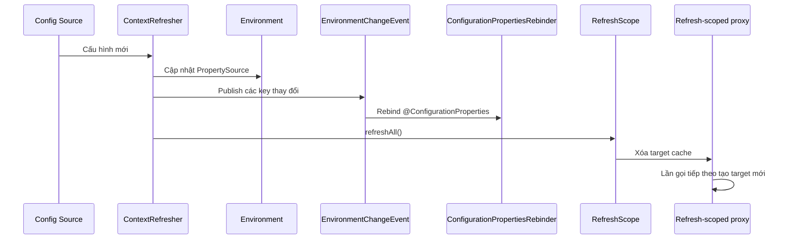

# Kiểm thử rebind và Refresh Scope trước, sau thay đổi

## 1. Mục tiêu của bài kiểm thử

Trong ứng dụng Spring Cloud, cấu hình có thể thay đổi khi ứng dụng đang chạy. Ví dụ, nhóm vận hành tăng timeout của một HTTP client, đổi feature flag hoặc cập nhật địa chỉ một dịch vụ bên ngoài. Sau khi Environment nhận giá trị mới, ứng dụng phải đưa giá trị đó tới đúng bean đang sử dụng.

Spring Cloud Context hỗ trợ hai cơ chế có liên quan nhưng khác nhau:

- **Rebinding** cập nhật các bean được đánh dấu **@ConfigurationProperties** khi có **EnvironmentChangeEvent**.
- **Refresh Scope** hủy target hiện tại của bean có **@RefreshScope**, để proxy tạo target mới khi bean được gọi ở lần tiếp theo.

Kiểm thử cần quan sát cả hai hành vi. Nếu chỉ kiểm tra Environment đã trả giá trị mới, ta chưa chứng minh bean đã được rebind. Nếu chỉ kiểm tra bean Refresh Scope đã được tạo lại, ta chưa chứng minh property source mới đã được nạp.

Sau bài học, người đọc có thể:

- Phân biệt giá trị trong Environment, bean @ConfigurationProperties và target của bean @RefreshScope.
- Kiểm thử rebind trước và sau khi phát EnvironmentChangeEvent.
- Kiểm thử target của Refresh Scope được tạo lại sau khi cache bị xóa.
- Kiểm thử luồng refresh tổng thể bằng ContextRefresher hoặc Actuator endpoint.
- Nhận diện các trường hợp không refresh được, như constructor-bound properties và bean bị loại khỏi refresh scope.

## 2. Hai cơ chế có trách nhiệm khác nhau

### 2.1. Rebinding của @ConfigurationProperties

Spring Cloud Context đăng ký ConfigurationPropertiesRebinder để lắng nghe EnvironmentChangeEvent. Khi nhận event chứa danh sách key đã thay đổi, rebinder tìm các bean @ConfigurationProperties và bind lại giá trị từ Environment.

Ví dụ:

```java
@ConfigurationProperties(prefix = "client")
public class ClientProperties {

    private String endpoint;
    private int timeout;

    public String getEndpoint() {
        return endpoint;
    }

    public void setEndpoint(String endpoint) {
        this.endpoint = endpoint;
    }

    public int getTimeout() {
        return timeout;
    }

    public void setTimeout(int timeout) {
        this.timeout = timeout;
    }
}
```

Nếu các property client.endpoint hoặc client.timeout thay đổi và ứng dụng phát EnvironmentChangeEvent với những key đó, bean ClientProperties được bind lại. Đối tượng bean được cập nhật tại chỗ; nó không được thay bằng một instance mới.

Điểm này quan trọng khi kiểm thử:

- Tham chiếu tới ClientProperties vẫn trỏ tới cùng một đối tượng.
- Giá trị getter sau rebind phải phản ánh property mới.
- Rebinding nhiều field không phải một phép thay thế object nguyên tử. Một thread khác đọc bean trong lúc rebind có thể quan sát trạng thái trung gian.

Các lớp @ConfigurationProperties dùng constructor binding, bao gồm Java record, không thể được refresh bằng cơ chế rebinding này theo tài liệu Spring Cloud hiện hành. Với cấu hình cần thay đổi lúc chạy, hãy chọn mutable JavaBean properties hoặc một thiết kế bean refresh phù hợp.

### 2.2. Refresh Scope

Bean được đánh dấu @RefreshScope được Spring quản lý qua một scoped proxy. Scope giữ target đã khởi tạo như một cache. Khi gọi RefreshScope.refresh(name) hoặc refreshAll(), scope hủy target hiện tại. Proxy vẫn còn trong ApplicationContext; lần gọi method tiếp theo sẽ tạo target mới và inject dependency cùng giá trị cấu hình hiện tại.

Ví dụ:

```java
@Bean
@RefreshScope
GreetingClient greetingClient(ClientProperties properties) {
    return new GreetingClient(
            properties.getEndpoint(),
            properties.getTimeout()
    );
}
```

GreetingClient ở đây nhận một snapshot của cấu hình tại thời điểm target được tạo. Sau khi ClientProperties được rebind, target cũ vẫn giữ endpoint và timeout cũ. Chỉ sau khi target cache bị xóa, proxy mới tạo một GreetingClient khác với cấu hình mới.

Refresh Scope phù hợp với bean được khởi tạo từ cấu hình và cần được tạo lại khi cấu hình thay đổi, chẳng hạn client, connection factory hoặc adapter giữ state. Nó không tự tải cấu hình mới từ Config Server; nguồn cấu hình phải cập nhật Environment trước.

### 2.3. Bảng so sánh

| Tiêu chí | Rebinding | Refresh Scope |
| --- | --- | --- |
| Đối tượng áp dụng | Bean @ConfigurationProperties | Bean được đánh dấu @RefreshScope |
| Tác động | Bind lại các field trên cùng instance | Hủy target hiện tại trong cache |
| Instance bean | Giữ nguyên | Proxy giữ nguyên, target được tạo lại |
| Thời điểm thấy giá trị mới | Sau khi event được xử lý và rebind xong | Sau khi scope refresh và proxy gọi method để tạo target mới |
| Phù hợp | Cấu hình dữ liệu có setter, giá trị có thể bind lại | Bean cần khởi tạo lại từ cấu hình mới hoặc cần trạng thái nhất quán |
| Rủi ro cần chú ý | Reader đồng thời có thể thấy trạng thái bind dở dang | Khởi tạo target mới có thể thất bại; cần xử lý lỗi và lifecycle |

## 3. Trình tự refresh trong Spring Cloud Context

Trong luồng thông thường, ContextRefresher.refresh() thực hiện hai phần theo thứ tự:

1. Nạp lại Environment và xác định các property key đã thay đổi.
2. Phát EnvironmentChangeEvent, để các listener như ConfigurationPropertiesRebinder rebind bean và cập nhật logger level.
3. Gọi RefreshScope.refreshAll() để xóa target cache của các bean thuộc Refresh Scope.
4. Khi ứng dụng gọi các proxy ở lần tiếp theo, target mới được tạo từ cấu hình hiện tại.



EnvironmentChangeEvent đơn lẻ chỉ kích hoạt các listener xử lý event, trong đó có rebinding. Nếu tự phát event bằng code, ứng dụng cũng phải gọi RefreshScope.refreshAll() hoặc refresh(beanName) khi muốn tái tạo các target scoped. ContextRefresher.refresh() điều phối cả hai bước.

### 3.1. refreshEnvironment() và refresh() không giống nhau

ContextRefresher.refreshEnvironment() cập nhật Environment và phát EnvironmentChangeEvent, trả về tập key thay đổi. ContextRefresher.refresh() gọi phần đó rồi tiếp tục refresh toàn bộ Refresh Scope.

Vì vậy:

- Dùng refreshEnvironment() khi chỉ cần cập nhật Environment và các listener như rebinder xử lý event.
- Dùng refresh() khi cần cả rebinding lẫn hủy target cache của Refresh Scope.

Không nên gọi refreshEnvironment() rồi kết luận rằng mọi bean @RefreshScope đã được tạo lại.

## 4. Chuẩn bị cấu hình và bean cho test

Để kiểm thử trước/sau thay đổi, cần một nguồn property có thể đổi giá trị trong lúc test chạy. @DynamicPropertySource cho phép đăng ký supplier cho property; supplier có thể đọc giá trị từ AtomicReference.

Ví dụ cấu hình test:

```java
@SpringBootTest(classes = RefreshBehaviorTest.TestApplication.class)
class RefreshBehaviorTest {

    private static final AtomicReference<String> MESSAGE =
            new AtomicReference<>("before");
    private static final AtomicInteger GENERATIONS = new AtomicInteger();

    @DynamicPropertySource
    static void dynamicProperties(DynamicPropertyRegistry registry) {
        registry.add("demo.client.message", MESSAGE::get);
    }

    @Autowired
    private ClientProperties clientProperties;

    @Autowired
    private GreetingClient greetingClient;

    @Autowired
    private ApplicationEventPublisher eventPublisher;

    @Autowired
    private org.springframework.cloud.context.scope.refresh.RefreshScope refreshScope;

    @Test
    void rebindsPropertiesAndRecreatesRefreshScopedTarget() {
        assertThat(clientProperties.getMessage()).isEqualTo("before");
        assertThat(greetingClient.message()).isEqualTo("before");
        int originalGeneration = greetingClient.generation();

        MESSAGE.set("after");
        eventPublisher.publishEvent(
                new EnvironmentChangeEvent(
                        this,
                        Set.of("demo.client.message")
                )
        );

        // Rebinding cập nhật bean properties tại chỗ.
        assertThat(clientProperties.getMessage()).isEqualTo("after");

        // Target đã cache vẫn giữ snapshot cũ cho tới khi scope được refresh.
        assertThat(greetingClient.message()).isEqualTo("before");
        assertThat(greetingClient.generation()).isEqualTo(originalGeneration);

        refreshScope.refreshAll();

        // Lần gọi qua proxy tiếp theo tạo target mới từ properties hiện tại.
        assertThat(greetingClient.message()).isEqualTo("after");
        assertThat(greetingClient.generation()).isGreaterThan(originalGeneration);
    }

    @SpringBootConfiguration
    @EnableAutoConfiguration
    @EnableConfigurationProperties(ClientProperties.class)
    static class TestApplication {

        @Bean
        @RefreshScope
        GreetingClient greetingClient(ClientProperties properties) {
            return new GreetingClient(
                    properties.getMessage(),
                    GENERATIONS.incrementAndGet()
            );
        }
    }

    @ConfigurationProperties(prefix = "demo.client")
    public static class ClientProperties {

        private String message;

        public String getMessage() {
            return message;
        }

        public void setMessage(String message) {
            this.message = message;
        }
    }

    public static class GreetingClient {

        private final String message;
        private final int generation;

        public GreetingClient(String message, int generation) {
            this.message = message;
            this.generation = generation;
        }

        public String message() {
            return message;
        }

        public int generation() {
            return generation;
        }
    }
}
```

Các import chính của ví dụ:

```java
import java.util.Set;
import java.util.concurrent.atomic.AtomicInteger;
import java.util.concurrent.atomic.AtomicReference;

import org.junit.jupiter.api.Test;
import org.springframework.beans.factory.annotation.Autowired;
import org.springframework.boot.SpringBootConfiguration;
import org.springframework.boot.autoconfigure.EnableAutoConfiguration;
import org.springframework.boot.context.properties.ConfigurationProperties;
import org.springframework.boot.context.properties.EnableConfigurationProperties;
import org.springframework.boot.test.context.SpringBootTest;
import org.springframework.cloud.context.config.annotation.RefreshScope;
import org.springframework.cloud.context.environment.EnvironmentChangeEvent;
import org.springframework.context.ApplicationEventPublisher;
import org.springframework.context.annotation.Bean;
import org.springframework.test.context.DynamicPropertyRegistry;
import org.springframework.test.context.DynamicPropertySource;

import static org.assertj.core.api.Assertions.assertThat;
```

Test này cố ý phát event và gọi RefreshScope riêng để cô lập hai cơ chế. DynamicPropertySource đọc giá trị hiện tại từ MESSAGE, vì vậy rebinder có thể lấy after khi xử lý event. Bean properties giữ nguyên identity, trong khi generation của target scoped tăng sau lần gọi proxy tiếp theo.

## 5. Vì sao các assertion trước và sau lại khác nhau?

Test trên xác nhận bốn trạng thái:

1. **Ban đầu:** Environment, ClientProperties và target GreetingClient đều đọc before.
2. **Sau khi nguồn property đổi nhưng chưa có event:** supplier có giá trị mới, nhưng bean properties chưa được rebind.
3. **Sau EnvironmentChangeEvent:** ClientProperties đọc after, nhưng target GreetingClient đang cache vẫn giữ snapshot before.
4. **Sau refreshAll():** target cũ bị hủy; khi proxy được gọi, target mới được tạo và đọc after.

Nếu chỉ assert clientProperties.getMessage() sau event, test mới chứng minh rebinding. Nếu chỉ assert greetingClient.message() sau refresh, test chưa chứng minh target cũ thực sự giữ cấu hình trước đó. Hãy giữ các assertion ở cả hai thời điểm để kiểm tra đúng lifecycle.

Có thể xác nhận rebinding giữ nguyên instance:

```java
ClientProperties originalProperties = clientProperties;

// Sau khi publish EnvironmentChangeEvent:
assertThat(clientProperties).isSameAs(originalProperties);
assertThat(clientProperties.getMessage()).isEqualTo("after");
```

Ngược lại, generation của GreetingClient chứng minh target đã được tạo lại. Không so sánh identity của proxy vì proxy vẫn là bean được inject vào consumer.

## 6. Test luồng ContextRefresher trong ứng dụng

Trong ứng dụng đang chạy, nên kiểm thử luồng orchestration qua ContextRefresher.refresh():

Kiểu ContextRefresher nằm trong package org.springframework.cloud.context.refresh:

```java
import org.springframework.cloud.context.refresh.ContextRefresher;
```

```java
@Autowired
private ContextRefresher contextRefresher;

@Test
void refreshReportsChangedKeys() {
    Set<String> changedKeys = contextRefresher.refresh();

    assertThat(changedKeys).contains("demo.client.message");
    assertThat(clientProperties.getMessage()).isEqualTo("after");
    assertThat(greetingClient.message()).isEqualTo("after");
}
```

Ví dụ này giả định test đã cấu hình một Config Data source hoặc nguồn cấu hình có thể trả về giá trị khác giữa hai lần load. Chỉ inject ContextRefresher mà không thay đổi nguồn cấu hình thì changedKeys có thể rỗng; test không nên tự tạo một thay đổi giả rồi kỳ vọng refresher phát hiện.

Với Config Server, integration test có thể dùng một server test hoặc mock endpoint trả về hai phiên bản property. Trình tự kiểm thử:

1. Khởi động ứng dụng với giá trị before.
2. Xác nhận bean properties và target scoped đang dùng before.
3. Thay property trong nguồn cấu hình test thành after.
4. Gọi contextRefresher.refresh().
5. Xác nhận tập key thay đổi có demo.client.message.
6. Xác nhận bean @ConfigurationProperties và target @RefreshScope đều đọc được after.

Không nên dùng một file local cố định làm nguồn cấu hình rồi kỳ vọng ContextRefresher tự phát hiện file đã đổi nếu implementation đang dùng không reload nguồn đó. Cần chọn một Config Data loader hoặc property source có hành vi reload được hỗ trợ.

## 7. Kiểm thử qua Actuator endpoint

Spring Cloud Context cung cấp endpoint refresh để gọi luồng refresh từ HTTP. Cần có Actuator và expose endpoint rõ ràng:

```yaml
management:
  endpoints:
    web:
      exposure:
        include:
          - health
          - refresh
```

Trong test HTTP, gửi POST tới /actuator/refresh:

```bash
curl -X POST http://localhost:8080/actuator/refresh
```

Endpoint trả về danh sách key đã thay đổi. Nếu danh sách rỗng, có thể nguồn cấu hình không thay đổi hoặc loader không cung cấp giá trị mới.

Một integration test có thể dùng TestRestTemplate hoặc WebTestClient để:

1. Đọc endpoint nghiệp vụ trước refresh và xác nhận trả before.
2. Cập nhật Config Server test fixture.
3. Gửi POST tới /actuator/refresh.
4. Kiểm tra response có key thay đổi.
5. Gọi lại endpoint nghiệp vụ và xác nhận trả after.

Không expose endpoint refresh công khai. Đây là thao tác quản trị có thể thay đổi cấu hình và khởi tạo lại bean đang chạy. Bảo vệ bằng authentication/authorization, giới hạn network access và ghi log hoạt động quản trị.

## 8. Kiểm thử nhiều instance và Spring Cloud Bus

ContextRefresher.refresh() tác động lên ApplicationContext của một instance. Nếu service chạy nhiều replica, refresh một instance không tự làm mới các instance còn lại.

Spring Cloud Config Client không mặc định polling Config Server để phát hiện thay đổi. Với hệ thống nhiều instance, có thể dùng Spring Cloud Bus để broadcast refresh event tới các ứng dụng đang kết nối bus.

Kiểm thử phân tán nên xác nhận:

- Event được phát tới đúng nhóm ứng dụng.
- Mỗi instance nhận event và thực hiện refresh cục bộ.
- Mọi replica cuối cùng đều đọc được giá trị mới.
- Instance tạm thời mất kết nối bus có cách đồng bộ lại phù hợp.
- Không có refresh storm do gửi event lặp hoặc vòng lặp giữa các listener.

Vì xử lý bus có thể bất đồng bộ, test không nên assert ngay sau khi POST event. Dùng polling có timeout hoặc Awaitility để chờ tất cả replica hội tụ. Timeout phải phản ánh SLA thực tế của môi trường test, tránh Thread.sleep() cố định dài.

## 9. Những trường hợp không refresh được như mong đợi

### 9.1. Rebinding không tạo object mới

Nếu test mong bean @ConfigurationProperties có identity mới sau refresh, assertion đó sai. Rebinding cập nhật bean tại chỗ. Hãy kiểm tra giá trị getter và identity giữ nguyên.

### 9.2. Refresh Scope không tạo target ngay tại thời điểm refresh

refreshAll() xóa target cache. Target mới được tạo khi proxy nhận method call tiếp theo. Vì vậy, generation counter chỉ tăng sau khi test gọi method trên proxy, không phải ngay khi gọi refreshAll().

### 9.3. Gắn @RefreshScope lên configuration class

Đánh dấu một @Configuration class bằng @RefreshScope không có nghĩa mọi bean được khai báo bằng @Bean trong class đó đều tự động thuộc Refresh Scope. Nếu một bean cần được tạo lại, hãy đánh dấu chính bean method hoặc bean class đó.

### 9.4. Constructor-bound properties và Java record

Các bean @ConfigurationProperties dùng constructor binding, gồm record, không thể được rebinder cập nhật theo cơ chế thông thường. Với cấu hình thay đổi lúc chạy, hãy dùng mutable properties hoặc bọc cấu hình trong một bean refresh-scoped phù hợp.

### 9.5. Bean nằm trong danh sách không refresh

Một số bean không thể hoặc không nên refresh. Ví dụ, HikariDataSource nằm trong danh sách spring.cloud.refresh.never-refreshable mặc định. spring.cloud.refresh.extra-refreshable có thể bổ sung một số loại bean cần xử lý đặc biệt, nhưng không nên ép refresh một resource mà lifecycle không hỗ trợ.

### 9.6. Xóa property khỏi nguồn cấu hình

Tài liệu Spring Cloud lưu ý việc xóa một cấu hình khỏi nguồn rồi refresh không nhất thiết cập nhật sự hiện diện của property trong Environment. Với logic bật/tắt, nên thiết kế theo giá trị tường minh như enabled=false thay vì phụ thuộc vào việc property biến mất.

### 9.7. Tham chiếu target bị giữ ngoài proxy

Các thành phần nên inject và gọi qua scoped proxy. Nếu ứng dụng lấy target thật rồi giữ một tham chiếu trực tiếp bên ngoài proxy, tham chiếu đó không tự chuyển sang target mới sau refresh. Tránh lưu target scoped vào static field hoặc cache riêng không được quản lý.

### 9.8. Refresh trong AOT và native image

Context refresh không được hỗ trợ cho Spring AOT transformations và native images theo tài liệu Spring Cloud hiện hành. Với các môi trường đó, cần đặt spring.cloud.refresh.enabled=false và thiết kế cấu hình theo mô hình khởi tạo phù hợp.

## 10. Kiểm tra đồng thời và lifecycle

Rebinding và Refresh Scope có đặc tính đồng thời khác nhau:

- Rebinding được tuần tự hóa giữa các lần rebind cùng bean, nhưng reader khác vẫn có thể thấy các field đang được cập nhật dở.
- Refresh Scope dùng cơ chế khóa để điều phối truy cập và refresh target trong scope; target cũ được hủy theo lifecycle callback, target mới được khởi tạo khi cần.

Nếu một thao tác nghiệp vụ cần đọc nhiều property như endpoint, timeout và credential như một bộ giá trị nhất quán, không nên để thread đọc trực tiếp bean properties trong lúc nhiều field đang rebind. Có thể đóng gói chúng trong một bean refresh-scoped, để lần refresh thay target theo một phiên bản cấu hình mới.

Test concurrency cần có barrier hoặc latch để điều khiển thời điểm reader và refresher, không dựa vào may rủi của scheduler. Các test đó nên xác nhận invariant của nghiệp vụ, chẳng hạn endpoint và credential luôn thuộc cùng một bộ cấu hình.

## 11. Ma trận kiểm thử trước và sau thay đổi

| Trạng thái | Environment | Bean properties | Refresh-scoped target |
| --- | --- | --- | --- |
| Trước thay đổi | before | before | before |
| Environment đã cập nhật, chưa phát event | after | Có thể vẫn before | before |
| Sau EnvironmentChangeEvent | after | after | Vẫn before nếu target đang cache snapshot cũ |
| Sau RefreshScope.refreshAll() | after | after | Target cũ bị xóa; proxy tạo target mới khi được gọi |
| Sau lần gọi proxy tiếp theo | after | after | after |

Ma trận này là cơ sở để viết assertion có ý nghĩa. Mỗi bước chỉ kiểm tra một tác động; nhờ vậy khi test thất bại, có thể xác định lỗi nằm ở nguồn cấu hình, rebinder hay Refresh Scope.

## 12. Checklist khi viết test

1. Chọn nguồn property có thể thay đổi và được Environment đọc lại.
2. Xác nhận giá trị ban đầu trước khi phát event.
3. Dùng bean @ConfigurationProperties mutable để kiểm thử rebinding.
4. Gửi EnvironmentChangeEvent với đúng danh sách key thay đổi.
5. Xác nhận properties bean được cập nhật tại chỗ.
6. Dùng bean @RefreshScope có thể nhận diện target generation.
7. Xác nhận target cũ giữ snapshot cũ sau khi chỉ rebind properties.
8. Gọi refreshAll() hoặc refresh(beanName) và gọi proxy để tạo target mới.
9. Xác nhận target mới dùng giá trị cấu hình mới.
10. Kiểm thử ContextRefresher.refresh() hoặc /actuator/refresh với nguồn cấu hình reload được.
11. Nếu dùng Bus, chờ tất cả replica hội tụ bằng polling có timeout.
12. Bổ sung test cho property bị thiếu, lỗi khởi tạo target và bean không refreshable.
13. Bảo vệ endpoint refresh và không ghi secret vào log/assertion output.

## 13. Tài liệu tham khảo

- [Spring Cloud Context — Application Context Services](https://docs.spring.io/spring-cloud-commons/reference/spring-cloud-commons/application-context-services.html): EnvironmentChangeEvent, ConfigurationPropertiesRebinder, Refresh Scope, ContextRefresher và endpoint refresh.
- [Spring Cloud Commons — Configuration Properties](https://docs.spring.io/spring-cloud-commons/reference/configprops.html): các thuộc tính spring.cloud.refresh.*.
- [ConfigurationPropertiesRebinder source](https://github.com/spring-cloud/spring-cloud-commons/blob/main/spring-cloud-context/src/main/java/org/springframework/cloud/context/properties/ConfigurationPropertiesRebinder.java): listener EnvironmentChangeEvent và cách rebind bean properties.
- [ContextRefresher source](https://github.com/spring-cloud/spring-cloud-commons/blob/main/spring-cloud-context/src/main/java/org/springframework/cloud/context/refresh/ContextRefresher.java): thứ tự cập nhật Environment, phát event và refresh scope.
- [RefreshScope source](https://github.com/spring-cloud/spring-cloud-commons/blob/main/spring-cloud-context/src/main/java/org/springframework/cloud/context/scope/refresh/RefreshScope.java): refresh một bean hoặc toàn bộ scope và hủy target cache.

Một bài test refresh tốt phải chứng minh được từng tầng: nguồn cấu hình thực sự đổi, Environment nhận giá trị mới, @ConfigurationProperties được rebind, và target @RefreshScope được tạo lại khi proxy được gọi. Chỉ khi kiểm tra trước/sau ở cả các tầng này, ta mới biết ứng dụng đã áp dụng cấu hình mới theo đúng lifecycle.
