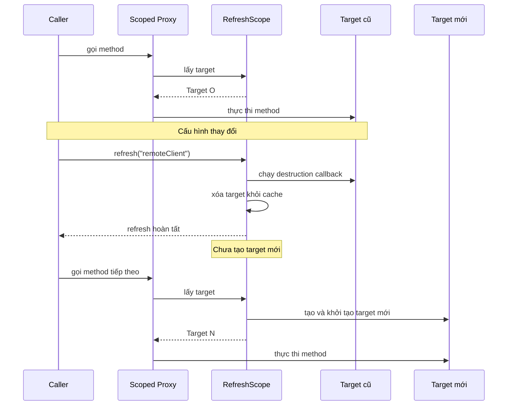

# Kiểm thử lỗi refresh và giải phóng target cũ

Trong Spring Cloud Context, bean được đánh dấu `@RefreshScope` được truy cập qua một scoped proxy. Proxy có thể được các service khác giữ trong suốt vòng đời ứng dụng, còn target thật nằm trong cache của refresh scope. Khi refresh, Spring Cloud hủy target đang được cache và gọi destruction callback đã đăng ký. Target mới chỉ được tạo khi có lời gọi tiếp theo đi qua proxy.

Cách hoạt động này tạo ra hai thời điểm cần kiểm thử riêng: **thời điểm hủy target cũ** và **thời điểm khởi tạo target mới**. Nếu cấu hình mới không hợp lệ, thao tác refresh có thể đã hoàn tất việc xóa target cũ, nhưng lỗi chỉ xuất hiện ở lần gọi proxy tiếp theo. Nếu chỉ kiểm tra HTTP response của `/actuator/refresh`, bài test có thể bỏ sót lỗi khởi tạo này.

Bài học thuộc chương **Kiểm thử** của **SPRING_CLOUD_CORE**. Trọng tâm là kiểm tra vòng đời target của `@RefreshScope`, xác nhận `@PreDestroy`, `DisposableBean` hoặc `close()` được gọi khi target bị loại khỏi cache, mô phỏng lỗi khi tạo target mới, kiểm tra lỗi được ghi nhận trong `RefreshScope` và `RefreshScopeHealthIndicator`, đồng thời kiểm tra việc refresh khi có request đang chạy.

## 1. Mục tiêu học tập

Sau bài này, người học có thể:

1. Phân biệt scoped proxy với target thật của một bean `@RefreshScope`.
2. Mô tả thứ tự cập nhật Environment, phát `EnvironmentChangeEvent`, hủy target cũ và tạo target mới.
3. Kiểm thử target cũ được giải phóng đúng một lần khi refresh.
4. Kiểm tra target mới chưa được tạo ngay tại thời điểm cache bị xóa.
5. Mô phỏng lỗi constructor, factory method hoặc binding khi tạo target mới.
6. Xác nhận exception xuất hiện ở lần gọi proxy sau refresh.
7. Kiểm tra lỗi được ghi nhận qua `RefreshScope.getErrors()` và health indicator.
8. Phân biệt lỗi hủy target cũ với lỗi khởi tạo target mới.
9. Kiểm thử hành vi khi có lời gọi đang chạy trong lúc refresh.
10. Thiết kế test có thể lặp lại, không phụ thuộc vào `Thread.sleep` hoặc trạng thái static bị rò giữa các test.

## 2. Mô hình vòng đời cần kiểm thử

### 2.1. Proxy và target là hai đối tượng khác nhau

Khi khai báo:

```java
@Bean
@RefreshScope
RemoteClient remoteClient() {
    return new RemoteClient();
}
```

Spring đăng ký một proxy để các bean khác inject. Target thật được tạo và lưu trong scope khi cần. Tên bean target trong cơ chế scoped proxy thường có dạng `scopedTarget.remoteClient`.

Một service giữ proxy:

```java
@Service
class OrderService {

    private final RemoteClient remoteClient;

    OrderService(RemoteClient remoteClient) {
        this.remoteClient = remoteClient;
    }

    String fetch() {
        return remoteClient.call();
    }
}
```

Sau refresh, `OrderService` vẫn giữ cùng proxy. Proxy tra cứu target hiện tại từ refresh scope mỗi khi method được gọi. Vì vậy, test cần quan sát cả hai đối tượng:

- Proxy: đại diện bean được inject vào các component.
- Target: instance thật giữ state, connection hoặc tài nguyên cần giải phóng.

Không nên dùng việc proxy có cùng identity để kết luận target chưa được refresh.

### 2.2. Vòng đời thành công



Các điểm quan sát:

1. Target cũ đã được tạo trước khi refresh.
2. Destruction callback của target cũ được chạy khi target bị loại khỏi scope.
3. Proxy vẫn dùng được sau refresh.
4. Target mới được tạo ở lần truy cập tiếp theo.
5. Target mới đọc cấu hình hiện tại từ Environment.

### 2.3. Refresh không đồng nghĩa tạo target mới ngay lập tức

Tài liệu Spring Cloud mô tả refresh scope bean là lazy proxy. `RefreshScope.refresh(String)` loại target khỏi cache và buộc target được tạo lại ở lần method call tiếp theo. `refreshAll()` áp dụng thao tác này cho toàn bộ bean trong scope.

Do đó, chuỗi kiểm thử đúng là:

1. Gọi proxy để tạo target ban đầu.
2. Thay đổi property.
3. Gọi `refreshScope.refresh("remoteClient")`.
4. Xác nhận target cũ đã được giải phóng.
5. Xác nhận số target được tạo chưa tăng.
6. Gọi proxy.
7. Xác nhận target mới được tạo với cấu hình mới.

Nếu chỉ gọi refresh rồi kiểm tra số lần khởi tạo, test có thể kết luận sai rằng refresh không hoạt động vì target mới chưa được truy cập.

## 3. Phân biệt các đường refresh

Có hai mức kiểm thử khác nhau.

| API hoặc endpoint | Trách nhiệm | Phù hợp với loại test |
| --- | --- | --- |
| `RefreshScope.refresh(beanName)` | Hủy target đã cache của một bean | Unit/integration test vòng đời một target |
| `RefreshScope.refreshAll()` | Hủy tất cả target trong refresh scope | Kiểm thử nhiều bean được refresh |
| `ContextRefresher.refresh()` | Cập nhật Environment, phát `EnvironmentChangeEvent`, sau đó refresh scope | Kiểm thử luồng refresh cấu hình tổng thể |
| `POST /actuator/refresh` | Gọi luồng refresh được expose qua Actuator | Kiểm thử endpoint quản trị và tích hợp |

Trong implementation hiện hành, `ContextRefresher.refresh()` gọi `refreshEnvironment()` trước rồi mới gọi `RefreshScope.refreshAll()`. `refreshEnvironment()` cập nhật property sources, xác định các key thay đổi và phát `EnvironmentChangeEvent`. Các listener như `ConfigurationPropertiesRebinder` có thể xử lý event đó trước khi target refresh scope bị hủy.

`RefreshScope.refresh(beanName)` chỉ xử lý target trong scope. Nó không tự tải cấu hình mới từ Config Server hoặc cập nhật Environment. Vì vậy, dùng API trực tiếp phù hợp khi test muốn kiểm tra riêng lifecycle; dùng `ContextRefresher` hoặc endpoint khi cần kiểm tra cả luồng cập nhật cấu hình.

### 3.1. Tên bean truyền vào refresh

Khi gọi:

```java
refreshScope.refresh("remoteClient");
```

Spring Cloud tự chuyển tên bean thông thường sang tên target `scopedTarget.remoteClient` trước khi xóa cache. Trong test thông thường, truyền tên bean mà ứng dụng khai báo; không cần tự thêm tiền tố `scopedTarget.`.

Giá trị boolean trả về cho biết target đã có trong cache và được xử lý. Nếu target chưa từng được tạo, `refresh(beanName)` có thể trả về `false` vì không có target cũ để hủy. Không nên coi `false` trong tình huống đó là lỗi cấu hình.

## 4. Các loại lỗi phải phân biệt

Một lần refresh có thể thất bại ở các giai đoạn khác nhau:

| Giai đoạn | Ví dụ lỗi | Điều cần kiểm tra |
| --- | --- | --- |
| Tải cấu hình | Config Server không truy cập được, property source không hợp lệ | Environment có nhận được cấu hình mới không? |
| Rebind `@ConfigurationProperties` | Giá trị không chuyển đổi được, validation thất bại | Bean properties có được bind thành công không? |
| Hủy target cũ | Callback giải phóng tài nguyên hoặc custom destruction processor gặp lỗi | Target cũ đã được xử lý đến đâu? |
| Tạo target mới | Constructor, `@Bean` factory method hoặc dependency injection ném exception | Lỗi xuất hiện ở lần gọi proxy nào? |
| Runtime sau refresh | Target tạo thành công nhưng kết nối downstream thất bại | Health, metrics và hành vi nghiệp vụ có đúng không? |

Một điểm quan trọng: nếu lỗi xảy ra khi tạo target mới, target cũ đã có thể bị hủy trước đó. Khi đó, proxy vẫn còn nhưng không có target hợp lệ để phục vụ request. Test cần xác nhận trạng thái này thay vì giả định target cũ sẽ tự động quay lại.

### 4.1. Lỗi khi tạo target mới

Target mới được tạo thông qua bean factory khi proxy cần target. Nếu constructor hoặc factory method ném exception, exception sẽ truyền về caller của method trên proxy. `GenericScope` ghi nhận lỗi khởi tạo trong error map của scope để health indicator có thể báo trạng thái.

Ví dụ:

```java
@Bean
@RefreshScope
RemoteClient remoteClient(Environment environment) {
    String endpoint = environment.getRequiredProperty("client.endpoint");

    if ("invalid".equals(endpoint)) {
        throw new IllegalArgumentException(
            "client.endpoint is invalid"
        );
    }

    return new RemoteClient(endpoint);
}
```

Khi `client.endpoint=invalid`:

1. `refreshScope.refresh("remoteClient")` hủy target cũ.
2. Refresh trả về sau khi cache entry cũ được loại bỏ.
3. Lần gọi `remoteClient.call()` tiếp theo bắt đầu tạo target.
4. Factory method ném `IllegalArgumentException`.
5. Caller nhận exception do không có target hợp lệ.
6. Scope ghi nhận lỗi tạo bean.

Lỗi này có thể không xuất hiện trong response của thao tác refresh ban đầu vì target chưa được tạo ở thời điểm đó.

### 4.2. Health indicator phản ánh lỗi refresh

Spring Cloud tự cấu hình `RefreshScopeHealthIndicator` để kiểm tra lỗi của refresh scope và `ConfigurationPropertiesRebinder`. Khi bean không thể khởi tạo lại hoặc rebind sau refresh, health indicator chuyển sang `DOWN` và cung cấp thông tin exception.

Có thể kiểm tra health endpoint:

```text
GET /actuator/health/refresh
```

Endpoint health và chi tiết của contributor cần được expose theo cấu hình Actuator, quyền truy cập và health detail policy của ứng dụng. Nếu không muốn expose health contributor riêng, test có thể kiểm tra trực tiếp `RefreshScope.getErrors()` và `ConfigurationPropertiesRebinder.getErrors()`.

Cấu hình minh họa:

```yaml
management:
  endpoints:
    web:
      exposure:
        include:
          - health
          - refresh
  endpoint:
    health:
      show-details: always
  health:
    refresh:
      enabled: true
```

Không expose endpoint refresh hoặc health details công khai nếu chưa có xác thực, phân quyền và giới hạn mạng phù hợp.

## 5. Theo dõi target cũ bằng destruction callback

### 5.1. Những callback nào có thể được kiểm thử?

Spring quản lý các callback giải phóng bean, ví dụ:

- `@PreDestroy`.
- Bean triển khai `DisposableBean`.
- Bean có phương thức `close()` hoặc `shutdown()` được Spring nhận diện.
- Custom destroy method khai báo trên bean definition.

Khi target thuộc refresh scope bị loại khỏi cache, lifecycle callback đã đăng ký cho target được chạy. Spring Cloud mô tả rõ việc refresh target áp dụng các lifecycle method, bao gồm destruction callback, rồi khởi tạo instance mới ở lần truy cập tiếp theo.

### 5.2. Dùng AutoCloseable để đếm lần giải phóng

Ví dụ target có ID riêng và ghi lại những instance đã đóng:

```java
public class RemoteClient implements AutoCloseable {

    private static final AtomicInteger NEXT_ID = new AtomicInteger();

    private static final List<Integer> CLOSED_IDS =
        new CopyOnWriteArrayList<>();

    private static volatile CountDownLatch CLOSE_ENTERED =
        new CountDownLatch(1);

    private final int id = NEXT_ID.incrementAndGet();

    private final String endpoint;

    public RemoteClient(String endpoint) {
        this.endpoint = endpoint;
    }

    public int getId() {
        return id;
    }

    public String getEndpoint() {
        return endpoint;
    }

    public String callAndWait(CountDownLatch entered, CountDownLatch release)
            throws InterruptedException {
        entered.countDown();
        if (!release.await(2, TimeUnit.SECONDS)) {
            throw new IllegalStateException("Invocation was not released");
        }
        return "completed";
    }

    @Override
    public void close() {
        CLOSED_IDS.add(id);
        CLOSE_ENTERED.countDown();
    }

    public static CountDownLatch closeEnteredLatch() {
        return CLOSE_ENTERED;
    }

    public static List<Integer> closedIds() {
        return List.copyOf(CLOSED_IDS);
    }

    public static int createdCount() {
        return NEXT_ID.get();
    }

    public static void resetCounters() {
        NEXT_ID.set(0);
        CLOSED_IDS.clear();
        CLOSE_ENTERED = new CountDownLatch(1);
    }
}
```

Spring có thể suy ra destroy method `close()` cho bean trả về từ `@Bean` nếu object triển khai `AutoCloseable` và bean definition không tắt việc suy luận destroy method.

Cấu hình:

```java
@Bean
@RefreshScope
RemoteClient remoteClient(Environment environment) {
    String endpoint = environment.getRequiredProperty("client.endpoint");

    if ("invalid".equals(endpoint)) {
        throw new IllegalArgumentException("Invalid endpoint");
    }

    return new RemoteClient(endpoint);
}
```

### 5.3. Assertion cần có

Sau khi target đầu tiên được tạo:

```java
String oldEndpoint = remoteClient.getEndpoint();
int oldId = remoteClient.getId();
```

Sau khi đổi property và refresh:

```java
assertThat(refreshScope.refresh("remoteClient")).isTrue();

assertThat(RemoteClient.closedIds())
    .containsExactly(oldId);
```

Assertion này chứng minh target cũ đã chạy callback giải phóng. Sau khi gọi proxy lần tiếp theo:

```java
assertThat(remoteClient.getEndpoint())
    .isEqualTo("https://new.example");

assertThat(remoteClient.getId())
    .isNotEqualTo(oldId);
```

Test đã xác nhận target mới được tạo và sử dụng cấu hình mới.

## 6. Chuẩn bị test fixture có thể điều khiển cấu hình

Một fixture kiểm thử tốt cần điều khiển được property mà không phải gọi Config Server thật. Có thể dùng `@DynamicPropertySource` với `AtomicReference`:

```java
@SpringBootTest(classes = RefreshScopeTestApplication.class)
@DirtiesContext(classMode = DirtiesContext.ClassMode.AFTER_EACH_TEST_METHOD)
class RefreshScopeLifecycleTests {

    private static final AtomicReference<String> ENDPOINT =
        new AtomicReference<>("https://old.example");

    @DynamicPropertySource
    static void properties(DynamicPropertyRegistry registry) {
        registry.add("client.endpoint", ENDPOINT::get);
    }

    @Autowired
    private RefreshScope refreshScope;

    @Autowired
    private RemoteClient remoteClient;

    @Autowired
    private RefreshScopeHealthIndicator refreshScopeHealthIndicator;

    private final ExecutorService executor = Executors.newFixedThreadPool(2);

    @BeforeEach
    void reset() {
        ENDPOINT.set("https://old.example");
        RemoteClient.resetCounters();
    }

    @AfterEach
    void shutdownExecutor() {
        executor.shutdownNow();
    }
}
```

Cấu hình test:

```java
@SpringBootConfiguration
@EnableAutoConfiguration
static class RefreshScopeTestApplication {

    @Bean
    static RefreshScope refreshScope() {
        RefreshScope scope = new RefreshScope();
        scope.setEager(false);
        return scope;
    }

    @Bean
    @RefreshScope
    RemoteClient remoteClient(Environment environment) {
        String endpoint =
            environment.getRequiredProperty("client.endpoint");

        if ("invalid".equals(endpoint)) {
            throw new IllegalArgumentException("Invalid endpoint");
        }

        return new RemoteClient(endpoint);
    }
}
```

`setEager(false)` giúp test kiểm soát thời điểm target được tạo, đặc biệt khi muốn kiểm tra trạng thái chưa có target. Cấu hình này thay thế bean `RefreshScope` mặc định bằng một scope có eager initialization tắt. Trong ứng dụng thực tế, hãy giữ cấu hình mặc định nếu không có yêu cầu lifecycle riêng.

`@DirtiesContext` cô lập ApplicationContext giữa các test để tránh cache target, event listener hoặc bean state của test trước ảnh hưởng test sau. Nếu fixture của bạn không dùng static counter hoặc đã có cách reset đầy đủ, có thể chọn chiến lược quản lý context nhẹ hơn.

Test fixture cần `spring-cloud-context` và `spring-boot-starter-test`. Nếu kiểm tra `RefreshScopeHealthIndicator` hoặc HTTP health endpoint, thêm `spring-boot-starter-actuator`. Hãy để Spring Cloud BOM quản lý phiên bản dependency tương thích với Spring Boot đang dùng.

## 7. Kiểm thử refresh thành công và target cũ được giải phóng

Test cơ bản:

```java
@Test
void refreshDestroysOldTargetAndCreatesNewTargetOnNextCall() {
    String oldEndpoint = remoteClient.getEndpoint();
    int oldId = remoteClient.getId();

    assertThat(oldEndpoint).isEqualTo("https://old.example");

    ENDPOINT.set("https://new.example");

    assertThat(refreshScope.refresh("remoteClient")).isTrue();

    assertThat(RemoteClient.closedIds())
        .containsExactly(oldId);

    // Refresh chỉ loại target cũ, chưa tạo target mới.
    assertThat(RemoteClient.createdCount()).isEqualTo(1);

    // Lần gọi proxy tiếp theo mới tạo target mới.
    assertThat(remoteClient.getEndpoint())
        .isEqualTo("https://new.example");

    assertThat(RemoteClient.createdCount()).isEqualTo(2);
    assertThat(remoteClient.getId()).isNotEqualTo(oldId);

    assertThat(RemoteClient.closedIds())
        .containsExactly(oldId);
}
```

Trong test trên, lệnh `remoteClient.getEndpoint()` sau refresh là lần gọi đầu tiên khiến target mới được tạo. Có thể tách assertion trước và sau lần gọi này để chứng minh tính lazy rõ ràng hơn.

## 8. Kiểm thử refresh một bean chưa từng được khởi tạo

Nếu bean chưa được truy cập, scope chưa có target instance trong cache. Khi gọi `refresh(beanName)`, không có target cũ để hủy và phương thức có thể trả về `false`.

Test:

```java
@Test
void refreshBeforeFirstAccessDoesNotCreateOrDestroyTarget() {
    assertThat(RemoteClient.createdCount()).isZero();

    boolean refreshed = refreshScope.refresh("remoteClient");

    assertThat(refreshed).isFalse();
    assertThat(RemoteClient.createdCount()).isZero();
    assertThat(RemoteClient.closedIds()).isEmpty();

    assertThat(remoteClient.getEndpoint())
        .isEqualTo("https://old.example");

    assertThat(RemoteClient.createdCount()).isEqualTo(1);
}
```

Test này phân biệt việc xóa cache với việc khởi tạo bean. Nếu test không kiểm soát eager initialization, target có thể đã được tạo trong startup phase và assertion ban đầu sẽ không còn đúng. Vì vậy, fixture cần xác định rõ chế độ eager/lazy.

## 9. Kiểm thử lỗi khi target mới không khởi tạo được

### 9.1. Mô phỏng cấu hình sai

Giữ target cũ hoạt động, sau đó thay property bằng giá trị khiến factory method thất bại:

```java
@Test
void failedTargetCreationIsVisibleOnNextProxyInvocation() {
    String oldEndpoint = remoteClient.getEndpoint();
    int oldId = remoteClient.getId();

    ENDPOINT.set("invalid");

    assertThat(refreshScope.refresh("remoteClient")).isTrue();

    // Target cũ đã được giải phóng.
    assertThat(RemoteClient.closedIds())
        .containsExactly(oldId);

    // Target mới chỉ được tạo khi proxy được gọi.
    assertThatThrownBy(remoteClient::getEndpoint)
        .hasRootCauseInstanceOf(IllegalArgumentException.class);

    assertThat(refreshScope.getErrors())
        .containsKey("scopedTarget.remoteClient");
}
```

Tùy loại exception và phiên bản Spring, caller có thể nhận `BeanCreationException` hoặc exception wrapper khác. Vì vậy, kiểm tra root cause thường ổn định hơn việc yêu cầu đúng một exception lớp ngoài.

### 9.2. Vì sao lỗi không xuất hiện ngay khi gọi refresh?

`refreshScope.refresh("remoteClient")` xử lý việc hủy target cũ và loại cache entry. Nó không gọi factory method để tạo target thay thế. Vì vậy, refresh có thể trả về thành công dù property mới không hợp lệ.

Lỗi xuất hiện khi proxy cần target mới. Trong ứng dụng HTTP, request đầu tiên đi qua bean sau refresh có thể thất bại trong lúc Spring tạo target. Đây là lý do test cần gọi proxy sau refresh và kiểm tra exception ở đúng thời điểm.

### 9.3. Khôi phục sau khi sửa property

Sau khi sửa cấu hình, test cần xác minh target có thể được tạo lại và error state được xử lý:

```java
ENDPOINT.set("https://recovered.example");

// Loại wrapper đã ghi nhận lỗi và xóa error của bean đó.
assertThat(refreshScope.refresh("remoteClient")).isTrue();

assertThat(refreshScope.getErrors())
    .doesNotContainKey("scopedTarget.remoteClient");

assertThat(remoteClient.getEndpoint())
    .isEqualTo("https://recovered.example");
```

Trong implementation hiện hành, `GenericScope` ghi lỗi khởi tạo theo tên bean và cung cấp error map cho health indicator. Việc loại wrapper lỗi khỏi cache bằng refresh tiếp theo cho phép scope thử tạo target mới với cấu hình đã sửa. Hãy kiểm tra cả kết quả gọi proxy lẫn health status sau khi phục hồi; không chỉ dựa vào việc property đã được thay đổi.

## 10. Phân biệt lỗi tạo target và lỗi rebind properties

Spring Cloud có hai cơ chế thường cùng xuất hiện trong một lần refresh:

- `RefreshScope`: hủy target cũ và tạo target mới ở lần truy cập tiếp theo.
- `ConfigurationPropertiesRebinder`: cập nhật các bean `@ConfigurationProperties` theo Environment change.

Nếu bean properties bị lỗi validation hoặc conversion, lỗi được ghi nhận bởi rebinder. Nếu factory method của bean refresh scope không thể tạo target, lỗi được ghi nhận bởi refresh scope.

`RefreshScopeHealthIndicator` tổng hợp lỗi của hai cơ chế này. Khi một trong hai báo lỗi, health indicator có thể chuyển sang `DOWN`.

| Loại bean | Cách cập nhật | Kiểm tra lỗi |
| --- | --- | --- |
| Bean `@RefreshScope` | Hủy target, tạo target mới khi proxy được gọi | `RefreshScope.getErrors()` |
| Bean `@ConfigurationProperties` thông thường | Rebind trên instance hiện có | `ConfigurationPropertiesRebinder.getErrors()` |
| Bean vừa có cấu hình properties vừa nằm trong refresh scope | Phụ thuộc cách bean được đăng ký và phiên bản | Kiểm tra cả hai lifecycle và test cụ thể |

Không nên dùng một test cho `ConfigurationPropertiesRebinder` để kết luận destruction callback của refresh-scoped target đã chạy. Hai cơ chế có lifecycle khác nhau.

## 11. Kiểm thử health indicator

Nếu ứng dụng có Actuator và refresh health indicator được bật, có thể kiểm tra health status sau khi target khởi tạo thất bại.

Ví dụ:

```java
@Test
void refreshHealthReportsDownWhenTargetCannotBeCreated() {
    ENDPOINT.set("invalid");

    refreshScope.refresh("remoteClient");

    assertThatThrownBy(remoteClient::getEndpoint)
        .hasRootCauseInstanceOf(IllegalArgumentException.class);

    Health health = refreshScopeHealthIndicator.health();

    assertThat(health.getStatus()).isEqualTo(Status.DOWN);
}
```

Đây là dạng test minh họa. Tùy phiên bản, bean health indicator có thể được lấy từ ApplicationContext hoặc kiểm tra qua `HealthEndpoint`. Khi dùng Actuator endpoint, bảo đảm health contributor `refresh` đã được đăng ký và test đã cấu hình quyền hiển thị details phù hợp.

Cần kiểm tra cả hai loại lỗi:

1. Target factory thất bại sau khi refresh.
2. `@ConfigurationProperties` rebind thất bại trong `EnvironmentChangeEvent`.

Không nên chỉ assert HTTP status của `/actuator/refresh`, vì lỗi khởi tạo target có thể xảy ra ở request nghiệp vụ đầu tiên sau đó.

## 12. Kiểm thử RefreshScopeRefreshedEvent

`RefreshScope.refresh(beanName)` phát `RefreshScopeRefreshedEvent` cho bean target vừa được refresh. `refreshAll()` phát event chung sau khi quá trình hủy target trong scope hoàn tất.

Event giúp component khác biết rằng target đã bị invalidated. Nó không chứng minh target mới đã được tạo thành công với cấu hình mới.

Có thể ghi nhận event trong test:

```java
@Component
class RefreshEventProbe {

    private final List<String> refreshedNames =
        new CopyOnWriteArrayList<>();

    @EventListener
    void onRefresh(RefreshScopeRefreshedEvent event) {
        refreshedNames.add(event.getName());
    }

    List<String> refreshedNames() {
        return List.copyOf(refreshedNames);
    }
}
```

Sau khi gọi `refreshScope.refresh("remoteClient")`, kiểm tra tên event theo target bean name:

```java
assertThat(refreshEventProbe.refreshedNames())
    .contains("scopedTarget.remoteClient");
```

Event được phát sau thao tác hủy target. Không dùng event này như tín hiệu rằng mọi target đã được khởi tạo thành công với cấu hình mới.

## 13. Kiểm thử lỗi khi giải phóng target cũ

Cần phân biệt lỗi của callback giải phóng với lỗi khởi tạo target mới.

Một số callback như `DisposableBean.destroy()` có hợp đồng của Spring là exception được ghi log để container tiếp tục giải phóng các bean khác. Vì vậy, không nên viết test mặc định rằng chỉ cần `destroy()` ném exception thì `refreshScope.refresh()` chắc chắn ném exception tương ứng.

Thay vào đó:

- Dùng counter hoặc fake resource để xác nhận callback đã chạy.
- Kiểm tra trạng thái tài nguyên sau khi đóng.
- Kiểm tra log nếu cần xác nhận callback báo lỗi.
- Nếu dùng custom `DestructionAwareBeanPostProcessor`, kiểm thử riêng cách processor xử lý exception theo phiên bản Spring Framework.
- Không giả định một callback đã hoàn tất chỉ vì target đã bị loại khỏi cache.

Ví dụ, target nên đóng resource bằng một abstraction có thể quan sát:

```java
class ManagedConnection implements AutoCloseable {

    private final AtomicBoolean closed = new AtomicBoolean();

    @Override
    public void close() {
        if (closed.compareAndSet(false, true)) {
            // Đóng socket hoặc connection thực tế.
        }
    }

    boolean isClosed() {
        return closed.get();
    }
}
```

Test xác nhận:

```java
assertThat(connection.isClosed()).isFalse();

refreshScope.refresh("remoteClient");

assertThat(connection.isClosed()).isTrue();
```

Nếu callback có thể thất bại khi đóng socket hoặc pool, hãy kiểm tra warning/error log và bổ sung cơ chế quan sát tài nguyên chưa giải phóng. Test cần mô phỏng đúng lifecycle callback đang dùng thay vì suy luận từ exception giả lập ở một phương thức khác.

## 14. Kiểm thử khi có request đang chạy

Refresh có thể xảy ra khi một thread đang gọi method trên target. Với lifecycle decorator và scope cache tương ứng, Spring Cloud bảo vệ việc truy cập target và destruction callback bằng cơ chế đồng bộ để tránh giải phóng target giữa lúc method đang chạy.

Test concurrency nên dùng `CountDownLatch` hoặc `Phaser`, không dựa vào `Thread.sleep`.

Mẫu test:

```java
@Test
void refreshWaitsForInFlightInvocationToFinish() throws Exception {
    CountDownLatch entered = new CountDownLatch(1);
    CountDownLatch release = new CountDownLatch(1);
    CountDownLatch refreshStarted = new CountDownLatch(1);
    CountDownLatch closeEntered = RemoteClient.closeEnteredLatch();

    Future<String> call = executor.submit(
        () -> remoteClient.callAndWait(entered, release)
    );

    assertThat(entered.await(2, TimeUnit.SECONDS)).isTrue();

    Future<Boolean> refresh = executor.submit(
        () -> {
            refreshStarted.countDown();
            return refreshScope.refresh("remoteClient");
        }
    );

    assertThat(refreshStarted.await(2, TimeUnit.SECONDS)).isTrue();
    assertThat(closeEntered.await(100, TimeUnit.MILLISECONDS)).isFalse();

    release.countDown();

    assertThat(call.get(2, TimeUnit.SECONDS))
        .isEqualTo("completed");

    assertThat(refresh.get(2, TimeUnit.SECONDS)).isTrue();
    assertThat(closeEntered.await(2, TimeUnit.SECONDS)).isTrue();
}
```

Đây là skeleton minh họa; `callAndWait` phải được cài đặt để báo `entered` khi method đã thực sự vào target và chỉ kết thúc sau khi `release` được mở. Trong test thực tế, thêm assertion rằng destruction callback không chạy trước khi invocation hoàn tất.

Không nên dùng thời gian ngủ cố định để đoán thread đã vào method hay chưa. Latch giúp điều khiển thứ tự sự kiện và làm test ổn định hơn.

## 15. Kiểm thử refreshAll với nhiều target

Một ứng dụng có thể có nhiều bean refresh-scoped:

- `remoteClient`.
- `featurePolicy`.
- `tenantResolver`.

Sau `refreshAll()`, các target đã được tạo trong scope cần được giải phóng. Những target chưa từng được tạo không có instance để đóng.

Bảng kiểm tra:

| Bean | Đã truy cập trước refresh? | Callback cần chạy? |
| --- | --- | --- |
| `remoteClient` | Có | Có |
| `featurePolicy` | Có | Có |
| `tenantResolver` | Không | Không có target cũ để đóng |

Test nên ghi lại ID của từng target trước refresh, sau đó xác nhận các ID đó xuất hiện trong danh sách đã đóng. Khi gọi lại từng proxy, xác nhận target mới được tạo với ID mới.

Không nên chỉ đếm tổng số callback nếu nhiều bean có thể tạo/hủy ở startup hoặc context shutdown. Gắn ID cho từng target giúp xác định bean nào đã được giải phóng.

## 16. Kiểm thử target cũ không bị giữ lại ngoài ý muốn

Một lỗi thiết kế phổ biến là component khác giữ trực tiếp reference đến target thật thay vì giữ scoped proxy. Nếu giữ reference trực tiếp, component đó có thể tiếp tục gọi object cũ sau refresh, dù scope đã xóa target khỏi cache.

Trong code ứng dụng, nên inject proxy do Spring cung cấp. Tránh lấy target thật qua `AopTestUtils`, `TargetSource` hoặc reflection rồi lưu vào singleton dùng lâu dài.

Một test hữu ích:

1. Inject proxy vào service singleton.
2. Ghi lại target ID qua một method chẩn đoán.
3. Refresh bean.
4. Gọi lại service singleton.
5. Xác nhận target ID đã đổi.
6. Xác nhận ID cũ đã được đóng.

Nếu service singleton vẫn báo ID cũ, kiểm tra xem code có giữ target thật hoặc cache kết quả từ target cũ không.

## 17. Kiểm thử nhiều lần refresh liên tiếp

Refresh có thể xảy ra nhiều lần trong lúc hệ thống đang vận hành. Cần xác nhận mỗi target cũ được giải phóng đúng một lần và mỗi target mới chỉ được tạo khi có truy cập.

Ví dụ:

```java
@Test
void repeatedRefreshClosesEachCreatedTargetOnce() {
    int firstId = remoteClient.getId();

    ENDPOINT.set("https://v2.example");
    assertThat(refreshScope.refresh("remoteClient")).isTrue();

    int secondId = remoteClient.getId();

    ENDPOINT.set("https://v3.example");
    assertThat(refreshScope.refresh("remoteClient")).isTrue();

    int thirdId = remoteClient.getId();

    assertThat(secondId).isNotEqualTo(firstId);
    assertThat(thirdId).isNotEqualTo(secondId);

    assertThat(RemoteClient.closedIds())
        .containsExactly(firstId, secondId);
}
```

Test này xác nhận target đầu tiên và thứ hai được đóng khi refresh tương ứng; target thứ ba vẫn đang hoạt động nên chưa nằm trong danh sách đóng trước khi context kết thúc.

## 18. Những lỗi thường gặp trong test

| Triệu chứng | Nguyên nhân có thể | Cách xử lý |
| --- | --- | --- |
| Refresh trả về thành công nhưng request sau đó thất bại | Target mới được tạo lazy và factory method lỗi | Gọi proxy sau refresh và kiểm tra exception |
| Không thấy destruction callback chạy | Target chưa từng được khởi tạo hoặc bean không nằm trong refresh scope | Gọi proxy trước và kiểm tra bean definition |
| Proxy có cùng identity sau refresh | Proxy được giữ ổn định theo thiết kế | Kiểm tra target ID thay vì proxy ID |
| Target mới vẫn dùng property cũ | Environment chưa nhận giá trị mới hoặc property source có precedence cao hơn | Kiểm tra Environment trước khi refresh |
| `refresh(beanName)` trả về false | Không có target trong cache hoặc tên bean không đúng | Kiểm tra tên bean và thời điểm target được tạo |
| Health indicator báo DOWN | Target không khởi tạo được hoặc properties rebind thất bại | Kiểm tra `getErrors()` và exception details |
| Test đếm callback lớn hơn mong đợi | Context shutdown cũng gọi destroy callback hoặc test dùng static counter chung | Cô lập context và kiểm tra ID từng target |
| Test concurrency chập chờn | Dùng `Thread.sleep` hoặc không đồng bộ thời điểm bắt đầu | Dùng latch, barrier và timeout có giới hạn |
| Test refresh một bean nhưng bean khác cũng đổi | Đã gọi `refreshAll()` hoặc test thay Environment dùng chung | Dùng `refresh(beanName)` và kiểm soát property source |
| Callback destroy ném exception nhưng refresh không ném | Spring lifecycle adapter có thể log và xử lý exception theo contract | Assert callback side effect và log, không mặc định exception truyền ra |

## 19. Quy trình kiểm thử tích hợp qua Actuator

Sau khi unit/integration test scope trực tiếp đã ổn định, có thể kiểm tra endpoint quản trị:

1. Expose endpoint `refresh` trong môi trường test.
2. Cập nhật property thông qua nguồn cấu hình mà test kiểm soát.
3. Gửi `POST /actuator/refresh`.
4. Xác nhận Environment chứa giá trị mới.
5. Gọi API nghiệp vụ sử dụng bean refresh-scoped.
6. Xác nhận target cũ đã được đóng.
7. Xác nhận target mới sử dụng cấu hình mới.
8. Mô phỏng property sai và lặp lại refresh.
9. Gọi API nghiệp vụ để kích hoạt target mới.
10. Kiểm tra lỗi và health contributor `refresh`.

Cấu hình exposure minh họa:

```yaml
management:
  endpoints:
    web:
      exposure:
        include:
          - health
          - refresh
```

Không nên kiểm tra riêng HTTP response của endpoint refresh. Hãy kiểm tra cả API nghiệp vụ sử dụng target mới và health status sau khi target được khởi tạo.

## 20. Checklist trước khi merge test

Trước khi hoàn tất bộ test refresh scope, hãy xác nhận:

1. Test đã chứng minh bean được inject là scoped proxy.
2. Target cũ đã được tạo trước khi refresh.
3. Property mới được đưa vào Environment với precedence đúng.
4. Refresh xóa target cũ khỏi cache.
5. Destruction callback chạy và đóng tài nguyên cũ.
6. Target mới chưa được tạo trước lần gọi proxy tiếp theo.
7. Lần gọi tiếp theo tạo target mới bằng property mới.
8. Lỗi factory/init được ném ở lần gọi proxy và được ghi nhận.
9. Health indicator phản ánh lỗi refresh hoặc rebind.
10. Test phục hồi sau khi sửa property.
11. Nhiều lần refresh không đóng trùng hoặc rò target.
12. Concurrency test dùng latch/barrier thay cho sleep.
13. Test phân biệt `refresh(beanName)` và `refreshAll()`.
14. Context được dọn sau test và counter không rò giữa các test.
15. Test đã xác nhận đúng release train Spring Cloud và Spring Boot đang sử dụng.

## 21. Bài tập áp dụng

### Bài tập 1. Xác nhận target cũ được giải phóng

Một bean `@RefreshScope` mở một HTTP connection pool. Hãy thiết kế test để chứng minh:

- Target cũ được tạo một lần.
- `refresh("httpClient")` gọi callback đóng pool cũ.
- Proxy vẫn tồn tại.
- Target mới chỉ được tạo khi method được gọi sau refresh.

### Bài tập 2. Cấu hình mới không hợp lệ

Một factory method cần property `client.endpoint`. Sau refresh, property nhận giá trị `invalid`.

Hãy viết test để xác nhận:

- Target cũ đã được giải phóng.
- Lệnh refresh đã loại target khỏi cache.
- Lần gọi proxy tiếp theo ném exception.
- `RefreshScope.getErrors()` chứa lỗi tương ứng.
- Health indicator chuyển sang `DOWN`.

### Bài tập 3. Khôi phục sau lỗi

Sau bài tập 2, cập nhật endpoint thành giá trị hợp lệ. Hãy thiết kế bước refresh tiếp theo và kiểm tra target mới có thể hoạt động. Kiểm tra cả error map và health indicator sau khi phục hồi.

### Bài tập 4. Phân biệt refresh và rebind

Một ứng dụng có bean `@ConfigurationProperties` và bean `@RefreshScope` cùng đọc một cấu hình. Hãy thiết kế test riêng cho rebind và target replacement. Xác định callback nào được gọi và instance nào giữ nguyên.

### Bài tập 5. Request đang chạy khi refresh

Một method của target mất vài giây để xử lý. Dùng `CountDownLatch` để giữ method đang chạy, kích hoạt refresh ở thread khác, sau đó giải phóng latch. Xác nhận request đang chạy hoàn tất và callback đóng target chạy đúng thứ tự.

### Bài tập 6. Nhiều target và refreshAll

Một ứng dụng có ba bean refresh-scoped, trong đó chỉ hai bean từng được gọi. Hãy kiểm tra số callback destroy, số target mới được tạo và hành vi của bean chưa từng được truy cập.

## 22. Câu hỏi tự kiểm tra

1. `@RefreshScope` tạo scoped proxy để giải quyết vấn đề gì?
2. Vì sao proxy có thể giữ nguyên identity nhưng target thay đổi?
3. `RefreshScope.refresh(beanName)` thực hiện những bước nào?
4. Vì sao target mới không nhất thiết được tạo ngay sau refresh?
5. Khi nào `refresh(beanName)` trả về false?
6. Destruction callback của target cũ được gọi ở thời điểm nào?
7. Vì sao cần test cả constructor/factory method và lần gọi proxy sau refresh?
8. `GenericScope.getErrors()` phản ánh loại lỗi nào?
9. `RefreshScopeHealthIndicator` tổng hợp lỗi từ những cơ chế nào?
10. `ContextRefresher.refresh()` khác `RefreshScope.refreshAll()` ra sao?
11. Vì sao không thể dùng response HTTP 200 của `/actuator/refresh` làm bằng chứng target mới hoạt động?
12. Vì sao nên kiểm tra target ID thay vì proxy identity?
13. Làm thế nào kiểm thử target chưa từng được khởi tạo?
14. Vì sao test giải phóng tài nguyên nên dùng counter hoặc fake resource?
15. Cần lưu ý gì khi kiểm thử refresh đồng thời với request đang chạy?

## 23. Nguồn tham chiếu

- [Spring Cloud Commons 5.0.4 — Application Context Services](https://docs.spring.io/spring-cloud-commons/reference/spring-cloud-commons/application-context-services.html): semantics của `@RefreshScope`, lazy target, refresh API, health indicator và Actuator endpoint.
- [RefreshScope.java — Spring Cloud Commons source](https://github.com/spring-cloud/spring-cloud-commons/blob/main/spring-cloud-context/src/main/java/org/springframework/cloud/context/scope/refresh/RefreshScope.java): cách refresh target theo tên, hủy toàn bộ scope và phát `RefreshScopeRefreshedEvent`.
- [GenericScope.java — Spring Cloud Commons source](https://github.com/spring-cloud/spring-cloud-commons/blob/main/spring-cloud-context/src/main/java/org/springframework/cloud/context/scope/GenericScope.java): cache target, lifecycle wrapper, destruction callback và error map.
- [ContextRefresher.java — Spring Cloud Commons source](https://github.com/spring-cloud/spring-cloud-commons/blob/main/spring-cloud-context/src/main/java/org/springframework/cloud/context/refresh/ContextRefresher.java): thứ tự cập nhật Environment, phát event và refresh scope.
- [RefreshScopeLazyIntegrationTests.java — Spring Cloud Commons tests](https://github.com/spring-cloud/spring-cloud-commons/blob/main/spring-cloud-context/src/test/java/org/springframework/cloud/context/scope/refresh/RefreshScopeLazyIntegrationTests.java): ví dụ kiểm thử target được tạo lazy, target cũ được destroy và target mới được tạo sau refresh.
- [Spring Framework Reference — Lifecycle Callbacks](https://docs.spring.io/spring-framework/reference/core/beans/factory-nature.html): callback khởi tạo và giải phóng bean.
- [DisposableBean API — Spring Framework 6.1](https://docs.spring.io/spring-framework/docs/6.1.21/javadoc-api/org/springframework/beans/factory/DisposableBean.html): contract của `destroy()` và cách container xử lý exception trong quá trình giải phóng.

## Ghi nhớ

Kiểm thử refresh scope phải theo dõi target thật bên trong proxy. `refresh(beanName)` hủy target đang cache và chạy lifecycle callback; target mới được tạo khi proxy được gọi lần tiếp theo. Nếu target mới không thể khởi tạo, lỗi xuất hiện ở lần gọi đó, được ghi nhận trong scope và có thể làm `RefreshScopeHealthIndicator` chuyển sang `DOWN`. Hãy kiểm tra riêng việc đóng target cũ, tạo target mới, lỗi khởi tạo, phục hồi sau lỗi và request đang chạy để bảo đảm refresh không làm rò tài nguyên hoặc che giấu lỗi cấu hình.
