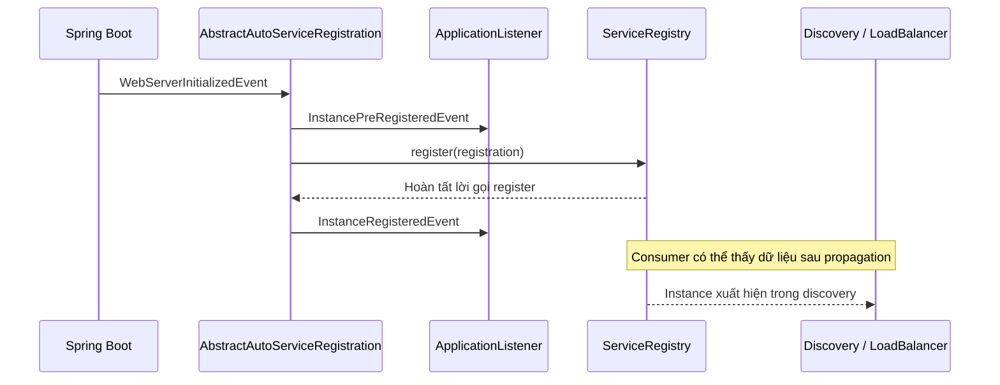
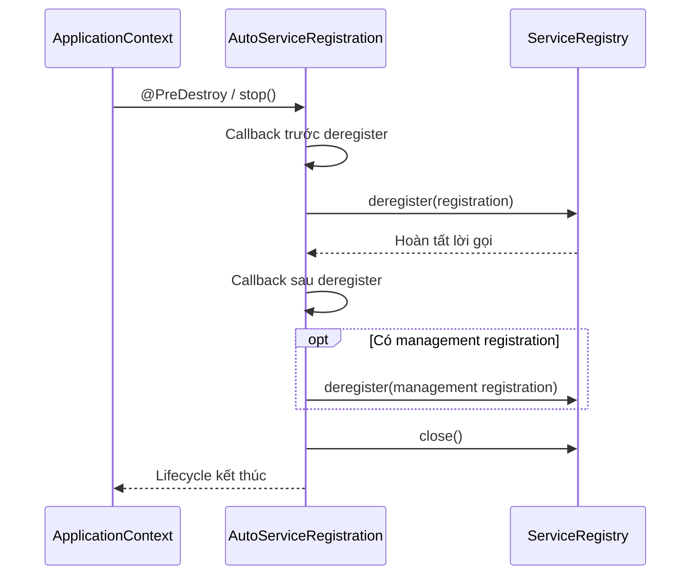

# Kiểm thử sự kiện đăng ký và vòng đời ServiceRegistry

## 1. Vì sao cần kiểm thử vòng đời đăng ký?

Trong hệ thống Spring Cloud, một instance chỉ có thể được các dịch vụ khác tìm thấy khi thông tin của nó được đăng ký vào service registry. Đăng ký sai thời điểm, không hủy đăng ký khi dừng hoặc cập nhật trạng thái không đúng có thể làm consumer nhận địa chỉ cũ, gửi request đến instance chưa sẵn sàng hoặc bỏ sót instance đang hoạt động.

Spring Cloud Commons cung cấp abstraction `ServiceRegistry` để thao tác với registration và hai event quan trọng cho luồng auto-registration:

- `InstancePreRegisteredEvent`: được phát trước khi instance được đăng ký.
- `InstanceRegisteredEvent`: được phát sau khi thao tác đăng ký hoàn tất.

Kiểm thử cần xác nhận contract của registry, thứ tự event, thời điểm đăng ký, hành vi khi tắt auto-registration, deregistration khi shutdown và semantics trạng thái của provider cụ thể.

Bài học thuộc chương **Kiểm thử** của module **SPRING_CLOUD_CORE**. Module giúp người học hiểu Spring Cloud Commons, Spring Cloud Context, cấu hình ngoài, tương thích Spring Boot, refresh scope, discovery, service registry, giao tiếp dịch vụ và cách kiểm thử/vận hành các abstraction chung.

Sau bài này, người học có thể:

- Phân biệt `ServiceRegistry`, `Registration`, `DiscoveryClient` và cơ chế auto-registration.
- Mô tả vòng đời đăng ký từ lúc web server khởi động đến khi ApplicationContext đóng.
- Phân biệt event trước đăng ký và event sau đăng ký.
- Viết listener để quan sát `InstancePreRegisteredEvent` và `InstanceRegisteredEvent`.
- Kiểm thử các thao tác `register`, `deregister`, `setStatus`, `getStatus` và `close`.
- Xác minh hành vi khi tắt auto-registration hoặc dùng đăng ký thủ công.
- Kiểm thử trạng thái instance qua Actuator và API của registry.
- Thiết kế integration test có kiểm soát eventual consistency, shutdown và lỗi kết nối registry.

## 2. Các thành phần trong hợp đồng ServiceRegistry

### 2.1. ServiceRegistry và Registration

Spring Cloud Commons định nghĩa `ServiceRegistry<R extends Registration>`. Đây là abstraction để thao tác với một registration cụ thể. `Registration` là marker interface; mỗi provider cung cấp kiểu registration riêng.

Các thao tác chính của hợp đồng gồm:

| Phương thức | Mục đích |
| --- | --- |
| `register(registration)` | Đưa registration vào registry |
| `deregister(registration)` | Hủy registration |
| `setStatus(registration, status)` | Thay đổi trạng thái theo semantics của provider |
| `getStatus(registration)` | Đọc trạng thái hiện tại |
| `close()` | Đóng tài nguyên của implementation registry |

Một số implementation cụ thể:

| Provider | Registration | ServiceRegistry |
| --- | --- | --- |
| Eureka | `EurekaRegistration` | `EurekaServiceRegistry` |
| Consul | `ConsulRegistration` | `ConsulServiceRegistry` |
| Zookeeper | `ZookeeperRegistration` | `ZookeeperServiceRegistry` |

Khi inject abstraction, cần dùng đúng registration type mà implementation đang hỗ trợ. Không tạo một object registration của Eureka rồi truyền cho Consul registry.

### 2.2. ServiceRegistry không phải DiscoveryClient

Hai abstraction phục vụ hai chiều khác nhau:

| Thành phần | Trách nhiệm | Ví dụ thao tác |
| --- | --- | --- |
| `ServiceRegistry` | Ghi và quản lý registration của instance | Register, deregister, đổi status |
| `Registration` | Mô tả instance cần đăng ký | Service ID, instance ID, địa chỉ và metadata theo provider |
| `DiscoveryClient` | Đọc danh sách service và instance | `getServices()`, `getInstances(serviceId)` |
| `AbstractAutoServiceRegistration` | Điều phối auto-registration theo lifecycle ứng dụng | Start khi web server sẵn sàng, stop khi context đóng |

Một test gọi `DiscoveryClient.getInstances()` có thể xác nhận registry đang hiển thị instance, nhưng không tự chứng minh listener nhận đúng event. Ngược lại, event đã được phát không chứng minh mọi discovery client đã nhìn thấy registration ngay lập tức.

### 2.3. Vì sao cần tách các loại kiểm thử?

- **Contract/unit test:** xác minh implementation hoặc service wrapper gọi đúng các thao tác registry.
- **Event test:** xác minh listener phản ứng đúng với event và không phụ thuộc thứ tự ngoài hợp đồng.
- **Lifecycle integration test:** xác minh auto-registration gắn với web server startup và ApplicationContext shutdown.
- **Provider integration test:** xác minh registration, status, health filtering và deregistration trong registry thật hoặc test instance của provider.

Không dùng một unit test mock để kết luận rằng registry thật đã đồng bộ dữ liệu hoặc consumer đã nhận được instance mới.

## 3. Vòng đời auto-registration

### 3.1. Thời điểm đăng ký

Trong luồng auto-registration thông dụng, `AbstractAutoServiceRegistration` lắng nghe `WebServerInitializedEvent`. Khi web server của ứng dụng đã khởi tạo và có port, lifecycle registration có thể bắt đầu.

Trình tự khái quát:

1. Web server của ứng dụng khởi động và phát `WebServerInitializedEvent`.
2. Auto-registration kiểm tra provider và cấu hình có cho phép đăng ký hay không.
3. Phát `InstancePreRegisteredEvent`.
4. Chạy các callback trước đăng ký nếu provider có cấu hình `RegistrationLifecycle`.
5. Gọi `ServiceRegistry.register(...)`.
6. Chạy callback sau đăng ký.
7. Nếu được cấu hình và management server dùng port riêng, đăng ký thêm management service.
8. Phát `InstanceRegisteredEvent`.
9. Đánh dấu lifecycle đang chạy.



Điểm quan trọng: `InstanceRegisteredEvent` cho biết lời gọi đăng ký trong lifecycle đã chạy xong. Với registry phân tán, nó không bảo đảm mọi node registry hoặc mọi discovery client đã cập nhật cache tại đúng thời điểm event được phát.

### 3.2. InstancePreRegisteredEvent

Event này được phát trước khi gọi `ServiceRegistry.register(...)`. Listener có thể dùng nó để ghi nhận ý định đăng ký, bổ sung telemetry hoặc chạy logic chuẩn bị phù hợp.

Nếu thao tác đăng ký phía sau thất bại, event trước đăng ký vẫn có thể đã được phát. Vì vậy, không dùng event này làm bằng chứng instance đã tồn tại trong registry.

### 3.3. InstanceRegisteredEvent

Event này được phát sau khi thao tác register hoàn tất trong luồng auto-registration. Listener có thể dùng nó để ghi log, cập nhật metric hoặc kích hoạt bước tích hợp sau đăng ký.

Trong implementation hiện hành của `AbstractAutoServiceRegistration`, event sau đăng ký được tạo với configuration object của provider. Không nên mặc định payload của `InstanceRegisteredEvent` luôn là chính object `Registration`; hãy kiểm tra kiểu và semantics theo phiên bản/provider đang dùng.

### 3.4. Shutdown và deregistration

Khi ApplicationContext đóng, `AbstractAutoServiceRegistration` gọi lifecycle stop thông qua destruction callback. Luồng stop thông dụng:

1. Kiểm tra registration đang chạy và auto-registration vẫn được bật.
2. Chạy callback trước deregistration.
3. Gọi `ServiceRegistry.deregister(...)`.
4. Chạy callback sau deregistration.
5. Nếu management service đã được đăng ký, hủy registration đó.
6. Gọi `ServiceRegistry.close()` để implementation giải phóng tài nguyên theo contract của nó.



Deregistration chủ động giúp giảm thời gian consumer nhìn thấy địa chỉ cũ. Tuy nhiên, registry provider vẫn có thể có cache, lease hoặc propagation delay riêng. Kiểm thử cần dùng giới hạn thời gian chấp nhận được của provider thay vì giả định dữ liệu biến mất tức thời.

## 4. Bật, tắt và tùy chỉnh auto-registration

### 4.1. Cấu hình mặc định

Spring Cloud Commons thường bật auto-registration khi có implementation discovery/service registry phù hợp trên classpath.

Có thể tắt bằng property:

```yaml
spring:
  cloud:
    service-registry:
      auto-registration:
        enabled: false
```

Với ứng dụng dùng annotation `@EnableDiscoveryClient`, thuộc tính `autoRegister=false` cũng là cách tắt auto-registration trong cấu hình annotation. Trong các phiên bản Spring Cloud hiện hành, annotation này không còn bắt buộc chỉ để kích hoạt discovery nếu implementation đã có trên classpath; hãy kiểm tra API và hướng dẫn của release train đang dùng.

Tên property đầy đủ để tắt auto-registration là `spring.cloud.service-registry.auto-registration.enabled`. Khi property này là `false`, hai event `InstancePreRegisteredEvent` và `InstanceRegisteredEvent` không được phát bởi luồng auto-registration. Test event phải đặt rõ property này, nếu không kết quả có thể khác giữa profile test và production.

### 4.2. Đăng ký thủ công

Có thể tắt auto-registration rồi chủ động gọi registry từ một service hoặc một quy trình điều phối:

```java
@Service
class ManualRegistrationManager implements AutoCloseable {

    private final ServiceRegistry<MyRegistration> serviceRegistry;

    ManualRegistrationManager(
            ServiceRegistry<MyRegistration> serviceRegistry) {
        this.serviceRegistry = serviceRegistry;
    }

    void register(MyRegistration registration) {
        serviceRegistry.register(registration);
    }

    void deregister(MyRegistration registration) {
        serviceRegistry.deregister(registration);
    }

    @Override
    public void close() {
        serviceRegistry.close();
    }
}
```

Đăng ký thủ công chỉ gọi contract của `ServiceRegistry`. Nó không tự phát hai event auto-registration nói trên. Nếu ứng dụng cần event domain riêng cho manual registration, hãy publish event riêng sau khi thao tác hoàn tất và đặt tên rõ ràng để không nhầm với event do Spring Cloud phát.

### 4.3. Management service registration

Một số ứng dụng chạy management server trên port riêng. Spring Cloud có thể đăng ký management endpoint thành một service riêng khi provider và cấu hình cho phép.

Property hiện hành:

```yaml
spring:
  cloud:
    service-registry:
      auto-registration:
        register-management: true
```

Cấu hình này mặc định bật trong property metadata hiện hành, nhưng management registration chỉ có ý nghĩa khi có management port riêng và provider hỗ trợ. Khi kiểm thử, xác minh riêng registration ứng dụng và registration management; đừng đếm cả hai như hai instance nghiệp vụ.

## 5. Viết listener quan sát registration events

### 5.1. Listener dùng @EventListener

Có thể ghi nhận event trong một component:

```java
import java.util.List;
import java.util.concurrent.CopyOnWriteArrayList;

import org.springframework.context.event.EventListener;
import org.springframework.stereotype.Component;

import org.springframework.cloud.client.discovery.event.InstancePreRegisteredEvent;
import org.springframework.cloud.client.discovery.event.InstanceRegisteredEvent;

@Component
class RegistrationEventRecorder {

    private final List<String> events = new CopyOnWriteArrayList<>();

    @EventListener
    void beforeRegistration(InstancePreRegisteredEvent event) {
        events.add("pre-registered");
    }

    @EventListener
    void afterRegistration(InstanceRegisteredEvent<?> event) {
        events.add("registered");
    }

    List<String> snapshot() {
        return List.copyOf(events);
    }

    void clear() {
        events.clear();
    }
}
```

Recorder chỉ lưu tên event để ví dụ dễ đọc. Trong ứng dụng thật, có thể ghi thêm service name, instance ID hoặc correlation ID từ registration/configuration phù hợp. Tránh ghi credential hoặc metadata nhạy cảm vào log.

### 5.2. Không biến listener thành tác vụ chặn startup

Event được phát trong luồng lifecycle registration. Listener chạy đồng bộ có thể làm chậm hoặc làm lỗi quá trình khởi động nếu thực hiện công việc nặng.

Các nguyên tắc:

- Giữ listener ngắn và có thể quan sát được.
- Không thực hiện vòng gọi HTTP dài đến nhiều hệ thống bên ngoài ngay trong listener.
- Nếu cần tác vụ nền, đẩy công việc vào executor/queue có quản lý, retry và metric.
- Không xem event pre-registration như tín hiệu readiness cuối cùng.
- Đảm bảo lỗi trong listener không vô tình làm ứng dụng khởi động thất bại ngoài ý muốn.

Nếu dùng listener bất đồng bộ, cần kiểm thử thứ tự và tính nhất quán riêng. Không giả định event xử lý xong trước khi startup hoàn tất.

## 6. Unit test contract ServiceRegistry

### 6.1. Kiểm thử wrapper/service gọi đúng thao tác

Nếu ứng dụng có một service bọc registry, dùng mock để xác minh delegation:

```java
@ExtendWith(MockitoExtension.class)
class ManualRegistrationManagerTest {

    @Mock
    ServiceRegistry<MyRegistration> registry;

    @InjectMocks
    ManualRegistrationManager manager;

    @Test
    void delegatesRegisterAndDeregister() {
        MyRegistration registration =
                new MyRegistration("catalog-service", "catalog-1");

        manager.register(registration);
        manager.deregister(registration);

        verify(registry).register(registration);
        verify(registry).deregister(registration);
    }
}
```

Test này xác minh lớp ứng dụng gọi đúng API. Nó không kiểm tra provider có ghi dữ liệu vào registry thật hay không.

### 6.2. Kiểm thử trạng thái

```java
@Test
void readsAndChangesRegistrationStatus() {
    MyRegistration registration =
            new MyRegistration("catalog-service", "catalog-1");

    when(registry.<String>getStatus(registration)).thenReturn("UP");

    assertThat(registry.<String>getStatus(registration)).isEqualTo("UP");

    registry.setStatus(registration, "OUT_OF_SERVICE");

    verify(registry).setStatus(registration, "OUT_OF_SERVICE");
}
```

Đây là ví dụ với mock. Khi kiểm thử provider thật, phải xác minh trạng thái trả về sau khi gọi `setStatus`, đồng thời xác nhận status đó có ảnh hưởng đến discovery/load balancing theo semantics provider hay không.

### 6.3. Kiểm thử close

Nếu service wrapper sở hữu vòng đời của registry, kiểm tra nó đóng tài nguyên đúng lúc:

```java
@Test
void closesRegistryWhenManagerStops() {
    manager.close();

    verify(registry).close();
}
```

Không gọi `close()` tùy tiện từ một request nghiệp vụ nếu registry là singleton dùng chung trong ApplicationContext. Thông thường lifecycle container hoặc auto-registration implementation quản lý thời điểm đóng provider client.

## 7. Test fixture cho Registration và ServiceRegistry

### 7.1. Registration giả lập

Vì `Registration` là marker interface, test có thể tạo kiểu đơn giản:

```java
import org.springframework.cloud.client.serviceregistry.Registration;

record MyRegistration(
        String serviceId,
        String instanceId,
        String host,
        int port) implements Registration {
}
```

Đây là kiểu registration cho ví dụ test, không phải registration dùng trực tiếp với Eureka, Consul hoặc Zookeeper. Provider thực tế yêu cầu class registration riêng của nó.

### 7.2. Recording registry

Một fake registry giúp kiểm tra trình tự thao tác mà không cần khởi động backend bên ngoài:

```java
import java.util.ArrayList;
import java.util.HashMap;
import java.util.List;
import java.util.Map;

import org.springframework.cloud.client.serviceregistry.ServiceRegistry;

class RecordingServiceRegistry
        implements ServiceRegistry<MyRegistration> {

    private final List<String> calls = new ArrayList<>();
    private final Map<String, String> statuses = new HashMap<>();

    @Override
    public void register(MyRegistration registration) {
        calls.add("register:" + registration.instanceId());
        statuses.put(registration.instanceId(), "UP");
    }

    @Override
    public void deregister(MyRegistration registration) {
        calls.add("deregister:" + registration.instanceId());
        statuses.remove(registration.instanceId());
    }

    @Override
    public void setStatus(MyRegistration registration, String status) {
        statuses.put(registration.instanceId(), status);
        calls.add("status:" + registration.instanceId() + ":" + status);
    }

    @Override
    @SuppressWarnings("unchecked")
    public <T> T getStatus(MyRegistration registration) {
        return (T) statuses.get(registration.instanceId());
    }

    @Override
    public void close() {
        calls.add("close");
    }

    List<String> calls() {
        return List.copyOf(calls);
    }
}
```

Fake này lưu trạng thái trong memory để test. Không dùng nó làm mô hình chính xác cho lease, heartbeat, health check hoặc consistency của một registry phân tán.

### 7.3. Những invariant nên xác minh

| Thao tác | Invariant kiểm thử |
| --- | --- |
| Register | Registration được gửi đúng một lần theo hành vi lifecycle mong đợi |
| Deregister | Đúng registration bị hủy |
| Set status | Status truyền đến provider đúng giá trị |
| Get status | Giá trị đọc được phản ánh contract provider |
| Close | Tài nguyên của registry được đóng đúng lifecycle |
| Register lỗi | Event sau đăng ký không được xem là thành công |
| Deregister lỗi | Lỗi được ghi nhận; không giả định registration đã biến mất |

Không áp đặt các quy tắc như duplicate registration luôn phải lỗi hoặc luôn phải idempotent lên mọi provider. Hãy kiểm tra hành vi được tài liệu provider cam kết.

## 8. Kiểm thử event lifecycle

### 8.1. Kiểm thử listener riêng biệt

Có thể publish event trực tiếp trong unit test để xác minh listener phản ứng đúng:

```java
@Test
void recordsRegistrationEvents() {
    RegistrationEventRecorder recorder =
            new RegistrationEventRecorder();

    recorder.beforeRegistration(
            new InstancePreRegisteredEvent(this, registration)
    );
    recorder.afterRegistration(
            new InstanceRegisteredEvent<>(this, configuration)
    );

    assertThat(recorder.snapshot())
            .containsExactly("pre-registered", "registered");
}
```

Test này chỉ xác minh logic recorder. Nó không chứng minh Spring Cloud tự phát event đúng thời điểm.

### 8.2. Integration test với auto-registration thực

Để kiểm tra lifecycle thật, khởi động ứng dụng web với provider discovery phù hợp và auto-registration được bật. Dùng listener recorder để ghi nhận hai event.

Ví dụ cấu trúc test:

```java
@SpringBootTest(webEnvironment = SpringBootTest.WebEnvironment.RANDOM_PORT)
@ActiveProfiles("registry-test")
class ServiceRegistrationLifecycleIT {

    @Autowired
    RegistrationEventRecorder recorder;

    @Autowired
    DiscoveryClient discoveryClient;

    @LocalServerPort
    int port;

    @Test
    void registersAfterWebServerStarts() {
        await().untilAsserted(() ->
                assertThat(recorder.snapshot())
                        .containsSubsequence(
                                "pre-registered",
                                "registered"
                        )
        );

        await().untilAsserted(() ->
                assertThat(discoveryClient.getInstances("catalog-service"))
                        .anyMatch(instance -> instance.getPort() == port)
        );
    }
}
```

Ví dụ giả định profile `registry-test` cấu hình provider test và `catalog-service` là service ID được đăng ký. Thư viện Awaitility được dùng để chờ event và registry propagation thay vì sleep một khoảng thời gian cố định.

Cần lưu ý:

- `InstancePreRegisteredEvent` phải xuất hiện trước `InstanceRegisteredEvent`.
- Event sau đăng ký xác nhận thao tác register đã chạy xong.
- Việc discovery client nhìn thấy instance có thể đến muộn hơn do registry propagation hoặc cache.
- Nếu ứng dụng dùng management port riêng, kiểm tra registration management độc lập.
- Mỗi test phải dùng instance ID hoặc namespace riêng để tránh dữ liệu từ lần chạy trước.

### 8.3. Kiểm tra auto-registration bị tắt

Dùng một context riêng với property:

```yaml
spring:
  cloud:
    service-registry:
      auto-registration:
        enabled: false
```

Kết quả cần xác nhận:

- Không có registration tự động khi web server khởi động.
- Không có `InstancePreRegisteredEvent` từ luồng auto-registration.
- Không có `InstanceRegisteredEvent` từ luồng auto-registration.
- Nếu ứng dụng chủ động gọi `ServiceRegistry.register()`, thao tác thủ công vẫn hoạt động theo logic riêng.

Không dùng recorder được chia sẻ giữa nhiều test mà không reset state; nếu không, event từ context trước có thể làm test sau pass giả.

## 9. Kiểm thử deregistration khi shutdown

### 9.1. Vì sao cần kiểm tra shutdown?

Nếu instance đóng mà registration còn tồn tại, consumer có thể tiếp tục chọn địa chỉ đã dừng. Một số registry có heartbeat/lease để loại instance mất kết nối, nhưng thời gian loại bỏ có thể lâu hơn mong muốn.

Kiểm thử shutdown cần xác nhận:

- Lifecycle stop được gọi khi context đóng.
- Provider nhận đúng lệnh deregister.
- Registration ứng dụng bị loại khỏi registry trong giới hạn thời gian provider cam kết.
- Management registration cũng được hủy nếu đã tạo.
- Registry client được đóng đúng lifecycle.

### 9.2. Unit test stop với recording registry

Nếu có lớp lifecycle riêng sở hữu register/deregister, test có thể kiểm tra trình tự lời gọi:

```java
@Test
void deregistersBeforeClosingRegistry() {
    lifecycle.start();
    lifecycle.stop();

    assertThat(registry.calls()).containsSubsequence(
            "register:catalog-1",
            "deregister:catalog-1",
            "close"
    );
}
```

Test này phù hợp với lifecycle coordinator do ứng dụng tự viết. Với `AbstractAutoServiceRegistration`, cần integration test qua implementation provider hoặc test subclass có kiểm soát; không giả định gọi `ServiceRegistry.register()` trực tiếp sẽ tạo ra toàn bộ lifecycle.

### 9.3. Integration test đóng ApplicationContext

Có thể chạy ứng dụng trong một context riêng, chờ instance xuất hiện, đóng context, rồi truy vấn registry bằng một client quản trị độc lập:

```java
ConfigurableApplicationContext context =
        new SpringApplicationBuilder(CatalogApplication.class)
                .web(WebApplicationType.SERVLET)
                .run(testArguments);

try {
    // Chờ instance xuất hiện trong registry.
}
finally {
    context.close();
}

// Dùng registry admin client bên ngoài context đã đóng
// để chờ registration biến mất.
```

Không dùng bean `DiscoveryClient` từ context đã đóng để kiểm tra kết quả sau shutdown. Hãy dùng client quản trị bên ngoài, một context test độc lập hoặc API của registry.

## 10. Kiểm thử trạng thái qua Actuator

### 10.1. Endpoint Service Registry

Spring Cloud Commons cung cấp Actuator endpoint có ID `serviceregistry`. Endpoint dựa vào bean `Registration` trong ApplicationContext và registry implementation tương ứng.

- GET `/actuator/serviceregistry`: đọc trạng thái registration hiện tại.
- POST `/actuator/serviceregistry`: yêu cầu đổi trạng thái qua JSON có field `status`.

Ví dụ body:

```json
{
  "status": "OUT_OF_SERVICE"
}
```

Ví dụ cấu hình expose endpoint:

```yaml
management:
  endpoints:
    web:
      exposure:
        include:
          - health
          - serviceregistry
```

Chỉ expose endpoint này trên management network và bảo vệ thao tác POST bằng authentication/authorization phù hợp. Không mở quyền thay đổi status cho người dùng không tin cậy.

### 10.2. Status phụ thuộc provider

Một số giá trị thường gặp trong Eureka gồm:

- `UP`
- `DOWN`
- `OUT_OF_SERVICE`
- `UNKNOWN`

Đây không phải enum chuẩn dùng chung cho mọi registry. Provider khác có thể dùng metadata hoặc state machine khác để biểu diễn trạng thái. Ví dụ, Spring Cloud Zookeeper có cách biểu diễn `OUT_OF_SERVICE` qua metadata và LoadBalancer supplier lọc các instance không ở trạng thái `UP`.

Test status phải dùng giá trị được provider hỗ trợ và xác minh tác động thực tế đến discovery/load balancing. Không chỉ assert GET endpoint trả lại chuỗi đã POST.

### 10.3. Status không thay thế readiness

Đưa instance vào `OUT_OF_SERVICE` có thể giúp provider hoặc LoadBalancer loại nó khỏi tập instance được chọn, nhưng readiness, health check và traffic draining vẫn là các cơ chế riêng.

Trong rollout có kiểm soát:

1. Đưa instance ra khỏi traffic theo cơ chế phù hợp.
2. Chờ registry/load balancer cập nhật.
3. Cho request đang chạy hoàn tất.
4. Đóng context và deregister.
5. Xác minh instance không còn được discovery trả về.

Không giả định POST status tự chờ mọi consumer cập nhật cache.

## 11. RegistrationLifecycle callbacks

Ngoài application events, Spring Cloud Commons có các lifecycle callback extension point cho implementation đăng ký dịch vụ:

- `postProcessBeforeStartRegister(registration)`
- `postProcessAfterStartRegister(registration)`
- `postProcessBeforeStopRegister(registration)`
- `postProcessAfterStopRegister(registration)`

Các callback này thuộc `RegistrationLifecycle` và có thể được provider dùng để bổ sung xử lý quanh thao tác đăng ký/hủy đăng ký. Management registration có callback riêng trong `RegistrationManagementLifecycle`.

Phân biệt:

| Cơ chế | Mục đích |
| --- | --- |
| Application event | Thông báo cho listener trong ApplicationContext |
| RegistrationLifecycle callback | Hook nội bộ quanh thao tác của auto-registration implementation |
| ServiceRegistry API | Thực hiện thao tác với registry backend |

Khi viết test provider tùy biến, kiểm tra callback trước/sau có đúng thứ tự với thao tác backend. Không dùng callback như một thay thế cho contract register/deregister.

## 12. Các lỗi thường gặp trong kiểm thử

| Triệu chứng | Nguyên nhân có thể | Hướng xử lý |
| --- | --- | --- |
| Không nhận được event pre/post | Auto-registration bị tắt hoặc không có implementation auto-registration | Kiểm tra dependency provider và property auto-registration |
| Chỉ có event pre-registration | Lệnh register lỗi hoặc lifecycle dừng trước khi hoàn tất | Kiểm tra exception và log của ServiceRegistry |
| Event sau đăng ký đã có nhưng discovery chưa thấy instance | Registry propagation hoặc client cache chưa cập nhật | Dùng Awaitility và kiểm tra provider admin API |
| Manual register không phát event | ServiceRegistry API không tự publish auto-registration events | Publish domain event riêng nếu ứng dụng cần |
| Test pass khi chạy riêng nhưng fail cả suite | Recorder/state hoặc registration còn sót giữa các test | Dùng context/instance ID riêng và reset fixture |
| Instance cũ vẫn được trả về sau shutdown | Deregistration lỗi, lease/cache hoặc propagation delay | Kiểm tra backend registry và TTL provider |
| Status endpoint không có | Actuator thiếu, endpoint chưa expose hoặc thiếu Registration bean | Kiểm tra dependency, exposure và provider configuration |
| POST status trả thành công nhưng routing không đổi | Status value không được provider/load balancer hiểu như kỳ vọng | Kiểm tra semantics provider và instance supplier |
| Test chờ registry quá lâu | Dùng sleep cố định hoặc timeout không phù hợp | Chờ condition bằng Awaitility và đặt timeout theo môi trường test |
| Đếm hai registration cho một ứng dụng | Management service có port riêng được đăng ký thêm | Kiểm tra register-management và phân biệt service/management instance |
| Close registry làm hỏng test khác | Dùng chung một registry singleton cho nhiều test mà đóng quá sớm | Để ApplicationContext quản lý lifecycle hoặc tạo fixture độc lập |

## 13. Ma trận kiểm thử đề xuất

| Nhóm | Kịch bản | Bằng chứng cần thu thập |
| --- | --- | --- |
| Contract | Register một registration | Provider nhận đúng object và metadata |
| Contract | Deregister registration | Registration bị xóa theo semantics provider |
| Contract | Set/get status | Status đọc lại đúng và có hiệu lực |
| Contract | Close | Tài nguyên provider được giải phóng |
| Events | Auto-registration bật | Pre-event trước, post-event sau register |
| Events | Auto-registration tắt | Không phát hai event auto-registration |
| Events | Manual registration | Không kỳ vọng event auto-registration tự phát |
| Startup | Web server bind port | Registration có host/port thực tế đúng |
| Management | Management port riêng | Registration quản trị được tạo/hủy theo cấu hình |
| Shutdown | Đóng ApplicationContext | Deregistration được gọi và instance biến mất theo giới hạn provider |
| Status | Chuyển OUT_OF_SERVICE | Provider và LoadBalancer phản ánh trạng thái |
| Failure | Registry không truy cập được | Fail-fast hoặc retry/error behavior đúng cấu hình |
| Consistency | Registry propagation chậm | Test chờ condition, không dựa vào thời gian sleep |
| Isolation | Nhiều test chạy song song | Service ID/instance ID và namespace không xung đột |

## 14. Checklist triển khai và kiểm thử

Trước khi phát hành integration discovery, hãy xác nhận:

1. Registration type có đúng provider đang dùng không?
2. Service ID, instance ID, host, port và metadata có chính xác không?
3. Auto-registration có được bật đúng profile không?
4. Hai event pre/post có được phát trong luồng auto-registration không?
5. Listener có tránh chặn startup bằng tác vụ dài không?
6. Manual registration có được phân biệt với auto-registration không?
7. Shutdown có gọi deregister và giải phóng registry client không?
8. Management service registration có đang được bật ngoài ý muốn không?
9. Status value có hợp lệ theo provider và có ảnh hưởng đến routing như mong đợi không?
10. Actuator endpoint có được expose tối thiểu và bảo vệ đúng quyền không?
11. Integration test có dùng registry thật hoặc test backend tương thích không?
12. Test có chờ propagation bằng condition thay vì sleep cố định không?
13. Test shutdown có truy vấn registry qua client còn sống sau khi context đóng không?
14. Test có xác minh riêng event, backend registration và discovery visibility không?

## 15. Tài liệu tham khảo chính thức

- [Spring Cloud Commons — Common Abstractions, ServiceRegistry](https://docs.spring.io/spring-cloud-commons/reference/spring-cloud-commons/common-abstractions.html): hợp đồng ServiceRegistry, auto-registration, hai event và Actuator endpoint.
- [AbstractAutoServiceRegistration.java — Spring Cloud Commons](https://github.com/spring-cloud/spring-cloud-commons/blob/main/spring-cloud-commons/src/main/java/org/springframework/cloud/client/serviceregistry/AbstractAutoServiceRegistration.java): lifecycle gắn với WebServerInitializedEvent, publish event, register, stop và deregister.
- [ServiceRegistry API — Spring Cloud Commons](https://javadoc.io/doc/org.springframework.cloud/spring-cloud-commons/latest/org/springframework/cloud/client/serviceregistry/ServiceRegistry.html): các thao tác register, deregister, status và close.
- [Spring Cloud Zookeeper — Service Registry](https://docs.spring.io/spring-cloud-zookeeper/reference/service-registry.html): ví dụ registration thủ công và semantics OUT_OF_SERVICE của Zookeeper.
- [Spring Cloud Netflix — Eureka Client](https://docs.spring.io/spring-cloud-netflix/reference/spring-cloud-netflix.html): heartbeat, lease, registry cache và hành vi discovery của Eureka.

**Ghi nhớ:** `ServiceRegistry` thực hiện thao tác với registration; auto-registration điều phối các thao tác đó theo lifecycle của ứng dụng. `InstancePreRegisteredEvent` được phát trước register, `InstanceRegisteredEvent` được phát sau khi register hoàn tất. Hãy kiểm thử riêng event, trạng thái backend, discovery visibility và deregistration khi shutdown; chúng có quan hệ với nhau nhưng không phải cùng một tín hiệu.
