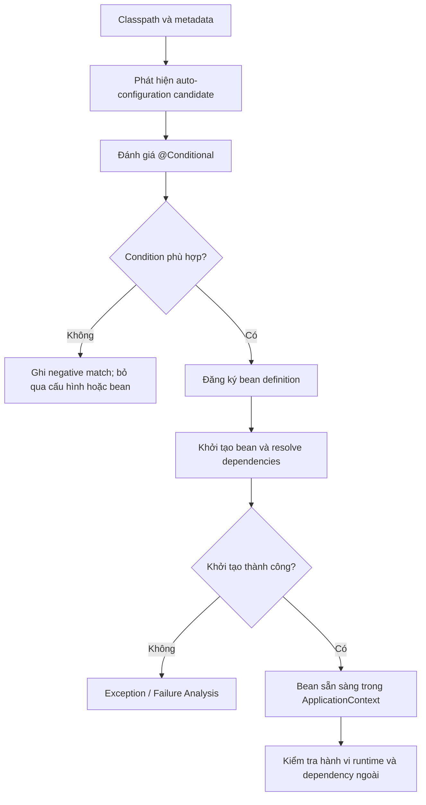
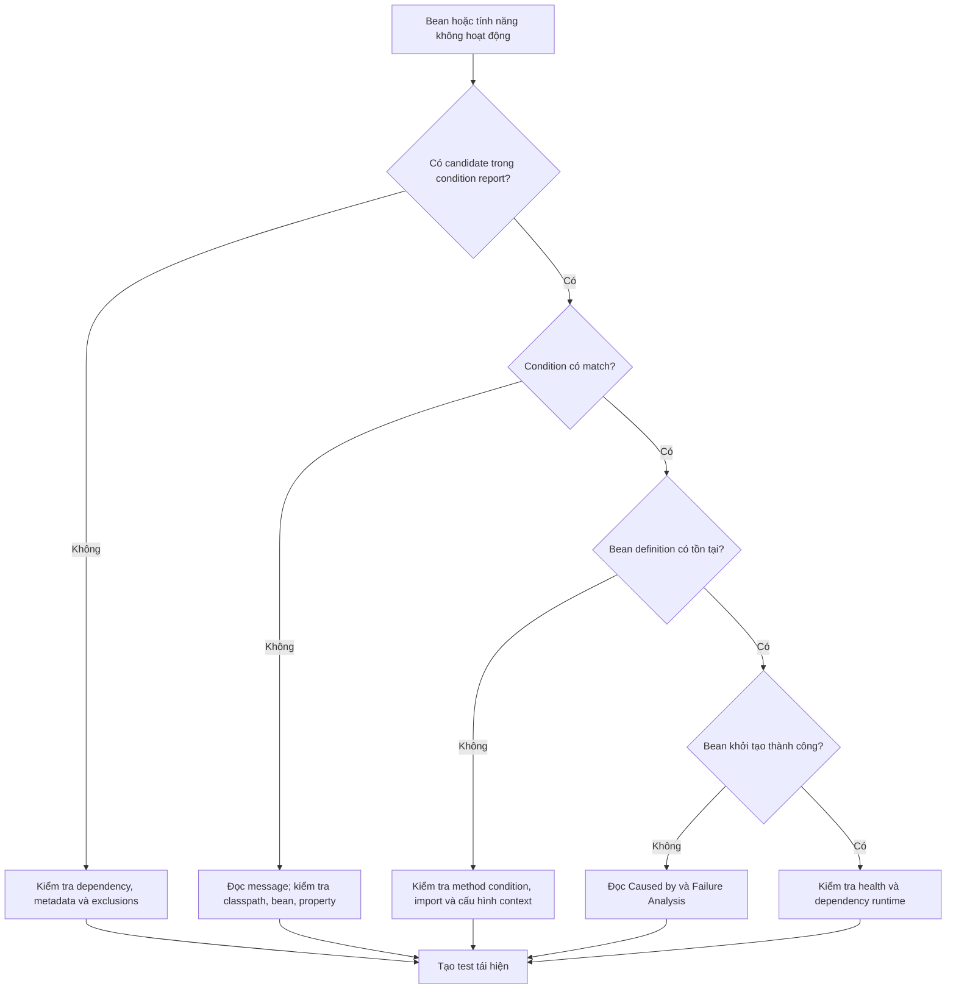

# Chẩn đoán auto-configuration bằng conditions và log khởi động

Khi một bean của Spring Boot hoặc Spring Cloud không xuất hiện, nguyên nhân có thể nằm ở nhiều giai đoạn: lớp auto-configuration chưa được phát hiện, một condition không khớp, cấu hình bị loại trừ, bean khác khiến cấu hình mặc định lùi lại, hoặc bean đã được khai báo nhưng lỗi trong lúc khởi tạo. Chỉ nhìn stack trace hay danh sách bean thường chưa đủ để phân biệt các trường hợp này.

Spring Boot cung cấp `ConditionEvaluationReport` để ghi lại kết quả đánh giá condition của configuration và auto-configuration. Có thể xem báo cáo qua log khởi động khi bật `--debug`, truy vấn Actuator `/actuator/conditions`, hoặc đọc report trong test. Kết hợp các nguồn này với log của bean lifecycle và thông tin cấu hình sẽ giúp tìm đúng điểm khiến một tính năng không được kích hoạt.

Bài học thuộc chương **Quan sát** của **SPRING_CLOUD_CORE**. Nội dung tập trung vào cách đọc positive/negative matches, bật debug report, dùng endpoint conditions, truy nguyên property và classpath, chẩn đoán auto-configuration của Spring Cloud, cùng quy trình điều tra lỗi khởi động.

## 1. Mục tiêu học tập

Sau bài này, bạn có thể:

- Mô tả các giai đoạn từ phát hiện auto-configuration đến khởi tạo bean.
- Giải thích vai trò của `ConditionEvaluationReport`.
- Bật báo cáo condition bằng `--debug` hoặc property `debug`.
- Đọc các nhóm positive matches, negative matches và unconditional classes.
- Truy vấn báo cáo qua Actuator `/actuator/conditions`.
- Dùng API `ConditionEvaluationReport` trong công cụ chẩn đoán hoặc test.
- Phân biệt classpath condition, bean condition và property condition.
- Kiểm tra cấu hình bị loại trừ bằng annotation hoặc `spring.autoconfigure.exclude`.
- Phân biệt auto-configuration không được phát hiện với auto-configuration được phát hiện nhưng không khớp condition.
- Đối chiếu condition report với property source, bean list và log khởi tạo.
- Chẩn đoán các condition liên quan tới Spring Cloud discovery và service registry.
- Dùng `ApplicationContextRunner` để tái hiện điều kiện gây lỗi.
- Bảo vệ thông tin nhạy cảm khi bật Actuator hoặc log chẩn đoán trong môi trường thật.

## 2. Quy trình hình thành một bean từ auto-configuration

Để đọc log đúng, cần hiểu một bean đi qua những giai đoạn nào. Có thể mô hình hóa thành năm bước:

1. Spring Boot phát hiện lớp auto-configuration từ metadata trên classpath.
2. Spring đánh giá các condition trên lớp cấu hình và các phương thức `@Bean`.
3. Nếu condition phù hợp, Spring đăng ký bean definition.
4. Khi container cần khởi tạo bean, dependency được resolve và factory method hoặc constructor được thực thi.
5. Bean hoạt động trong ứng dụng và phụ thuộc vào các dịch vụ bên ngoài như registry, database hoặc message broker.



`ConditionEvaluationReport` tập trung vào bước đánh giá condition. Nó giúp giải thích vì sao một cấu hình hoặc bean method được chọn hay bị bỏ qua. Báo cáo không thay thế log khởi tạo bean, health check hoặc kiểm tra kết nối runtime.

### 2.1. Ba loại vấn đề dễ nhầm

| Trường hợp | Dấu hiệu | Nơi cần kiểm tra |
| --- | --- | --- |
| Auto-configuration không được phát hiện | Không thấy class trong condition report | `AutoConfiguration.imports`, metadata JAR, dependency và exclusions |
| Auto-configuration được phát hiện nhưng condition không khớp | Có negative match và message giải thích | `ConditionEvaluationReport`, property, classpath và bean conditions |
| Bean definition được đăng ký nhưng bean không khởi tạo được | Có condition match nhưng startup ném exception | Stack trace, dependency injection, constructor, factory method và lifecycle |

Đừng kết luận rằng một class không có trong report là condition của nó đã thất bại. Có thể Spring Boot chưa từng phát hiện class đó để đánh giá.

## 3. ConditionEvaluationReport là gì?

`org.springframework.boot.autoconfigure.condition.ConditionEvaluationReport` là cấu trúc dữ liệu Spring Boot dùng để ghi lại kết quả đánh giá các `Condition` trong quá trình xử lý configuration.

Mỗi kết quả gắn với một source, thường là tên configuration class hoặc bean method. Một source có thể có nhiều condition cùng được đánh giá.

Report cung cấp các nhóm thông tin quan trọng:

| API / nhóm dữ liệu | Ý nghĩa |
| --- | --- |
| `getConditionAndOutcomesBySource()` | Các condition outcome được nhóm theo source |
| `getExclusions()` | Các auto-configuration class bị loại trừ |
| `getUnconditionalClasses()` | Các configuration class được đánh giá nhưng không có condition |
| `getParent()` | Report của parent BeanFactory nếu có |
| `getDelta(previousReport)` | Phần thay đổi so với report trước đó |

Mỗi `ConditionOutcome` cho biết condition có khớp hay không và cung cấp message giải thích. Ví dụ message có thể nói class bắt buộc không tồn tại, property không được tìm thấy hoặc bean cần thiết chưa được đăng ký.

### 3.1. Positive match

Positive match có nghĩa condition tương ứng đã khớp. Ví dụ:

```text
@ConditionalOnClass found required class 'com.acme.Client'
```

Hoặc:

```text
@ConditionalOnMissingBean did not find any beans
```

Kết quả này cho biết điều kiện đang xét cho phép cấu hình tiếp tục. Nó không bảo đảm tất cả bean trong cấu hình đều được khởi tạo thành công.

### 3.2. Negative match

Negative match cho biết một condition không khớp. Ví dụ:

```text
@ConditionalOnClass did not find required class 'com.acme.Client'
```

Hoặc:

```text
@ConditionalOnProperty did not find property 'acme.client.enabled'
```

Với `@ConditionalOnMissingBean`, negative match có thể cho biết bean cùng kiểu đã tồn tại, khiến bean mặc định lùi lại.

### 3.3. Unconditional classes

Một số configuration class không có condition. Chúng được ghi trong nhóm unconditional classes. Không nên coi việc xuất hiện trong nhóm này là bằng chứng rằng mọi bean do class đó khai báo đều đã được khởi tạo thành công.

## 4. Bật Condition Evaluation Report bằng --debug

Cách nhanh nhất để điều tra tại local hoặc môi trường kiểm thử là bật debug mode khi khởi động Spring Boot.

Với executable JAR:

```bash
java -jar app.jar --debug
```

Có thể dùng property:

```properties
debug=true
```

Hoặc YAML:

```yaml
debug: true
```

Khi debug mode được bật, Spring Boot ghi `ConditionEvaluationReport` vào log. Báo cáo liệt kê các auto-configuration phù hợp và không phù hợp cùng lý do.

### 4.1. Ví dụ đầu ra

Định dạng thực tế phụ thuộc phiên bản và cấu hình logging. Một đoạn rút gọn có thể trông như sau:

```text
Positive matches:
-----------------

AcmeAutoConfiguration matched:
   - @ConditionalOnClass found required class
     'com.acme.Client' (OnClassCondition)

AcmeAutoConfiguration#acmeClient matched:
   - @ConditionalOnMissingBean did not find any beans
     (OnBeanCondition)


Negative matches:
-----------------

AcmeMetricsAutoConfiguration:
   - @ConditionalOnProperty (acme.metrics.enabled=true)
     did not find property 'acme.metrics.enabled'
     (OnPropertyCondition)
```

Cách đọc:

- `AcmeAutoConfiguration` đã vượt qua classpath condition.
- Bean `acmeClient` được phép tạo vì chưa có bean thay thế.
- Cấu hình metrics không được áp dụng vì property không tồn tại hoặc không có giá trị phù hợp.

### 4.2. --debug không có nghĩa bật DEBUG cho toàn bộ ứng dụng

`--debug` yêu cầu Spring Boot bật mức log debug cho một số logger lõi được chọn. Nó không tự động đặt mọi logger trong ứng dụng và mọi thư viện về `DEBUG`.

Nếu cần log chi tiết của một package cụ thể, có thể cấu hình logger riêng:

```yaml
logging:
  level:
    org.springframework.boot.autoconfigure: DEBUG
    org.springframework.cloud: DEBUG
```

Chỉ bật logger cần thiết. Bật DEBUG toàn bộ Spring Framework hoặc toàn bộ ứng dụng có thể tạo lượng log rất lớn và làm khó việc tìm nguyên nhân chính.

### 4.3. Bật debug theo từng lần chạy

Không nhất thiết commit `debug: true` vào cấu hình production. Có thể thêm `--debug` khi chạy một lần để điều tra, sau đó tắt lại. Cách này giảm log không cần thiết và tránh vô tình lưu thông tin chẩn đoán dài hạn.

## 5. Đọc report theo thứ tự

Khi tìm một bean không xuất hiện, không cần đọc toàn bộ report từ đầu đến cuối. Hãy bắt đầu từ tên class hoặc bean method liên quan.

Một cách đọc hiệu quả:

1. Tìm tên auto-configuration class.
2. Xem source đó có positive match hay negative match.
3. Nếu là negative match, đọc đầy đủ message của condition.
4. Nếu class match nhưng bean không có, tìm riêng method `@Bean`.
5. Kiểm tra exclusions và cấu hình người dùng có thể đã thay thế bean.
6. Nếu report cho thấy match, chuyển sang kiểm tra bean creation log và exception.

### 5.1. Condition trên class và condition trên method

Một class có thể được đánh giá là phù hợp, nhưng một method `@Bean` bên trong vẫn có condition riêng không khớp.

Ví dụ:

```java
@AutoConfiguration
@ConditionalOnClass(AcmeClient.class)
public class AcmeAutoConfiguration {

    @Bean
    @ConditionalOnProperty(
            prefix = "acme.client",
            name = "enabled",
            havingValue = "true")
    AcmeClient acmeClient() {
        return new AcmeClient();
    }
}
```

Nếu class `AcmeClient` có mặt, condition trên class có thể match. Nhưng nếu `acme.client.enabled` không phải `true`, bean method vẫn bị bỏ qua.

Do đó, hãy tìm cả tên class và tên method trong report.

### 5.2. Một source có thể có nhiều outcome

Một source có thể có nhiều condition. Một số condition match nhưng chỉ cần một condition bắt buộc không match thì cấu hình vẫn không được áp dụng.

Hãy đọc tất cả message của source đang điều tra. Không dừng lại ở condition đầu tiên có chữ `matched`.

## 6. Truy vấn bằng Actuator /actuator/conditions

Nếu ứng dụng đã tích hợp Spring Boot Actuator, có thể xem condition report qua endpoint:

```text
GET /actuator/conditions
```

Endpoint trả báo cáo dưới dạng JSON, phù hợp khi ứng dụng đã chạy và cần kiểm tra trạng thái cấu hình đang hoạt động.

### 6.1. Thêm Actuator dependency

Với Maven, thêm starter Actuator vào module ứng dụng:

```xml
<dependency>
    <groupId>org.springframework.boot</groupId>
    <artifactId>spring-boot-starter-actuator</artifactId>
</dependency>
```

Phiên bản dependency nên được quản lý bằng Spring Boot dependency management hoặc BOM tương ứng với ứng dụng.

### 6.2. Expose conditions endpoint

Mặc định Spring Boot chỉ expose endpoint `health` qua HTTP. Để expose `conditions`, cấu hình:

```yaml
management:
  endpoints:
    web:
      exposure:
        include: "health,conditions"
```

Nếu ứng dụng đã có danh sách endpoint được expose, hãy thêm `conditions` vào danh sách hiện tại để không vô tình bỏ các endpoint đang sử dụng.

Sau đó truy vấn:

```bash
curl http://localhost:8080/actuator/conditions
```

Đường dẫn thực tế có thể khác nếu ứng dụng đổi management base path hoặc dùng management port riêng.

### 6.3. Cấu trúc JSON

Response có các nhóm chính:

```json
{
  "contexts": {
    "application": {
      "positiveMatches": {
        "AcmeAutoConfiguration": [
          {
            "condition": "OnClassCondition",
            "message": "@ConditionalOnClass found required class"
          }
        ]
      },
      "negativeMatches": {
        "AcmeMetricsAutoConfiguration": {
          "notMatched": [
            {
              "condition": "OnPropertyCondition",
              "message": "did not find property 'acme.metrics.enabled'"
            }
          ],
          "matched": []
        }
      },
      "unconditionalClasses": []
    }
  }
}
```

Đây là JSON rút gọn để minh họa cấu trúc, không phải response cố định của mọi ứng dụng. Tên context và nội dung condition phụ thuộc ứng dụng thực tế.

| JSON field | Ý nghĩa |
| --- | --- |
| `contexts` | Các ApplicationContext được báo cáo |
| `positiveMatches` | Source có condition phù hợp |
| `negativeMatches` | Source có ít nhất một condition không phù hợp |
| `notMatched` | Các condition không match |
| `matched` | Các condition đã match trong source có negative outcome |
| `unconditionalClasses` | Các configuration class không có condition |
| `parentId` | ID của parent context nếu tồn tại |

### 6.4. Endpoint không có sẵn chỉ vì đã thêm Actuator

Để truy cập được `/actuator/conditions`, cần bảo đảm:

- Actuator có trên classpath.
- Endpoint được tạo và không bị vô hiệu hóa.
- Access policy cho phép đọc endpoint.
- Endpoint được expose qua HTTP hoặc JMX tương ứng.
- Security policy cho phép caller truy cập.

Nếu nhận HTTP 404, kiểm tra endpoint exposure, base path và management port. Nếu nhận 401/403, kiểm tra authentication, authorization và SecurityFilterChain.

## 7. Đọc report bằng API trong ApplicationContext

Trong một công cụ nội bộ hoặc integration test, có thể lấy `ConditionEvaluationReport` trực tiếp từ BeanFactory.

Ví dụ:

```java
import org.springframework.boot.autoconfigure.condition.ConditionEvaluationReport;
import org.springframework.context.ConfigurableApplicationContext;

public class ConditionReportPrinter {

    public void print(ConfigurableApplicationContext context) {
        ConditionEvaluationReport report =
                ConditionEvaluationReport.get(context.getBeanFactory());

        report.getExclusions().forEach(
                name -> System.out.println("Excluded: " + name));

        report.getConditionAndOutcomesBySource()
                .forEach((source, outcomes) -> {
                    outcomes.forEach(item -> {
                        var outcome = item.getOutcome();

                        System.out.printf(
                                "%s -> %s: %s%n",
                                source,
                                outcome.isMatch() ? "MATCH" : "NO MATCH",
                                outcome.getMessage());
                    });
                });
    }
}
```

`ConditionEvaluationReport.get(...)` trả report gắn với BeanFactory. `getConditionAndOutcomesBySource()` nhóm outcome theo source; mỗi outcome có trạng thái match và message.

Đây là API phục vụ chẩn đoán. Không nên dùng condition report để quyết định nghiệp vụ runtime, thay cho dependency injection hoặc health check. Việc đọc report cũng không làm thay đổi kết quả auto-configuration đã được xử lý.

### 7.1. Chỉ đọc report sau khi context đã có dữ liệu condition

Report có ý nghĩa sau khi Spring đã xử lý các configuration và condition liên quan. Nếu đọc quá sớm trong quá trình bootstrap, report có thể chưa chứa đủ kết quả.

Trong ứng dụng, chỉ nên gọi từ công cụ chẩn đoán sau khi context đã refresh thành công. Nếu context không khởi động được, hãy dùng log khởi động và report được ghi khi failure thay vì cố truy cập một context chưa tồn tại.

## 8. Chẩn đoán các condition thường gặp

Các condition phổ biến để đọc report:

| Condition | Message thường gặp | Câu hỏi cần kiểm tra |
| --- | --- | --- |
| `OnClassCondition` | Không tìm thấy required class | Dependency có trong runtime classpath không? |
| `OnBeanCondition` | Không tìm thấy bean hoặc đã có bean | Bean type, qualifier và thứ tự cấu hình có đúng không? |
| `OnPropertyCondition` | Không tìm thấy property hoặc giá trị không phù hợp | Property có được nạp và có đúng giá trị không? |
| `OnResourceCondition` | Không tìm thấy resource | File có nằm trong classpath/artifact không? |
| `OnWebApplicationCondition` | Loại ứng dụng không phù hợp | Context hiện tại là servlet, reactive hay non-web? |
| `OnCloudPlatformCondition` | Không nhận diện được cloud platform | Environment có platform marker cần thiết không? |

### 8.1. Classpath condition

Ví dụ:

```text
@ConditionalOnClass did not find required class
'com.acme.registry.RegistryClient'
```

Kiểm tra:

- Dependency có nằm trong runtime scope không?
- Dependency có bị loại bởi dependency exclusion không?
- Có lỗi version hoặc classloader isolation không?
- Class có trong JAR nhưng không nằm trong artifact cuối cùng không?
- Auto-configuration có tham chiếu class tùy chọn quá sớm trong method signature hoặc superclass không?

Nếu SDK là tùy chọn, hãy đặt phần phụ thuộc vào nested configuration có condition ở cấp lớp để tránh nạp kiểu không tồn tại.

### 8.2. Bean condition

Ví dụ:

```text
@ConditionalOnMissingBean found beans of type
'com.acme.Client'
```

Đây thường là hành vi back-off đúng thiết kế: ứng dụng đã cung cấp bean nên auto-configuration không tạo bean mặc định.

Kiểm tra:

- Bean hiện có được tạo từ cấu hình nào?
- Có nhiều implementation cùng kiểu không?
- Có qualifier hoặc generic type làm khác candidate không?
- Auto-configuration có thứ tự sau cấu hình người dùng không?
- Bean hiện có có thực sự là bean mà method đang kiểm tra không?

Nếu condition là `@ConditionalOnBean` nhưng không tìm thấy bean, xác minh bean definition đã được đăng ký trước thời điểm condition được đánh giá.

### 8.3. Property condition

Ví dụ:

```text
@ConditionalOnProperty (acme.client.enabled=true)
did not find property 'acme.client.enabled'
```

Kiểm tra:

- Property có được khai báo đúng prefix và tên không?
- Profile tương ứng có được kích hoạt không?
- File cấu hình có được import không?
- Environment variable có tên ánh xạ đúng không?
- Giá trị có bị command-line argument hoặc nguồn ưu tiên cao hơn ghi đè không?
- `matchIfMissing` có được cấu hình đúng với mong muốn không?

Với `@ConditionalOnProperty`, nếu không đặt `matchIfMissing=true`, property bị thiếu thường không làm condition match khi đang yêu cầu giá trị cụ thể.

### 8.4. Web application condition

Một cấu hình chỉ dành cho Servlet có thể không được bật trong reactive application hoặc non-web context.

Kiểm tra loại ApplicationContext, dependency web trên classpath và runner dùng trong test. Đừng kết luận condition sai nếu test đang tạo loại context khác với production.

## 9. Kiểm tra auto-configuration bị loại trừ

Một auto-configuration có thể không được đánh giá vì đã bị loại trừ rõ ràng.

Có thể loại trừ bằng annotation:

```java
@SpringBootApplication(
        exclude = AcmeAutoConfiguration.class)
public class Application {
}
```

Hoặc bằng tên class:

```java
@SpringBootApplication(
        excludeName = "com.example.acme.AcmeAutoConfiguration")
public class Application {
}
```

Cũng có thể dùng property:

```yaml
spring:
  autoconfigure:
    exclude:
      - com.example.acme.AcmeAutoConfiguration
```

Khi điều tra:

1. Kiểm tra `getExclusions()` của `ConditionEvaluationReport`.
2. Tìm `exclude` hoặc `excludeName` trong annotation khởi động.
3. Kiểm tra `spring.autoconfigure.exclude` từ mọi nguồn cấu hình.
4. Kiểm tra test slice hoặc test annotation có loại trừ auto-configuration không.

Nếu class nằm trong danh sách exclusions, chỉnh condition bên trong class sẽ không giải quyết được vì class đã bị loại khỏi quá trình áp dụng.

## 10. Phân biệt auto-configuration không được phát hiện với condition không match

Đây là một trong những lỗi chẩn đoán phổ biến nhất.

Nếu một class không xuất hiện trong positive hoặc negative matches, có thể có nhiều nguyên nhân:

- JAR chứa auto-configuration chưa có trên classpath.
- File `AutoConfiguration.imports` không được đóng gói.
- Tên class trong metadata sai.
- Cấu hình bị exclude.
- Cơ chế đăng ký của extension point không phải `AutoConfiguration.imports`.
- Module đang dùng phiên bản Spring Boot không tương thích với metadata của thư viện.

Vì vậy, hãy kiểm tra metadata trong JAR:

```bash
jar tf acme-spring-boot-autoconfigure.jar
```

Với auto-configuration theo cơ chế Spring Boot hiện đại, kiểm tra resource:

```text
META-INF/spring/org.springframework.boot.autoconfigure.AutoConfiguration.imports
```

Nếu dùng thư viện hoặc extension point Spring Cloud khác, hãy xác minh đúng metadata mà extension point đó yêu cầu. Không phải mọi factory hoặc integration của Spring Cloud đều được đăng ký bằng `AutoConfiguration.imports`; một số cơ chế vẫn dùng `META-INF/spring.factories`.

### 10.1. Kiểm tra tên class

Đối chiếu:

- Fully qualified class name trong source.
- Tên class trong JAR.
- Dòng tương ứng trong file imports.
- Artifact version thực tế được ứng dụng tải về.

Một ký tự sai trong package hoặc class name có thể khiến auto-configuration không được khám phá như mong muốn.

## 11. Thứ tự auto-configuration và bean condition

`@ConditionalOnBean` và `@ConditionalOnMissingBean` phụ thuộc vào các bean definition đã được xử lý tại thời điểm condition chạy.

Ví dụ:

```java
@AutoConfiguration
@AutoConfigureAfter(PlatformClientAutoConfiguration.class)
public class AcmeAdapterAutoConfiguration {

    @Bean
    @ConditionalOnBean(PlatformClient.class)
    AcmeAdapter acmeAdapter(PlatformClient client) {
        return new AcmeAdapter(client);
    }
}
```

Nếu `PlatformClientAutoConfiguration` đăng ký bean client, đặt cấu hình adapter chạy sau nó giúp condition nhìn thấy bean definition cần thiết.

Khi report cho thấy bean condition không match, kiểm tra:

- Auto-configuration cung cấp bean phụ thuộc có được phát hiện không?
- Ordering giữa hai cấu hình có đúng không?
- Bean phụ thuộc có bị condition khác loại bỏ không?
- Bean có nằm trong parent context hoặc child context khác không?

Không dùng `@AutoConfigureAfter` để điều khiển thứ tự khởi tạo object. Annotation này sắp xếp thứ tự áp dụng auto-configuration; dependency injection vẫn quyết định quan hệ tạo bean.

## 12. Chẩn đoán bằng các Actuator endpoint liên quan

`conditions` giải thích condition outcome. Những endpoint khác trả lời các câu hỏi khác.

| Endpoint | Câu hỏi |
| --- | --- |
| `/actuator/conditions` | Vì sao configuration/auto-configuration được hoặc không được áp dụng? |
| `/actuator/beans` | Bean nào hiện đang được đăng ký trong context? |
| `/actuator/env` | Property source nào cung cấp cấu hình và giá trị nào đang được phân giải? |
| `/actuator/configprops` | Các `@ConfigurationProperties` đã bind như thế nào? |
| `/actuator/loggers` | Logger đang dùng level nào và có thể thay đổi ra sao? |
| `/actuator/startup` | Những bước startup nào đã được ghi nhận nếu đã cấu hình `BufferingApplicationStartup`? |
| `/actuator/health` | Các thành phần được health indicator kiểm tra đang ở trạng thái nào? |

Không nên dùng một endpoint để thay thế endpoint khác. Ví dụ, `/actuator/conditions` có thể cho biết một bean method condition đã match, nhưng `/actuator/beans` mới cho biết bean definition hiện diện trong context; `/actuator/health` mới phản ánh health indicator của ứng dụng.

### 12.1. Kiểm tra nguồn property

Nếu condition phụ thuộc property, có thể dùng `/actuator/env` hoặc `/actuator/env/{property}` để xem nguồn cấu hình và origin nếu được cung cấp.

Ví dụ cấu hình:

```yaml
management:
  endpoints:
    web:
      exposure:
        include: "health,conditions,env,configprops"
```

Các endpoint `env` và `configprops` có thể hiển thị thông tin cấu hình nhạy cảm. Spring Boot có cơ chế sanitization, nhưng không nên xem đó là lý do để expose endpoint công khai.

### 12.2. Kiểm tra bean đã được tạo

Nếu report cho thấy method condition match nhưng bean không xuất hiện trong `/actuator/beans`, hãy xem log sau giai đoạn condition evaluation:

- Bean factory method có được gọi không?
- Constructor có ném exception không?
- Dependency có resolve được không?
- Có `BeanPostProcessor` hoặc custom registrar can thiệp không?
- Bean có bị loại bởi profile hoặc cấu hình context khác không?

## 13. Log khởi động và lỗi tạo bean

Condition report không giải thích mọi lỗi startup. Khi bean đã được chọn nhưng khởi tạo thất bại, cần đọc log exception.

Ví dụ:

```text
Error creating bean with name 'acmeClient':
UnsatisfiedDependencyException

Caused by: NoSuchBeanDefinitionException:
No qualifying bean of type 'AcmeCredentials' available
```

Trong trường hợp này, vấn đề không còn là condition của `AcmeAutoConfiguration`. Bean đã được đăng ký nhưng thiếu dependency `AcmeCredentials`.

### 13.1. Đọc exception từ nguyên nhân gốc

Khi startup thất bại:

1. Tìm exception đầu tiên ở cuối stack trace hoặc chuỗi `Caused by`.
2. Xác định bean nào đang được tạo.
3. Tìm factory method hoặc constructor tương ứng.
4. Xác định dependency nào thiếu hoặc exception nào được ném.
5. Đối chiếu với condition report để biết vì sao bean được đăng ký.

Không chỉ đọc exception ngoài cùng. `BeanCreationException` hoặc `UnsatisfiedDependencyException` thường bọc nguyên nhân cụ thể hơn ở bên trong.

### 13.2. FailureAnalyzer

Spring Boot có cơ chế `FailureAnalyzer` để chuyển một số lỗi startup thành thông báo dễ hiểu, thường gồm:

- Description: điều gì đã xảy ra.
- Action: cần làm gì để khắc phục.

Nếu có Failure Analysis, đọc phần này trước rồi đối chiếu stack trace và condition report. FailureAnalyzer không thay thế exception gốc; nó giúp trình bày nguyên nhân và hành động rõ ràng hơn.

### 13.3. Khi report không xuất hiện

Có thể không có condition report hữu ích nếu lỗi xảy ra trước khi Spring xử lý auto-configuration, chẳng hạn:

- JVM không khởi động được.
- Lỗi parse file cấu hình quá sớm.
- Lỗi class loading trước khi context được tạo.
- Lỗi trong EnvironmentPostProcessor hoặc ApplicationContextInitializer trước giai đoạn đánh giá condition.

Trong trường hợp đó, tập trung vào exception đầu tiên, classpath và cấu hình bootstrap. Không giả định mọi lỗi startup đều phải có positive/negative match.

## 14. Spring Cloud: các điểm cần kiểm tra thêm

Các auto-configuration của Spring Cloud cũng dùng điều kiện của Spring Boot, nhưng có thêm dependency, property và metadata riêng.

### 14.1. Discovery và service registry

Nếu một discovery client không được tạo, kiểm tra:

- Provider starter có trong runtime classpath không?
- Auto-configuration/provider metadata có được nạp không?
- Provider có điều kiện classpath hoặc property riêng không?
- `spring.cloud.discovery.enabled` có bị tắt không?
- Ứng dụng có đang dùng blocking hay reactive discovery client?
- Bean tùy chỉnh có khiến provider auto-configuration back off không?

Một số property thường gặp:

```yaml
spring:
  cloud:
    discovery:
      enabled: true
      blocking:
        enabled: true
      reactive:
        enabled: true
```

Đây là các công tắc ở tầng discovery chung. Provider cụ thể vẫn có thể có property riêng để bật/tắt registration, health check hoặc kết nối registry.

### 14.2. Không nhầm discovery bean với registration thành công

Việc `DiscoveryClient` bean được tạo không chứng minh ứng dụng đã đăng ký thành công với registry. Tương tự, `ServiceRegistry` bean tồn tại không chứng minh registry bên ngoài đang truy cập được.

Nếu bean có mặt nhưng discovery không trả instance, kiểm tra thêm:

- Provider configuration và endpoint registry.
- Authentication/TLS/network.
- Registration lifecycle.
- Health/status của instance.
- Cache hoặc propagation delay của registry.
- Kết quả truy vấn từ chính `DiscoveryClient`.

### 14.3. Config Server và property từ xa

Nếu condition phụ thuộc property do Config Server cung cấp, hãy xác minh property đã vào Environment trước khi condition được đánh giá.

Kiểm tra:

- `spring.config.import` có khai báo nguồn cấu hình đúng không?
- Config Server có truy cập được không?
- Profile và application name có đúng không?
- Property source từ xa có được nạp theo thứ tự mong muốn không?
- Giá trị có bị command-line, environment variable hoặc nguồn ưu tiên cao hơn ghi đè không?

Nếu property không có trong Environment tại thời điểm condition chạy, auto-configuration có thể không được bật dù file trên Config Server chứa giá trị mong đợi.

### 14.4. Bootstrap và main ApplicationContext

Một số hệ thống Spring Cloud có thể sử dụng bootstrap context hoặc context phân cấp. Condition report có thể chứa nhiều context, mỗi context có bean factory và kết quả riêng.

Khi thấy một bean có trong context này nhưng không có trong context khác, hãy xác định đúng context chứa component đang cần. Đừng so sánh bean từ parent và child context mà không xét quan hệ kế thừa.

## 15. Kiểm thử condition với ApplicationContextRunner

Khi đã tìm được condition gây ra hành vi, nên tái hiện bằng test nhỏ. `ApplicationContextRunner` cho phép cung cấp property và cấu hình theo từng trường hợp.

Ví dụ:

```java
class AcmeAutoConfigurationTests {

    private final ApplicationContextRunner contextRunner =
            new ApplicationContextRunner()
                    .withConfiguration(
                            AutoConfigurations.of(
                                    AcmeAutoConfiguration.class));

    @Test
    void createsClientWhenEnabled() {
        this.contextRunner
                .withPropertyValues("acme.client.enabled=true")
                .run(context -> {
                    assertThat(context).hasNotFailed();
                    assertThat(context).hasSingleBean(AcmeClient.class);
                });
    }

    @Test
    void backsOffWhenDisabled() {
        this.contextRunner
                .withPropertyValues("acme.client.enabled=false")
                .run(context -> {
                    assertThat(context).hasNotFailed();
                    assertThat(context).doesNotHaveBean(AcmeClient.class);
                });
    }
}
```

Test này giúp kiểm tra condition có thể tái hiện độc lập với toàn bộ ứng dụng.

### 15.1. Ghi report trong test

Có thể gắn `ConditionEvaluationReportLoggingListener` vào runner:

```java
import org.springframework.boot.autoconfigure.logging
        .ConditionEvaluationReportLoggingListener;
import org.springframework.boot.logging.LogLevel;

private final ApplicationContextRunner contextRunner =
        new ApplicationContextRunner()
                .withInitializer(
                        ConditionEvaluationReportLoggingListener
                                .forLogLevel(LogLevel.INFO))
                .withConfiguration(
                        AutoConfigurations.of(
                                AcmeAutoConfiguration.class));
```

Listener này ghi condition report theo mức log được chọn. Nó hữu ích khi test thất bại vì property hoặc classpath condition không khớp như mong đợi.

Không dùng chung một initializer instance cho nhiều context độc lập nếu API phiên bản đang dùng không thiết kế cho việc chia sẻ đó; tạo initializer qua factory cho runner phù hợp.

### 15.2. Kiểm tra classpath

Dùng `FilteredClassLoader` để mô phỏng dependency bị thiếu:

```java
this.contextRunner
        .withClassLoader(
                new FilteredClassLoader(AcmeClient.class))
        .run(context -> {
            assertThat(context).hasNotFailed();
            assertThat(context).doesNotHaveBean(AcmeClient.class);
        });
```

Cách này kiểm tra nhánh `@ConditionalOnClass` mà không cần gỡ dependency khỏi build file. Khi muốn xác minh metadata và dependency graph thực tế, vẫn cần consumer test với JAR đã đóng gói.

### 15.3. Kiểm tra property source độc lập

Không gộp test thiếu class với test property tắt. Mỗi test nên thay đổi một yếu tố chính để khi thất bại có thể xác định condition liên quan.

## 16. Quy trình chẩn đoán từng bước

Khi một bean hoặc tính năng Spring Cloud không hoạt động, có thể đi theo quy trình sau:

**Bước 1 — Xác định bean cần tìm**

Ghi lại bean type, bean name, auto-configuration class và tính năng liên quan. Nếu chưa biết tên class, kiểm tra tài liệu hoặc condition report của provider.

**Bước 2 — Xác minh dependency và metadata**

Kiểm tra runtime classpath, JAR và resource đăng ký auto-configuration. Nếu class không có trong report, đừng vội điều chỉnh condition.

**Bước 3 — Bật --debug**

Chạy ứng dụng với `--debug` để thu condition report. Tìm source tương ứng với class hoặc bean method đang điều tra.

**Bước 4 — Đọc negative match**

Nếu condition không khớp, phân loại thành classpath, bean, property, resource hoặc web condition. Đọc message đầy đủ để xác định dữ liệu nào đang thiếu.

**Bước 5 — Kiểm tra exclusions**

Xem `getExclusions()`, annotation `exclude`/`excludeName` và property `spring.autoconfigure.exclude`.

**Bước 6 — Đối chiếu Environment**

Nếu condition phụ thuộc property, kiểm tra profile, Config Server, environment variable, command-line và property source precedence.

**Bước 7 — Kiểm tra bean thực tế**

Dùng `/actuator/beans` hoặc `ApplicationContext` để xác định bean definition đã xuất hiện chưa. Nếu có condition match nhưng bean không có, đọc log khởi tạo và dependency resolution.

**Bước 8 — Kiểm tra hành vi runtime**

Nếu bean đã được tạo, kiểm tra health, network, credentials, registry status và các dependency bên ngoài.

**Bước 9 — Tạo test tái hiện**

Dùng `ApplicationContextRunner` để cố định classpath, property và bean configuration. Test giúp tránh lỗi quay lại sau khi sửa.



## 17. Ví dụ thực tế: AcmeClient không xuất hiện

Giả sử thư viện cung cấp:

```java
@AutoConfiguration
@ConditionalOnClass(AcmeClient.class)
public class AcmeAutoConfiguration {

    @Bean
    @ConditionalOnProperty(
            prefix = "acme.client",
            name = "enabled",
            havingValue = "true",
            matchIfMissing = false)
    @ConditionalOnMissingBean
    AcmeClient acmeClient() {
        return new AcmeClient();
    }
}
```

Ứng dụng mong đợi có bean `AcmeClient`, nhưng:

```java
context.getBean(AcmeClient.class);
```

ném `NoSuchBeanDefinitionException`.

### 17.1. Bước đầu: bật report

Chạy:

```bash
java -jar app.jar --debug
```

Report có thể cho thấy:

```text
AcmeAutoConfiguration matched:
   - @ConditionalOnClass found required class 'AcmeClient'

AcmeAutoConfiguration#acmeClient:
   - @ConditionalOnProperty did not find property
     'acme.client.enabled'
```

### 17.2. Diễn giải

Class `AcmeClient` có trên classpath nên class condition match. Tuy nhiên, property `acme.client.enabled` chưa có giá trị `true`, nên bean method không được áp dụng.

### 17.3. Kiểm tra nguồn cấu hình

Xem file YAML, profile đang chạy và các nguồn cấu hình bên ngoài. Nếu property được quản lý từ Config Server, xác minh client đã nạp đúng application/profile.

### 17.4. Sửa cấu hình

```yaml
acme:
  client:
    enabled: true
```

Khởi động lại và kiểm tra report. Nếu method condition match nhưng bean vẫn không được tạo, kiểm tra tiếp `@ConditionalOnMissingBean` và các lỗi khởi tạo.

Ví dụ này cho thấy condition report không chỉ nói bean có hay không; nó chỉ ra điều kiện cụ thể khiến bean method bị bỏ qua.

## 18. Bảo vệ thông tin chẩn đoán

Condition report và Actuator hữu ích nhưng có thể tiết lộ cấu trúc nội bộ:

- Tên package và class của dependency.
- Những thư viện tùy chọn có hoặc không có.
- Property và tên profile.
- Các integration được bật/tắt.
- Bean type và quan hệ giữa các module.

Trong môi trường production:

- Chỉ expose `conditions` trên management network phù hợp.
- Dùng authentication và authorization cho Actuator.
- Không mở toàn bộ endpoint bằng `management.endpoints.web.exposure.include: "*"`.
- Không log toàn bộ Environment hoặc secret.
- Bảo vệ log khởi động và file log theo chính sách lưu trữ.
- Tắt debug report sau khi hoàn tất điều tra.
- Giới hạn quyền truy cập endpoint `env`, `configprops`, `beans` và `conditions`.

Spring Boot mặc định chỉ expose `health` qua HTTP. Nếu expose thêm `conditions`, cần kiểm tra access policy và bảo vệ endpoint theo cách triển khai của ứng dụng.

## 19. Các lỗi chẩn đoán thường gặp

| Nhận định sai | Thực tế | Cách kiểm tra đúng |
| --- | --- | --- |
| Không thấy class trong report nghĩa là condition không match | Có thể class chưa được phát hiện hoặc đã bị exclude | Kiểm tra metadata, JAR và exclusions |
| Positive match nghĩa là bean đã hoạt động | Report chỉ ghi condition outcome | Kiểm tra bean list, startup log và health |
| `@ConditionalOnMissingBean` không match là lỗi | Có thể ứng dụng đã cung cấp bean thay thế | Tìm bean hiện có và source khai báo |
| `--debug` bật DEBUG cho tất cả logger | Boot chỉ bật một số logger lõi được chọn | Cấu hình logger cụ thể nếu cần |
| `/actuator/conditions` luôn truy cập được khi có Actuator | Endpoint phải được tạo, cho phép và expose | Kiểm tra exposure, access, security và management path |
| Condition report giải thích mọi startup failure | Lỗi có thể xảy ra trước giai đoạn condition | Đọc exception đầu tiên và bootstrap log |
| Class có trên classpath nghĩa là bean đã có | Classpath và bean registry là hai trạng thái khác nhau | Kiểm tra `@ConditionalOnBean` và `/actuator/beans` |
| Tắt discovery chỉ cần xem condition report | Provider có thể được tạo nhưng không kết nối registry | Kiểm tra health, network và registration |
| Property có trong file nghĩa là condition chắc chắn đọc được | File/profile có thể chưa được nạp hoặc bị nguồn khác ghi đè | Kiểm tra `/actuator/env` và origin |
| Thứ tự auto-configuration quyết định thứ tự khởi tạo bean | Ordering sắp xếp cấu hình, dependency graph quyết định khởi tạo | Kiểm tra constructor/factory dependencies |

## 20. Nguyên tắc vận hành

- Bắt đầu bằng tên bean hoặc auto-configuration cụ thể cần điều tra.
- Dùng `--debug` để thu condition report khi tái hiện lỗi.
- Tìm cả source class và bean method.
- Đọc đầy đủ message của condition không khớp.
- Kiểm tra exclusions trước khi sửa condition.
- Phân biệt classpath condition với bean condition.
- Dùng Actuator `/conditions` khi cần xem report từ ứng dụng đang chạy.
- Dùng `/env` và `/configprops` để truy nguyên property, có bảo vệ dữ liệu nhạy cảm.
- Dùng `/beans` để xác minh bean hiện diện trong context.
- Đọc `Caused by` khi bean đã được đăng ký nhưng khởi tạo thất bại.
- Với Spring Cloud, kiểm tra provider metadata, discovery flags và registration lifecycle.
- Tái hiện vấn đề bằng `ApplicationContextRunner`.
- Chỉ bật log/endpoint chẩn đoán trong phạm vi và thời gian cần thiết.
- Không dùng condition report làm cơ chế quyết định nghiệp vụ runtime.

## 21. Tổng kết

`ConditionEvaluationReport` là công cụ trung tâm để hiểu vì sao Spring Boot áp dụng hoặc bỏ qua một configuration và auto-configuration. Có thể xem report qua log khi bật `--debug`, truy vấn Actuator `/actuator/conditions`, hoặc đọc trực tiếp bằng API trong test và công cụ chẩn đoán.

Điều quan trọng là phân biệt ba giai đoạn: auto-configuration được phát hiện, condition được đánh giá, và bean được khởi tạo. Không có candidate trong report thường cần kiểm tra metadata/classpath/exclusions; negative match cần kiểm tra condition và dữ liệu đầu vào; positive match nhưng bean không hoạt động cần đọc log khởi tạo và kiểm tra runtime.

Với Spring Cloud, cùng quy trình này áp dụng cho discovery, service registry và các integration tùy chọn. Kết hợp condition report, property source, bean list, startup exception và test tái hiện sẽ giúp chẩn đoán chính xác mà không phải bật log toàn hệ thống hoặc thay đổi cấu hình một cách mò mẫm.

## 22. Tài liệu tham khảo

- [Spring Boot — Troubleshoot Auto-configuration](https://docs.spring.io/spring-boot/how-to/application.html#howto.application.troubleshoot-auto-configuration)
- [Spring Boot API — ConditionEvaluationReport](https://docs.spring.io/spring-boot/api/java/org/springframework/boot/autoconfigure/condition/ConditionEvaluationReport.html)
- [Spring Boot API — ConditionOutcome](https://docs.spring.io/spring-boot/api/java/org/springframework/boot/autoconfigure/condition/ConditionOutcome.html)
- [Spring Boot API — ConditionEvaluationReportLoggingListener](https://docs.spring.io/spring-boot/api/java/org/springframework/boot/autoconfigure/logging/ConditionEvaluationReportLoggingListener.html)
- [Spring Boot Actuator API — Conditions Endpoint](https://docs.spring.io/spring-boot/api/rest/actuator/conditions.html)
- [Spring Boot Reference — Actuator Endpoints and Exposure](https://docs.spring.io/spring-boot/reference/actuator/endpoints.html)
- [Spring Cloud Commons — Common Abstractions](https://docs.spring.io/spring-cloud-commons/reference/spring-cloud-commons/common-abstractions.html)
