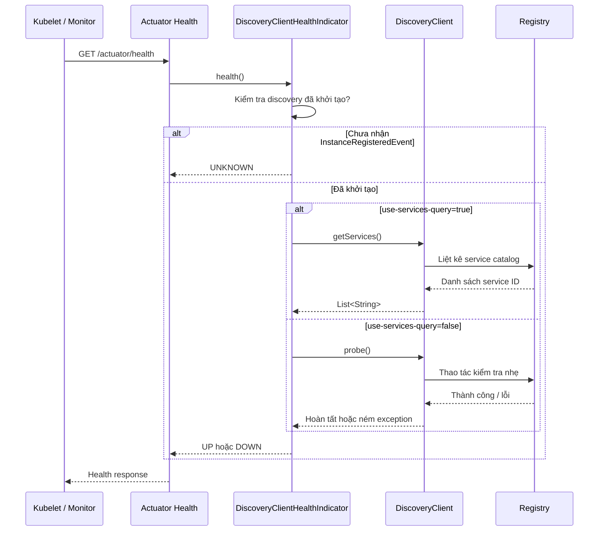

# Giảm chi phí health check bằng probe thay vì liệt kê dịch vụ

## 1. Vì sao liệt kê toàn bộ service có thể làm health check đắt đỏ?

Trong hệ thống microservices, mỗi ứng dụng có thể đăng ký với service registry và dùng Spring Cloud `DiscoveryClient` để tìm các service khác. Spring Cloud Commons cung cấp `DiscoveryClientHealthIndicator` để phản ánh khả năng sử dụng của discovery client trong Spring Boot Actuator.

Mặc định, health indicator gọi `DiscoveryClient.getServices()` trong mỗi lần kiểm tra. Phương thức này trả về danh sách tất cả service ID mà registry biết. Ở môi trường nhỏ, danh sách có thể chỉ có vài chục phần tử. Nhưng ở nền tảng dùng chung với hàng trăm hoặc hàng nghìn service, truy vấn catalog có thể tốn thời gian mạng, tải dữ liệu, giải mã response và cấp phát collection, trong khi kubelet hoặc hệ thống giám sát có thể gọi health endpoint lặp lại liên tục.

Mục tiêu của bài học là dùng **probe** để kiểm tra discovery client có thể giao tiếp với registry bằng một thao tác gọn nhẹ, thay vì yêu cầu nó liệt kê toàn bộ service ở mỗi lần health check.

Có một chi tiết cần hiểu trước khi đổi cấu hình: `DiscoveryClient.probe()` có implementation mặc định gọi lại `getServices()`. Muốn thực sự giảm chi phí, provider phải override `probe()` bằng một thao tác nhẹ hơn. Spring Cloud Consul là ví dụ: `getServices()` truy vấn catalog services, còn `probe()` gọi endpoint lấy trạng thái leader của Consul.

## 2. `getServices()` và `probe()` trả lời hai câu hỏi khác nhau

`DiscoveryClient` là abstraction blocking trong Spring Cloud Commons. Hai phương thức liên quan đến health check có mục đích khác nhau:

| Phương thức | Mục đích | Dữ liệu/kết quả |
| --- | --- | --- |
| `getServices()` | Lấy tất cả service ID mà discovery client biết | `List<String>` chứa tên service |
| `probe()` | Kiểm tra discovery client còn có thể thực hiện lời gọi tới backend hay không | `void`; thành công nếu không ném exception |

Ví dụ consumer có thể cần biết các service đang được đăng ký:

```java
List<String> serviceIds = discoveryClient.getServices();
```

Đây là truy vấn catalog. Nó hữu ích cho màn hình quản trị, chẩn đoán hoặc tác vụ thực sự cần danh sách service. Nó không nhất thiết phù hợp với health check được gọi nhiều lần mỗi phút.

Ngược lại, health check thường chỉ cần biết client có gọi được backend discovery hay không. Nó không cần tải toàn bộ danh sách service để trả lời câu hỏi đó.

### 2.1. Hợp đồng của `probe()`

`DiscoveryClient.probe()` được khai báo là default method:

```java
default void probe() {
    getServices();
}
```

Javadoc của interface nêu rõ: nếu lời gọi hoàn tất mà không có exception, client được xem là có thể thực hiện request; implementation cụ thể có thể override để dùng thao tác nhẹ hơn.

Điều này dẫn đến hai trường hợp:

- Provider không override `probe()`: gọi `probe()` vẫn thực hiện `getServices()`, nên chi phí liệt kê không giảm.
- Provider override `probe()`: có thể kiểm tra trạng thái backend bằng một API nhẹ, không cần tải catalog.

`probe()` không trả về boolean. Khi backend không sẵn sàng, implementation nên để exception phù hợp truyền ra để health indicator đánh dấu `DOWN`. Nếu implementation bắt exception rồi bỏ qua, health indicator có thể báo `UP` dù registry đang lỗi.

Các ví dụ trong bài tập trung vào blocking `DiscoveryClient` và method `void probe()`. Nếu ứng dụng dùng `ReactiveDiscoveryClient`, hãy kiểm tra contract và reactive health indicator của đúng release train; API reactive có kiểu trả về và cách subscribe khác với blocking client.

## 3. Luồng hoạt động của `DiscoveryClientHealthIndicator`

Spring Cloud Commons tự cấu hình `DiscoveryClientHealthIndicator` khi có `DiscoveryClient` và discovery health indicator được bật.

Luồng cơ bản:

1. Health endpoint của Actuator nhận request.
2. `DiscoveryClientHealthIndicator.health()` kiểm tra discovery client đã được khởi tạo hay chưa.
3. Nếu chưa nhận sự kiện `InstanceRegisteredEvent`, indicator trả trạng thái `UNKNOWN`.
4. Nếu đã khởi tạo, indicator lấy `DiscoveryClient` hiện có.
5. Khi `use-services-query=true`, indicator gọi `getServices()` và đưa danh sách service vào health details.
6. Khi `use-services-query=false`, indicator gọi `probe()` và không đưa danh sách service vào details.
7. Nếu lời gọi ném exception, indicator trả `DOWN`; nếu hoàn tất bình thường, indicator trả `UP`.



Trong implementation hiện tại, nhánh `getServices()` đặt status `UP` sau khi lời gọi thành công và thêm danh sách vào details. Nó không đánh dấu `DOWN` chỉ vì danh sách rỗng. Vì vậy, không nên dùng `getServices()` như phép kiểm tra rằng registry phải có ít nhất một service.

Nhánh `probe()` cũng đánh dấu `UP` khi phương thức hoàn tất bình thường. `probe()` kiểm tra khả năng gọi backend của client; nó không xác minh mọi service đã đăng ký đều có instance khỏe mạnh.

## 4. Bật chế độ probe bằng property

Thuộc tính quan trọng:

`spring.cloud.discovery.client.health-indicator.use-services-query`

| Giá trị | Hành vi |
| --- | --- |
| `true` | Mặc định. Health indicator gọi `DiscoveryClient.getServices()` và trả danh sách trong details |
| `false` | Health indicator gọi `DiscoveryClient.probe()` thay cho truy vấn danh sách |

Ví dụ cấu hình:

```yaml
spring:
  cloud:
    discovery:
      client:
        health-indicator:
          use-services-query: false
```

Giá trị mặc định hiện hành là `true`. Khi đặt thành `false`, health indicator chuyển sang đường gọi `probe()`. Hãy xác nhận provider discovery đang dùng có override phương thức này bằng một thao tác nhẹ hơn hay không.

Có thể cấu hình rõ thêm các tùy chọn liên quan:

```yaml
spring:
  cloud:
    discovery:
      client:
        health-indicator:
          enabled: true
          include-description: false
          use-services-query: false
        composite-indicator:
          enabled: true
```

Ý nghĩa:

| Property | Mặc định | Tác động |
| --- | --- | --- |
| `spring.cloud.discovery.client.health-indicator.enabled` | `true` | Bật/tắt generic `DiscoveryClientHealthIndicator` |
| `spring.cloud.discovery.client.health-indicator.include-description` | `false` | Có đưa `DiscoveryClient.description()` vào health description hay không |
| `spring.cloud.discovery.client.health-indicator.use-services-query` | `true` | Chọn `getServices()` hay `probe()` |
| `spring.cloud.discovery.client.composite-indicator.enabled` | `true` | Bật/tắt composite contributor tổng hợp các `DiscoveryHealthIndicator` |

`include-description=false` tránh đưa description vào health response. Đây chủ yếu là tùy chọn nội dung response; nó không thay thế việc chọn probe.

`health-indicator.enabled=false` tắt generic indicator. `composite-indicator.enabled=false` tắt composite contributor tổng hợp các indicator discovery. Hai thuộc tính điều khiển hai thành phần khác nhau; đừng nhầm chúng với `use-services-query`.

## 5. Vì sao chỉ đổi property có thể chưa giảm chi phí?

Đây là điểm quan trọng nhất khi triển khai.

Giả sử provider chỉ triển khai các method bắt buộc của `DiscoveryClient`, không override `probe()`. Khi cấu hình:

```yaml
spring:
  cloud:
    discovery:
      client:
        health-indicator:
          use-services-query: false
```

Health indicator gọi `probe()`, nhưng default method trong interface lại gọi `getServices()`. Kết quả thực tế vẫn là truy vấn danh sách service.

Vì vậy, hãy kiểm tra cả hai phần:

1. Cấu hình health indicator đã chuyển sang `probe()`.
2. Implementation discovery có override `probe()` và thực hiện một request thực sự nhẹ hơn.

Ví dụ với Consul:

| Hoạt động | API được gọi |
| --- | --- |
| `ConsulDiscoveryClient.getServices()` | `ConsulClient.getCatalogServices(...)` |
| `ConsulDiscoveryClient.probe()` | `ConsulClient.getStatusLeader()` |

Truy vấn leader status giúp xác nhận Consul client có thể giao tiếp với agent/server mà không cần tải toàn bộ catalog service. Đây là ví dụ về cách provider có thể hiện thực probe; provider khác có thể dùng health endpoint, ping API hoặc một request metadata nhỏ.

## 6. Tự triển khai probe nhẹ trong `DiscoveryClient`

Nếu xây dựng provider discovery nội bộ, hãy override `probe()` bằng API kiểm tra kết nối có giới hạn thời gian và ít dữ liệu.

Ví dụ minh họa:

```java
import java.util.List;

import org.springframework.cloud.client.ServiceInstance;
import org.springframework.cloud.client.discovery.DiscoveryClient;

public final class PlatformDiscoveryClient implements DiscoveryClient {

    private final RegistryApi registryApi;

    public PlatformDiscoveryClient(RegistryApi registryApi) {
        this.registryApi = registryApi;
    }

    @Override
    public String description() {
        return "Platform Registry Discovery Client";
    }

    @Override
    public List<ServiceInstance> getInstances(String serviceId) {
        return registryApi.findInstances(serviceId);
    }

    @Override
    public List<String> getServices() {
        return registryApi.listServices();
    }

    @Override
    public void probe() {
        registryApi.ping();
    }
}
```

Trong ví dụ, `RegistryApi.ping()` là API do provider nội bộ định nghĩa. Nó nên gửi một request nhỏ tới endpoint kiểm tra trạng thái của registry và ném exception nếu không thể kết nối hoặc backend báo lỗi.

Một contract tối giản cho API đó:

```java
import java.util.List;

import org.springframework.cloud.client.ServiceInstance;

public interface RegistryApi {

    void ping();

    List<ServiceInstance> findInstances(String serviceId);

    List<String> listServices();
}
```

Đây là mã minh họa ranh giới tích hợp; `RegistryApi` thực tế cần được triển khai bằng client SDK của registry đang sử dụng.

### 6.1. Nguyên tắc của một probe tốt

- Không liệt kê toàn bộ service hoặc instance.
- Không thay đổi dữ liệu đăng ký, không register/deregister và không tạo side effect.
- Chỉ kiểm tra dependency mà discovery client cần để thực hiện nhiệm vụ.
- Có connect/read/request timeout hữu hạn ở HTTP client hoặc SDK.
- Không retry nhiều lần trong một lần health check; retry dày có thể khuếch đại sự cố.
- Để lỗi kết nối quan trọng truyền ra dưới dạng exception để indicator có thể trả `DOWN`.
- Không log mỗi lần probe thành công ở mức `INFO`; health check thường được gọi rất thường xuyên.
- Nếu backend có nhiều node, chọn một API nhẹ nhưng đủ đại diện cho khả năng hoạt động mà ứng dụng cần.

Một probe chỉ kiểm tra TCP socket mở có thể chưa đủ nếu ứng dụng còn cần xác thực, TLS hoặc API registry. Ngược lại, truy vấn catalog đầy đủ thường quá nặng cho một phép kiểm tra lặp lại. Hãy chọn thao tác nhỏ nhất vẫn xác minh được đường giao tiếp quan trọng.

## 7. Phân biệt probe của discovery với health của toàn ứng dụng

`DiscoveryClient.probe()` chỉ kiểm tra khả năng gọi backend discovery. Nó không phải phép kiểm tra tổng thể cho ứng dụng.

| Kiểm tra | Câu hỏi |
| --- | --- |
| Discovery probe | Ứng dụng có thể giao tiếp với discovery backend không? |
| Service lookup | Có thể lấy instance của một service ID cụ thể không? |
| Provider health check | Một dependency/provider cụ thể có khỏe theo tiêu chí riêng không? |
| Application liveness | Process/ứng dụng còn ở trạng thái có thể tiếp tục chạy không? |
| Application readiness | Instance đã sẵn sàng nhận traffic hay chưa? |

Một discovery probe `UP` không có nghĩa mọi service đã đăng ký đều hoạt động. Một service lookup thành công cũng không chứng minh API nghiệp vụ của service đích khỏe mạnh.

Nếu cần xác nhận một service thiết yếu cụ thể có thể được tìm thấy, hãy viết một health contributor riêng cho service đó và gọi `getInstances("service-id")` với tiêu chí rõ ràng. Không biến generic discovery health indicator thành tác vụ kiểm tra toàn bộ topology.

## 8. Dùng với Kubernetes liveness và readiness probe

Spring Boot Actuator cung cấp health group cho liveness và readiness. Trong Kubernetes, kubelet gọi các endpoint này theo chu kỳ.

- **Liveness** trả lời ứng dụng có cần được khởi động lại để phục hồi hay không.
- **Readiness** trả lời instance có nên nhận traffic ở thời điểm hiện tại hay không.

Không nên đưa kiểm tra registry bên ngoài vào liveness. Nếu Consul/Eureka/Nacos gặp sự cố mạng, Kubernetes có thể restart hàng loạt application instance dù process của chúng vẫn hoạt động. Điều này có thể tạo thêm tải khi registry đang suy giảm.

Với readiness, quyết định phụ thuộc vào vai trò của discovery trong request path:

- Nếu ứng dụng cần discovery backend cho mọi request quan trọng và không có cache/fallback, việc registry không khả dụng có thể khiến instance không phục vụ được traffic.
- Nếu ứng dụng đã có danh sách instance cache, có fallback hoặc có thể tiếp tục xử lý request hiện tại, registry tạm thời mất kết nối chưa chắc cần đưa instance khỏi service.
- Nếu registry là dependency dùng chung cho tất cả replica, đưa nó vào readiness có thể làm toàn bộ ứng dụng không nhận traffic cùng lúc.

Mặc định Spring Boot không tự thêm các health indicator bên ngoài vào liveness/readiness groups. Chỉ thêm discovery contributor vào readiness khi đã quyết định rõ rằng registry là điều kiện bắt buộc để instance phục vụ traffic. Xem tên contributor thực tế trong `/actuator/health` trước khi cấu hình `include`, vì nó có thể xuất hiện trực tiếp hoặc nằm trong composite discovery contributor.

Ví dụ cấu hình health groups cơ bản:

```yaml
management:
  endpoint:
    health:
      probes:
        enabled: true
      group:
        readiness:
          include: readinessState,discoveryClient
```

Ví dụ trên chỉ minh họa cách thêm contributor `discoveryClient` vào readiness. Nếu ứng dụng expose contributor qua `discoveryComposite`, hãy dùng đúng component ID quan sát được trong response health. Không thêm discovery check vào liveness group.

## 9. Hiểu trạng thái `UNKNOWN`, `UP` và `DOWN`

`DiscoveryClientHealthIndicator` theo dõi sự kiện `InstanceRegisteredEvent`. Trước khi discovery client được đánh dấu khởi tạo, health indicator trả `UNKNOWN` với mô tả `Discovery Client not initialized`.

Sau khi nhận sự kiện khởi tạo:

| Tình huống | Kết quả thường thấy |
| --- | --- |
| `use-services-query=true`, `getServices()` hoàn tất | `UP`, có details `services` |
| `use-services-query=false`, `probe()` hoàn tất | `UP`, không có danh sách services trong details |
| `getServices()` hoặc `probe()` ném exception | `DOWN` |
| Chưa nhận `InstanceRegisteredEvent` | `UNKNOWN` |

Nếu ứng dụng tắt auto-registration hoặc provider không phát sự kiện đăng ký như flow mặc định, cần kiểm tra lifecycle cụ thể của provider và phiên bản đang dùng. Không vội kết luận registry hỏng chỉ vì indicator còn `UNKNOWN` trong giai đoạn startup.

Cũng cần phân biệt trạng thái `UP` của indicator với số lượng service. Trong nhánh truy vấn, code đặt `UP` khi lời gọi thành công kể cả khi list rỗng. Trong nhánh probe, code đặt `UP` khi probe hoàn tất mà không ném exception.

## 10. Đo hiệu quả trước và sau khi chuyển sang probe

Để xác nhận thay đổi thực sự giảm chi phí, quan sát cả thời gian và số request tới registry.

Các chỉ số hữu ích:

- Thời gian thực hiện health check discovery (p50, p95, p99).
- Số request catalog/list-services gửi tới registry.
- Số request probe/ping gửi tới registry.
- Kích thước response và số service ID được trả về khi còn dùng `getServices()`.
- Tỷ lệ lỗi và timeout của probe.
- Tần suất gọi `/actuator/health` từ kubelet, load balancer và hệ thống giám sát.

Một mô hình tải đơn giản:

`Số lần health check mỗi giây ≈ số replica × số lần kiểm tra mỗi replica trong một giây`

Ví dụ 60 replica, mỗi replica được kiểm tra 5 giây một lần, tạo khoảng 12 lần health check mỗi giây trên toàn cụm. Nếu mỗi lần đều tải catalog lớn, registry phải xử lý cùng một loại truy vấn lặp lại dù danh sách service không đổi.

Sau khi chuyển sang probe, hãy xác minh request thực tế đã đổi sang endpoint nhẹ. Nếu provider vẫn gọi `getServices()` trong default `probe()`, latency và tải catalog có thể không thay đổi.

## 11. Kiểm thử cấu hình và implementation probe

Nên kiểm tra riêng ba điều: property được bind, health indicator chọn đúng method, và provider override `probe()` thực hiện request nhẹ.

### 11.1. Unit test cho provider

Ví dụ với registry API giả lập:

```java
import static org.mockito.Mockito.mock;
import static org.mockito.Mockito.verify;
import static org.mockito.Mockito.verifyNoMoreInteractions;

import org.junit.jupiter.api.Test;

class PlatformDiscoveryClientTests {

    @Test
    void probeUsesLightweightRegistryPing() {
        RegistryApi registryApi = mock(RegistryApi.class);
        PlatformDiscoveryClient discoveryClient =
                new PlatformDiscoveryClient(registryApi);

        discoveryClient.probe();

        verify(registryApi).ping();
        verifyNoMoreInteractions(registryApi);
    }
}
```

Test này xác nhận `probe()` gọi ping và không gọi `listServices()` hoặc `findInstances()`. Trong test đầy đủ, thêm trường hợp `ping()` ném exception để xác nhận lỗi được truyền ra ngoài.

### 11.2. Kiểm thử health indicator theo hai mode

Tạo test cho hai cấu hình:

| Cấu hình | Kỳ vọng với fake `DiscoveryClient` |
| --- | --- |
| `use-services-query=true` | `getServices()` được gọi; `probe()` không được gọi |
| `use-services-query=false` | `probe()` được gọi; `getServices()` không được gọi trực tiếp bởi health indicator |
| `probe()` ném exception | Health status là `DOWN` |
| `getServices()` ném exception | Health status là `DOWN` |
| Chưa phát `InstanceRegisteredEvent` | Health status là `UNKNOWN` |

Lưu ý: ở mode `false`, nếu fake client dùng default implementation của interface thì `probe()` vẫn gọi `getServices()` bên trong. Vì vậy, test mock nên xác minh cả method override và các lời gọi xuống registry API, không chỉ đếm lời gọi `probe()`.

### 11.3. Integration test với Actuator

Có thể khởi động Spring Boot test context với:

```java
@SpringBootTest(properties = {
    "spring.cloud.discovery.client.health-indicator.use-services-query=false",
    "management.endpoints.web.exposure.include=health"
})
@AutoConfigureMockMvc
class DiscoveryHealthEndpointTests {
    // Inject MockMvc và fake DiscoveryClient để kiểm tra /actuator/health.
}
```

Dùng fake provider để kiểm soát phản hồi registry, tránh phụ thuộc Consul/Eureka thật trong test thông thường. Một integration test riêng với Testcontainers có thể xác nhận probe của provider hoạt động với phiên bản registry thực tế.

## 12. Chẩn đoán lỗi thường gặp

| Triệu chứng | Nguyên nhân có thể | Hướng kiểm tra |
| --- | --- | --- |
| Đã đặt `use-services-query=false` nhưng vẫn có truy vấn catalog | Provider dùng default `probe()` gọi `getServices()` | Kiểm tra class implementation có override `probe()` hay không |
| Health check vẫn chậm | Probe vẫn nặng, SDK retry hoặc timeout quá dài | Theo dõi endpoint thực tế, request count và timeout của client |
| Health status là `DOWN` | Probe ném exception, credential sai, TLS hoặc backend không reachable | Kiểm tra nguyên nhân gốc của exception và log provider |
| Health status là `UNKNOWN` | Chưa nhận `InstanceRegisteredEvent` hoặc lifecycle registration chưa hoàn tất | Kiểm tra startup sequence và auto-registration |
| Health response vẫn có component discovery tổng hợp | Composite contributor vẫn bật | Kiểm tra `spring.cloud.discovery.client.composite-indicator.enabled` và các contributor đã đăng ký |
| Không thấy `discoveryClient` trong health response | Generic indicator bị tắt, không có `DiscoveryClient` bean hoặc contributor nằm trong composite | Kiểm tra auto-configuration, classpath và component ID |
| Readiness chuyển `DOWN` khi registry chập chờn | Discovery indicator đã được thêm vào readiness group | Đánh giá registry có thật sự là điều kiện phục vụ traffic không |
| Pod liên tục restart khi registry lỗi | Liveness phụ thuộc health check bên ngoài | Bỏ discovery check khỏi liveness; dùng liveness phản ánh trạng thái nội tại của ứng dụng |

## 13. Checklist triển khai trong production

1. Xác định health check đang được gọi từ đâu: kubelet, load balancer hay monitor.
2. Kiểm tra `getServices()` có thực hiện truy vấn catalog toàn bộ hay không.
3. Đặt `spring.cloud.discovery.client.health-indicator.use-services-query=false` nếu muốn dùng probe.
4. Xác nhận provider override `DiscoveryClient.probe()` bằng API nhẹ hơn.
5. Cấu hình timeout mạng hữu hạn cho probe.
6. Để exception phản ánh lỗi kết nối truyền tới health indicator.
7. Không log thành công ở mức INFO cho mỗi lần probe.
8. Quyết định riêng discovery health có thuộc readiness hay không.
9. Không đưa dependency registry vào liveness nếu sự cố registry không có nghĩa process cần restart.
10. Đo request count, latency và error rate trước/sau khi đổi cấu hình.
11. Kiểm thử cả trường hợp provider mất kết nối và trường hợp registry trả lời chậm.
12. Kiểm tra lại behavior sau khi nâng cấp Spring Cloud hoặc đổi discovery provider.

## 14. Câu hỏi tự kiểm tra

1. Vì sao `getServices()` có thể đắt trong hệ thống có nhiều service?
2. `DiscoveryClient.probe()` có kiểu trả về gì và quy ước thành công là gì?
3. Vì sao `use-services-query=false` chưa chắc làm health check nhẹ hơn?
4. Provider cần override `probe()` như thế nào để tránh tải toàn bộ service catalog?
5. Spring Cloud Consul dùng API nào trong `probe()`?
6. Khi `getServices()` trả list rỗng nhưng không ném exception, generic health indicator báo trạng thái gì?
7. Vì sao health indicator có thể trả `UNKNOWN` trong startup?
8. `health-indicator.enabled` khác `composite-indicator.enabled` như thế nào?
9. Vì sao không nên đưa registry dependency vào Kubernetes liveness probe?
10. Cần đo những chỉ số nào để chứng minh probe đã giảm tải?

## 15. Tài liệu tham khảo chính thức

- [Spring Cloud Commons — Common Abstractions, Health Indicators](https://docs.spring.io/spring-cloud-commons/reference/spring-cloud-commons/common-abstractions.html) — cấu hình `DiscoveryClientHealthIndicator`, `use-services-query` và composite contributor.
- [Spring Cloud Commons — Configuration Properties](https://docs.spring.io/spring-cloud-commons/reference/configprops.html) — giá trị mặc định và mô tả các thuộc tính health indicator.
- [DiscoveryClient.java — Spring Cloud Commons](https://github.com/spring-cloud/spring-cloud-commons/blob/main/spring-cloud-commons/src/main/java/org/springframework/cloud/client/discovery/DiscoveryClient.java) — hợp đồng `probe()` và implementation mặc định gọi `getServices()`.
- [DiscoveryClientHealthIndicator.java — Spring Cloud Commons](https://github.com/spring-cloud/spring-cloud-commons/blob/main/spring-cloud-commons/src/main/java/org/springframework/cloud/client/discovery/health/DiscoveryClientHealthIndicator.java) — logic chọn `getServices()`/`probe()` và trạng thái health.
- [ConsulDiscoveryClient.java — Spring Cloud Consul](https://github.com/spring-cloud/spring-cloud-consul/blob/main/spring-cloud-consul-discovery/src/main/java/org/springframework/cloud/consul/discovery/ConsulDiscoveryClient.java) — ví dụ override probe bằng truy vấn leader status.
- [Spring Boot Actuator — Endpoints and Kubernetes Probes](https://docs.spring.io/spring-boot/reference/actuator/endpoints.html) — liveness, readiness và nguyên tắc kiểm tra external state.

*Tài liệu tập trung vào giảm tải truy vấn service catalog trong health check. Hãy xác minh provider có probe nhẹ thật sự, đo request tới registry và quyết định riêng discovery check có cần ảnh hưởng tới readiness hay không.*
