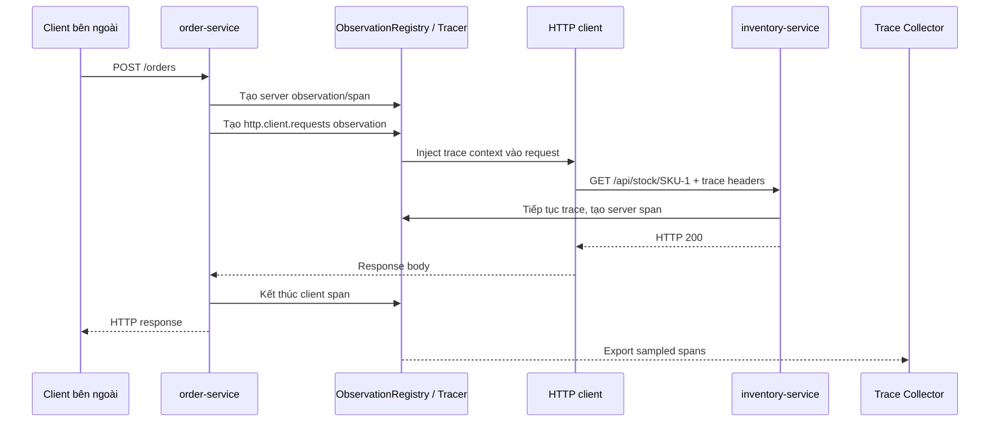

# Truy vết lời gọi qua client được cấu hình từ Spring Boot

## 1. Vì sao lời gọi outbound cần trace?

Trong hệ thống phân tán, một request thường đi qua nhiều dịch vụ. Ví dụ, API của `order-service` nhận yêu cầu tạo đơn, gọi `inventory-service` để kiểm tra hàng, rồi gọi `payment-service` để thanh toán. Nếu chỉ xem log của từng ứng dụng riêng lẻ, rất khó xác định request chậm ở đâu, lỗi bắt đầu tại dịch vụ nào hoặc lần gọi nào đã thất bại.

Distributed tracing gắn các thao tác thuộc cùng một request vào một trace. Mỗi dịch vụ và mỗi lần gọi HTTP có thể tạo một span riêng. Khi client gửi request sang dịch vụ khác, tracing context được truyền qua HTTP headers để dịch vụ đích tiếp tục cùng trace.

Spring Boot tích hợp Micrometer Observation và Micrometer Tracing để tạo metrics, spans và correlation ID. Các HTTP client của Spring Framework như `RestClient`, `RestTemplate` và `WebClient` có thể tạo observation cho request/response. Spring Boot cung cấp builder đã được cấu hình observation và tracing; Spring Cloud LoadBalancer bổ sung khả năng phân giải service ID thành instance khi dùng client load-balanced.

Bài học thuộc chương **Quan sát** của module **SPRING_CLOUD_CORE**. Module tập trung vào Spring Cloud Commons, Spring Cloud Context, cấu hình ngoài, tương thích Spring Boot, refresh scope, discovery, service registry, giao tiếp dịch vụ và cách kiểm thử/vận hành các abstraction chung.

Sau bài này, người học có thể:

- Phân biệt log, metric, observation, span và trace.
- Giải thích cách Spring Boot cấu hình tracing cho HTTP client.
- Tạo `RestClient`, `RestTemplate` hoặc `WebClient` từ builder được auto-configure.
- Kết hợp `@LoadBalanced` với builder của Spring Boot để vừa phân giải service ID vừa giữ observation/tracing.
- Hiểu cách trace context được truyền qua HTTP headers.
- Đọc metric `http.client.requests` và các metric của Spring Cloud LoadBalancer.
- Tùy chỉnh observation tags và giới hạn cardinality.
- Kiểm thử trace propagation qua nhiều dịch vụ.
- Chẩn đoán trường hợp có log nhưng không có span outbound.

## 2. Phân biệt log, metric, observation, span và trace

Ba trụ cột observability là logging, metrics và traces. Chúng trả lời các câu hỏi khác nhau:

| Thành phần | Câu hỏi chính | Ví dụ |
| --- | --- | --- |
| Log | Sự kiện nào đã xảy ra và nội dung chi tiết là gì? | Request tạo đơn bị từ chối vì hết hàng |
| Metric | Hệ thống đang hoạt động như thế nào theo thời gian? | Tỷ lệ lỗi, latency p95, số request mỗi giây |
| Observation | Một thao tác có thể đo lường và truy vết được là gì? | Thời gian thực hiện HTTP client exchange |
| Span | Một đơn vị công việc cụ thể trong trace là gì? | Lần gọi từ order-service đến inventory-service |
| Trace | Toàn bộ đường đi của một request qua các thành phần là gì? | Request đi qua gateway, order, inventory và payment |

Micrometer Observation là abstraction nối metrics và tracing. Một observation được xử lý bởi các `ObservationHandler`; handler có thể tạo timer/counter và span tùy cấu hình. Trong Spring Boot, `ObservationRegistry` là nơi các thành phần gửi observation.

Không phải mọi observation đều trở thành span được export. Kết quả phụ thuộc handler, tracer, sampling và cấu hình export. Tương tự, một metric vẫn có thể được ghi ngay cả khi trace tương ứng không được lấy mẫu.

### 2.1. Trace và span

Một trace có một `traceId` chung. Mỗi span có `spanId` riêng và có thể có quan hệ parent-child với span khác.

Ví dụ:

```text
Trace: 4bf92f3577b34da6a3ce929d0e0e4736
|
+-- order-service: HTTP server request
    |
    +-- order-service: validate-order
    |
    +-- order-service: HTTP client -> inventory-service
    |   |
    |   +-- inventory-service: HTTP server request
    |       |
    |       +-- inventory-service: query-stock
    |
    +-- order-service: HTTP client -> payment-service
        |
        +-- payment-service: HTTP server request
            |
            +-- payment-service: authorize-payment
```

Một span thường có thời điểm bắt đầu, thời lượng, tên thao tác, attributes, trạng thái và liên kết với span cha. Trace UI sắp xếp các span theo thời gian để thấy thao tác nào chạy tuần tự, thao tác nào chạy song song và khoảng thời gian bị tiêu tốn ở đâu.

### 2.2. Observation HTTP client

Spring Framework tạo observation có tên mặc định `http.client.requests` cho các HTTP client được cấu hình `ObservationRegistry`. Observation bao phủ toàn bộ exchange, từ thiết lập kết nối đến khi đọc và deserialize body response.

Khi có Micrometer Tracing được cấu hình, observation HTTP client có thể trở thành client span. Khi có registry metrics, nó cũng cung cấp timer và tags cho metric.

## 3. Spring Boot cấu hình tracing cho HTTP client

### 3.1. Vai trò của Actuator và Micrometer Tracing

Spring Boot Actuator cung cấp dependency management và auto-configuration cho Micrometer. Với tracing, Boot hỗ trợ các tracer phổ biến như OpenTelemetry và OpenZipkin Brave.

Một cấu hình thường có các phần:

1. **Actuator/observability infrastructure:** cung cấp `ObservationRegistry`, `MeterRegistry` và các auto-configuration liên quan.
2. **Tracer bridge:** kết nối Micrometer Tracing với implementation như OpenTelemetry hoặc Brave.
3. **Exporter/reporter:** gửi span đến backend hoặc OpenTelemetry Collector.
4. **HTTP client builder:** gắn observation và tracing customization vào client.
5. **Backend/UI:** lưu trữ, tìm kiếm và hiển thị trace.

Spring Boot 4.1 có starter OpenTelemetry:

```xml
<dependency>
    <groupId>org.springframework.boot</groupId>
    <artifactId>spring-boot-starter-actuator</artifactId>
</dependency>

<dependency>
    <groupId>org.springframework.boot</groupId>
    <artifactId>spring-boot-starter-opentelemetry</artifactId>
</dependency>
```

Nếu ứng dụng dùng Spring Cloud LoadBalancer, thêm starter tương ứng:

```xml
<dependency>
    <groupId>org.springframework.cloud</groupId>
    <artifactId>spring-cloud-starter-loadbalancer</artifactId>
</dependency>
```

Các dependency Spring Boot và Spring Cloud cần được quản lý bằng BOM/release train tương thích. Không tự pin một phiên bản Micrometer, OpenTelemetry hoặc Spring Framework khác với dependency management của ứng dụng nếu chưa xác minh tương thích.

### 3.2. Cấu hình exporter và sampling

Ví dụ cấu hình cho môi trường local với OpenTelemetry OTLP/HTTP:

```yaml
spring:
  application:
    name: order-service

management:
  tracing:
    sampling:
      probability: 1.0
    propagation:
      produce:
        - W3C
      consume:
        - W3C
        - B3
        - B3_MULTI
  opentelemetry:
    tracing:
      export:
        otlp:
          endpoint: ${OTEL_EXPORTER_OTLP_TRACES_ENDPOINT:http://localhost:4318/v1/traces}
```

Giá trị sampling trong ví dụ là 100% để dễ quan sát khi phát triển và kiểm thử. Spring Boot mặc định lấy mẫu khoảng 10% request nhằm hạn chế tải cho trace backend. Trong production, chọn tỷ lệ theo lưu lượng, dung lượng backend, chi phí và yêu cầu điều tra sự cố.

Nếu dùng biến môi trường chung `OTEL_EXPORTER_OTLP_ENDPOINT`, Spring Boot có thể tự ánh xạ endpoint và bổ sung đường dẫn signal `v1/traces` khi phù hợp. Có thể cấu hình endpoint riêng bằng `OTEL_EXPORTER_OTLP_TRACES_ENDPOINT`.

Không đặt token exporter trực tiếp trong source code hoặc file cấu hình được commit. Cấp credentials qua secret manager hoặc runtime environment được bảo vệ.

### 3.3. Sampling ảnh hưởng đến điều gì?

`management.tracing.sampling.probability` nhận giá trị từ 0.0 đến 1.0:

| Giá trị | Ý nghĩa |
| --- | --- |
| `0.0` | Không lấy mẫu trace mới theo ratio sampler |
| `0.1` | Lấy mẫu khoảng 10% trace mới |
| `0.5` | Lấy mẫu khoảng 50% trace mới |
| `1.0` | Lấy mẫu 100% trace mới |

Khi có parent span, sampler dạng parent-based thường giữ quyết định sampling của parent cho các span con. Vì vậy, nếu request đi vào từ một dịch vụ khác, trạng thái sampled trong context truyền đến có thể ảnh hưởng đến việc span outbound được ghi nhận.

Sampling quyết định trace có được ghi/export hay không; nó không phải tỷ lệ request được xử lý. Không dùng tỷ lệ sampling thấp để che lỗi exporter hoặc builder không được instrument.

## 4. Luồng truy vết qua HTTP client

Giả sử client `order-service` gọi `inventory-service`:



Các bước chính:

1. Request đến `order-service` tạo server observation/span.
2. Khi ứng dụng gọi HTTP client, client tạo observation `http.client.requests`.
3. Tracing instrumentation đọc trace context hiện tại.
4. Client inject context vào HTTP headers theo propagation format được cấu hình.
5. Dịch vụ đích trích xuất context từ headers và tạo server span thuộc cùng trace.
6. Khi response hoặc exception hoàn tất, client span kết thúc.
7. Các span được exporter gửi đến backend nếu trace được lấy mẫu.

Không cần tự tạo một trace ID mới cho mỗi lời gọi HTTP. Mục tiêu là giữ quan hệ giữa request cha và các thao tác downstream.

## 5. Tạo RestClient từ builder đã được Boot cấu hình

### 5.1. Vì sao cần dùng RestClient.Builder?

Spring Boot cung cấp bean `RestClient.Builder` đã được cấu hình các customizer cần thiết. Trong số đó có instrumentation cho observation và tracing khi các dependency tương ứng hiện diện.

Ví dụ:

```java
import org.springframework.context.annotation.Bean;
import org.springframework.context.annotation.Configuration;
import org.springframework.web.client.RestClient;

@Configuration(proxyBeanMethods = false)
class HttpClientConfiguration {

    @Bean
    RestClient partnerRestClient(RestClient.Builder builder) {
        return builder
                .baseUrl("https://partner.example")
                .build();
    }
}
```

Ở đây, ứng dụng inject builder do Spring Boot cung cấp, thêm base URL rồi build client. Builder mang theo các customizer đã được cấu hình trong application context.

Không tạo client bằng `RestClient.create()` hoặc `RestClient.builder()` độc lập trong code nghiệp vụ rồi kỳ vọng nó tự nhận tất cả instrumentation của Boot. Khi tự tạo builder, ứng dụng phải áp dụng các configurer/customizer cần thiết.

### 5.2. Dùng client trong service

```java
import org.springframework.stereotype.Component;
import org.springframework.web.client.RestClient;

@Component
class PartnerClient {

    private final RestClient restClient;

    PartnerClient(RestClient.Builder builder) {
        this.restClient = builder
                .baseUrl("https://partner.example")
                .build();
    }

    PartnerStatus getStatus() {
        return restClient.get()
                .uri("/api/status")
                .retrieve()
                .body(PartnerStatus.class);
    }
}
```

Khi gọi `getStatus()`, HTTP client observation có thể ghi nhận method, URI template, client name, status, outcome và error. Tracing instrumentation có thể tạo client span và inject context vào request.

Không tạo một client mới ở mỗi lần gọi nếu không có yêu cầu đặc biệt. Tạo client một lần theo lifecycle của application giúp tái sử dụng request factory, connection pool và cấu hình.

## 6. Kết hợp RestClient với Spring Cloud LoadBalancer

### 6.1. Vì sao cần RestClientBuilderConfigurer?

Trong Spring Cloud, `@LoadBalanced` đánh dấu builder để client dùng service ID thay cho hostname vật lý. Khi tự tạo một builder mới cho LoadBalancer, nếu bỏ qua `RestClientBuilderConfigurer`, builder có thể thiếu các customizer mà Spring Boot dùng để cài đặt observability.

Spring Cloud Commons hướng dẫn sử dụng Boot configurer khi tạo `@LoadBalanced RestClient.Builder`. Cấu hình sau vừa giữ cấu hình mặc định của Boot, vừa cho Spring Cloud thêm tích hợp LoadBalancer:

```java
import org.springframework.boot.restclient.autoconfigure.RestClientBuilderConfigurer;
import org.springframework.cloud.client.loadbalancer.LoadBalanced;
import org.springframework.context.annotation.Bean;
import org.springframework.context.annotation.Configuration;
import org.springframework.web.client.RestClient;

@Configuration(proxyBeanMethods = false)
class LoadBalancedRestClientConfiguration {

    @Bean
    @LoadBalanced
    RestClient.Builder loadBalancedRestClientBuilder(
            RestClientBuilderConfigurer configurer) {
        return configurer.configure(RestClient.builder());
    }
}
```

Dependency `spring-cloud-starter-loadbalancer` phải có trên classpath. URI dùng service ID, ví dụ `http://inventory-service`; LoadBalancer sẽ chọn một `ServiceInstance` và phân giải thành địa chỉ vật lý.

### 6.2. Gọi service ID

```java
import org.springframework.cloud.client.loadbalancer.LoadBalanced;
import org.springframework.stereotype.Component;
import org.springframework.web.client.RestClient;

@Component
class InventoryClient {

    private final RestClient restClient;

    InventoryClient(
            @LoadBalanced RestClient.Builder builder) {
        this.restClient = builder
                .baseUrl("http://inventory-service")
                .build();
    }

    StockView getStock(String sku) {
        return restClient.get()
                .uri("/api/stock/{sku}", sku)
                .retrieve()
                .body(StockView.class);
    }
}
```

Ở đây có hai lớp xử lý độc lập nhưng phối hợp:

- Spring Cloud LoadBalancer chọn instance từ discovery và thay service ID bằng URI vật lý.
- Spring Boot/Spring Framework observation ghi nhận HTTP exchange và tracing instrumentation truyền context qua request.

Một client được load-balanced nhưng builder không giữ Boot customizers có thể phân giải service ID thành công nhưng không tạo được trace outbound như mong đợi. Ngược lại, client có tracing nhưng không có LoadBalancer chỉ xử lý được URL mà HTTP transport có thể phân giải trực tiếp.

### 6.3. Dùng RestTemplate khi ứng dụng còn sử dụng API blocking cũ

Spring Boot vẫn cung cấp `RestTemplateBuilder`. Khi cần kết hợp với Spring Cloud LoadBalancer, có thể tạo builder có qualifier và dùng `RestTemplateBuilderConfigurer`:

```java
import org.springframework.boot.restclient.autoconfigure.RestTemplateBuilderConfigurer;
import org.springframework.boot.restclient.RestTemplateBuilder;
import org.springframework.cloud.client.loadbalancer.LoadBalanced;
import org.springframework.context.annotation.Bean;
import org.springframework.context.annotation.Configuration;

@Configuration(proxyBeanMethods = false)
class LoadBalancedRestTemplateConfiguration {

    @Bean
    @LoadBalanced
    RestTemplateBuilder loadBalancedRestTemplateBuilder(
            RestTemplateBuilderConfigurer configurer) {
        return configurer.configure(new RestTemplateBuilder());
    }
}
```

Inject builder này để tạo `RestTemplate`:

```java
@Component
class LegacyInventoryClient {

    private final RestTemplate restTemplate;

    LegacyInventoryClient(
            @LoadBalanced RestTemplateBuilder builder) {
        this.restTemplate = builder.build();
    }

    StockView getStock(String sku) {
        return restTemplate.getForObject(
                "http://inventory-service/api/stock/{sku}",
                StockView.class,
                sku
        );
    }
}
```

Không dùng `new RestTemplate()` ở nơi khác rồi mong nó tự nhận instrumentation. Nếu ứng dụng tự tạo builder hoặc client, phải áp dụng đúng configurer/customizer của phiên bản Boot đang dùng.

## 7. WebClient và reactive call

Với ứng dụng reactive, Spring Boot cung cấp `WebClient.Builder` đã được cấu hình observation. Khi cần service discovery/load balancing, ứng dụng phải khai báo builder `@LoadBalanced` và áp dụng các `WebClientCustomizer` do Boot cung cấp:

```java
import org.springframework.beans.factory.ObjectProvider;
import org.springframework.boot.webclient.WebClientCustomizer;
import org.springframework.cloud.client.loadbalancer.LoadBalanced;
import org.springframework.context.annotation.Bean;
import org.springframework.context.annotation.Configuration;
import org.springframework.web.reactive.function.client.WebClient;

@Configuration(proxyBeanMethods = false)
class LoadBalancedWebClientConfiguration {

    @Bean
    @LoadBalanced
    WebClient.Builder loadBalancedWebClientBuilder(
            ObjectProvider<WebClientCustomizer> customizers) {
        WebClient.Builder builder = WebClient.builder();
        customizers.orderedStream().forEach(customizer -> customizer.customize(builder));
        return builder;
    }
}
```

Việc áp dụng customizer giữ lại cấu hình observation của Boot trước khi Spring Cloud thêm filter cho LoadBalancer.

Ví dụ client reactive:

```java
@Component
class ReactiveInventoryClient {

    private final WebClient webClient;

    ReactiveInventoryClient(
            @LoadBalanced WebClient.Builder builder) {
        this.webClient = builder
                .baseUrl("http://inventory-service")
                .build();
    }

    Mono<StockView> getStock(String sku) {
        return webClient.get()
                .uri("/api/stock/{sku}", sku)
                .retrieve()
                .bodyToMono(StockView.class);
    }
}
```

Với custom builder, hãy áp dụng các `WebClientCustomizer` do Boot cung cấp trước khi build. Spring Cloud Commons có thể thêm LoadBalancer exchange filter function cho builder load-balanced. Không gọi `block()` trên event-loop để lấy kết quả đồng bộ; giữ request trong Reactor pipeline để context propagation hoạt động đúng.

## 8. Trace context propagation qua HTTP headers

### 8.1. W3C Trace Context

Spring Boot mặc định phát trace context theo W3C. Header phổ biến là `traceparent`, có dạng:

```text
traceparent: 00-4bf92f3577b34da6a3ce929d0e0e4736-00f067aa0ba902b7-01
```

Header chứa version, trace ID, parent span ID và trace flags. Dịch vụ nhận request có thể tiếp tục trace nếu dùng instrumentation tương thích.

Spring Boot cũng có thể consume các định dạng B3 và B3 multi-header. Cấu hình propagation cần thống nhất với các dịch vụ và gateway trong hệ thống.

### 8.2. Cấu hình propagation

Có thể cấu hình loại context được phát và loại context được nhận:

```yaml
management:
  tracing:
    propagation:
      produce:
        - W3C
      consume:
        - W3C
        - B3
        - B3_MULTI
```

Nếu toàn bộ hệ thống đã thống nhất W3C, chỉ cần phát/nhận W3C. Nếu còn dịch vụ cũ dùng B3, có thể nhận thêm định dạng đó trong giai đoạn chuyển đổi.

Không tự ghi đè header `traceparent` hoặc B3 trong interceptor nghiệp vụ. Việc tạo, inject và extract context nên do tracing instrumentation quản lý để không làm đứt quan hệ parent-child hoặc tạo trace giả.

### 8.3. Baggage và correlation ID

Baggage là dữ liệu nhỏ được truyền cùng tracing context, chẳng hạn tenant class hoặc vùng triển khai. Chỉ đưa vào baggage các thuộc tính cần truyền qua nhiều dịch vụ, có kiểm soát và không nhạy cảm.

Không đưa access token, password, email, số điện thoại, nội dung đơn hàng hoặc dữ liệu cá nhân vào baggage. Baggage có thể được truyền qua nhiều boundary và làm tăng nguy cơ lộ dữ liệu.

Spring Boot đưa `traceId` và `spanId` vào logging context khi Micrometer Tracing hoạt động. Log có thể chứa correlation ID để tìm các dòng thuộc cùng trace. Nếu đổi format correlation ID, dùng `logging.pattern.correlation` thay vì tự tạo trace ID trong code.

## 9. HTTP client observations và metric http.client.requests

### 9.1. Các trường low-cardinality

Observation mặc định `http.client.requests` có các key low-cardinality chính:

| Key | Ý nghĩa |
| --- | --- |
| `method` | HTTP method, ví dụ GET hoặc POST |
| `uri` | URI template nếu có; không gồm scheme, host và port |
| `client.name` | Tên client suy ra từ host trong request URI |
| `status` | HTTP status, IO_ERROR hoặc CLIENT_ERROR |
| `outcome` | Kết quả exchange |
| `error` | Tên class exception hoặc none |

Low-cardinality tags có số lượng giá trị hữu hạn, phù hợp để đưa vào metric dimensions. Ví dụ `method=GET` hoặc `status=200`.

### 9.2. High-cardinality fields

Trường `http.url` là high-cardinality và được đưa vào trace, không nên dùng làm metric tag có số lượng giá trị không giới hạn.

Ví dụ path `/orders/10001`, `/orders/10002`, `/orders/10003` tạo ra nhiều giá trị khác nhau. Nếu đưa từng order ID vào metric label, số time series có thể tăng rất nhanh.

Ưu tiên dùng URI template:

```java
restClient.get()
        .uri("/api/orders/{orderId}", orderId)
        .retrieve()
        .body(OrderView.class);
```

Cách gọi này giữ template `/api/orders/{orderId}` để observation có thể ghi nhận URI theo dạng ổn định khi client hỗ trợ. Với `RestTemplate`, overload nhận URI template và path variables cũng quan trọng.

Không ghi raw query string có token hoặc thông tin nhạy cảm vào trace. Dữ liệu high-cardinality chỉ nằm trong trace không có nghĩa là có thể bỏ qua chính sách bảo vệ dữ liệu.

## 10. Metric riêng của Spring Cloud LoadBalancer

Spring Cloud LoadBalancer có `MicrometerStatsLoadBalancerLifecycle`. Khi bật cấu hình và có `MeterRegistry`, nó cung cấp các meter:

| Meter | Loại | Ý nghĩa |
| --- | --- | --- |
| `loadbalancer.requests.active` | Gauge | Số request load-balanced đang hoạt động |
| `loadbalancer.requests.success` | Timer | Thời gian các request kết thúc bằng response được chuyển về HTTP client |
| `loadbalancer.requests.failed` | Timer | Thời gian các request kết thúc bằng exception |
| `loadbalancer.requests.discard` | Counter | Số request không lấy được instance để gọi |

Bật thống kê:

```yaml
spring:
  cloud:
    loadbalancer:
      stats:
        micrometer:
          enabled: true
        include-path: false
```

Cần có `MeterRegistry`, thường được cung cấp khi dùng Spring Boot Actuator và registry metrics tương ứng. Property đầy đủ là `spring.cloud.loadbalancer.stats.include-path`; đặt `false` giúp tránh đưa path có ID biến thiên vào URI tag.

Với `RestTemplate`, LoadBalancer không luôn có URI template nên có thể dùng toàn bộ path làm tag. Với `RestClient` và `WebClient`, URI template có thể có sẵn để tạo tag ổn định hơn. Hãy kiểm tra cardinality trước khi bật path tags trên hệ thống có lưu lượng lớn.

### 10.1. Phân biệt metric HTTP client và metric LoadBalancer

| Metric family | Đo phần nào? | Dùng để trả lời |
| --- | --- | --- |
| `http.client.requests` | HTTP exchange từ kết nối đến đọc body | HTTP client gọi thành công hay lỗi? Status nào? Latency bao nhiêu? |
| `loadbalancer.requests.*` | Lifecycle chọn instance và chuyển request qua LoadBalancer | Có lấy được instance không? Instance nào được chọn? Request load-balanced kết thúc thế nào? |

Hai nhóm metric nhìn vào hai lớp khác nhau. Không nên cộng hoặc so sánh duration của chúng như hai phần thời gian độc lập nếu một metric bao trùm thời gian của metric kia.

## 11. Tùy chỉnh observation cho nghiệp vụ

HTTP client observation cho biết thông tin giao thức. Đôi khi cần một span nghiệp vụ bao quanh toàn bộ thao tác, ví dụ `inventory.lookup` hoặc `payment.authorize`.

Có thể tạo observation bằng `ObservationRegistry`:

```java
import io.micrometer.observation.Observation;
import io.micrometer.observation.ObservationRegistry;

import org.springframework.stereotype.Component;
import org.springframework.web.client.RestClient;

@Component
class InventoryLookup {

    private final RestClient restClient;
    private final ObservationRegistry observationRegistry;

    InventoryLookup(
            RestClient.Builder builder,
            ObservationRegistry observationRegistry) {
        this.restClient = builder
                .baseUrl("http://inventory-service")
                .build();
        this.observationRegistry = observationRegistry;
    }

    StockView find(String sku) {
        return Observation.createNotStarted(
                        "inventory.lookup",
                        observationRegistry
                )
                .lowCardinalityKeyValue("service", "inventory-service")
                .observe(() -> restClient.get()
                        .uri("/api/stock/{sku}", sku)
                        .retrieve()
                        .body(StockView.class));
    }
}
```

Observation nghiệp vụ có thể trở thành span cha của HTTP client observation. Tag `service` có số lượng giá trị nhỏ, phù hợp low-cardinality. Không đưa SKU hoặc order ID vào low-cardinality key.

Nếu chỉ cần span mà không cần metric, có thể cân nhắc API Tracer cấp thấp. Với phần lớn trường hợp, Observation API giúp dùng cùng mô hình cho cả metrics và traces.

### 11.1. Custom observation convention

Có thể dùng `ClientRequestObservationConvention` để điều chỉnh tên observation hoặc key-values mặc định. Khi custom convention:

- Giữ lại các key chuẩn nếu dashboard/backend đang phụ thuộc chúng.
- Chỉ thêm low-cardinality tags có tập giá trị hữu hạn.
- Đưa thông tin không giới hạn vào high-cardinality trace attributes khi thực sự cần.
- Không thêm payload, credentials hoặc PII.
- Đặt tên tag ổn định, nhất quán giữa các service.

Đối với các thay đổi áp dụng toàn cục, cân nhắc `ObservationRegistryCustomizer`, `ObservationFilter`, `ObservationPredicate` hoặc convention bean phù hợp thay vì tự gắn interceptor cho từng client.

## 12. Context propagation qua thread và reactive pipeline

Tracing context thường được giữ trong execution context hiện tại. Khi công việc chuyển sang thread khác hoặc reactive pipeline, context phải được truyền theo cơ chế phù hợp.

### 12.1. @Async và executor

Với `@Async` và `AsyncTaskExecutor` do Spring Boot auto-configure, có thể bật propagation:

```yaml
spring:
  task:
    execution:
      propagate-context: true
```

Nếu ứng dụng tự cấu hình executor, có thể dùng `ContextPropagatingTaskDecorator`:

```java
import org.springframework.context.annotation.Bean;
import org.springframework.context.annotation.Configuration;
import org.springframework.core.task.support.ContextPropagatingTaskDecorator;

@Configuration(proxyBeanMethods = false)
class TaskContextConfiguration {

    @Bean
    ContextPropagatingTaskDecorator contextPropagatingTaskDecorator() {
        return new ContextPropagatingTaskDecorator();
    }
}
```

Gắn decorator vào executor do ứng dụng tạo. Không giả định ThreadLocal tự động được truyền qua mọi thread pool hoặc executor tự viết.

### 12.2. Reactor context

Trong ứng dụng reactive, Reactor context là nơi phù hợp để giữ tracing context qua các operator. Spring Boot hỗ trợ tự động propagation bằng:

```yaml
spring:
  reactor:
    context-propagation: auto
```

Khi client trả `Mono` hoặc `Flux`, hãy compose pipeline thay vì gọi `block()` trong event-loop. Nếu có operator tự tạo thread hoặc chuyển scheduler, cần kiểm thử propagation trong đúng pipeline thực tế.

## 13. Kiểm thử outbound tracing

Kiểm thử cần xác minh nhiều lớp riêng biệt:

1. Client được tạo từ builder đã cấu hình.
2. HTTP observation được ghi nhận.
3. Trace context được inject vào request.
4. Dịch vụ đích trích xuất context và tiếp tục trace.
5. Exporter gửi span đến test backend hoặc test exporter khi test cần xác minh export.

### 13.1. Integration test với mock HTTP server

Dùng mock server hoặc WireMock để kiểm tra request thực tế:

- Khởi tạo application context với tracing enabled và sampling 100% trong test.
- Tạo HTTP client từ builder được inject.
- Gọi một endpoint giả lập.
- Kiểm tra request có header propagation phù hợp, chẳng hạn `traceparent`.
- Kiểm tra response/status và exception path.
- Xác minh observation được tạo qua test observation handler hoặc registry phù hợp.
- Đóng mock server và context sau test.

Không hard-code trace ID ngẫu nhiên để assert một giá trị cố định. Hãy xác minh format, tính hiện diện và quan hệ trace/parent phù hợp.

### 13.2. Kiểm thử service-to-service

Có thể dựng hai ứng dụng test:

- Service A nhận request và gọi Service B qua client builder đã cấu hình.
- Service B ghi nhận trace context từ request.
- Test xác minh trace ID ở A và B giống nhau, span ID khác nhau và quan hệ parent-child phù hợp.
- Khi gọi qua LoadBalancer, kiểm tra service ID được phân giải và request đến một instance test đã đăng ký.

Unit test mock HTTP client chỉ xác minh logic gọi method. Nó không chứng minh header propagation, instrumentation của request factory hoặc LoadBalancer hoạt động.

### 13.3. Lưu ý với Spring Boot test

Một số thành phần exporter/tracer reporting có thể không được khởi tạo như production khi dùng test slice hoặc `@SpringBootTest`. Nếu mục tiêu là kiểm tra propagation, có thể dùng test handler/recorder để xác minh span và headers. Nếu mục tiêu là kiểm tra export, cấu hình test exporter hoặc collector giả lập có kiểm soát.

Không buộc test phải gửi trace đến collector production. Test nên cô lập endpoint và credentials.

## 14. Chẩn đoán khi không thấy outbound span

| Triệu chứng | Nguyên nhân có thể | Hướng kiểm tra |
| --- | --- | --- |
| Có server span nhưng không có client span | Client tạo bằng `new` hoặc builder không có observation registry | Dùng builder auto-configured hoặc configurer của Boot |
| Có metric HTTP nhưng không có trace | Micrometer Tracing bridge/exporter chưa có hoặc sampling không lấy trace | Kiểm tra tracer dependency, sampling và export |
| Có span nhưng thiếu parent | Context không được propagate qua thread/reactive boundary | Kiểm tra executor decorator và Reactor context |
| Service đích tạo trace mới | Header propagation không tương thích hoặc bị proxy xóa | Kiểm tra `traceparent`/B3 ở request thực tế |
| Chỉ trace được URL bên ngoài, không trace service nội bộ | Builder load-balanced tự tạo đã bỏ Boot customizers | Dùng `RestTemplateBuilderConfigurer` hoặc `RestClientBuilderConfigurer` |
| Có request nhưng không có span trong backend | Trace không được sample hoặc exporter lỗi | Kiểm tra sampling, endpoint collector, queue/export logs |
| Metric có quá nhiều series | Tag chứa path/ID biến thiên hoặc query parameter | Dùng URI template và tắt path tag của LoadBalancer |
| Span chứa dữ liệu nhạy cảm | Convention, baggage hoặc instrumentation ghi raw URL/header | Loại bỏ dữ liệu nhạy cảm và giới hạn attributes |
| Log không có correlation ID | Logging pattern hoặc context propagation không hoạt động | Kiểm tra MDC, tracer và executor context |

### 14.1. Checklist debug theo thứ tự

1. Xác nhận dependency Actuator và tracer implementation có trên runtime classpath.
2. Kiểm tra có `ObservationRegistry` và `MeterRegistry` phù hợp.
3. Xác nhận client được tạo từ builder do Boot cung cấp.
4. Nếu client load-balanced, xác nhận builder được tạo bằng Boot configurer.
5. Kiểm tra metric `http.client.requests` có được ghi nhận.
6. Kiểm tra trace sampling probability và sampler.
7. Xem request outbound có header propagation không.
8. Kiểm tra dịch vụ đích có extract được header và tạo server span không.
9. Kiểm tra exporter/collector và truy vấn theo đúng service name, trace ID và khoảng thời gian.
10. Kiểm tra async/reactive context propagation nếu request chạy qua thread boundary.

## 15. Các lỗi thiết kế và vận hành thường gặp

- **Tạo client thủ công:** `new RestClient()`, `RestClient.create()` hoặc `new RestTemplate()` không tự nhận toàn bộ auto-configured tracing customizers.
- **Mất Boot customizer khi thêm LoadBalancer:** builder load-balanced phải được cấu hình bằng Boot configurer/customizer.
- **Dùng Sleuth theo hướng dẫn cũ:** ứng dụng Spring Boot hiện đại dùng Micrometer Tracing; không sao chép property hoặc starter Sleuth của release train cũ.
- **Sampling 100% trong production:** có thể tạo lượng span lớn, tăng chi phí collector và lưu trữ.
- **Dùng raw URL làm metric tag:** gây cardinality tăng mạnh theo ID, query string hoặc path.
- **Truyền dữ liệu nhạy cảm bằng baggage:** baggage có thể đi qua nhiều service boundary.
- **Tự thêm trace ID vào header:** dễ làm mất quan hệ parent-child hoặc tạo nhiều trace rời rạc.
- **Chỉ xem LoadBalancer metric:** metric chọn instance không thay thế HTTP client observation và tracing span.
- **Coi status 5xx là exception ở mọi tầng:** HTTP response 5xx và lỗi transport là hai trạng thái khác nhau; quan sát cả status, outcome và error.
- **Không kiểm tra context propagation:** tracing có thể bị đứt khi chuyển executor, thread hoặc reactive context.

## 16. Checklist trước khi triển khai

1. Actuator và Micrometer Tracing đã được cấu hình đúng phiên bản chưa?
2. Tracer implementation và exporter/backend đã được chọn rõ ràng chưa?
3. Sampling rate phù hợp với lưu lượng và chi phí chưa?
4. Outbound client được tạo từ builder auto-configured của Boot chưa?
5. Client load-balanced có giữ customizer của Boot qua configurer không?
6. Propagation format giữa các service có tương thích không?
7. Có metric `http.client.requests` và trace span cho outbound exchange không?
8. LoadBalancer statistics có được bật nếu cần quan sát instance selection không?
9. URI template và low-cardinality tags đã được kiểm soát chưa?
10. Baggage và span attributes có tránh dữ liệu nhạy cảm không?
11. Context có được truyền qua `@Async`, executor và Reactor pipeline không?
12. Integration test có kiểm tra header propagation và trace continuity qua hai service không?
13. Có dashboard/alert cho latency, error rate, discarded load-balanced requests và missing traces không?
14. Có giới hạn quyền truy cập trace backend và thời gian lưu dữ liệu phù hợp không?

## 17. Tài liệu tham khảo chính thức

- [Spring Boot — Tracing](https://docs.spring.io/spring-boot/reference/actuator/tracing.html): tracer implementations, sampling, propagation, correlation IDs và outbound trace propagation qua builder.
- [Spring Boot — Observability](https://docs.spring.io/spring-boot/reference/actuator/observability.html): ObservationRegistry, context propagation, common tags, predicates và handlers.
- [Spring Boot — Metrics](https://docs.spring.io/spring-boot/reference/actuator/metrics.html): cấu hình Micrometer registry và instrumentation cho HTTP client.
- [Spring Framework — Observability Support](https://docs.spring.io/spring-framework/reference/integration/observability.html): `http.client.requests`, HTTP client keys, ObservationConvention và ObservationRegistry.
- [Spring Cloud Commons — Common Abstractions](https://docs.spring.io/spring-cloud-commons/reference/spring-cloud-commons/common-abstractions.html): `@LoadBalanced`, builder configurer và tích hợp RestClient/RestTemplate/WebClient.
- [Spring Cloud LoadBalancer](https://docs.spring.io/spring-cloud-commons/reference/spring-cloud-commons/loadbalancer.html): LoadBalancerLifecycle, Micrometer statistics và kiểm soát cardinality.
- [RestClientBuilderConfigurer API — Spring Boot 4.1.2](https://docs.spring.io/spring-boot/api/java/org/springframework/boot/restclient/autoconfigure/RestClientBuilderConfigurer.html): cấu hình builder theo các default/customizer của Spring Boot.
- [RestTemplateBuilderConfigurer API — Spring Boot 4.1.2](https://docs.spring.io/spring-boot/api/java/org/springframework/boot/restclient/autoconfigure/RestTemplateBuilderConfigurer.html): cấu hình RestTemplateBuilder theo hạ tầng auto-configuration.
- [WebClientCustomizer API — Spring Boot 4.1.2](https://docs.spring.io/spring-boot/api/java/org/springframework/boot/webclient/WebClientCustomizer.html): áp dụng observation và các customizer khác vào WebClient.Builder.

**Ghi nhớ:** Muốn truy vết outbound call xuyên qua các dịch vụ, hãy tạo HTTP client từ builder được Spring Boot cấu hình. Nếu client còn dùng Spring Cloud LoadBalancer, hãy áp dụng Boot configurer khi tạo builder load-balanced để giữ observation và tracing instrumentation. Khi đó HTTP client observation ghi nhận exchange, tracing truyền context qua network, còn LoadBalancer metrics cho biết quá trình chọn instance.
