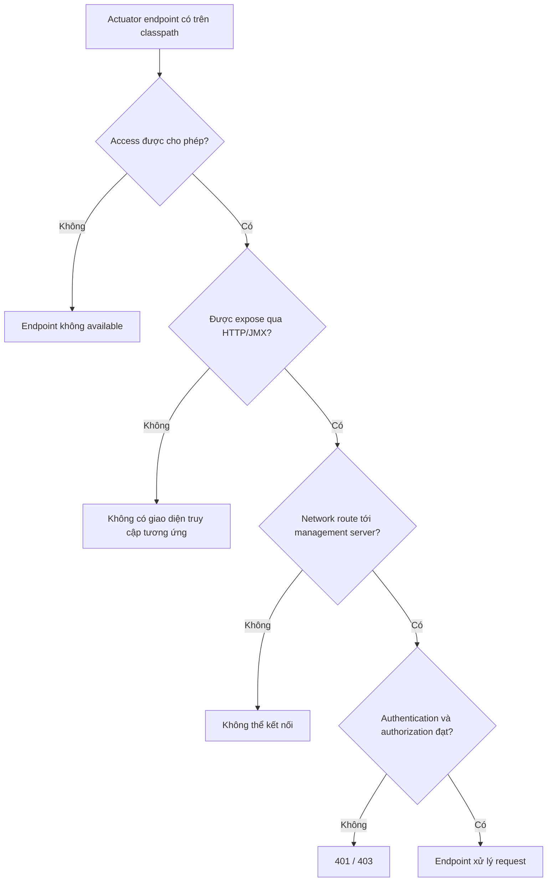

# Giới hạn endpoint quản trị được bật và được công bố

## 1. Vì sao cần giới hạn endpoint quản trị?

Spring Boot Actuator và các module Spring Cloud cung cấp endpoint để quan sát, chẩn đoán và điều khiển ứng dụng. Ví dụ:

- `health`: trạng thái sức khỏe của ứng dụng.
- `info`: thông tin ứng dụng.
- `env` và `configprops`: thông tin Environment và cấu hình đã bind.
- `beans`, `conditions`, `mappings`: cấu trúc nội bộ của ApplicationContext.
- `loggers`: đọc và thay đổi mức log.
- `refresh`: yêu cầu nạp lại cấu hình và refresh bean.
- `serviceregistry`: đọc hoặc thay đổi trạng thái đăng ký service.
- `busrefresh`: gửi yêu cầu refresh qua Spring Cloud Bus khi module Bus được dùng.
- `shutdown`: yêu cầu tắt ứng dụng.

Các endpoint này giúp vận hành hệ thống, nhưng một số endpoint có thể tiết lộ cấu hình, tên bean, topology, thông tin hạ tầng hoặc cho phép thay đổi trạng thái đang chạy. Nếu công bố rộng rãi, chúng có thể trở thành đường truy cập quản trị ngoài dự kiến.

Mục tiêu của bài học là thiết kế một bề mặt quản trị nhỏ và có kiểm soát. Người đọc sẽ biết cách phân biệt endpoint được phép hoạt động, endpoint được công bố qua HTTP/JMX và endpoint được Spring Security cho phép truy cập; đồng thời biết cách kiểm thử cấu hình thực tế thay vì chỉ kiểm tra file YAML.

## 2. Ba lớp quyết định endpoint có thể được sử dụng

Một Actuator endpoint không tự động có nghĩa là đã có URL truy cập được. Cần phân biệt ba lớp:

1. **Endpoint access:** endpoint có được phép hoạt động hay không, và được phép ở mức nào.
2. **Exposure:** endpoint được công bố qua công nghệ nào, chẳng hạn HTTP hoặc JMX.
3. **Network và security:** request có đến được management server và có vượt qua authentication/authorization hay không.

Spring Boot xem endpoint là available khi access được cho phép và endpoint được expose. Sau đó, request HTTP còn phải đi qua security filter chain và các lớp mạng.



Ví dụ, `management.endpoint.env.access=unrestricted` chỉ cho phép endpoint `env` hoạt động. Nếu `env` không nằm trong `management.endpoints.web.exposure.include`, URL HTTP `/actuator/env` vẫn không được tạo. Ngược lại, expose `env` không tự cấp quyền truy cập cho người dùng nếu Spring Security yêu cầu role.

## 3. Access: bật endpoint và giới hạn thao tác

### 3.1. Access level trong Spring Boot hiện hành

Từ Spring Boot 3.4, cơ chế access level là cách cấu hình chính để quyết định endpoint có được phép hoạt động hay không. Dùng:

- `management.endpoint.<id>.access`: quyền của một endpoint.
- `management.endpoints.access.default`: quyền mặc định của mọi endpoint.
- `management.endpoints.access.max-permitted`: giới hạn tối đa áp dụng cho toàn ứng dụng.

Ba mức thường dùng:

| Mức | Ý nghĩa |
| --- | --- |
| `none` | Không cho phép truy cập endpoint |
| `read-only` | Chỉ cho phép thao tác đọc |
| `unrestricted` | Cho phép mọi thao tác mà endpoint cung cấp |

Mặc định, các endpoint đều unrestricted, ngoại trừ `shutdown` và `heapdump`. Hai endpoint này bị hạn chế mặc định do tác động hoặc dữ liệu mà chúng cung cấp.

Ví dụ, chỉ cho phép endpoint `health` và `info` tồn tại:

```yaml
management:
  endpoints:
    access:
      default: none
  endpoint:
    health:
      access: read-only
    info:
      access: read-only
```

Với cấu hình này, những endpoint khác bị loại khỏi ApplicationContext. Điều này khác với việc chỉ ẩn URL qua HTTP: endpoint bị access `none` không còn hoạt động trong context.

### 3.2. Giới hạn tối đa bằng max-permitted

`management.endpoints.access.max-permitted` đặt trần quyền truy cập. Giá trị này có ưu tiên cao hơn access mặc định và access riêng của từng endpoint.

```yaml
management:
  endpoints:
    access:
      default: unrestricted
      max-permitted: read-only
  endpoint:
    loggers:
      access: unrestricted
```

Mặc dù `loggers` được cấu hình `unrestricted`, giới hạn `max-permitted: read-only` chỉ cho phép thao tác đọc. Endpoint không thể thay đổi log level qua write operation.

Có thể đặt `max-permitted: none` để tắt toàn bộ endpoint. Tuy nhiên, hãy cân nhắc các probe cần thiết cho nền tảng triển khai trước khi áp dụng.

### 3.3. Access level và thao tác HTTP

Với endpoint kiểu `@Endpoint`, `@JmxEndpoint` và `@WebEndpoint`:

- Read access tương ứng các method `@ReadOperation`.
- Write access tương ứng các method `@WriteOperation`.
- Delete access tương ứng các method `@DeleteOperation`.

Với `@ControllerEndpoint` hoặc `@RestControllerEndpoint`, read-only tương ứng các mapping xử lý `GET` và `HEAD`. Các mapping thay đổi trạng thái cần quyền cao hơn.

Vì vậy, `read-only` hữu ích khi chỉ muốn cho đội vận hành xem cấu hình logger hoặc trạng thái mà không cho phép thay đổi.

### 3.4. Thuộc tính enabled cũ

Các phiên bản Spring Boot trước 3.4 thường dùng `management.endpoint.<id>.enabled` và `management.endpoints.enabled-by-default`. Trong Spring Boot hiện hành, các thuộc tính này đã deprecated để chuyển sang access level.

Khi nâng cấp ứng dụng, không nên trộn lẫn hai mô hình. Hãy dùng `access` cho phiên bản mới và kiểm tra tài liệu đúng phiên bản Boot mà ứng dụng đang chạy.

## 4. Exposure: công bố endpoint qua HTTP và JMX

Access quyết định endpoint có được phép tồn tại; exposure quyết định endpoint có được mở qua một công nghệ cụ thể hay không.

Spring Boot mặc định chỉ expose `health` qua HTTP và JMX. Những endpoint khác không tự động có URL hoặc MBean chỉ vì dependency Actuator đã có trong classpath. Các property điều khiển là `management.endpoints.web.exposure.include`, `management.endpoints.web.exposure.exclude`, `management.endpoints.jmx.exposure.include` và `management.endpoints.jmx.exposure.exclude`.

### 4.1. Allowlist HTTP

Nên dùng allowlist, chỉ công bố những endpoint thực sự cần:

```yaml
management:
  endpoints:
    web:
      exposure:
        include:
          - health
          - info
          - prometheus
```

Trong ví dụ này, HTTP chỉ expose ba endpoint `health`, `info` và `prometheus`. Endpoint `prometheus` cần registry Micrometer Prometheus tương ứng trên classpath.

### 4.2. Exclude luôn có ưu tiên cao hơn include

Có thể kết hợp include và exclude:

```yaml
management:
  endpoints:
    web:
      exposure:
        include: "*"
        exclude:
          - env
          - beans
          - configprops
          - shutdown
```

`exclude` có ưu tiên cao hơn `include`. Kể cả khi include có `*`, các endpoint bị exclude vẫn không được expose qua HTTP.

Trong YAML, ký tự `*` có ý nghĩa đặc biệt nên phải đặt trong dấu nháy. Không dùng `include: "*"` như mặc định production nếu chưa đánh giá tất cả endpoint.

### 4.3. HTTP và JMX là hai exposure độc lập

Tắt HTTP exposure không có nghĩa JMX cũng bị tắt. Nếu endpoint được expose qua JMX, người có quyền kết nối JMX vẫn có thể gọi MBean tương ứng. Hai property JMX là `management.endpoints.jmx.exposure.include` và `management.endpoints.jmx.exposure.exclude`; chúng độc lập với hai property `management.endpoints.web.exposure.*`.

Ví dụ, chỉ expose `health` qua HTTP nhưng cho phép `health` và `info` qua JMX:

```yaml
management:
  endpoints:
    web:
      exposure:
        include:
          - health
    jmx:
      exposure:
        include:
          - health
          - info
```

Nếu không sử dụng JMX remote management, hãy cân nhắc tắt hoặc giới hạn JMX exposure theo môi trường triển khai. Cũng cần bảo vệ cổng JMX ở tầng JVM, network và authentication; exposure property không thay thế bảo mật giao thức JMX.

## 5. Endpoint Spring Cloud cũng chịu quy tắc Actuator

Spring Cloud Context và Commons bổ sung endpoint riêng. Khi dependency tương ứng có mặt và endpoint được auto-configure, chúng vẫn tuân theo access và exposure của Actuator.

| Endpoint ID | Chức năng | Thao tác đáng chú ý |
| --- | --- | --- |
| `refresh` | Nạp lại Environment và refresh bean trong instance hiện tại | POST |
| `features` | Liệt kê các feature Spring Cloud nhận diện | GET |
| `serviceregistry` | Xem hoặc thay đổi trạng thái registration | GET, POST |
| `busrefresh` | Phát refresh event qua Spring Cloud Bus | POST |

Không phải ứng dụng nào cũng có tất cả endpoint này. Chúng phụ thuộc module và bean được cấu hình. Ví dụ, `busrefresh` chỉ xuất hiện khi tích hợp Spring Cloud Bus phù hợp.

Ví dụ cho phép đọc `features`, `health`, `info`, nhưng không expose các endpoint điều khiển:

```yaml
management:
  endpoints:
    web:
      exposure:
        include:
          - health
          - info
          - features
```

Nếu cần `refresh` trong môi trường nội bộ, hãy expose rõ ràng và yêu cầu role quản trị. Không nên đưa `refresh`, `busrefresh`, `serviceregistry` hoặc `shutdown` vào một allowlist công khai chỉ để tiện vận hành.

## 6. SecurityFilterChain: xác thực và phân quyền HTTP

Exposure không phải authentication. Khi Spring Security có trên classpath và ứng dụng không khai báo `SecurityFilterChain` riêng, Spring Boot tự cấu hình bảo vệ các Actuator endpoint khác `health`.

Nếu ứng dụng khai báo bất kỳ `SecurityFilterChain` bean nào, auto-configuration bảo mật Actuator của Boot sẽ back off. Khi đó, ứng dụng phải tự định nghĩa quy tắc cho Actuator và các request còn lại.

### 6.1. Tách security chain cho Actuator và ứng dụng

Ví dụ dưới đây dùng API Spring Boot 4.1.2. `EndpointRequest.toAnyEndpoint()` chỉ khớp các Actuator endpoint; chain thứ hai xử lý các request khác.

```java
import org.springframework.boot.security.autoconfigure.actuate.web.servlet.EndpointRequest;
import org.springframework.context.annotation.Bean;
import org.springframework.context.annotation.Configuration;
import org.springframework.core.annotation.Order;
import org.springframework.security.config.Customizer;
import org.springframework.security.config.annotation.web.builders.HttpSecurity;
import org.springframework.security.web.SecurityFilterChain;

@Configuration(proxyBeanMethods = false)
public class ManagementSecurityConfiguration {

    @Bean
    @Order(1)
    SecurityFilterChain actuatorSecurity(HttpSecurity http) throws Exception {
        http.securityMatcher(EndpointRequest.toAnyEndpoint())
            .authorizeHttpRequests(authorize -> authorize
                .requestMatchers(EndpointRequest.to("health")).permitAll()
                .anyRequest().hasRole("ACTUATOR_ADMIN")
            )
            .httpBasic(Customizer.withDefaults());

        return http.build();
    }

    @Bean
    @Order(2)
    SecurityFilterChain applicationSecurity(HttpSecurity http) throws Exception {
        http.authorizeHttpRequests(authorize -> authorize
            .anyRequest().authenticated()
        ).httpBasic(Customizer.withDefaults());

        return http.build();
    }
}
```

Chain đầu tiên cho phép đọc `health` không cần đăng nhập; mọi Actuator endpoint còn lại, kể cả `info`, yêu cầu role `ACTUATOR_ADMIN`. Chain thứ hai bảo vệ các route nghiệp vụ. Cấu hình thực tế cần thêm cơ chế xác thực người dùng, chẳng hạn OAuth2 Resource Server hoặc user store của tổ chức, thay vì chỉ dựa vào HTTP Basic mẫu.

Với Spring Boot 3.x, package của `EndpointRequest` là `org.springframework.boot.actuate.autoconfigure.security.servlet.EndpointRequest`; package đã thay đổi trong Spring Boot 4. Hãy dùng đúng package theo phiên bản.

### 6.2. Authentication và authorization

Authentication xác định người gọi là ai. Authorization quyết định người đó có được gọi endpoint hay thao tác cụ thể hay không.

Nên phân vai:

- Health probe: chỉ đọc trạng thái cần thiết cho load balancer hoặc orchestrator.
- Monitoring agent: chỉ đọc metric hoặc thông tin health được cho phép.
- Operator: đọc thông tin chẩn đoán như `loggers` hoặc `conditions`.
- Administrator: thực hiện thao tác thay đổi trạng thái như refresh hoặc shutdown nếu quy trình cho phép.

Không cấp quyền quản trị cho tài khoản monitoring chỉ vì cùng cần truy cập Actuator.

### 6.3. CSRF với endpoint ghi

Spring Security bật CSRF protection theo mặc định. Các endpoint Actuator có `POST`, `PUT` hoặc `DELETE` có thể trả `403` nếu request không có CSRF token phù hợp.

Không tắt CSRF toàn cục chỉ để làm cho `POST /actuator/refresh` hoạt động. Với API quản trị chỉ dành cho machine-to-machine, có thể thiết kế chain riêng và loại trừ CSRF cho đúng endpoint sau khi đã đánh giá client, authentication và network boundary. Với ứng dụng có browser session/cookie, tiếp tục yêu cầu CSRF token.

## 7. Tách management server và giới hạn network

Có thể đặt Actuator trên cổng riêng để tách khỏi cổng nghiệp vụ:

```yaml
server:
  port: 8080

management:
  server:
    port: 8081
    address: 127.0.0.1
  endpoints:
    web:
      base-path: /manage
      exposure:
        include:
          - health
          - prometheus
```

Trong ví dụ, ứng dụng phục vụ nghiệp vụ trên cổng 8080; Actuator dùng cổng 8081 với base path `/manage`. Bind `127.0.0.1` giới hạn management server ở loopback của máy/container. Điều này chỉ phù hợp nếu agent quản trị chạy cùng network namespace; nếu monitoring ở container hoặc host khác, cần bind vào interface riêng và dùng firewall, service mesh hoặc network policy để giới hạn nguồn truy cập.

Các property tương ứng là `management.server.port` và `management.server.address`. Khi cấu hình chúng, cần xác minh management context, health probe, ingress và security filter chain theo topology triển khai. Cổng riêng không tự động bảo vệ endpoint nếu nó vẫn được publish ra network không đáng tin cậy.

### 7.1. Đường dẫn endpoint

Đường dẫn HTTP thường có dạng:

`<management-base-path>/<endpoint-id>`

Ví dụ:

- Base path mặc định `/actuator`, endpoint `health`: `/actuator/health`.
- Base path `/manage`, endpoint `health`: `/manage/health`.

Nếu ứng dụng đặt `server.servlet.context-path`, `spring.webflux.base-path` hoặc management server riêng, URL cuối cùng còn phụ thuộc context/base path tương ứng. Không hardcode `/actuator/**` trong security rule nếu đã thay base path; dùng `EndpointRequest` giúp matcher theo endpoint metadata thay vì tự ghép URL.

## 8. Custom endpoint và EndpointFilter

Thư viện có thể tự tạo Actuator endpoint:

Các import chính:

```java
import java.util.Map;
import org.springframework.boot.actuate.endpoint.annotation.Endpoint;
import org.springframework.boot.actuate.endpoint.annotation.ReadOperation;
import org.springframework.boot.actuate.endpoint.annotation.WriteOperation;
```

```java
@Endpoint(id = "inventoryAdmin")
public class InventoryAdminEndpoint {

    @ReadOperation
    public Map<String, Object> status() {
        return Map.of("state", "ready");
    }

    @WriteOperation
    public void reload() {
        // Thực hiện thao tác quản trị có kiểm soát
    }
}
```

Custom endpoint cần được đăng ký thành bean và tuân thủ access/exposure như endpoint built-in. Không nên đặt dữ liệu bí mật hoặc thao tác nguy hiểm vào `@ReadOperation`/`@WriteOperation` mà không đánh giá quyền và tác động.

Nếu cần chính sách expose động theo endpoint, có thể đăng ký `EndpointFilter` bean. Ví dụ, một nền tảng nội bộ có thể chỉ expose endpoint khi feature flag quản trị được bật. Filter này bổ sung quyết định exposure; nó không thay thế access level, authentication, authorization hoặc network policy.

## 9. Cấu hình production theo nguyên tắc allowlist

Ví dụ cấu hình production cho monitoring và operator:

```yaml
management:
  server:
    port: 8081
  endpoints:
    access:
      default: none
      max-permitted: read-only
    web:
      exposure:
        include:
          - health
          - info
          - prometheus
    jmx:
      exposure:
        exclude: "*"
  endpoint:
    health:
      access: read-only
      show-details: when-authorized
      roles:
        - ACTUATOR_ADMIN
    info:
      access: read-only
    prometheus:
      access: read-only
```

Cấu hình này áp dụng các nguyên tắc:

- Mặc định không cho endpoint access.
- Chỉ giới hạn quyền tối đa ở mức đọc.
- Chỉ expose ba endpoint HTTP đã chọn.
- Không expose endpoint qua JMX.
- Health detail chỉ hiện với role được chỉ định.

Nếu hệ thống cần `refresh` hoặc `serviceregistry` trong một môi trường quản trị riêng, hãy tạo profile hoặc cấu hình riêng cho môi trường đó, nâng access level đúng endpoint và expose đúng công nghệ cần dùng. Không nâng `max-permitted` toàn cục nếu chỉ một endpoint cần thao tác ghi; hãy cân nhắc role và network boundary tương ứng.

## 10. Kiểm thử endpoint thực sự được bật và được công bố

Đọc file YAML không đủ để xác nhận endpoint được bảo vệ đúng. Cần kiểm tra hành vi từ HTTP hoặc JMX trong context đã khởi động.

### 10.1. Kiểm thử bằng MockMvc

Với ứng dụng Servlet và Spring Security, có thể kiểm tra:

Các import dùng trong ví dụ:

```java
import org.junit.jupiter.api.Test;
import org.springframework.beans.factory.annotation.Autowired;
import org.springframework.boot.webmvc.test.autoconfigure.AutoConfigureMockMvc;
import org.springframework.boot.test.context.SpringBootTest;
import org.springframework.test.web.servlet.MockMvc;

import static org.springframework.security.test.web.servlet.request.SecurityMockMvcRequestPostProcessors.user;
import static org.springframework.test.web.servlet.request.MockMvcRequestBuilders.get;
import static org.springframework.test.web.servlet.result.MockMvcResultMatchers.status;
```

```java
@SpringBootTest
@AutoConfigureMockMvc
class ActuatorSecurityTests {

    @Autowired
    MockMvc mockMvc;

    @Test
    void healthIsReadableWithoutAuthentication() throws Exception {
        mockMvc.perform(get("/actuator/health"))
                .andExpect(status().isOk());
    }

    @Test
    void loggersRequiresAdministratorRole() throws Exception {
        mockMvc.perform(get("/actuator/loggers"))
                .andExpect(status().isUnauthorized());

        mockMvc.perform(get("/actuator/loggers")
                        .with(user("operator").roles("ACTUATOR_ADMIN")))
                .andExpect(status().isOk());
    }

    @Test
    void envIsNotExposed() throws Exception {
        mockMvc.perform(get("/actuator/env")
                        .with(user("operator").roles("ACTUATOR_ADMIN")))
                .andExpect(status().isNotFound());
    }
}
```

Ví dụ giả định `health` và `loggers` đã được expose, `env` không nằm trong allowlist, và ứng dụng dùng HTTP Basic hoặc test authentication tương ứng. Nếu security entry point, CSRF, management port hoặc base path khác, cần điều chỉnh assertion theo cấu hình thật.

Phân biệt các kết quả:

| Kết quả | Ý nghĩa thường gặp |
| --- | --- |
| `404 Not Found` | Endpoint không được expose, không tồn tại hoặc không có mapping tại URL đó |
| `401 Unauthorized` | Chưa xác thực hoặc thông tin xác thực không hợp lệ |
| `403 Forbidden` | Đã xác thực nhưng thiếu quyền, hoặc request bị CSRF protection từ chối |
| `200 OK` | Request được chấp nhận; vẫn cần kiểm tra payload và dữ liệu có bị lộ quá mức không |

Không nên chỉ assert status `404` để kết luận endpoint đã bị tắt: có thể endpoint vẫn hoạt động qua JMX hoặc một management port khác.

### 10.2. Kiểm thử access level

Để kiểm tra `read-only`, hãy xác nhận thao tác đọc thành công nhưng thao tác ghi không khả dụng. Ví dụ `loggers` có thể đọc logger configuration, còn POST thay đổi mức log bị từ chối bởi access policy hoặc security policy.

Để kiểm tra `max-permitted`, cấu hình một endpoint riêng là `unrestricted`, đặt trần `read-only`, rồi xác nhận write operation vẫn bị chặn. Đây là cách kiểm tra ưu tiên giữa access riêng và access tối đa.

### 10.3. Kiểm thử profile và management port

Chạy integration test với profile production hoặc cấu hình tương ứng, rồi xác nhận:

1. Chỉ các endpoint trong allowlist có URL.
2. Endpoint không được expose trả 404 trên HTTP.
3. Endpoint quản trị yêu cầu role phù hợp.
4. Management port và base path đúng như cấu hình.
5. Không có JMX exposure ngoài dự kiến.
6. Health detail không xuất hiện với caller không có role.

Với management server port riêng, dùng random port trong integration test và truy vấn đúng local management port. Test MockMvc trên main application context không tự chứng minh network binding của management server ngoài thực tế.

## 11. Lỗi cấu hình thường gặp

| Triệu chứng | Nguyên nhân có thể | Cách xử lý |
| --- | --- | --- |
| Đã thêm endpoint vào include nhưng vẫn 404 | Access của endpoint là `none`, dependency thiếu hoặc endpoint không được auto-configure | Kiểm tra access, classpath và điều kiện bean |
| Endpoint bị lộ dù đã tắt HTTP exposure | Endpoint vẫn được expose qua JMX hoặc management port khác | Kiểm tra cả web và JMX exposure, topology triển khai |
| `exclude` không có tác dụng như mong đợi | ID endpoint sai hoặc đang truy cập một mapping khác | Xác nhận endpoint ID và URL thực tế |
| Custom SecurityFilterChain làm mất bảo vệ Actuator mặc định | Boot security auto-configuration đã back off | Tạo chain riêng cho Actuator và chain cho ứng dụng |
| Endpoint trả 401 | Chưa đăng nhập hoặc credential sai | Kiểm tra authentication provider/token |
| Endpoint trả 403 | Thiếu role, access level không đủ hoặc CSRF token thiếu | Kiểm tra authorization và CSRF |
| POST refresh bị 403 dù đã có role | CSRF protection vẫn được bật | Dùng CSRF token hoặc thiết kế loại trừ có phạm vi hẹp |
| `include: "*"` expose quá nhiều endpoint | Wildcard được dùng mà không có denylist | Chuyển sang allowlist |
| Management port vẫn truy cập từ ngoài | Bind address hoặc firewall/network policy quá rộng | Giới hạn interface và nguồn truy cập |
| Health payload tiết lộ chi tiết | `show-details` hoặc health group chưa được giới hạn | Chọn `never` hoặc `when-authorized`, cấu hình role |
| JMX endpoint vẫn truy cập được | Chỉ cấu hình web exposure | Cấu hình riêng JMX hoặc tắt remote JMX |

## 12. Checklist bảo mật endpoint quản trị

1. Liệt kê endpoint thực sự cần cho health probe, monitoring và operator.
2. Dùng `management.endpoints.access.default=none` nếu muốn mô hình opt-in.
3. Đặt access riêng cho endpoint cần thiết; dùng `max-permitted` để đặt trần quyền.
4. Dùng allowlist cho HTTP và JMX; tránh wildcard trong production.
5. Đánh giá riêng các endpoint có write/delete operation như refresh, loggers, serviceregistry và shutdown.
6. Bảo vệ bằng authentication và role-based authorization.
7. Kiểm tra CSRF với endpoint nhận POST/PUT/DELETE.
8. Tách management port và giới hạn interface/network khi phù hợp.
9. Giới hạn health details và thông tin cấu hình nhạy cảm.
10. Kiểm thử HTTP status, payload, role, profile, port và JMX exposure.
11. Kiểm tra lại security rules khi thêm một `SecurityFilterChain`.
12. Ghi log các thao tác quản trị và theo dõi thay đổi cấu hình endpoint.

## 13. Tài liệu tham khảo

- [Spring Boot 4.1 — Actuator Endpoints](https://docs.spring.io/spring-boot/reference/actuator/endpoints.html): access level, exposure, include/exclude, `EndpointFilter`, security và CSRF.
- [Spring Boot — Common Application Properties](https://docs.spring.io/spring-boot/appendix/application-properties/index.html): các thuộc tính `management.endpoint.*` và `management.endpoints.*`.
- [Spring Security — Servlet Architecture](https://docs.spring.io/spring-security/reference/servlet/architecture.html): SecurityFilterChain và thứ tự filter chain.
- [Spring Cloud Commons — Common Abstractions](https://docs.spring.io/spring-cloud-commons/reference/spring-cloud-commons/common-abstractions.html): các Actuator endpoint bổ sung như features và serviceregistry.
- [Spring Cloud Context — Application Context Services](https://docs.spring.io/spring-cloud-commons/reference/spring-cloud-commons/application-context-services.html): endpoint refresh và cơ chế refresh cấu hình.

Endpoint quản trị chỉ nên hoạt động khi có nhu cầu rõ ràng, chỉ được công bố qua giao diện cần thiết và chỉ cho đúng nhóm người dùng truy cập. Hãy kiểm tra đủ access, exposure, security và network; một cấu hình an toàn phải được chứng minh bằng request thực tế trên đúng profile và management port sẽ triển khai.
