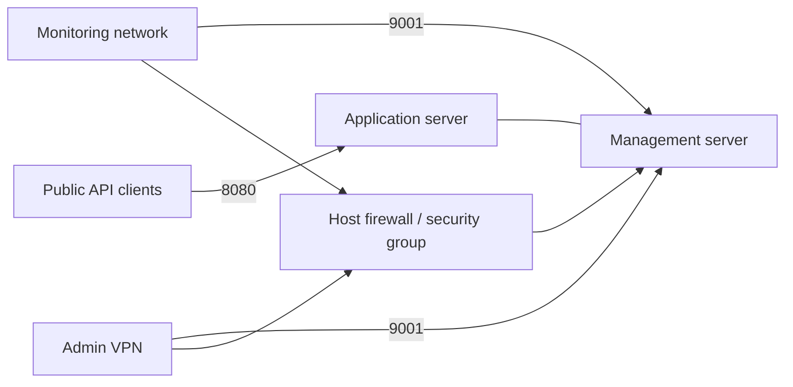
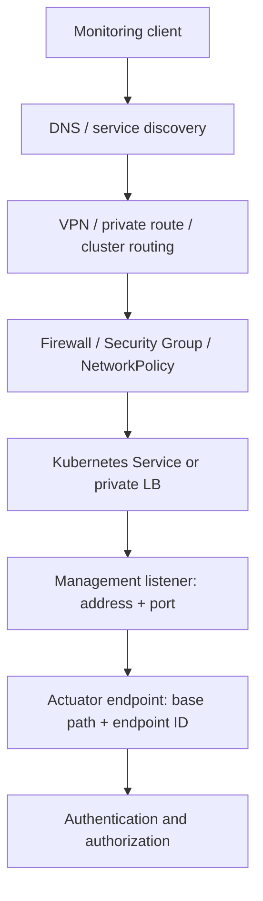

# Tách management port, địa chỉ lắng nghe và đường mạng quản trị

Ứng dụng Spring Boot thường phục vụ request nghiệp vụ và đồng thời cung cấp endpoint quản trị qua Spring Boot Actuator. Các endpoint như health, metrics, prometheus, env hoặc beans giúp đội vận hành kiểm tra trạng thái, cấu hình và thành phần bên trong ứng dụng. Nếu tất cả endpoint cùng dùng một listener và một đường mạng với API nghiệp vụ, việc giới hạn người được phép truy cập có thể khó hơn.

Spring Boot cho phép cấu hình cổng và địa chỉ lắng nghe riêng cho management server. Hai thuộc tính quan trọng là `management.server.port` và `management.server.address`. Khi management server chạy trên cổng khác với cổng ứng dụng, có thể bind listener quản trị vào một địa chỉ riêng, sử dụng TLS riêng và đưa nó qua một đường mạng nội bộ chỉ dành cho monitoring hoặc quản trị.

Tuy nhiên, **tách port không tự tạo bảo mật**. Một listener quản trị vẫn có thể bị truy cập từ bên ngoài nếu nó bind trên mọi interface và firewall, Service, load balancer hoặc ingress cho phép lưu lượng đi tới. Cần phối hợp địa chỉ bind, port, routing, network policy, exposure của endpoint và authentication/authorization.

Bài học thuộc chương **Bảo mật** của module `SPRING_CLOUD_CORE`. Nội dung giải thích cách tách application listener khỏi management listener, phân biệt địa chỉ bind với địa chỉ client dùng để kết nối, thiết kế đường mạng quản trị trong VM/container/Kubernetes, cấu hình TLS và kiểm tra các lớp bảo vệ.

## 1. Application server và management server

Một ứng dụng Spring Boot có thể phục vụ hai nhóm request:

- **Application traffic:** request nghiệp vụ tới controller, REST API, GraphQL hoặc giao thức ứng dụng.
- **Management traffic:** request tới Actuator như health, metrics, prometheus, beans hoặc thông tin vận hành.

Khi dùng chung một listener, hai nhóm traffic cùng đi qua một port. Ví dụ:

```yaml
server:
  port: 8080

management:
  endpoints:
    web:
      base-path: /actuator
```

API nghiệp vụ và Actuator đều được phục vụ trên port 8080. Endpoint health có URL dạng `http://host:8080/actuator/health` nếu dùng base path mặc định.

Nếu cần listener quản trị riêng:

```yaml
server:
  port: 8080

management:
  server:
    port: 9001
```

Ứng dụng nghiệp vụ tiếp tục lắng nghe port 8080; management server lắng nghe port 9001. Với base path mặc định, Actuator có thể được gọi qua `http://host:9001/actuator/health`.

Việc tách listener hữu ích khi muốn:

- Chỉ công bố API nghiệp vụ qua public load balancer.
- Chỉ cho monitoring system hoặc administrator truy cập port quản trị.
- Áp dụng TLS hoặc client certificate riêng cho management traffic.
- Áp dụng firewall rule, security group hoặc Kubernetes NetworkPolicy riêng.
- Giảm nguy cơ một route public vô tình chuyển tiếp tới Actuator.

## 2. Phân biệt các thuộc tính port và address

Spring Boot có hai nhóm thuộc tính chính:

| Thuộc tính | Phạm vi | Ý nghĩa |
| --- | --- | --- |
| `server.port` | Application server | Port phục vụ request ứng dụng |
| `server.address` | Application server | Địa chỉ IP/interface mà application server bind |
| `management.server.port` | Management server | Port phục vụ management endpoint khi cấu hình tách port |
| `management.server.address` | Management server | Địa chỉ IP/interface mà management server bind khi chạy trên port riêng |

Port là số cổng TCP mà listener sử dụng. Address là địa chỉ local trên máy/container mà socket bind vào. Hai khái niệm này không phải địa chỉ đích mà client luôn phải dùng.

Ví dụ:

```yaml
server:
  port: 8080
  address: 0.0.0.0

management:
  server:
    port: 9001
    address: 127.0.0.1
```

Trong cấu hình này:

- Application server bind port 8080 trên mọi interface IPv4.
- Management server bind port 9001 trên loopback.
- Client ở máy khác không thể truy cập management listener qua địa chỉ mạng của máy chủ nếu listener chỉ bind loopback.
- Process trên cùng host có thể truy cập management listener qua `127.0.0.1:9001`.

Đây là cấu hình phù hợp khi agent quản trị chạy cùng host. Nếu monitoring server ở máy khác, bind loopback sẽ khiến nó không thể kết nối trực tiếp.

### 2.1. Địa chỉ bind không phải địa chỉ quảng bá

`management.server.address` quyết định interface local nhận kết nối. Nó không tự tạo DNS record, route, firewall rule hay Kubernetes Service.

Ví dụ, bind vào `10.20.5.15` chỉ có ý nghĩa khi địa chỉ đó thực sự được gán cho một interface của host/container. Nếu địa chỉ không tồn tại hoặc chưa sẵn sàng, embedded server có thể không bind được và ứng dụng không khởi động thành công.

Tương tự, bind vào `0.0.0.0` nghĩa là lắng nghe trên tất cả IPv4 interface. Nó không có nghĩa client phải gọi địa chỉ `0.0.0.0`; client phải dùng IP hoặc DNS có thể định tuyến tới host.

### 2.2. Khi nào management.server.address có hiệu lực?

`management.server.address` chỉ có thể cấu hình độc lập khi management server chạy trên port khác application server, tức là có management port riêng. Nếu management endpoint dùng chung port với ứng dụng, listener là listener của application server và địa chỉ bind được điều khiển bởi `server.address`.

Vì vậy, không nên đặt `management.server.address` với kỳ vọng tạo thêm một interface riêng trong khi `management.server.port` vẫn dùng chung port ứng dụng. Hãy xác nhận cấu hình port trước, rồi mới quyết định địa chỉ bind.

### 2.3. Port và base path giải quyết hai lớp khác nhau

`management.server.port` chọn cổng TCP. `management.endpoints.web.base-path` chọn tiền tố đường dẫn HTTP.

Ví dụ:

```yaml
management:
  server:
    port: 9001
  endpoints:
    web:
      base-path: /ops
```

Endpoint health sẽ có đường dẫn `/ops/health` trên port 9001. Đổi base path không thay đổi port hoặc interface bind; đổi port không tự thay đổi base path.

## 3. Tách management port bằng cấu hình Spring Boot

Cấu hình tối thiểu:

```yaml
server:
  port: 8080

management:
  server:
    port: 9001
  endpoints:
    web:
      exposure:
        include: health,info,prometheus
```

Trong ví dụ này:

- Request nghiệp vụ đi vào port 8080.
- Management HTTP server dùng port 9001.
- Chỉ các endpoint được liệt kê mới được expose qua HTTP.
- Việc expose endpoint vẫn cần phối hợp với security và network controls.

Endpoint `prometheus` chỉ có khi ứng dụng có registry tương ứng, thường là dependency `micrometer-registry-prometheus`. Nếu chưa tích hợp registry này, hãy bỏ `prometheus` khỏi danh sách exposure hoặc thêm dependency phù hợp với Spring Boot BOM đang dùng.

Có thể đặt port bằng biến môi trường:

```text
SERVER_PORT=8080
MANAGEMENT_SERVER_PORT=9001
```

Spring Boot hỗ trợ relaxed binding cho các thuộc tính cấu hình. Với deployment, có thể đưa port vào ConfigMap hoặc environment variable, nhưng cần kiểm soát nguồn cấu hình có precedence cao hơn.

### 3.1. Chọn port riêng có chủ đích

Nên chọn port management khác port ứng dụng và ghi rõ trong tài liệu vận hành, service manifest và firewall rule. Không nên giả định một port quen thuộc luôn trống trên mọi host; kiểm tra port allocation và tránh xung đột với process khác.

Có thể dùng port riêng cố định cho production. Trong test, một số setup có thể chọn port ngẫu nhiên để tránh xung đột, sau đó lấy port thực tế từ test environment. Không đưa giá trị port test ngẫu nhiên vào cấu hình production.

### 3.2. Tách management context

Khi management server dùng port khác, Spring Boot thiết lập management web server/context riêng theo cơ chế của Actuator. Management context có thể truy cập các bean cần thiết từ application context cha, nhưng nó vẫn có lifecycle và listener quản trị riêng.

Điều này giúp tách HTTP endpoint quản trị khỏi listener nghiệp vụ. Nó không có nghĩa toàn bộ bean ứng dụng được nhân đôi hoặc mỗi endpoint chạy trong một JVM khác.

### 3.3. Management port riêng không tự động giới hạn endpoint

Nếu management port đã được mở, endpoint nào có thể gọi còn phụ thuộc exposure và access configuration của Actuator version đang dùng. Ví dụ chỉ expose health và prometheus:

```yaml
management:
  endpoints:
    web:
      exposure:
        include: health,prometheus
```

Endpoint như env, beans hoặc configprops không nên được expose rộng rãi nếu không có nhu cầu và kiểm soát truy cập rõ ràng. Tách port không phải lý do để expose mọi endpoint.

## 4. Chọn địa chỉ lắng nghe phù hợp

### 4.1. Loopback: chỉ cho process trên cùng host

```yaml
management:
  server:
    port: 9001
    address: 127.0.0.1
```

Loopback phù hợp khi một agent cục bộ trên cùng host đọc Actuator. Listener không nhận kết nối từ interface mạng khác.

Cần lưu ý: trong container, `127.0.0.1` là loopback của container network namespace. Một monitoring server bên ngoài container, kể cả chạy trên cùng node, thường không thể truy cập listener này qua Pod IP hoặc container IP.

### 4.2. Bind vào private interface

Trên VM có interface quản trị ổn định, có thể bind vào private IP:

```yaml
management:
  server:
    port: 9001
    address: 10.20.5.15
```

Địa chỉ ví dụ phải được thay bằng IP thực có trên host. Firewall hoặc security group vẫn cần giới hạn nguồn truy cập, chẳng hạn chỉ subnet monitoring.

Nếu host có nhiều network interface, bind private address giúp listener không mở trên public interface. Tuy nhiên, phải kiểm tra route, NAT và interface sau khi thay đổi hạ tầng.

### 4.3. Bind mọi interface rồi giới hạn bằng network policy

Trong container và Kubernetes, IP của pod thường được cấp động. Việc cấu hình một IP cố định vào `management.server.address` có thể làm container không khởi động khi địa chỉ thay đổi.

Một mô hình thường dùng là bind vào tất cả interface bên trong container:

```yaml
server:
  address: 0.0.0.0
  port: 8080

management:
  server:
    address: 0.0.0.0
    port: 9001
```

Sau đó dùng Kubernetes Service, NetworkPolicy, cloud firewall hoặc security group để giới hạn ai có thể tới port 9001. Cấu hình bind rộng chỉ phù hợp khi network boundary bên ngoài được thiết lập và kiểm tra đúng.

Không nhầm việc bind `0.0.0.0` với việc công khai endpoint. Nó làm socket nhận kết nối trên các interface có mặt; đường mạng và policy mới quyết định nguồn nào có thể tới listener.

## 5. Đường mạng quản trị trong một VM hoặc máy chủ vật lý

Một kiến trúc đơn giản có thể là:



Trong thiết kế này, application traffic và management traffic có listener riêng. Firewall chỉ cho phép subnet monitoring và VPN quản trị truy cập port management.

Các nguyên tắc:

- Không mở management port trên public firewall rule nếu không có lý do vận hành rõ ràng.
- Dùng private IP hoặc management VLAN khi hạ tầng hỗ trợ.
- Chỉ cho phép source CIDR cụ thể thay vì toàn bộ mạng nội bộ.
- Ghi nhận port và source range trong tài liệu vận hành.
- Kiểm tra cả IPv4 và IPv6; một listener hoặc firewall rule chỉ giới hạn IPv4 không tự bảo vệ IPv6.
- Không dựa vào việc port khó đoán để bảo mật.

### 5.1. Kiểm tra firewall và security group

Kiểm tra hai chiều: listener đã bind đúng interface và firewall cho phép đúng nguồn. Một port có thể đang listen nhưng client không kết nối được do firewall; ngược lại, firewall có thể mở port nhưng ứng dụng không bind listener.

Trên Linux, các lệnh kiểm tra phổ biến gồm:

```bash
ss -lntp
ip address
ip route
```

Tìm listener trên port 8080 và 9001, sau đó xác nhận local address. Ví dụ `127.0.0.1:9001` khác `0.0.0.0:9001` và khác private IP cụ thể.

Có thể kiểm tra từ host monitoring:

```bash
curl --connect-timeout 2 http://10.20.5.15:9001/actuator/health
```

Kết quả thành công chỉ xác nhận đường mạng và endpoint hoạt động từ vị trí đó. Vẫn cần kiểm tra authentication, TLS và endpoint exposure.

## 6. Tách management traffic trong Docker

Trong container, application server và management server cùng chạy trong một process nhưng có thể bind hai port riêng. Một ví dụ cấu hình:

```yaml
server:
  address: 0.0.0.0
  port: 8080

management:
  server:
    address: 0.0.0.0
    port: 9001
  endpoints:
    web:
      exposure:
        include: health,prometheus
```

Nếu chỉ muốn host local truy cập management port qua Docker port publishing:

```yaml
services:
  catalog:
    image: example/catalog-service:latest
    ports:
      - "8080:8080"
      - "127.0.0.1:9001:9001"
```

Ở đây container bind port 9001 trên interface container để Docker có thể forward; Docker chỉ publish port management lên loopback của host. Client từ máy khác không thể truy cập host port 9001 qua public interface nếu cấu hình publish thực sự giới hạn ở `127.0.0.1`.

Nếu cần monitoring chạy ngoài host, hãy publish management port trên private interface thích hợp và dùng firewall để giới hạn source. Tránh bỏ địa chỉ host trong port mapping nếu mục tiêu là chỉ bind host loopback, vì cấu hình mặc định có thể publish trên mọi host interface.

### 6.1. Loopback trong container và loopback trên host khác nhau

Có hai network namespace:

- `127.0.0.1` bên trong container là loopback của container.
- `127.0.0.1` trên host là loopback của host.

Nếu ứng dụng bind management listener vào loopback trong container, Docker port forwarding thường không thể kết nối tới listener qua container interface. Nếu muốn Docker publish port, app thường cần bind vào interface container phù hợp, sau đó giới hạn host publish address và firewall.

Đây là lý do cấu hình `management.server.address: 127.0.0.1` trong container có thể làm health check từ host hoặc monitoring sidecar không kết nối được như dự kiến.

## 7. Tách management Service trong Kubernetes

Trong Kubernetes, Pod có thể mở application port và management port. Có thể tạo hai Service riêng:

- Application Service chuyển tiếp tới port 8080 và được route theo nhu cầu nghiệp vụ.
- Management Service chuyển tiếp tới port 9001 và chỉ dành cho monitoring trong cluster.

Ví dụ Deployment khai báo cả hai container port:

```yaml
apiVersion: apps/v1
kind: Deployment
metadata:
  name: catalog
  namespace: apps
spec:
  replicas: 2
  selector:
    matchLabels:
      app: catalog
  template:
    metadata:
      labels:
        app: catalog
    spec:
      containers:
        - name: catalog
          image: example/catalog-service:latest
          ports:
            - name: http
              containerPort: 8080
            - name: management
              containerPort: 9001
          env:
            - name: SERVER_PORT
              value: "8080"
            - name: MANAGEMENT_SERVER_PORT
              value: "9001"
            - name: MANAGEMENT_SERVER_ADDRESS
              value: "0.0.0.0"
```

Application Service:

```yaml
apiVersion: v1
kind: Service
metadata:
  name: catalog
  namespace: apps
spec:
  type: ClusterIP
  selector:
    app: catalog
  ports:
    - name: http
      port: 80
      targetPort: http
```

Management Service riêng:

```yaml
apiVersion: v1
kind: Service
metadata:
  name: catalog-management
  namespace: apps
spec:
  type: ClusterIP
  selector:
    app: catalog
  ports:
    - name: management
      port: 9001
      targetPort: management
```

Service quản trị dùng `ClusterIP`, không tự tạo public LoadBalancer hoặc NodePort. Monitoring system trong cluster có thể gọi `catalog-management.apps.svc:9001` nếu DNS và network policy cho phép.

### 7.1. ClusterIP không phải ranh giới bảo mật đầy đủ

ClusterIP giới hạn cách Service được công bố ra ngoài cluster, nhưng nhiều workload trong cluster vẫn có thể thử kết nối tới địa chỉ đó. Nếu cần chỉ Prometheus hoặc monitoring namespace truy cập, hãy áp dụng NetworkPolicy và xác minh CNI đang thực thi policy.

Ví dụ policy chỉ cho pod Prometheus trong namespace monitoring truy cập port 9001:

```yaml
apiVersion: networking.k8s.io/v1
kind: NetworkPolicy
metadata:
  name: allow-catalog-management-from-monitoring
  namespace: apps
spec:
  podSelector:
    matchLabels:
      app: catalog
  policyTypes:
    - Ingress
  ingress:
    - from:
        - namespaceSelector:
            matchLabels:
              kubernetes.io/metadata.name: monitoring
          podSelector:
            matchLabels:
              app: prometheus
      ports:
        - protocol: TCP
          port: 9001
```

Trong một entry của `from`, `namespaceSelector` và `podSelector` kết hợp theo phép AND: nguồn phải là pod có label phù hợp trong namespace có label phù hợp. Kiểm tra label thực tế của namespace và pod monitoring trước khi áp dụng.

NetworkPolicy chỉ có tác dụng nếu network plugin trong cluster hỗ trợ và thực thi policy. Cần kiểm tra cả ingress và egress policy đang áp dụng, vì một policy khác có thể ảnh hưởng kết nối.

### 7.2. Không đưa management Service vào public Ingress

Không thêm `catalog-management` vào public ingress hoặc gateway dành cho client Internet. Nếu monitoring ở ngoài cluster, hãy dùng private network, VPN, private load balancer hoặc cơ chế scrape được bảo vệ; không route management endpoint qua cùng public host chỉ vì cấu hình DNS tiện lợi.

### 7.3. Health probe của Kubernetes

Kubernetes liveness/readiness probe có thể gọi endpoint Actuator qua port management hoặc application port tùy thiết kế. Nếu dùng management port, cấu hình probe rõ `port: management` và path `/actuator/health/liveness` hoặc readiness tương ứng nếu ứng dụng đã bật các health group này.

Probe phải phản ánh trạng thái phù hợp:
- Liveness cho biết process có cần restart hay không.
- Readiness cho biết Pod có nên nhận traffic nghiệp vụ hay không.
- Monitoring endpoint cung cấp thêm thông tin cho hệ thống quan sát.

Không đưa mọi dependency ngoài vào liveness một cách tùy tiện; một dependency tạm lỗi có thể làm Kubernetes restart hàng loạt Pod.

## 8. TLS riêng cho management server

Khi management server chạy trên port riêng, có thể cấu hình SSL riêng cho listener quản trị:

```yaml
server:
  port: 8080
  ssl:
    enabled: true
    key-store: classpath:app-server.p12
    key-store-password: ${APP_KEYSTORE_PASSWORD}
    key-store-type: PKCS12

management:
  server:
    port: 9001
    ssl:
      enabled: true
      key-store: file:/run/secrets/management-server.p12
      key-store-password: ${MANAGEMENT_KEYSTORE_PASSWORD}
      key-store-type: PKCS12
```

Ví dụ minh họa hai listener có thể dùng certificate/keystore riêng. Quản lý password qua secret store hoặc secret injection; không commit password thật vào repository.

Nếu management port dùng chung với application port, management endpoint sử dụng cấu hình SSL của application server. Cấu hình TLS riêng cho management server gắn với việc tách management listener.

### 8.1. Client certificate và trust

Trong mạng quản trị nhạy cảm, có thể yêu cầu client certificate (mTLS) nếu embedded server và hạ tầng security được cấu hình hỗ trợ. Khi đó cần:

- Server certificate có SAN phù hợp với DNS mà monitoring client gọi.
- Truststore của server chứa CA được phép cấp client certificate.
- Monitoring client có certificate/private key tương ứng.
- Rotation và expiry được quản lý trước khi certificate hết hạn.
- Kiểm thử handshake từ đúng network path.

TLS mã hóa và xác thực peer ở tầng transport. Nó không thay thế authorization ở tầng ứng dụng; sau khi TLS thành công, vẫn cần xác định client được phép gọi endpoint nào.

### 8.2. Không bỏ qua hostname verification

Không tắt hostname verification để xử lý lỗi certificate. Hãy cấp certificate có Subject Alternative Name đúng DNS/IP mà client dùng. Khi gọi qua Service DNS trong Kubernetes, certificate phải phù hợp với tên DNS tương ứng hoặc dùng một tên quản trị ổn định được route tới Service.

## 9. Phân biệt bind address, Service address và public route

Một request tới Actuator đi qua nhiều lớp:



Các lớp giải quyết câu hỏi khác nhau:

| Lớp | Câu hỏi |
| --- | --- |
| DNS | Client dùng hostname nào? |
| Route | Có đường đi từ client tới host/cluster không? |
| Firewall/NetworkPolicy | Nguồn này có được phép tới port không? |
| Service/load balancer | Traffic được chuyển tới backend nào? |
| Bind address/port | Process có listener trên interface và port đó không? |
| Base path/endpoint exposure | URL Actuator có tồn tại và được expose không? |
| Authentication/authorization | Caller có quyền đọc endpoint không? |

Một lỗi kết nối có thể nằm ở bất kỳ lớp nào. Ví dụ DNS resolve đúng nhưng firewall drop port; Service có endpoint nhưng process không bind; listener nhận kết nối nhưng Actuator không expose endpoint; hoặc HTTP trả 401/403 do security.

## 10. Management port và cấu hình bảo mật nhiều lớp

Một cấu hình production cần ít nhất bốn lớp quyết định:

1. **Listener:** port và address mà management server bind.
2. **Network path:** ai có thể định tuyến tới listener.
3. **Endpoint exposure:** endpoint nào được cung cấp qua HTTP/JMX.
4. **Identity and authorization:** caller nào được phép truy cập.

Ví dụ:

```yaml
server:
  port: 8080
  address: 0.0.0.0

management:
  server:
    port: 9001
    address: 0.0.0.0
  endpoints:
    web:
      exposure:
        include: health,prometheus
  endpoint:
    health:
      show-details: when-authorized
```

Đây chỉ là phần cấu hình ứng dụng. Vì management listener bind mọi interface, hạ tầng phải giới hạn port 9001 vào monitoring network. Endpoint exposure giới hạn tập endpoint, còn security phải yêu cầu identity/role phù hợp.

Nếu chỉ monitoring nội bộ cần scrape Prometheus, không nhất thiết expose beans, env, configprops hoặc shutdown. Quyền truy cập càng rộng thì tác động khi credential bị lộ càng lớn.

### 10.1. SecurityFilterChain và management endpoint

Trong ứng dụng servlet có Spring Security, cần bảo đảm management endpoint được bảo vệ bằng rule phù hợp. Một filter chain có thể dùng `EndpointRequest` để nhận diện Actuator endpoint, nhưng phải phối hợp với chain hiện có và authentication provider của tổ chức.

Không thêm một `SecurityFilterChain` mới mà không xem thứ tự và matcher của các chain hiện tại. Một chain có matcher rộng hơn có thể bắt request trước chain quản trị. Hãy kiểm thử cả truy cập được phép và bị từ chối trên port management.

### 10.2. Management port riêng không có nghĩa security riêng tự động

Tách port tạo listener riêng, không tự tạo user database, role hoặc authentication scheme riêng. Nếu ứng dụng dùng chung Spring Security context, management endpoints có thể dùng cùng cơ chế authentication. Nếu muốn trust boundary khác, thiết kế chain và identity provider rõ ràng.

## 11. Tách mạng quản trị cho Spring Cloud components

Spring Cloud có thể cung cấp nhiều endpoint và integration vận hành:

- Config Client và trạng thái nạp cấu hình.
- Discovery client và service registry.
- LoadBalancer.
- Refresh infrastructure.
- Circuit breaker và metrics.
- Actuator health, metrics, prometheus, beans, conditions và env.

Management port có thể là nơi monitoring thu thập metrics/health, còn thao tác quản trị nhạy cảm cần xác thực mạnh hơn. Không phải mọi endpoint cần chung một audience.

Ví dụ một chính sách hợp lý:
- Prometheus scrape `prometheus` qua private monitoring network.
- Kubernetes probe chỉ gọi health group cần thiết.
- Operator gọi endpoint chẩn đoán qua VPN và role quản trị.
- Endpoint có khả năng thay đổi trạng thái hoặc tiết lộ cấu hình không được mở cho scraper thông thường.

Nếu nhiều nhóm caller cần quyền khác nhau, cân nhắc tách proxy/route hoặc dùng authentication/authorization theo endpoint thay vì cấp quyền rộng cho cả port.

### 11.1. Không công bố management port qua service discovery nghiệp vụ

Không đăng ký management port như endpoint service-to-service thông thường nếu client nghiệp vụ không cần gọi nó. Service registry nên công bố endpoint nghiệp vụ phù hợp. Nếu cần monitoring discovery riêng, dùng cấu hình target/scrape riêng và giới hạn quyền truy cập.

### 11.2. Config Server không nên là lý do mở rộng mạng quản trị

Remote configuration có thể điều khiển port/address/exposure thông qua property sources, nhưng thay đổi listener có thể cần restart hoặc tạo lại server context tùy thuộc thuộc tính và lifecycle. Không giả định refresh một property sẽ tự chuyển socket đang bind từ port này sang port khác.

Các thuộc tính listener nên được xem là cấu hình triển khai/startup. Khi thay đổi, triển khai rollout có kiểm soát và xác minh listener mới trước khi đóng đường cũ.

## 12. Chẩn đoán khi management endpoint không truy cập được

Bắt đầu từ lỗi cụ thể:

| Triệu chứng | Lớp có thể gây lỗi | Cách kiểm tra |
| --- | --- | --- |
| Connection refused | Không có listener hoặc port sai | Kiểm tra process và socket bind |
| Timeout | Firewall, route hoặc NetworkPolicy drop traffic | Kiểm tra từ client, host và network boundary |
| DNS lookup failure | DNS/service discovery | Resolve hostname từ chính môi trường client |
| 404 | Sai base path, endpoint chưa expose hoặc endpoint không tồn tại | Kiểm tra Actuator exposure và URL |
| 401 | Thiếu hoặc sai authentication | Kiểm tra credential/token và authentication provider |
| 403 | Identity hợp lệ nhưng thiếu quyền | Kiểm tra role/authorization rule |
| TLS handshake failure | Certificate, truststore, protocol hoặc mTLS | Kiểm tra certificate chain, SAN và client auth |
| Chỉ truy cập được từ trong container | Listener bind loopback hoặc port publish sai | Kiểm tra address trong container và Docker mapping |
| Application API truy cập được nhưng management không | Management port/address hoặc service route riêng sai | Kiểm tra `management.server.*` và management Service |
| Monitoring scrape nhầm Pod/port | Target discovery hoặc Service selector | Kiểm tra labels, endpoints và target port |

### 12.1. Kiểm tra listener trước

Trên host hoặc container, xác nhận port và local address thực tế:

```bash
ss -lntp
```

Tìm port application và management. Nếu chỉ thấy port 8080, có thể management server chưa tách port, chưa khởi động hoặc cấu hình port không được nạp. Nếu thấy `127.0.0.1:9001`, client ngoài network namespace không thể truy cập qua interface khác.

### 12.2. Kiểm tra từ nhiều điểm

Thực hiện kiểm tra theo từng điểm:

1. Từ chính process/host: gọi loopback.
2. Từ một máy trong private subnet: gọi private IP/DNS.
3. Từ monitoring namespace: gọi management Service.
4. Từ network không được phép: xác nhận kết nối bị chặn.
5. Từ public Internet: xác nhận management port không được route công khai.

Một phép thử từ localhost thành công không chứng minh monitoring system truy cập được. Một phép thử từ trong cluster thành công cũng không chứng minh ingress hoặc public network bị chặn.

### 12.3. Phân biệt lỗi mạng và lỗi HTTP

- Không tạo được TCP connection: tập trung vào listener, port, bind address, route và firewall.
- TCP thành công nhưng trả 404: tập trung vào path và endpoint exposure.
- Trả 401/403: tập trung vào identity và authorization.
- Trả 5xx: listener và route đã hoạt động; xem log/health và lỗi trong endpoint xử lý.

Không đổi firewall hoặc mở port rộng chỉ để xử lý 401/403; đó là lỗi tầng ứng dụng security.

## 13. Thay đổi management port và rollout

Port/address là một phần của topology triển khai. Khi đổi port management, cần cập nhật đồng bộ:

- Spring Boot configuration hoặc environment variables.
- Docker port mapping.
- Kubernetes container port và Service targetPort.
- NetworkPolicy và cloud firewall/security group.
- Prometheus scrape config hoặc service monitor.
- Kubernetes probes nếu đang gọi management endpoint.
- Reverse proxy hoặc private load balancer nếu có.
- Runbook và dashboard/alert.

Một rollout an toàn có thể triển khai cấu hình mới, xác minh management listener mới từ monitoring network, cập nhật scrape target, sau đó loại bỏ rule/port cũ. Tránh thay đồng thời listener, DNS và firewall mà không có điểm kiểm tra trung gian.

Nếu management port bị đổi trong lúc monitoring vẫn scrape port cũ, alert có thể báo target down dù application traffic vẫn hoạt động. Cần phân biệt availability nghiệp vụ với availability của management plane.

## 14. Thực hành: tạo management plane riêng trong Kubernetes

Mục tiêu:

- Application API lắng nghe port 8080.
- Actuator lắng nghe port 9001.
- Prometheus trong namespace monitoring scrape metrics.
- Không có public ingress tới port 9001.
- NetworkPolicy chỉ cho Prometheus pod đã chọn truy cập management port.

### Bước 1 — Cấu hình Spring Boot

```yaml
server:
  port: 8080
  address: 0.0.0.0

management:
  server:
    port: 9001
    address: 0.0.0.0
  endpoints:
    web:
      exposure:
        include: health,prometheus
```

### Bước 2 — Khai báo hai port trong Deployment

```yaml
ports:
  - name: http
    containerPort: 8080
  - name: management
    containerPort: 9001
```

### Bước 3 — Tạo hai Service

Application Service route tới named port `http`. Management Service kiểu ClusterIP route tới named port `management`. Không dùng NodePort hoặc LoadBalancer cho management Service trừ khi có kiến trúc private exposure được phê duyệt và kiểm soát rõ.

### Bước 4 — Giới hạn ingress bằng NetworkPolicy

Cho phép pod monitoring có label đã định truy cập TCP 9001. Kiểm tra namespace label, pod label và CNI hỗ trợ NetworkPolicy.

### Bước 5 — Kiểm tra từ monitoring namespace

Gọi `http://catalog-management.apps.svc:9001/actuator/prometheus` từ một pod được phép. Xác nhận scraper nhận metric và target chuyển sang trạng thái healthy.

### Bước 6 — Kiểm tra nguồn không được phép

Từ một pod không thuộc monitoring namespace, thử kết nối port 9001. Kết nối cần bị chặn theo policy. Nếu vẫn truy cập được, kiểm tra CNI enforcement và các NetworkPolicy khác.

### Bước 7 — Kiểm tra public route

Xác nhận public Ingress chỉ route tới application Service. Không có rule, gateway hoặc external load balancer chuyển tiếp tới management Service.

### Câu hỏi tự kiểm tra

1. `server.port` và `management.server.port` điều khiển listener nào?
2. `management.server.address` có thể cấu hình độc lập trong trường hợp nào?
3. Bind `127.0.0.1` bên trong container có ý nghĩa gì?
4. Vì sao `0.0.0.0` không phải địa chỉ mà client nên gọi?
5. Tách management port có tự giới hạn người truy cập không?
6. `management.endpoints.web.base-path` khác port như thế nào?
7. Vì sao ClusterIP chưa phải ranh giới bảo mật đầy đủ trong Kubernetes?
8. NetworkPolicy ví dụ giới hạn nguồn truy cập theo namespace và pod label ra sao?
9. Khi nào nên dùng `management.server.ssl`?
10. Vì sao TLS không thay thế authorization?
11. Cần cập nhật những thành phần nào khi đổi management port?
12. Làm sao phân biệt connection refused, timeout, 404, 401 và 403?

**Gợi ý đáp án:** (1) Port của application server và management server; (2) Khi management server chạy trên port khác application server; (3) Chỉ nhận kết nối từ loopback trong network namespace container; (4) Nó là wildcard bind address, không phải địa chỉ đích có thể định tuyến; (5) Không, cần network controls và authorization; (6) Base path là tiền tố URL, port là listener TCP; (7) Workload khác trong cluster vẫn có thể truy cập ClusterIP; (8) Dùng namespaceSelector và podSelector trong cùng entry để kết hợp điều kiện nguồn; (9) Khi management listener có port riêng và cần TLS settings riêng; (10) TLS bảo vệ transport/peer, authorization quyết định quyền gọi endpoint; (11) App config, container/service port, firewall/NetworkPolicy, probes và monitoring targets; (12) Đối chiếu TCP listener/route, HTTP path/exposure và authentication/authorization.

## 15. Những nguyên tắc cần nhớ

- `server.port` và `server.address` cấu hình application listener; `management.server.port` và `management.server.address` cấu hình management listener khi được tách riêng.
- `management.server.address` chỉ có ý nghĩa cấu hình độc lập khi management server chạy trên port khác application server.
- Bind address là interface local mà process lắng nghe; nó không tạo DNS, route, firewall rule hoặc địa chỉ quảng bá.
- `127.0.0.1` trong container là loopback của container, không phải loopback của host.
- `0.0.0.0` giúp listener nhận kết nối trên mọi IPv4 interface; phải dùng firewall hoặc network policy để giới hạn nguồn.
- `management.endpoints.web.base-path` điều khiển URL path, không điều khiển port hoặc bind address.
- Tách management port không tự bảo vệ endpoint; cần kết hợp network path, exposure và authentication/authorization.
- Kubernetes ClusterIP không thay thế NetworkPolicy; chỉ cho phép monitoring workload truy cập management port.
- Có thể cấu hình TLS riêng cho management listener khi management port khác application port.
- Không công bố management Service qua public ingress nếu không có kiến trúc private access được kiểm soát.
- Xem port/address là cấu hình triển khai; thay đổi cần rollout và cập nhật probes, Service, firewall và monitoring target.
- Chẩn đoán theo lớp: listener, route, policy mạng, endpoint path/exposure, TLS và authorization.

Tách management listener tạo một điểm kiểm soát rõ ràng cho traffic quản trị. Khi kết hợp bind address phù hợp với network segmentation, endpoint exposure tối thiểu và xác thực caller, Actuator có thể phục vụ monitoring và vận hành mà không trở thành một đường truy cập phụ vào ứng dụng nghiệp vụ.

## Tài liệu tham khảo

- [Spring Boot Reference — Monitoring and Management over HTTP](https://docs.spring.io/spring-boot/reference/actuator/monitoring.html)
- [Spring Boot Reference — Actuator Endpoints](https://docs.spring.io/spring-boot/reference/actuator/endpoints.html)
- [Spring Boot Reference — SSL](https://docs.spring.io/spring-boot/reference/features/ssl.html)
- [Kubernetes Documentation — Network Policies](https://kubernetes.io/docs/concepts/services-networking/network-policies/)
- [Docker Compose Documentation — ports](https://docs.docker.com/reference/compose-file/services/#ports)
