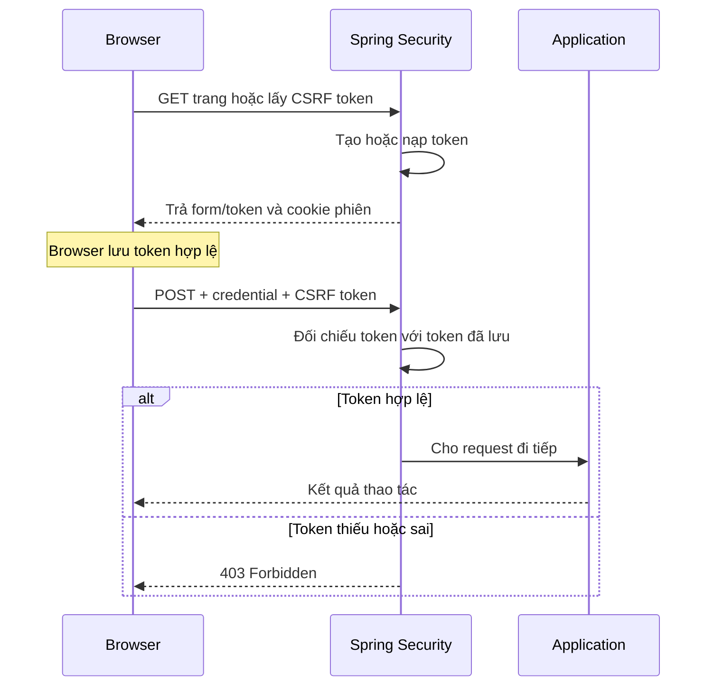

# CSRF đối với endpoint thay đổi trạng thái và lựa chọn cấu hình phù hợp

Spring Cloud Context và Spring Boot Actuator cung cấp các endpoint quản trị có thể thay đổi trạng thái ứng dụng. Ví dụ, POST /actuator/refresh làm mới cấu hình và các bean @RefreshScope; POST /actuator/env có thể cập nhật Environment và rebind @ConfigurationProperties; endpoint restart, pause hoặc resume cũng có thể tác động trực tiếp đến vòng đời ứng dụng.

Nếu các endpoint này được gọi từ trình duyệt và trình duyệt tự gửi cookie phiên hoặc thông tin xác thực khác, một website bên ngoài có thể dụ người vận hành gửi request ngoài ý muốn. Cross-Site Request Forgery (CSRF) bảo vệ các request thay đổi trạng thái bằng cách yêu cầu một token mà website bên ngoài không thể tự biết để đưa vào request.

Spring Security bật CSRF mặc định cho các HTTP method không an toàn. Với endpoint quản trị Spring Cloud, cần kết hợp ba lớp kiểm soát: endpoint có được expose hay không, người gọi có được xác thực và phân quyền hay không, và request có CSRF token hợp lệ khi được gọi bằng browser credentials hay không. Bài học này giải thích cách lựa chọn cấu hình phù hợp cho ứng dụng có giao diện trình duyệt, SPA, API máy-máy và các endpoint Actuator.

Bài học thuộc chương **Bảo mật** của **SPRING_CLOUD_CORE**. Trọng tâm là hiểu mô hình tấn công CSRF, phân loại endpoint thay đổi trạng thái, bảo vệ /actuator/refresh và /actuator/env, truyền token trong form hoặc JavaScript, giới hạn ngoại lệ CSRF, phân biệt Servlet với WebFlux và kiểm thử các trường hợp thiếu, sai hoặc hợp lệ token.

## 1. Mục tiêu học tập

Sau bài này, người học có thể:

1. Giải thích vì sao browser tự gửi cookie có thể tạo ra lỗ hổng CSRF.
2. Phân biệt authentication, authorization và CSRF protection.
3. Nhận diện HTTP method an toàn và không an toàn.
4. Giải thích cách Spring Security dùng synchronizer token để bảo vệ request.
5. Xác định các endpoint Spring Cloud Context có khả năng thay đổi trạng thái.
6. Cấu hình exposure và quyền truy cập cho Actuator endpoint.
7. Bảo vệ /actuator/refresh và /actuator/env bằng role quản trị cùng CSRF token.
8. Tích hợp token với HTML form, SPA và JavaScript client.
9. Chọn phạm vi ignoringRequestMatchers hoặc security chain riêng cho API máy-máy.
10. Giải thích vì sao stateless, JSON, CORS hoặc HTTP Basic không tự loại bỏ rủi ro CSRF.
11. Phân biệt CSRF trong Servlet và WebFlux.
12. Kiểm thử request thiếu token, token sai, token hợp lệ và người dùng thiếu quyền.

## 2. CSRF là gì?

CSRF xảy ra khi trình duyệt của người dùng đã đăng nhập bị một website khác dụ gửi request đến ứng dụng đang được tin cậy. Trình duyệt có thể tự động đính kèm cookie phiên hoặc thông tin xác thực đã lưu, dù người dùng không chủ ý thực hiện thao tác đó.

Ví dụ, người vận hành đang đăng nhập trang quản trị ứng dụng Spring Cloud. Trình duyệt lưu cookie phiên của trang quản trị. Một trang web độc hại có thể dựng form gửi request:

```html
<form action="https://admin.example.com/actuator/refresh"
      method="post">
    <button type="submit">Open report</button>
</form>
```

Nếu người vận hành truy cập trang này và trình duyệt gửi cookie phiên đến máy chủ quản trị, request có thể được xác thực bằng phiên của người vận hành. Nếu endpoint không kiểm tra CSRF token, hành động refresh có thể được thực hiện ngoài ý muốn.

Kẻ tấn công không cần đọc được cookie hoặc response. Vấn đề nằm ở chỗ browser tự đính kèm credential hợp lệ vào request do một origin khác khởi tạo.

### 2.1. Điều kiện thường gặp để xảy ra CSRF

Một tình huống CSRF thường có các yếu tố:

- Người dùng đã đăng nhập hoặc browser đang giữ credential.
- Browser tự động gửi credential đó với request đến ứng dụng đích.
- Ứng dụng có endpoint làm thay đổi trạng thái.
- Endpoint không yêu cầu bằng chứng request được tạo từ ứng dụng hợp lệ.

CSRF token bổ sung một giá trị ngẫu nhiên mà trang ngoài không thể đọc từ origin của ứng dụng đích do same-origin policy. Server so sánh token gửi lên với token đã lưu trước khi cho phép request tiếp tục.

### 2.2. CSRF không phải là giả mạo danh tính trực tiếp

CSRF thường lợi dụng phiên hoặc credential hợp lệ của nạn nhân. Nó không tự tìm mật khẩu và không tự vượt qua authorization. Tuy nhiên, nếu người dùng có role quản trị, request giả mạo có thể chạy với quyền của chính người dùng đó.

Vì vậy, cần kết hợp:

- Authentication: xác định người gọi là ai.
- Authorization: xác định người gọi được phép thao tác nào.
- CSRF protection: xác minh request unsafe được khởi tạo từ client hợp lệ.

Một request có CSRF token đúng vẫn phải qua bước xác thực và phân quyền.

## 3. HTTP method an toàn và không an toàn

Spring Security Servlet mặc định yêu cầu CSRF token cho các method khác GET, HEAD, TRACE, OPTIONS. Những method thường cần token là POST, PUT, PATCH và DELETE.

Một nguyên tắc thiết kế API quan trọng là các method an toàn phải chỉ đọc dữ liệu. GET, HEAD, OPTIONS và TRACE không được tạo đơn hàng, xóa dữ liệu, thay đổi cấu hình, refresh context hoặc thực hiện logout.

Ví dụ không nên thiết kế:

```java
@GetMapping("/admin/refresh")
String refresh() {
    contextRefresher.refresh();
    return "refreshed";
}
```

Thay vào đó, dùng một method thể hiện rõ thao tác thay đổi trạng thái:

```java
@PostMapping("/admin/refresh")
String refresh() {
    contextRefresher.refresh();
    return "refreshed";
}
```

Đổi endpoint sang POST không tự bảo vệ endpoint. Nó chỉ giúp Spring Security áp dụng CSRF matcher mặc định và giúp API thể hiện đúng semantics.

### 3.1. Vì sao GET phải chỉ đọc?

Nếu GET thay đổi trạng thái, một liên kết, ảnh nhúng, redirect hoặc trình duyệt prefetch có thể vô tình kích hoạt hành động. Khi đó, các cơ chế CSRF tập trung vào unsafe method sẽ không có cơ hội bảo vệ request.

Hãy giữ GET cho việc đọc trạng thái như health, info hoặc hiển thị trang. Các hành động refresh, restart, cập nhật Environment, pause, resume hoặc logout phải dùng method thay đổi trạng thái.

## 4. Synchronizer token pattern

Spring Security sử dụng synchronizer token pattern. Server tạo một token ngẫu nhiên, lưu token mong đợi và yêu cầu client gửi lại token đó trong request thay đổi trạng thái.

Luồng khái quát:



Token phải được gửi trong một phần của request mà browser không tự động thêm khi một trang ngoài gửi request, thường là hidden form field _csrf hoặc HTTP header X-CSRF-TOKEN / X-XSRF-TOKEN.

Chỉ lưu token trong cookie mà không yêu cầu client gửi lại token trong header hoặc parameter không tạo ra synchronizer token protection. Cookie cũng được browser tự động gửi, giống credential mà CSRF đang lợi dụng.

### 4.1. Token repository mặc định

Trong Spring Security Servlet, HttpSessionCsrfTokenRepository được dùng mặc định để lưu token trong HttpSession.

Spring Security cũng cung cấp CookieCsrfTokenRepository, thường dùng khi JavaScript cần đọc token từ cookie rồi đưa token vào request header.

| Repository | Nơi lưu token mong đợi | Trường hợp thường dùng |
| --- | --- | --- |
| HttpSessionCsrfTokenRepository | HTTP session | Server-rendered form, ứng dụng dùng session |
| CookieCsrfTokenRepository | Cookie XSRF-TOKEN | SPA hoặc JavaScript client cần đọc token |
| Custom repository | Nơi lưu do ứng dụng triển khai | Hệ thống có cơ chế session/token riêng |

Token không phải session cookie và cũng không thay thế session. Nó là bằng chứng bổ sung cho request thay đổi trạng thái.

### 4.2. Header và parameter mặc định

Với HttpSessionCsrfTokenRepository, Spring Security thường sử dụng parameter _csrf và header X-CSRF-TOKEN.

CookieCsrfTokenRepository mặc định ghi cookie XSRF-TOKEN và đọc token từ header X-XSRF-TOKEN hoặc parameter _csrf. Client phải gửi đúng header hoặc parameter mà repository/request handler đang cấu hình.

Không nên đưa CSRF token vào URL query string vì URL có thể xuất hiện trong access log, browser history, proxy log hoặc referrer.

## 5. Spring Security bật CSRF mặc định

Với ứng dụng Servlet sử dụng Spring Security, CSRF protection được bật mặc định. Có thể giữ rõ chủ đích trong SecurityFilterChain:

```java
@Configuration
@EnableWebSecurity
class SecurityConfiguration {

    @Bean
    SecurityFilterChain securityFilterChain(HttpSecurity http)
            throws Exception {

        http
            .csrf(Customizer.withDefaults())
            .authorizeHttpRequests(auth -> auth
                .anyRequest().authenticated()
            );

        return http.build();
    }
}
```

Không cần tự tạo CsrfFilter hoặc viết bộ so sánh token riêng. Spring Security kết hợp CsrfFilter, CsrfTokenRepository, CsrfTokenRequestHandler và AccessDeniedHandler để nạp, cung cấp, xác minh token và từ chối request không hợp lệ.

Nếu ứng dụng định nghĩa SecurityFilterChain tùy chỉnh, hãy kiểm tra cấu hình .csrf(...) trong chain đó. Đừng giả định việc thêm authorization rule sẽ tự vô hiệu hóa hoặc tự thay đổi CSRF behavior.

### 5.1. Khi token thiếu hoặc sai

Khi request cần CSRF protection nhưng token không có hoặc không khớp, Spring Security từ chối request bằng AccessDeniedException. Với cấu hình thông thường, client nhận HTTP 403 Forbidden.

Nếu frontend cần JSON error response, có thể cấu hình AccessDeniedHandler riêng. Tuy nhiên, handler chỉ thay đổi cách trả lỗi; nó không nên bỏ qua việc kiểm tra token.

## 6. Spring Security 6: deferred token và BREACH protection

Khi nâng cấp từ Spring Security 5 lên 6, có hai thay đổi đáng chú ý:

1. CSRF token được nạp theo cơ chế deferred mặc định, tránh phải đọc session ở mọi request.
2. Token được mã hóa với randomness khi đưa vào request attribute để hỗ trợ chống BREACH.

Trong Servlet stack, XorCsrfTokenRequestAttributeHandler là request handler mặc định ở Spring Security 6. Nó cung cấp token dạng đã được mã hóa ngẫu nhiên trong request attribute và giải mã token nhận từ request parameter/header trước khi so sánh với token lưu trữ.

Điều này quan trọng với SPA dùng cookie repository. JavaScript đọc giá trị token thuần từ cookie, trong khi server-rendered form có thể sử dụng token đã được XOR encode. Nếu cấu hình request handler không phân biệt hai cách gửi, token từ SPA có thể bị giải mã sai.

Khi dùng cấu hình SPA hiện đại, hãy sử dụng request handler phù hợp với tài liệu của đúng phiên bản Spring Security. Không tùy tiện thay XorCsrfTokenRequestAttributeHandler bằng handler không có BREACH protection chỉ để làm cho một test đơn lẻ chạy qua.

## 7. CSRF với HTML form và Thymeleaf

Với server-rendered HTML, token thường được đưa vào hidden input. Spring Security expose token dưới request attribute _csrf. Các view technology có tích hợp RequestDataValueProcessor, bao gồm Thymeleaf, có thể tự thêm token vào form có unsafe method.

Ví dụ HTML sau khi render:

```html
<form action="/admin/refresh" method="post">
    <input type="hidden" name="_csrf" value="token-from-server"/>
    <button type="submit">Refresh configuration</button>
</form>
```

Với Thymeleaf, hãy dùng form action và method phù hợp để integration tự thêm hidden field:

```html
<form th:action="@{/admin/refresh}" method="post">
    <button type="submit">Refresh configuration</button>
</form>
```

Nếu tự dựng HTML bằng template engine không tích hợp Spring Security, hãy đưa _csrf.parameterName và _csrf.token vào hidden input một cách tường minh. Đảm bảo token không bị escape hoặc biến đổi sai khi render.

## 8. CSRF với SPA và JavaScript

SPA thường gửi JSON qua fetch hoặc Axios. Thay vì hidden input, client đọc token và đưa token vào header của request thay đổi trạng thái.

### 8.1. Dùng CookieCsrfTokenRepository

Cấu hình cơ bản:

```java
@Bean
SecurityFilterChain securityFilterChain(HttpSecurity http)
        throws Exception {

    http
        .csrf(csrf -> csrf
            .csrfTokenRepository(
                CookieCsrfTokenRepository.withHttpOnlyFalse()
            )
        )
        .authorizeHttpRequests(auth -> auth
            .anyRequest().authenticated()
        );

    return http.build();
}
```

Repository tạo cookie XSRF-TOKEN. HttpOnly=false cho phép JavaScript đọc cookie để đưa giá trị vào header X-XSRF-TOKEN. Chỉ dùng thiết lập này khi frontend thật sự cần đọc cookie. Nếu không cần JavaScript đọc cookie, giữ HttpOnly mặc định để giảm khả năng script đọc token.

Đoạn cấu hình trên chỉ chọn nơi lưu token. Với SPA trên Spring Security 6 trở lên, hãy cấu hình thêm request handler ở mục tiếp theo để xử lý token thuần trong header cùng với XOR handler mặc định. Nếu chỉ đổi repository mà giữ nguyên handler, header token do JavaScript đọc từ cookie có thể không được giải mã theo cách mà server mong đợi.

Ví dụ request:

```javascript
const token = readCookie("XSRF-TOKEN");

await fetch("/actuator/refresh", {
  method: "POST",
  credentials: "same-origin",
  headers: {
    "Content-Type": "application/json",
    "X-XSRF-TOKEN": token
  }
});
```

readCookie là hàm frontend đọc cookie theo tên. Với cross-origin frontend, cần cấu hình CORS và cookie credentials đúng origin; không dùng wildcard origin khi cho phép credentials.

### 8.2. Request handler dành cho SPA với Spring Security 6

Spring Security 6 mặc định dùng XOR handler để chống BREACH. SPA gửi token thuần từ cookie nên cần handler đọc header theo kiểu plain, trong khi vẫn giữ XOR handler cho token được render vào response body hoặc hidden form.

Ví dụ theo mô hình được tài liệu Spring Security hướng dẫn:

```java
final class SpaCsrfTokenRequestHandler
        implements CsrfTokenRequestHandler {

    private final CsrfTokenRequestHandler plain =
        new CsrfTokenRequestAttributeHandler();

    private final CsrfTokenRequestHandler xor =
        new XorCsrfTokenRequestAttributeHandler();

    @Override
    public void handle(
            HttpServletRequest request,
            HttpServletResponse response,
            Supplier<CsrfToken> csrfToken) {

        this.xor.handle(request, response, csrfToken);
        csrfToken.get();
    }

    @Override
    public String resolveCsrfTokenValue(
            HttpServletRequest request,
            CsrfToken csrfToken) {

        String headerValue =
            request.getHeader(csrfToken.getHeaderName());

        CsrfTokenRequestHandler handler =
            StringUtils.hasText(headerValue) ? this.plain : this.xor;

        return handler.resolveCsrfTokenValue(request, csrfToken);
    }
}
```

Gắn handler vào security chain:

```java
http.csrf(csrf -> csrf
    .csrfTokenRepository(
        CookieCsrfTokenRepository.withHttpOnlyFalse()
    )
    .csrfTokenRequestHandler(
        new SpaCsrfTokenRequestHandler()
    )
);
```

Cách xử lý trên giữ XOR handler cho request parameter/rendered token và dùng plain handler khi client gửi token thuần trong header. Đối chiếu implementation với phiên bản Spring Security mà ứng dụng đang sử dụng trước khi sao chép vào dự án.

### 8.3. Làm mới token sau login và logout

Spring Security xóa CSRF token sau authentication success và logout success. Với SPA dùng cookie repository, client cần lấy token mới trước request unsafe tiếp theo.

Có thể expose endpoint đọc token:

```java
@RestController
class CsrfController {

    @GetMapping("/csrf")
    CsrfToken csrf(CsrfToken csrfToken) {
        return csrfToken;
    }
}
```

Frontend gọi /csrf khi khởi động và sau khi login/logout thành công, rồi lưu token nhận được để gửi trong header. Nếu endpoint cần gọi trước authentication, có thể cho phép riêng /csrf trong authorization rule; việc permitAll không có nghĩa endpoint thay đổi trạng thái hoặc endpoint quản trị cũng được mở.

Không log token, không đưa token vào URL và không lưu token lâu hơn cần thiết.

## 9. Các endpoint Spring Cloud có thể thay đổi trạng thái

Spring Cloud Commons cung cấp một số endpoint quản trị thông qua Spring Boot Actuator. Các endpoint này có thể tác động trực tiếp đến cấu hình hoặc vòng đời ứng dụng.

| Endpoint | HTTP method / hành vi | Tác động |
| --- | --- | --- |
| /actuator/refresh | POST | Nạp lại bootstrap context và refresh các bean @RefreshScope |
| /actuator/env | POST khi được bật | Cập nhật Environment, rebind @ConfigurationProperties và logger levels |
| /actuator/restart | Thao tác quản trị; mặc định disabled | Đóng và khởi động lại ApplicationContext |
| /actuator/pause | Thao tác quản trị | Gọi pause trên các PauseHandler |
| /actuator/resume | Thao tác quản trị | Gọi resume trên các PauseHandler |

Các endpoint không nhất thiết được expose hoặc enable trong mọi ứng dụng. Ví dụ, restart mặc định bị disabled; nếu restart bị disabled thì pause/resume cũng bị disabled theo tài liệu Spring Cloud.

### 9.1. Bật endpoint env POST có kiểm soát

Để cho phép POST /actuator/env, Spring Cloud yêu cầu bật management.endpoint.env.post.enabled=true và cấu hình regex giới hạn các property key có thể thay đổi.

Ví dụ:

```yaml
management:
  endpoint:
    env:
      post:
        enabled: true
        valid-keys-regex: '^acme\.(feature|routing)\..+$'
```

Regex trên giới hạn key trong các nhánh acme.feature.* và acme.routing.*. Nó chỉ giới hạn tên key được phép thay đổi; không thay thế authorization, kiểm tra giá trị hợp lệ hoặc audit. Hãy thu hẹp allowlist theo đúng cấu hình mà đội vận hành được phép cập nhật.

### 9.2. Expose endpoint qua HTTP

Actuator chỉ expose một số endpoint qua HTTP theo cấu hình mặc định. Ví dụ:

```yaml
management:
  endpoints:
    web:
      exposure:
        include:
          - health
          - info
          - refresh
          - env
```

Việc expose chỉ làm endpoint có thể được định tuyến qua management web interface. Nó không tự cấp quyền cho mọi người gọi và cũng không thay thế CSRF protection.

Nếu dùng management port hoặc base path riêng, URL và request matcher trong Spring Security phải khớp với cấu hình triển khai.

## 10. Bảo vệ endpoint quản trị bằng authentication, authorization và CSRF

Một cấu hình Servlet minh họa cho ứng dụng quản trị dùng session hoặc HTTP Basic:

```java
@Configuration
@EnableWebSecurity
class ManagementSecurityConfiguration {

    @Bean
    SecurityFilterChain securityFilterChain(HttpSecurity http)
            throws Exception {

        http
            .authorizeHttpRequests(auth -> auth
                .requestMatchers("/actuator/health").permitAll()
                .requestMatchers(
                    HttpMethod.POST,
                    "/actuator/refresh",
                    "/actuator/env"
                ).hasRole("OPS")
                .requestMatchers("/actuator/**").hasRole("OPS")
                .anyRequest().authenticated()
            )
            .csrf(Customizer.withDefaults())
            .httpBasic(Customizer.withDefaults());

        return http.build();
    }
}
```

Cấu hình này minh họa ba quyết định:

1. Health endpoint được phép đọc công khai theo chính sách ví dụ.
2. Các endpoint Actuator còn lại yêu cầu role OPS.
3. CSRF vẫn được bật cho unsafe method.

hasRole("OPS") tương ứng authority ROLE_OPS. Ứng dụng cần cấu hình user, identity provider hoặc resource authorization phù hợp để cấp role này. Nếu management port/base path khác, hãy điều chỉnh request matcher.

HTTP Basic không tự loại bỏ CSRF. Browser có thể tự gửi thông tin Basic đã lưu cùng request đến origin đích, vì vậy endpoint quản trị dùng Basic vẫn cần CSRF nếu browser có thể truy cập.

### 10.1. Exposure không phải authorization

Không nhầm lẫn các cấu hình sau:

| Cấu hình | Câu hỏi được giải quyết |
| --- | --- |
| management.endpoints.web.exposure.include | Endpoint nào được công bố qua HTTP? |
| management.endpoint.env.post.enabled | Có cho phép POST tới env endpoint không? |
| valid-keys-regex | Những property key nào được phép cập nhật? |
| Spring Security authentication | Ai đang gọi? |
| Spring Security authorization | Người gọi có quyền quản trị không? |
| CSRF token | Request unsafe có được khởi tạo từ client hợp lệ không? |
| Network policy / firewall | Client nào có thể kết nối đến management port? |

Một endpoint có thể được expose nhưng vẫn yêu cầu authentication, role và CSRF token. Ngược lại, endpoint chưa được expose có thể trả 404 dù security chain đã cấu hình quyền.

### 10.2. Không dùng GET để refresh hoặc cập nhật cấu hình

Nếu một ứng dụng tự tạo endpoint wrapper cho ContextRefresher.refresh(), hãy dùng POST hoặc một method unsafe phù hợp. Không biến hành động refresh thành GET để tránh CSRF; cách đó làm sai semantics của HTTP và mở cửa cho thao tác ngoài ý muốn.

## 11. Khi nào giữ CSRF và khi nào có thể loại trừ?

CSRF protection nên được giữ cho request có thể được browser của người dùng thông thường thực hiện, đặc biệt khi authentication dựa trên session cookie hoặc credential browser tự đính kèm.

| Kiểu client/credential | Cần CSRF? | Lý do |
| --- | --- | --- |
| Server-rendered web dùng session cookie | Có | Browser tự gửi cookie |
| SPA dùng session cookie | Có | Cookie vẫn được browser tự gửi; token phải được đưa vào header |
| Browser dùng HTTP Basic | Có | Browser có thể tự gửi credential đã lưu |
| API dùng JWT trong cookie | Có | Cookie tự động được gửi |
| API máy-máy dùng bearer token trong Authorization header do client chủ động gắn | Thường có thể loại trừ cho security chain đó | Website ngoài không tự đọc và gắn bearer token của client |
| Service-to-service có mTLS, không nhận browser traffic | Có thể loại trừ trong phạm vi API đó | Không có browser credential tự động gửi |

Không nên suy luận REST API thì không cần CSRF, stateless thì an toàn hoặc dùng JSON thì không thể bị CSRF. Hãy xác định credential được gửi như thế nào và browser có thể khởi tạo request bằng credential đó hay không.

### 11.1. Stateless không tự động an toàn

SessionCreationPolicy.STATELESS ngăn Spring Security dùng HTTP session làm cơ chế lưu security context theo cấu hình đó. Nhưng nếu browser vẫn tự gửi cookie xác thực, cookie JWT hoặc HTTP Basic credential, request vẫn có thể bị CSRF.

Điều quyết định là credential có được browser tự động đính kèm hay không, không chỉ là server có lưu session hay không.

### 11.2. JSON không tự động loại bỏ CSRF

Không nên chỉ dựa vào Content-Type: application/json để bỏ CSRF protection. Một số cách gửi form hoặc content type đặc biệt có thể tạo request mà ứng dụng xử lý không đúng kỳ vọng. CSRF token và kiểm tra content type vẫn cần được thiết kế riêng.

### 11.3. CORS không thay thế CSRF

CORS chủ yếu kiểm soát việc JavaScript từ origin khác có được đọc response hoặc thực hiện một số request cần preflight hay không. Các request đơn giản như HTML form submission có thể không cần preflight. Vì vậy, CORS không thay thế CSRF token.

Nếu SPA dùng cross-origin cookie, hãy cấu hình CORS cho origin cụ thể, bật credentials khi cần và cấu hình cookie phù hợp. Không dùng Access-Control-Allow-Origin: * cùng credentials.

### 11.4. SameSite là lớp phòng thủ bổ sung

Thuộc tính cookie SameSite=Lax hoặc SameSite=Strict có thể hạn chế cookie được gửi trong một số request cross-site. Đây là lớp phòng thủ hữu ích, nhưng không nên coi là thay thế duy nhất cho synchronizer token pattern. Hành vi phụ thuộc loại điều hướng, browser và topology domain.

## 12. Bỏ qua CSRF cho một số API máy-máy

Spring Security cho phép bỏ qua CSRF với các request matcher cụ thể:

```java
@Bean
SecurityFilterChain securityFilterChain(HttpSecurity http)
        throws Exception {

    http
        .csrf(csrf -> csrf
            .ignoringRequestMatchers("/api/machine/**")
        )
        .authorizeHttpRequests(auth -> auth
            .requestMatchers("/api/machine/**").authenticated()
            .anyRequest().authenticated()
        );

    return http.build();
}
```

Đây chỉ là ví dụ về cơ chế matcher. Chỉ sử dụng khi route đó thực sự dành cho machine client, không phục vụ browser, không nhận session cookie hoặc credential tự động của browser và được bảo vệ bằng cơ chế xác thực riêng như bearer token hoặc mTLS.

Không đưa /actuator/**, /admin/** hoặc toàn bộ /api/** vào danh sách ignore chỉ để tránh phải gửi token. Một path prefix rộng có thể vô tình chứa endpoint mà browser đang sử dụng.

### 12.1. Tách security chain cho API máy-máy

Một lựa chọn dễ kiểm soát hơn là tạo chain riêng cho route máy-máy:

```java
@Bean
@Order(1)
SecurityFilterChain machineApiSecurity(HttpSecurity http)
        throws Exception {

    http
        .securityMatcher("/api/machine/**")
        .csrf(AbstractHttpConfigurer::disable)
        .sessionManagement(session -> session
            .sessionCreationPolicy(SessionCreationPolicy.STATELESS)
        )
        .authorizeHttpRequests(auth -> auth
            .anyRequest().authenticated()
        )
        .oauth2ResourceServer(oauth2 -> oauth2
            .jwt(Customizer.withDefaults())
        );

    return http.build();
}

@Bean
@Order(2)
SecurityFilterChain browserSecurity(HttpSecurity http)
        throws Exception {

    http
        .authorizeHttpRequests(auth -> auth
            .anyRequest().authenticated()
        )
        .csrf(Customizer.withDefaults());

    return http.build();
}
```

Chain đầu tiên chỉ áp dụng cho /api/machine/**, yêu cầu JWT bearer token và tắt CSRF trong đúng phạm vi đó. Chain thứ hai tiếp tục bảo vệ các request còn lại bằng CSRF mặc định.

Cần bảo đảm matcher của chain máy-máy đủ hẹp, thứ tự chain đúng và chain fallback không bỏ sót route. Không dùng chain stateless này cho endpoint quản trị được gọi bằng browser session.

## 13. Bảo vệ endpoint Actuator khi chỉ có automation gọi

Có thể có hệ thống vận hành gọi /actuator/refresh từ pipeline hoặc control plane. Nếu endpoint chỉ nhận bearer token được gắn rõ trong Authorization header, không dùng cookie/session và không phục vụ browser, có thể thiết kế một management security chain riêng cho machine client.

Tuy nhiên, cần phân biệt hai trường hợp:

- Cùng endpoint được gọi cả từ browser và automation: giữ CSRF, automation phải lấy/gửi token phù hợp hoặc tách một route/management interface riêng.
- Endpoint chỉ dành cho machine client: có thể loại CSRF trong chain hẹp, đồng thời yêu cầu bearer token/mTLS, role riêng và network restriction.

Không nên dùng một cấu hình ignore toàn bộ /actuator/** chỉ vì hiện tại pipeline là client duy nhất. Endpoint có thể được mở cho giao diện quản trị về sau hoặc bị truy cập từ browser nếu network policy thay đổi.

Với management interface nhạy cảm, hãy ưu tiên port hoặc network riêng, authentication mạnh, role vận hành tối thiểu, audit và giới hạn nguồn kết nối.

## 14. WebFlux: dùng ServerHttpSecurity

Nếu ứng dụng chạy WebFlux, Spring Security dùng SecurityWebFilterChain, ServerHttpSecurity và CsrfWebFilter thay cho Servlet HttpSecurity và CsrfFilter.

CSRF protection cũng được bật mặc định trong WebFlux. Token mặc định được lưu trong WebSession bằng WebSessionServerCsrfTokenRepository. Từ Spring Security 6, XorServerCsrfTokenRequestAttributeHandler cung cấp BREACH protection.

Ví dụ giữ CSRF cho endpoint quản trị:

```java
@Bean
SecurityWebFilterChain springSecurityFilterChain(ServerHttpSecurity http) {
    return http
        .authorizeExchange(exchange -> exchange
            .pathMatchers("/actuator/health").permitAll()
            .pathMatchers("/actuator/**").hasRole("OPS")
            .anyExchange().authenticated()
        )
        .csrf(Customizer.withDefaults())
        .build();
}
```

Nếu dùng WebFlux API-only dành riêng cho machine client, có thể disable CSRF trong security chain tương ứng bằng ServerHttpSecurity.csrf(csrf -> csrf.disable()), với cùng điều kiện không phục vụ browser và không dùng credential tự động gửi.

Tên class, repository và request handler của WebFlux khác Servlet. Không copy CsrfTokenRequestHandler hoặc CookieCsrfTokenRepository Servlet vào cấu hình reactive; hãy dùng ServerCsrfTokenRequestHandler, ServerCsrfTokenRepository hoặc CookieServerCsrfTokenRepository tương ứng.

## 15. Kiểm thử CSRF bằng MockMvc

Một bộ test nên xác nhận ba trường hợp cơ bản:

1. Request POST thiếu token bị từ chối.
2. Request POST có token sai bị từ chối.
3. Request POST có token hợp lệ và người dùng đủ quyền được xử lý.

Ví dụ:

```java
@SpringBootTest
@AutoConfigureMockMvc
class RefreshEndpointSecurityTests {

    @Autowired
    MockMvc mockMvc;

    @Test
    void refreshWithoutCsrfTokenIsForbidden() throws Exception {
        mockMvc.perform(post("/actuator/refresh")
                .with(user("operator").roles("OPS")))
            .andExpect(status().isForbidden());
    }

    @Test
    void refreshWithInvalidCsrfTokenIsForbidden() throws Exception {
        mockMvc.perform(post("/actuator/refresh")
                .with(user("operator").roles("OPS"))
                .with(csrf().useInvalidToken()))
            .andExpect(status().isForbidden());
    }

    @Test
    void refreshWithValidCsrfTokenCanReachEndpoint() throws Exception {
        mockMvc.perform(post("/actuator/refresh")
                .with(user("operator").roles("OPS"))
                .with(csrf().asHeader()))
            .andExpect(status().is2xxSuccessful());
    }
}
```

Test cuối cần endpoint refresh được bật, expose và có dependency/configuration cần thiết. Nếu endpoint chưa available, test có thể trả 404 hoặc lỗi khởi tạo thay vì chứng minh CSRF hoạt động. Có thể dùng một endpoint quản trị test thay thế để kiểm tra filter chain trước, sau đó thêm integration test với Actuator thật.

csrf() là test post processor tạo token hợp lệ cho MockMvc; nó không mô phỏng việc frontend thật lấy token từ cookie hoặc HTML. Với SPA, cần thêm test tích hợp cho repository, header name và request handler.

### 15.1. Kiểm tra authorization riêng với CSRF

Token hợp lệ không đồng nghĩa người dùng có quyền quản trị. Hãy kiểm thử người dùng thiếu role:

```java
@Test
void refreshWithValidCsrfButWithoutOpsRoleIsForbidden() throws Exception {
    mockMvc.perform(post("/actuator/refresh")
            .with(user("viewer").roles("VIEWER"))
            .with(csrf()))
        .andExpect(status().isForbidden());
}
```

Cả CSRF và authorization đều có thể trả 403, nhưng nguyên nhân khác nhau. Khi chẩn đoán, kiểm tra security debug log hoặc viết test riêng cho từng điều kiện để xác định filter/authorization rule đang từ chối request.

### 15.2. Kiểm tra header và parameter

Spring Security test support cho phép gửi token dưới dạng request parameter mặc định:

```java
mockMvc.perform(post("/actuator/refresh")
    .with(user("operator").roles("OPS"))
    .with(csrf()));
```

Hoặc gửi trong header:

```java
mockMvc.perform(post("/actuator/refresh")
    .with(user("operator").roles("OPS"))
    .with(csrf().asHeader()));
```

Có thể dùng csrf().useInvalidToken() để xác nhận token sai bị từ chối. Đây là cách kiểm tra filter mà không cần tự tạo token ngẫu nhiên trong test.

## 16. Kiểm thử CSRF trong WebFlux

Với WebFlux, sử dụng WebTestClient và Spring Security reactive test support:

```java
webTestClient
    .mutateWith(csrf())
    .post()
    .uri("/actuator/refresh")
    .exchange()
    .expectStatus().is2xxSuccessful();
```

Có thể bỏ .mutateWith(csrf()) để xác nhận request bị từ chối khi thiếu token. Với test authorization, kết hợp test principal/authority phù hợp để tách lỗi CSRF khỏi lỗi role.

Không dùng SecurityMockMvcRequestPostProcessors.csrf() cho WebFlux. Hai stack có test support và request context khác nhau.

## 17. Chẩn đoán lỗi CSRF thường gặp

| Triệu chứng | Nguyên nhân có thể | Hướng xử lý |
| --- | --- | --- |
| POST /actuator/refresh trả 403 | Thiếu token, token sai hoặc người dùng thiếu role | Kiểm tra token và authorization riêng |
| GET health thành công nhưng POST refresh bị từ chối | GET không cần token; POST cần token và role | Gửi CSRF token hợp lệ |
| SPA gửi cookie XSRF-TOKEN nhưng vẫn bị 403 | Client chưa gửi header, header sai tên hoặc request handler không xử lý token plain | Gửi X-XSRF-TOKEN, kiểm tra repository/handler |
| SPA hoạt động trước login nhưng lỗi sau login | Token cũ bị xóa sau authentication success | Lấy token mới sau login |
| Request logout bị 403 | Thiếu token cho POST logout | Gửi CSRF token cùng request |
| API JSON bị 403 | JSON vẫn có thể cần CSRF; token chưa được gửi | Gửi token trong header |
| API stateless vẫn gặp CSRF | Browser vẫn tự gửi cookie hoặc Basic credential | Xác định credential thực tế; không chỉ dựa vào STATELESS |
| Endpoint trả 404 | Endpoint chưa expose, chưa enable hoặc base path khác | Kiểm tra Actuator exposure và endpoint property |
| Endpoint trả 401 | Chưa xác thực hoặc credential không hợp lệ | Kiểm tra authentication |
| Endpoint trả 403 dù token hợp lệ | Role không đủ hoặc request matcher khác với dự kiến | Kiểm tra authorization rules và filter chain order |
| /actuator/env không nhận POST | Chưa bật env POST hoặc endpoint chưa expose | Kiểm tra management.endpoint.env.post.enabled và management.endpoints.web.exposure.include |
| Refresh chạy được nhưng property thay đổi ngoài dự kiến | Allowlist key quá rộng hoặc authorization chưa đủ chặt | Thu hẹp valid-keys-regex, audit và phân quyền |

## 18. Các biện pháp bổ sung

CSRF token là lớp bảo vệ quan trọng nhưng không thay thế các biện pháp bảo mật khác.

- Chỉ expose management endpoint thực sự cần thiết.
- Đặt management interface trong network riêng khi có thể.
- Dùng HTTPS cho request quản trị.
- Phân quyền role quản trị riêng, không dùng quyền admin rộng cho mọi service.
- Giới hạn property key có thể cập nhật qua /actuator/env.
- Audit người gọi, endpoint, thời gian và kết quả thao tác; không log token.
- Dùng SameSite cookie như lớp phòng thủ bổ sung.
- Bảo vệ ứng dụng khỏi XSS bằng output encoding, CSP và quản lý dependency frontend.
- Không dùng GET cho hành động thay đổi trạng thái.
- Kiểm tra cả Servlet và WebFlux stack tương ứng với ứng dụng.

CSRF token không bảo vệ ứng dụng khỏi XSS. Nếu kẻ tấn công thực thi được JavaScript trong origin hợp lệ, script có thể đọc token mà SPA được phép đọc và gửi request dưới quyền người dùng. Vì vậy, cần kết hợp CSRF protection với phòng chống XSS và authorization.

## 19. Quy trình lựa chọn cấu hình

Khi quyết định giữ, thu hẹp hoặc tắt CSRF, hãy đi theo các bước:

1. Xác định endpoint có thay đổi trạng thái hay không.
2. Xác định endpoint có được browser truy cập không.
3. Xác định credential có được browser tự động đính kèm không: session cookie, JWT cookie, HTTP Basic hoặc cơ chế khác.
4. Nếu browser có thể gọi endpoint bằng credential tự động, giữ CSRF và yêu cầu token cho unsafe method.
5. Nếu endpoint chỉ dành cho machine client, xác minh không có browser traffic và credential được gắn tường minh qua bearer header hoặc mTLS.
6. Nếu cần ngoại lệ, giới hạn vào path hoặc security chain riêng cho machine API.
7. Giữ authentication, authorization và network restrictions kể cả khi CSRF bị tắt trong chain máy-máy.
8. Với Actuator, kiểm tra exposure, enablement, role, CSRF và allowlist property như các quyết định riêng.
9. Viết test cho token thiếu, sai, hợp lệ và người dùng thiếu role.
10. Kiểm tra lại sau khi thay đổi management port, base path, filter chain hoặc frontend origin.

## 20. Bài tập áp dụng

### Bài tập 1. Tấn công refresh giả mạo

Một người vận hành đang đăng nhập trang quản trị bằng session cookie. Trang ngoài gửi form POST tới /actuator/refresh.

Hãy mô tả vì sao browser gửi cookie, vì sao attacker không cần đọc response và CSRF token ngăn request như thế nào.

### Bài tập 2. Bảo vệ /actuator/env

Một ứng dụng bật POST /actuator/env để thay đổi feature flag. Hãy viết cấu hình management.endpoint.env.post.enabled, valid-keys-regex, Actuator exposure và SecurityFilterChain yêu cầu role OPS cùng CSRF token. Nêu cách giới hạn key để không cho phép sửa các property nhạy cảm.

### Bài tập 3. SPA dùng CookieCsrfTokenRepository

Một SPA đọc cookie XSRF-TOKEN nhưng POST vẫn bị 403 sau khi nâng cấp Spring Security 5 lên 6. Hãy giải thích vai trò của deferred token và XOR handler, sau đó đề xuất SpaCsrfTokenRequestHandler phù hợp.

### Bài tập 4. API máy-máy

Một route /api/machine/** chỉ nhận JWT bearer token trong Authorization header, không phục vụ browser và không dùng cookie. Hãy tạo security chain riêng, tắt CSRF trong phạm vi đó và giữ CSRF cho browser routes. Giải thích vì sao STATELESS một mình không đủ.

### Bài tập 5. Phân biệt 401 và 403

Một POST /actuator/refresh trả 403. Hãy thiết kế ba test để phân biệt: người dùng thiếu role, token thiếu/sai và request hợp lệ. Giải thích vì sao cả CSRF và authorization đều có thể dẫn đến 403.

### Bài tập 6. WebFlux

Một ứng dụng WebFlux expose endpoint quản trị POST /actuator/refresh. Hãy cấu hình SecurityWebFilterChain, cấp quyền OPS, giữ CSRF và viết test bằng WebTestClient.mutateWith(csrf()).

## 21. Câu hỏi tự kiểm tra

1. CSRF lợi dụng đặc điểm nào của browser?
2. Vì sao attacker không cần đọc cookie hoặc response của ứng dụng?
3. Những HTTP method nào được Spring Security Servlet mặc định xem là unsafe?
4. Vì sao GET không được thay đổi trạng thái?
5. Synchronizer token pattern hoạt động như thế nào?
6. HttpSessionCsrfTokenRepository lưu token ở đâu?
7. CookieCsrfTokenRepository dùng cookie và header mặc định nào?
8. Vì sao chỉ lưu token trong cookie mà không gửi lại bằng header là chưa đủ?
9. Spring Security 6 thay đổi gì về deferred token và BREACH protection?
10. Vì sao SPA cần chú ý request handler sau khi nâng cấp lên Spring Security 6?
11. Vì sao /actuator/refresh và /actuator/env cần CSRF khi được gọi từ browser?
12. Exposure Actuator khác authorization và CSRF ở điểm nào?
13. Vì sao management.endpoint.env.post.valid-keys-regex cần được giới hạn?
14. Vì sao stateless hoặc HTTP Basic không tự loại bỏ CSRF?
15. CORS và SameSite hỗ trợ CSRF theo cách nào, và giới hạn của chúng là gì?
16. Khi nào có thể tạo security chain không CSRF cho machine API?
17. MockMvc kiểm thử token hợp lệ, thiếu và sai bằng cách nào?
18. WebFlux dùng filter, repository và test support nào cho CSRF?

## 22. Nguồn tham chiếu

- [Spring Security 6.5 — Cross Site Request Forgery](https://www.springframework.org/spring-security/reference/6.5/servlet/exploits/csrf.html): synchronizer token, repository, deferred token, BREACH protection, SPA, disable/ignore CSRF và kiểm thử.
- [Spring Security — CSRF Considerations](https://www.springframework.org/spring-security/reference/6.5/features/exploits/csrf.html): nguyên lý CSRF, safe methods, SameSite, browser credential, stateless application và khi nào nên bật/tắt CSRF.
- [Spring Security — Testing with CSRF Protection](https://docs.spring.io/spring-security/reference/servlet/test/mockmvc/csrf.html): csrf(), asHeader() và useInvalidToken() cho MockMvc.
- [Spring Cloud Commons 5.0.4 — Application Context Services](https://docs.spring.io/spring-cloud-commons/reference/spring-cloud-commons/application-context-services.html): các endpoint /actuator/refresh, /actuator/env, /actuator/restart, /actuator/pause và /actuator/resume.
- [Spring Security 6.5 — CSRF for WebFlux](https://docs.spring.io/spring-security/reference/6.5/reactive/exploits/csrf.html): CsrfWebFilter, token repository, request handler và cách tích hợp token trong reactive application.
- [Spring Security — Testing with CSRF for WebFlux](https://docs.spring.io/spring-security/reference/reactive/test/web/csrf.html): kiểm thử CSRF bằng WebTestClient và mutateWith(csrf()).

## Ghi nhớ

Các endpoint Spring Cloud như /actuator/refresh và /actuator/env có thể thay đổi trạng thái hoặc cấu hình của ứng dụng, nên cần được expose có chọn lọc, yêu cầu authentication và authorization phù hợp, đồng thời giữ CSRF khi browser có thể tự gửi credential. Spring Security bảo vệ unsafe method bằng token; HTML form gửi token trong hidden field, SPA gửi token trong header. Chỉ loại trừ CSRF cho một route hoặc security chain máy-máy có phạm vi hẹp khi không phục vụ browser và không dùng credential tự động gửi. Stateless, JSON, CORS và SameSite riêng lẻ không thay thế CSRF protection.
