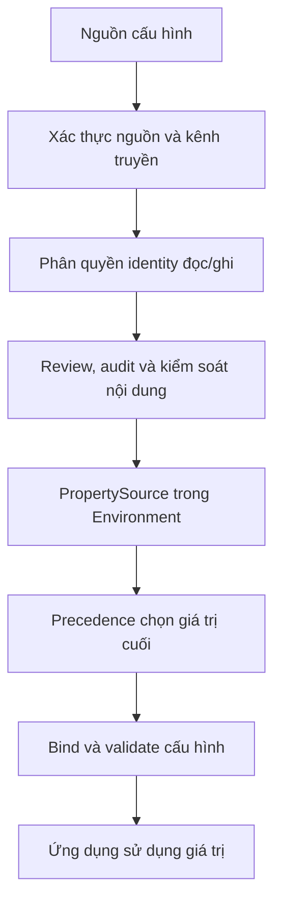

# Kiểm soát nguồn cấu hình được tin cậy

Spring Boot và Spring Cloud cho phép ứng dụng lấy cấu hình từ nhiều nơi: file đóng gói cùng JAR, file bên ngoài, biến môi trường, tham số dòng lệnh, Spring Cloud Config Server, Vault hoặc secret được mount vào container. Khả năng kết hợp này giúp triển khai cùng một ứng dụng trên nhiều môi trường, nhưng cũng tạo ra một ranh giới bảo mật quan trọng: **nguồn nào được phép cung cấp hoặc ghi đè cấu hình mà ứng dụng tin cậy?**

Spring `Environment` giải quyết việc tìm giá trị theo thứ tự ưu tiên của các `PropertySource`. Thứ tự đó quyết định giá trị nào thắng khi nhiều nguồn cùng khai báo một key; nó không xác thực danh tính nguồn, không kiểm tra chữ ký nội dung và không chứng minh giá trị là an toàn. Việc bảo vệ nguồn cấu hình cần kết hợp kiểm soát quyền truy cập, xác thực kết nối, quản trị repository, phân quyền theo ứng dụng, quản lý secret và chính sách override.

Bài học thuộc chương **Bảo mật** của **SPRING_CLOUD_CORE**. Nội dung tập trung vào mô hình tin cậy của externalized configuration, thứ tự ưu tiên property, Spring Cloud Config Client/Server, TLS và xác thực, mã hóa cấu hình, Vault, config tree, chính sách ghi đè, refresh và cách kiểm thử các ranh giới này.

## 1. Mục tiêu học tập

Sau bài này, bạn có thể:

- Phân biệt nguồn cấu hình với mức độ tin cậy của nguồn đó.
- Giải thích vì sao property precedence không phải security policy.
- Nhận biết các nguồn cấu hình Spring Boot và thứ tự ưu tiên cơ bản.
- Thiết kế cách import cấu hình từ Spring Cloud Config Server.
- Chọn giữa nguồn cấu hình bắt buộc và nguồn tùy chọn.
- Bảo vệ Config Server bằng HTTPS, xác thực và phân quyền theo ứng dụng.
- Quản lý credential của Config Client mà không ghi secret vào Git.
- Hiểu phạm vi bảo vệ của `{cipher}` trong Spring Cloud Config.
- Dùng Spring Cloud Vault hoặc `configtree:` cho dữ liệu nhạy cảm.
- Thiết lập chính sách override cho remote property source đúng với cơ chế bootstrap đang dùng.
- Kiểm soát profile, refresh và thay đổi cấu hình khi ứng dụng đang chạy.
- Truy nguyên nguồn của một property và kiểm thử hành vi khi nguồn tin cậy không sẵn sàng.
- Xây dựng quy trình quản trị cấu hình có audit, review và quyền tối thiểu.

## 2. Mô hình tin cậy của nguồn cấu hình

Một ứng dụng có thể nhận cấu hình từ nhiều nguồn. Mỗi nguồn có cách phân phối, quyền ghi và vòng đời khác nhau.

| Nguồn | Ví dụ | Rủi ro cần quản lý |
| --- | --- | --- |
| Cấu hình đóng gói trong JAR | `application.yml` trong artifact | Giá trị lỗi thời, secret vô tình được đóng gói |
| File bên ngoài | `/etc/myapp/application.yml` | Quyền file, quyền mount và người có thể sửa |
| Biến môi trường | `PAYMENTS_ENDPOINT` | Quyền sửa deployment manifest hoặc process environment |
| Tham số dòng lệnh | `--payments.mode=...` | Quyền khởi chạy process và khả năng override |
| Spring Cloud Config Server | Git-backed property source | Xác thực client, phân quyền application, độ tin cậy của Git |
| Vault | Secret backend | Identity của workload, policy và vòng đời secret |
| Config tree | Kubernetes Secret hoặc Docker secret được mount | Quyền truy cập volume, file permission và cách cập nhật |
| JSON application properties | `SPRING_APPLICATION_JSON` | Nguồn có ưu tiên cao, dễ bị dùng để override ngoài dự kiến |

Không có quy tắc mặc định nào trong Spring nói rằng file remote luôn an toàn hơn biến môi trường, hoặc biến môi trường luôn an toàn hơn file local. Mức tin cậy đến từ cách tổ chức vận hành: ai có thể sửa nguồn, ai có thể đọc nguồn, nội dung được review ra sao, kết nối có được xác thực không và ứng dụng có được phép dùng nguồn đó cho mục đích nào.



Sơ đồ tách các bước bảo đảm tin cậy khỏi bước chọn giá trị. Precedence chỉ xảy ra sau khi nguồn đã được đưa vào `Environment`; nó không thay thế xác thực, phân quyền hay kiểm tra nội dung.

### 2.1. Phân biệt ba thuộc tính

Khi đánh giá một nguồn, hãy tách ba câu hỏi:

1. **Nguồn có xác thực được không?** Ứng dụng có biết nó đang kết nối đúng Config Server, Vault hoặc endpoint được quản trị không?
2. **Người cung cấp có được phân quyền không?** Identity hiện tại có quyền đọc cấu hình của đúng service và môi trường không?
3. **Nội dung có được kiểm soát không?** Thay đổi có review, audit, kiểm thử và phát hành theo quy trình không?

HTTPS giải quyết bảo vệ kênh truyền và xác thực server theo chứng thư. Nó không tự xác minh rằng người sửa Git có quyền thay đổi property `payments.admin-enabled`. Tương tự, một commit nằm trong repository nội bộ không mặc nhiên an toàn nếu quyền ghi repository quá rộng.

### 2.2. Property precedence không phải trust ranking

Spring `Environment` chọn giá trị theo thứ tự `PropertySource`. Một nguồn có ưu tiên cao có thể ghi đè giá trị từ nguồn có ưu tiên thấp hơn.

Điều đó không có nghĩa nguồn có ưu tiên cao được tin cậy hơn. Ví dụ, command-line argument có thể ghi đè giá trị trong file cấu hình; nếu một hệ thống triển khai cho phép người không có quyền thay đổi tham số khởi chạy, họ có thể thay đổi hành vi ứng dụng mà không sửa Git repository.

Vì vậy, phải bảo vệ cả nguồn cấu hình lẫn thành phần có quyền đưa nguồn đó vào process.

## 3. Những rủi ro khi nhận cấu hình từ bên ngoài

Một property có thể ảnh hưởng trực tiếp tới hành vi và bề mặt tấn công của ứng dụng. Ví dụ:

```yaml
management:
  endpoints:
    web:
      exposure:
        include: "*"

spring:
  datasource:
    url: jdbc:postgresql://unexpected-host/payments
  security:
    user:
      password: weak-password

payments:
  approval:
    required: false
```

Nếu một người không được phép có thể thay đổi các giá trị này, hậu quả có thể gồm:

- Expose Actuator endpoint vượt phạm vi dự kiến.
- Chuyển kết nối database sang host không đáng tin cậy.
- Làm yếu xác thực hoặc vô hiệu hóa một kiểm tra nghiệp vụ.
- Thay đổi endpoint gọi dịch vụ hoặc proxy.
- Làm thay đổi truststore, TLS hoặc cấu hình network.
- Bật log quá chi tiết khiến dữ liệu nhạy cảm xuất hiện trong log.
- Thay đổi cấu hình discovery, service registration hoặc routing.

Cấu hình không phải mã thực thi theo nghĩa thông thường, nhưng nhiều property điều khiển những thành phần có quyền truy cập mạng, dữ liệu hoặc tài nguyên hệ thống. Hãy xem quyền sửa cấu hình production là một quyền vận hành nhạy cảm.

### 3.1. Phân loại cấu hình

Có thể chia cấu hình thành ba nhóm để áp dụng chính sách phù hợp:

| Nhóm | Ví dụ | Cách quản lý |
| --- | --- | --- |
| Cấu hình vận hành thông thường | Timeout, số worker, feature flag | Config Server hoặc deployment config có review |
| Cấu hình bảo mật | Endpoint xác thực, TLS, access policy, truststore | Repository/quy trình có quyền hạn chặt và kiểm tra độc lập |
| Bí mật | Password, private key, API token, database credential | Vault, secret manager hoặc secret volume; hạn chế lưu trong Git |

Không nhất thiết mọi property đều phải đặt trong Vault. Điều quan trọng là không dùng một repository cấu hình thông thường như nơi lưu secret lâu dài nếu chưa có kiểm soát truy cập, mã hóa, audit và quy trình xoay vòng phù hợp.

## 4. Thứ tự ưu tiên của PropertySource trong Spring Boot

Spring Boot xây dựng `Environment` từ nhiều `PropertySource`. Theo thứ tự externalized configuration hiện hành, các nguồn có mức ưu tiên thấp hơn đứng trước; nguồn xuất hiện sau có thể ghi đè giá trị trước đó.

Các nhóm thường gặp, từ ưu tiên thấp lên cao:

1. Default properties được đặt qua `SpringApplication.setDefaultProperties`.
2. `@PropertySource` trên configuration class.
3. Config data, chẳng hạn `application.properties` hoặc `application.yml`.
4. `RandomValuePropertySource`.
5. Biến môi trường của hệ điều hành.
6. Java system properties.
7. JNDI attributes.
8. `ServletContext` init parameters.
9. `ServletConfig` init parameters.
10. `SPRING_APPLICATION_JSON`.
11. Tham số dòng lệnh.
12. Các test properties và dynamic test properties trong môi trường kiểm thử.
13. Devtools global settings khi Devtools được bật.

Danh sách chi tiết có thể thay đổi theo phiên bản Spring Boot và loại ứng dụng. Khi xử lý property quan trọng, hãy kiểm tra tài liệu của đúng phiên bản đang triển khai.

### 4.1. Ví dụ nhiều nguồn cùng khai báo một property

Giả sử các nguồn sau cùng khai báo `payments.timeout`:

```yaml
# application.yml
payments:
  timeout: 2s
```

Biến môi trường:

```text
PAYMENTS_TIMEOUT=3s
```

Tham số khởi chạy:

```bash
java -jar app.jar --payments.timeout=5s
```

Trong cấu hình mặc định, command-line argument có ưu tiên cao hơn environment variable, và environment variable có ưu tiên cao hơn config data. Giá trị cuối cùng được phân giải là `5s`.

Đây là hành vi hữu ích cho một số thao tác vận hành, nhưng cũng có nghĩa quyền cung cấp command-line argument phải được kiểm soát.

### 4.2. @PropertySource có giới hạn về thời điểm

`@PropertySource` được thêm vào `Environment` trong quá trình refresh ApplicationContext. Thời điểm này có thể quá muộn cho các property cần đọc trước refresh, chẳng hạn một số thiết lập `logging.*` hoặc `spring.main.*`.

Nếu property điều khiển bootstrap hoặc quá trình nạp cấu hình, hãy đặt nó ở nguồn được đọc sớm như environment variable, system property hoặc command-line argument theo đúng hướng dẫn của Spring Boot.

### 4.3. Config data và file profile

Với các file `application` thông thường, profile-specific config data được ưu tiên hơn file không gắn profile. File bên ngoài JAR thường có thể ghi đè file được đóng gói bên trong JAR.

Ví dụ:

```text
application.yml
application-prod.yml
```

Khi profile `prod` hoạt động, các giá trị trong `application-prod.yml` được xét theo quy tắc profile và vị trí config data. Nếu nhiều profile cùng hoạt động, thứ tự profile cũng ảnh hưởng kết quả.

Không dùng tên profile làm cơ chế phân quyền. Profile chỉ quyết định nhóm cấu hình được kích hoạt; quyền đọc cấu hình production phải được bảo vệ ở Config Server, Vault, nền tảng triển khai và hệ thống identity.

## 5. Chọn nguồn cấu hình theo độ nhạy

Một cách phân chia thực tế:

- Giá trị mặc định không nhạy cảm: đóng gói trong JAR.
- Giá trị theo môi trường: file triển khai hoặc Config Server.
- Secret cần đọc lúc chạy: Vault hoặc secret manager.
- Secret được mount vào container: config tree từ volume được bảo vệ.
- Giá trị một lần dùng để debug: command-line chỉ trong môi trường và quy trình được kiểm soát.

Ví dụ file ứng dụng chỉ chứa vị trí và tên nguồn secret:

```yaml
spring:
  config:
    import: "optional:configtree:/run/secrets/"

payments:
  endpoint: "https://payments.internal"
  connect-timeout: 2s
```

Các file trong `/run/secrets/` có thể cung cấp những property như `payments.api-key` hoặc `spring.datasource.password`. File secret không cần được đưa vào Git.

Nếu nguồn secret là bắt buộc để ứng dụng hoạt động an toàn, hãy cân nhắc bỏ tiền tố `optional:`. Điều này giúp ứng dụng dừng khởi động khi secret volume không có thay vì chạy với cấu hình thiếu.

## 6. Nạp cấu hình từ Spring Cloud Config Server

Spring Cloud Config Server cung cấp property source từ một backend được quản lý, thường là Git, nhưng cũng có thể là các repository implementation khác. Client nhận cấu hình dựa trên application name, profile và label.

Với Spring Boot Config Data API, cách khai báo hiện đại là `spring.config.import`:

```yaml
spring:
  application:
    name: payments-service
  config:
    import: "configserver:https://config.example.internal"
```

Nếu import không có tiền tố `optional:`, Config Client sẽ coi Config Server là nguồn bắt buộc và làm ứng dụng thất bại khi không thể kết nối hoặc lấy cấu hình. Đây thường là lựa chọn phù hợp khi cấu hình từ xa chứa thiết lập cần thiết để chạy an toàn.

### 6.1. Khi nào dùng optional:?

Ví dụ:

```yaml
spring:
  config:
    import: "optional:configserver:https://config.example.internal"
```

`optional:` cho phép ứng dụng tiếp tục khởi động khi nguồn import không có hoặc không truy cập được theo semantics của Config Data.

Chỉ dùng khi ứng dụng có bộ giá trị mặc định an toàn và có thể hoạt động đúng mà không cần cấu hình từ xa. Không dùng `optional:` để che lỗi xác thực hoặc outage của nguồn cấu hình bắt buộc; việc tiếp tục chạy bằng default có thể tạo hành vi không an toàn.

### 6.2. Địa chỉ server và thông tin định danh

Có thể cấu hình địa chỉ qua import URI hoặc `spring.cloud.config.uri`. Nếu import đã chứa URL, URL đó có ưu tiên theo quy tắc Config Client so với property URI riêng.

Ví dụ:

```yaml
spring:
  config:
    import: "configserver:https://config.example.internal"
  cloud:
    config:
      username: "${CONFIG_SERVER_USER}"
      password: "${CONFIG_SERVER_PASSWORD}"
```

Các placeholder lấy credential từ nguồn triển khai được bảo vệ. Không commit password hoặc token thật vào `application.yml`, repository cấu hình hay script build.

### 6.3. application, profile và label

Config Client gửi thông tin định danh để Config Server tìm đúng cấu hình:

- `application`: thường lấy từ `spring.application.name`.
- `profile`: các active profile của ứng dụng.
- `label`: nhãn cấu hình, thường là branch, tag hoặc commit ID trong Git backend.

Label dạng branch có thể thay đổi theo thời gian. Với một bản phát hành cần tái lập, cân nhắc dùng commit ID hoặc tag bất biến được quản trị. Điều này giúp truy lại chính xác nội dung cấu hình đã dùng cho một lần triển khai.

## 7. Bảo vệ Config Server bằng xác thực và phân quyền

Config Server là điểm tập trung có thể cung cấp cấu hình của nhiều ứng dụng. Vì vậy, bảo vệ endpoint server là yêu cầu nền tảng.

Spring Cloud Config cho phép bảo vệ server bằng các cơ chế Spring Security, ví dụ HTTP Basic hoặc OAuth2 Resource Server với JWT. Với môi trường production, lựa chọn cơ chế phải phù hợp identity của workload và hạ tầng quản lý credential.

### 7.1. HTTP Basic qua HTTPS

Ví dụ cấu hình server dùng Spring Security:

```yaml
spring:
  security:
    user:
      name: configserver
      password: "${CONFIG_SERVER_PASSWORD}"
```

Client cung cấp credential qua property được nạp từ secret store:

```yaml
spring:
  cloud:
    config:
      username: "${CONFIG_SERVER_USER}"
      password: "${CONFIG_SERVER_PASSWORD}"
```

HTTP Basic chỉ mã hóa credential khi được bảo vệ bởi HTTPS. Không gửi Basic credentials qua HTTP thuần.

### 7.2. OAuth2 Resource Server và JWT

Config Server có thể được cấu hình để xác thực JWT thông qua issuer hoặc JWKS URI. Client phải có cách lấy token và gửi header `Authorization: Bearer ...`.

Spring Cloud Config Client không tự động lấy OAuth2 token cho mọi trường hợp. Nếu dùng token, ứng dụng cần tích hợp cơ chế lấy token và gắn header phù hợp, chẳng hạn một client tùy chỉnh hoặc cấu hình Spring Security tương ứng.

Không hard-code JWT hoặc refresh token trong source code. Ưu tiên workload identity, client credentials có vòng đời ngắn hoặc cơ chế cấp token do nền tảng triển khai quản lý.

### 7.3. Phân quyền theo application

Một điểm dễ bỏ sót: xác thực thành công không đồng nghĩa client được phép đọc mọi cấu hình.

Theo cấu hình bảo mật cơ bản, một người dùng đã xác thực có thể yêu cầu cấu hình cho nhiều giá trị `{application}` khác nhau nếu server không có authorization policy chi tiết. Nếu repository chứa secret riêng cho từng service, cần giới hạn client chỉ đọc cấu hình của application được cấp quyền.

Ví dụ, một policy có thể so sánh path segment `{application}` với danh tính đã xác thực:

```java
@Configuration
@EnableWebSecurity
class ConfigServerSecurityConfiguration {

    @Bean
    SecurityFilterChain configSecurity(HttpSecurity http) throws Exception {
        http.authorizeHttpRequests(authorize -> authorize
                .requestMatchers("/actuator/health").permitAll()
                .requestMatchers("/{application}/**")
                    .access((authentication, context) -> {
                        String requestedApplication =
                                context.getVariables().get("application");
                        String principal =
                                authentication.get().getName();

                        return new AuthorizationDecision(
                                principal.equals(requestedApplication));
                    })
                .anyRequest().authenticated());

        http.httpBasic(Customizer.withDefaults());
        return http.build();
    }
}
```

Đây là ví dụ minh họa policy theo tên principal. Hệ thống thật thường cần ánh xạ application với role, OAuth2 claim hoặc policy service; không nên giả định username luôn bằng application name. Cũng cần kiểm tra các route khác, chẳng hạn endpoint Actuator và route quản trị, theo nguyên tắc quyền tối thiểu.

## 8. TLS và xác thực máy chủ

Config Server trả về dữ liệu có thể chứa credential, endpoint nội bộ và cấu hình bảo mật. Production nên sử dụng HTTPS để bảo vệ dữ liệu và credential trên đường truyền.

Server có thể cấu hình TLS trực tiếp bằng `server.ssl.*` hoặc đặt sau reverse proxy/load balancer có TLS termination được quản trị. Client cần xác minh chứng thư server theo trust store phù hợp.

### 8.1. Client-side TLS và mutual TLS

Nếu Config Server yêu cầu client certificate, Config Client hỗ trợ cấu hình key store và trust store:

```yaml
spring:
  cloud:
    config:
      tls:
        enabled: true
        key-store: "/run/secrets/config-client.p12"
        key-store-type: PKCS12
        key-store-password: "${CONFIG_CLIENT_KEYSTORE_PASSWORD}"
        trust-store: "/run/secrets/config-server-trust.p12"
        trust-store-type: PKCS12
        trust-store-password: "${CONFIG_SERVER_TRUSTSTORE_PASSWORD}"
```

`key-store` chứa client identity để xác thực với server; `trust-store` chứa CA hoặc certificate được dùng để xác minh server. Nếu không chỉ định trust store riêng, client có thể dùng JVM default trust store theo cấu hình và phiên bản tương ứng.

### 8.2. Không tắt xác minh chứng thư để “sửa nhanh”

Không dùng cấu hình tắt SSL verification hoặc trust mọi certificate để xử lý lỗi chứng thư trong production. Hãy sửa hostname, certificate chain, CA trust hoặc thời hạn chứng thư.

Nếu TLS bị bỏ qua, attacker trên đường truyền có thể giả mạo Config Server và cung cấp property độc hại hoặc thu thập credential client.

## 9. Bảo vệ Git repository làm nguồn cấu hình

Khi Config Server dùng Git backend, repository trở thành một phần của control plane.

Một số biện pháp quản trị:

- Chỉ cấp quyền đọc cho identity của Config Server.
- Giới hạn quyền ghi theo team hoặc nhóm sở hữu service.
- Bảo vệ nhánh production bằng pull request và review bắt buộc.
- Yêu cầu kiểm thử cấu hình trước khi merge.
- Lưu audit trail cho commit và thay đổi quyền.
- Dùng commit/tag bất biến để tái lập cấu hình phát hành.
- Không đưa password, private key hoặc token dạng plaintext vào repository.
- Tách repository hoặc path theo miền bảo mật khi cần phân quyền độc lập.
- Quản lý deploy key/token của Config Server ngoài repository.
- Kiểm tra SSH host key hoặc TLS certificate khi kết nối Git server.

Ví dụ cấu hình Git backend:

```yaml
spring:
  cloud:
    config:
      server:
        git:
          uri: "https://git.example.internal/platform/configuration.git"
          username: "${CONFIG_GIT_USER}"
          password: "${CONFIG_GIT_TOKEN}"
          clone-on-start: true
```

`clone-on-start` giúp phát hiện một số lỗi truy cập repository ngay khi Config Server khởi động thay vì đợi client đầu tiên yêu cầu cấu hình. Credential trong ví dụ phải được inject từ secret store hoặc môi trường triển khai được bảo vệ.

### 9.1. Phân biệt quyền Config Client và quyền Config Server

Config Client chỉ cần quyền đọc Config Server. Config Server cần credential đọc repository backend. Không chia sẻ credential Git có quyền ghi cho mọi ứng dụng client.

Tách hai danh tính này giúp nếu một service bị xâm nhập, attacker không thể dùng credential của nó để thay đổi repository cấu hình toàn hệ thống.

## 10. Mã hóa giá trị trong Spring Cloud Config

Spring Cloud Config hỗ trợ giá trị mã hóa trong repository với tiền tố `{cipher}`. Config Server giải mã giá trị trước khi gửi property source tới client.

Ví dụ cấu hình lưu trong Git:

```yaml
spring:
  datasource:
    username: payments_user
    password: "{cipher}ENCRYPTED_VALUE_FROM_CONFIG_SERVER"
```

Mục đích là tránh lưu password dạng rõ trong repository. Người đọc Git chỉ nhìn thấy ciphertext thay vì giá trị secret.

### 10.1. Mã hóa at rest không thay thế TLS

Giá trị `{cipher}` được giải mã trước khi trả về client. Vì vậy, client nhận plaintext trong Environment để cấu hình datasource hoặc bean tương ứng.

Cơ chế này bảo vệ dữ liệu khi lưu trong repository, nhưng không thay thế:

- HTTPS giữa client và Config Server.
- Xác thực client và phân quyền theo application.
- Bảo vệ memory, log và Actuator của client.
- Quản lý key mã hóa.
- Kiểm soát người có quyền gọi endpoint Config Server.

### 10.2. Quản lý encryption key

Không lưu encryption key cạnh ciphertext trong cùng repository. Key cần được quản lý bằng hệ thống secret/KMS phù hợp, có quyền truy cập hạn chế và quy trình xoay vòng.

Nếu key bị lộ, ciphertext tương ứng có thể mất tác dụng bảo vệ. Nếu key bị mất, Config Server không thể giải mã các giá trị cũ; cần có kế hoạch backup, rotation và re-encryption.

### 10.3. Lỗi giải mã

Khi một giá trị không giải mã được, Config Server có thể loại bỏ giá trị ciphertext khỏi property source và thêm một property có prefix `invalid` để báo lỗi. Điều này tránh việc ứng dụng vô tình dùng chuỗi ciphertext như password.

Hãy theo dõi log server và kiểm tra key, thuật toán, format ciphertext, cũng như sự tương thích giữa phiên bản server và client. Không xử lý bằng cách copy ciphertext vào trường password dạng rõ.

## 11. Dùng Vault cho secret có vòng đời riêng

Spring Cloud Vault tích hợp Vault secret backend vào Spring `Environment` thông qua Config Data API. Với Spring Boot 2.4 trở lên, đây là cách được ưu tiên so với bootstrap context cũ trong các phiên bản Spring Cloud Vault hiện hành.

Ví dụ:

```yaml
spring:
  config:
    import: "vault://"
```

Ứng dụng cần cấu hình địa chỉ Vault, TLS và cơ chế xác thực phù hợp. `vault://` mặc định là import bắt buộc; nếu Vault là nguồn tùy chọn, có thể dùng `optional:vault://` theo đúng yêu cầu vận hành.

### 11.1. Không dùng root token trong ứng dụng

Root token trong quickstart chỉ phù hợp thử nghiệm ban đầu. Ứng dụng production nên dùng identity có policy giới hạn đường dẫn và thao tác cần thiết.

Các lựa chọn xác thực tùy hạ tầng gồm Kubernetes auth, AppRole hoặc phương thức identity của nền tảng cloud. Ưu tiên credential ngắn hạn hoặc được cấp tự động thay vì token tĩnh tồn tại lâu.

### 11.2. Tách cấu hình thường và secret

Config Server có thể quản lý endpoint, timeout, feature flag và các giá trị không bí mật. Vault quản lý password, token và key có vòng đời riêng.

Ví dụ:

```yaml
spring:
  config:
    import:
      - "configserver:https://config.example.internal"
      - "vault://"
```

Khi có nhiều import, thứ tự và vị trí import ảnh hưởng precedence. Cần xác định rõ property nào do Config Server sở hữu, property nào do Vault sở hữu, và không để cùng một key nhạy cảm xuất hiện trong nhiều nguồn.

## 12. Dùng configtree cho secret được mount

Spring Boot hỗ trợ `configtree:` để đọc các file trong một thư mục như các property. Tên file trở thành key, nội dung file trở thành value.

Ví dụ volume mount:

```text
/run/secrets/
├── payments.api-key
└── spring.datasource.password
```

Khai báo import:

```yaml
spring:
  config:
    import: "configtree:/run/secrets/"
```

Ứng dụng có thể đọc `payments.api-key` hoặc `spring.datasource.password` như property bình thường.

### 12.1. Kubernetes Secret và Docker secrets

Kubernetes có thể mount ConfigMap hoặc Secret thành volume. Docker Swarm có thể mount Docker secret vào thư mục được chỉ định.

Dùng `configtree:` khi nền tảng đã chịu trách nhiệm phân phối file và giới hạn quyền truy cập. Kiểm tra:

- Volume chỉ mount vào container cần secret.
- File permission và user chạy process phù hợp.
- Secret không bị copy vào image layer.
- Không log nội dung file.
- Quy trình cập nhật/rotation có được kiểm thử.
- Ứng dụng có cần restart hoặc refresh để đọc giá trị mới hay không.

### 12.2. Không nhầm ConfigMap với Secret

ConfigMap phù hợp với cấu hình không nhạy cảm. Secret được thiết kế cho dữ liệu nhạy cảm nhưng vẫn cần bảo vệ quyền truy cập, encryption at rest của cluster và quyền đọc API. Việc dữ liệu được đặt trong object tên `Secret` không tự động đảm bảo chỉ workload hợp lệ mới đọc được nó.

## 13. Chính sách ghi đè remote property source

Spring Cloud Config có các property điều khiển khả năng ghi đè giá trị remote. Cần phân biệt cơ chế Config Data hiện đại với bootstrap context cũ.

Với bootstrap mode, remote property source mặc định có thể được bảo vệ khỏi việc ghi đè local. Nếu muốn local override, remote source phải cho phép qua `spring.cloud.config.allowOverride=true`. Flag này phải được thiết lập từ remote property source; đặt nó ở local client không cấp quyền override.

### 13.1. Các cờ trong bootstrap mode

Ví dụ remote configuration trong repository có thể cấp quyền override:

```yaml
spring:
  cloud:
    config:
      allow-override: true
      override-none: false
      override-system-properties: false
```

Chỉ đặt các cờ này khi chủ sở hữu remote configuration thực sự muốn cho phép client override theo chính sách đã chọn. Không đặt `allow-override` ở file local rồi kỳ vọng nó cấp quyền cho local source.

| Property | Ý nghĩa |
| --- | --- |
| `spring.cloud.config.allowOverride` | Cho phép áp dụng chính sách override chi tiết; cần được cấp từ remote source |
| `spring.cloud.config.override-none=true` | Đặt remote properties xuống mức ưu tiên thấp để property source local có thể ghi đè |
| `spring.cloud.config.override-system-properties=false` | Cho phép system properties, command-line và environment variables ghi đè remote; local config files vẫn không ghi đè theo quy tắc này |

Các cờ này phải được dùng đúng theo tài liệu phiên bản Spring Cloud. Chúng không phải cơ chế phân quyền người dùng; chúng chỉ điều chỉnh thứ tự property source.

### 13.2. Không áp dụng máy móc cho Config Data import

Các cờ override nêu trên thuộc hành vi Config Client với bootstrap context và không có cùng tác dụng khi dùng Spring Boot Config Data API. Với:

```yaml
spring:
  config:
    import: "configserver:https://config.example.internal"
```

hãy quản lý precedence theo quy tắc Config Data: vị trí import, thứ tự các import và property source của Spring Boot. Không kỳ vọng `override-none` sẽ thay đổi thứ tự import trong Config Data mode.

### 13.3. Chọn chính sách theo quyền sở hữu property

Trước khi cho phép local override, hãy xác định ai sở hữu property:

- Property an toàn để operator override: timeout hoặc giới hạn tài nguyên có thể phù hợp.
- Property điều khiển security: endpoint xác thực, TLS, authorization hoặc access policy cần bảo vệ chặt.
- Secret: nên có một nguồn sở hữu rõ ràng, tránh copy qua nhiều property source.

Nếu command-line và environment variable có thể override security property, quyền sửa deployment manifest hoặc tham số process phải được quản lý như quyền thay đổi chính sách bảo mật.

## 14. Profile không phải ranh giới bảo mật

Profile như `dev`, `test`, `staging` và `prod` giúp kích hoạt nhóm cấu hình. Profile không xác thực người gọi và không cấp quyền đọc dữ liệu.

Không nên dựa vào việc client gửi `profile=prod` để quyết định người đó có được đọc secret production hay không. Config Server cần xác thực identity và phân quyền theo application/environment/label; Vault cần policy tương ứng.

Ví dụ:

```yaml
spring:
  profiles:
    active: prod
```

Giá trị này chỉ chọn profile. Nếu client có thể tự thay profile hoặc request URL để lấy cấu hình khác, server vẫn phải kiểm tra authorization trước khi trả dữ liệu.

## 15. Refresh và rủi ro thay đổi cấu hình khi đang chạy

Spring Cloud Context hỗ trợ cập nhật Environment và refresh một số bean khi nhận refresh event. Điều này giúp thay đổi timeout, feature flag hoặc endpoint mà không cần luôn khởi động lại toàn bộ tiến trình.

Tuy nhiên, refresh cũng làm thay đổi hành vi ứng dụng sau thời điểm khởi động. Nếu nguồn cấu hình bị xâm nhập hoặc thay đổi sai, tác động có thể lan tới nhiều instance đang chạy.

Các nguyên tắc nên áp dụng:

- Giới hạn ai được commit hoặc publish cấu hình.
- Review thay đổi trước khi phát hành.
- Dùng rollout theo nhóm nhỏ trước khi áp dụng toàn cluster.
- Ghi lại version/commit/label của cấu hình đang chạy.
- Theo dõi refresh event và kết quả bind.
- Có quy trình rollback về version cấu hình trước.
- Không dùng refresh để xoay vòng secret nếu cơ chế secret không bảo đảm đồng bộ và an toàn.
- Kiểm tra bean có hỗ trợ refresh đúng cách hay cần restart.

### 15.1. Refresh không phải giao dịch nguyên tử toàn cluster

Một refresh event không đảm bảo mọi instance nhận cùng lúc hoặc cùng thành công. Trong thời gian rollout, các replica có thể chạy với hai phiên bản cấu hình khác nhau.

Với thay đổi ảnh hưởng security policy, credential hoặc schema giao tiếp, cần thiết kế tương thích giữa phiên bản cũ/mới và xác minh trạng thái từng instance.

### 15.2. Ghi nhận nguồn và phiên bản cấu hình

Nên lưu metadata triển khai như Git commit ID, Config Server label, image version và thời điểm refresh. Không cần log toàn bộ giá trị property; chỉ ghi nhận định danh nguồn và phiên bản giúp audit mà không làm lộ secret.

## 16. Truy nguyên nguồn của một property

Khi giá trị không đúng như mong đợi, cần xác định nguồn nào đã cung cấp giá trị cuối cùng.

Có thể dùng `Environment`:

```java
@Component
class PropertySourceInspector {

    private final ConfigurableEnvironment environment;

    PropertySourceInspector(ConfigurableEnvironment environment) {
        this.environment = environment;
    }

    void printSourcesFor(String propertyName) {
        for (PropertySource<?> source : environment.getPropertySources()) {
            if (source.containsProperty(propertyName)) {
                System.out.println(
                        propertyName + " is present in " + source.getName());
            }
        }
    }
}
```

Ví dụ này chỉ in tên property source, không in giá trị. Khi cần chẩn đoán một property nhạy cảm, tránh log plaintext.

### 16.1. Actuator env và configprops

Actuator cung cấp endpoint `/actuator/env` để xem property source và thông tin origin nếu có; `/actuator/configprops` cho biết dữ liệu đã bind vào `@ConfigurationProperties` như thế nào.

Các endpoint này hữu ích nhưng có thể tiết lộ cấu trúc nội bộ và tên cấu hình nhạy cảm. Chỉ expose trên management interface được bảo vệ, giới hạn quyền truy cập và giữ cơ chế sanitization phù hợp.

Không bật `env`, `configprops` công khai chỉ để debug một lỗi cấu hình. Có thể kiểm tra trong local/test hoặc dùng log giới hạn chỉ ghi tên source.

### 16.2. Property origin không phải chữ ký xác thực

Origin có thể chỉ ra file, dòng hoặc property source cung cấp giá trị. Nó giúp truy nguyên nhưng không chứng minh file/repository đã được người có thẩm quyền phê duyệt.

Để chứng minh nguồn được tin cậy, vẫn cần audit Git, danh tính người thay đổi, policy truy cập và tính toàn vẹn của kênh phân phối.

## 17. Xác thực và kiểm tra cấu hình sau khi nạp

Một nguồn đã xác thực vẫn có thể chứa giá trị sai hoặc không an toàn do lỗi con người. Hãy bind cấu hình vào kiểu dữ liệu có validation thay vì đọc chuỗi rời rạc ở nhiều bean.

Ví dụ:

```java
@ConfigurationProperties(prefix = "payments")
@Validated
public record PaymentsProperties(
        @NotNull URI endpoint,
        @NotNull Duration connectTimeout,
        @Min(1) @Max(20) int maxConnections) {
}
```

Đăng ký properties bằng `@ConfigurationPropertiesScan` hoặc `@EnableConfigurationProperties` phù hợp với ứng dụng. Validation có thể kiểm tra giá trị bắt buộc, khoảng số, định dạng và quy tắc nghiệp vụ.

### 17.1. Validation không thay thế authorization

`@NotNull`, `@Min`, `@Max` hoặc custom validator giúp ngăn cấu hình không hợp lệ. Chúng không thể xác định người sửa property có được phép thay đổi chính sách hay không.

Ví dụ `payments.admin-enabled=true` có thể hợp lệ về kiểu dữ liệu nhưng không được phép bật từ một nguồn cấu hình không đáng tin cậy. Quyền thay đổi property nhạy cảm cần được kiểm soát ở tầng repository, Config Server, secret manager và deployment pipeline.

### 17.2. Allowlist cho giá trị nhạy cảm

Với property có thể chuyển hướng kết nối hoặc thay đổi trust, cân nhắc allowlist:

- Hostname hoặc domain được phép.
- URI scheme bắt buộc là HTTPS.
- Tên secret path được phép.
- Profile/label được chấp nhận.
- Giá trị feature flag chỉ do control plane có quyền quản lý.

Không nhận một URL tùy ý từ nguồn cấu hình có quyền thấp rồi dùng trực tiếp để gọi HTTP, tải plugin hoặc tạo kết nối tới địa chỉ nội bộ.

## 18. Kiểm thử chính sách nguồn cấu hình

Kiểm thử nên bao phủ cả việc nạp thành công lẫn hành vi an toàn khi nguồn không hợp lệ hoặc không sẵn sàng.

| Kịch bản | Kỳ vọng |
| --- | --- |
| Config Server bắt buộc không truy cập được | Ứng dụng không khởi động bằng default ngoài ý muốn |
| Config Server được đánh dấu optional và không truy cập được | Ứng dụng chỉ chạy nếu default đã được thiết kế an toàn |
| Credential Config Server sai | Request bị từ chối; không log password/token |
| Client A yêu cầu config của service B | Config Server từ chối theo authorization policy |
| Certificate server không được tin cậy | TLS handshake thất bại |
| Git label không tồn tại | Config Server/Client báo lỗi theo chính sách fail-fast |
| Property xuất hiện ở nhiều nguồn | Giá trị cuối cùng khớp precedence đã thiết kế |
| Config có giá trị ngoài allowlist | Validation hoặc policy kiểm soát từ chối |
| Secret volume không được mount | Startup thất bại nếu secret là bắt buộc |
| Refresh nhận cấu hình mới | Bean được cập nhật theo contract và có thể rollback |

### 18.1. Kiểm thử Config Client bắt buộc

Với Config Server cần thiết để khởi động, không thêm `optional:`:

```yaml
spring:
  config:
    import: "configserver:https://config.example.internal"
```

Integration test có thể khởi động một Config Server test hoặc stub tương thích, xác minh cấu hình được nạp, sau đó dừng server và xác minh client thất bại khi import bắt buộc không truy cập được.

### 18.2. Kiểm thử property precedence

Cung cấp cùng một key qua hai hoặc nhiều nguồn test. Xác minh nguồn có ưu tiên cao hơn thắng theo phiên bản Spring Boot đang dùng.

Không chỉ kiểm tra `Environment.getProperty`; nếu property bind vào `@ConfigurationProperties`, kiểm tra object sau binding để phát hiện lỗi conversion và validation.

### 18.3. Kiểm thử phân quyền theo application

Gọi endpoint Config Server bằng identity của service A, thử lấy:

- Cấu hình của A.
- Cấu hình của B.
- Cấu hình chung được cho phép.
- Cấu hình production khi identity chỉ có quyền staging.

Kết quả phải phản ánh authorization policy, không chỉ việc request có xác thực thành công hay không.

## 19. Quy trình vận hành nguồn cấu hình tin cậy

Một quy trình có thể áp dụng cho mỗi thay đổi:

1. Xác định owner của property và mức độ nhạy cảm.
2. Chọn nguồn phù hợp: config repository, Config Server, Vault hoặc secret volume.
3. Cấp quyền đọc/ghi theo identity và trách nhiệm.
4. Review thay đổi và kiểm tra diff trước khi merge.
5. Chạy validation và test cho profile/label liên quan.
6. Phát hành theo commit/tag có thể truy nguyên.
7. Xác minh Config Client nhận đúng version và property origin.
8. Theo dõi startup, health và refresh result.
9. Rollback nếu có sai lệch.
10. Audit quyền truy cập và xoay vòng credential theo lịch hoặc khi có sự cố.

Không nên dùng một tài khoản dùng chung có quyền đọc mọi secret cho tất cả microservice. Tách identity theo workload giúp giới hạn tác động khi một ứng dụng bị xâm nhập.

## 20. Checklist bảo mật

- [ ] Mỗi nguồn cấu hình có owner và mục đích rõ ràng.
- [ ] Property precedence đã được kiểm tra trong đúng phiên bản Spring Boot.
- [ ] Command-line, environment variable và deployment manifest được bảo vệ.
- [ ] Config Server chỉ chấp nhận kết nối được xác thực.
- [ ] Config Server sử dụng HTTPS trong production.
- [ ] Client xác minh certificate và hostname của server.
- [ ] Phân quyền theo application/profile/label được triển khai khi cấu hình chứa dữ liệu riêng.
- [ ] Config Server có quyền Git read-only tối thiểu.
- [ ] Repository cấu hình có branch protection, review và audit.
- [ ] Secret không được commit dạng plaintext.
- [ ] `{cipher}` được xem là mã hóa at rest, không thay thế TLS.
- [ ] Encryption key được quản lý tách biệt khỏi repository.
- [ ] Secret được phân phối qua Vault hoặc secret manager khi phù hợp.
- [ ] `optional:` chỉ dùng khi ứng dụng có fallback an toàn.
- [ ] Chính sách override bootstrap không bị nhầm với Config Data import.
- [ ] Profile không được dùng làm cơ chế authorization.
- [ ] Refresh có rollout, quan sát và rollback.
- [ ] Actuator `env`, `configprops` và `conditions` được bảo vệ.
- [ ] Log không ghi plaintext secret hoặc token.
- [ ] Có test cho truy cập chéo application và nguồn cấu hình không sẵn sàng.

## 21. Tổng kết

Spring Boot và Spring Cloud cho phép kết hợp nhiều nguồn cấu hình, nhưng `PropertySource` precedence chỉ quyết định giá trị nào thắng; nó không xác thực nguồn hoặc phân quyền người cung cấp. Muốn kiểm soát nguồn cấu hình được tin cậy, cần bảo vệ cả repository, Config Server, identity của client, secret store, deployment environment và quy trình refresh.

Với Spring Cloud Config, hãy dùng import bắt buộc khi cấu hình từ xa là điều kiện để chạy an toàn, bảo vệ server bằng HTTPS và authentication, đồng thời giới hạn mỗi client chỉ đọc cấu hình thuộc quyền của nó. `{cipher}` giúp tránh plaintext trong repository nhưng giá trị được giải mã trước khi gửi cho client, nên TLS và quản lý key vẫn bắt buộc. Với secret có vòng đời riêng, Vault hoặc secret volume qua `configtree:` thường phù hợp hơn.

Cuối cùng, hãy kiểm tra property precedence, validate giá trị sau khi bind, theo dõi nguồn và version cấu hình, và kiểm thử cả trường hợp nguồn không sẵn sàng lẫn truy cập trái phép. Cấu hình chỉ đáng tin khi danh tính, quyền truy cập, tính toàn vẹn và quá trình thay đổi của nó đều được kiểm soát.

## 22. Tài liệu tham khảo

- [Spring Boot Reference — Externalized Configuration](https://docs.spring.io/spring-boot/reference/features/external-config.html)
- [Spring Cloud Config — Config Client](https://docs.spring.io/spring-cloud-config/reference/client.html)
- [Spring Cloud Config — Server Security](https://docs.spring.io/spring-cloud-config/reference/server/security.html)
- [Spring Cloud Config — Encryption and Decryption](https://docs.spring.io/spring-cloud-config/reference/server/encryption-and-decryption.html)
- [Spring Cloud Config — Git Backend](https://docs.spring.io/spring-cloud-config/reference/server/environment-repository/git-backend.html)
- [Spring Cloud Config — Property Overrides](https://docs.spring.io/spring-cloud-config/reference/server/environment-repository/property-overrides.html)
- [Spring Cloud Commons — Configuration Properties](https://docs.spring.io/spring-cloud-commons/reference/configprops.html)
- [Spring Cloud Vault — Config Data API](https://docs.spring.io/spring-cloud-vault/reference/config-data.html)

