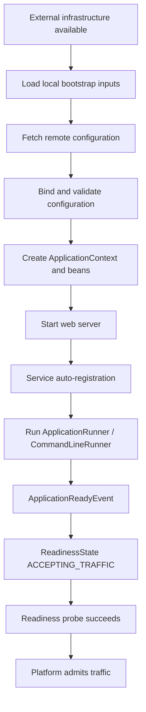
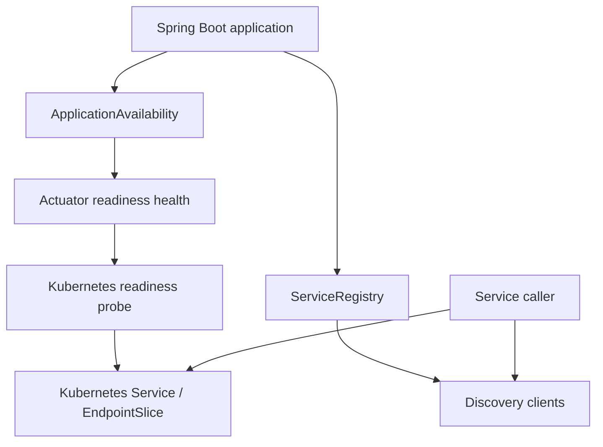
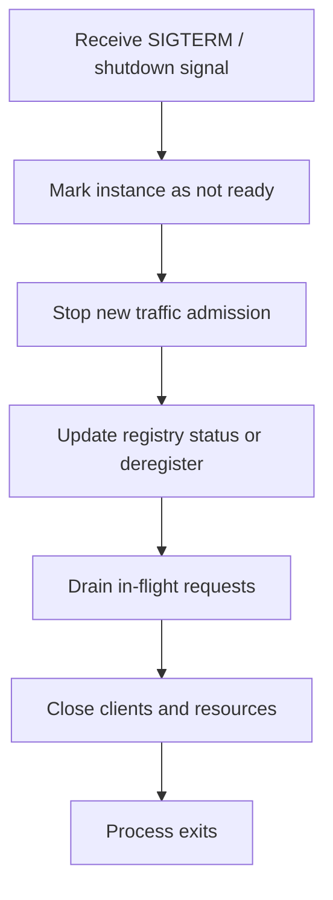

# Trình tự sẵn sàng của nguồn cấu hình, registry và ứng dụng

Một dịch vụ Spring Cloud chỉ có thể nhận traffic ổn định khi nhiều thành phần đã sẵn sàng theo đúng thứ tự: nguồn cấu hình bên ngoài phải cung cấp được các giá trị cần thiết, service registry/discovery phải có thể được truy cập, ứng dụng phải tạo xong context và hoàn tất công việc khởi động, sau đó readiness mới cho phép hệ thống định tuyến request tới instance.

Các trạng thái này có liên quan nhưng không đồng nghĩa. Lấy được cấu hình không chứng minh database đã kết nối. Đăng ký thành công vào registry không chứng minh ứng dụng đã sẵn sàng xử lý nghiệp vụ. ApplicationContext đã refresh cũng chưa có nghĩa mọi runner, cache warm-up hoặc kiểm tra phụ thuộc bắt buộc đã hoàn tất. Nếu gộp tất cả thành một cờ “UP”, rollout có thể gửi traffic quá sớm hoặc khởi động lại hàng loạt khi một dependency dùng chung gặp sự cố.

Bài học thuộc chương **Vận hành** của module `SPRING_CLOUD_CORE`. Nội dung xây dựng trình tự từ Config Server, discovery và ServiceRegistry tới lifecycle của Spring Boot, readiness/liveness, traffic admission, rollout và shutdown. Các ví dụ dùng Spring Cloud Commons làm abstraction chung; chi tiết registration, health propagation và retry cần đối chiếu với provider cùng release train thực tế.

## 1. Bản đồ các trạng thái sẵn sàng

Một microservice thường có ít nhất năm trạng thái cần theo dõi:

| Trạng thái | Câu hỏi cần trả lời | Ví dụ bằng chứng |
| --- | --- | --- |
| Configuration available | Ứng dụng đã nạp được cấu hình cần thiết chưa? | Config Data import thành công, properties được bind và validate |
| Infrastructure reachable | Các hệ thống bắt buộc có thể được kết nối chưa? | Database, broker, registry hoặc secret store đáp ứng kiểm tra phù hợp |
| Registered/discoverable | Instance đã được công bố và client có thể tìm thấy chưa? | ServiceRegistry xác nhận đăng ký, discovery trả instance |
| Application ready | Ứng dụng đã hoàn thành khởi động và có thể xử lý request chưa? | Spring Boot ReadinessState là `ACCEPTING_TRAFFIC` |
| Traffic admitted | Hạ tầng có đang route request tới instance này không? | Kubernetes Pod Ready, Service EndpointSlice hoặc load balancer target healthy |

Không nên dùng một tín hiệu thay cho tất cả. Ví dụ:

- Config Server trả cấu hình thành công nhưng cấu hình chứa database URL sai.
- Eureka nhận registration nhưng ứng dụng vẫn đang warm-up cache.
- ApplicationContext đã tạo xong nhưng một `ApplicationRunner` còn đang nạp dữ liệu bắt buộc.
- Kubernetes readiness probe thành công nhưng Eureka client chưa đồng bộ instance tới các consumer.
- Registry có instance nhưng network policy chặn traffic từ caller.

Sự sẵn sàng là kết quả của nhiều điều kiện và có thể khác nhau theo từng loại traffic. Một ứng dụng có thể sẵn sàng nhận request đọc nhưng chưa sẵn sàng xử lý lệnh ghi nếu hệ thống phụ trợ ghi đang bảo trì. Khi đó nên thiết kế readiness group hoặc routing policy theo nghiệp vụ thay vì chỉ dùng một health flag chung.

## 2. Trình tự khởi động tổng thể

Một trình tự vận hành thường gặp:



Đây là mô hình logic để thiết kế dependency và quan sát; thứ tự chi tiết của một số integration có thể khác theo provider, Spring Cloud release train và cấu hình. Đặc biệt, auto-registration của registry thường diễn ra trong lifecycle tích hợp của provider, có thể trước khi application readiness được phát ra. Không được suy ra “đã đăng ký” đồng nghĩa “đã sẵn sàng”.

Các mốc lifecycle chính của Spring Boot:

1. `ApplicationEnvironmentPreparedEvent`: Environment đã được chuẩn bị, trước khi context được tạo.
2. `ApplicationContextInitializedEvent`: context đã được chuẩn bị và initializer chạy, nhưng bean definitions chưa được nạp.
3. `ApplicationPreparedEvent`: bean definitions đã được nạp, ngay trước khi refresh context.
4. `ContextRefreshedEvent` và `WebServerInitializedEvent`: context được refresh và web server được khởi tạo.
5. `ApplicationStartedEvent`: context đã refresh, trước khi gọi application/command-line runners.
6. `AvailabilityChangeEvent` với `LivenessState.CORRECT`: ứng dụng được xem là live.
7. `ApplicationReadyEvent`: các runner đã hoàn tất.
8. `AvailabilityChangeEvent` với `ReadinessState.ACCEPTING_TRAFFIC`: ứng dụng báo sẵn sàng nhận traffic.

Các event trên hữu ích để hiểu lúc nào nên nạp cấu hình, khởi tạo tài nguyên, đăng ký service và bật traffic. Listener mặc định chạy đồng bộ trong thread phát event; tránh đặt công việc dài trong event listener nếu điều đó làm chậm startup.

## 3. Chuẩn bị hạ tầng trước khi khởi động service

Trước khi khởi động application instance, cần xác định những hệ thống nào là dependency của startup:

| Thành phần | Cần trước khi tạo context? | Chính sách khi không khả dụng |
| --- | --- | --- |
| Config Server | Có nếu remote config là bắt buộc | Fail startup hoặc retry trong deadline |
| Discovery dùng để tìm Config Server | Có nếu bật discovery-first lookup | Fail/retry theo mức độ bắt buộc |
| Database | Tùy ứng dụng có cần kết nối ngay khi tạo bean không | Fail-fast, lazy connection hoặc chưa ready |
| Message broker | Tùy startup listener/producer có bắt buộc không | Chưa ready hoặc degraded theo nghiệp vụ |
| Service registry | Thường cần trước khi instance được discoverable | Retry registration, chưa admit traffic hoặc fail theo policy |
| Secret store | Có nếu secret cần để bind bean/start TLS | Fail startup nếu thiếu secret bắt buộc |
| Monitoring backend | Thường không bắt buộc để xử lý nghiệp vụ | Có thể khởi động nhưng phát cảnh báo observability |

Không phải mọi dependency phải hoạt động trước khi Spring tạo context. Một ứng dụng có thể tạo bean trước rồi kết nối database khi cần. Tuy nhiên, nếu nghiệp vụ không thể phục vụ request nếu database chưa sẵn sàng, readiness phải phản ánh điều đó.

### 3.1. Chuẩn bị network, DNS và credentials

Trước khi kiểm tra trạng thái ứng dụng, xác nhận:

- DNS của Config Server, registry, database và broker phân giải đúng.
- Route và firewall cho phép đúng traffic.
- TLS certificate, truststore và hostname verification hợp lệ.
- Credentials có quyền đọc cấu hình, đăng ký instance và kết nối dependency.
- Đồng hồ hệ thống đủ chính xác nếu token/certificate phụ thuộc thời gian.
- Secret được cấp qua secret manager, Kubernetes Secret hoặc cơ chế triển khai phù hợp.

Một lỗi DNS hoặc credential không nên được xử lý bằng retry vô hạn. Retry chỉ giúp lỗi tạm thời; cấu hình sai cần fail sớm để operator sửa đúng nguyên nhân.

## 4. Nạp cấu hình từ Spring Cloud Config

### 4.1. Config Data import

Với Spring Boot hiện đại, cách thông dụng để import Config Server là `spring.config.import`:

```properties
spring.application.name=catalog-service
spring.config.import=configserver:http://config-server:8888
```

Không có tiền tố `optional:` nghĩa là Config Server là dependency bắt buộc của startup. Nếu không kết nối được hoặc không lấy được cấu hình cần thiết, Config Client làm quá trình khởi động thất bại.

Nếu remote config chỉ là tùy chọn:

```properties
spring.config.import=optional:configserver:http://config-server:8888
```

Khi đó ứng dụng có thể tiếp tục dùng cấu hình local nếu Config Server không khả dụng. Chỉ dùng optional khi cấu hình local đủ để ứng dụng chạy an toàn; không biến một dependency bắt buộc thành optional chỉ để Pod khởi động được.

Một file `bootstrap.yml` không bắt buộc khi dùng Config Data import. Cơ chế legacy bootstrap có lifecycle khác và cần được bật riêng. Không trộn hai cách một cách tùy tiện; hãy chọn cơ chế theo phiên bản và kiến trúc đang sử dụng.

### 4.2. Cấu hình tối thiểu để tìm Config Server

Remote configuration không thể là nguồn duy nhất cho thông tin cần thiết để truy cập chính Config Server. Những giá trị như địa chỉ Config Server, credentials bootstrap, TLS trust và địa chỉ discovery service dùng để tìm Config Server phải có sẵn từ local configuration, environment hoặc secret source khác.

Ví dụ:

```yaml
spring:
  application:
    name: catalog-service
  config:
    import: "configserver:http://config-server:8888"
```

Nếu dùng discovery-first lookup:

```yaml
spring:
  application:
    name: catalog-service
  config:
    import: "optional:configserver:"
  cloud:
    config:
      discovery:
        enabled: true
        service-id: configserver

eureka:
  client:
    service-url:
      defaultZone: http://eureka:8761/eureka/
```

Ví dụ trên minh họa Eureka. Địa chỉ discovery server phải có sẵn từ local config hoặc environment, vì client cần tìm Config Server trước khi có thể lấy remote property source. Discovery-first lookup thêm một network round trip để tìm vị trí Config Server; đổi lại Config Server có thể thay đổi tọa độ mà client không cần hard-code địa chỉ mới. Với Config Data discovery-first, tài liệu Config Client yêu cầu import có tiền tố `optional:`; nếu cấu hình từ xa là bắt buộc và cần fail-fast tuyệt đối, cân nhắc config-first với URL cố định hoặc kiểm thử kỹ chính sách `spring.cloud.config.fail-fast` theo release train đang dùng.

### 4.3. Config Server có thể được gọi nhiều lần lúc startup

Với Config Data, Spring Boot có thể tải cấu hình theo nhiều lượt: trước tiên với profile `default`, sau đó tải thêm cấu hình cho các profile được kích hoạt. Vì vậy, nhiều request tới Config Server trong startup có thể là hành vi bình thường, không nhất thiết là retry loop.

Khi phân tích log, phân biệt request do Config Data profile resolution với request retry sau lỗi mạng. Kiểm tra application name, active profile, label và thời điểm gọi.

### 4.4. Chọn fail-fast hay optional

| Tình huống | Chính sách thường phù hợp |
| --- | --- |
| Remote config chứa database credentials bắt buộc | Required import; fail startup nếu không lấy được |
| Remote config chỉ bổ sung feature flag tùy chọn | Có thể dùng optional nếu local default an toàn |
| Config Server tạm thời gián đoạn khi deploy | Required import kết hợp retry có giới hạn |
| Local config có thể chạy nhưng có nguy cơ dùng nhầm môi trường | Fail-fast để tránh khởi động với cấu hình sai |
| Ứng dụng cần tiếp tục chạy với snapshot cấu hình đã đóng gói | Thiết kế rõ fallback và kiểm tra freshness/version |

Không nên chỉ quan tâm process có start được hay không. Cần xác nhận ứng dụng đã dùng đúng phiên bản cấu hình, đúng profile và đúng label.

## 5. Retry khi Config Server chưa sẵn sàng

Nếu Config Server có thể tạm thời chưa khả dụng trong lúc rollout, retry có giới hạn giúp tránh fail ngay ở một lỗi mạng ngắn.

Spring Cloud Config Client hỗ trợ retry khi cấu hình fail-fast và có các dependency Spring Retry cần thiết. Với Config Data import, có thể khai báo tham số retry trên URL import:

```properties
spring.config.import=configserver:http://config-server:8888?fail-fast=true&max-attempts=8&initial-interval=500&max-interval=5000&multiplier=1.5
```

Các con số chỉ là ví dụ. Hãy chọn `max-attempts`, khoảng chờ và multiplier theo startup deadline của nền tảng. Tài liệu Config Client mô tả thêm dependency `spring-retry` và `spring-boot-starter-aop` cho retry integration.

Nếu import nằm trong profile-specific file, cấu hình retry có thể cần được đặt trực tiếp dưới dạng query parameters trên import statement theo hướng dẫn của Spring Cloud Config version đang dùng.

### 5.1. Retry không sửa được lỗi cấu hình

Các tình huống nên phân loại:

- Connection refused hoặc timeout tạm thời: có thể retry.
- DNS chưa cập nhật trong rollout: retry ngắn có giới hạn có thể hữu ích.
- HTTP 401/403: credentials hoặc quyền sai; retry liên tục thường không giải quyết.
- HTTP 400 do request sai: sửa cấu hình client.
- Application/profile/label sai: kiểm tra tên và phiên bản cấu hình.
- Config Server không truy cập được Git backend: xử lý lỗi backend theo log server.

Retry nên có backoff và giới hạn tổng thời gian. Nếu 100 instance cùng retry theo cùng chu kỳ, Config Server có thể bị retry storm. Dùng jitter khi cơ chế hỗ trợ, giãn rollout và tránh khởi động lại toàn bộ fleet đồng thời.

### 5.2. Không dùng readiness thay cho config import

Readiness chỉ được kiểm tra sau khi process đã khởi động đủ để phục vụ probe. Nếu cấu hình bắt buộc không thể nạp trước khi tạo bean, cần xử lý ở startup phase bằng required import/fail-fast. Không khởi động ứng dụng với giá trị giả rồi kỳ vọng readiness sẽ sửa cấu hình sau đó.

## 6. Xác thực cấu hình trước khi tạo traffic

Sau khi nạp local và remote property, ứng dụng cần bind và validate cấu hình.

Ví dụ:

```java
@ConfigurationProperties(prefix = "catalog.client")
@Validated
public class CatalogClientProperties {

    @NotNull
    private URI baseUrl;

    @NotNull
    private Duration connectTimeout;

    @NotNull
    private Duration readTimeout;

    // getters and setters
}
```

Nếu property bắt buộc thiếu hoặc không hợp lệ, startup nên thất bại với thông báo đủ rõ để xác định key cần sửa. Không log giá trị secret.

Một cấu hình hợp lệ về kiểu dữ liệu chưa chắc hợp lệ về môi trường. Ví dụ URI đúng cú pháp nhưng trỏ tới production database trong staging. Có thể kiểm tra thêm:

- Hostname thuộc môi trường mong đợi.
- TLS được bật cho endpoint nhạy cảm.
- Timeout dương và nằm trong giới hạn.
- Profile và Config Server label đúng release.
- Feature flag không tạo ra tổ hợp cấu hình không hỗ trợ.
- Secret version tương thích với certificate hoặc credential hiện hành.

Sau khi cấu hình được xác thực, tạo các bean và khởi tạo các resource cần thiết. Nếu cần warm-up dữ liệu hoặc kiểm tra nghiệp vụ bắt buộc, thực hiện bằng `ApplicationRunner`/`CommandLineRunner` hoặc lifecycle orchestration có deadline rõ ràng.

## 7. Discovery và service registry

### 7.1. Discovery và registration giải quyết hai chiều khác nhau

`DiscoveryClient` giúp client tìm instance của service khác. `ServiceRegistry` quản lý registration của instance hiện tại. Chúng có quan hệ nhưng không đồng nghĩa:

- Discovery trả lời “có những instance nào của service X?”.
- Registration trả lời “instance hiện tại đã được công bố với registry chưa?”.
- Health/readiness trả lời “instance có thể nhận loại traffic nào ngay lúc này?”.

Một instance có thể đăng ký thành công nhưng chưa ready. Một client có thể có cache discovery cũ sau khi registry đã cập nhật. Một registry có thể reachable nhưng không có instance nào phù hợp.

### 7.2. Auto-registration mặc định

Spring Cloud Commons cho phép `ServiceRegistry` implementation tự đăng ký service đang chạy. Có thể tắt auto-registration bằng:

```yaml
spring:
  cloud:
    service-registry:
      auto-registration:
        enabled: false
```

Hoặc dùng `@EnableDiscoveryClient(autoRegister = false)` trong cấu hình phù hợp.

Spring Cloud Commons công bố hai event cho auto-registration:

- `InstancePreRegisteredEvent`: phát trước khi service được đăng ký.
- `InstanceRegisteredEvent`: phát sau khi service được đăng ký.

Các event này không được phát khi auto-registration bị tắt bằng property. Listener có thể dùng để ghi log, phát metric hoặc phối hợp tác vụ liên quan. Event “registered” xác nhận quá trình registration đã được gọi/hoàn tất theo implementation; nó không chứng minh mọi discovery client đã nhận bản cập nhật hoặc ứng dụng đã sẵn sàng nhận traffic.

### 7.3. Chọn thời điểm registration

Nếu muốn chỉ công bố instance sau khi các runner đã hoàn tất nhưng trước khi Spring Boot chuyển readiness sang accepting traffic, có thể tắt auto-registration và điều phối registration trong `ApplicationReadyEvent`. Đây là lựa chọn nâng cao, cần hiểu provider cụ thể và đảm bảo deregistration khi shutdown.

Khung cấu hình:

```yaml
spring:
  cloud:
    service-registry:
      auto-registration:
        enabled: false
```

Spring Boot phát `ApplicationReadyEvent` sau khi application/command-line runners hoàn tất và ngay trước event chuyển `ReadinessState` sang `ACCEPTING_TRAFFIC`. Có thể dùng hook này để đăng ký đồng bộ trước khi readiness mặc định cho phép traffic:

```java
@Component
public class RegistryReadinessListener {

    @EventListener(ApplicationReadyEvent.class)
    public void onApplicationReady() {
        // Gọi orchestration đăng ký bằng ServiceRegistry
        // và Registration phù hợp với provider đang dùng.
    }
}
```

Đây là điểm móc lifecycle, không phải implementation registration hoàn chỉnh. Listener sự kiện chạy đồng bộ theo cơ chế event của Spring; registration cần hoàn tất theo policy đã chọn trước khi listener trả về. Khi triển khai thật cần:

- Inject `ServiceRegistry` và `Registration` đúng kiểu của provider.
- Đảm bảo không đăng ký hai lần khi nhận event lặp.
- Xử lý registration failure và retry có giới hạn.
- Deregister hoặc chuyển trạng thái ra khỏi traffic khi shutdown.
- Xem xét thứ tự readiness và registration để tránh khoảng thời gian không có instance.
- Kiểm thử với Eureka, Consul hoặc provider thực tế đang dùng.

Nếu auto-registration vẫn bật, không thêm logic đăng ký thủ công bên cạnh vì có thể tạo registration trùng hoặc cập nhật trạng thái không nhất quán.

### 7.4. Registry có thể chưa phản ánh readiness của ứng dụng

Với Eureka, heartbeat mặc định không tự đồng nghĩa với việc truyền health state của Spring Boot Actuator. Nếu không bật health check integration, một client sau khi đăng ký có thể được Eureka công bố là `UP` dù ứng dụng chưa sẵn sàng theo readiness nghiệp vụ.

Có thể bật:

```yaml
eureka:
  client:
    healthcheck:
      enabled: true
```

Spring Cloud Netflix khuyến nghị đặt property này trong `application.yml`, không đặt trong `bootstrap.yml`, để tránh trạng thái đăng ký không mong muốn. Hãy kiểm tra behavior của đúng release train và provider; không suy rộng cơ chế Eureka sang mọi ServiceRegistry implementation.

### 7.5. Theo dõi trạng thái ServiceRegistry

Spring Cloud Commons có Actuator endpoint `/serviceregistry` khi có `Registration` phù hợp. GET có thể đọc trạng thái registration; POST có thể thay đổi status theo giá trị mà provider hỗ trợ.

Endpoint này hữu ích cho vận hành, nhưng POST có thể ảnh hưởng việc instance nhận traffic. Cần bảo vệ bằng authentication/authorization và không dùng nó như health probe công khai.

## 8. Spring Boot liveness và readiness

Spring Boot cung cấp `ApplicationAvailability` cùng các trạng thái liveness/readiness.

### 8.1. Liveness

Liveness trả lời câu hỏi: process còn ở trạng thái có thể hoạt động hoặc tự phục hồi không? Nếu liveness thất bại kéo dài, nền tảng có thể restart container.

Không nên đưa database, Config Server, Eureka hoặc API ngoài vào liveness theo cách khiến một lỗi dependency dùng chung làm toàn bộ Pod restart. Restart hàng loạt có thể làm giảm năng lực hệ thống và tạo cascading failure.

Liveness nên phản ánh trạng thái nội bộ không thể phục hồi hợp lý, ví dụ deadlock hoặc trạng thái process hỏng.

### 8.2. Readiness

Readiness trả lời câu hỏi: instance có thể nhận request nghiệp vụ vào thời điểm này không? Spring Boot mặc định chuyển sang `ACCEPTING_TRAFFIC` sau khi context refresh và application/command-line runners hoàn tất.

Readiness có thể chuyển về `REFUSING_TRAFFIC` trong runtime khi ứng dụng cần tạm ngừng nhận traffic, ví dụ bảo trì hoặc quá tải được kiểm soát. Nền tảng orchestration sẽ dùng tín hiệu này để ngừng route request tới instance.

### 8.3. Health groups

Khi dùng Actuator, Spring Boot cung cấp health group cho liveness và readiness trong môi trường phù hợp:

```text
/actuator/health/liveness
/actuator/health/readiness
```

Có thể cấu hình probe health rõ ràng:

```yaml
management:
  endpoint:
    health:
      probes:
        enabled: true
```

Tùy môi trường và phiên bản Spring Boot, probes có thể được tự cấu hình khi phát hiện Kubernetes. Khai báo tường minh hữu ích khi muốn behavior nhất quán trong test hoặc môi trường khác. Không expose chi tiết health nhạy cảm ra public interface.

### 8.4. Readiness dependency nên được chọn cẩn thận

Có thể thêm dependency vào readiness group nếu thiếu dependency đó thì instance không thể phục vụ nghiệp vụ. Ví dụ:

```yaml
management:
  endpoint:
    health:
      group:
        readiness:
          include: readinessState,db
```

Ví dụ chỉ hợp lý nếu database thực sự bắt buộc cho loại traffic được nhận. Nếu database tạm lỗi nhưng service có thể trả dữ liệu cache hoặc xử lý một nhóm request khác, readiness quá nghiêm ngặt có thể loại bỏ tất cả instance dù vẫn có khả năng phục vụ một phần.

Tránh đưa mọi dependency vào readiness. Hãy phân loại:

- **Hard dependency:** không có thì request không thể được xử lý đúng.
- **Soft dependency:** có thể degrade, dùng cache hoặc trả kết quả có kiểm soát.
- **Optional dependency:** không ảnh hưởng tới traffic chính.
- **Control-plane dependency:** registry/config/monitoring; lỗi có thể ảnh hưởng discovery hoặc quản trị nhưng không nhất thiết khiến process không thể xử lý request đang chạy.

## 9. Kubernetes startup, liveness và readiness probes

Kubernetes có ba loại probe với mục tiêu khác nhau:

| Probe | Mục tiêu | Khi thất bại |
| --- | --- | --- |
| Startup | Cho ứng dụng thời gian hoàn thành khởi tạo ban đầu | Kubelet restart container sau ngưỡng thất bại |
| Liveness | Phát hiện process không thể tiếp tục hoạt động | Kubelet restart container |
| Readiness | Quyết định Pod có nhận traffic từ Service hay không | Pod bị đánh dấu not-ready và bị loại khỏi EndpointSlice cho Service phù hợp |

Nếu cấu hình startup probe, Kubernetes chưa chạy liveness/readiness cho tới khi startup probe thành công. Readiness probe tiếp tục chạy trong toàn bộ lifecycle; khi thất bại, container không bị restart chỉ vì readiness fail.

Ví dụ:

```yaml
containers:
  - name: catalog
    image: example/catalog-service:latest
    ports:
      - name: http
        containerPort: 8080
    startupProbe:
      httpGet:
        path: /actuator/health/liveness
        port: http
      periodSeconds: 5
      failureThreshold: 36
    livenessProbe:
      httpGet:
        path: /actuator/health/liveness
        port: http
      periodSeconds: 10
      timeoutSeconds: 2
      failureThreshold: 3
    readinessProbe:
      httpGet:
        path: /actuator/health/readiness
        port: http
      periodSeconds: 5
      timeoutSeconds: 2
      failureThreshold: 3
```

Các ngưỡng chỉ là ví dụ. Tính tổng startup budget theo thời gian lấy config, tạo context, kết nối dependency và warm-up. Startup probe cần đủ dài cho trường hợp startup bình thường chậm nhất, nhưng không quá dài để che một lỗi cấu hình cố định.

### 9.1. Không dùng liveness để chờ Config Server

Nếu Config Server là dependency bắt buộc, giải quyết nó trong config import/startup phase. Startup probe chỉ cho process thêm thời gian khởi động; nó không tự sửa endpoint, credential hoặc remote config. Nếu startup bị treo vô hạn do retry không giới hạn, startup probe chỉ trì hoãn việc phát hiện lỗi.

### 9.2. Readiness và Service routing

Khi readiness probe thất bại, Pod bị đánh dấu not-ready và IP của nó được loại khỏi EndpointSlice của các Service tương ứng. Điều này giúp Kubernetes Service ngừng gửi traffic mới tới Pod đó.

Đây là routing của Kubernetes. Eureka/Consul có registry state và cache riêng; readiness của Kubernetes không tự động cập nhật trạng thái trong registry bên ngoài nếu không có integration.

### 9.3. Tách readiness của app khỏi dependency không thiết yếu

Nếu monitoring backend hoặc registry bị lỗi, có thể ứng dụng vẫn xử lý request đã được định tuyến và không cần restart. Hãy quyết định readiness dựa trên khả năng phục vụ nghiệp vụ, không dựa trên việc mọi hệ thống control plane đều xanh.
## 10. Kết hợp readiness với ServiceRegistry và Discovery

Một kiến trúc có thể có hai control plane độc lập:



Kubernetes Service routing và external service registry không tự đồng bộ. Nếu service được gọi qua cả hai con đường, cần chính sách trạng thái tương ứng cho cả hai.

Ví dụ:

- Readiness thất bại: Kubernetes ngừng route qua Service.
- Registry vẫn báo `UP`: caller dùng Eureka có thể tiếp tục chọn instance đó.
- Registration bị deregister: Eureka caller dần loại instance, nhưng Kubernetes Service có thể vẫn có Pod Ready nếu readiness còn thành công.

Hãy tránh trạng thái mâu thuẫn bằng cách chọn một nguồn routing chính, hoặc triển khai health propagation/registration lifecycle phù hợp. Với nhiều registry, cần hiểu thời gian cache, heartbeat, eviction và propagation delay của từng provider.

### 10.1. Khi nào nên đăng ký trước readiness?

Một số hệ thống cần đăng ký instance ngay khi web server khởi tạo để discovery có thể tìm thấy service. Điều đó có thể chấp nhận nếu:

- Registry status không làm caller gửi traffic trước readiness.
- Health check của registry phản ánh trạng thái phù hợp.
- Client có retry/timeout và xử lý instance chưa sẵn sàng.
- Readiness gate của nền tảng vẫn kiểm soát traffic nội bộ.

Nếu không có bảo đảm đó, hãy cân nhắc trì hoãn registration đến khi ứng dụng ready hoặc dùng status `OUT_OF_SERVICE` trong giai đoạn warm-up theo khả năng provider.

### 10.2. Khi nào nên trì hoãn registration?

Trì hoãn registration phù hợp khi caller dùng registry trực tiếp và provider không phản ánh readiness của app. Tuy nhiên, nếu registration là điều kiện để service khác hoàn tất startup, trì hoãn có thể tạo vòng phụ thuộc.

Ví dụ A chờ B đăng ký, B lại chờ A đăng ký. Cần phát hiện dependency cycle và thiết kế ứng dụng khởi động ở trạng thái degraded/ready theo khả năng, hoặc tách bootstrap dependency khỏi traffic dependency.

## 11. Tránh vòng phụ thuộc khi bootstrap

Một vòng phụ thuộc thường gặp:

- Service A cần Config Server để biết địa chỉ Registry.
- Config Server cần Registry để tự đăng ký.
- Registry lại cần cấu hình lấy từ Config Server.

Vòng này khiến không thành phần nào có thể khởi động đầu tiên.

Giải pháp là cung cấp một tập cấu hình bootstrap nhỏ, độc lập và ổn định để các control-plane service có thể khởi động:

- Registry có endpoint và credentials riêng.
- Config Server có địa chỉ Git/backend và security riêng.
- Config Client có địa chỉ Config Server hoặc discovery endpoint ban đầu.
- Các cấu hình còn lại được nạp từ remote config sau khi control plane đã sẵn sàng.

Không đưa toàn bộ cấu hình vào remote store nếu chính thông tin cần để kết nối remote store cũng chỉ tồn tại ở đó.

### 11.1. Config-first và discovery-first

| Cách tiếp cận | Luồng | Đặc điểm |
| --- | --- | --- |
| Config-first | Client biết URL Config Server từ local config | Ít phụ thuộc discovery lúc bootstrap |
| Discovery-first | Client kết nối registry trước, tìm service ID Config Server rồi tải config | Linh hoạt địa chỉ Config Server nhưng thêm dependency và round trip |

Với discovery-first, thông tin tối thiểu để kết nối registry phải có từ local config/environment. Nếu registry chưa sẵn sàng, Config Client có thể không tìm được Config Server và không thể lấy remote config.

### 11.2. Không để ứng dụng phụ thuộc vào chính nó để khởi động

Một service không nên cần đăng ký thành công vào registry để lấy thông tin cấu hình tối thiểu cho chính quá trình registration của nó. Tách bootstrap metadata khỏi runtime service metadata và dùng DNS/static endpoint cho control plane khi phù hợp.

## 12. Retry, timeout và startup deadline

Mỗi dependency cần timeout và retry budget rõ ràng. Ví dụ:

| Dependency | Timeout mỗi lần | Retry | Tổng ngân sách |
| --- | --- | --- | --- |
| Config Server | Kết nối/đọc theo cấu hình client | Có giới hạn nếu required | Nằm trong startup deadline |
| Discovery/Registry | Theo client provider | Provider-specific | Không retry vô hạn |
| Database | Connect timeout và pool acquisition timeout | Hạn chế | Theo chính sách startup |
| Broker | Connection timeout và metadata timeout | Client-specific | Không vượt rollout budget |
| Warm-up | Timeout theo tác vụ | Có thể resume/checkpoint | Có deadline nghiệp vụ |

Tổng startup time gần đúng:

```text
T_startup =
    T_config_fetch
  + T_context_refresh
  + T_dependency_init
  + T_registry
  + T_runner_and_warmup
  + T_safety_margin
```

Nếu các bước chạy song song, tổng thời gian thực tế phụ thuộc critical path, không phải phép cộng đơn giản. Dù vậy, cần đo từng phase để biết startup chậm do config, registry, database hay warm-up.

### 12.1. Retry có backoff

Không dùng vòng lặp gọi liên tục. Một policy nên có:

- Maximum attempts hoặc deadline tổng.
- Connection/read timeout riêng.
- Exponential backoff và giới hạn max interval.
- Jitter nếu client hỗ trợ.
- Phân loại lỗi transient và permanent.
- Log có correlation ID, dependency và attempt number.
- Hủy retry khi process shutdown hoặc deadline hết.

### 12.2. Tránh retry storm trong rollout

Nếu rollout 50 replica cùng lúc và tất cả cùng retry Config Server mỗi giây, chính đợt deploy có thể làm Config Server quá tải. Điều phối bằng:

- Rolling update với `maxSurge`/`maxUnavailable` phù hợp.
- Backoff có jitter.
- Giới hạn concurrent connection ở Config Server.
- Cache/artifact config nếu kiến trúc cho phép.
- Tách liveness khỏi dependency tạm lỗi.
- Alert khi startup retry tăng đột biến.

## 13. Rollout và scale-out theo trạng thái sẵn sàng

Một rollout ổn định nên đảm bảo instance mới không nhận traffic trước khi hoàn tất các bước cần thiết.

Ví dụ chiến lược:

1. Kiểm tra Config Server, registry, database và network trước rollout.
2. Triển khai một batch nhỏ.
3. Chờ config fetch, bean creation, runner và readiness thành công.
4. Xác nhận instance xuất hiện trong registry đúng trạng thái.
5. Kiểm tra request thật hoặc synthetic check tới instance mới.
6. Tiếp tục batch tiếp theo.
7. Theo dõi error rate, latency, registration count và startup duration.
8. Dừng rollout nếu readiness hoặc dependency health suy giảm.

### 13.1. Readiness gate và rollout progress

Kubernetes Deployment chỉ xem Pod là available khi đạt điều kiện availability tương ứng. Readiness probe và `minReadySeconds` có thể giúp tránh đánh dấu instance vừa sẵn sàng trong chốc lát là ổn định ngay lập tức.

Ví dụ:

```yaml
spec:
  minReadySeconds: 10
  strategy:
    rollingUpdate:
      maxSurge: 1
      maxUnavailable: 0
```

Đây chỉ là ví dụ cho một Deployment. Giá trị cần cân nhắc số replica, tài nguyên cluster và thời gian khởi động. `maxUnavailable: 0` có thể cần thêm capacity vì phải tạo instance mới trước khi loại instance cũ.

### 13.2. Kiểm tra sau khi đăng ký

Sau khi registry báo instance đã đăng ký, kiểm tra:

- Host/port/secure flag có đúng không.
- Metadata version/zone có đúng không.
- Health/status có phản ánh readiness mong muốn không.
- Discovery client có nhìn thấy instance không.
- Caller có kết nối được từ network thực tế không.
- Load balancer có chọn đúng instance không.
- Có instance cũ hoặc registration trùng chưa được dọn không.

Đăng ký thành công chỉ là một bước trong rollout, không phải điều kiện duy nhất để chuyển sang batch tiếp theo.

## 14. Shutdown, deregistration và drain traffic

Startup có trình tự; shutdown cũng cần trình tự ngược có kiểm soát:



Spring Boot hỗ trợ graceful shutdown cho embedded web server. Có thể cấu hình timeout:

```yaml
server:
  shutdown: graceful

spring:
  lifecycle:
    timeout-per-shutdown-phase: 20s
```

Graceful shutdown cho phép request đang xử lý hoàn tất trong khoảng thời gian được cấp và ngừng nhận request mới theo behavior của web server. Thời gian thực tế cần phối hợp với `terminationGracePeriodSeconds` của Kubernetes, `preStop` hook, load balancer drain và timeout của caller.

### 14.1. Registry cần được cập nhật khi instance dừng

Provider có thể deregister khi context đóng hoặc khi registration lifecycle kết thúc. Nếu ứng dụng tự điều khiển registration, phải bảo đảm deregister idempotent và không để instance stale sau shutdown.

Có thể dùng `/serviceregistry` hoặc API provider để chuyển trạng thái khỏi traffic trước khi deregister, nhưng status hợp lệ và propagation delay phụ thuộc provider.

### 14.2. Không deregister quá sớm khi còn request đang chạy

Nếu registry xóa instance trước khi caller và load balancer cập nhật cache, request đang gửi có thể lỗi. Ngược lại, nếu process đóng trước khi deregister, registry có thể giữ instance tới khi heartbeat timeout/eviction.

Cần phối hợp:

- Thời gian drain.
- Registry status propagation.
- Client discovery cache TTL/refresh.
- Load balancer retry behavior.
- Kubernetes endpoint termination.
- Request timeout và retry budget.

Không có một khoảng chờ chung cho mọi registry. Đo propagation time của provider trong môi trường thật.

## 15. Quan sát trình tự sẵn sàng

Theo dõi các chỉ số và event theo từng phase:

| Phase | Metric/log cần có |
| --- | --- |
| Config fetch | Duration, result, profile, label, retry count |
| Property validation | Lỗi binding/validation theo key, không log secret |
| Context refresh | Startup duration, bean initialization failure |
| Dependency init | Connection time, timeout, pool readiness |
| Registry registration | Registration duration, result, instance ID/status |
| Application readiness | Thời điểm chuyển trạng thái live và accepting traffic |
| Platform readiness | Probe result, Pod Ready transition, EndpointSlice update |
| Traffic admission | Request count, error rate, latency, selected instance |
| Shutdown | Deregister time, drain duration, forced termination count |

Nên có correlation ID hoặc startup instance ID để ghép log từ Config Client, application, registry và orchestrator. Ghi nhận version cấu hình và application build để điều tra trường hợp instance cũ dùng config mới hoặc ngược lại.

Không chỉ theo dõi health tổng thể. Một service có thể trả health UP nhưng registry không thấy instance, hoặc registry có instance nhưng readiness probe fail. Dashboard nên thể hiện cả hai control plane.

## 16. Chẩn đoán theo triệu chứng

| Triệu chứng | Nguyên nhân thường gặp | Hướng xử lý |
| --- | --- | --- |
| Ứng dụng dừng trước khi context tạo | Config Server required không truy cập được | Kiểm tra import URL, DNS, TLS, credentials, fail-fast/retry |
| Ứng dụng khởi động với config cũ | Import optional hoặc remote config không được resolve như mong muốn | Kiểm tra active profile, label và log Config Client |
| Discovery-first không tìm thấy Config Server | Registry endpoint bootstrap chưa có hoặc registry chưa ready | Kiểm tra local discovery config và registry |
| Context tạo xong nhưng runner treo | Warm-up hoặc dependency call không có timeout | Thêm deadline, log phase và xử lý retry |
| Instance có trong Eureka nhưng chưa nhận traffic Kubernetes | Pod readiness fail hoặc Service selector sai | Kiểm tra readiness probe, labels và EndpointSlice |
| Pod Ready nhưng caller qua Eureka không gọi được | Registry chưa có instance, health status sai hoặc cache chưa cập nhật | Kiểm tra registration, Eureka health check và discovery cache |
| Registry báo UP khi app chưa ready | Provider chỉ dùng heartbeat hoặc chưa tích hợp readiness | Cấu hình health propagation hoặc trì hoãn registration |
| Tất cả Pod restart khi database lỗi | Liveness phụ thuộc database | Chuyển dependency check sang readiness hoặc degraded handling |
| Rollout treo ở Progressing | Startup probe quá ngắn, Config Server chậm hoặc readiness không đạt | Xem startup phase và probe event |
| Sau shutdown vẫn thấy instance cũ | Deregistration lỗi hoặc registry eviction chưa hết | Kiểm tra shutdown log, heartbeat và provider status |
| Config Server quá tải lúc deploy | Retry đồng loạt hoặc rollout quá nhanh | Backoff/jitter, rollout batch và giới hạn concurrency |

Trình tự điều tra nên đi từ đầu vào đến traffic:

1. Kiểm tra process đã nhận đúng local bootstrap config chưa.
2. Xác nhận Config Client tải đúng application/profile/label.
3. Kiểm tra properties bắt buộc đã bind và validate.
4. Xác định ApplicationContext và web server đã refresh chưa.
5. Kiểm tra runner/warm-up đã hoàn tất chưa.
6. Xem Spring Boot `LivenessState` và `ReadinessState`.
7. Kiểm tra ServiceRegistry registration và status.
8. Kiểm tra discovery client/caller có nhìn thấy instance không.
9. Kiểm tra Kubernetes readiness, Service và EndpointSlice.
10. Đối chiếu request trace để xác nhận traffic thực sự tới instance nào.

## 17. Thực hành: đưa catalog-service vào traffic an toàn

Giả sử `catalog-service` dùng Config Server, Eureka, PostgreSQL và chạy trên Kubernetes. Mục tiêu là không nhận traffic trước khi cấu hình hợp lệ, database sẵn sàng, startup task hoàn tất và instance được công bố đúng trạng thái.

### Bước 1 — Chuẩn bị control plane

- Config Server có thể đọc backend cấu hình.
- Eureka server có thể nhận registration.
- DNS/network/TLS/credentials đã được kiểm tra.
- Bootstrap config chứa địa chỉ Config Server hoặc Eureka cần thiết.

### Bước 2 — Cấu hình Config Data import bắt buộc

```yaml
spring:
  application:
    name: catalog-service
  config:
    import: "configserver:http://config-server:8888"
```

Dùng required import nếu thiếu remote config làm ứng dụng không an toàn. Thêm retry có giới hạn nếu cần chịu được lỗi tạm thời.

### Bước 3 — Validate cấu hình nghiệp vụ

Bind `CatalogClientProperties` và database settings. Fail startup nếu URI, credentials, timeout hoặc profile không hợp lệ.

### Bước 4 — Khởi tạo dependency và warm-up

Kết nối database, chạy kiểm tra schema cần thiết, nạp cache bắt buộc và hoàn tất các runner. Mỗi tác vụ có timeout/deadline rõ ràng.

### Bước 5 — Kiểm soát registration

Nếu dùng auto-registration, kiểm tra provider có công bố trạng thái readiness phù hợp không. Nếu cần trì hoãn registration, tắt auto-registration và dùng `ServiceRegistry` provider-specific khi ứng dụng chuyển sang ready.

### Bước 6 — Cấu hình health probes

```yaml
management:
  endpoint:
    health:
      probes:
        enabled: true
  endpoints:
    web:
      exposure:
        include: health,prometheus
```

Đảm bảo registry/Prometheus dependency phù hợp được thêm vào nếu expose endpoint tương ứng. Không thêm dependency không cần thiết chỉ để làm ví dụ cấu hình chạy được.

### Bước 7 — Cấu hình Kubernetes probes

```yaml
startupProbe:
  httpGet:
    path: /actuator/health/liveness
    port: 8080
  periodSeconds: 5
  failureThreshold: 36

livenessProbe:
  httpGet:
    path: /actuator/health/liveness
    port: 8080
  periodSeconds: 10
  failureThreshold: 3

readinessProbe:
  httpGet:
    path: /actuator/health/readiness
    port: 8080
  periodSeconds: 5
  timeoutSeconds: 2
  failureThreshold: 3
```

Nếu Actuator chạy trên management port riêng, thay port probe theo thiết kế và bảo đảm kubelet có thể truy cập port đó. Không để endpoint readiness bị security rule chặn probe ngoài ý muốn.

### Bước 8 — Xác minh traffic

- Chờ Pod Ready.
- Kiểm tra registration và discovery status.
- Gọi request từ service caller thật hoặc synthetic client.
- Xác nhận request chỉ tới instance đã ready.
- Theo dõi latency, error rate và retry.
- Tiếp tục rollout khi batch đầu ổn định.

### Bước 9 — Xác minh shutdown

Gửi SIGTERM trong môi trường test, xác nhận readiness chuyển trạng thái, traffic mới dừng, request đang chạy được drain, registry được cập nhật và process thoát trong grace period.

## 18. Checklist vận hành

Trước startup:

- [ ] Config Server và discovery endpoint có thể truy cập từ đúng network namespace.
- [ ] Bootstrap properties có đủ địa chỉ, TLS và credentials.
- [ ] Config import là required hay optional theo quyết định rõ ràng.
- [ ] Retry có giới hạn và nằm trong startup deadline.
- [ ] Remote application/profile/label đúng.
- [ ] Properties bắt buộc được bind và validate.
- [ ] Dependency bắt buộc có timeout và health policy.

Trong startup:

- [ ] ApplicationContext refresh thành công.
- [ ] Web server bind đúng port.
- [ ] Database/broker/client initialization hoàn tất theo policy.
- [ ] Runner/warm-up hoàn tất.
- [ ] Liveness và readiness được theo dõi riêng.
- [ ] Registry registration/status đúng với lifecycle.

Trước khi admit traffic:

- [ ] ReadinessState là `ACCEPTING_TRAFFIC`.
- [ ] Kubernetes readiness probe thành công nếu chạy trên Kubernetes.
- [ ] Pod xuất hiện trong EndpointSlice đúng Service.
- [ ] Registry/discovery trả instance với host, port, metadata đúng.
- [ ] Caller có thể kết nối từ network thực tế.
- [ ] Không có registration trùng hoặc instance cũ.

Trong shutdown:

- [ ] Instance ngừng nhận traffic mới.
- [ ] Registry status/deregistration được xử lý.
- [ ] Request đang chạy được drain trong timeout.
- [ ] Resource và client được đóng đúng thứ tự.
- [ ] Monitoring xác nhận instance đã rời target pool.

### Câu hỏi tự kiểm tra

1. Vì sao nạp được remote config chưa có nghĩa ứng dụng đã ready?
2. `spring.config.import=optional:configserver:` khác import bắt buộc thế nào?
3. Vì sao discovery-first Config Client cần bootstrap discovery properties?
4. Tại sao Config Data có thể gửi nhiều request tới Config Server trong startup?
5. `InstancePreRegisteredEvent` và `InstanceRegisteredEvent` xảy ra ở thời điểm nào?
6. Vì sao registration thành công chưa chứng minh instance nhận traffic an toàn?
7. Spring Boot phát `ReadinessState.ACCEPTING_TRAFFIC` sau mốc nào?
8. Liveness khác readiness ở hành động của Kubernetes thế nào?
9. Vì sao không nên đưa database lỗi vào liveness check?
10. Readiness probe thất bại ảnh hưởng EndpointSlice ra sao?
11. Vì sao Kubernetes readiness không tự cập nhật Eureka status?
12. Khi nào nên tắt auto-registration và đăng ký thủ công?
13. Retry Config Server cần giới hạn những yếu tố nào?
14. Cần cập nhật những gì trong shutdown để tránh instance stale?
15. Vì sao không nên để Config Server, registry và application phụ thuộc vòng tròn khi bootstrap?

**Gợi ý đáp án:** (1) Còn phải validate property, tạo bean, kết nối dependency, chạy runner và qua readiness; (2) Optional cho phép tiếp tục nếu remote config không có, required làm startup thất bại; (3) Client cần biết registry endpoint trước khi có thể tìm Config Server; (4) Config Data có thể tải default profile rồi tải các profile được kích hoạt; (5) Trước và sau auto-registration; (6) Provider có thể công bố UP theo heartbeat, readiness có thể chưa đạt và propagation chưa hoàn tất; (7) Sau ApplicationReadyEvent và khi runners đã hoàn tất; (8) Liveness có thể restart container, readiness chỉ ngừng route traffic; (9) Tránh restart dây chuyền khi dependency dùng chung lỗi; (10) Pod bị đánh dấu not-ready và bị loại khỏi EndpointSlice phù hợp; (11) Hai control plane độc lập, cần integration/health propagation; (12) Khi phải trì hoãn công bố instance đến lúc app sẵn sàng và đã xử lý provider lifecycle; (13) Attempts, timeout, backoff, jitter và deadline tổng; (14) Readiness, registry status/deregister, drain, graceful shutdown và client close; (15) Vì không có thành phần nào có thể khởi động đầu tiên nếu tất cả đều chờ nhau.

## 19. Những nguyên tắc cần nhớ

- Bootstrap config phải đủ để truy cập nguồn remote config và control plane cần thiết; không để thông tin kết nối Config Server chỉ tồn tại ở chính Config Server.
- Dùng required Config Data import khi thiếu remote config khiến ứng dụng không an toàn; dùng optional chỉ khi local fallback thực sự đủ.
- Retry Config Server có giới hạn, backoff và deadline; không retry lỗi cấu hình/authorization như lỗi mạng tạm thời.
- Config Data có thể tải nhiều profile theo nhiều lượt; phân biệt các request hợp lệ với retry.
- Spring Cloud Commons mặc định hỗ trợ auto-registration; `InstancePreRegisteredEvent` và `InstanceRegisteredEvent` giúp quan sát lifecycle registration.
- Registry registration, discovery visibility, application readiness và platform traffic admission là các trạng thái khác nhau.
- Spring Boot chuyển liveness sang trạng thái live sau context refresh và readiness sang `ACCEPTING_TRAFFIC` sau khi runners hoàn tất.
- Liveness phản ánh khả năng process tự phục hồi; readiness phản ánh khả năng nhận traffic. Không dùng liveness để theo dõi dependency ngoài.
- Kubernetes startup probe bảo vệ thời gian khởi tạo; readiness loại Pod khỏi traffic; liveness restart container.
- Kubernetes Service và Eureka/Consul là các control plane khác nhau; cần đồng bộ trạng thái nếu caller dùng nhiều đường routing.
- Chỉ trì hoãn registration khi đã hiểu dependency cycle, provider lifecycle và shutdown semantics.
- Rollout phải đợi config, startup task, readiness và registration status đạt điều kiện; shutdown phải drain và deregister có kiểm soát.

Một dịch vụ được xem là sẵn sàng khi cấu hình đúng, dependency bắt buộc đáp ứng, ứng dụng hoàn tất lifecycle và mọi hệ thống định tuyến liên quan đều có thể gửi traffic an toàn. Xác định rõ từng trạng thái và thời điểm chuyển trạng thái giúp tránh khởi động nửa vời, traffic sớm, retry storm và instance stale trong quá trình deploy.

## Tài liệu tham khảo

- [Spring Cloud Config Client — Config Data Import, Fail Fast and Retry](https://docs.spring.io/spring-cloud-config/reference/client.html)
- [Spring Cloud Commons — ServiceRegistry Auto-Registration and Events](https://docs.spring.io/spring-cloud-commons/reference/spring-cloud-commons/common-abstractions.html)
- [Spring Boot — Application Events and Availability](https://docs.spring.io/spring-boot/reference/features/spring-application.html)
- [Spring Boot — Actuator Endpoints and Kubernetes Probes](https://docs.spring.io/spring-boot/reference/actuator/endpoints.html)
- [Spring Cloud Netflix — Eureka Health Checks](https://docs.spring.io/spring-cloud-netflix/reference/spring-cloud-netflix.html)
- [Kubernetes — Liveness, Readiness, and Startup Probes](https://kubernetes.io/docs/concepts/workloads/pods/probes/)
- [Spring Boot — Graceful Shutdown](https://docs.spring.io/spring-boot/reference/web/graceful-shutdown.html)
