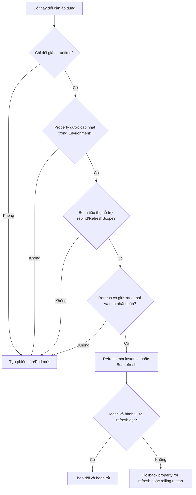
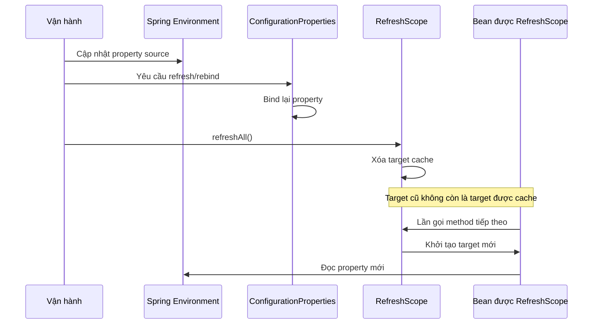
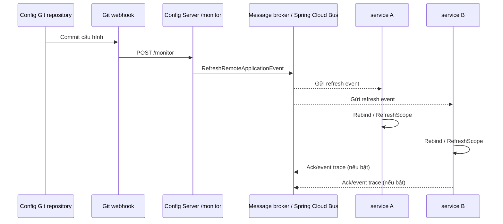

# Chọn refresh hoặc rolling restart theo loại thay đổi

## 1. Một thay đổi cấu hình không phải lúc nào cũng cần restart

Trong hệ thống Spring Cloud, cấu hình có thể thay đổi khi ứng dụng đang chạy. Ví dụ, đội vận hành cần đổi timeout gọi dịch vụ, ngưỡng cảnh báo, địa chỉ một API đối tác hoặc bật một quy tắc định tuyến. Với một số loại property, Spring Cloud Context có thể cập nhật Environment, rebind cấu hình và làm mới bean được đánh dấu `@RefreshScope` mà không dừng tiến trình.

Nhưng refresh không thể thay thế mọi lần khởi động lại. Nếu thay đổi liên quan đến classpath, cấu trúc bean, cổng lắng nghe, tham số JVM, biến môi trường được đọc lúc khởi động, loại kết nối hoặc thành phần không hỗ trợ refresh, cần tạo tiến trình mới. Trong môi trường nhiều replica, rolling restart thay từng instance theo từng đợt để duy trì năng lực phục vụ.

Bài học thuộc chương **Vận hành** của module **SPRING_CLOUD_CORE**. Module tập trung vào Spring Cloud Commons, Spring Cloud Context, cấu hình ngoài, tương thích Spring Boot, refresh scope, discovery, service registry, giao tiếp dịch vụ và cách kiểm thử/vận hành các abstraction chung.

Sau bài này, người học có thể:

- Phân loại thay đổi thành refreshable, cần restart hoặc cần rollout có kiểm soát.
- Giải thích cách Spring Cloud Context cập nhật Environment, rebind `@ConfigurationProperties` và làm mới `@RefreshScope`.
- Chọn giữa `/actuator/refresh`, `/actuator/busrefresh` và rolling restart.
- Nhận diện các property và bean không thể cập nhật an toàn trong tiến trình hiện tại.
- Thiết kế rollout với readiness, graceful shutdown, connection draining và kiểm tra sau triển khai.
- Lập kế hoạch rollback cho thay đổi cấu hình và thay đổi phiên bản ứng dụng.
- Tránh refresh một phần khiến các bean trong cùng request dùng cấu hình không đồng nhất.

## 2. Quyết định theo phạm vi thay đổi

### 2.1. Ma trận lựa chọn nhanh

| Loại thay đổi | Hướng xử lý thường phù hợp | Lý do |
| --- | --- | --- |
| Timeout, retry limit hoặc URL đối tác được bind vào bean có hỗ trợ refresh | Refresh | Có thể cập nhật property và tạo lại bean phụ thuộc |
| Ngưỡng nghiệp vụ hoặc feature parameter được đọc từ `@ConfigurationProperties` mutable | Refresh, sau khi kiểm tra consumer | Spring Cloud có thể rebind property bean |
| Thay đổi log level qua cơ chế quản trị phù hợp | Refresh hoặc cập nhật log level | Không nhất thiết phải tạo lại tiến trình |
| Thay đổi bean graph, `@ConditionalOnProperty`, `@ConditionalOnClass` hoặc auto-configuration | Rolling restart | Điều kiện và bean definition được đánh giá trong quá trình khởi tạo context |
| Thay đổi class, dependency, JAR, image hoặc JDK | Rolling restart/deploy | Runtime hiện tại không tự nạp code mới an toàn |
| Thay đổi port, connector, SSL listener hoặc server thread configuration | Rolling restart | Tài nguyên mạng và server được tạo trong startup |
| Thay đổi biến môi trường, JVM argument, system property hoặc active profile | Rolling restart | Các giá trị này thường được cung cấp trước khi process khởi động |
| Thay đổi cấu hình gắn với bean không refreshable, ví dụ HikariDataSource | Restart/rollout | Bean không được làm mới bằng RefreshScope mặc định |
| Thay đổi schema database hoặc giao thức giữa các phiên bản | Kế hoạch migration và rollout | Cần bảo đảm phiên bản cũ/mới cùng hoạt động trong giai đoạn chuyển tiếp |
| Ứng dụng chạy AOT/native image | Restart theo quy trình triển khai | Spring Cloud Context refresh không hỗ trợ AOT/native image |

Đây là ma trận khởi đầu. Trước khi chọn refresh, phải biết property nào thay đổi, bean nào giữ giá trị đó, bean nào sử dụng chúng và phiên bản Spring Cloud/Spring Boot đang chạy.

### 2.2. Sơ đồ quyết định



Câu hỏi quan trọng không phải “property có đổi được không?” mà là “mọi thành phần phụ thuộc property đó có chuyển sang trạng thái mới an toàn không?”.

## 3. Refresh trong Spring Cloud hoạt động như thế nào?

### 3.1. Environment, rebind và RefreshScope

Spring Cloud Context bổ sung khả năng làm mới một phần context. Khi cấu hình mới được đưa vào Environment, quá trình refresh có thể thực hiện hai nhóm công việc:

1. Rebind các bean được quản lý bằng `@ConfigurationProperties` để chúng nhận giá trị mới.
2. Xóa cache target của `RefreshScope` để các bean trong scope được khởi tạo lại khi lần tiếp theo được sử dụng.

`@RefreshScope` tạo một lazy proxy. Proxy giữ target bean đã khởi tạo; khi scope được refresh, target bị loại khỏi cache. Lần gọi method tiếp theo sẽ tạo target mới bằng cấu hình hiện tại.



Refresh không đồng nghĩa với việc JVM hoặc toàn bộ ApplicationContext được tạo lại. Nó thay đổi một số đối tượng được thiết kế để nhận cấu hình mới.

### 3.2. Rebind @ConfigurationProperties

Các bean `@ConfigurationProperties` có thể được rebind khi refresh. Với bean JavaBean mutable, Spring cập nhật các field trên cùng instance. Tài liệu Spring Cloud lưu ý rằng thao tác rebind có thể đặt lại field về default rồi mới áp dụng giá trị mới; reader đồng thời có thể nhìn thấy trạng thái trung gian nếu bean được đọc trong lúc rebind.

Nếu cần một view cấu hình nhất quán qua refresh, hãy cân nhắc đặt consumer trong `@RefreshScope` để target được thay thế thay vì để nhiều thread đọc cùng object đang bị mutate.

Các object dùng constructor binding, bao gồm Java record được bind theo constructor, không thể refresh theo cơ chế rebind này. Nếu property của record thay đổi, hãy chọn một trong hai hướng:

- Dùng cấu trúc mutable có getter/setter và validation phù hợp nếu thực sự cần refresh runtime.
- Restart tiến trình để tạo context mới và bind lại record từ đầu.

Không thay record bằng mutable bean chỉ để né restart nếu giá trị đó có ảnh hưởng đến invariant hoặc tính nhất quán của nghiệp vụ.

### 3.3. RefreshScope và vòng đời target bean

Ví dụ một client đọc URL và timeout từ cấu hình:

```yaml
partner:
  api:
    base-url: https://partner-v1.example
    read-timeout: 3s
```

Bean cấu hình mutable:

```java
import java.net.URI;
import java.time.Duration;

import org.springframework.boot.context.properties.ConfigurationProperties;

@ConfigurationProperties(prefix = "partner.api")
public class PartnerApiProperties {

    private URI baseUrl;
    private Duration readTimeout = Duration.ofSeconds(3);

    public URI getBaseUrl() {
        return baseUrl;
    }

    public void setBaseUrl(URI baseUrl) {
        this.baseUrl = baseUrl;
    }

    public Duration getReadTimeout() {
        return readTimeout;
    }

    public void setReadTimeout(Duration readTimeout) {
        this.readTimeout = readTimeout;
    }
}
```

Đăng ký properties bean trong context:

```java
import org.springframework.boot.context.properties.EnableConfigurationProperties;
import org.springframework.context.annotation.Configuration;

@Configuration(proxyBeanMethods = false)
@EnableConfigurationProperties(PartnerApiProperties.class)
class PartnerApiConfiguration {
}
```

Client dùng cấu hình khi target được tạo:

```java
import java.net.URI;
import java.time.Duration;

import org.springframework.cloud.context.config.annotation.RefreshScope;
import org.springframework.stereotype.Service;

@Service
@RefreshScope
public class PartnerApiClient {

    private final PartnerApiProperties properties;

    public PartnerApiClient(PartnerApiProperties properties) {
        this.properties = properties;
    }

    public URI baseUri() {
        return properties.getBaseUrl();
    }

    public Duration readTimeout() {
        return properties.getReadTimeout();
    }
}
```

Khi Environment nhận cấu hình mới và refresh scope bị invalidate, lần gọi tiếp theo qua proxy sẽ tạo target client mới. Ví dụ này chỉ minh họa vòng đời bean; một HTTP client thực tế còn cần quản lý connection pool, TLS, retry và đóng tài nguyên của target cũ đúng cách.

Đặt `@RefreshScope` trên một class `@Configuration` không tự động đưa tất cả bean được khai báo trong class đó vào refresh scope. Bean phụ thuộc vào những bean đó cũng không tự động được tạo lại. Hãy đánh dấu đúng bean cần refresh và kiểm tra cả dependency graph.

### 3.4. Giới hạn của RefreshScope

Cần xem xét các giới hạn sau trước khi dùng refresh:

- `HikariDataSource` nằm trong danh sách `spring.cloud.refresh.never-refreshable` mặc định. Thay JDBC URL hoặc pool setting không đồng nghĩa pool đang chạy sẽ được thay an toàn.
- Có thể thêm loại bean vào `spring.cloud.refresh.extra-refreshable` trong trường hợp implementation hỗ trợ, nhưng không nên ép refresh một resource mà thư viện không thiết kế để thay nóng.
- Xóa một property khỏi nguồn cấu hình rồi refresh không nhất thiết cập nhật sự hiện diện/absence của property như mong muốn. Nên kiểm thử semantics của property khi bị xóa; trong một số trường hợp, thiết kế logic dựa trên giá trị tường minh sẽ dễ kiểm soát hơn.
- Context refresh không được hỗ trợ cho Spring AOT transformations và native images. Với các ứng dụng này, đặt `spring.cloud.refresh.enabled=false` và dùng quy trình triển khai/restart.
- Một bean có state đang xử lý request, giữ socket, thread hoặc transaction cần có lifecycle riêng. Xóa cache target không tự giải quyết việc drain các thao tác đang chạy.

## 4. Khi nào chọn refresh?

### 4.1. Các thay đổi thường phù hợp

Refresh phù hợp khi thay đổi là một giá trị cấu hình runtime và toàn bộ consumer được thiết kế để nhận giá trị mới, ví dụ:

- URL hoặc timeout của một client đối tác, nếu client có thể được tạo lại.
- Retry count, backoff hoặc ngưỡng circuit breaker nếu thư viện cho phép cập nhật runtime.
- Ngưỡng nghiệp vụ như giới hạn đơn hàng hoặc mức cảnh báo.
- Danh sách routing hoặc allowlist được nạp vào bean refreshable.
- Một số property trong `@ConfigurationProperties` mutable.
- Log level qua endpoint quản trị tương ứng.

Trước khi refresh, cần kiểm tra property source mới đã được nạp vào Environment. Chỉ gọi refresh trong khi Config Server vẫn trả cấu hình cũ sẽ không tạo ra thay đổi mong muốn.

### 4.2. Quy trình refresh một instance

Một quy trình có kiểm soát:

1. Commit cấu hình mới vào nguồn cấu hình có version.
2. Kiểm tra ứng dụng, profile và label đang lấy đúng phiên bản cấu hình.
3. Đọc diff và xác định bean chịu ảnh hưởng.
4. Xác nhận bean đã được thiết kế để rebind hoặc nằm trong RefreshScope.
5. Thử refresh trên một instance canary.
6. Xác minh property mới, health indicator và hành vi request.
7. Mở rộng refresh sang các instance còn lại.
8. Theo dõi lỗi, latency và các metric liên quan.
9. Nếu có vấn đề, khôi phục cấu hình cũ rồi refresh lại hoặc thực hiện rolling restart nếu context đã ở trạng thái không nhất quán.

Không dùng refresh như một thao tác thử vận may. Hãy có bản cấu hình cũ, phạm vi instance và tiêu chí dừng trước khi bắt đầu.

### 4.3. Endpoint /actuator/refresh

Với ứng dụng có Spring Cloud Context và Actuator, có thể expose endpoint refresh:

```yaml
management:
  endpoints:
    web:
      exposure:
        include:
          - health
          - refresh
```

Thực hiện POST đến `/actuator/refresh`:

```bash
curl -X POST http://localhost:8080/actuator/refresh
```

Endpoint này yêu cầu ứng dụng nạp lại nguồn cấu hình bootstrap phù hợp và refresh các bean thuộc `@RefreshScope`. Endpoint phải được expose rõ ràng; không giả định nó luôn sẵn có chỉ vì ứng dụng có Spring Boot.

Chỉ mở endpoint trên management network, yêu cầu authentication/authorization phù hợp và giới hạn người có quyền thực hiện. Không public endpoint refresh ra Internet. Một lần refresh có thể thay đổi hành vi của ứng dụng đang phục vụ traffic.

### 4.4. /actuator/env không phải lựa chọn thay thế mặc định

Spring Cloud Context hỗ trợ POST `/actuator/env` để cập nhật Environment, rebind `@ConfigurationProperties` và log levels. Endpoint này cần bật rõ:

```yaml
management:
  endpoint:
    env:
      post:
        enabled: true
        valid-keys-regex: "^partner[.]api[.](read-timeout|base-url)$"
  endpoints:
    web:
      exposure:
        include:
          - env
          - refresh
```

Regex ở ví dụ chỉ cho phép một số property được chỉ định; hãy thay bằng allowlist phù hợp với ứng dụng. Việc cho phép POST Environment có thể tạo cấu hình khác với nguồn cấu hình chuẩn và gây khó tái lập sau restart. Vì vậy, ưu tiên thay đổi trong Config Server hoặc nguồn cấu hình có version; chỉ dùng POST env cho use case quản trị đã được kiểm soát.

## 5. Refresh nhiều instance bằng Spring Cloud Bus

### 5.1. Vì sao cần Bus refresh?

Một hệ thống có nhiều replica không thể chỉ refresh instance đầu tiên rồi coi toàn bộ dịch vụ đã cập nhật. Spring Cloud Bus truyền sự kiện qua broker để nhiều application instance nhận lệnh refresh.

Endpoint `/actuator/busrefresh` xóa cache của RefreshScope và rebind `@ConfigurationProperties` trên các instance nhận sự kiện. Cần có Spring Cloud Bus được cấu hình với binder/broker như RabbitMQ hoặc Kafka, và các ứng dụng tham gia cùng bus.

Ví dụ expose endpoint:

```yaml
management:
  endpoints:
    web:
      exposure:
        include:
          - health
          - busrefresh
```

Gửi POST đến endpoint bus refresh:

```bash
curl -X POST http://config-admin:8080/actuator/busrefresh
```

### 5.2. Luồng Config Monitor và webhook

Khi dùng Spring Cloud Config, có thể kết hợp Config Monitor với webhook từ Git provider. Config Server nhận thông báo repository thay đổi, xác định ứng dụng bị ảnh hưởng rồi phát `RefreshRemoteApplicationEvent` qua Spring Cloud Bus.



Webhook chỉ phát được sự kiện Bus khi Spring Cloud Bus được kích hoạt ở Config Server và các client liên quan. Config Monitor có thể xác định file cấu hình nào thay đổi để gửi sự kiện đến đúng nhóm ứng dụng; file dùng chung như application configuration có thể ảnh hưởng nhiều service.

Webhook phải được xác thực bằng secret/signature theo Git provider. Endpoint `/monitor` không nên chấp nhận request tùy ý từ Internet.

### 5.3. Theo dõi kết quả Bus refresh

Không coi HTTP 200 từ một instance gửi Bus event là bằng chứng mọi replica đã refresh thành công. Cần theo dõi:

- Broker có nhận và chuyển event không.
- Các instance có nhận event và thực hiện refresh không.
- Instance nào báo lỗi rebind hoặc khởi tạo lại bean.
- RefreshScope health indicator có chuyển sang DOWN không.
- Các metric và request thực tế có cho thấy cấu hình mới đã được áp dụng không.

Có thể bật tracing/ack cho Bus theo cấu hình phù hợp. Nếu có instance không nhận được event, cần xác định broker connectivity, bus ID, destination và trạng thái ứng dụng trước khi tiếp tục rollout.

## 6. Khi nào phải restart hoặc deploy phiên bản mới?

### 6.1. Thay đổi tác động đến startup

Rolling restart phù hợp khi thay đổi làm thay đổi cách tiến trình hoặc ApplicationContext được tạo:

- JAR, thư viện, code, JDK hoặc base image.
- Environment variable, JVM argument, system property hoặc active profile.
- Port HTTP/HTTPS, TLS keystore, connector hoặc server configuration.
- Bean được tạo theo điều kiện classpath/property hoặc auto-configuration.
- Constructor-bound configuration properties, bao gồm record.
- Resource không hỗ trợ refresh như HikariDataSource theo mặc định.
- Thread pool, scheduler, executor hoặc connection factory cần khởi tạo lại.
- Cấu hình chỉ được đọc một lần trong static initializer hoặc constructor của bean không refreshable.
- Thay đổi cấu trúc context, bean definition hoặc dependency graph.
- Ứng dụng AOT/native image không hỗ trợ Context Refresh.

Một property có thể đổi trong Environment nhưng bean đã giữ giá trị cũ trong field, constructor hoặc resource bên dưới. Nếu không có cơ chế tạo lại an toàn, refresh sẽ tạo cảm giác thành công trong khi ứng dụng vẫn chạy cấu hình cũ.

### 6.2. Thay đổi ConfigMap, Secret và biến môi trường

Trong Kubernetes, cần phân biệt cách ứng dụng nhận cấu hình:

| Cách cấp cấu hình | Hành vi khi nguồn thay đổi | Hướng xử lý |
| --- | --- | --- |
| Environment variable trong Pod spec | Giá trị process hiện tại không tự thay đổi | Tạo Pod mới qua rollout |
| ConfigMap/Secret mount dạng volume | File được cập nhật theo cơ chế projection của Kubernetes; ứng dụng phải đọc lại file | Dùng cơ chế reload đã cấu hình hoặc rollout |
| ConfigMap/Secret được mount qua subPath | Không nhận cập nhật projection như volume thông thường | Rollout Pod |
| Config Server / remote property source | Có thể nạp lại bằng refresh nếu client và bean hỗ trợ | Refresh hoặc Bus refresh |
| Property chỉ được đọc lúc startup | Giá trị đã được giữ trong resource/bean | Restart |

Đừng giả định thay ConfigMap đồng nghĩa Spring Environment tự cập nhật. Cần có integration reload cụ thể, hoặc thay Pod template/checksum để Deployment tạo replica mới.

### 6.3. Thay đổi database schema và contract dịch vụ

Một thay đổi schema database thường không thể giải quyết chỉ bằng refresh property. Nếu code mới yêu cầu cột hoặc index mới, hãy triển khai theo chiến lược expand-contract:

1. Thêm schema mới theo cách code cũ vẫn chạy được.
2. Deploy phiên bản có thể đọc/ghi schema mới, tương thích với phiên bản cũ.
3. Chuyển traffic và xác nhận toàn bộ instance mới hoạt động.
4. Chỉ xóa schema cũ sau khi không còn instance hoặc consumer cũ sử dụng.

Tương tự, thay đổi API giữa service nên giữ tương thích ngược trong giai đoạn rolling update vì phiên bản cũ và mới có thể cùng phục vụ request.

## 7. Rolling restart là gì?

Rolling restart thay từng instance bằng tiến trình mới trong khi các replica còn lại tiếp tục phục vụ. Trong Kubernetes Deployment, chiến lược mặc định là `RollingUpdate`; controller tăng replica mới và giảm replica cũ theo các giới hạn cấu hình.

Hai tham số quan trọng:

- `maxUnavailable`: số hoặc tỷ lệ replica tối đa được phép không sẵn sàng trong lúc update.
- `maxSurge`: số hoặc tỷ lệ replica mới có thể vượt quá desired replica count trong lúc update.

Ví dụ Deployment có ba replica:

```yaml
apiVersion: apps/v1
kind: Deployment
metadata:
  name: order-service
spec:
  replicas: 3
  strategy:
    type: RollingUpdate
    rollingUpdate:
      maxUnavailable: 0
      maxSurge: 1
  selector:
    matchLabels:
      app: order-service
  template:
    metadata:
      labels:
        app: order-service
    spec:
      terminationGracePeriodSeconds: 45
      containers:
        - name: order-service
          image: registry.example/order-service:2.4.0
          ports:
            - name: http
              containerPort: 8080
          readinessProbe:
            httpGet:
              path: /actuator/health/readiness
              port: 8080
            periodSeconds: 5
            failureThreshold: 3
          livenessProbe:
            httpGet:
              path: /actuator/health/liveness
              port: 8080
            periodSeconds: 10
            failureThreshold: 3
```

Trong ví dụ, Kubernetes có thể tạo thêm một Pod mới trước khi loại Pod cũ. `maxUnavailable: 0` yêu cầu không chủ động giảm số Pod available dưới desired count trong quá trình rollout; `maxSurge: 1` cho phép có thêm một Pod. Cần đủ CPU, memory, IP và quota để chạy surge replica.

Readiness probe phải chỉ báo ready khi ứng dụng đã hoàn tất startup và có thể phục vụ traffic. Liveness probe dùng để phát hiện tiến trình không thể tiếp tục hoạt động. Không đưa mọi dependency bên ngoài vào liveness check theo cách khiến một sự cố DB hoặc registry làm Kubernetes restart hàng loạt ứng dụng.

## 8. Readiness, graceful shutdown và connection draining

### 8.1. Readiness trước khi nhận traffic

Spring Boot cung cấp trạng thái availability:

- `ACCEPTING_TRAFFIC`: ứng dụng sẵn sàng nhận request.
- `REFUSING_TRAFFIC`: ứng dụng không nhận request mới.

Với Actuator, có thể dùng các endpoint health readiness/liveness cho probe. Khi rollout, Pod mới chỉ nên nhận traffic sau khi context, connection pool và dependency cần thiết đã sẵn sàng.

Có thể bật probe rõ ràng:

```yaml
management:
  endpoint:
    health:
      probes:
        enabled: true
```

Nếu ứng dụng có startup task kéo dài, hãy cấu hình startup probe hoặc initial delay phù hợp để tránh liveness probe restart ứng dụng trước khi nó hoàn tất khởi động.

### 8.2. Graceful shutdown

Spring Boot bật graceful shutdown mặc định với embedded Tomcat, Jetty và Reactor Netty. Trong quá trình đóng ApplicationContext, server ngừng nhận request mới và cho request đang chạy thời gian hoàn tất theo timeout của shutdown phase.

Cấu hình thời gian:

```yaml
spring:
  lifecycle:
    timeout-per-shutdown-phase: 30s
server:
  shutdown: graceful
```

Kubernetes gửi SIGTERM khi Pod bị terminate và chờ trong termination grace period trước khi dùng SIGKILL. Giá trị mặc định của Kubernetes thường là 30 giây. Nếu Spring Boot cần 30 giây để graceful shutdown, Pod termination grace period phải lớn hơn khoảng thời gian đó và còn chừa thời gian cho preStop hook, deregistration hoặc cleanup khác.

Ví dụ Deployment ở phần trước dùng 45 giây để minh họa sự phối hợp giữa hai timeout; giá trị thực tế phải dựa trên thời gian request dài nhất, drain và cleanup của hệ thống.

### 8.3. Thứ tự drain và deregister

Một lần shutdown an toàn cần phối hợp nhiều lớp:

1. Đánh dấu instance không còn nhận traffic mới qua readiness hoặc cơ chế traffic draining.
2. Chờ load balancer/service routing cập nhật endpoint.
3. Cho request đang chạy, message đang xử lý và transaction hoàn tất trong giới hạn cho phép.
4. Dừng consumer hoặc scheduler theo lifecycle của ứng dụng.
5. Deregister khỏi service registry nếu provider sử dụng registration riêng.
6. Đóng connection pool, HTTP client và tài nguyên.
7. Kết thúc process trước khi termination grace period hết.

Không chỉ dựa vào việc xóa Pod khỏi Deployment. Với service registry độc lập như Eureka/Consul, cần xác minh registration và cache của consumer cũng được cập nhật.

## 9. Quy trình rolling restart có kiểm soát

Một rollout thực tế nên chia thành các bước:

### 9.1. Trước rollout

- Kiểm tra image, version và cấu hình đã được build/review.
- Xác nhận release mới tương thích với schema và API đang được dùng.
- Xác nhận capacity đủ để chạy old/new replica cùng lúc.
- Kiểm tra readiness/liveness probe và graceful shutdown.
- Xác định metric, log và SLO cần theo dõi.
- Ghi lại revision hiện tại và lệnh rollback.

### 9.2. Trong rollout

Có thể dùng:

```bash
kubectl rollout status deployment/order-service
```

Theo dõi replica mới:

```bash
kubectl get pods -l app=order-service
kubectl describe deployment order-service
```

Nếu ứng dụng có canary hoặc progressive delivery, bắt đầu với một phần traffic nhỏ, quan sát error rate và latency rồi mới mở rộng. Nếu chỉ dùng Deployment rolling update, đặt `maxUnavailable` và `maxSurge` theo capacity, sau đó kiểm tra tiến độ từng đợt.

Không chỉ nhìn số Pod ở trạng thái Running. Một Pod có thể Running nhưng readiness chưa thành công và chưa nên nhận traffic.

### 9.3. Sau rollout

- Xác nhận Deployment đã hoàn tất và mọi replica mới Ready.
- Kiểm tra version/build info của từng instance.
- Kiểm tra registry/discovery chỉ còn instance phù hợp.
- Xác nhận request thành công qua service boundary.
- So sánh error rate, latency, saturation và queue lag trước/sau.
- Kiểm tra log startup, lỗi kết nối, migration và deprecation warning.
- Theo dõi đủ lâu để phát hiện lỗi chỉ xuất hiện dưới tải thực tế.

### 9.4. Rollback

Nếu rollout bị lỗi:

```bash
kubectl rollout history deployment/order-service
kubectl rollout undo deployment/order-service
kubectl rollout status deployment/order-service
```

Rollback image không tự rollback database schema hoặc external configuration. Vì vậy, migration phải có khả năng tương thích ngược và config cần có version/commit để khôi phục độc lập.

## 10. So sánh refresh và rolling restart

| Tiêu chí | Refresh | Rolling restart |
| --- | --- | --- |
| Phạm vi | Property, rebind và bean refreshable | Toàn bộ process/Pod |
| Thời gian áp dụng | Thường nhanh, không chờ JVM startup | Cần startup và readiness từng replica |
| Tài nguyên | Không tạo process mới, nhưng có thể tạo lại client/resource | Cần capacity chạy old/new cùng lúc |
| Thay đổi code/dependency | Không | Có |
| Thay đổi JVM/env/port | Thường không | Có |
| Bean constructor-bound record | Không rebind được | Có |
| HikariDataSource mặc định | Không refreshable | Tạo pool mới khi restart |
| Tác động request đang chạy | Có thể gặp khác biệt target/config nếu thiết kế không nhất quán | Có thể drain request cũ rồi chuyển traffic |
| Phạm vi lỗi | Có thể refresh một phần hoặc nhiều instance qua Bus | Rollout từng replica, có thể pause/rollback |
| Yêu cầu phối hợp | Property source, bean scope, Bus nếu nhiều instance | Readiness, shutdown, capacity và compatibility |

Refresh không luôn ít rủi ro hơn restart. Một refresh sai có thể tạo trạng thái hỗn hợp giữa bean cũ và bean mới; một rolling restart được chuẩn bị tốt có thể dễ kiểm soát hơn.

Spring Cloud Context cũng có endpoint `/actuator/restart` để đóng và khởi động lại ApplicationContext, nhưng endpoint này bị tắt mặc định. Trong môi trường nhiều replica, thường nên để orchestrator thực hiện rolling restart để quản lý readiness, capacity, drain và rollback tập trung, thay vì gọi restart trực tiếp từng process qua HTTP.

## 11. Ví dụ tình huống vận hành

### 11.1. Đổi timeout của API đối tác

Giả sử `partner.api.read-timeout` thay đổi từ 3 giây thành 5 giây. Client được thiết kế để tạo lại qua `@RefreshScope` và property bean có thể rebind.

Hướng xử lý:

1. Cập nhật property trong Config Server.
2. Kiểm tra giá trị mới được trả về cho đúng application/profile/label.
3. Refresh một instance canary.
4. Xác nhận client mới dùng timeout 5 giây và health vẫn UP.
5. Dùng Bus refresh hoặc refresh từng instance còn lại.
6. Theo dõi latency, timeout và error rate.

Không cần rolling restart nếu client thực sự được tạo lại và mọi instance nhận đúng cấu hình.

### 11.2. Đổi port server

Thay `server.port` làm thay đổi cổng mà web server bind. Đây là cấu hình gắn với tài nguyên server lúc khởi động. Refresh Environment không tự di chuyển socket đang lắng nghe sang port mới.

Hướng xử lý: cập nhật deployment/configuration và rolling restart. Readiness probe, Service targetPort, ingress và registry registration phải được cập nhật đồng bộ.

### 11.3. Đổi Hikari JDBC URL

`HikariDataSource` mặc định nằm trong danh sách không refreshable. Thay property JDBC URL rồi gọi refresh không đảm bảo pool hiện tại được tạo lại.

Hướng xử lý: dùng rolling restart có kiểm soát để tạo pool mới trên từng replica, kiểm tra connection đến database và khả năng tương thích migration. Nếu ứng dụng có cơ chế datasource rotation riêng, hãy kiểm thử cơ chế đó độc lập; không tự ý ép Hikari vào RefreshScope.

### 11.4. Đổi code và dependency

Thay đổi thuật toán nghiệp vụ, nâng thư viện hoặc sửa CVE trong dependency cần artifact mới. Refresh không thay bytecode hoặc class đã nạp trong JVM.

Hướng xử lý: build image mới, chạy test/scan, triển khai canary rồi rolling restart. Giữ tương thích API và database với replica cũ trong giai đoạn chuyển tiếp.

### 11.5. Đổi feature flag runtime

Nếu feature flag được bind vào một bean có thể cập nhật runtime, refresh có thể phù hợp. Nhưng nếu flag quyết định bean nào được tạo qua `@ConditionalOnProperty` lúc startup, đổi flag không tự chạy lại auto-configuration condition.

Hướng xử lý: dùng feature flag runtime chuyên dụng cho hành vi cần bật/tắt nóng; dùng restart khi flag quyết định cấu trúc ApplicationContext.

## 12. Kiểm chứng refresh thành công

Sau refresh, không chỉ kiểm tra HTTP response của endpoint. Hãy xác minh theo nhiều lớp:

1. **Nguồn cấu hình:** Config Server hoặc property source trả giá trị mới đúng application, profile và label.
2. **Environment:** giá trị mới đã xuất hiện trong Environment của instance.
3. **Binding:** bean `@ConfigurationProperties` nhận giá trị mong đợi.
4. **Target bean:** bean `@RefreshScope` đã được tạo lại khi sử dụng.
5. **Health:** RefreshScope health indicator không ở trạng thái DOWN.
6. **Behavior:** request thật sử dụng cấu hình mới.
7. **Replica coverage:** mọi instance trong service đã nhận refresh, không còn replica giữ cấu hình cũ.
8. **Observability:** log/metric không có lỗi rebind, khởi tạo bean, kết nối hoặc tăng latency bất thường.

Có thể dùng `/actuator/env` để kiểm tra Environment trong phạm vi quyền được cấp, nhưng cần bảo vệ endpoint vì nó có thể tiết lộ cấu hình nhạy cảm. Không ghi giá trị secret vào log hoặc ticket vận hành.

Nếu refresh làm bean khởi tạo thất bại, `RefreshScopeHealthIndicator` có thể chuyển trạng thái DOWN và cung cấp exception. Hãy xem đây là lỗi rollout cấu hình cần xử lý, không tiếp tục phát refresh diện rộng.

## 13. Kiểm thử chiến lược refresh/restart trước production

### 13.1. Test refresh property

Một integration test nên:

- Khởi tạo context với property ban đầu.
- Gọi bean refreshable và xác nhận giá trị ban đầu.
- Cập nhật property source trong test.
- Thực hiện refresh/rebind theo đúng cơ chế ứng dụng dùng.
- Gọi bean qua proxy lần nữa và xác nhận target mới đọc giá trị mới.
- Kiểm tra exception nếu bean mới không khởi tạo được.

Không chỉ mock `RefreshScope.refreshAll()`; cần test context thật để xác minh proxy và binding hoạt động.

### 13.2. Test các property không refresh

Tạo test riêng cho:

- Constructor-bound record.
- Bean không thuộc RefreshScope nhưng giữ snapshot property trong constructor.
- HikariDataSource hoặc resource nằm trong never-refreshable.
- Property bị xóa khỏi nguồn cấu hình.
- Bean phụ thuộc một bean khác nhưng chỉ một trong hai nằm trong RefreshScope.

Các test này giúp xác định chính xác giới hạn của chiến lược refresh trong ứng dụng.

### 13.3. Test rolling restart

Trong môi trường staging, kiểm tra:

- Pod mới chỉ nhận traffic sau khi readiness thành công.
- Pod cũ ngừng nhận traffic mới khi shutdown.
- Request đang chạy có đủ thời gian hoàn tất.
- Service registry loại registration cũ.
- Không có hai phiên bản gây lỗi tương thích API/schema.
- Rollback image thành công và cấu hình có thể khôi phục.

Kiểm thử cả tình huống Pod mới không Ready hoặc startup fail để xác nhận rollout dừng đúng lúc thay vì loại hết replica cũ.

## 14. Lỗi thường gặp và cách xử lý

| Triệu chứng | Nguyên nhân | Hướng xử lý |
| --- | --- | --- |
| Refresh trả thành công nhưng bean vẫn dùng giá trị cũ | Bean giữ snapshot trong constructor và không refreshable | Đặt đúng bean vào RefreshScope hoặc restart |
| Property bean cập nhật nhưng client không đổi | Client không được tạo lại hoặc giữ dependency/resource cũ | Refresh target client và kiểm thử dependency graph |
| Record không nhận property mới | Constructor binding không hỗ trợ refresh | Rolling restart |
| Hikari vẫn kết nối DB cũ | HikariDataSource không refreshable theo mặc định | Rolling restart hoặc datasource rotation đã được thiết kế riêng |
| Một số replica vẫn dùng cấu hình cũ | Chỉ refresh một instance hoặc Bus event không đến tất cả node | Theo dõi Bus event/ack và xác minh từng replica |
| RefreshScope health chuyển DOWN | Bean không khởi tạo lại hoặc rebind thất bại | Kiểm tra exception, rollback property và refresh lại sau khi sửa |
| Xóa property nhưng ứng dụng vẫn giữ hành vi cũ | Semantics xóa property không được refresh như mong đợi | Dùng giá trị tường minh hoặc restart |
| Thay ConfigMap nhưng app không đổi | Không có reload integration; env var chỉ được đọc khi startup | Trigger rolling restart hoặc cấu hình reload phù hợp |
| Pod mới Running nhưng không nhận traffic | Readiness chưa đạt | Kiểm tra probe, startup task và dependency |
| Request bị lỗi khi rollout | Graceful shutdown/draining chưa đủ hoặc timeout lệch | Điều chỉnh readiness, shutdown timeout và termination grace period |
| Rollout dừng giữa chừng | Pod mới không Ready, image/config lỗi hoặc thiếu capacity | Xem Deployment conditions/events, pause hoặc rollback |
| Rollback image nhưng app vẫn lỗi | Schema/config đã thay đổi không tương thích | Thiết kế migration expand-contract và rollback config độc lập |

## 15. Checklist quyết định và vận hành

Trước khi chọn refresh hoặc restart, hãy xác nhận:

1. Chính xác property hoặc thành phần nào thay đổi?
2. Giá trị đó được đọc lúc startup, bind vào bean hay được đọc động mỗi lần gọi?
3. Bean giữ giá trị có được rebind hoặc nằm trong RefreshScope không?
4. Bean phụ thuộc có cần được tạo lại cùng lúc không?
5. Có constructor binding/record, HikariDataSource hoặc resource không refreshable không?
6. Thay đổi có tác động đến classpath, port, TLS listener, JVM, environment hoặc bean graph không?
7. Property source mới đã được version hóa và xác minh chưa?
8. Nếu dùng refresh, endpoint đã được expose và bảo vệ chưa?
9. Nếu dùng Bus, mọi instance có nhận event và có bằng chứng ack/health không?
10. Nếu restart, readiness probe và graceful shutdown đã hoạt động chưa?
11. Kubernetes có đủ capacity cho maxSurge và replica mới không?
12. Termination grace period có dài hơn shutdown/drain/cleanup không?
13. API và database schema có tương thích giữa phiên bản cũ và mới không?
14. Có metric, log, health và tiêu chí dừng rollout rõ ràng không?
15. Có thể rollback code, config và schema theo từng phần không?

## 16. Tài liệu tham khảo chính thức

- [Spring Cloud Commons — Spring Cloud Context: Application Context Services](https://docs.spring.io/spring-cloud-commons/reference/spring-cloud-commons/application-context-services.html): rebind `@ConfigurationProperties`, `@RefreshScope`, giới hạn refresh và các Actuator endpoint.
- [Spring Cloud Commons — Configuration Properties](https://docs.spring.io/spring-cloud-commons/reference/configprops.html): `spring.cloud.refresh.enabled`, `extra-refreshable`, `never-refreshable` và các thuộc tính refresh.
- [Spring Cloud Bus — Bus Endpoints](https://docs.spring.io/spring-cloud-bus/reference/spring-cloud-bus/bus-endpoints.html): `busrefresh`, rebind và refresh nhiều instance.
- [Spring Cloud Config — Push Notifications and Spring Cloud Bus](https://docs.spring.io/spring-cloud-config/reference/server/push-notifications-and-bus.html): webhook, Config Monitor, `RefreshRemoteApplicationEvent` và xác thực webhook.
- [Spring Boot — Graceful Shutdown](https://docs.spring.io/spring-boot/reference/web/graceful-shutdown.html): timeout shutdown phase và cách server ngừng nhận request mới.
- [Spring Boot — Actuator Endpoints](https://docs.spring.io/spring-boot/reference/actuator/endpoints.html): availability/readiness, health probes và management endpoints.
- [Kubernetes — Deployments](https://kubernetes.io/docs/concepts/workloads/controllers/deployment/): RollingUpdate, `maxUnavailable`, `maxSurge`, progress deadline và rollout history.
- [Kubernetes — Termination of Pods](https://kubernetes.io/docs/concepts/workloads/pods/pod-termination/): SIGTERM, preStop, termination grace period và thời điểm Pod rời EndpointSlice.

**Ghi nhớ:** Chọn refresh khi thay đổi chỉ tác động đến property và bean được thiết kế để cập nhật an toàn trong process. Chọn rolling restart khi thay đổi ảnh hưởng đến startup, resource, classpath, bean graph hoặc cấu hình không refreshable. Với nhiều replica, readiness, graceful shutdown, registry deregistration, capacity và rollback là một phần của cùng kế hoạch triển khai.

