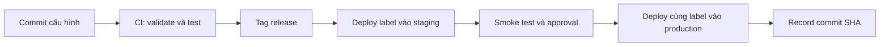

# Quản lý phiên bản cấu hình và khả năng quay lại

## 1. Vì sao cấu hình cũng cần quản lý phiên bản?

Trong một hệ thống phân tán, cấu hình quyết định cách từng dịch vụ kết nối, xác thực, phân giải dịch vụ, retry, timeout, giới hạn tài nguyên và bật/tắt tính năng. Một thay đổi cấu hình có thể ảnh hưởng tới nhiều instance cùng lúc dù không có bản build ứng dụng mới.

Ví dụ, thay read-timeout từ 2 giây thành 200 mili giây có thể khiến hàng loạt lời gọi dịch vụ thất bại. Thay địa chỉ registry hoặc tên queue sai có thể khiến một nhóm instance mất khả năng giao tiếp. Nếu không biết cấu hình nào đang được áp dụng và không có đường quay lại, việc khôi phục hệ thống sẽ chậm và dễ phát sinh thêm lỗi.

Spring Cloud Config giải quyết bài toán cấu hình tập trung bằng cách đưa cấu hình ứng dụng vào một repository có phiên bản, thường là Git. Config Server đọc repository và cung cấp property sources qua HTTP; Config Client nạp chúng vào Spring Environment. Git cung cấp lịch sử commit, nhánh, tag và khả năng so sánh thay đổi. Spring Cloud Config ánh xạ các Git label đó thành phiên bản cấu hình mà client có thể yêu cầu.

Bài thuộc chương **Vận hành** của mô-đun **SPRING_CLOUD_CORE**. Mô-đun giúp người học hiểu các nền tảng cốt lõi của Spring Cloud trong hệ thống phân tán, đặc biệt Spring Cloud Commons, Context, cấu hình ngoài và khả năng tương thích với Spring Boot; người học cũng tìm hiểu refresh scope, discovery, service registry, giao tiếp dịch vụ và kiểm thử, vận hành các abstraction chung.

Sau bài học, người học có thể:

- Giải thích vai trò của Git label trong Spring Cloud Config.
- Phân biệt commit SHA, tag và branch khi chọn phiên bản cấu hình.
- Thiết kế quy trình đưa cùng một phiên bản cấu hình qua các môi trường.
- Xác định phiên bản cấu hình mà Config Server đang trả về.
- Quay lại phiên bản tốt bằng git revert hoặc ghim client vào label đã biết tốt.
- Kích hoạt refresh và kiểm tra instance đã nhận cấu hình mới.
- Phát hiện rủi ro từ cache, nhánh đã xóa, Git backend gián đoạn và cấu hình bị lệch giữa các instance.

## 2. Mô hình quản lý cấu hình có phiên bản

Một cách tổ chức phổ biến là tách cấu hình khỏi mã nguồn ứng dụng:

```text
inventory-service
├── application.yml
├── inventory-service.yml
├── inventory-service-dev.yml
├── inventory-service-staging.yml
└── inventory-service-prod.yml
```

Các file này có thể nằm trong một Git repository dành cho cấu hình. Config Server nhận tên ứng dụng, profile và label rồi tìm các property sources tương ứng. File application.yml có thể chứa giá trị dùng chung; file theo tên ứng dụng và profile ghi đè hoặc bổ sung giá trị chuyên biệt.

Ví dụ:

| File | Phạm vi |
| --- | --- |
| application.yml | Giá trị mặc định dùng chung cho các ứng dụng. |
| inventory-service.yml | Cấu hình chung cho inventory-service. |
| inventory-service-dev.yml | Giá trị riêng cho profile dev. |
| inventory-service-prod.yml | Giá trị riêng cho profile prod. |

Trong vận hành, điều quan trọng là có thể trả lời ba câu hỏi:

1. Cấu hình nào đang được áp dụng cho ứng dụng và profile này?
2. Cấu hình đó đến từ commit hoặc release nào?
3. Nếu thay đổi gây sự cố, có thể phục hồi chính xác phiên bản nào?

Git commit và Config Server response giúp truy vết câu trả lời. Đừng chỉ ghi “đang dùng nhánh production”, vì nội dung nhánh có thể thay đổi theo từng commit.

## 3. Git label trong Spring Cloud Config

Config Server Git backend ánh xạ tham số {label} của endpoint thành một Git label. Label có thể là:

- **Commit ID:** mã commit cụ thể, xác định một snapshot nội dung.
- **Tag:** tên mốc phát hành trỏ tới một commit.
- **Branch:** tên nhánh, trỏ tới commit hiện tại của nhánh và có thể di chuyển khi có commit mới.

Ví dụ endpoint:

```text
/{application}/{profile}/{label}
```

Client có thể yêu cầu cấu hình của inventory-service, profile prod, label config-v2.7.1:

```text
http://config-server:8888/inventory-service/prod/config-v2.7.1
```

Với Git backend, config-v2.7.1 có thể là tag, branch hoặc commit reference mà Git có thể checkout.

### 3.1. Commit SHA

Commit SHA xác định một snapshot cụ thể trong lịch sử Git. Khi client được cấu hình với commit SHA, lần khởi động sau vẫn yêu cầu đúng nội dung đó miễn là commit còn được giữ trong repository và Config Server có thể fetch được nó.

Ví dụ:

```yaml
spring:
  cloud:
    config:
      label: 7a4c2d9f8b1e
```

SHA ngắn chỉ nên dùng khi đã xác minh nó duy nhất trong repository. Với release cần khả năng kiểm toán, nên ghi lại full commit SHA trong manifest triển khai hoặc deployment record.

### 3.2. Tag phát hành

Tag giúp đặt tên dễ đọc cho một snapshot:

```bash
git tag -a config-v2.7.1 7a4c2d9f8b1e -m "Configuration release 2.7.1"
git push origin config-v2.7.1
```

Một tag phát hành nên được coi là bất biến theo quy trình nhóm: không di chuyển tag đã dùng cho production sang commit khác. Nếu cần thay nội dung, tạo tag mới, ví dụ config-v2.7.2. Tag có thể ký bằng GPG/SSH nếu chính sách repository yêu cầu xác thực nguồn phát hành.

Tag bất biến giúp nhiều môi trường dùng cùng một snapshot:

| Môi trường | Config label |
| --- | --- |
| Staging | config-v2.7.1 |
| Pre-production | config-v2.7.1 |
| Production | config-v2.7.1 |

Nếu staging và production dùng hai branch khác nhau, chúng có thể chứa nội dung khác dù tên file giống nhau. Ghim vào cùng tag hoặc commit SHA giúp việc promotion có thể kiểm chứng.

### 3.3. Branch

Branch phù hợp cho phát triển liên tục:

```yaml
spring:
  cloud:
    config:
      label: develop
```

Khi có commit mới trên develop, nội dung mà label đó trỏ tới thay đổi. Vì vậy, branch thích hợp cho dev hoặc môi trường cần lấy cấu hình mới thường xuyên. Branch không phải lựa chọn tốt để mô tả một bản phát hành production bất biến.

Một tên như production có thể hữu ích làm alias cho cấu hình hiện hành, nhưng phải ghi nhận commit SHA thực tế được deploy tại mỗi thời điểm. Nếu branch được cập nhật trong lúc rollout, hai instance khởi động ở hai thời điểm khác nhau có thể lấy hai commit khác nhau.

### 3.4. Quy tắc chọn label

| Nhu cầu | Label nên dùng |
| --- | --- |
| Phát triển hằng ngày | Branch như develop hoặc feature/... |
| Kiểm thử một thay đổi có phạm vi | Branch feature hoặc commit SHA. |
| Promotion qua staging và production | Tag phát hành hoặc commit SHA. |
| Khôi phục nhanh một snapshot đã biết tốt | Tag cũ hoặc commit SHA đã xác minh. |
| Cập nhật cấu hình theo luồng liên tục | Branch có quy trình kiểm soát commit và audit rõ ràng. |

Không dùng một branch có thể di chuyển làm bằng chứng duy nhất cho phiên bản production. Lưu cả label và resolved commit SHA.

## 4. Cấu hình Git backend của Config Server

Ví dụ Config Server trỏ tới Git repository:

```yaml
server:
  port: 8888

spring:
  cloud:
    config:
      server:
        git:
          uri: https://git.example.com/platform/config-repository.git
          default-label: main
          clone-on-start: true
          refresh-rate: 0
```

Ý nghĩa:

- uri: repository mà Config Server đọc.
- default-label: label mặc định khi request không chỉ định label.
- clone-on-start: clone repository lúc server khởi động để phát hiện sớm URI hoặc credential sai.
- refresh-rate: khoảng thời gian Config Server kiểm tra thay đổi từ Git backend.

Với Git backend hiện hành, default label của server là main; nếu không có main, server có thể thử master trừ khi tắt fallback. Config Client có binding mặc định được tài liệu hóa riêng; để tránh phụ thuộc khác biệt giữa phiên bản hoặc default của client/server, hãy cấu hình spring.cloud.config.label tường minh cho môi trường cần kiểm soát.

Giá trị spring.cloud.config.label phải có sẵn trước khi Config Data import gọi Config Server. Đặt nó trong cấu hình cục bộ của client, biến môi trường hoặc tham số triển khai; không đặt label lựa chọn ban đầu chỉ trong repository remote mà chính request đó cần đọc.

### 4.1. Refresh rate và cache repository

spring.cloud.config.server.git.refresh-rate tính bằng giây:

| Giá trị | Hành vi |
| --- | --- |
| 0 | Fetch cập nhật Git mỗi khi có request cấu hình. |
| Số dương | Giới hạn tần suất fetch theo khoảng thời gian đã đặt. |
| Số âm | Không refresh repository từ remote. |

Nếu đặt refresh rate lớn hơn 0, commit mới có thể chưa xuất hiện ngay trong response của Config Server. Nếu đặt số âm, server có thể tiếp tục dùng snapshot đã clone cho tới khi được khởi động lại hoặc có cơ chế cập nhật khác.

Khi rollback, phải tính tới refresh rate và working copy của từng Config Server instance. Gửi refresh tới client trong lúc server vẫn đang trả commit cũ sẽ không khôi phục được cấu hình mong muốn.

### 4.2. Kiểm soát working copy

Config Server giữ working copy cục bộ của Git repository. Một số thuộc tính vận hành cần biết:

| Thuộc tính | Mục đích |
| --- | --- |
| clone-on-start | Clone lúc khởi động để phát hiện lỗi kết nối sớm. |
| basedir | Chỉ định thư mục lưu working copy; tránh thư mục tạm bị hệ điều hành dọn dẹp. |
| force-pull | Reset working copy về remote nếu local copy bị dirty hoặc lệch. |
| delete-untracked-branches | Xóa branch local không còn tồn tại ở remote để tránh checkout nhầm branch cũ. |

Ví dụ:

```yaml
spring:
  cloud:
    config:
      server:
        git:
          uri: https://git.example.com/platform/config-repository.git
          basedir: /var/lib/config-server/repositories
          clone-on-start: true
          force-pull: true
          delete-untracked-branches: true
```

force-pull có thể bỏ các thay đổi cục bộ trong working copy để đồng bộ với remote. Chỉ bật khi working copy là cache do Config Server quản lý, không chứa chỉnh sửa thủ công cần giữ. Không dùng force-pull như thao tác rollback ứng dụng; rollback phải thay đổi label hoặc lịch sử Git theo quy trình phát hành.

Nếu remote branch bị xóa nhưng branch local vẫn còn, Config Server có thể tiếp tục checkout branch cũ từ working copy. delete-untracked-branches giúp loại bỏ tình huống này. Với release tag/commit, vẫn cần giữ tag và commit ở remote để mọi Config Server instance có thể fetch.

### 4.3. Nhiều repository và pattern

Config Server có thể định tuyến application/profile tới repository khác nhau bằng pattern. Ví dụ:

```yaml
spring:
  cloud:
    config:
      server:
        git:
          uri: https://git.example.com/platform/shared-config.git
          repos:
            payments:
              pattern: payments-*
              uri: https://git.example.com/payments/config.git
            inventory:
              pattern: inventory-*
              uri: https://git.example.com/inventory/config.git
              clone-on-start: true
```

Khi dùng nhiều repository, mỗi repo có thể có lịch sử, branch và tag riêng. Release manifest phải ghi đúng repository cùng label/commit của từng ứng dụng; một tag tên giống nhau ở hai repository không đảm bảo cùng nội dung.

## 5. Client chọn phiên bản cấu hình

Với Spring Boot Config Data, Config Client kết nối Config Server qua spring.config.import. Ví dụ:

```yaml
spring:
  application:
    name: inventory-service
  profiles:
    active: prod
  config:
    import: configserver:https://config.example.com
  cloud:
    config:
      label: config-v2.7.1
```

Ở đây:

- spring.application.name xác định application name.
- active profile chọn tập cấu hình môi trường.
- spring.cloud.config.label chọn branch, tag hoặc commit.
- spring.config.import khai báo Config Server là nguồn cấu hình.

Nếu muốn ứng dụng tiếp tục khởi động khi Config Server không sẵn sàng, có thể dùng optional:configserver:. Nếu không có tiền tố optional:, Config Client có thể fail startup khi không lấy được cấu hình. Với production, chọn hành vi fail-fast hay optional theo yêu cầu vận hành; không bật optional chỉ để che lỗi cấu hình.

Ví dụ URL request trực tiếp:

```bash
curl https://config.example.com/inventory-service/prod/config-v2.7.1
```

Response của Config Server chứa các property sources và trường version cho biết revision được repository backend trả về. Lưu trường này vào log hoặc deployment record để truy vết.

### 5.1. Label có dấu slash

Nếu branch hoặc tag chứa dấu /, ví dụ release/2026.11, Config Server dùng ký hiệu đặc biệt (_) trong URL để tránh nhầm lẫn với các thành phần path:

```text
inventory-service/prod/release(_)2026.11
```

Khi dùng spring.cloud.config.label trong property, vẫn ghi tên Git label theo dạng thực tế:

```yaml
spring:
  cloud:
    config:
      label: release/2026.11
```

Không tự thay slash bằng (_) trong giá trị property của client; cách biểu diễn đặc biệt áp dụng cho URL resource.

### 5.2. Danh sách label dự phòng

Client hỗ trợ danh sách label phân tách bằng dấu phẩy, ví dụ:

```yaml
spring:
  cloud:
    config:
      label: feature/catalog,develop
```

Cách này hữu ích khi muốn thử label feature trước rồi mới dùng label dự phòng. Tuy nhiên, với môi trường production cần tái lập chính xác, không nên dựa vào danh sách fallback: kết quả có thể phụ thuộc label nào tồn tại hoặc server xử lý request ra sao.

Với request chứa nhiều label, Git backend cũng có quy tắc xử lý lỗi label; theo mặc định, nếu một label gặp lỗi thì server có thể trả lỗi cho request thay vì tự động bỏ qua và thử tất cả label. Có thuộc tính continue-on-multiple-label-failure để thay đổi hành vi này. Hãy kiểm tra đúng phiên bản Config Server và test trường hợp label đầu tiên không hợp lệ trước khi dùng fallback trong production.

## 6. Promotion cùng một cấu hình qua các môi trường

Một release configuration nên đi qua các môi trường bằng cùng một snapshot:



Quy trình đề xuất:

1. Developer tạo pull request cho thay đổi cấu hình.
2. CI kiểm tra YAML/properties, schema, key bắt buộc và giá trị theo policy.
3. CI so sánh diff để phát hiện thay đổi nhạy cảm như URL, timeout, TLS, credential reference hoặc retry.
4. Sau review, merge commit vào repository cấu hình.
5. Tạo tag phát hành trỏ tới commit đã merge.
6. Deploy tag vào staging và kiểm thử hành vi.
7. Promote chính tag/commit đó sang production sau khi có phê duyệt.
8. Ghi application, profile, repository, label, commit SHA và thời điểm triển khai vào release record.

Không sửa trực tiếp file trên server hoặc working copy của Config Server. Thay đổi phải đi qua Git để có lịch sử, review và khả năng tái lập.

### 6.1. Release manifest

Một manifest triển khai có thể ghi:

```yaml
release:
  application: inventory-service
  profile: prod
  configRepository: platform/config-repository
  configLabel: config-v2.7.1
  configCommit: 7a4c2d9f8b1e...
  applicationImage: registry.example.com/inventory:4.12.0
  deployedAt: 2026-11-18T10:30:00Z
```

Đây là ví dụ về metadata của quy trình triển khai, không phải property bắt buộc của Spring Cloud Config. Manifest giúp đối chiếu phiên bản ứng dụng và phiên bản cấu hình đã đi cùng nhau.

## 7. Xác minh phiên bản cấu hình đang được phục vụ

Khi xảy ra sự cố, trước tiên phải xác định Config Server đang trả revision nào.

Gọi endpoint theo application/profile/label:

```bash
curl -sS https://config.example.com/inventory-service/prod/config-v2.7.1
```

Kiểm tra:

- name: application name mà server đã resolve.
- profiles: profile được áp dụng.
- label: label được yêu cầu/resolve.
- version: revision của repository, thường là commit SHA với Git backend.
- propertySources: các nguồn cấu hình và thứ tự áp dụng.

Không công khai endpoint cấu hình cho mạng bên ngoài. Response có thể chứa URL nội bộ, feature flags hoặc thông tin nhạy cảm. Dùng quyền truy cập chỉ dành cho operator và tránh ghi toàn bộ property values vào log.

### 7.1. So sánh hai phiên bản

Với Git, dùng git diff để xem thay đổi:

```bash
git diff config-v2.7.0..config-v2.7.1 -- inventory-service-prod.yml
```

Kiểm tra riêng các thay đổi có thể ảnh hưởng runtime:

| Nhóm cấu hình | Tác động cần đánh giá |
| --- | --- |
| Host, port, service ID | Kết nối tới dịch vụ hoặc registry. |
| Timeout, retry, circuit breaker | Độ trễ, tải và khả năng phục hồi. |
| Pool size, concurrency | Tài nguyên và áp lực lên upstream. |
| TLS, trust store, certificate reference | Khả năng bắt tay và xác minh danh tính. |
| Feature flag | Hành vi nghiệp vụ và tương thích dữ liệu. |
| Profile hoặc property source | Giá trị nào thắng khi có nhiều nguồn cùng khai báo key. |

Có thể xem một file tại commit cụ thể:

```bash
git show 7a4c2d9f8b1e:inventory-service-prod.yml
```

Không chỉ so sánh file riêng lẻ nếu cấu hình còn được kế thừa từ application.yml, file theo ứng dụng hoặc profile khác. Cần xem property sources hợp nhất mà Config Server thực sự trả về.

## 8. Hai cách rollback

Rollback cấu hình có hai mục tiêu khác nhau:

- Khôi phục nhánh đang phát triển theo cách có audit.
- Yêu cầu ứng dụng dùng lại một snapshot đã biết tốt.

Không có một thao tác Git duy nhất phù hợp cho mọi tình huống.

### 8.1. Cách A — git revert để tạo commit sửa lỗi

Nếu commit mới đưa cấu hình lỗi vào nhánh đang được môi trường sử dụng, có thể tạo commit đảo ngược:

```bash
git revert 7a4c2d9f8b1e
git push origin main
```

git revert tạo commit mới đảo nội dung của commit cũ, giữ nguyên lịch sử. Đây là lựa chọn phù hợp khi nhánh tiếp tục phát triển và nhóm muốn bản sửa lỗi trở thành một phần của lịch sử chính.

Nếu production đang pin vào tag, commit revert trên main không tự thay đổi tag đó. Hãy tạo tag phát hành mới trỏ tới commit đã revert rồi cập nhật deployment label sang tag mới; giữ tag lỗi cũ để audit.

Sau khi revert:

1. Kiểm tra commit mới trên remote.
2. Chờ Config Server fetch được commit mới.
3. Gọi Config Client refresh hoặc Spring Cloud Bus refresh theo chiến lược triển khai.
4. Xác minh Config Server response có commit SHA mới.
5. Xác minh các instance đã nhận lại giá trị tốt.

Không dùng git reset --hard và force-push nhánh đang được nhiều môi trường sử dụng như một cách rollback thông thường. Việc viết lại lịch sử có thể làm working copy của Config Server và các pipeline khác lệch khỏi remote.

### 8.2. Cách B — ghim client về tag hoặc commit tốt

Nếu cần khôi phục nhanh một snapshot đã biết tốt, có thể đổi label client về tag hoặc SHA đó:

```yaml
spring:
  cloud:
    config:
      label: config-v2.7.0
```

Hoặc:

```yaml
spring:
  cloud:
    config:
      label: 2b8e6a1c4d90...
```

Sau đó rollout lại client hoặc thực hiện cơ chế nạp cấu hình phù hợp. Cách này hữu ích khi nhánh hiện tại đã có nhiều commit mới nhưng cần phục hồi đúng snapshot cũ mà không viết lại lịch sử.

Với môi trường production, nên đặt label ở deployment configuration/manifest có version, không sửa thủ công trên một instance. Các instance cần được triển khai cùng một label để tránh chạy lẫn hai cấu hình.

### 8.3. Không di chuyển tag phát hành cũ

Không xóa rồi tạo lại config-v2.7.0 để trỏ tới commit khác. Điều đó làm mất ý nghĩa của release label và khiến hai Config Server có thể phục vụ hai nội dung khác nhau nếu cache/working copy chưa đồng bộ.

Nếu cần bản sửa dựa trên snapshot cũ, tạo commit mới và tag mới, ví dụ config-v2.7.2. Tag cũ tiếp tục trỏ tới commit cũ để audit và rollback.

## 9. Nạp phiên bản mới vào Config Client

Config Server phục vụ cấu hình mới không đồng nghĩa mọi bean trong tất cả client tự động đổi giá trị ngay lập tức. Cần phân biệt:

1. Git repository đã có commit mới.
2. Config Server đã fetch và trả commit mới.
3. Config Client đã tải lại property sources.
4. Bean hoặc component trong ứng dụng đã nhận giá trị mới.

Mỗi bước cần được xác minh riêng.

### 9.1. Refresh một instance

Spring Cloud Context cung cấp Actuator endpoint /actuator/refresh để tải lại cấu hình bootstrap/remote và refresh các bean trong @RefreshScope.

Ví dụ:

```bash
curl -X POST http://inventory-01:8080/actuator/refresh
```

Endpoint cần được expose và bảo vệ bằng authentication/authorization. Không mở công khai endpoint refresh.

Một bean có thể dùng @RefreshScope:

```java
import org.springframework.cloud.context.config.annotation.RefreshScope;
import org.springframework.beans.factory.annotation.Value;
import org.springframework.stereotype.Component;

@RefreshScope
@Component
public class InventoryRoutingSettings {

    @Value("${inventory.routing.primary-region}")
    private String primaryRegion;

    public String primaryRegion() {
        return primaryRegion;
    }
}
```

Sau refresh, bean trong scope được làm mới khi được truy cập lại. Không phải mọi bean hoặc mọi thuộc tính đều tự cập nhật chỉ vì có endpoint refresh. Các component không nằm trong refresh scope, object đã giữ reference cũ hoặc thành phần không hỗ trợ rebinding có thể cần được tạo lại hoặc restart.

Với @ConfigurationProperties, Spring Cloud có cơ chế rebinding khi refresh. Tuy nhiên, hãy kiểm thử đúng bean và property cụ thể, đặc biệt khi property bị xóa hoặc khi bean phụ thuộc vào giá trị đã được tính một lần lúc khởi tạo.

### 9.2. Refresh nhiều instance bằng Spring Cloud Bus

Nếu một service có nhiều replica, gọi /actuator/refresh từng instance thủ công dễ bỏ sót. Spring Cloud Bus có endpoint /actuator/busrefresh để phát sự kiện refresh tới các node tham gia Bus:

```bash
curl -X POST https://inventory.example.com/actuator/busrefresh
```

Bus refresh xóa cache của RefreshScope và rebind @ConfigurationProperties trên các instance nhận sự kiện. Bus cần broker và cấu hình Spring Cloud Stream tương ứng, ví dụ RabbitMQ hoặc Kafka.

Có thể giới hạn target theo service hoặc instance ID nếu triển khai theo mô hình Bus phù hợp. Trước khi refresh toàn bộ production, nên kiểm thử broker connectivity, số instance nhận sự kiện và khả năng retry khi một node tạm thời mất kết nối.

### 9.3. Khi nào cần restart hoặc rolling deployment?

Refresh không phải universal replacement cho restart. Cần rolling restart hoặc redeploy khi:

- Property chỉ được đọc lúc khởi tạo và không được rebinding.
- Thư viện hoặc connection pool không hỗ trợ cập nhật cấu hình đang chạy.
- Thay đổi cấu hình ảnh hưởng tới constructor hoặc cấu trúc bean graph.
- Cần bảo đảm mọi instance khởi động với cùng một label và snapshot.
- Ứng dụng có trạng thái nội bộ không thể tái tạo an toàn qua refresh.

Với rollback quan trọng, rolling deployment dùng một label cố định thường dễ kiểm soát hơn refresh ngẫu nhiên từng instance.

## 10. Kiểm soát sự cố ở Config Server

### 10.1. Git backend tạm thời không truy cập được

Sau khi Config Server đã clone repository, server có working copy cục bộ. Nếu remote Git tạm thời mất kết nối, Config Server có thể tiếp tục phục vụ snapshot cuối cùng trong local working copy.

Tuy nhiên:

- Nếu server chưa clone repository và lazy clone vẫn được dùng, request đầu tiên có thể thất bại khi Git backend không truy cập được.
- clone-on-start giúp phát hiện lỗi repository ngay khi Config Server khởi động.
- Nếu Config Server đã restart trong lúc Git backend down và chưa có local clone, client không thể lấy label mới từ server.
- Client giữ cấu hình hiện tại nếu lần refresh không lấy được cấu hình mới; không nên xem refresh request thành công ở tầng mạng là bằng chứng cấu hình đã đổi.

Nên bật Config Server health indicator, kiểm tra repository được cấu hình và theo dõi lỗi fetch/clone. Với nhiều Config Server instance, cần xác minh tất cả server có thể đọc cùng repository và phục vụ cùng label.

### 10.2. Working copy bị dirty hoặc lệch

Nếu process khác sửa file trong thư mục working copy hoặc local repository bị lỗi merge, fetch có thể không cập nhật được như mong đợi. force-pull có thể reset local working copy về remote. Đây là biện pháp sửa cache repository, không phải cơ chế thay thế version pin hoặc Git revert.

Chỉ cho phép tài khoản Config Server ghi vào basedir; không dùng chung thư mục này với quy trình chỉnh sửa cấu hình thủ công. Trong môi trường container, dùng volume/path có quyền phù hợp và không đặt working copy vào thư mục tạm bị dọn trong lúc chạy.

### 10.3. Label đã bị xóa khỏi remote

Config Server có thể giữ branch đã checkout trong local working copy ngay cả khi branch đó bị xóa trên remote. Khi client yêu cầu label cũ, server có thể tìm thấy branch local stale.

delete-untracked-branches: true giúp xóa các branch local không còn theo dõi ở remote. Với tag/commit cần dùng cho rollback, không xóa tag và không garbage-collect commit đang được deployment manifest tham chiếu.

### 10.4. Nhiều label không phải cơ chế rollback chắc chắn

Danh sách label như feature-a,main hữu ích cho fallback trong một số luồng phát triển. Nhưng nó không thay thế release pin:

- Label đầu có thể tồn tại nhưng nội dung chưa được kiểm thử.
- Nếu label đầu trả lỗi, hành vi tiếp tục hay dừng còn phụ thuộc client/server version và multiple-label failure policy.
- Một label branch có thể thay đổi sau lần triển khai trước.

Production nên yêu cầu một label duy nhất đã được xác minh hoặc một commit SHA cụ thể.

## 11. Kiểm thử quy trình versioning và rollback

Kiểm thử không chỉ xác nhận Config Server trả HTTP 200. Cần xác minh cả revision, property value và tác động sau refresh.

| Ca kiểm thử | Thao tác | Kết quả mong đợi |
| --- | --- | --- |
| Label là tag | Request application/profile với tag đã tạo | Response trả đúng property source và commit version của tag. |
| Label là commit SHA | Request với full SHA | Server trả snapshot đúng commit. |
| Label là branch | Thêm commit vào branch và fetch lại | Server trả revision mới sau refresh theo cấu hình. |
| Promotion | Dùng cùng tag ở staging và production | Hai môi trường nhận cùng commit SHA. |
| Revert | Revert commit gây lỗi trên branch | Có commit mới đảo thay đổi; lịch sử cũ vẫn còn. |
| Pin rollback | Đổi client label về tag tốt | Client khởi động/nạp lại đúng snapshot cũ. |
| Refresh một node | Gọi /actuator/refresh | Property source được tải lại và refresh-scoped bean nhận giá trị mới. |
| Bus refresh | Gửi /actuator/busrefresh | Các instance nhận sự kiện được refresh. |
| Git backend unavailable | Ngắt remote sau khi Config Server clone thành công | Server tiếp tục dùng local snapshot; không báo revision mới chưa fetch. |
| Lazy clone lỗi | Khởi động server khi remote không truy cập được | Lỗi xuất hiện ở lần request đầu; với clone-on-start thì fail ngay lúc startup. |
| Deleted branch | Xóa branch remote rồi yêu cầu label cũ | Xác minh không phục vụ branch stale khi đã bật cleanup phù hợp. |
| Config drift | So sánh revision giữa các instance | Phát hiện instance còn giữ revision khác. |

### 11.1. Test thay đổi và quay lại một giá trị

Giả sử file cấu hình có:

```yaml
inventory:
  routing:
    primary-region: region-a
```

Commit đầu tiên tạo tag config-v2.7.0. Commit tiếp theo đổi thành region-b và tạo tag config-v2.7.1.

Quy trình test:

1. Gọi Config Server với label config-v2.7.0, xác nhận primary-region=region-a.
2. Gọi với label config-v2.7.1, xác nhận primary-region=region-b.
3. Khởi động Config Client với config-v2.7.1, xác nhận bean nhận region-b.
4. Ghim client về config-v2.7.0 và restart/refresh theo cách đã chọn.
5. Xác nhận bean nhận lại region-a.
6. Kiểm tra log/release record có label và commit SHA tương ứng.

Test này chứng minh đường đi từ Git label đến Config Server và bean trong ứng dụng. Nó cũng phát hiện trường hợp server trả đúng property nhưng bean không refresh như kỳ vọng.

### 11.2. Kiểm tra drift giữa các instance

Với nhiều replica, ghi lại:

- Application name và profile.
- Config label được triển khai.
- Commit SHA mà Config Server trả về.
- Thời điểm instance refresh thành công.
- Kết quả health/readiness sau refresh.

Không chỉ so sánh spring.cloud.config.label, vì branch có thể đã di chuyển. So sánh resolved commit SHA để xác định hai instance có cùng snapshot hay không.

## 12. Quan sát và vận hành

Nên có metric, log hoặc deployment metadata cho các thông tin sau:

| Thông tin | Mục đích |
| --- | --- |
| Repository URI hoặc repository ID | Xác định nguồn cấu hình. |
| Application/profile | Xác định tập cấu hình được resolve. |
| Label | Biết client yêu cầu tag/branch/commit nào. |
| Resolved commit SHA | Chứng minh snapshot thực tế. |
| Config Server fetch/clone status | Phát hiện remote Git lỗi. |
| Client refresh timestamp | Biết instance đã nạp lại lúc nào. |
| Refresh failure count | Phát hiện instance không nhận được cấu hình mới. |
| Application version/image | Đối chiếu mã nguồn và cấu hình đã triển khai. |

Không log giá trị secret hoặc toàn bộ response Config Server. Log metadata phiên bản là đủ để truy vết; giá trị nhạy cảm phải được bảo vệ theo cơ chế secret management.

Config Server có health indicator để kiểm tra EnvironmentRepository. Có thể cấu hình health check cho application, profile và label cụ thể thay vì chỉ dựa vào một repository mặc định. Nhờ vậy, health status có thể phản ánh label mà production thực sự cần.

## 13. Quy trình rollback production đề xuất

Khi một thay đổi cấu hình gây sự cố:

1. Xác định application, profile, repository, label và resolved commit SHA đang gây lỗi.
2. So sánh commit hiện tại với snapshot cuối cùng được xác nhận tốt.
3. Chọn rollback bằng git revert nếu cần sửa nhánh đang chạy, hoặc pin client về tag/SHA tốt nếu cần khôi phục snapshot cụ thể.
4. Xác minh Config Server fetch được phiên bản mong muốn bằng endpoint application/profile/label.
5. Xác nhận trường version trong response khớp release record.
6. Cập nhật deployment label nếu dùng pin, hoặc đợi commit revert trên branch được fetch.
7. Refresh một instance canary trước để kiểm tra bean và kết nối downstream.
8. Nếu canary đạt, refresh qua Bus hoặc rolling restart các instance còn lại.
9. Theo dõi health, error rate, timeout và traffic sau rollback.
10. Ghi lại nguyên nhân, commit gây lỗi, commit/tag phục hồi và thời điểm hoàn tất.

Không refresh hàng loạt trước khi xác nhận Config Server đang phục vụ đúng phiên bản. Nếu nguồn cấu hình vẫn trả snapshot lỗi, thao tác refresh chỉ làm lỗi lan nhanh hơn.

## 14. Lỗi thường gặp

| Triệu chứng | Nguyên nhân có thể | Cách xử lý |
| --- | --- | --- |
| Client vẫn nhận cấu hình cũ | Config Server chưa fetch commit mới hoặc refresh-rate đang trì hoãn | Kiểm tra server version, Git fetch và refresh rate. |
| Hai instance có cấu hình khác nhau | Khởi động ở hai thời điểm khi branch di chuyển hoặc refresh chưa đồng đều | Pin tag/SHA, ghi resolved SHA và kiểm tra từng instance. |
| Rollback bằng cách sửa tag nhưng client không đổi | Tag đã được checkout/cached hoặc working copy chưa cập nhật | Không di chuyển tag; tạo tag mới hoặc pin SHA và xác minh server fetch. |
| Client không tải được label | Label không tồn tại, sai tên hoặc branch/tag slash chưa encode đúng trong URL | Kiểm tra remote ref và URL label. |
| Config Server trả nhánh đã xóa | Branch stale vẫn tồn tại trong local clone | Cân nhắc delete-untracked-branches và xác minh working copy. |
| Git backend down nhưng Config Server vẫn trả 200 | Server đang phục vụ local snapshot cũ | Kiểm tra version, health indicator và remote fetch status. |
| Refresh thành công nhưng bean vẫn giữ giá trị cũ | Bean không hỗ trợ refresh hoặc giữ state/reference cũ | Dùng @RefreshScope/rebinding phù hợp hoặc restart. |
| Bus refresh chỉ cập nhật một số instance | Broker, subscription hoặc instance connectivity có vấn đề | Kiểm tra Bus event, broker và revision trên từng instance. |
| optional:configserver: che lỗi startup | Ứng dụng tiếp tục khởi động mà thiếu cấu hình bắt buộc | Bỏ optional: hoặc cấu hình fail-fast/retry theo policy. |
| Rollback làm hỏng cấu hình profile khác | Chỉ kiểm tra một file mà bỏ qua property sources được kế thừa | Test toàn bộ application/profile và xem property source order. |

## 15. Hướng dẫn thiết kế

1. Lưu cấu hình trong Git repository có review và audit.
2. Dùng commit SHA hoặc tag bất biến cho release; dành branch cho luồng phát triển liên tục.
3. Promotion cùng một snapshot qua staging và production.
4. Ghi label cùng resolved commit SHA vào deployment record.
5. Không sửa trực tiếp working copy trên Config Server.
6. Cấu hình clone-on-start và health indicator để phát hiện repository lỗi sớm.
7. Chọn refresh-rate dựa trên yêu cầu cập nhật và tải Git backend.
8. Dùng force-pull để xử lý local working copy dirty, không dùng như rollback.
9. Chọn git revert hoặc pin về tag/SHA dựa trên mục tiêu khôi phục.
10. Xác minh Config Server trả đúng revision trước khi refresh client.
11. Test canary, kiểm tra bean thực sự nhận giá trị mới rồi mới mở rộng refresh.
12. Dùng rolling restart khi thay đổi không thể áp dụng an toàn bằng refresh.

## 16. Câu hỏi tự kiểm tra

1. Spring Cloud Config ánh xạ Git label thành những loại tham chiếu nào?
2. Vì sao branch không đảm bảo cấu hình bất biến?
3. Khi nào nên dùng tag hoặc commit SHA cho production?
4. spring.cloud.config.label ảnh hưởng thế nào tới request Config Server?
5. refresh-rate=0, giá trị dương và giá trị âm có hành vi gì?
6. clone-on-start, force-pull và delete-untracked-branches giải quyết các vấn đề nào?
7. Khác biệt giữa git revert và pin client về tag cũ là gì?
8. Vì sao phải xác minh trường version trước khi gọi refresh?
9. /actuator/refresh và /actuator/busrefresh khác nhau như thế nào?
10. Vì sao một bean có thể chưa nhận giá trị mới dù Config Client đã tải property source?
11. Làm thế nào phát hiện hai instance đang chạy hai commit cấu hình khác nhau?
12. Thiết kế quy trình promotion và rollback để cùng một cấu hình đã kiểm thử được dùng nhất quán ở production.

## 17. Tài liệu tham khảo chính thức

- [Spring Cloud Config — Git Backend](https://docs.spring.io/spring-cloud-config/reference/server/environment-repository/git-backend.html)
- [Spring Cloud Config — Client](https://docs.spring.io/spring-cloud-config/reference/client.html)
- [Spring Cloud Config — Server](https://docs.spring.io/spring-cloud-config/reference/server.html)
- [Spring Cloud Config — Version Control Backend Filesystem Use](https://docs.spring.io/spring-cloud-config/reference/server/environment-repository/version-control-backend-filesystem-use.html)
- [Spring Cloud Config — Health Indicator](https://docs.spring.io/spring-cloud-config/reference/server/health-indicator.html)
- [Spring Cloud Context — Application Context Services and Refresh Scope](https://docs.spring.io/spring-cloud-commons/reference/spring-cloud-commons/application-context-services.html)
- [Spring Cloud Bus — Bus Refresh Endpoint](https://docs.spring.io/spring-cloud-bus/reference/spring-cloud-bus/bus-endpoints.html)

Quản lý phiên bản cấu hình không kết thúc ở việc lưu file vào Git. Cần giữ được liên kết giữa label, commit SHA, Config Server response, lần refresh của client và trạng thái thực tế của bean. Khi mọi mắt xích đều có thể truy vết, rollback trở thành một quy trình có thể kiểm chứng thay vì thử thay đổi cho tới khi hệ thống hoạt động lại.
